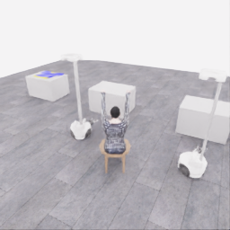
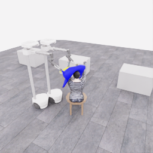
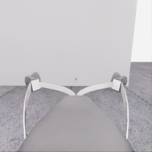
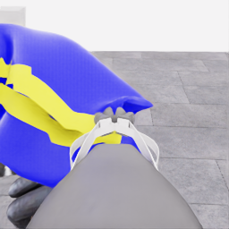
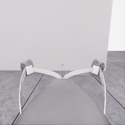
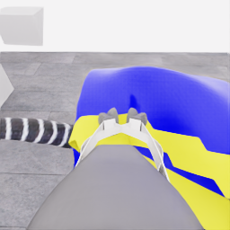
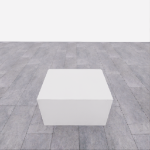
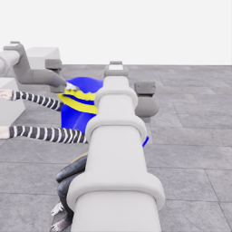
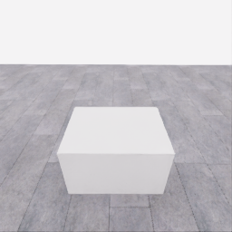
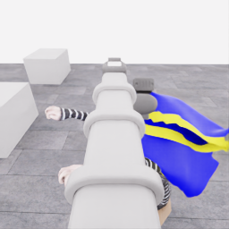

# 자동 시연 수집 시도 · 20261107-astra-progress787-named-001

[전체 수집 기록](../../README.ko.md) · [구조화 요약](manifest.json) · [전체 행동 기록](decisions.jsonl) · [사용한 기본 프롬프트](prompt.txt)

실행 상태는 **completed**, 원본 출처는 `gpt`입니다. 완료 상태와 과제 성공은 아래에서 따로 기록합니다.

## 실행 조건과 시간

| 항목 | 기록 |
|---|---|
| 기록 시작 UTC | 2026-11-07T03:30:54Z |
| 기록 종료 UTC | 2026-11-07T04:02:40Z |
| 이전 시도 | 20261106-astra-guide470-depth-001 |
| 재시도 사유 | task_progress_after_information_probe_stopped_before_entry |
| 출처 그룹 | 20261106-coordinated-demo-methods |
| 요청 모델 / 추론 설정 | gpt-6-astra / ultra |
| 전체 실제 경과 시간 (초) | 1906.180 |
| Actor 호출 합계 (초) | 821.402 |
| 환경 요청·응답 합계 (초) | 1031.865 |
| 시뮬레이션 시간 (초) | 59.000 |
| 저장 전이 수 | 1180.000 |
| 응답 확인 전이 수 | 1180.000 |
| 모델 호출 시도 수 | 18.000 |
| 완료한 결정 구간 수 | 18.000 |
| 파일 완료 상태 | true |
| 데이터 정합성 검사 | true |
| 학습 데이터 승인 | unreviewed |
| Actor 호출 방식 | exec |
| 한 호출의 최대 계획 구간 수 | 1.000 |
| 한 계획의 최대 제어 step 수 | 20.000 |
| 제어기 정착 대기 설정 | true |
| 정착 대기 요청 step 수 | 6.000 |
| 완료한 제어기 정착 구간 수 | 18.000 |
| 제어기 정착 전이 수 | 108.000 |
| 제어기 정착 환경 요청·응답 (초) | 105.483 |
| 전이 예산으로 단축한 정착 구간 수 | 0.000 |
| 전이 예산으로 건너뛴 정착 구간 수 | 0.000 |

Actor 호출 시간은 공개 입력 저장·요청 전송·응답 처리 등 호출 경로를 측정합니다. 방식에 따라 Docker/CLI 시작이 호출 안에 들어가거나 상주 서버 준비 시간으로 분리됩니다. 내부 모델 추론 시간만 별도로 측정한 값은 아닙니다. 모델이 판단하는 동안 물리 시간은 멈추며 실제 경과 시간과 시뮬레이션 시간은 다릅니다. 세부 요청 프로세스 시간에도 CLI 처리·네트워크·서버 대기·생성이 함께 포함됩니다.

## 토큰 사용량의 범위

`actor_usage`는 thread별 관측 누계를 합친 값입니다. 결정의 `usage`는 원본 CLI 누계이며, 호출별 증가량은 `usage_accounting.incremental_usage`입니다. 캐시 입력은 입력의 부분집합이고 추론 출력은 출력의 부분집합이므로 열들을 다시 합산하지 않습니다.

전체 호출 사용량 확정: **true** · 기록한 호출 수: 18.

| 입력 | 캐시 입력 | 캐시 쓰기 입력 | 출력 | 추론 출력 |
|---:|---:|---:|---:|---:|
| 1974144 | 1777152 | 0 | 23284 | 19009 |

중복 누계는 추가 사용량 0으로 처리하고, 역행한 누계는 미확정으로 보존합니다. 새 thread는 별도로 집계합니다. 토큰 기록은 화폐 비용이나 청구서가 아닙니다.

## 리뷰 정지 조건

목표 누적 점수 10.000 · 감시 상태 `collector_ended_before_gate` · 수집기 상태 `completed`.

마지막 관측 점수 5.000 · 응답 확인 step 1179.

`review_ready`는 정지 조건에 따라 실행을 마치고 리뷰할 준비가 된 상태입니다. 50점·착의 성공이나 학습 데이터 승인을 뜻하지 않습니다. 공식 점수와 success는 아래 평가 결과로 확인합니다.

## 공식 평가 결과

평가 유효성 `true` · 누적 점수 **5.000 / 50** · 착의 success **false** · rate 상태 `no_dressing_points` · 최종 rate 0.000 points/s.

누적 50점, 착의 success, 정상 파일 종료와 데이터 정합성은 서로 다른 상태입니다. 접촉 전 `no_contact`의 rate는 0점/초로 바꾸지 않습니다.

| 단계 | 획득 점수 / 최대 | 획득 시각 (episode 초) |
|---|---:|---:|
| 파지·들기 | 5.000 / 5 | 27.150 |
| 첫 소매 | 0.000 / 5 | 미측정/해당 없음 |
| 반대 어깨 | 0.000 / 5 | 미측정/해당 없음 |
| 두 번째 소매 | 0.000 / 5 | 미측정/해당 없음 |
| 왼쪽 위팔 | 0.000 / 5 | 미측정/해당 없음 |
| 오른쪽 위팔 | 0.000 / 5 | 미측정/해당 없음 |
| 목 통과 | 0.000 / 10 | 미측정/해당 없음 |
| 앞면 방향 | 0.000 / 10 | 미측정/해당 없음 |

## 단계 획득 경로

점수 획득은 [평가 이벤트](score-events.jsonl)에서 같은 physics tick끼리 묶었습니다. 같은 시각에 인정된 항목의 내부 순서는 추정하지 않습니다. 착의 success는 점수 획득과 별도로 기록합니다.

| 순서 | episode 시간 (초) | 전이 경계 step | 누적 점수 변화 | 같은 시각의 항목 변화 |
|---:|---:|---:|---:|---|
| 0 | 27.150 | 543 | 0.000→5.000 | 파지·들기 0.000→5.000 |

평가 clock 0초에 대응하는 공개 simulation clock은 1.525초입니다. 두 시계를 같은 절대 시각으로 혼동하지 않습니다.

별도 success 이벤트 수: **0**. 평가 유효성: `true`.


## 원본 관측 화면

지정된 공개 카메라의 저장 RGB 픽셀입니다. 시작은 첫 `obs`, 종료는 마지막 `next_obs`입니다. 이미지 합성이나 내부 상태 기반 장면 재구성 없이 원본 픽셀로 PNG를 저장했습니다.

| 카메라 | 시작 | 종료 |
|---|---|---|
| `overview` | [](images/initial-overview.png) | [](images/final-overview.png) |
| `robot_0_wrist` | [](images/initial-robot_0_wrist.png) | [](images/final-robot_0_wrist.png) |
| `robot_1_wrist` | [](images/initial-robot_1_wrist.png) | [](images/final-robot_1_wrist.png) |
| `robot_0_head` | [](images/initial-robot_0_head.png) | [](images/final-robot_0_head.png) |
| `robot_1_head` | [](images/initial-robot_1_head.png) | [](images/final-robot_1_head.png) |

시작 관측 시각 1.525초 · 종료 관측 시각 60.525초 (공개 simulation clock).

[▶ overview 관측 영상 보기](overview.mp4)

저장된 20 Hz `obs` 중 1180프레임을 순서대로 사용했습니다. 재생은 **1배 느리게** (20.000 fps), 실제 대기 시간·모델 호출 지연은 영상에 들어가지 않습니다. 종료 `next_obs`는 위 PNG에서 확인합니다.

## 결정과 실행 순서

아래 근거는 모델 최종 JSON의 짧은 행동 설명입니다. 시각적 평가는 행동 전 관측에 대한 판단이며, 그 행동의 실행 후 성공 라벨로 사용하지 않습니다. 공식 점수는 별도의 평가 결과입니다.

행동의 각 행은 로봇 0·1 순서이며 열은 `전진, 왼쪽 이동, 반시계 회전, 리프트, 팔 신장, 손목 yaw, pitch, roll, gripper`입니다. 앞 8개는 정규화 속도이고 gripper는 닫기 `+1`, 열기 `-1`, 의도 유지 `0`입니다.

제어기 정착 대기는 앞선 모델 결정에 연결된 별도 중립 행동입니다. 추가 모델 호출이나 모델 결정으로 집계하지 않으며, 실제 전이와 환경 요청·응답 시간은 전체 합계에 포함됩니다. 중립 행동은 두 로봇의 속도와 gripper 명령을 모두 0으로 보내 기존 gripper 의도를 유지합니다. 대기를 실행했다는 기록이 옷의 정착이나 과제 개선을 확인했다는 뜻은 아닙니다.

### 기록된 행동의 재실행 구간

원본 `20261106-astra-guide470-depth-001`의 행동 787전이를 새 환경에서 다시 실행했습니다. 이 구간에는 새 모델 호출이 없고 관측·평가를 새로 기록했습니다. 정확한 물리 상태 복원이나 독립적인 새 시연으로 집계하지 않습니다. 원본 step 대응과 실제 행동은 `decisions.jsonl`의 `replayed_segment`에 있습니다.

### 별도 모델 호출 0 · `initial`

실행 결정 인덱스 0의 고정 관측을 사용했습니다. 호출 경과 43.455초. 같은 call index의 행동 기록과 사용량을 중복 합산하지 않습니다.

공개 입력 저장 0.229초 · 요청 프로세스 43.226초 · 결과 해석 0.000초.

### 결정 0 · 첫 소매 · `act`

입력 관측 40.875초 · Actor 호출 43.455초 · 시각적 판단 `uncertain`.

계획 `20261107-astra-progress787-named-001:call-00000` · 모델 호출 인덱스 0 · 계획 구간 1/1 · 이 구간에서 모델 호출 `true`.

실행 직전 최신 관측 40.875초.

공개 입력 저장 0.229초 · 요청 프로세스 43.226초 · 결과 해석 0.000초.

호출 사용량 상태 `observed` · 이번 증가량 입력 22237 / 출력 1255 토큰.

최종 응답의 행동 설명: Robot 0 appears to support the near-hand edge and robot 1 the opposite edge. The candidate body opening remains short of the lower visible hand. With lifts near their targets, advance both bases approximately 0.15 m while preserving separation and grips, testing a body-opening approach; entry remains unconfirmed.

요청 행동:

```json
[[0.25, 0, 0, 0, 0, 0, 0, 0, 0], [0.25, 0, 0, 0, 0, 0, 0, 0, 0]]
```

실행 구간 step **[787, 807)** · 요청 20 step / 실제 20 step · 환경 요청·응답 15.917초.

실제 적용 행동:

```json
[[0.25, 0.0, 0.0, 0.0, 0.0, 0.0, 0.0, 0.0, 0.0], [0.25, 0.0, 0.0, 0.0, 0.0, 0.0, 0.0, 0.0, 0.0]]
```

### 제어기 정착 대기 · 연결 결정 0

구간 `20261107-astra-progress787-named-001:settle-00000` · 출처 `controller_settle` · 이 구간에서 모델 호출 `false`.

앞선 모델 호출 인덱스 0에 연결됩니다. 추가 호출은 없습니다.

실행 구간 step **[807, 813)** · 요청 6 step / 실제 6 step · 환경 요청·응답 5.165초.

공개 simulation clock 41.875→42.175초 · 실행 전 관측 41.875초.

실제 적용 중립 행동:

```json
[[0.0, 0.0, 0.0, 0.0, 0.0, 0.0, 0.0, 0.0, 0.0], [0.0, 0.0, 0.0, 0.0, 0.0, 0.0, 0.0, 0.0, 0.0]]
```

### 별도 모델 호출 1 · `initial`

실행 결정 인덱스 1의 고정 관측을 사용했습니다. 호출 경과 32.045초. 같은 call index의 행동 기록과 사용량을 중복 합산하지 않습니다.

공개 입력 저장 0.086초 · 요청 프로세스 31.959초 · 결과 해석 0.000초.

### 결정 1 · 첫 소매 · `act`

입력 관측 42.175초 · Actor 호출 32.045초 · 시각적 판단 `progressing`.

계획 `20261107-astra-progress787-named-001:call-00001` · 모델 호출 인덱스 1 · 계획 구간 1/1 · 이 구간에서 모델 호출 `true`.

실행 직전 최신 관측 42.175초.

공개 입력 저장 0.086초 · 요청 프로세스 31.959초 · 결과 해석 0.000초.

호출 사용량 상태 `observed` · 이번 증가량 입력 32586 / 출력 887 토큰.

최종 응답의 행동 설명: Robot 0 retains the near-hand edge and robot 1 the opposite support visually. Both bases advanced about 0.153 m; cloth appears to have followed, reducing the lower-hand-to-rim gap. Advance together another approximately 0.09 m toward candidate body-opening entry, preserving height and separation; passage is unconfirmed.

요청 행동:

```json
[[0.18, 0, 0, 0, 0, 0, 0, 0, 0], [0.18, 0, 0, 0, 0, 0, 0, 0, 0]]
```

실행 구간 step **[813, 829)** · 요청 16 step / 실제 16 step · 환경 요청·응답 11.879초.

실제 적용 행동:

```json
[[0.18000000715255737, 0.0, 0.0, 0.0, 0.0, 0.0, 0.0, 0.0, 0.0], [0.18000000715255737, 0.0, 0.0, 0.0, 0.0, 0.0, 0.0, 0.0, 0.0]]
```

### 제어기 정착 대기 · 연결 결정 1

구간 `20261107-astra-progress787-named-001:settle-00001` · 출처 `controller_settle` · 이 구간에서 모델 호출 `false`.

앞선 모델 호출 인덱스 1에 연결됩니다. 추가 호출은 없습니다.

실행 구간 step **[829, 835)** · 요청 6 step / 실제 6 step · 환경 요청·응답 4.760초.

공개 simulation clock 42.975→43.275초 · 실행 전 관측 42.975초.

실제 적용 중립 행동:

```json
[[0.0, 0.0, 0.0, 0.0, 0.0, 0.0, 0.0, 0.0, 0.0], [0.0, 0.0, 0.0, 0.0, 0.0, 0.0, 0.0, 0.0, 0.0]]
```

### 별도 모델 호출 2 · `initial`

실행 결정 인덱스 2의 고정 관측을 사용했습니다. 호출 경과 44.009초. 같은 call index의 행동 기록과 사용량을 중복 합산하지 않습니다.

공개 입력 저장 0.082초 · 요청 프로세스 43.927초 · 결과 해석 0.000초.

### 결정 2 · 첫 소매 · `act`

입력 관측 43.275초 · Actor 호출 44.009초 · 시각적 판단 `progressing`.

계획 `20261107-astra-progress787-named-001:call-00002` · 모델 호출 인덱스 2 · 계획 구간 1/1 · 이 구간에서 모델 호출 `true`.

실행 직전 최신 관측 43.275초.

공개 입력 저장 0.082초 · 요청 프로세스 43.927초 · 결과 해석 0.000초.

호출 사용량 상태 `observed` · 이번 증가량 입력 42576 / 출력 1260 토큰.

최종 응답의 행동 설명: Robot 0 and robot 1 still appear to support opposite edges. The measured 0.088 m advance brought the lower hand into projected rim overlap, but entry remains uncertain. Pitch both wrists approximately 0.33 rad toward level, intending to raise the candidate body-opening rim around that same hand while preserving bilateral support.

요청 행동:

```json
[[0, 0, 0, 0, 0, 0, -0.1, 0, 0], [0, 0, 0, 0, 0, 0, -0.1, 0, 0]]
```

실행 구간 step **[835, 847)** · 요청 12 step / 실제 12 step · 환경 요청·응답 8.994초.

실제 적용 행동:

```json
[[0.0, 0.0, 0.0, 0.0, 0.0, 0.0, -0.10000000149011612, 0.0, 0.0], [0.0, 0.0, 0.0, 0.0, 0.0, 0.0, -0.10000000149011612, 0.0, 0.0]]
```

### 제어기 정착 대기 · 연결 결정 2

구간 `20261107-astra-progress787-named-001:settle-00002` · 출처 `controller_settle` · 이 구간에서 모델 호출 `false`.

앞선 모델 호출 인덱스 2에 연결됩니다. 추가 호출은 없습니다.

실행 구간 step **[847, 853)** · 요청 6 step / 실제 6 step · 환경 요청·응답 4.713초.

공개 simulation clock 43.875→44.175초 · 실행 전 관측 43.875초.

실제 적용 중립 행동:

```json
[[0.0, 0.0, 0.0, 0.0, 0.0, 0.0, 0.0, 0.0, 0.0], [0.0, 0.0, 0.0, 0.0, 0.0, 0.0, 0.0, 0.0, 0.0]]
```

### 별도 모델 호출 3 · `initial`

실행 결정 인덱스 3의 고정 관측을 사용했습니다. 호출 경과 62.928초. 같은 call index의 행동 기록과 사용량을 중복 합산하지 않습니다.

공개 입력 저장 0.071초 · 요청 프로세스 62.857초 · 결과 해석 0.000초.

### 결정 3 · 첫 소매 · `act`

입력 관측 44.175초 · Actor 호출 62.928초 · 시각적 판단 `uncertain`.

계획 `20261107-astra-progress787-named-001:call-00003` · 모델 호출 인덱스 3 · 계획 구간 1/1 · 이 구간에서 모델 호출 `true`.

실행 직전 최신 관측 44.175초.

공개 입력 저장 0.071초 · 요청 프로세스 62.857초 · 결과 해석 0.000초.

호출 사용량 상태 `observed` · 이번 증가량 입력 52520 / 출력 1781 토큰.

최종 응답의 행동 설명: Robot 0 and robot 1 retain apparent opposite-edge support. Pitching raised both grasps 0.082 m and lifted the cloth, but obscured the tracked hand without proving entry. Test a downward approach along the forearm toward the torso: advance about 0.074 m and lower about 0.06 m, allowing for the remaining small upward pitch-following motion.

요청 행동:

```json
[[0.15, 0, 0, -0.05, 0, 0, 0, 0, 0], [0.15, 0, 0, -0.05, 0, 0, 0, 0, 0]]
```

실행 구간 step **[853, 869)** · 요청 16 step / 실제 16 step · 환경 요청·응답 12.228초.

실제 적용 행동:

```json
[[0.15000000596046448, 0.0, 0.0, -0.05000000074505806, 0.0, 0.0, 0.0, 0.0, 0.0], [0.15000000596046448, 0.0, 0.0, -0.05000000074505806, 0.0, 0.0, 0.0, 0.0, 0.0]]
```

### 제어기 정착 대기 · 연결 결정 3

구간 `20261107-astra-progress787-named-001:settle-00003` · 출처 `controller_settle` · 이 구간에서 모델 호출 `false`.

앞선 모델 호출 인덱스 3에 연결됩니다. 추가 호출은 없습니다.

실행 구간 step **[869, 875)** · 요청 6 step / 실제 6 step · 환경 요청·응답 5.160초.

공개 simulation clock 44.975→45.275초 · 실행 전 관측 44.975초.

실제 적용 중립 행동:

```json
[[0.0, 0.0, 0.0, 0.0, 0.0, 0.0, 0.0, 0.0, 0.0], [0.0, 0.0, 0.0, 0.0, 0.0, 0.0, 0.0, 0.0, 0.0]]
```

### 별도 모델 호출 4 · `initial`

실행 결정 인덱스 4의 고정 관측을 사용했습니다. 호출 경과 33.786초. 같은 call index의 행동 기록과 사용량을 중복 합산하지 않습니다.

공개 입력 저장 0.073초 · 요청 프로세스 33.713초 · 결과 해석 0.000초.

### 결정 4 · 방향 · `act`

입력 관측 45.275초 · Actor 호출 33.786초 · 시각적 판단 `recovering`.

계획 `20261107-astra-progress787-named-001:call-00004` · 모델 호출 인덱스 4 · 계획 구간 1/1 · 이 구간에서 모델 호출 `true`.

실행 직전 최신 관측 45.275초.

공개 입력 저장 0.073초 · 요청 프로세스 33.713초 · 결과 해석 0.000초.

호출 사용량 상태 `observed` · 이번 증가량 입력 62954 / 출력 951 토큰.

최종 응답의 행동 설명: Robot 0 and robot 1 retain apparent edge support. The advance and descent executed, but rim folding increased and the tracked hand remains hidden. Pitch both wrists downward about 0.20 rad, compensating with 0.055 m lift and 0.022 m extension to approximately preserve edge positions while testing whether the candidate body opening unfolds.

요청 행동:

```json
[[0, 0, 0, 0.06, 0.03, 0, 0.06, 0, 0], [0, 0, 0, 0.06, 0.03, 0, 0.06, 0, 0]]
```

실행 구간 step **[875, 887)** · 요청 12 step / 실제 12 step · 환경 요청·응답 9.615초.

실제 적용 행동:

```json
[[0.0, 0.0, 0.0, 0.05999999865889549, 0.029999999329447746, 0.0, 0.05999999865889549, 0.0, 0.0], [0.0, 0.0, 0.0, 0.05999999865889549, 0.029999999329447746, 0.0, 0.05999999865889549, 0.0, 0.0]]
```

### 제어기 정착 대기 · 연결 결정 4

구간 `20261107-astra-progress787-named-001:settle-00004` · 출처 `controller_settle` · 이 구간에서 모델 호출 `false`.

앞선 모델 호출 인덱스 4에 연결됩니다. 추가 호출은 없습니다.

실행 구간 step **[887, 893)** · 요청 6 step / 실제 6 step · 환경 요청·응답 5.002초.

공개 simulation clock 45.875→46.175초 · 실행 전 관측 45.875초.

실제 적용 중립 행동:

```json
[[0.0, 0.0, 0.0, 0.0, 0.0, 0.0, 0.0, 0.0, 0.0], [0.0, 0.0, 0.0, 0.0, 0.0, 0.0, 0.0, 0.0, 0.0]]
```

### 별도 모델 호출 5 · `initial`

실행 결정 인덱스 5의 고정 관측을 사용했습니다. 호출 경과 70.795초. 같은 call index의 행동 기록과 사용량을 중복 합산하지 않습니다.

공개 입력 저장 0.075초 · 요청 프로세스 70.720초 · 결과 해석 0.000초.

### 결정 5 · 첫 소매 · `act`

입력 관측 46.175초 · Actor 호출 70.795초 · 시각적 판단 `uncertain`.

계획 `20261107-astra-progress787-named-001:call-00005` · 모델 호출 인덱스 5 · 계획 구간 1/1 · 이 구간에서 모델 호출 `true`.

실행 직전 최신 관측 46.175초.

공개 입력 저장 0.075초 · 요청 프로세스 70.720초 · 결과 해석 0.000초.

호출 사용량 상태 `observed` · 이번 증가량 입력 72745 / 출력 2103 토큰.

최종 응답의 행동 설명: Robot 0 and robot 1 retain apparent opposite-edge support. Reorientation approximately preserved grasp positions and restored the farther forearm view; tracked-hand entry remains obscured. The visible forearm runs toward the torso to camera-right. Shift both robots about 0.10 m local-right, 0.02 m forward and 0.037 m down to test garment travel along that direction.

요청 행동:

```json
[[0.04, -0.2, 0, -0.03, 0, 0, 0, 0, 0], [0.04, -0.2, 0, -0.03, 0, 0, 0, 0, 0]]
```

실행 구간 step **[893, 909)** · 요청 16 step / 실제 16 step · 환경 요청·응답 13.073초.

실제 적용 행동:

```json
[[0.03999999910593033, -0.20000000298023224, 0.0, -0.029999999329447746, 0.0, 0.0, 0.0, 0.0, 0.0], [0.03999999910593033, -0.20000000298023224, 0.0, -0.029999999329447746, 0.0, 0.0, 0.0, 0.0, 0.0]]
```

### 제어기 정착 대기 · 연결 결정 5

구간 `20261107-astra-progress787-named-001:settle-00005` · 출처 `controller_settle` · 이 구간에서 모델 호출 `false`.

앞선 모델 호출 인덱스 5에 연결됩니다. 추가 호출은 없습니다.

실행 구간 step **[909, 915)** · 요청 6 step / 실제 6 step · 환경 요청·응답 5.646초.

공개 simulation clock 46.975→47.275초 · 실행 전 관측 46.975초.

실제 적용 중립 행동:

```json
[[0.0, 0.0, 0.0, 0.0, 0.0, 0.0, 0.0, 0.0, 0.0], [0.0, 0.0, 0.0, 0.0, 0.0, 0.0, 0.0, 0.0, 0.0]]
```

### 별도 모델 호출 6 · `initial`

실행 결정 인덱스 6의 고정 관측을 사용했습니다. 호출 경과 60.529초. 같은 call index의 행동 기록과 사용량을 중복 합산하지 않습니다.

공개 입력 저장 0.079초 · 요청 프로세스 60.450초 · 결과 해석 0.000초.

### 결정 6 · 방향 · `act`

입력 관측 47.275초 · Actor 호출 60.529초 · 시각적 판단 `recovering`.

계획 `20261107-astra-progress787-named-001:call-00006` · 모델 호출 인덱스 6 · 계획 구간 1/1 · 이 구간에서 모델 호출 `true`.

실행 직전 최신 관측 47.275초.

공개 입력 저장 0.079초 · 요청 프로세스 60.450초 · 결과 해석 0.000초.

호출 사용량 상태 `observed` · 이번 증가량 입력 83694 / 출력 1568 토큰.

최종 응답의 행동 설명: Robot 0 retains the torso-side edge; robot 1 retains the opposite support. The approximately 0.10 m lateral shift executed, but the tracked hand remains hidden and the rim looks flatter. Lower robot 0&#x27;s edge about 0.10 m while robot 1 holds height, tilting the candidate body opening to test alignment with the descending forearm and expose its relationship to the rim.

요청 행동:

```json
[[0, 0, 0, -0.08, 0, 0, 0, 0, 0], [0, 0, 0, 0, 0, 0, 0, 0, 0]]
```

실행 구간 step **[915, 931)** · 요청 16 step / 실제 16 step · 환경 요청·응답 13.713초.

실제 적용 행동:

```json
[[0.0, 0.0, 0.0, -0.07999999821186066, 0.0, 0.0, 0.0, 0.0, 0.0], [0.0, 0.0, 0.0, 0.0, 0.0, 0.0, 0.0, 0.0, 0.0]]
```

### 제어기 정착 대기 · 연결 결정 6

구간 `20261107-astra-progress787-named-001:settle-00006` · 출처 `controller_settle` · 이 구간에서 모델 호출 `false`.

앞선 모델 호출 인덱스 6에 연결됩니다. 추가 호출은 없습니다.

실행 구간 step **[931, 937)** · 요청 6 step / 실제 6 step · 환경 요청·응답 5.107초.

공개 simulation clock 48.075→48.375초 · 실행 전 관측 48.075초.

실제 적용 중립 행동:

```json
[[0.0, 0.0, 0.0, 0.0, 0.0, 0.0, 0.0, 0.0, 0.0], [0.0, 0.0, 0.0, 0.0, 0.0, 0.0, 0.0, 0.0, 0.0]]
```

### 별도 모델 호출 7 · `initial`

실행 결정 인덱스 7의 고정 관측을 사용했습니다. 호출 경과 61.793초. 같은 call index의 행동 기록과 사용량을 중복 합산하지 않습니다.

공개 입력 저장 0.081초 · 요청 프로세스 61.712초 · 결과 해석 0.000초.

### 결정 7 · 방향 · `act`

입력 관측 48.375초 · Actor 호출 61.793초 · 시각적 판단 `recovering`.

계획 `20261107-astra-progress787-named-001:call-00007` · 모델 호출 인덱스 7 · 계획 구간 1/1 · 이 구간에서 모델 호출 `true`.

실행 직전 최신 관측 48.375초.

공개 입력 저장 0.081초 · 요청 프로세스 61.712초 · 결과 해석 0.000초.

호출 사용량 상태 `observed` · 이번 증가량 입력 94139 / 출력 1779 토큰.

최종 응답의 행동 설명: Robot 0 lowered its supported edge 0.095 m; robot 1 maintained the higher edge. The rim tilted, but tracked-hand passage remains obscured. Reorient the held span toward the diagonal forearm direction: move robot 0 forward-left and robot 1 backward-right, approximately 0.11 m fore-aft and 0.043 m laterally each, preserving grips and avoiding increased span tension.

요청 행동:

```json
[[0.18, 0.07, 0, 0, 0, 0, 0, 0, 0], [-0.18, -0.07, 0, 0, 0, 0, 0, 0, 0]]
```

실행 구간 step **[937, 957)** · 요청 20 step / 실제 20 step · 환경 요청·응답 16.988초.

실제 적용 행동:

```json
[[0.18000000715255737, 0.07000000029802322, 0.0, 0.0, 0.0, 0.0, 0.0, 0.0, 0.0], [-0.18000000715255737, -0.07000000029802322, 0.0, 0.0, 0.0, 0.0, 0.0, 0.0, 0.0]]
```

### 제어기 정착 대기 · 연결 결정 7

구간 `20261107-astra-progress787-named-001:settle-00007` · 출처 `controller_settle` · 이 구간에서 모델 호출 `false`.

앞선 모델 호출 인덱스 7에 연결됩니다. 추가 호출은 없습니다.

실행 구간 step **[957, 963)** · 요청 6 step / 실제 6 step · 환경 요청·응답 5.648초.

공개 simulation clock 49.375→49.675초 · 실행 전 관측 49.375초.

실제 적용 중립 행동:

```json
[[0.0, 0.0, 0.0, 0.0, 0.0, 0.0, 0.0, 0.0, 0.0], [0.0, 0.0, 0.0, 0.0, 0.0, 0.0, 0.0, 0.0, 0.0]]
```

### 별도 모델 호출 8 · `initial`

실행 결정 인덱스 8의 고정 관측을 사용했습니다. 호출 경과 72.410초. 같은 call index의 행동 기록과 사용량을 중복 합산하지 않습니다.

공개 입력 저장 0.082초 · 요청 프로세스 72.328초 · 결과 해석 0.000초.

### 결정 8 · 방향 · `act`

입력 관측 49.675초 · Actor 호출 72.410초 · 시각적 판단 `recovering`.

계획 `20261107-astra-progress787-named-001:call-00008` · 모델 호출 인덱스 8 · 계획 구간 1/1 · 이 구간에서 모델 호출 `true`.

실행 직전 최신 관측 49.675초.

공개 입력 저장 0.082초 · 요청 프로세스 72.328초 · 결과 해석 0.000초.

호출 사용량 상태 `observed` · 이번 증가량 입력 104838 / 출력 2119 토큰.

최종 응답의 행동 설명: Robot 0 and robot 1 still visibly support their edges, and the span rotated with them. The exposed rim appears angled opposite the hand-to-torso direction. Reverse the fore-aft stagger with approximately 0.216 m backward travel for robot 0 and forward travel for robot 1, keeping heights and grips unchanged to redirect the candidate body opening toward the forearm.

요청 행동:

```json
[[-0.35, 0, 0, 0, 0, 0, 0, 0, 0], [0.35, 0, 0, 0, 0, 0, 0, 0, 0]]
```

실행 구간 step **[963, 983)** · 요청 20 step / 실제 20 step · 환경 요청·응답 17.274초.

실제 적용 행동:

```json
[[-0.3499999940395355, 0.0, 0.0, 0.0, 0.0, 0.0, 0.0, 0.0, 0.0], [0.3499999940395355, 0.0, 0.0, 0.0, 0.0, 0.0, 0.0, 0.0, 0.0]]
```

### 제어기 정착 대기 · 연결 결정 8

구간 `20261107-astra-progress787-named-001:settle-00008` · 출처 `controller_settle` · 이 구간에서 모델 호출 `false`.

앞선 모델 호출 인덱스 8에 연결됩니다. 추가 호출은 없습니다.

실행 구간 step **[983, 989)** · 요청 6 step / 실제 6 step · 환경 요청·응답 5.280초.

공개 simulation clock 50.675→50.975초 · 실행 전 관측 50.675초.

실제 적용 중립 행동:

```json
[[0.0, 0.0, 0.0, 0.0, 0.0, 0.0, 0.0, 0.0, 0.0], [0.0, 0.0, 0.0, 0.0, 0.0, 0.0, 0.0, 0.0, 0.0]]
```

### 별도 모델 호출 9 · `initial`

실행 결정 인덱스 9의 고정 관측을 사용했습니다. 호출 경과 41.958초. 같은 call index의 행동 기록과 사용량을 중복 합산하지 않습니다.

공개 입력 저장 0.083초 · 요청 프로세스 41.875초 · 결과 해석 0.000초.

### 결정 9 · 첫 소매 · `act`

입력 관측 50.975초 · Actor 호출 41.958초 · 시각적 판단 `progressing`.

계획 `20261107-astra-progress787-named-001:call-00009` · 모델 호출 인덱스 9 · 계획 구간 1/1 · 이 구간에서 모델 호출 `true`.

실행 직전 최신 관측 50.975초.

공개 입력 저장 0.083초 · 요청 프로세스 41.875초 · 결과 해석 0.000초.

호출 사용량 상태 `observed` · 이번 증가량 입력 115905 / 출력 1201 토큰.

최종 응답의 행동 설명: Robot 0 retains the lower edge and robot 1 the higher edge. Reversing the stagger moved the cloth and exposed a hand just above robot 1&#x27;s rim; passage remains unconfirmed. Move both supports approximately 0.089 m local-right, 0.035 m forward and 0.031 m down, testing garment travel along the visible forearm toward the torso while retaining the opening&#x27;s new orientation.

요청 행동:

```json
[[0.07, -0.18, 0, -0.025, 0, 0, 0, 0, 0], [0.07, -0.18, 0, -0.025, 0, 0, 0, 0, 0]]
```

실행 구간 step **[989, 1005)** · 요청 16 step / 실제 16 step · 환경 요청·응답 13.408초.

실제 적용 행동:

```json
[[0.07000000029802322, -0.18000000715255737, 0.0, -0.02500000037252903, 0.0, 0.0, 0.0, 0.0, 0.0], [0.07000000029802322, -0.18000000715255737, 0.0, -0.02500000037252903, 0.0, 0.0, 0.0, 0.0, 0.0]]
```

### 제어기 정착 대기 · 연결 결정 9

구간 `20261107-astra-progress787-named-001:settle-00009` · 출처 `controller_settle` · 이 구간에서 모델 호출 `false`.

앞선 모델 호출 인덱스 9에 연결됩니다. 추가 호출은 없습니다.

실행 구간 step **[1005, 1011)** · 요청 6 step / 실제 6 step · 환경 요청·응답 5.799초.

공개 simulation clock 51.775→52.075초 · 실행 전 관측 51.775초.

실제 적용 중립 행동:

```json
[[0.0, 0.0, 0.0, 0.0, 0.0, 0.0, 0.0, 0.0, 0.0], [0.0, 0.0, 0.0, 0.0, 0.0, 0.0, 0.0, 0.0, 0.0]]
```

### 별도 모델 호출 10 · `initial`

실행 결정 인덱스 10의 고정 관측을 사용했습니다. 호출 경과 51.273초. 같은 call index의 행동 기록과 사용량을 중복 합산하지 않습니다.

공개 입력 저장 0.085초 · 요청 프로세스 51.188초 · 결과 해석 0.000초.

### 결정 10 · 첫 소매 · `act`

입력 관측 52.075초 · Actor 호출 51.273초 · 시각적 판단 `progressing`.

계획 `20261107-astra-progress787-named-001:call-00010` · 모델 호출 인덱스 10 · 계획 구간 1/1 · 이 구간에서 모델 호출 `true`.

실행 직전 최신 관측 52.075초.

공개 입력 저장 0.085초 · 요청 프로세스 51.188초 · 결과 해석 0.000초.

호출 사용량 상태 `observed` · 이번 증가량 입력 126067 / 출력 1491 토큰.

최종 응답의 행동 설명: Robot 0 retains the lower support and robot 1 the higher rim. Cloth followed the diagonal movement, and robot 1&#x27;s rim now projects nearer the wrist/forearm than the hand; sleeve passage is unconfirmed. Advance together about 0.099 m forward, 0.059 m local-right and 0.031 m down to reduce the remaining forearm-to-opening gap and continue toward the torso.

요청 행동:

```json
[[0.2, -0.12, 0, -0.025, 0, 0, 0, 0, 0], [0.2, -0.12, 0, -0.025, 0, 0, 0, 0, 0]]
```

실행 구간 step **[1011, 1027)** · 요청 16 step / 실제 16 step · 환경 요청·응답 15.253초.

실제 적용 행동:

```json
[[0.20000000298023224, -0.11999999731779099, 0.0, -0.02500000037252903, 0.0, 0.0, 0.0, 0.0, 0.0], [0.20000000298023224, -0.11999999731779099, 0.0, -0.02500000037252903, 0.0, 0.0, 0.0, 0.0, 0.0]]
```

### 제어기 정착 대기 · 연결 결정 10

구간 `20261107-astra-progress787-named-001:settle-00010` · 출처 `controller_settle` · 이 구간에서 모델 호출 `false`.

앞선 모델 호출 인덱스 10에 연결됩니다. 추가 호출은 없습니다.

실행 구간 step **[1027, 1033)** · 요청 6 step / 실제 6 step · 환경 요청·응답 6.133초.

공개 simulation clock 52.875→53.175초 · 실행 전 관측 52.875초.

실제 적용 중립 행동:

```json
[[0.0, 0.0, 0.0, 0.0, 0.0, 0.0, 0.0, 0.0, 0.0], [0.0, 0.0, 0.0, 0.0, 0.0, 0.0, 0.0, 0.0, 0.0]]
```

### 별도 모델 호출 11 · `initial`

실행 결정 인덱스 11의 고정 관측을 사용했습니다. 호출 경과 57.335초. 같은 call index의 행동 기록과 사용량을 중복 합산하지 않습니다.

공개 입력 저장 0.086초 · 요청 프로세스 57.250초 · 결과 해석 0.000초.

### 결정 11 · 첫 소매 · `act`

입력 관측 53.175초 · Actor 호출 57.335초 · 시각적 판단 `uncertain`.

계획 `20261107-astra-progress787-named-001:call-00011` · 모델 호출 인덱스 11 · 계획 구간 1/1 · 이 구간에서 모델 호출 `true`.

실행 직전 최신 관측 53.175초.

공개 입력 저장 0.086초 · 요청 프로세스 57.250초 · 결과 해석 0.000초.

호출 사용량 상태 `observed` · 이번 증가량 입력 136521 / 출력 1522 토큰.

최종 응답의 행동 설명: Robot 0 retains the lower support; robot 1&#x27;s supported rim now lies close to the visible forearm in depth after the advance. The yellow rim has folded, so entry remains uncertain. Hold robot 0 steady and raise robot 1&#x27;s edge approximately 0.062 m to test lifting the candidate body-opening lip over that forearm.

요청 행동:

```json
[[0, 0, 0, 0, 0, 0, 0, 0, 0], [0, 0, 0, 0.05, 0, 0, 0, 0, 0]]
```

실행 구간 step **[1033, 1049)** · 요청 16 step / 실제 16 step · 환경 요청·응답 16.072초.

실제 적용 행동:

```json
[[0.0, 0.0, 0.0, 0.0, 0.0, 0.0, 0.0, 0.0, 0.0], [0.0, 0.0, 0.0, 0.05000000074505806, 0.0, 0.0, 0.0, 0.0, 0.0]]
```

### 제어기 정착 대기 · 연결 결정 11

구간 `20261107-astra-progress787-named-001:settle-00011` · 출처 `controller_settle` · 이 구간에서 모델 호출 `false`.

앞선 모델 호출 인덱스 11에 연결됩니다. 추가 호출은 없습니다.

실행 구간 step **[1049, 1055)** · 요청 6 step / 실제 6 step · 환경 요청·응답 6.339초.

공개 simulation clock 53.975→54.275초 · 실행 전 관측 53.975초.

실제 적용 중립 행동:

```json
[[0.0, 0.0, 0.0, 0.0, 0.0, 0.0, 0.0, 0.0, 0.0], [0.0, 0.0, 0.0, 0.0, 0.0, 0.0, 0.0, 0.0, 0.0]]
```

### 별도 모델 호출 12 · `initial`

실행 결정 인덱스 12의 고정 관측을 사용했습니다. 호출 경과 28.036초. 같은 call index의 행동 기록과 사용량을 중복 합산하지 않습니다.

공개 입력 저장 0.084초 · 요청 프로세스 27.952초 · 결과 해석 0.000초.

### 결정 12 · 첫 소매 · `act`

입력 관측 54.275초 · Actor 호출 28.036초 · 시각적 판단 `progressing`.

계획 `20261107-astra-progress787-named-001:call-00012` · 모델 호출 인덱스 12 · 계획 구간 1/1 · 이 구간에서 모델 호출 `true`.

실행 직전 최신 관측 54.275초.

공개 입력 저장 0.084초 · 요청 프로세스 27.952초 · 결과 해석 0.000초.

호출 사용량 상태 `observed` · 이번 증가량 입력 146997 / 출력 945 토큰.

최종 응답의 행동 설명: Robot 0 retains the lower edge; robot 1 raised its supported edge about 0.057 m. Robot 0&#x27;s head view now shows a hand at a yellow-bordered side opening, supporting an uncertain sleeve-exit hypothesis. Move both supports about 0.089 m local-right and 0.020 m forward, lowering roughly 0.02 m to advance the garment along the forearm toward the shoulder.

요청 행동:

```json
[[0.04, -0.18, 0, -0.015, 0, 0, 0, 0, 0], [0.04, -0.18, 0, -0.02, 0, 0, 0, 0, 0]]
```

실행 구간 step **[1055, 1071)** · 요청 16 step / 실제 16 step · 환경 요청·응답 16.691초.

실제 적용 행동:

```json
[[0.03999999910593033, -0.18000000715255737, 0.0, -0.014999999664723873, 0.0, 0.0, 0.0, 0.0, 0.0], [0.03999999910593033, -0.18000000715255737, 0.0, -0.019999999552965164, 0.0, 0.0, 0.0, 0.0, 0.0]]
```

### 제어기 정착 대기 · 연결 결정 12

구간 `20261107-astra-progress787-named-001:settle-00012` · 출처 `controller_settle` · 이 구간에서 모델 호출 `false`.

앞선 모델 호출 인덱스 12에 연결됩니다. 추가 호출은 없습니다.

실행 구간 step **[1071, 1077)** · 요청 6 step / 실제 6 step · 환경 요청·응답 6.550초.

공개 simulation clock 55.075→55.375초 · 실행 전 관측 55.075초.

실제 적용 중립 행동:

```json
[[0.0, 0.0, 0.0, 0.0, 0.0, 0.0, 0.0, 0.0, 0.0], [0.0, 0.0, 0.0, 0.0, 0.0, 0.0, 0.0, 0.0, 0.0]]
```

### 별도 모델 호출 13 · `initial`

실행 결정 인덱스 13의 고정 관측을 사용했습니다. 호출 경과 36.503초. 같은 call index의 행동 기록과 사용량을 중복 합산하지 않습니다.

공개 입력 저장 0.086초 · 요청 프로세스 36.417초 · 결과 해석 0.000초.

### 결정 13 · 어깨 · `act`

입력 관측 55.375초 · Actor 호출 36.503초 · 시각적 판단 `progressing`.

계획 `20261107-astra-progress787-named-001:call-00013` · 모델 호출 인덱스 13 · 계획 구간 1/1 · 이 구간에서 모델 호출 `true`.

실행 직전 최신 관측 55.375초.

공개 입력 저장 0.086초 · 요청 프로세스 36.417초 · 결과 해석 0.000초.

호출 사용량 상태 `observed` · 이번 증가량 입력 156917 / 출력 1029 토큰.

최종 응답의 행동 설명: Robot 0 retains the lower torso-side edge and robot 1 the higher support. Both forearms now appear to extend from garment side regions, while the upper opening remains diagonal across the head/shoulder area. Raise robot 0&#x27;s edge about 0.123 m with robot 1 holding height to level the supported opening; sleeve seating and head passage remain unconfirmed.

요청 행동:

```json
[[0, 0, 0, 0.1, 0, 0, 0, 0, 0], [0, 0, 0, 0, 0, 0, 0, 0, 0]]
```

실행 구간 step **[1077, 1093)** · 요청 16 step / 실제 16 step · 환경 요청·응답 16.699초.

실제 적용 행동:

```json
[[0.0, 0.0, 0.0, 0.10000000149011612, 0.0, 0.0, 0.0, 0.0, 0.0], [0.0, 0.0, 0.0, 0.0, 0.0, 0.0, 0.0, 0.0, 0.0]]
```

### 제어기 정착 대기 · 연결 결정 13

구간 `20261107-astra-progress787-named-001:settle-00013` · 출처 `controller_settle` · 이 구간에서 모델 호출 `false`.

앞선 모델 호출 인덱스 13에 연결됩니다. 추가 호출은 없습니다.

실행 구간 step **[1093, 1099)** · 요청 6 step / 실제 6 step · 환경 요청·응답 6.744초.

공개 simulation clock 56.175→56.475초 · 실행 전 관측 56.175초.

실제 적용 중립 행동:

```json
[[0.0, 0.0, 0.0, 0.0, 0.0, 0.0, 0.0, 0.0, 0.0], [0.0, 0.0, 0.0, 0.0, 0.0, 0.0, 0.0, 0.0, 0.0]]
```

### 별도 모델 호출 14 · `initial`

실행 결정 인덱스 14의 고정 관측을 사용했습니다. 호출 경과 31.444초. 같은 call index의 행동 기록과 사용량을 중복 합산하지 않습니다.

공개 입력 저장 0.082초 · 요청 프로세스 31.362초 · 결과 해석 0.000초.

### 결정 14 · 목 · `act`

입력 관측 56.475초 · Actor 호출 31.444초 · 시각적 판단 `progressing`.

계획 `20261107-astra-progress787-named-001:call-00014` · 모델 호출 인덱스 14 · 계획 구간 1/1 · 이 구간에서 모델 호출 `true`.

실행 직전 최신 관측 56.475초.

공개 입력 저장 0.082초 · 요청 프로세스 31.362초 · 결과 해석 0.000초.

호출 사용량 상태 `observed` · 이번 증가량 입력 166840 / 출력 845 토큰.

최종 응답의 행동 설명: Robot 0 raised its supported edge 0.116 m while robot 1 maintained support, bringing the edges closer to level. The candidate neck opening remains in front of the head. Raise both lifts within remaining travel and pitch wrists toward level, targeting approximately 0.18–0.21 m of rim elevation toward the crown; head passage remains unconfirmed.

요청 행동:

```json
[[0, 0, 0, 0.06, 0, 0, -0.1, 0, 0], [0, 0, 0, 0.04, 0, 0, -0.1, 0, 0]]
```

실행 구간 step **[1099, 1115)** · 요청 16 step / 실제 16 step · 환경 요청·응답 16.877초.

실제 적용 행동:

```json
[[0.0, 0.0, 0.0, 0.05999999865889549, 0.0, 0.0, -0.10000000149011612, 0.0, 0.0], [0.0, 0.0, 0.0, 0.03999999910593033, 0.0, 0.0, -0.10000000149011612, 0.0, 0.0]]
```

### 제어기 정착 대기 · 연결 결정 14

구간 `20261107-astra-progress787-named-001:settle-00014` · 출처 `controller_settle` · 이 구간에서 모델 호출 `false`.

앞선 모델 호출 인덱스 14에 연결됩니다. 추가 호출은 없습니다.

실행 구간 step **[1115, 1121)** · 요청 6 step / 실제 6 step · 환경 요청·응답 6.690초.

공개 simulation clock 57.275→57.575초 · 실행 전 관측 57.275초.

실제 적용 중립 행동:

```json
[[0.0, 0.0, 0.0, 0.0, 0.0, 0.0, 0.0, 0.0, 0.0], [0.0, 0.0, 0.0, 0.0, 0.0, 0.0, 0.0, 0.0, 0.0]]
```

### 별도 모델 호출 15 · `initial`

실행 결정 인덱스 15의 고정 관측을 사용했습니다. 호출 경과 24.418초. 같은 call index의 행동 기록과 사용량을 중복 합산하지 않습니다.

공개 입력 저장 0.068초 · 요청 프로세스 24.350초 · 결과 해석 0.000초.

### 결정 15 · 목 · `act`

입력 관측 57.575초 · Actor 호출 24.418초 · 시각적 판단 `uncertain`.

계획 `20261107-astra-progress787-named-001:call-00015` · 모델 호출 인덱스 15 · 계획 구간 1/1 · 이 구간에서 모델 호출 `true`.

실행 직전 최신 관측 57.575초.

공개 입력 저장 0.068초 · 요청 프로세스 24.350초 · 결과 해석 0.000초.

호출 사용량 상태 `observed` · 이번 증가량 입력 176224 / 출력 679 토큰.

최종 응답의 행동 설명: Robot 0 and robot 1 retain apparent supports; their grasps rose about 0.195 m and 0.165 m, with cloth following. The overview places the head below and toward the torso side of the raised rim. Translate both supports about 0.089 m local-right and 0.030 m forward to bring the candidate neck opening over the crown, allowing remaining lift/pitch motion to settle; passage is unconfirmed.

요청 행동:

```json
[[0.06, -0.18, 0, 0, 0, 0, 0, 0, 0], [0.06, -0.18, 0, 0, 0, 0, 0, 0, 0]]
```

실행 구간 step **[1121, 1137)** · 요청 16 step / 실제 16 step · 환경 요청·응답 16.717초.

실제 적용 행동:

```json
[[0.05999999865889549, -0.18000000715255737, 0.0, 0.0, 0.0, 0.0, 0.0, 0.0, 0.0], [0.05999999865889549, -0.18000000715255737, 0.0, 0.0, 0.0, 0.0, 0.0, 0.0, 0.0]]
```

### 제어기 정착 대기 · 연결 결정 15

구간 `20261107-astra-progress787-named-001:settle-00015` · 출처 `controller_settle` · 이 구간에서 모델 호출 `false`.

앞선 모델 호출 인덱스 15에 연결됩니다. 추가 호출은 없습니다.

실행 구간 step **[1137, 1143)** · 요청 6 step / 실제 6 step · 환경 요청·응답 6.491초.

공개 simulation clock 58.375→58.675초 · 실행 전 관측 58.375초.

실제 적용 중립 행동:

```json
[[0.0, 0.0, 0.0, 0.0, 0.0, 0.0, 0.0, 0.0, 0.0], [0.0, 0.0, 0.0, 0.0, 0.0, 0.0, 0.0, 0.0, 0.0]]
```

### 별도 모델 호출 16 · `initial`

실행 결정 인덱스 16의 고정 관측을 사용했습니다. 호출 경과 28.927초. 같은 call index의 행동 기록과 사용량을 중복 합산하지 않습니다.

공개 입력 저장 0.069초 · 요청 프로세스 28.857초 · 결과 해석 0.000초.

### 결정 16 · 목 · `act`

입력 관측 58.675초 · Actor 호출 28.927초 · 시각적 판단 `uncertain`.

계획 `20261107-astra-progress787-named-001:call-00016` · 모델 호출 인덱스 16 · 계획 구간 1/1 · 이 구간에서 모델 호출 `true`.

실행 직전 최신 관측 58.675초.

공개 입력 저장 0.069초 · 요청 프로세스 28.857초 · 결과 해석 0.000초.

호출 사용량 상태 `observed` · 이번 증가량 입력 185447 / 출력 825 토큰.

최종 응답의 행동 설명: Robot 0 and robot 1 retain apparent bilateral support. Both bases completed the translation, but the raised cloth still obscures the head-opening relationship. Lower both lifts and pitch wrists downward, targeting roughly 0.12 m of rim descent to test head emergence through the candidate neck opening and restore a downward view; passage is not assumed.

요청 행동:

```json
[[0, 0, 0, -0.03, 0, 0, 0.08, 0, 0], [0, 0, 0, -0.03, 0, 0, 0.08, 0, 0]]
```

실행 구간 step **[1143, 1155)** · 요청 12 step / 실제 12 step · 환경 요청·응답 12.959초.

실제 적용 행동:

```json
[[0.0, 0.0, 0.0, -0.029999999329447746, 0.0, 0.0, 0.07999999821186066, 0.0, 0.0], [0.0, 0.0, 0.0, -0.029999999329447746, 0.0, 0.0, 0.07999999821186066, 0.0, 0.0]]
```

### 제어기 정착 대기 · 연결 결정 16

구간 `20261107-astra-progress787-named-001:settle-00016` · 출처 `controller_settle` · 이 구간에서 모델 호출 `false`.

앞선 모델 호출 인덱스 16에 연결됩니다. 추가 호출은 없습니다.

실행 구간 step **[1155, 1161)** · 요청 6 step / 실제 6 step · 환경 요청·응답 7.095초.

공개 simulation clock 59.275→59.575초 · 실행 전 관측 59.275초.

실제 적용 중립 행동:

```json
[[0.0, 0.0, 0.0, 0.0, 0.0, 0.0, 0.0, 0.0, 0.0], [0.0, 0.0, 0.0, 0.0, 0.0, 0.0, 0.0, 0.0, 0.0]]
```

### 별도 모델 호출 17 · `initial`

실행 결정 인덱스 17의 고정 관측을 사용했습니다. 호출 경과 39.756초. 같은 call index의 행동 기록과 사용량을 중복 합산하지 않습니다.

공개 입력 저장 0.082초 · 요청 프로세스 39.674초 · 결과 해석 0.000초.

### 결정 17 · 방향 · `act`

입력 관측 59.575초 · Actor 호출 39.756초 · 시각적 판단 `recovering`.

계획 `20261107-astra-progress787-named-001:call-00017` · 모델 호출 인덱스 17 · 계획 구간 1/1 · 이 구간에서 모델 호출 `true`.

실행 직전 최신 관측 59.575초.

공개 입력 저장 0.082초 · 요청 프로세스 39.674초 · 결과 해석 0.000초.

호출 사용량 상태 `observed` · 이번 증가량 입력 194937 / 출력 1044 토큰.

최종 응답의 행동 설명: Robot 0 and robot 1 retain apparent edge support. Both rims descended about 0.098 m, but head emergence remains unseen. Pitch both wrists downward approximately 0.33 rad to tilt and slightly withdraw the candidate neck rim, aiming to expose the head-to-opening relationship while preserving both grips.

요청 행동:

```json
[[0, 0, 0, 0, 0, 0, 0.1, 0, 0], [0, 0, 0, 0, 0, 0, 0.1, 0, 0]]
```

실행 구간 step **[1161, 1173)** · 요청 12 step / 실제 12 step · 환경 요청·응답 13.427초.

실제 적용 행동:

```json
[[0.0, 0.0, 0.0, 0.0, 0.0, 0.0, 0.10000000149011612, 0.0, 0.0], [0.0, 0.0, 0.0, 0.0, 0.0, 0.0, 0.10000000149011612, 0.0, 0.0]]
```

### 제어기 정착 대기 · 연결 결정 17

구간 `20261107-astra-progress787-named-001:settle-00017` · 출처 `controller_settle` · 이 구간에서 모델 호출 `false`.

앞선 모델 호출 인덱스 17에 연결됩니다. 추가 호출은 없습니다.

실행 구간 step **[1173, 1179)** · 요청 6 step / 실제 6 step · 환경 요청·응답 7.158초.

공개 simulation clock 60.175→60.475초 · 실행 전 관측 60.175초.

실제 적용 중립 행동:

```json
[[0.0, 0.0, 0.0, 0.0, 0.0, 0.0, 0.0, 0.0, 0.0], [0.0, 0.0, 0.0, 0.0, 0.0, 0.0, 0.0, 0.0, 0.0]]
```

수집기 정지: `decision_budget` · 중립 명령 1 step.

## 검수와 후속 판단

현재 데이터 승인은 `unreviewed`입니다. 형식과 시간 정합성 검사를 통과해도 시연의 유용성이나 착의 성공을 보장하지 않습니다.

이 페이지의 원본 파일 SHA256과 생성 파일 SHA256은 [manifest.json](manifest.json)에 있습니다. 실행 실패도 같은 run ID와 부모 시도 관계로 보존합니다. 공개 범위는 카메라, 최종 행동 응답, 시간, 평가 요약입니다.

[개발 피드백과 변경 근거](../../feedback/2026-11-07.jsonl)
