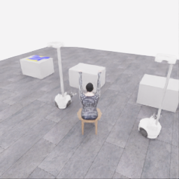
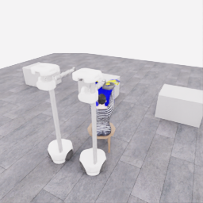
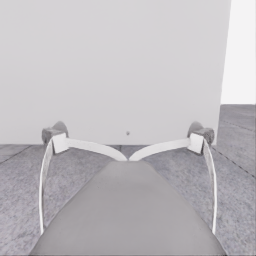
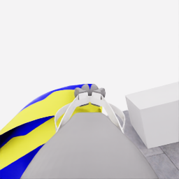
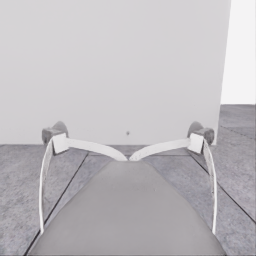
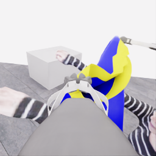
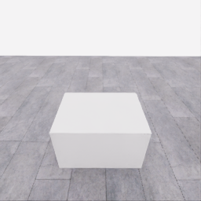
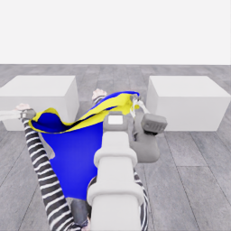
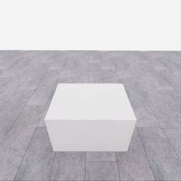
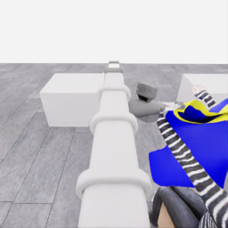

# 자동 시연 수집 시도 · 20261107-astra-regrasp698-progress-named-001

[전체 수집 기록](../../README.ko.md) · [구조화 요약](manifest.json) · [전체 행동 기록](decisions.jsonl) · [사용한 기본 프롬프트](prompt.txt)

실행 상태는 **completed**, 원본 출처는 `gpt`입니다. 완료 상태와 과제 성공은 아래에서 따로 기록합니다.

## 실행 조건과 시간

| 항목 | 기록 |
|---|---|
| 기록 시작 UTC | 2026-11-07T06:58:14Z |
| 기록 종료 UTC | 2026-11-07T07:39:05Z |
| 이전 시도 | 20261107-astra-opposing563-named-001 |
| 재시도 사유 | transport_and_entry_with_e25_changed_grasp |
| 출처 그룹 | 20261106-coordinated-demo-methods |
| 요청 모델 / 추론 설정 | gpt-6-astra / ultra |
| 전체 실제 경과 시간 (초) | 2450.624 |
| Actor 호출 합계 (초) | 1348.906 |
| 환경 요청·응답 합계 (초) | 1046.466 |
| 시뮬레이션 시간 (초) | 57.950 |
| 저장 전이 수 | 1159.000 |
| 응답 확인 전이 수 | 1159.000 |
| 모델 호출 시도 수 | 23.000 |
| 완료한 결정 구간 수 | 22.000 |
| 파일 완료 상태 | true |
| 데이터 정합성 검사 | true |
| 학습 데이터 승인 | unreviewed |
| Actor 호출 방식 | exec |
| 한 호출의 최대 계획 구간 수 | 1.000 |
| 한 계획의 최대 제어 step 수 | 20.000 |
| 제어기 정착 대기 설정 | true |
| 정착 대기 요청 step 수 | 6.000 |
| 완료한 제어기 정착 구간 수 | 21.000 |
| 제어기 정착 전이 수 | 126.000 |
| 제어기 정착 환경 요청·응답 (초) | 130.147 |
| 전이 예산으로 단축한 정착 구간 수 | 0.000 |
| 전이 예산으로 건너뛴 정착 구간 수 | 0.000 |

Actor 호출 시간은 공개 입력 저장·요청 전송·응답 처리 등 호출 경로를 측정합니다. 방식에 따라 Docker/CLI 시작이 호출 안에 들어가거나 상주 서버 준비 시간으로 분리됩니다. 내부 모델 추론 시간만 별도로 측정한 값은 아닙니다. 모델이 판단하는 동안 물리 시간은 멈추며 실제 경과 시간과 시뮬레이션 시간은 다릅니다. 세부 요청 프로세스 시간에도 CLI 처리·네트워크·서버 대기·생성이 함께 포함됩니다.

## 토큰 사용량의 범위

`actor_usage`는 thread별 관측 누계를 합친 값입니다. 결정의 `usage`는 원본 CLI 누계이며, 호출별 증가량은 `usage_accounting.incremental_usage`입니다. 캐시 입력은 입력의 부분집합이고 추론 출력은 출력의 부분집합이므로 열들을 다시 합산하지 않습니다.

전체 호출 사용량 확정: **true** · 기록한 호출 수: 23.

| 입력 | 캐시 입력 | 캐시 쓰기 입력 | 출력 | 추론 출력 |
|---:|---:|---:|---:|---:|
| 3001626 | 2591616 | 0 | 33527 | 28176 |

중복 누계는 추가 사용량 0으로 처리하고, 역행한 누계는 미확정으로 보존합니다. 새 thread는 별도로 집계합니다. 토큰 기록은 화폐 비용이나 청구서가 아닙니다.

## 리뷰 정지 조건

목표 누적 점수 10.000 · 감시 상태 `collector_ended_before_gate` · 수집기 상태 `completed`.

마지막 관측 점수 5.000 · 응답 확인 step 1158.

`review_ready`는 정지 조건에 따라 실행을 마치고 리뷰할 준비가 된 상태입니다. 50점·착의 성공이나 학습 데이터 승인을 뜻하지 않습니다. 공식 점수와 success는 아래 평가 결과로 확인합니다.

## 공식 평가 결과

평가 유효성 `true` · 누적 점수 **5.000 / 50** · 착의 success **false** · rate 상태 `no_dressing_points` · 최종 rate 0.000 points/s.

누적 50점, 착의 success, 정상 파일 종료와 데이터 정합성은 서로 다른 상태입니다. 접촉 전 `no_contact`의 rate는 0점/초로 바꾸지 않습니다.

| 단계 | 획득 점수 / 최대 | 획득 시각 (episode 초) |
|---|---:|---:|
| 파지·들기 | 5.000 / 5 | 27.150 |
| 첫 소매 | 0.000 / 5 | 미측정/해당 없음 |
| 반대 어깨 | 0.000 / 5 | 미측정/해당 없음 |
| 두 번째 소매 | 0.000 / 5 | 미측정/해당 없음 |
| 왼쪽 위팔 | 0.000 / 5 | 미측정/해당 없음 |
| 오른쪽 위팔 | 0.000 / 5 | 미측정/해당 없음 |
| 목 통과 | 0.000 / 10 | 미측정/해당 없음 |
| 앞면 방향 | 0.000 / 10 | 미측정/해당 없음 |

## 단계 획득 경로

점수 획득은 [평가 이벤트](score-events.jsonl)에서 같은 physics tick끼리 묶었습니다. 같은 시각에 인정된 항목의 내부 순서는 추정하지 않습니다. 착의 success는 점수 획득과 별도로 기록합니다.

| 순서 | episode 시간 (초) | 전이 경계 step | 누적 점수 변화 | 같은 시각의 항목 변화 |
|---:|---:|---:|---:|---|
| 0 | 27.150 | 543 | 0.000→5.000 | 파지·들기 0.000→5.000 |

평가 clock 0초에 대응하는 공개 simulation clock은 1.525초입니다. 두 시계를 같은 절대 시각으로 혼동하지 않습니다.

별도 success 이벤트 수: **0**. 평가 유효성: `true`.


## 원본 관측 화면

지정된 공개 카메라의 저장 RGB 픽셀입니다. 시작은 첫 `obs`, 종료는 마지막 `next_obs`입니다. 이미지 합성이나 내부 상태 기반 장면 재구성 없이 원본 픽셀로 PNG를 저장했습니다.

| 카메라 | 시작 | 종료 |
|---|---|---|
| `overview` | [](images/initial-overview.png) | [](images/final-overview.png) |
| `robot_0_wrist` | [](images/initial-robot_0_wrist.png) | [](images/final-robot_0_wrist.png) |
| `robot_1_wrist` | [](images/initial-robot_1_wrist.png) | [](images/final-robot_1_wrist.png) |
| `robot_0_head` | [](images/initial-robot_0_head.png) | [](images/final-robot_0_head.png) |
| `robot_1_head` | [](images/initial-robot_1_head.png) | [](images/final-robot_1_head.png) |

시작 관측 시각 1.525초 · 종료 관측 시각 59.475초 (공개 simulation clock).

[▶ overview 관측 영상 보기](overview.mp4)

저장된 20 Hz `obs` 중 1159프레임을 순서대로 사용했습니다. 재생은 **1배 느리게** (20.000 fps), 실제 대기 시간·모델 호출 지연은 영상에 들어가지 않습니다. 종료 `next_obs`는 위 PNG에서 확인합니다.

## 결정과 실행 순서

아래 근거는 모델 최종 JSON의 짧은 행동 설명입니다. 시각적 평가는 행동 전 관측에 대한 판단이며, 그 행동의 실행 후 성공 라벨로 사용하지 않습니다. 공식 점수는 별도의 평가 결과입니다.

행동의 각 행은 로봇 0·1 순서이며 열은 `전진, 왼쪽 이동, 반시계 회전, 리프트, 팔 신장, 손목 yaw, pitch, roll, gripper`입니다. 앞 8개는 정규화 속도이고 gripper는 닫기 `+1`, 열기 `-1`, 의도 유지 `0`입니다.

제어기 정착 대기는 앞선 모델 결정에 연결된 별도 중립 행동입니다. 추가 모델 호출이나 모델 결정으로 집계하지 않으며, 실제 전이와 환경 요청·응답 시간은 전체 합계에 포함됩니다. 중립 행동은 두 로봇의 속도와 gripper 명령을 모두 0으로 보내 기존 gripper 의도를 유지합니다. 대기를 실행했다는 기록이 옷의 정착이나 과제 개선을 확인했다는 뜻은 아닙니다.

### 기록된 행동의 재실행 구간

원본 `20261107-astra-opposing563-named-001`의 행동 698전이를 새 환경에서 다시 실행했습니다. 이 구간에는 새 모델 호출이 없고 관측·평가를 새로 기록했습니다. 정확한 물리 상태 복원이나 독립적인 새 시연으로 집계하지 않습니다. 원본 step 대응과 실제 행동은 `decisions.jsonl`의 `replayed_segment`에 있습니다.

### 별도 모델 호출 0 · `initial`

실행 결정 인덱스 0의 고정 관측을 사용했습니다. 호출 경과 26.500초. 같은 call index의 행동 기록과 사용량을 중복 합산하지 않습니다.

공개 입력 저장 0.249초 · 요청 프로세스 26.251초 · 결과 해석 0.000초.

### 결정 0 · 들기 · `act`

입력 관측 36.425초 · Actor 호출 26.500초 · 시각적 판단 `uncertain`.

계획 `20261107-astra-regrasp698-progress-named-001:call-00000` · 모델 호출 인덱스 0 · 계획 구간 1/1 · 이 구간에서 모델 호출 `true`.

실행 직전 최신 관측 36.425초.

공개 입력 저장 0.249초 · 요청 프로세스 26.251초 · 결과 해석 0.000초.

호출 사용량 상태 `observed` · 이번 증가량 입력 22287 / 출력 733 토큰.

최종 응답의 행동 설명: Robot 0 appears to grip the higher yellow-edged corner; robot 1 the lower rim beside the table. Both are near their controller targets, but bilateral cloth following remains unverified. Raise together approximately 7 cm, preserving grips, to test both supports before transport toward the mannequin’s raised hands.

요청 행동:

```json
[[0, 0, 0, 0.12, 0, 0, 0, 0, 0], [0, 0, 0, 0.12, 0, 0, 0, 0, 0]]
```

실행 구간 step **[698, 706)** · 요청 8 step / 실제 8 step · 환경 요청·응답 6.915초.

실제 적용 행동:

```json
[[0.0, 0.0, 0.0, 0.11999999731779099, 0.0, 0.0, 0.0, 0.0, 0.0], [0.0, 0.0, 0.0, 0.11999999731779099, 0.0, 0.0, 0.0, 0.0, 0.0]]
```

### 제어기 정착 대기 · 연결 결정 0

구간 `20261107-astra-regrasp698-progress-named-001:settle-00000` · 출처 `controller_settle` · 이 구간에서 모델 호출 `false`.

앞선 모델 호출 인덱스 0에 연결됩니다. 추가 호출은 없습니다.

실행 구간 step **[706, 712)** · 요청 6 step / 실제 6 step · 환경 요청·응답 5.373초.

공개 simulation clock 36.825→37.125초 · 실행 전 관측 36.825초.

실제 적용 중립 행동:

```json
[[0.0, 0.0, 0.0, 0.0, 0.0, 0.0, 0.0, 0.0, 0.0], [0.0, 0.0, 0.0, 0.0, 0.0, 0.0, 0.0, 0.0, 0.0]]
```

### 별도 모델 호출 1 · `initial`

실행 결정 인덱스 1의 고정 관측을 사용했습니다. 호출 경과 26.646초. 같은 call index의 행동 기록과 사용량을 중복 합산하지 않습니다.

공개 입력 저장 0.096초 · 요청 프로세스 26.550초 · 결과 해석 0.000초.

### 결정 1 · 들기 · `act`

입력 관측 37.125초 · Actor 호출 26.646초 · 시각적 판단 `progressing`.

계획 `20261107-astra-regrasp698-progress-named-001:call-00001` · 모델 호출 인덱스 1 · 계획 구간 1/1 · 이 구간에서 모델 호출 `true`.

실행 직전 최신 관측 37.125초.

공개 입력 저장 0.096초 · 요청 프로세스 26.550초 · 결과 해석 0.000초.

호출 사용량 상태 `observed` · 이번 증가량 입력 32221 / 출력 734 토큰.

최종 응답의 행동 설명: Both grippers rose about 6.7 cm, with their adjacent yellow edges visibly following. Robot 0 supports the higher corner; robot 1 supports the lower rim. Raise them approximately 8 and 22 cm respectively to reduce tilt and lift more of the panel from the table while preserving both grips.

요청 행동:

```json
[[0, 0, 0, 0.05, 0, 0, 0, 0, 0], [0, 0, 0, 0.14, 0, 0, 0, 0, 0]]
```

실행 구간 step **[712, 732)** · 요청 20 step / 실제 20 step · 환경 요청·응답 16.144초.

실제 적용 행동:

```json
[[0.0, 0.0, 0.0, 0.05000000074505806, 0.0, 0.0, 0.0, 0.0, 0.0], [0.0, 0.0, 0.0, 0.14000000059604645, 0.0, 0.0, 0.0, 0.0, 0.0]]
```

### 제어기 정착 대기 · 연결 결정 1

구간 `20261107-astra-regrasp698-progress-named-001:settle-00001` · 출처 `controller_settle` · 이 구간에서 모델 호출 `false`.

앞선 모델 호출 인덱스 1에 연결됩니다. 추가 호출은 없습니다.

실행 구간 step **[732, 738)** · 요청 6 step / 실제 6 step · 환경 요청·응답 5.251초.

공개 simulation clock 38.125→38.425초 · 실행 전 관측 38.125초.

실제 적용 중립 행동:

```json
[[0.0, 0.0, 0.0, 0.0, 0.0, 0.0, 0.0, 0.0, 0.0], [0.0, 0.0, 0.0, 0.0, 0.0, 0.0, 0.0, 0.0, 0.0]]
```

### 별도 모델 호출 2 · `initial`

실행 결정 인덱스 2의 고정 관측을 사용했습니다. 호출 경과 49.724초. 같은 call index의 행동 기록과 사용량을 중복 합산하지 않습니다.

공개 입력 저장 0.093초 · 요청 프로세스 49.631초 · 결과 해석 0.000초.

### 결정 2 · 운반 · `act`

입력 관측 38.425초 · Actor 호출 49.724초 · 시각적 판단 `progressing`.

계획 `20261107-astra-regrasp698-progress-named-001:call-00002` · 모델 호출 인덱스 2 · 계획 구간 1/1 · 이 구간에서 모델 호출 `true`.

실행 직전 최신 관측 38.425초.

공개 입력 저장 0.093초 · 요청 프로세스 49.631초 · 결과 해석 0.000초.

호출 사용량 상태 `observed` · 이번 증가량 입력 42105 / 출력 1266 토큰.

최종 응답의 행동 설명: Robot 0 retains the higher corner; robot 1’s rim followed its larger lift, reducing tilt. The panel still overlaps the table. Translate both backward about 15 cm and right about 22 cm toward the mannequin-side aisle, while raising robot 1 about 11 cm to bring the supported opening away from the table.

요청 행동:

```json
[[-0.25, -0.35, 0, 0, 0, 0, 0, 0, 0], [-0.25, -0.35, 0, 0.07, 0, 0, 0, 0, 0]]
```

실행 구간 step **[738, 758)** · 요청 20 step / 실제 20 step · 환경 요청·응답 16.295초.

실제 적용 행동:

```json
[[-0.25, -0.3499999940395355, 0.0, 0.0, 0.0, 0.0, 0.0, 0.0, 0.0], [-0.25, -0.3499999940395355, 0.0, 0.07000000029802322, 0.0, 0.0, 0.0, 0.0, 0.0]]
```

### 제어기 정착 대기 · 연결 결정 2

구간 `20261107-astra-regrasp698-progress-named-001:settle-00002` · 출처 `controller_settle` · 이 구간에서 모델 호출 `false`.

앞선 모델 호출 인덱스 2에 연결됩니다. 추가 호출은 없습니다.

실행 구간 step **[758, 764)** · 요청 6 step / 실제 6 step · 환경 요청·응답 5.434초.

공개 simulation clock 39.425→39.725초 · 실행 전 관측 39.425초.

실제 적용 중립 행동:

```json
[[0.0, 0.0, 0.0, 0.0, 0.0, 0.0, 0.0, 0.0, 0.0], [0.0, 0.0, 0.0, 0.0, 0.0, 0.0, 0.0, 0.0, 0.0]]
```

### 별도 모델 호출 3 · `initial`

실행 결정 인덱스 3의 고정 관측을 사용했습니다. 호출 경과 35.501초. 같은 call index의 행동 기록과 사용량을 중복 합산하지 않습니다.

공개 입력 저장 0.088초 · 요청 프로세스 35.413초 · 결과 해석 0.000초.

### 결정 3 · 운반 · `act`

입력 관측 39.725초 · Actor 호출 35.501초 · 시각적 판단 `progressing`.

계획 `20261107-astra-regrasp698-progress-named-001:call-00003` · 모델 호출 인덱스 3 · 계획 구간 1/1 · 이 구간에서 모델 호출 `true`.

실행 직전 최신 관측 39.725초.

공개 입력 저장 0.088초 · 요청 프로세스 35.413초 · 결과 해석 0.000초.

호출 사용량 상태 `observed` · 이번 증가량 입력 52519 / 출력 988 토큰.

최종 응답의 행동 설명: Robot 0 retains the leading corner; robot 1’s supported rim rose and moved toward the table edge. Both bases achieved the previous translation. Move together approximately 46 cm right and 15 cm backward to carry the garment around the table corner toward the mannequin, preserving support spacing and height.

요청 행동:

```json
[[-0.25, -0.75, 0, 0, 0, 0, 0, 0, 0], [-0.25, -0.75, 0, 0, 0, 0, 0, 0, 0]]
```

실행 구간 step **[764, 784)** · 요청 20 step / 실제 20 step · 환경 요청·응답 16.276초.

실제 적용 행동:

```json
[[-0.25, -0.75, 0.0, 0.0, 0.0, 0.0, 0.0, 0.0, 0.0], [-0.25, -0.75, 0.0, 0.0, 0.0, 0.0, 0.0, 0.0, 0.0]]
```

### 제어기 정착 대기 · 연결 결정 3

구간 `20261107-astra-regrasp698-progress-named-001:settle-00003` · 출처 `controller_settle` · 이 구간에서 모델 호출 `false`.

앞선 모델 호출 인덱스 3에 연결됩니다. 추가 호출은 없습니다.

실행 구간 step **[784, 790)** · 요청 6 step / 실제 6 step · 환경 요청·응답 5.212초.

공개 simulation clock 40.725→41.025초 · 실행 전 관측 40.725초.

실제 적용 중립 행동:

```json
[[0.0, 0.0, 0.0, 0.0, 0.0, 0.0, 0.0, 0.0, 0.0], [0.0, 0.0, 0.0, 0.0, 0.0, 0.0, 0.0, 0.0, 0.0]]
```

### 별도 모델 호출 4 · `initial`

실행 결정 인덱스 4의 고정 관측을 사용했습니다. 호출 경과 61.886초. 같은 call index의 행동 기록과 사용량을 중복 합산하지 않습니다.

공개 입력 저장 0.087초 · 요청 프로세스 61.798초 · 결과 해석 0.000초.

### 결정 4 · 운반 · `act`

입력 관측 41.025초 · Actor 호출 61.886초 · 시각적 판단 `progressing`.

계획 `20261107-astra-regrasp698-progress-named-001:call-00004` · 모델 호출 인덱스 4 · 계획 구간 1/1 · 이 구간에서 모델 호출 `true`.

실행 직전 최신 관측 41.025초.

공개 입력 저장 0.087초 · 요청 프로세스 61.798초 · 결과 해석 0.000초.

호출 사용량 상태 `observed` · 이번 증가량 입력 62644 / 출력 1772 토큰.

최종 응답의 행동 설명: Robot 0 and robot 1 retain their respective rim regions; the garment followed the translation and now hangs beyond the table edge. Continue together approximately 55 cm right and 22 cm backward across the visible aisle, reducing the opening-to-mannequin gap while maintaining grip spacing.

요청 행동:

```json
[[-0.35, -0.9, 0, 0, 0, 0, 0, 0, 0], [-0.35, -0.9, 0, 0, 0, 0, 0, 0, 0]]
```

실행 구간 step **[790, 810)** · 요청 20 step / 실제 20 step · 환경 요청·응답 16.157초.

실제 적용 행동:

```json
[[-0.3499999940395355, -0.8999999761581421, 0.0, 0.0, 0.0, 0.0, 0.0, 0.0, 0.0], [-0.3499999940395355, -0.8999999761581421, 0.0, 0.0, 0.0, 0.0, 0.0, 0.0, 0.0]]
```

### 제어기 정착 대기 · 연결 결정 4

구간 `20261107-astra-regrasp698-progress-named-001:settle-00004` · 출처 `controller_settle` · 이 구간에서 모델 호출 `false`.

앞선 모델 호출 인덱스 4에 연결됩니다. 추가 호출은 없습니다.

실행 구간 step **[810, 816)** · 요청 6 step / 실제 6 step · 환경 요청·응답 5.370초.

공개 simulation clock 42.025→42.325초 · 실행 전 관측 42.025초.

실제 적용 중립 행동:

```json
[[0.0, 0.0, 0.0, 0.0, 0.0, 0.0, 0.0, 0.0, 0.0], [0.0, 0.0, 0.0, 0.0, 0.0, 0.0, 0.0, 0.0, 0.0]]
```

### 별도 모델 호출 5 · `initial`

실행 결정 인덱스 5의 고정 관측을 사용했습니다. 호출 경과 47.220초. 같은 call index의 행동 기록과 사용량을 중복 합산하지 않습니다.

공개 입력 저장 0.092초 · 요청 프로세스 47.127초 · 결과 해석 0.000초.

### 결정 5 · 운반 · `act`

입력 관측 42.325초 · Actor 호출 47.220초 · 시각적 판단 `progressing`.

계획 `20261107-astra-regrasp698-progress-named-001:call-00005` · 모델 호출 인덱스 5 · 계획 구간 1/1 · 이 구간에서 모델 호출 `true`.

실행 직전 최신 관측 42.325초.

공개 입력 저장 0.092초 · 요청 프로세스 47.127초 · 결과 해석 0.000초.

호출 사용량 상태 `observed` · 이번 증가량 입력 73570 / 출력 1201 토큰.

최종 응답의 행동 설명: Robot 0’s leading corner and robot 1’s opposite rim remain supported, with the hanging panel following both robots away from the table. The mannequin remains separated from the garment. Continue the coordinated diagonal approach for one second, preserving the opening’s current shape; account for the remaining lateral motion at the next observation.

요청 행동:

```json
[[-0.35, -0.9, 0, 0, 0, 0, 0, 0, 0], [-0.35, -0.9, 0, 0, 0, 0, 0, 0, 0]]
```

실행 구간 step **[816, 836)** · 요청 20 step / 실제 20 step · 환경 요청·응답 16.229초.

실제 적용 행동:

```json
[[-0.3499999940395355, -0.8999999761581421, 0.0, 0.0, 0.0, 0.0, 0.0, 0.0, 0.0], [-0.3499999940395355, -0.8999999761581421, 0.0, 0.0, 0.0, 0.0, 0.0, 0.0, 0.0]]
```

### 제어기 정착 대기 · 연결 결정 5

구간 `20261107-astra-regrasp698-progress-named-001:settle-00005` · 출처 `controller_settle` · 이 구간에서 모델 호출 `false`.

앞선 모델 호출 인덱스 5에 연결됩니다. 추가 호출은 없습니다.

실행 구간 step **[836, 842)** · 요청 6 step / 실제 6 step · 환경 요청·응답 5.652초.

공개 simulation clock 43.325→43.625초 · 실행 전 관측 43.325초.

실제 적용 중립 행동:

```json
[[0.0, 0.0, 0.0, 0.0, 0.0, 0.0, 0.0, 0.0, 0.0], [0.0, 0.0, 0.0, 0.0, 0.0, 0.0, 0.0, 0.0, 0.0]]
```

### 별도 모델 호출 6 · `initial`

실행 결정 인덱스 6의 고정 관측을 사용했습니다. 호출 경과 56.128초. 같은 call index의 행동 기록과 사용량을 중복 합산하지 않습니다.

공개 입력 저장 0.087초 · 요청 프로세스 56.040초 · 결과 해석 0.000초.

### 결정 6 · 접근 · `act`

입력 관측 43.625초 · Actor 호출 56.128초 · 시각적 판단 `progressing`.

계획 `20261107-astra-regrasp698-progress-named-001:call-00006` · 모델 호출 인덱스 6 · 계획 구간 1/1 · 이 구간에서 모델 호출 `true`.

실행 직전 최신 관측 43.625초.

공개 입력 저장 0.087초 · 요청 프로세스 56.040초 · 결과 해석 0.000초.

호출 사용량 상태 `observed` · 이번 증가량 입력 83912 / 출력 1417 토큰.

최종 응답의 행동 설명: Robot 0 leads with one rim corner; robot 1 retains the opposite support. Both carried the cloth about 60 cm laterally, including residual motion. Reduce lateral speed and translate together toward the raised hand on the overview’s left, commanding approximately 43 cm right and 28 cm backward while preserving the candidate body opening.

요청 행동:

```json
[[-0.45, -0.7, 0, 0, 0, 0, 0, 0, 0], [-0.45, -0.7, 0, 0, 0, 0, 0, 0, 0]]
```

실행 구간 step **[842, 862)** · 요청 20 step / 실제 20 step · 환경 요청·응답 16.475초.

실제 적용 행동:

```json
[[-0.44999998807907104, -0.699999988079071, 0.0, 0.0, 0.0, 0.0, 0.0, 0.0, 0.0], [-0.44999998807907104, -0.699999988079071, 0.0, 0.0, 0.0, 0.0, 0.0, 0.0, 0.0]]
```

### 제어기 정착 대기 · 연결 결정 6

구간 `20261107-astra-regrasp698-progress-named-001:settle-00006` · 출처 `controller_settle` · 이 구간에서 모델 호출 `false`.

앞선 모델 호출 인덱스 6에 연결됩니다. 추가 호출은 없습니다.

실행 구간 step **[862, 868)** · 요청 6 step / 실제 6 step · 환경 요청·응답 5.320초.

공개 simulation clock 44.625→44.925초 · 실행 전 관측 44.625초.

실제 적용 중립 행동:

```json
[[0.0, 0.0, 0.0, 0.0, 0.0, 0.0, 0.0, 0.0, 0.0], [0.0, 0.0, 0.0, 0.0, 0.0, 0.0, 0.0, 0.0, 0.0]]
```

### 별도 모델 호출 7 · `initial`

실행 결정 인덱스 7의 고정 관측을 사용했습니다. 호출 경과 37.607초. 같은 call index의 행동 기록과 사용량을 중복 합산하지 않습니다.

공개 입력 저장 0.094초 · 요청 프로세스 37.513초 · 결과 해석 0.000초.

### 공개 픽셀 depth 조회 · 결정 7

물리 전이 없이 같은 카메라·시각의 원본 값을 조회했습니다. 무효 값은 null이며 접촉·입구 통과 판단이 아닙니다.

```json
{
  "request": {
    "kind": "depth_query",
    "observation_id": "955cad3f06c5aae338122fe9f708e51e2ad0dd970863b5c9f68432e085aef2ed",
    "camera": "robot_0_head",
    "pixels_uv": [
      [
        239,
        177
      ],
      [
        246,
        184
      ],
      [
        252,
        194
      ],
      [
        80,
        192
      ],
      [
        151,
        165
      ],
      [
        151,
        159
      ]
    ],
    "include_camera_geometry": true
  },
  "response": {
    "kind": "depth_query_result",
    "observation_id": "955cad3f06c5aae338122fe9f708e51e2ad0dd970863b5c9f68432e085aef2ed",
    "camera": "robot_0_head",
    "camera_index": 3,
    "simulation_time_s": 44.92500234302133,
    "intrinsics_sha256": "3dd91a2df5cb0a47b6f5ceb86d60d41e1f5d6753d2a11a034ac0b52bc385cd23",
    "request_sha256": "d0013b46598126436c8a290f55fa6a376e8f4b9b1e0ed05cc7dac71d98ea6152",
    "depth_semantics": "optical_Z_metres_not_ray_range",
    "geometry_semantics": "camera_X_right_Y_down_Z_forward",
    "rgb_image_order": [
      "overview",
      "robot_0_wrist",
      "robot_1_wrist",
      "robot_0_head",
      "robot_1_head"
    ],
    "resolution_wh": [
      256,
      256
    ],
    "neighbor_depth_substituted": false,
    "hidden_surfaces_estimated": false,
    "object_pose_or_contact_inferred": false,
    "source_sha256": {
      "observation_json": "426e08a4d247ef7e2e3b943fe1480f3554b0ef864ce2cad41b7bb93ed123afb5",
      "public_depth_npz": "c74ab5fde6390a70fb961da246a316af29c8c0b9fec958c0e51c7c717d748bf1",
      "overview_rgb": "61c57d0d6f0b5829983ba1d6aca9b4d720adc287cfede6c33f95e9fa6bd83644",
      "robot_0_wrist_rgb": "9cd1c7e091b53a7e0604684a4aaeb835a43ec622785e2d8ba99c7eb103d23607",
      "robot_1_wrist_rgb": "60533c040aad646685c76477d1bdc69aaa762f30df409032dbc49ea98872b292",
      "robot_0_head_rgb": "ef816bd71b92b8378061b633a485261e94e5a2944c2279f51541f6a377b8def2",
      "robot_1_head_rgb": "76282f9aedb7e28386c65ffcf98af63abfac636219e28020c400e56e1b3748e4"
    },
    "results": [
      {
        "pixel_uv": [
          239,
          177
        ],
        "status": "valid",
        "optical_z_m": 0.5135513544082642,
        "camera_xyz_m": [
          0.31183414677505067,
          0.13765651524304034,
          0.5135513544082642
        ],
        "camera_range_m": 0.6163804384455625,
        "invalid_reasons": []
      },
      {
        "pixel_uv": [
          246,
          184
        ],
        "status": "valid",
        "optical_z_m": 0.5033075213432312,
        "camera_xyz_m": [
          0.32488692981950495,
          0.1541836277109515,
          0.5033075213432312
        ],
        "camera_range_m": 0.618581093521553,
        "invalid_reasons": []
      },
      {
        "pixel_uv": [
          252,
          194
        ],
        "status": "valid",
        "optical_z_m": 0.49115705490112305,
        "camera_xyz_m": [
          0.3331646262776889,
          0.17732955914780216,
          0.49115705490112305
        ],
        "camera_range_m": 0.6194188351426284,
        "invalid_reasons": []
      },
      {
        "pixel_uv": [
          80,
          192
        ],
        "status": "valid",
        "optical_z_m": 0.691138744354248,
        "camera_xyz_m": [
          -0.18147770952961426,
          0.24197027937281895,
          0.691138744354248
        ],
        "camera_range_m": 0.7544246411030341,
        "invalid_reasons": []
      },
      {
        "pixel_uv": [
          151,
          165
        ],
        "status": "valid",
        "optical_z_m": 0.7737746238708496,
        "camera_xyz_m": [
          0.09735519502909601,
          0.1566148789598501,
          0.7737746238708496
        ],
        "camera_range_m": 0.7954454241852401,
        "invalid_reasons": []
      },
      {
        "pixel_uv": [
          151,
          159
        ],
        "status": "valid",
        "optical_z_m": 0.4517655372619629,
        "camera_xyz_m": [
          0.056840481234111534,
          0.07661108340249816,
          0.4517655372619629
        ],
        "camera_range_m": 0.4617274077468435,
        "invalid_reasons": []
      }
    ]
  }
}
```

### 별도 모델 호출 8 · `action_after_query`

실행 결정 인덱스 7의 고정 관측을 사용했습니다. 호출 경과 82.315초. 같은 call index의 행동 기록과 사용량을 중복 합산하지 않습니다.

공개 입력 저장 0.091초 · 요청 프로세스 82.224초 · 결과 해석 0.000초.

### 결정 7 · 접근 · `act`

입력 관측 44.925초 · Actor 호출 82.315초 · 시각적 판단 `progressing`.

계획 `20261107-astra-regrasp698-progress-named-001:call-00008` · 모델 호출 인덱스 8 · 계획 구간 1/1 · 이 구간에서 모델 호출 `true`.

실행 직전 최신 관측 44.925초.

공개 입력 저장 0.091초 · 요청 프로세스 82.224초 · 결과 해석 0.000초.

호출 사용량 상태 `observed` · 이번 증가량 입력 105751 / 출력 2299 토큰.

최종 응답의 행동 설명: Robot 0 retains the hand-side corner; robot 1 supports the opposite rim. Depth samples place the visible hand rightward and nearer than the candidate rim. Move both approximately 25 cm right, 11 cm backward and 15 cm upward to bring the candidate body opening over that hand; passage remains unverified.

요청 행동:

```json
[[-0.22, -0.5, 0, 0.12, 0, 0, 0, 0, 0], [-0.22, -0.5, 0, 0.12, 0, 0, 0, 0, 0]]
```

실행 구간 step **[868, 884)** · 요청 16 step / 실제 16 step · 환경 요청·응답 13.139초.

실제 적용 행동:

```json
[[-0.2199999988079071, -0.5, 0.0, 0.11999999731779099, 0.0, 0.0, 0.0, 0.0, 0.0], [-0.2199999988079071, -0.5, 0.0, 0.11999999731779099, 0.0, 0.0, 0.0, 0.0, 0.0]]
```

### 제어기 정착 대기 · 연결 결정 7

구간 `20261107-astra-regrasp698-progress-named-001:settle-00007` · 출처 `controller_settle` · 이 구간에서 모델 호출 `false`.

앞선 모델 호출 인덱스 8에 연결됩니다. 추가 호출은 없습니다.

실행 구간 step **[884, 890)** · 요청 6 step / 실제 6 step · 환경 요청·응답 5.378초.

공개 simulation clock 45.725→46.025초 · 실행 전 관측 45.725초.

실제 적용 중립 행동:

```json
[[0.0, 0.0, 0.0, 0.0, 0.0, 0.0, 0.0, 0.0, 0.0], [0.0, 0.0, 0.0, 0.0, 0.0, 0.0, 0.0, 0.0, 0.0]]
```

### 별도 모델 호출 9 · `initial`

실행 결정 인덱스 8의 고정 관측을 사용했습니다. 호출 경과 73.900초. 같은 call index의 행동 기록과 사용량을 중복 합산하지 않습니다.

공개 입력 저장 0.084초 · 요청 프로세스 73.816초 · 결과 해석 0.000초.

### 결정 8 · 접근 · `act`

입력 관측 46.025초 · Actor 호출 73.900초 · 시각적 판단 `progressing`.

계획 `20261107-astra-regrasp698-progress-named-001:call-00009` · 모델 호출 인덱스 9 · 계획 구간 1/1 · 이 구간에서 모델 호출 `true`.

실행 직전 최신 관측 46.025초.

공개 입력 저장 0.084초 · 요청 프로세스 73.816초 · 결과 해석 0.000초.

호출 사용량 상태 `observed` · 이번 증가량 입력 117319 / 출력 2200 토큰.

최종 응답의 행동 설명: Robot 0 retains the hand-side corner; robot 1 retains the opposite rim, now visibly beside a raised hand in its wrist view. Cloth followed the translation and lift, whose targets capped at 1.20 m. Pitch both wrists upward about 0.17 rad and move backward 9 cm and right 6 cm to bring the candidate body opening toward that hand; entry remains uncertain.

요청 행동:

```json
[[-0.3, -0.18, 0, 0, 0, 0, -0.06, 0, 0], [-0.3, -0.18, 0, 0, 0, 0, -0.06, 0, 0]]
```

실행 구간 step **[890, 900)** · 요청 10 step / 실제 10 step · 환경 요청·응답 7.841초.

실제 적용 행동:

```json
[[-0.30000001192092896, -0.18000000715255737, 0.0, 0.0, 0.0, 0.0, -0.05999999865889549, 0.0, 0.0], [-0.30000001192092896, -0.18000000715255737, 0.0, 0.0, 0.0, 0.0, -0.05999999865889549, 0.0, 0.0]]
```

### 제어기 정착 대기 · 연결 결정 8

구간 `20261107-astra-regrasp698-progress-named-001:settle-00008` · 출처 `controller_settle` · 이 구간에서 모델 호출 `false`.

앞선 모델 호출 인덱스 9에 연결됩니다. 추가 호출은 없습니다.

실행 구간 step **[900, 906)** · 요청 6 step / 실제 6 step · 환경 요청·응답 5.149초.

공개 simulation clock 46.525→46.825초 · 실행 전 관측 46.525초.

실제 적용 중립 행동:

```json
[[0.0, 0.0, 0.0, 0.0, 0.0, 0.0, 0.0, 0.0, 0.0], [0.0, 0.0, 0.0, 0.0, 0.0, 0.0, 0.0, 0.0, 0.0]]
```

### 별도 모델 호출 10 · `initial`

실행 결정 인덱스 9의 고정 관측을 사용했습니다. 호출 경과 81.511초. 같은 call index의 행동 기록과 사용량을 중복 합산하지 않습니다.

공개 입력 저장 0.080초 · 요청 프로세스 81.430초 · 결과 해석 0.000초.

### 결정 9 · 첫 소매 · `act`

입력 관측 46.825초 · Actor 호출 81.511초 · 시각적 판단 `progressing`.

계획 `20261107-astra-regrasp698-progress-named-001:call-00010` · 모델 호출 인덱스 10 · 계획 구간 1/1 · 이 구간에서 모델 호출 `true`.

실행 직전 최신 관측 46.825초.

공개 입력 저장 0.080초 · 요청 프로세스 81.430초 · 결과 해석 0.000초.

호출 사용량 상태 `observed` · 이번 증가량 입력 128530 / 출력 2139 토큰.

최종 응답의 행동 설명: Robot 0 retains the hand-side corner; robot 1 supports the opposite rim. The rim has opened and now overlaps the striped forearm in its wrist view, but hand entry remains uncertain. Move both right 15 cm, backward 6 cm and down 5 cm to advance the candidate body opening along the observed arm toward the torso.

요청 행동:

```json
[[-0.12, -0.3, 0, -0.04, 0, 0, 0, 0, 0], [-0.12, -0.3, 0, -0.04, 0, 0, 0, 0, 0]]
```

실행 구간 step **[906, 922)** · 요청 16 step / 실제 16 step · 환경 요청·응답 12.677초.

실제 적용 행동:

```json
[[-0.11999999731779099, -0.30000001192092896, 0.0, -0.03999999910593033, 0.0, 0.0, 0.0, 0.0, 0.0], [-0.11999999731779099, -0.30000001192092896, 0.0, -0.03999999910593033, 0.0, 0.0, 0.0, 0.0, 0.0]]
```

### 제어기 정착 대기 · 연결 결정 9

구간 `20261107-astra-regrasp698-progress-named-001:settle-00009` · 출처 `controller_settle` · 이 구간에서 모델 호출 `false`.

앞선 모델 호출 인덱스 10에 연결됩니다. 추가 호출은 없습니다.

실행 구간 step **[922, 928)** · 요청 6 step / 실제 6 step · 환경 요청·응답 5.080초.

공개 simulation clock 47.625→47.925초 · 실행 전 관측 47.625초.

실제 적용 중립 행동:

```json
[[0.0, 0.0, 0.0, 0.0, 0.0, 0.0, 0.0, 0.0, 0.0], [0.0, 0.0, 0.0, 0.0, 0.0, 0.0, 0.0, 0.0, 0.0]]
```

### 별도 모델 호출 11 · `initial`

실행 결정 인덱스 10의 고정 관측을 사용했습니다. 호출 경과 63.186초. 같은 call index의 행동 기록과 사용량을 중복 합산하지 않습니다.

공개 입력 저장 0.083초 · 요청 프로세스 63.103초 · 결과 해석 0.000초.

### 결정 10 · 첫 소매 · `act`

입력 관측 47.925초 · Actor 호출 63.186초 · 시각적 판단 `progressing`.

계획 `20261107-astra-regrasp698-progress-named-001:call-00011` · 모델 호출 인덱스 11 · 계획 구간 1/1 · 이 구간에서 모델 호출 `true`.

실행 직전 최신 관측 47.925초.

공개 입력 저장 0.083초 · 요청 프로세스 63.103초 · 결과 해석 0.000초.

호출 사용량 상태 `observed` · 이번 증가량 입력 139708 / 출력 1781 토큰.

최종 응답의 행동 설명: Robot 0 retains the upper corner and robot 1 the lower rim. Cloth followed the last movement; the nearer forearm now spans the opened rim, with a hand visible at robot 0’s left image edge. Sleeve exit remains unverified. Move together right 10 cm, backward 7 cm and down 7 cm to advance the supported garment toward the torso.

요청 행동:

```json
[[-0.15, -0.2, 0, -0.06, 0, 0, 0, 0, 0], [-0.15, -0.2, 0, -0.06, 0, 0, 0, 0, 0]]
```

실행 구간 step **[928, 944)** · 요청 16 step / 실제 16 step · 환경 요청·응답 12.819초.

실제 적용 행동:

```json
[[-0.15000000596046448, -0.20000000298023224, 0.0, -0.05999999865889549, 0.0, 0.0, 0.0, 0.0, 0.0], [-0.15000000596046448, -0.20000000298023224, 0.0, -0.05999999865889549, 0.0, 0.0, 0.0, 0.0, 0.0]]
```

### 제어기 정착 대기 · 연결 결정 10

구간 `20261107-astra-regrasp698-progress-named-001:settle-00010` · 출처 `controller_settle` · 이 구간에서 모델 호출 `false`.

앞선 모델 호출 인덱스 11에 연결됩니다. 추가 호출은 없습니다.

실행 구간 step **[944, 950)** · 요청 6 step / 실제 6 step · 환경 요청·응답 5.392초.

공개 simulation clock 48.725→49.025초 · 실행 전 관측 48.725초.

실제 적용 중립 행동:

```json
[[0.0, 0.0, 0.0, 0.0, 0.0, 0.0, 0.0, 0.0, 0.0], [0.0, 0.0, 0.0, 0.0, 0.0, 0.0, 0.0, 0.0, 0.0]]
```

### 별도 모델 호출 12 · `initial`

실행 결정 인덱스 11의 고정 관측을 사용했습니다. 호출 경과 119.919초. 같은 call index의 행동 기록과 사용량을 중복 합산하지 않습니다.

공개 입력 저장 0.084초 · 요청 프로세스 119.834초 · 결과 해석 0.000초.

### 결정 11 · 두 번째 소매 · `act`

입력 관측 49.025초 · Actor 호출 119.919초 · 시각적 판단 `progressing`.

계획 `20261107-astra-regrasp698-progress-named-001:call-00012` · 모델 호출 인덱스 12 · 계획 구간 1/1 · 이 구간에서 모델 호출 `true`.

실행 직전 최신 관측 49.025초.

공개 입력 저장 0.084초 · 요청 프로세스 119.834초 · 결과 해석 0.000초.

호출 사용량 상태 `observed` · 이번 증가량 입력 150557 / 출력 3096 토큰.

최종 응답의 행동 설명: Robot 0’s corner is beside the other exposed hand; robot 1 supports the rim around the nearer forearm. Cloth advanced along that forearm, but sleeve exit remains unverified. Shift both supports forward and right about 6 cm, raising robot 0 about 2 cm, to bring the candidate body opening toward the exposed hand.

요청 행동:

```json
[[0.16, -0.16, 0, 0.025, 0, 0, 0, 0, 0], [0.16, -0.16, 0, 0, 0, 0, 0, 0, 0]]
```

실행 구간 step **[950, 962)** · 요청 12 step / 실제 12 step · 환경 요청·응답 10.705초.

실제 적용 행동:

```json
[[0.1599999964237213, -0.1599999964237213, 0.0, 0.02500000037252903, 0.0, 0.0, 0.0, 0.0, 0.0], [0.1599999964237213, -0.1599999964237213, 0.0, 0.0, 0.0, 0.0, 0.0, 0.0, 0.0]]
```

### 제어기 정착 대기 · 연결 결정 11

구간 `20261107-astra-regrasp698-progress-named-001:settle-00011` · 출처 `controller_settle` · 이 구간에서 모델 호출 `false`.

앞선 모델 호출 인덱스 12에 연결됩니다. 추가 호출은 없습니다.

실행 구간 step **[962, 968)** · 요청 6 step / 실제 6 step · 환경 요청·응답 6.519초.

공개 simulation clock 49.625→49.925초 · 실행 전 관측 49.625초.

실제 적용 중립 행동:

```json
[[0.0, 0.0, 0.0, 0.0, 0.0, 0.0, 0.0, 0.0, 0.0], [0.0, 0.0, 0.0, 0.0, 0.0, 0.0, 0.0, 0.0, 0.0]]
```

### 별도 모델 호출 13 · `initial`

실행 결정 인덱스 12의 고정 관측을 사용했습니다. 호출 경과 40.414초. 같은 call index의 행동 기록과 사용량을 중복 합산하지 않습니다.

공개 입력 저장 0.093초 · 요청 프로세스 40.320초 · 결과 해석 0.000초.

### 결정 12 · 두 번째 소매 · `act`

입력 관측 49.925초 · Actor 호출 40.414초 · 시각적 판단 `progressing`.

계획 `20261107-astra-regrasp698-progress-named-001:call-00013` · 모델 호출 인덱스 13 · 계획 구간 1/1 · 이 구간에서 모델 호출 `true`.

실행 직전 최신 관측 49.925초.

공개 입력 저장 0.093초 · 요청 프로세스 40.320초 · 결과 해석 0.000초.

호출 사용량 상태 `observed` · 이번 증가량 입력 162717 / 출력 1086 토큰.

최종 응답의 행동 설명: Robot 0’s corner is now aligned beneath the exposed hand, which remains beyond the rim. Robot 1 retains the opposite support, with its arm about 3 cm short of target. Hold both bases and robot 1’s targets; extend robot 0 about 4 cm and pitch upward 0.07 rad to advance the candidate body opening toward the hand.

요청 행동:

```json
[[0, 0, 0, 0, 0.06, 0, -0.025, 0, 0], [0, 0, 0, 0, 0, 0, 0, 0, 0]]
```

실행 구간 step **[968, 978)** · 요청 10 step / 실제 10 step · 환경 요청·응답 10.592초.

실제 적용 행동:

```json
[[0.0, 0.0, 0.0, 0.0, 0.05999999865889549, 0.0, -0.02500000037252903, 0.0, 0.0], [0.0, 0.0, 0.0, 0.0, 0.0, 0.0, 0.0, 0.0, 0.0]]
```

### 제어기 정착 대기 · 연결 결정 12

구간 `20261107-astra-regrasp698-progress-named-001:settle-00012` · 출처 `controller_settle` · 이 구간에서 모델 호출 `false`.

앞선 모델 호출 인덱스 13에 연결됩니다. 추가 호출은 없습니다.

실행 구간 step **[978, 984)** · 요청 6 step / 실제 6 step · 환경 요청·응답 6.516초.

공개 simulation clock 50.425→50.725초 · 실행 전 관측 50.425초.

실제 적용 중립 행동:

```json
[[0.0, 0.0, 0.0, 0.0, 0.0, 0.0, 0.0, 0.0, 0.0], [0.0, 0.0, 0.0, 0.0, 0.0, 0.0, 0.0, 0.0, 0.0]]
```

### 별도 모델 호출 14 · `initial`

실행 결정 인덱스 13의 고정 관측을 사용했습니다. 호출 경과 48.473초. 같은 call index의 행동 기록과 사용량을 중복 합산하지 않습니다.

공개 입력 저장 0.092초 · 요청 프로세스 48.381초 · 결과 해석 0.000초.

### 결정 13 · 방향 · `act`

입력 관측 50.725초 · Actor 호출 48.473초 · 시각적 판단 `uncertain`.

계획 `20261107-astra-regrasp698-progress-named-001:call-00014` · 모델 호출 인덱스 14 · 계획 구간 1/1 · 이 구간에서 모델 호출 `true`.

실행 직전 최신 관측 50.725초.

공개 입력 저장 0.092초 · 요청 프로세스 48.381초 · 결과 해석 0.000초.

호출 사용량 상태 `observed` · 이번 증가량 입력 172807 / 출력 1226 토큰.

최종 응답의 행동 설명: Robot 0 advanced about 4 cm, but the hand became more obscured without clear entry evidence. Robot 1’s rim remains beside its fingers, whose posture changed. Preserve both grip intents and hold translation targets; counter-roll the wrists about 0.26 rad to test whether the folded candidate body opening separates around the hand.

요청 행동:

```json
[[0, 0, 0, 0, 0, 0, 0, 0.08, 0], [0, 0, 0, 0, 0, 0, 0, -0.08, 0]]
```

실행 구간 step **[984, 996)** · 요청 12 step / 실제 12 step · 환경 요청·응답 12.886초.

실제 적용 행동:

```json
[[0.0, 0.0, 0.0, 0.0, 0.0, 0.0, 0.0, 0.07999999821186066, 0.0], [0.0, 0.0, 0.0, 0.0, 0.0, 0.0, 0.0, -0.07999999821186066, 0.0]]
```

### 제어기 정착 대기 · 연결 결정 13

구간 `20261107-astra-regrasp698-progress-named-001:settle-00013` · 출처 `controller_settle` · 이 구간에서 모델 호출 `false`.

앞선 모델 호출 인덱스 14에 연결됩니다. 추가 호출은 없습니다.

실행 구간 step **[996, 1002)** · 요청 6 step / 실제 6 step · 환경 요청·응답 6.624초.

공개 simulation clock 51.325→51.625초 · 실행 전 관측 51.325초.

실제 적용 중립 행동:

```json
[[0.0, 0.0, 0.0, 0.0, 0.0, 0.0, 0.0, 0.0, 0.0], [0.0, 0.0, 0.0, 0.0, 0.0, 0.0, 0.0, 0.0, 0.0]]
```

### 별도 모델 호출 15 · `initial`

실행 결정 인덱스 14의 고정 관측을 사용했습니다. 호출 경과 42.015초. 같은 call index의 행동 기록과 사용량을 중복 합산하지 않습니다.

공개 입력 저장 0.089초 · 요청 프로세스 41.925초 · 결과 해석 0.000초.

### 결정 14 · 방향 · `act`

입력 관측 51.625초 · Actor 호출 42.015초 · 시각적 판단 `uncertain`.

계획 `20261107-astra-regrasp698-progress-named-001:call-00015` · 모델 호출 인덱스 15 · 계획 구간 1/1 · 이 구간에서 모델 호출 `true`.

실행 직전 최신 관측 51.625초.

공개 입력 저장 0.089초 · 요청 프로세스 41.925초 · 결과 해석 0.000초.

호출 사용량 상태 `observed` · 이번 증가량 입력 183028 / 출력 1054 토큰.

최종 응답의 행동 설명: Robot 0 retains the exposed-hand corner; robot 1’s rim remains beside its fingers near the other forearm. Counter-rotation occurred, but the fold still obscures entry. Change support spacing with opposing 7 cm sidesteps, testing whether the candidate body opening widens around the hands while preserving both grip intents.

요청 행동:

```json
[[0, -0.2, 0, 0, 0, 0, 0, 0, 0], [0, 0.2, 0, 0, 0, 0, 0, 0, 0]]
```

실행 구간 step **[1002, 1014)** · 요청 12 step / 실제 12 step · 환경 요청·응답 10.989초.

실제 적용 행동:

```json
[[0.0, -0.20000000298023224, 0.0, 0.0, 0.0, 0.0, 0.0, 0.0, 0.0], [0.0, 0.20000000298023224, 0.0, 0.0, 0.0, 0.0, 0.0, 0.0, 0.0]]
```

### 제어기 정착 대기 · 연결 결정 14

구간 `20261107-astra-regrasp698-progress-named-001:settle-00014` · 출처 `controller_settle` · 이 구간에서 모델 호출 `false`.

앞선 모델 호출 인덱스 15에 연결됩니다. 추가 호출은 없습니다.

실행 구간 step **[1014, 1020)** · 요청 6 step / 실제 6 step · 환경 요청·응답 5.900초.

공개 simulation clock 52.225→52.525초 · 실행 전 관측 52.225초.

실제 적용 중립 행동:

```json
[[0.0, 0.0, 0.0, 0.0, 0.0, 0.0, 0.0, 0.0, 0.0], [0.0, 0.0, 0.0, 0.0, 0.0, 0.0, 0.0, 0.0, 0.0]]
```

### 별도 모델 호출 16 · `initial`

실행 결정 인덱스 15의 고정 관측을 사용했습니다. 호출 경과 33.460초. 같은 call index의 행동 기록과 사용량을 중복 합산하지 않습니다.

공개 입력 저장 0.098초 · 요청 프로세스 33.362초 · 결과 해석 0.000초.

### 결정 15 · 어깨 · `act`

입력 관측 52.525초 · Actor 호출 33.460초 · 시각적 판단 `progressing`.

계획 `20261107-astra-regrasp698-progress-named-001:call-00016` · 모델 호출 인덱스 16 · 계획 구간 1/1 · 이 구간에서 모델 호출 `true`.

실행 직전 최신 관측 52.525초.

공개 입력 저장 0.098초 · 요청 프로세스 33.362초 · 결과 해석 0.000초.

호출 사용량 상태 `observed` · 이번 증가량 입력 193083 / 출력 962 토큰.

최종 응답의 행동 설명: Robot 0 and robot 1 retained their rim regions through the widening movement; robot 1’s extension also reached its target. The cloth now spans the raised forearms more broadly, although sleeve passage remains unverified. Preserve this spacing and move both backward 10 cm and downward 12 cm along the arms toward the shoulders.

요청 행동:

```json
[[-0.2, 0, 0, -0.1, 0, 0, 0, 0, 0], [-0.2, 0, 0, -0.1, 0, 0, 0, 0, 0]]
```

실행 구간 step **[1020, 1036)** · 요청 16 step / 실제 16 step · 환경 요청·응답 14.806초.

실제 적용 행동:

```json
[[-0.20000000298023224, 0.0, 0.0, -0.10000000149011612, 0.0, 0.0, 0.0, 0.0, 0.0], [-0.20000000298023224, 0.0, 0.0, -0.10000000149011612, 0.0, 0.0, 0.0, 0.0, 0.0]]
```

### 제어기 정착 대기 · 연결 결정 15

구간 `20261107-astra-regrasp698-progress-named-001:settle-00015` · 출처 `controller_settle` · 이 구간에서 모델 호출 `false`.

앞선 모델 호출 인덱스 16에 연결됩니다. 추가 호출은 없습니다.

실행 구간 step **[1036, 1042)** · 요청 6 step / 실제 6 step · 환경 요청·응답 7.099초.

공개 simulation clock 53.325→53.625초 · 실행 전 관측 53.325초.

실제 적용 중립 행동:

```json
[[0.0, 0.0, 0.0, 0.0, 0.0, 0.0, 0.0, 0.0, 0.0], [0.0, 0.0, 0.0, 0.0, 0.0, 0.0, 0.0, 0.0, 0.0]]
```

### 별도 모델 호출 17 · `initial`

실행 결정 인덱스 16의 고정 관측을 사용했습니다. 호출 경과 56.288초. 같은 call index의 행동 기록과 사용량을 중복 합산하지 않습니다.

공개 입력 저장 0.094초 · 요청 프로세스 56.194초 · 결과 해석 0.000초.

### 결정 16 · 어깨 · `act`

입력 관측 53.625초 · Actor 호출 56.288초 · 시각적 판단 `progressing`.

계획 `20261107-astra-regrasp698-progress-named-001:call-00017` · 모델 호출 인덱스 17 · 계획 구간 1/1 · 이 구간에서 모델 호출 `true`.

실행 직전 최신 관측 53.625초.

공개 입력 저장 0.094초 · 요청 프로세스 56.194초 · 결과 해석 0.000초.

호출 사용량 상태 `observed` · 이번 증가량 입력 203127 / 출력 1395 토큰.

최종 응답의 행동 설명: Robot 0 retains the higher corner and robot 1 the lower rim. Both lowered about 12 cm; cloth followed, and a raised hand is now visible beyond the blue edge, without confirmed sleeve passage. Move together right 7 cm, backward 9 cm and down 8 cm to bring the supported garment farther along the arms toward the shoulders.

요청 행동:

```json
[[-0.18, -0.15, 0, -0.065, 0, 0, 0, 0, 0], [-0.18, -0.15, 0, -0.065, 0, 0, 0, 0, 0]]
```

실행 구간 step **[1042, 1058)** · 요청 16 step / 실제 16 step · 환경 요청·응답 20.427초.

실제 적용 행동:

```json
[[-0.18000000715255737, -0.15000000596046448, 0.0, -0.06499999761581421, 0.0, 0.0, 0.0, 0.0, 0.0], [-0.18000000715255737, -0.15000000596046448, 0.0, -0.06499999761581421, 0.0, 0.0, 0.0, 0.0, 0.0]]
```

### 제어기 정착 대기 · 연결 결정 16

구간 `20261107-astra-regrasp698-progress-named-001:settle-00016` · 출처 `controller_settle` · 이 구간에서 모델 호출 `false`.

앞선 모델 호출 인덱스 17에 연결됩니다. 추가 호출은 없습니다.

실행 구간 step **[1058, 1064)** · 요청 6 step / 실제 6 step · 환경 요청·응답 8.881초.

공개 simulation clock 54.425→54.725초 · 실행 전 관측 54.425초.

실제 적용 중립 행동:

```json
[[0.0, 0.0, 0.0, 0.0, 0.0, 0.0, 0.0, 0.0, 0.0], [0.0, 0.0, 0.0, 0.0, 0.0, 0.0, 0.0, 0.0, 0.0]]
```

### 별도 모델 호출 18 · `initial`

실행 결정 인덱스 17의 고정 관측을 사용했습니다. 호출 경과 49.175초. 같은 call index의 행동 기록과 사용량을 중복 합산하지 않습니다.

공개 입력 저장 0.092초 · 요청 프로세스 49.083초 · 결과 해석 0.000초.

### 결정 17 · 복구 · `act`

입력 관측 54.725초 · Actor 호출 49.175초 · 시각적 판단 `recovering`.

계획 `20261107-astra-regrasp698-progress-named-001:call-00018` · 모델 호출 인덱스 18 · 계획 구간 1/1 · 이 구간에서 모델 호출 `true`.

실행 직전 최신 관측 54.725초.

공개 입력 저장 0.092초 · 요청 프로세스 49.083초 · 결과 해석 0.000초.

호출 사용량 상태 `observed` · 이번 증가량 입력 213653 / 출력 1252 토큰.

최종 응답의 행동 설명: Robot 0 retains its rim region, but its arm is now 11 cm beyond target with asymmetric fingers; robot 1 retains the opposite corner. The panel covers the head area without verified sleeve passage. Move both forward 6 cm and upward 8 cm to relieve the latest loading direction while allowing robot 0’s arm to return toward its existing target.

요청 행동:

```json
[[0.16, 0, 0, 0.09, 0, 0, 0, 0, 0], [0.16, 0, 0, 0.09, 0, 0, 0, 0, 0]]
```

실행 구간 step **[1064, 1076)** · 요청 12 step / 실제 12 step · 환경 요청·응답 16.588초.

실제 적용 행동:

```json
[[0.1599999964237213, 0.0, 0.0, 0.09000000357627869, 0.0, 0.0, 0.0, 0.0, 0.0], [0.1599999964237213, 0.0, 0.0, 0.09000000357627869, 0.0, 0.0, 0.0, 0.0, 0.0]]
```

### 제어기 정착 대기 · 연결 결정 17

구간 `20261107-astra-regrasp698-progress-named-001:settle-00017` · 출처 `controller_settle` · 이 구간에서 모델 호출 `false`.

앞선 모델 호출 인덱스 18에 연결됩니다. 추가 호출은 없습니다.

실행 구간 step **[1076, 1082)** · 요청 6 step / 실제 6 step · 환경 요청·응답 8.115초.

공개 simulation clock 55.325→55.625초 · 실행 전 관측 55.325초.

실제 적용 중립 행동:

```json
[[0.0, 0.0, 0.0, 0.0, 0.0, 0.0, 0.0, 0.0, 0.0], [0.0, 0.0, 0.0, 0.0, 0.0, 0.0, 0.0, 0.0, 0.0]]
```

### 별도 모델 호출 19 · `initial`

실행 결정 인덱스 18의 고정 관측을 사용했습니다. 호출 경과 71.502초. 같은 call index의 행동 기록과 사용량을 중복 합산하지 않습니다.

공개 입력 저장 0.089초 · 요청 프로세스 71.413초 · 결과 해석 0.000초.

### 결정 18 · 방향 · `act`

입력 관측 55.625초 · Actor 호출 71.502초 · 시각적 판단 `recovering`.

계획 `20261107-astra-regrasp698-progress-named-001:call-00019` · 모델 호출 인덱스 19 · 계획 구간 1/1 · 이 구간에서 모델 호출 `true`.

실행 직전 최신 관측 55.625초.

공개 입력 저장 0.089초 · 요청 프로세스 71.413초 · 결과 해석 0.000초.

호출 사용량 상태 `observed` · 이번 증가량 입력 223973 / 출력 1854 토큰.

최종 응답의 행동 설명: Robot 0’s arm returned within 1 cm of target; both robots retain their cloth regions. The supported panel remains diagonal across the forearms. Retract robot 0 and extend robot 1 about 10 cm each, raising robot 1 about 8 cm, to reduce the opening’s fore-aft and height skew before advancing it toward the torso.

요청 행동:

```json
[[0, 0, 0, 0, -0.1, 0, 0, 0, 0], [0, 0, 0, 0.065, 0.1, 0, 0, 0, 0]]
```

실행 구간 step **[1082, 1098)** · 요청 16 step / 실제 16 step · 환경 요청·응답 20.474초.

실제 적용 행동:

```json
[[0.0, 0.0, 0.0, 0.0, -0.10000000149011612, 0.0, 0.0, 0.0, 0.0], [0.0, 0.0, 0.0, 0.06499999761581421, 0.10000000149011612, 0.0, 0.0, 0.0, 0.0]]
```

### 제어기 정착 대기 · 연결 결정 18

구간 `20261107-astra-regrasp698-progress-named-001:settle-00018` · 출처 `controller_settle` · 이 구간에서 모델 호출 `false`.

앞선 모델 호출 인덱스 19에 연결됩니다. 추가 호출은 없습니다.

실행 구간 step **[1098, 1104)** · 요청 6 step / 실제 6 step · 환경 요청·응답 8.137초.

공개 simulation clock 56.425→56.725초 · 실행 전 관측 56.425초.

실제 적용 중립 행동:

```json
[[0.0, 0.0, 0.0, 0.0, 0.0, 0.0, 0.0, 0.0, 0.0], [0.0, 0.0, 0.0, 0.0, 0.0, 0.0, 0.0, 0.0, 0.0]]
```

### 별도 모델 호출 20 · `initial`

실행 결정 인덱스 19의 고정 관측을 사용했습니다. 호출 경과 29.642초. 같은 call index의 행동 기록과 사용량을 중복 합산하지 않습니다.

공개 입력 저장 0.086초 · 요청 프로세스 29.555초 · 결과 해석 0.000초.

### 결정 19 · 방향 · `act`

입력 관측 56.725초 · Actor 호출 29.642초 · 시각적 판단 `uncertain`.

계획 `20261107-astra-regrasp698-progress-named-001:call-00020` · 모델 호출 인덱스 20 · 계획 구간 1/1 · 이 구간에서 모델 호출 `true`.

실행 직전 최신 관측 56.725초.

공개 입력 저장 0.086초 · 요청 프로세스 29.555초 · 결과 해석 0.000초.

호출 사용량 상태 `observed` · 이번 증가량 입력 234908 / 출력 736 토큰.

최종 응답의 행동 설명: Robot 0 retains its corner but retracted only about 3 cm and remains 6 cm beyond its new extension target. Robot 1 retains the opposite rim, still 2 cm short of its extension target. Preserve grips and allow 0.5 seconds of neutral settling to distinguish remaining target-following motion from obstruction before another manipulation.

요청 행동:

```json
[[0, 0, 0, 0, 0, 0, 0, 0, 0], [0, 0, 0, 0, 0, 0, 0, 0, 0]]
```

실행 구간 step **[1104, 1114)** · 요청 10 step / 실제 10 step · 환경 요청·응답 12.544초.

실제 적용 행동:

```json
[[0.0, 0.0, 0.0, 0.0, 0.0, 0.0, 0.0, 0.0, 0.0], [0.0, 0.0, 0.0, 0.0, 0.0, 0.0, 0.0, 0.0, 0.0]]
```

### 별도 모델 호출 21 · `initial`

실행 결정 인덱스 20의 고정 관측을 사용했습니다. 호출 경과 78.861초. 같은 call index의 행동 기록과 사용량을 중복 합산하지 않습니다.

공개 입력 저장 0.089초 · 요청 프로세스 78.771초 · 결과 해석 0.000초.

### 결정 20 · 방향 · `act`

입력 관측 57.225초 · Actor 호출 78.861초 · 시각적 판단 `recovering`.

계획 `20261107-astra-regrasp698-progress-named-001:call-00021` · 모델 호출 인덱스 21 · 계획 구간 1/1 · 이 구간에서 모델 호출 `true`.

실행 직전 최신 관측 57.225초.

공개 입력 저장 0.089초 · 요청 프로세스 78.771초 · 결과 해석 0.000초.

호출 사용량 상태 `observed` · 이번 증가량 입력 244733 / 출력 2011 토큰.

최종 응답의 행동 설명: Robot 0 retracted another 1 cm during settling but remains 5 cm beyond target; robot 1 retains the opposite rim with residual extension lag. The panel still crosses the forearms. Preserve both supports and pitch both wrists upward about 0.35 rad to lift the held rim away from the arms and change the candidate opening’s entry angle.

요청 행동:

```json
[[0, 0, 0, 0, 0, 0, -0.08, 0, 0], [0, 0, 0, 0, 0, 0, -0.08, 0, 0]]
```

실행 구간 step **[1114, 1130)** · 요청 16 step / 실제 16 step · 환경 요청·응답 18.991초.

실제 적용 행동:

```json
[[0.0, 0.0, 0.0, 0.0, 0.0, 0.0, -0.07999999821186066, 0.0, 0.0], [0.0, 0.0, 0.0, 0.0, 0.0, 0.0, -0.07999999821186066, 0.0, 0.0]]
```

### 제어기 정착 대기 · 연결 결정 20

구간 `20261107-astra-regrasp698-progress-named-001:settle-00020` · 출처 `controller_settle` · 이 구간에서 모델 호출 `false`.

앞선 모델 호출 인덱스 21에 연결됩니다. 추가 호출은 없습니다.

실행 구간 step **[1130, 1136)** · 요청 6 step / 실제 6 step · 환경 요청·응답 6.984초.

공개 simulation clock 58.025→58.325초 · 실행 전 관측 58.025초.

실제 적용 중립 행동:

```json
[[0.0, 0.0, 0.0, 0.0, 0.0, 0.0, 0.0, 0.0, 0.0], [0.0, 0.0, 0.0, 0.0, 0.0, 0.0, 0.0, 0.0, 0.0]]
```

### 별도 모델 호출 22 · `initial`

실행 결정 인덱스 21의 고정 관측을 사용했습니다. 호출 경과 137.035초. 같은 call index의 행동 기록과 사용량을 중복 합산하지 않습니다.

공개 입력 저장 0.081초 · 요청 프로세스 136.953초 · 결과 해석 0.000초.

### 결정 21 · 방향 · `act`

입력 관측 58.325초 · Actor 호출 137.035초 · 시각적 판단 `progressing`.

계획 `20261107-astra-regrasp698-progress-named-001:call-00022` · 모델 호출 인덱스 22 · 계획 구간 1/1 · 이 구간에서 모델 호출 `true`.

실행 직전 최신 관측 58.325초.

공개 입력 저장 0.081초 · 요청 프로세스 136.953초 · 결과 해석 0.000초.

호출 사용량 상태 `observed` · 이번 증가량 입력 63996 / 출력 1247 토큰.

최종 응답의 행동 설명: Both rim regions followed the wrist rotation; robot 0’s extension discrepancy decreased and robot 1 is near target. Sleeve passage remains unverified. Preserve both grips and wrist angles while raising the opening about 8 cm and advancing 6 cm toward the raised hands.

요청 행동:

```json
[[0.12, 0, 0, 0.065, 0, 0, 0, 0, 0], [0.12, 0, 0, 0.065, 0, 0, 0, 0, 0]]
```

실행 구간 step **[1136, 1152)** · 요청 16 step / 실제 16 step · 환경 요청·응답 16.701초.

실제 적용 행동:

```json
[[0.11999999731779099, 0.0, 0.0, 0.06499999761581421, 0.0, 0.0, 0.0, 0.0, 0.0], [0.11999999731779099, 0.0, 0.0, 0.06499999761581421, 0.0, 0.0, 0.0, 0.0, 0.0]]
```

### 제어기 정착 대기 · 연결 결정 21

구간 `20261107-astra-regrasp698-progress-named-001:settle-00021` · 출처 `controller_settle` · 이 구간에서 모델 호출 `false`.

앞선 모델 호출 인덱스 22에 연결됩니다. 추가 호출은 없습니다.

실행 구간 step **[1152, 1158)** · 요청 6 step / 실제 6 step · 환경 요청·응답 6.760초.

공개 simulation clock 59.125→59.425초 · 실행 전 관측 59.125초.

실제 적용 중립 행동:

```json
[[0.0, 0.0, 0.0, 0.0, 0.0, 0.0, 0.0, 0.0, 0.0], [0.0, 0.0, 0.0, 0.0, 0.0, 0.0, 0.0, 0.0, 0.0]]
```

수집기 정지: `decision_budget` · 중립 명령 1 step.

## 검수와 후속 판단

현재 데이터 승인은 `unreviewed`입니다. 형식과 시간 정합성 검사를 통과해도 시연의 유용성이나 착의 성공을 보장하지 않습니다.

이 페이지의 원본 파일 SHA256과 생성 파일 SHA256은 [manifest.json](manifest.json)에 있습니다. 실행 실패도 같은 run ID와 부모 시도 관계로 보존합니다. 공개 범위는 카메라, 최종 행동 응답, 시간, 평가 요약입니다.

[개발 피드백과 변경 근거](../../feedback/2026-11-07.jsonl)
