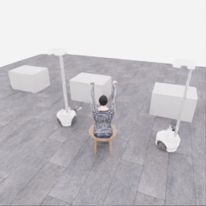
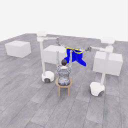
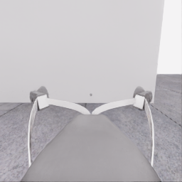
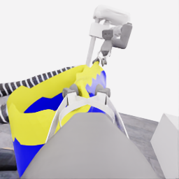
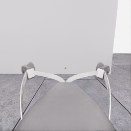
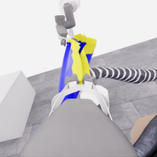
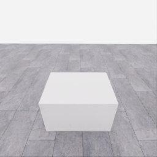
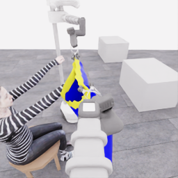
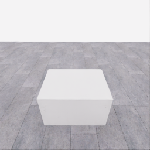
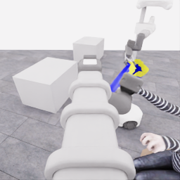

# 자동 시연 수집 시도 · 20261113-astra-diagonal682-001

[전체 수집 기록](../../README.ko.md) · [구조화 요약](manifest.json) · [전체 행동 기록](decisions.jsonl) · [사용한 기본 프롬프트](prompt.txt)

실행 상태는 **completed**, 원본 출처는 `gpt`입니다. 완료 상태와 과제 성공은 아래에서 따로 기록합니다.

## 실행 조건과 시간

| 항목 | 기록 |
|---|---|
| 기록 시작 UTC | 2026-11-13T23:17:37Z |
| 기록 종료 UTC | 2026-11-13T23:46:18Z |
| 이전 시도 | 20261113-astra-side-hem-fresh-001 |
| 재시도 사유 | Compare the unchanged diagonal-entry strategy from the earlier E28 boundary682 before the later approach sequence; reacquire current support and hand relation from fresh replay observations. |
| 출처 그룹 | 20261113-astra-side-hem-fresh-001 |
| 요청 모델 / 추론 설정 | gpt-6-astra / ultra |
| 전체 실제 경과 시간 (초) | 1721.580 |
| Actor 호출 합계 (초) | 971.602 |
| 환경 요청·응답 합계 (초) | 699.982 |
| 시뮬레이션 시간 (초) | 41.500 |
| 저장 전이 수 | 830.000 |
| 응답 확인 전이 수 | 830.000 |
| 모델 호출 시도 수 | 19.000 |
| 완료한 결정 구간 수 | 17.000 |
| 파일 완료 상태 | true |
| 데이터 정합성 검사 | true |
| 학습 데이터 승인 | unreviewed |
| Actor 호출 방식 | exec |
| 한 호출의 최대 계획 구간 수 | 1.000 |
| 한 계획의 최대 제어 step 수 | 20.000 |
| 제어기 정착 대기 설정 | true |
| 정착 대기 요청 step 수 | 6.000 |
| 완료한 제어기 정착 구간 수 | 15.000 |
| 제어기 정착 전이 수 | 90.000 |
| 제어기 정착 환경 요청·응답 (초) | 71.910 |
| 전이 예산으로 단축한 정착 구간 수 | 0.000 |
| 전이 예산으로 건너뛴 정착 구간 수 | 0.000 |

Actor 호출 시간은 공개 입력 저장·요청 전송·응답 처리 등 호출 경로를 측정합니다. 방식에 따라 Docker/CLI 시작이 호출 안에 들어가거나 상주 서버 준비 시간으로 분리됩니다. 내부 모델 추론 시간만 별도로 측정한 값은 아닙니다. 모델이 판단하는 동안 물리 시간은 멈추며 실제 경과 시간과 시뮬레이션 시간은 다릅니다. 세부 요청 프로세스 시간에도 CLI 처리·네트워크·서버 대기·생성이 함께 포함됩니다.

## 토큰 사용량의 범위

`actor_usage`는 thread별 관측 누계를 합친 값입니다. 결정의 `usage`는 원본 CLI 누계이며, 호출별 증가량은 `usage_accounting.incremental_usage`입니다. 캐시 입력은 입력의 부분집합이고 추론 출력은 출력의 부분집합이므로 열들을 다시 합산하지 않습니다.

전체 호출 사용량 확정: **true** · 기록한 호출 수: 19.

| 입력 | 캐시 입력 | 캐시 쓰기 입력 | 출력 | 추론 출력 |
|---:|---:|---:|---:|---:|
| 2232508 | 1880064 | 0 | 27258 | 22856 |

중복 누계는 추가 사용량 0으로 처리하고, 역행한 누계는 미확정으로 보존합니다. 새 thread는 별도로 집계합니다. 토큰 기록은 화폐 비용이나 청구서가 아닙니다.

## 리뷰 정지 조건

목표 누적 점수 10.000 · 감시 상태 `collector_ended_before_gate` · 수집기 상태 `completed`.

마지막 관측 점수 5.000 · 응답 확인 step 830.

`review_ready`는 정지 조건에 따라 실행을 마치고 리뷰할 준비가 된 상태입니다. 50점·착의 성공이나 학습 데이터 승인을 뜻하지 않습니다. 공식 점수와 success는 아래 평가 결과로 확인합니다.

## 공식 평가 결과

평가 유효성 `true` · 누적 점수 **5.000 / 50** · 착의 success **false** · rate 상태 `no_dressing_points` · 최종 rate 0.000 points/s.

누적 50점, 착의 success, 정상 파일 종료와 데이터 정합성은 서로 다른 상태입니다. 접촉 전 `no_contact`의 rate는 0점/초로 바꾸지 않습니다.

| 단계 | 획득 점수 / 최대 | 획득 시각 (episode 초) |
|---|---:|---:|
| 파지·들기 | 5.000 / 5 | 18.550 |
| 첫 소매 | 0.000 / 5 | 미측정/해당 없음 |
| 반대 어깨 | 0.000 / 5 | 미측정/해당 없음 |
| 두 번째 소매 | 0.000 / 5 | 미측정/해당 없음 |
| 왼쪽 위팔 | 0.000 / 5 | 미측정/해당 없음 |
| 오른쪽 위팔 | 0.000 / 5 | 미측정/해당 없음 |
| 목 통과 | 0.000 / 10 | 미측정/해당 없음 |
| 앞면 방향 | 0.000 / 10 | 미측정/해당 없음 |

## 단계 획득 경로

점수 획득은 [평가 이벤트](score-events.jsonl)에서 같은 physics tick끼리 묶었습니다. 같은 시각에 인정된 항목의 내부 순서는 추정하지 않습니다. 착의 success는 점수 획득과 별도로 기록합니다.

| 순서 | episode 시간 (초) | 전이 경계 step | 누적 점수 변화 | 같은 시각의 항목 변화 |
|---:|---:|---:|---:|---|
| 0 | 18.550 | 371 | 0.000→5.000 | 파지·들기 0.000→5.000 |

평가 clock 0초에 대응하는 공개 simulation clock은 1.525초입니다. 두 시계를 같은 절대 시각으로 혼동하지 않습니다.

별도 success 이벤트 수: **0**. 평가 유효성: `true`.


## 원본 관측 화면

지정된 공개 카메라의 저장 RGB 픽셀입니다. 시작은 첫 `obs`, 종료는 마지막 `next_obs`입니다. 이미지 합성이나 내부 상태 기반 장면 재구성 없이 원본 픽셀로 PNG를 저장했습니다.

| 카메라 | 시작 | 종료 |
|---|---|---|
| `overview` | [](images/initial-overview.png) | [](images/final-overview.png) |
| `robot_0_wrist` | [](images/initial-robot_0_wrist.png) | [](images/final-robot_0_wrist.png) |
| `robot_1_wrist` | [](images/initial-robot_1_wrist.png) | [](images/final-robot_1_wrist.png) |
| `robot_0_head` | [](images/initial-robot_0_head.png) | [](images/final-robot_0_head.png) |
| `robot_1_head` | [](images/initial-robot_1_head.png) | [](images/final-robot_1_head.png) |

시작 관측 시각 1.525초 · 종료 관측 시각 43.025초 (공개 simulation clock).

[▶ overview 관측 영상 보기](overview.mp4)

저장된 20 Hz `obs` 중 830프레임을 순서대로 사용했습니다. 재생은 **1배 느리게** (20.000 fps), 실제 대기 시간·모델 호출 지연은 영상에 들어가지 않습니다. 종료 `next_obs`는 위 PNG에서 확인합니다.

## 결정과 실행 순서

아래 근거는 모델 최종 JSON의 짧은 행동 설명입니다. 시각적 평가는 행동 전 관측에 대한 판단이며, 그 행동의 실행 후 성공 라벨로 사용하지 않습니다. 공식 점수는 별도의 평가 결과입니다.

행동의 각 행은 로봇 0·1 순서이며 열은 `전진, 왼쪽 이동, 반시계 회전, 리프트, 팔 신장, 손목 yaw, pitch, roll, gripper`입니다. 앞 8개는 정규화 속도이고 gripper는 닫기 `+1`, 열기 `-1`, 의도 유지 `0`입니다.

제어기 정착 대기는 앞선 모델 결정에 연결된 별도 중립 행동입니다. 추가 모델 호출이나 모델 결정으로 집계하지 않으며, 실제 전이와 환경 요청·응답 시간은 전체 합계에 포함됩니다. 중립 행동은 두 로봇의 속도와 gripper 명령을 모두 0으로 보내 기존 gripper 의도를 유지합니다. 대기를 실행했다는 기록이 옷의 정착이나 과제 개선을 확인했다는 뜻은 아닙니다.

### 기록된 행동의 재실행 구간

원본 `20261113-astra-side-hem-fresh-001`의 행동 682전이를 새 환경에서 다시 실행했습니다. 이 구간에는 새 모델 호출이 없고 관측·평가를 새로 기록했습니다. 정확한 물리 상태 복원이나 독립적인 새 시연으로 집계하지 않습니다. 원본 step 대응과 실제 행동은 `decisions.jsonl`의 `replayed_segment`에 있습니다.

### 별도 모델 호출 0 · `initial`

실행 결정 인덱스 0의 고정 관측을 사용했습니다. 호출 경과 59.609초. 같은 call index의 행동 기록과 사용량을 중복 합산하지 않습니다.

공개 입력 저장 0.214초 · 요청 프로세스 59.395초 · 결과 해석 0.000초.

### 결정 0 · 첫 소매 · `act`

입력 관측 35.625초 · Actor 호출 59.609초 · 시각적 판단 `uncertain`.

계획 `20261113-astra-diagonal682-001:call-00000` · 모델 호출 인덱스 0 · 계획 구간 1/1 · 이 구간에서 모델 호출 `true`.

실행 직전 최신 관측 35.625초.

공개 입력 저장 0.214초 · 요청 프로세스 59.395초 · 결과 해석 0.000초.

호출 사용량 상태 `observed` · 이번 증가량 입력 23243 / 출력 1775 토큰.

최종 응답의 행동 설명: Lower trial: robot_0 retains apparent opposite-edge support; robot_1 guides the candidate lip, which appears above the hand entering its wrist view from the right. Lower robot_1 slightly; inspect cloth following, retained anchor support and lip/housing clearance relative to that same wrist before reorientation. Entry remains unconfirmed.

요청 행동:

```json
[[0, 0, 0, 0, 0, 0, 0, 0, 0], [0, 0, 0, -0.1, 0, 0, 0, 0, 0]]
```

실행 구간 step **[682, 686)** · 요청 4 step / 실제 4 step · 환경 요청·응답 3.340초.

실제 적용 행동:

```json
[[0.0, 0.0, 0.0, 0.0, 0.0, 0.0, 0.0, 0.0, 0.0], [0.0, 0.0, 0.0, -0.10000000149011612, 0.0, 0.0, 0.0, 0.0, 0.0]]
```

### 제어기 정착 대기 · 연결 결정 0

구간 `20261113-astra-diagonal682-001:settle-00000` · 출처 `controller_settle` · 이 구간에서 모델 호출 `false`.

앞선 모델 호출 인덱스 0에 연결됩니다. 추가 호출은 없습니다.

실행 구간 step **[686, 692)** · 요청 6 step / 실제 6 step · 환경 요청·응답 4.707초.

공개 simulation clock 35.825→36.125초 · 실행 전 관측 35.825초.

실제 적용 중립 행동:

```json
[[0.0, 0.0, 0.0, 0.0, 0.0, 0.0, 0.0, 0.0, 0.0], [0.0, 0.0, 0.0, 0.0, 0.0, 0.0, 0.0, 0.0, 0.0]]
```

### 별도 모델 호출 1 · `initial`

실행 결정 인덱스 1의 고정 관측을 사용했습니다. 호출 경과 32.384초. 같은 call index의 행동 기록과 사용량을 중복 합산하지 않습니다.

공개 입력 저장 0.077초 · 요청 프로세스 32.307초 · 결과 해석 0.000초.

### 결정 1 · 첫 소매 · `act`

입력 관측 36.125초 · Actor 호출 32.384초 · 시각적 판단 `uncertain`.

계획 `20261113-astra-diagonal682-001:call-00001` · 모델 호출 인덱스 1 · 계획 구간 1/1 · 이 구간에서 모델 호출 `true`.

실행 직전 최신 관측 36.125초.

공개 입력 저장 0.077초 · 요청 프로세스 32.307초 · 결과 해석 0.000초.

호출 사용량 상태 `observed` · 이번 증가량 입력 33891 / 출력 873 토큰.

최종 응답의 행동 설명: Diagonal trial: robot_1 lowered about 2.7 cm with apparent cloth following; robot_0 retains opposite-edge support. The selected hand remains beside the candidate rim in robot_1&#x27;s wrist view, with entry unconfirmed. Roll robot_1 slightly; inspect lip separation, the same wrist relationship and clearance around both housings.

요청 행동:

```json
[[0, 0, 0, 0, 0, 0, 0, 0, 0], [0, 0, 0, 0, 0, 0, 0, 0.12, 0]]
```

실행 구간 step **[692, 695)** · 요청 3 step / 실제 3 step · 환경 요청·응답 2.730초.

실제 적용 행동:

```json
[[0.0, 0.0, 0.0, 0.0, 0.0, 0.0, 0.0, 0.0, 0.0], [0.0, 0.0, 0.0, 0.0, 0.0, 0.0, 0.0, 0.11999999731779099, 0.0]]
```

### 제어기 정착 대기 · 연결 결정 1

구간 `20261113-astra-diagonal682-001:settle-00001` · 출처 `controller_settle` · 이 구간에서 모델 호출 `false`.

앞선 모델 호출 인덱스 1에 연결됩니다. 추가 호출은 없습니다.

실행 구간 step **[695, 701)** · 요청 6 step / 실제 6 step · 환경 요청·응답 4.623초.

공개 simulation clock 36.275→36.575초 · 실행 전 관측 36.275초.

실제 적용 중립 행동:

```json
[[0.0, 0.0, 0.0, 0.0, 0.0, 0.0, 0.0, 0.0, 0.0], [0.0, 0.0, 0.0, 0.0, 0.0, 0.0, 0.0, 0.0, 0.0]]
```

### 별도 모델 호출 2 · `initial`

실행 결정 인덱스 2의 고정 관측을 사용했습니다. 호출 경과 56.067초. 같은 call index의 행동 기록과 사용량을 중복 합산하지 않습니다.

공개 입력 저장 0.078초 · 요청 프로세스 55.989초 · 결과 해석 0.000초.

### 결정 2 · 첫 소매 · `act`

입력 관측 36.575초 · Actor 호출 56.067초 · 시각적 판단 `uncertain`.

계획 `20261113-astra-diagonal682-001:call-00002` · 모델 호출 인덱스 2 · 계획 구간 1/1 · 이 구간에서 모델 호출 `true`.

실행 직전 최신 관측 36.575초.

공개 입력 저장 0.078초 · 요청 프로세스 55.989초 · 결과 해석 0.000초.

호출 사용량 상태 `observed` · 이번 증가량 입력 43625 / 출력 1593 토큰.

최종 응답의 행동 설명: Conditional raise: robot_1 rolled about 0.085 rad, with slight target-following remaining; robot_0 retains apparent support. The same hand remains beside the trackable candidate lip, making a short upward trial plausible. Raise only robot_1; inspect cloth following, rim motion relative to that wrist and both housing clearances. Entry remains unconfirmed.

요청 행동:

```json
[[0, 0, 0, 0, 0, 0, 0, 0, 0], [0, 0, 0, 0.08, 0, 0, 0, 0, 0]]
```

실행 구간 step **[701, 704)** · 요청 3 step / 실제 3 step · 환경 요청·응답 2.827초.

실제 적용 행동:

```json
[[0.0, 0.0, 0.0, 0.0, 0.0, 0.0, 0.0, 0.0, 0.0], [0.0, 0.0, 0.0, 0.07999999821186066, 0.0, 0.0, 0.0, 0.0, 0.0]]
```

### 제어기 정착 대기 · 연결 결정 2

구간 `20261113-astra-diagonal682-001:settle-00002` · 출처 `controller_settle` · 이 구간에서 모델 호출 `false`.

앞선 모델 호출 인덱스 2에 연결됩니다. 추가 호출은 없습니다.

실행 구간 step **[704, 710)** · 요청 6 step / 실제 6 step · 환경 요청·응답 5.008초.

공개 simulation clock 36.725→37.025초 · 실행 전 관측 36.725초.

실제 적용 중립 행동:

```json
[[0.0, 0.0, 0.0, 0.0, 0.0, 0.0, 0.0, 0.0, 0.0], [0.0, 0.0, 0.0, 0.0, 0.0, 0.0, 0.0, 0.0, 0.0]]
```

### 별도 모델 호출 3 · `initial`

실행 결정 인덱스 3의 고정 관측을 사용했습니다. 호출 경과 27.980초. 같은 call index의 행동 기록과 사용량을 중복 합산하지 않습니다.

공개 입력 저장 0.078초 · 요청 프로세스 27.902초 · 결과 해석 0.000초.

### 공개 픽셀 depth 조회 · 결정 3

물리 전이 없이 같은 카메라·시각의 원본 값을 조회했습니다. 무효 값은 null이며 접촉·입구 통과 판단이 아닙니다.

```json
{
  "request": {
    "kind": "depth_query",
    "observation_id": "5511c96a4dd5d237cc1b61e320415b819cd4d99292c4e3e4ece524832f7f7cbc",
    "camera": "robot_1_wrist",
    "pixels_uv": [
      [
        209,
        145
      ],
      [
        236,
        147
      ],
      [
        186,
        137
      ],
      [
        188,
        115
      ],
      [
        182,
        126
      ],
      [
        113,
        130
      ],
      [
        147,
        129
      ],
      [
        138,
        105
      ]
    ],
    "include_camera_geometry": true
  },
  "response": {
    "kind": "depth_query_result",
    "observation_id": "5511c96a4dd5d237cc1b61e320415b819cd4d99292c4e3e4ece524832f7f7cbc",
    "camera": "robot_1_wrist",
    "camera_index": 2,
    "simulation_time_s": 37.025001931004226,
    "intrinsics_sha256": "3dd91a2df5cb0a47b6f5ceb86d60d41e1f5d6753d2a11a034ac0b52bc385cd23",
    "request_sha256": "de8a04b5c2dbc60e4cd2cc74d77ac92b9d5b98f9c9f614d42589aebf18b57b87",
    "depth_semantics": "optical_Z_metres_not_ray_range",
    "geometry_semantics": "camera_X_right_Y_down_Z_forward",
    "rgb_image_order": [
      "overview",
      "robot_0_wrist",
      "robot_1_wrist",
      "robot_0_head",
      "robot_1_head"
    ],
    "resolution_wh": [
      256,
      256
    ],
    "neighbor_depth_substituted": false,
    "hidden_surfaces_estimated": false,
    "object_pose_or_contact_inferred": false,
    "source_sha256": {
      "observation_json": "94a0d01c25f68c6b2d34b7902ec301b3ad84df1fd939c62a8bfbdcf08c3ce036",
      "public_depth_npz": "b638608f8eda7d1f8465e67c1a25200cbb7080628b73eef4d8c9d524d991fec0",
      "overview_rgb": "e3819c674e4e601ebd22cc6177840934f8df395db2d916d6df0ee9e8565ed69e",
      "robot_0_wrist_rgb": "cbc9de437c977dab96977f5c7ee3dad145137a221ec3122544ec622fc8bc1727",
      "robot_1_wrist_rgb": "586b07426a1d50fc71e895efc529f0a7fef5603e540c9d55c47c9a9c26879cd7",
      "robot_0_head_rgb": "a0466113428681bd5f98c395824e2d82c7e68e258f5a73394319b24b5a5da05c",
      "robot_1_head_rgb": "64613d3c8719d1da80d77df4f4ab61c95cb9e9f42ed3e6efe5817a734c3adf83"
    },
    "results": [
      {
        "pixel_uv": [
          209,
          145
        ],
        "status": "valid",
        "optical_z_m": 0.348910391330719,
        "camera_xyz_m": [
          0.15460222327911724,
          0.032447380194382626,
          0.348910391330719
        ],
        "camera_range_m": 0.38300540610137646,
        "invalid_reasons": []
      },
      {
        "pixel_uv": [
          236,
          147
        ],
        "status": "valid",
        "optical_z_m": 0.32589060068130493,
        "camera_xyz_m": [
          0.19253620284924944,
          0.033872109760516106,
          0.32589060068130493
        ],
        "camera_range_m": 0.3800291999829191,
        "invalid_reasons": []
      },
      {
        "pixel_uv": [
          186,
          137
        ],
        "status": "valid",
        "optical_z_m": 0.37045496702194214,
        "camera_xyz_m": [
          0.11753852271568448,
          0.01823873628346828,
          0.37045496702194214
        ],
        "camera_range_m": 0.3890820458651769,
        "invalid_reasons": []
      },
      {
        "pixel_uv": [
          188,
          115
        ],
        "status": "valid",
        "optical_z_m": 0.5625229477882385,
        "camera_xyz_m": [
          0.18463256646434603,
          -0.04000372273394164,
          0.5625229477882385
        ],
        "camera_range_m": 0.5933983057105526,
        "invalid_reasons": []
      },
      {
        "pixel_uv": [
          182,
          126
        ],
        "status": "valid",
        "optical_z_m": 0.5825815200805664,
        "camera_xyz_m": [
          0.17209461317994168,
          -0.006373874562220062,
          0.5825815200805664
        ],
        "camera_range_m": 0.6075017775298045,
        "invalid_reasons": []
      },
      {
        "pixel_uv": [
          113,
          130
        ],
        "status": "valid",
        "optical_z_m": 0.20474225282669067,
        "camera_xyz_m": [
          -0.0168002424397602,
          0.0022400323253013604,
          0.20474225282669067
        ],
        "camera_range_m": 0.2054425856131139,
        "invalid_reasons": []
      },
      {
        "pixel_uv": [
          147,
          129
        ],
        "status": "valid",
        "optical_z_m": 0.2091449499130249,
        "camera_xyz_m": [
          0.02173791046597072,
          0.001144100550840564,
          0.2091449499130249
        ],
        "camera_range_m": 0.2102747150553739,
        "invalid_reasons": []
      },
      {
        "pixel_uv": [
          138,
          105
        ],
        "status": "valid",
        "optical_z_m": 0.5156265497207642,
        "camera_xyz_m": [
          0.02820668726683928,
          -0.06487538071373035,
          0.5156265497207642
        ],
        "camera_range_m": 0.5204566946502469,
        "invalid_reasons": []
      }
    ]
  }
}
```

### 별도 모델 호출 4 · `action_after_query`

실행 결정 인덱스 3의 고정 관측을 사용했습니다. 호출 경과 67.285초. 같은 call index의 행동 기록과 사용량을 중복 합산하지 않습니다.

공개 입력 저장 0.075초 · 요청 프로세스 67.210초 · 결과 해석 0.000초.

### 결정 3 · 첫 소매 · `act`

입력 관측 37.025초 · Actor 호출 67.285초 · 시각적 판단 `uncertain`.

계획 `20261113-astra-diagonal682-001:call-00004` · 모델 호출 인덱스 4 · 계획 구간 1/1 · 이 구간에서 모델 호출 `true`.

실행 직전 최신 관측 37.025초.

공개 입력 저장 0.075초 · 요청 프로세스 67.210초 · 결과 해석 0.000초.

호출 사용량 상태 `observed` · 이번 증가량 입력 65059 / 출력 2007 토큰.

최종 응답의 행동 설명: Three trials left the same hand beside the rim. Depth samples place it camera-right and nearer than the near-lip candidate. Robot_1 guides a short horizontal approach; robot_0 moves with it to preserve support and separation. Inspect cloth following, rim-to-hand alignment and both housing clearances; passage remains unconfirmed.

요청 행동:

```json
[[0.07, 0.25, 0, 0, 0, 0, 0, 0, 0], [-0.18, -0.18, 0, 0, 0, 0, 0, 0, 0]]
```

실행 구간 step **[710, 714)** · 요청 4 step / 실제 4 step · 환경 요청·응답 3.416초.

실제 적용 행동:

```json
[[0.07000000029802322, 0.25, 0.0, 0.0, 0.0, 0.0, 0.0, 0.0, 0.0], [-0.18000000715255737, -0.18000000715255737, 0.0, 0.0, 0.0, 0.0, 0.0, 0.0, 0.0]]
```

### 제어기 정착 대기 · 연결 결정 3

구간 `20261113-astra-diagonal682-001:settle-00003` · 출처 `controller_settle` · 이 구간에서 모델 호출 `false`.

앞선 모델 호출 인덱스 4에 연결됩니다. 추가 호출은 없습니다.

실행 구간 step **[714, 720)** · 요청 6 step / 실제 6 step · 환경 요청·응답 4.655초.

공개 simulation clock 37.225→37.525초 · 실행 전 관측 37.225초.

실제 적용 중립 행동:

```json
[[0.0, 0.0, 0.0, 0.0, 0.0, 0.0, 0.0, 0.0, 0.0], [0.0, 0.0, 0.0, 0.0, 0.0, 0.0, 0.0, 0.0, 0.0]]
```

### 별도 모델 호출 5 · `initial`

실행 결정 인덱스 4의 고정 관측을 사용했습니다. 호출 경과 48.813초. 같은 call index의 행동 기록과 사용량을 중복 합산하지 않습니다.

공개 입력 저장 0.078초 · 요청 프로세스 48.735초 · 결과 해석 0.000초.

### 결정 4 · 첫 소매 · `act`

입력 관측 37.525초 · Actor 호출 48.813초 · 시각적 판단 `uncertain`.

계획 `20261113-astra-diagonal682-001:call-00005` · 모델 호출 인덱스 5 · 계획 구간 1/1 · 이 구간에서 모델 호출 `true`.

실행 직전 최신 관측 37.525초.

공개 입력 저장 0.078초 · 요청 프로세스 48.735초 · 결과 해석 0.000초.

호출 사용량 상태 `observed` · 이번 증가량 입력 76011 / 출력 1284 토큰.

최종 응답의 행동 설명: Both bases moved about 3 cm with apparent support retained. The same hand is closer laterally but remains below the candidate rim. Robot_0 anchors while robot_1 tests a small downward pitch; inspect whether the near lip opens toward that wrist, retaining separation and clearance around both housings.

요청 행동:

```json
[[0, 0, 0, 0, 0, 0, 0, 0, 0], [0, 0, 0, 0, 0, 0, 0.12, 0, 0]]
```

실행 구간 step **[720, 723)** · 요청 3 step / 실제 3 step · 환경 요청·응답 2.728초.

실제 적용 행동:

```json
[[0.0, 0.0, 0.0, 0.0, 0.0, 0.0, 0.0, 0.0, 0.0], [0.0, 0.0, 0.0, 0.0, 0.0, 0.0, 0.11999999731779099, 0.0, 0.0]]
```

### 제어기 정착 대기 · 연결 결정 4

구간 `20261113-astra-diagonal682-001:settle-00004` · 출처 `controller_settle` · 이 구간에서 모델 호출 `false`.

앞선 모델 호출 인덱스 5에 연결됩니다. 추가 호출은 없습니다.

실행 구간 step **[723, 729)** · 요청 6 step / 실제 6 step · 환경 요청·응답 4.851초.

공개 simulation clock 37.675→37.975초 · 실행 전 관측 37.675초.

실제 적용 중립 행동:

```json
[[0.0, 0.0, 0.0, 0.0, 0.0, 0.0, 0.0, 0.0, 0.0], [0.0, 0.0, 0.0, 0.0, 0.0, 0.0, 0.0, 0.0, 0.0]]
```

### 별도 모델 호출 6 · `initial`

실행 결정 인덱스 5의 고정 관측을 사용했습니다. 호출 경과 45.556초. 같은 call index의 행동 기록과 사용량을 중복 합산하지 않습니다.

공개 입력 저장 0.077초 · 요청 프로세스 45.479초 · 결과 해석 0.000초.

### 결정 5 · 첫 소매 · `act`

입력 관측 37.975초 · Actor 호출 45.556초 · 시각적 판단 `uncertain`.

계획 `20261113-astra-diagonal682-001:call-00006` · 모델 호출 인덱스 6 · 계획 구간 1/1 · 이 구간에서 모델 호출 `true`.

실행 직전 최신 관측 37.975초.

공개 입력 저장 0.077초 · 요청 프로세스 45.479초 · 결과 해석 0.000초.

호출 사용량 상태 `observed` · 이번 증가량 입력 86185 / 출력 1263 토큰.

최종 응답의 행동 설명: Robot_1 pitched about 0.084 rad, lowering its grasp 2.4 cm with apparent cloth following; robot_0 retains support. The same fingertips remain beside the near lip. Robot_1 guides another short horizontal approach while robot_0 follows, testing rim crossing and housing clearance before any further raise.

요청 행동:

```json
[[0.09, 0.24, 0, 0, 0, 0, 0, 0, 0], [-0.2, -0.16, 0, 0, 0, 0, 0, 0, 0]]
```

실행 구간 step **[729, 732)** · 요청 3 step / 실제 3 step · 환경 요청·응답 2.615초.

실제 적용 행동:

```json
[[0.09000000357627869, 0.23999999463558197, 0.0, 0.0, 0.0, 0.0, 0.0, 0.0, 0.0], [-0.20000000298023224, -0.1599999964237213, 0.0, 0.0, 0.0, 0.0, 0.0, 0.0, 0.0]]
```

### 제어기 정착 대기 · 연결 결정 5

구간 `20261113-astra-diagonal682-001:settle-00005` · 출처 `controller_settle` · 이 구간에서 모델 호출 `false`.

앞선 모델 호출 인덱스 6에 연결됩니다. 추가 호출은 없습니다.

실행 구간 step **[732, 738)** · 요청 6 step / 실제 6 step · 환경 요청·응답 4.732초.

공개 simulation clock 38.125→38.425초 · 실행 전 관측 38.125초.

실제 적용 중립 행동:

```json
[[0.0, 0.0, 0.0, 0.0, 0.0, 0.0, 0.0, 0.0, 0.0], [0.0, 0.0, 0.0, 0.0, 0.0, 0.0, 0.0, 0.0, 0.0]]
```

### 별도 모델 호출 7 · `initial`

실행 결정 인덱스 6의 고정 관측을 사용했습니다. 호출 경과 77.593초. 같은 call index의 행동 기록과 사용량을 중복 합산하지 않습니다.

공개 입력 저장 0.076초 · 요청 프로세스 77.517초 · 결과 해석 0.000초.

### 결정 6 · 첫 소매 · `act`

입력 관측 38.425초 · Actor 호출 77.593초 · 시각적 판단 `uncertain`.

계획 `20261113-astra-diagonal682-001:call-00007` · 모델 호출 인덱스 7 · 계획 구간 1/1 · 이 구간에서 모델 호출 `true`.

실행 직전 최신 관측 38.425초.

공개 입력 저장 0.076초 · 요청 프로세스 77.517초 · 결과 해석 0.000초.

호출 사용량 상태 `observed` · 이번 증가량 입력 96348 / 출력 2147 토큰.

최종 응답의 행동 설명: Both bases moved about 2.4 cm; the same fingertips now overlap the candidate rim laterally but appear below it. Robot_0 retains anchor support while robot_1 lowers only its edge to test bringing the near lip beneath that wrist. Inspect cloth following, lip separation and housing clearance; entry remains unconfirmed.

요청 행동:

```json
[[0, 0, 0, 0, 0, 0, 0, 0, 0], [0, 0, 0, -0.12, 0, 0, 0, 0, 0]]
```

실행 구간 step **[738, 742)** · 요청 4 step / 실제 4 step · 환경 요청·응답 3.363초.

실제 적용 행동:

```json
[[0.0, 0.0, 0.0, 0.0, 0.0, 0.0, 0.0, 0.0, 0.0], [0.0, 0.0, 0.0, -0.11999999731779099, 0.0, 0.0, 0.0, 0.0, 0.0]]
```

### 제어기 정착 대기 · 연결 결정 6

구간 `20261113-astra-diagonal682-001:settle-00006` · 출처 `controller_settle` · 이 구간에서 모델 호출 `false`.

앞선 모델 호출 인덱스 7에 연결됩니다. 추가 호출은 없습니다.

실행 구간 step **[742, 748)** · 요청 6 step / 실제 6 step · 환경 요청·응답 4.883초.

공개 simulation clock 38.625→38.925초 · 실행 전 관측 38.625초.

실제 적용 중립 행동:

```json
[[0.0, 0.0, 0.0, 0.0, 0.0, 0.0, 0.0, 0.0, 0.0], [0.0, 0.0, 0.0, 0.0, 0.0, 0.0, 0.0, 0.0, 0.0]]
```

### 별도 모델 호출 8 · `initial`

실행 결정 인덱스 7의 고정 관측을 사용했습니다. 호출 경과 47.203초. 같은 call index의 행동 기록과 사용량을 중복 합산하지 않습니다.

공개 입력 저장 0.076초 · 요청 프로세스 47.127초 · 결과 해석 0.000초.

### 결정 7 · 첫 소매 · `act`

입력 관측 38.925초 · Actor 호출 47.203초 · 시각적 판단 `recovering`.

계획 `20261113-astra-diagonal682-001:call-00008` · 모델 호출 인덱스 8 · 계획 구간 1/1 · 이 구간에서 모델 호출 `true`.

실행 직전 최신 관측 38.925초.

공개 입력 저장 0.076초 · 요청 프로세스 47.127초 · 결과 해석 0.000초.

호출 사용량 상태 `observed` · 이번 증가량 입력 107386 / 출력 1309 토큰.

최종 응답의 행동 설명: Robot_1 lowered 3.2 cm with cloth following, but the candidate mouth narrowed. Robot_0 retains opposite-edge support. Keeping the same hand targeted, yaw robot_1 slightly toward it to change the opening orientation; inspect lip separation and both housing clearances before another entry trial.

요청 행동:

```json
[[0, 0, 0, 0, 0, 0, 0, 0, 0], [0, 0, 0, 0, 0, -0.12, 0, 0, 0]]
```

실행 구간 step **[748, 751)** · 요청 3 step / 실제 3 step · 환경 요청·응답 2.685초.

실제 적용 행동:

```json
[[0.0, 0.0, 0.0, 0.0, 0.0, 0.0, 0.0, 0.0, 0.0], [0.0, 0.0, 0.0, 0.0, 0.0, -0.11999999731779099, 0.0, 0.0, 0.0]]
```

### 제어기 정착 대기 · 연결 결정 7

구간 `20261113-astra-diagonal682-001:settle-00007` · 출처 `controller_settle` · 이 구간에서 모델 호출 `false`.

앞선 모델 호출 인덱스 8에 연결됩니다. 추가 호출은 없습니다.

실행 구간 step **[751, 757)** · 요청 6 step / 실제 6 step · 환경 요청·응답 4.681초.

공개 simulation clock 39.075→39.375초 · 실행 전 관측 39.075초.

실제 적용 중립 행동:

```json
[[0.0, 0.0, 0.0, 0.0, 0.0, 0.0, 0.0, 0.0, 0.0], [0.0, 0.0, 0.0, 0.0, 0.0, 0.0, 0.0, 0.0, 0.0]]
```

### 별도 모델 호출 9 · `initial`

실행 결정 인덱스 8의 고정 관측을 사용했습니다. 호출 경과 26.979초. 같은 call index의 행동 기록과 사용량을 중복 합산하지 않습니다.

공개 입력 저장 0.078초 · 요청 프로세스 26.901초 · 결과 해석 0.000초.

### 결정 8 · 첫 소매 · `act`

입력 관측 39.375초 · Actor 호출 26.979초 · 시각적 판단 `uncertain`.

계획 `20261113-astra-diagonal682-001:call-00009` · 모델 호출 인덱스 9 · 계획 구간 1/1 · 이 구간에서 모델 호출 `true`.

실행 직전 최신 관측 39.375초.

공개 입력 저장 0.078초 · 요청 프로세스 26.901초 · 결과 해석 0.000초.

호출 사용량 상태 `observed` · 이번 증가량 입력 117585 / 출력 739 토큰.

최종 응답의 행동 설명: Robot_1 yaw changed about 0.084 rad; the same hand is now beside the lower portion of the candidate rim. Robot_0 retains support. With this changed alignment, test one short robot_1 lift-only motion; inspect rim crossing, retained aperture and housing clearance. Hand occlusion alone will not establish entry.

요청 행동:

```json
[[0, 0, 0, 0, 0, 0, 0, 0, 0], [0, 0, 0, 0.1, 0, 0, 0, 0, 0]]
```

실행 구간 step **[757, 760)** · 요청 3 step / 실제 3 step · 환경 요청·응답 2.784초.

실제 적용 행동:

```json
[[0.0, 0.0, 0.0, 0.0, 0.0, 0.0, 0.0, 0.0, 0.0], [0.0, 0.0, 0.0, 0.10000000149011612, 0.0, 0.0, 0.0, 0.0, 0.0]]
```

### 제어기 정착 대기 · 연결 결정 8

구간 `20261113-astra-diagonal682-001:settle-00008` · 출처 `controller_settle` · 이 구간에서 모델 호출 `false`.

앞선 모델 호출 인덱스 9에 연결됩니다. 추가 호출은 없습니다.

실행 구간 step **[760, 766)** · 요청 6 step / 실제 6 step · 환경 요청·응답 4.746초.

공개 simulation clock 39.525→39.825초 · 실행 전 관측 39.525초.

실제 적용 중립 행동:

```json
[[0.0, 0.0, 0.0, 0.0, 0.0, 0.0, 0.0, 0.0, 0.0], [0.0, 0.0, 0.0, 0.0, 0.0, 0.0, 0.0, 0.0, 0.0]]
```

### 별도 모델 호출 10 · `initial`

실행 결정 인덱스 9의 고정 관측을 사용했습니다. 호출 경과 78.448초. 같은 call index의 행동 기록과 사용량을 중복 합산하지 않습니다.

공개 입력 저장 0.076초 · 요청 프로세스 78.372초 · 결과 해석 0.000초.

### 공개 픽셀 depth 조회 · 결정 9

물리 전이 없이 같은 카메라·시각의 원본 값을 조회했습니다. 무효 값은 null이며 접촉·입구 통과 판단이 아닙니다.

```json
{
  "request": {
    "kind": "depth_query",
    "observation_id": "34cab9f39e9536b45a6913e07084ecc5529dfcf9027a1cefa96061b5f130c8e3",
    "camera": "robot_1_wrist",
    "pixels_uv": [
      [
        161,
        122
      ],
      [
        153,
        118
      ],
      [
        179,
        121
      ],
      [
        141,
        112
      ],
      [
        150,
        88
      ],
      [
        119,
        108
      ],
      [
        146,
        131
      ],
      [
        133,
        130
      ]
    ],
    "include_camera_geometry": true
  },
  "response": {
    "kind": "depth_query_result",
    "observation_id": "34cab9f39e9536b45a6913e07084ecc5529dfcf9027a1cefa96061b5f130c8e3",
    "camera": "robot_1_wrist",
    "camera_index": 2,
    "simulation_time_s": 39.825002077035606,
    "intrinsics_sha256": "3dd91a2df5cb0a47b6f5ceb86d60d41e1f5d6753d2a11a034ac0b52bc385cd23",
    "request_sha256": "601e67c572c53286e3eae546ea22f59b994850096266b22c8ec4ef138271f32b",
    "depth_semantics": "optical_Z_metres_not_ray_range",
    "geometry_semantics": "camera_X_right_Y_down_Z_forward",
    "rgb_image_order": [
      "overview",
      "robot_0_wrist",
      "robot_1_wrist",
      "robot_0_head",
      "robot_1_head"
    ],
    "resolution_wh": [
      256,
      256
    ],
    "neighbor_depth_substituted": false,
    "hidden_surfaces_estimated": false,
    "object_pose_or_contact_inferred": false,
    "source_sha256": {
      "observation_json": "19565f17e6f9b64fc24ec71133cd8b284bc920c7fd08c209be4a04b9ca420ec2",
      "public_depth_npz": "3fa326ae126a76f1a435ac623b6ead8544263991de20322ba7f628df01d3556b",
      "overview_rgb": "0316f65efa1e7b7523cb3748b080282e6a9673d0ddad17ce3e9c124b41508dd5",
      "robot_0_wrist_rgb": "34ab0e1e4115503fd91229d89017589cfe00173bb85a4b217c4413ba7494225b",
      "robot_1_wrist_rgb": "faffb5569e965f0e0287204b833f7509fc69f08656087201c79f124d7d7da1c1",
      "robot_0_head_rgb": "812dfd6b64ec9a579f396a03ecaf1bfa68549b7393db762e8685d439ee4a0cca",
      "robot_1_head_rgb": "5be3edd5ab065efe55a5c4c0d9acbc7ceb857ece5ab43f80f1f84d4890a27adf"
    },
    "results": [
      {
        "pixel_uv": [
          161,
          122
        ],
        "status": "valid",
        "optical_z_m": 0.36007893085479736,
        "camera_xyz_m": [
          0.06500226091606034,
          -0.011818592893829156,
          0.36007893085479736
        ],
        "camera_range_m": 0.36608989265988157,
        "invalid_reasons": []
      },
      {
        "pixel_uv": [
          153,
          118
        ],
        "status": "valid",
        "optical_z_m": 0.36628812551498413,
        "camera_xyz_m": [
          0.05009330207857347,
          -0.02003732083142939,
          0.36628812551498413
        ],
        "camera_range_m": 0.37024022476294716,
        "invalid_reasons": []
      },
      {
        "pixel_uv": [
          179,
          121
        ],
        "status": "valid",
        "optical_z_m": 0.36830514669418335,
        "camera_xyz_m": [
          0.1027530628430602,
          -0.014103361566694539,
          0.36830514669418335
        ],
        "camera_range_m": 0.3826300795971675,
        "invalid_reasons": []
      },
      {
        "pixel_uv": [
          141,
          112
        ],
        "status": "valid",
        "optical_z_m": 0.6847410798072815,
        "camera_xyz_m": [
          0.04869524418310855,
          -0.05993260822536437,
          0.6847410798072815
        ],
        "camera_range_m": 0.6890816284812631,
        "invalid_reasons": []
      },
      {
        "pixel_uv": [
          150,
          88
        ],
        "status": "valid",
        "optical_z_m": 0.6459959149360657,
        "camera_xyz_m": [
          0.07774442659687543,
          -0.1413535029034099,
          0.6459959149360657
        ],
        "camera_range_m": 0.6658346121703391,
        "invalid_reasons": []
      },
      {
        "pixel_uv": [
          119,
          108
        ],
        "status": "valid",
        "optical_z_m": 0.48818451166152954,
        "camera_xyz_m": [
          -0.024034955280653594,
          -0.053411011734785775,
          0.48818451166152954
        ],
        "camera_range_m": 0.491685400104663,
        "invalid_reasons": []
      },
      {
        "pixel_uv": [
          146,
          131
        ],
        "status": "valid",
        "optical_z_m": 0.20205801725387573,
        "camera_xyz_m": [
          0.019895983148935037,
          0.0033159971914891733,
          0.20205801725387573
        ],
        "camera_range_m": 0.2030622769482412,
        "invalid_reasons": []
      },
      {
        "pixel_uv": [
          133,
          130
        ],
        "status": "valid",
        "optical_z_m": 0.25739824771881104,
        "camera_xyz_m": [
          0.007040320053698505,
          0.002816128021479402,
          0.25739824771881104
        ],
        "camera_range_m": 0.2575099116776018,
        "invalid_reasons": []
      }
    ]
  }
}
```

### 별도 모델 호출 11 · `action_after_query`

실행 결정 인덱스 9의 고정 관측을 사용했습니다. 호출 경과 56.233초. 같은 call index의 행동 기록과 사용량을 중복 합산하지 않습니다.

공개 입력 저장 0.080초 · 요청 프로세스 56.153초 · 결과 해석 0.000초.

### 결정 9 · 첫 소매 · `act`

입력 관측 39.825초 · Actor 호출 56.233초 · 시각적 판단 `uncertain`.

계획 `20261113-astra-diagonal682-001:call-00011` · 모델 호출 인덱스 11 · 계획 구간 1/1 · 이 구간에서 모델 호출 `true`.

실행 직전 최신 관측 39.825초.

공개 입력 저장 0.080초 · 요청 프로세스 56.153초 · 결과 해석 0.000초.

호출 사용량 상태 `observed` · 이번 증가량 입력 139486 / 출력 1537 토큰.

최종 응답의 행동 설명: Depth distinguishes the near held-edge candidate from the far yellow boundary; the same hand remains lateral to the candidate mouth. Robot_1 guides while robot_0 carries opposite-edge support through a matched sideways shift toward that hand. Inspect whether the rim surrounds the fingers while both housings remain outside; entry is unconfirmed.

요청 행동:

```json
[[-0.06, 0.34, 0, 0, 0, 0, 0, 0, 0], [-0.12, -0.325, 0, 0, 0, 0, 0, 0, 0]]
```

실행 구간 step **[766, 770)** · 요청 4 step / 실제 4 step · 환경 요청·응답 3.517초.

실제 적용 행동:

```json
[[-0.05999999865889549, 0.3400000035762787, 0.0, 0.0, 0.0, 0.0, 0.0, 0.0, 0.0], [-0.11999999731779099, -0.32499998807907104, 0.0, 0.0, 0.0, 0.0, 0.0, 0.0, 0.0]]
```

### 제어기 정착 대기 · 연결 결정 9

구간 `20261113-astra-diagonal682-001:settle-00009` · 출처 `controller_settle` · 이 구간에서 모델 호출 `false`.

앞선 모델 호출 인덱스 11에 연결됩니다. 추가 호출은 없습니다.

실행 구간 step **[770, 776)** · 요청 6 step / 실제 6 step · 환경 요청·응답 4.786초.

공개 simulation clock 40.025→40.325초 · 실행 전 관측 40.025초.

실제 적용 중립 행동:

```json
[[0.0, 0.0, 0.0, 0.0, 0.0, 0.0, 0.0, 0.0, 0.0], [0.0, 0.0, 0.0, 0.0, 0.0, 0.0, 0.0, 0.0, 0.0]]
```

### 별도 모델 호출 12 · `initial`

실행 결정 인덱스 10의 고정 관측을 사용했습니다. 호출 경과 32.990초. 같은 call index의 행동 기록과 사용량을 중복 합산하지 않습니다.

공개 입력 저장 0.081초 · 요청 프로세스 32.909초 · 결과 해석 0.000초.

### 결정 10 · 첫 소매 · `act`

입력 관측 40.325초 · Actor 호출 32.990초 · 시각적 판단 `uncertain`.

계획 `20261113-astra-diagonal682-001:call-00012` · 모델 호출 인덱스 12 · 계획 구간 1/1 · 이 구간에서 모델 호출 `true`.

실행 직전 최신 관측 40.325초.

공개 입력 저장 0.081초 · 요청 프로세스 32.909초 · 결과 해석 0.000초.

호출 사용량 상태 `observed` · 이번 증가량 입력 149978 / 출력 954 토큰.

최종 응답의 행동 설명: The matched 4.2 cm shift partially occluded the same hand near the rim; its connected forearm remains visible in the head view. Robot_0 anchors while robot_1 tests a short lift-only motion. Inspect whether the lip moves around that wrist, with both housings clear; disappearance alone is not entry evidence.

요청 행동:

```json
[[0, 0, 0, 0, 0, 0, 0, 0, 0], [0, 0, 0, 0.12, 0, 0, 0, 0, 0]]
```

실행 구간 step **[776, 779)** · 요청 3 step / 실제 3 step · 환경 요청·응답 2.754초.

실제 적용 행동:

```json
[[0.0, 0.0, 0.0, 0.0, 0.0, 0.0, 0.0, 0.0, 0.0], [0.0, 0.0, 0.0, 0.11999999731779099, 0.0, 0.0, 0.0, 0.0, 0.0]]
```

### 제어기 정착 대기 · 연결 결정 10

구간 `20261113-astra-diagonal682-001:settle-00010` · 출처 `controller_settle` · 이 구간에서 모델 호출 `false`.

앞선 모델 호출 인덱스 12에 연결됩니다. 추가 호출은 없습니다.

실행 구간 step **[779, 785)** · 요청 6 step / 실제 6 step · 환경 요청·응답 4.771초.

공개 simulation clock 40.475→40.775초 · 실행 전 관측 40.475초.

실제 적용 중립 행동:

```json
[[0.0, 0.0, 0.0, 0.0, 0.0, 0.0, 0.0, 0.0, 0.0], [0.0, 0.0, 0.0, 0.0, 0.0, 0.0, 0.0, 0.0, 0.0]]
```

### 별도 모델 호출 13 · `initial`

실행 결정 인덱스 11의 고정 관측을 사용했습니다. 호출 경과 53.778초. 같은 call index의 행동 기록과 사용량을 중복 합산하지 않습니다.

공개 입력 저장 0.089초 · 요청 프로세스 53.689초 · 결과 해석 0.000초.

### 결정 11 · 복구 · `act`

입력 관측 40.775초 · Actor 호출 53.778초 · 시각적 판단 `recovering`.

계획 `20261113-astra-diagonal682-001:call-00013` · 모델 호출 인덱스 13 · 계획 구간 1/1 · 이 구간에서 모델 호출 `true`.

실행 직전 최신 관측 40.775초.

공개 입력 저장 0.089초 · 요청 프로세스 53.689초 · 결과 해석 0.000초.

호출 사용량 상태 `observed` · 이번 증가량 입력 159779 / 출력 1500 토큰.

최종 응답의 행동 설명: Robot_1 rose 2.4 cm with cloth following, but the same hand remains occluded near its housing without confirmed rim crossing. Robot_0 anchors. Turn robot_1&#x27;s wrist back slightly with compensating base motion intended to retain the held edge; recover the wrist/rim view before further entry advance.

요청 행동:

```json
[[0, 0, 0, 0, 0, 0, 0, 0, 0], [-0.18, -0.2, 0, 0, 0, 0.1, 0, 0, 0]]
```

실행 구간 step **[785, 788)** · 요청 3 step / 실제 3 step · 환경 요청·응답 2.659초.

실제 적용 행동:

```json
[[0.0, 0.0, 0.0, 0.0, 0.0, 0.0, 0.0, 0.0, 0.0], [-0.18000000715255737, -0.20000000298023224, 0.0, 0.0, 0.0, 0.10000000149011612, 0.0, 0.0, 0.0]]
```

### 제어기 정착 대기 · 연결 결정 11

구간 `20261113-astra-diagonal682-001:settle-00011` · 출처 `controller_settle` · 이 구간에서 모델 호출 `false`.

앞선 모델 호출 인덱스 13에 연결됩니다. 추가 호출은 없습니다.

실행 구간 step **[788, 794)** · 요청 6 step / 실제 6 step · 환경 요청·응답 4.760초.

공개 simulation clock 40.925→41.225초 · 실행 전 관측 40.925초.

실제 적용 중립 행동:

```json
[[0.0, 0.0, 0.0, 0.0, 0.0, 0.0, 0.0, 0.0, 0.0], [0.0, 0.0, 0.0, 0.0, 0.0, 0.0, 0.0, 0.0, 0.0]]
```

### 별도 모델 호출 14 · `initial`

실행 결정 인덱스 12의 고정 관측을 사용했습니다. 호출 경과 56.822초. 같은 call index의 행동 기록과 사용량을 중복 합산하지 않습니다.

공개 입력 저장 0.077초 · 요청 프로세스 56.745초 · 결과 해석 0.000초.

### 결정 12 · 복구 · `act`

입력 관측 41.225초 · Actor 호출 56.822초 · 시각적 판단 `recovering`.

계획 `20261113-astra-diagonal682-001:call-00014` · 모델 호출 인덱스 14 · 계획 구간 1/1 · 이 구간에서 모델 호출 `true`.

실행 직전 최신 관측 41.225초.

공개 입력 저장 0.077초 · 요청 프로세스 56.745초 · 결과 해석 0.000초.

호출 사용량 상태 `observed` · 이번 증가량 입력 170124 / 출력 1528 토큰.

최종 응답의 행동 설명: Yaw recovery kept robot_1&#x27;s held point approximately in place, but the same wrist remains obscured by its housing. Robot_0 anchors; robot_1 pitches downward with compensating lift intended to retain edge height and expose the wrist/rim relationship. Inspect support and clearance before resuming entry.

요청 행동:

```json
[[0, 0, 0, 0, 0, 0, 0, 0, 0], [0, 0, 0, 0.18, 0, 0, 0.18, 0, 0]]
```

실행 구간 step **[794, 798)** · 요청 4 step / 실제 4 step · 환경 요청·응답 3.406초.

실제 적용 행동:

```json
[[0.0, 0.0, 0.0, 0.0, 0.0, 0.0, 0.0, 0.0, 0.0], [0.0, 0.0, 0.0, 0.18000000715255737, 0.0, 0.0, 0.18000000715255737, 0.0, 0.0]]
```

### 제어기 정착 대기 · 연결 결정 12

구간 `20261113-astra-diagonal682-001:settle-00012` · 출처 `controller_settle` · 이 구간에서 모델 호출 `false`.

앞선 모델 호출 인덱스 14에 연결됩니다. 추가 호출은 없습니다.

실행 구간 step **[798, 804)** · 요청 6 step / 실제 6 step · 환경 요청·응답 4.737초.

공개 simulation clock 41.425→41.725초 · 실행 전 관측 41.425초.

실제 적용 중립 행동:

```json
[[0.0, 0.0, 0.0, 0.0, 0.0, 0.0, 0.0, 0.0, 0.0], [0.0, 0.0, 0.0, 0.0, 0.0, 0.0, 0.0, 0.0, 0.0]]
```

### 별도 모델 호출 15 · `initial`

실행 결정 인덱스 13의 고정 관측을 사용했습니다. 호출 경과 36.501초. 같은 call index의 행동 기록과 사용량을 중복 합산하지 않습니다.

공개 입력 저장 0.085초 · 요청 프로세스 36.415초 · 결과 해석 0.000초.

### 결정 13 · 복구 · `act`

입력 관측 41.725초 · Actor 호출 36.501초 · 시각적 판단 `recovering`.

계획 `20261113-astra-diagonal682-001:call-00015` · 모델 호출 인덱스 15 · 계획 구간 1/1 · 이 구간에서 모델 호출 `true`.

실행 직전 최신 관측 41.725초.

공개 입력 저장 0.085초 · 요청 프로세스 36.415초 · 결과 해석 0.000초.

호출 사용량 상태 `observed` · 이번 증가량 입력 180569 / 출력 1028 토큰.

최종 응답의 행동 설명: Grasp height stayed nearly constant, but robot_1 still trails its pitch target by 0.021 rad and lift target by 1 cm. Robot_0 anchors and robot_1 supports the near edge. Allow brief neutral settling, then inspect the same partly obscured wrist and rim; entry remains unconfirmed.

요청 행동:

```json
[[0, 0, 0, 0, 0, 0, 0, 0, 0], [0, 0, 0, 0, 0, 0, 0, 0, 0]]
```

실행 구간 step **[804, 810)** · 요청 6 step / 실제 6 step · 환경 요청·응답 4.839초.

실제 적용 행동:

```json
[[0.0, 0.0, 0.0, 0.0, 0.0, 0.0, 0.0, 0.0, 0.0], [0.0, 0.0, 0.0, 0.0, 0.0, 0.0, 0.0, 0.0, 0.0]]
```

### 별도 모델 호출 16 · `initial`

실행 결정 인덱스 14의 고정 관측을 사용했습니다. 호출 경과 45.753초. 같은 call index의 행동 기록과 사용량을 중복 합산하지 않습니다.

공개 입력 저장 0.077초 · 요청 프로세스 45.675초 · 결과 해석 0.000초.

### 결정 14 · 첫 소매 · `act`

입력 관측 42.025초 · Actor 호출 45.753초 · 시각적 판단 `recovering`.

계획 `20261113-astra-diagonal682-001:call-00016` · 모델 호출 인덱스 16 · 계획 구간 1/1 · 이 구간에서 모델 호출 `true`.

실행 직전 최신 관측 42.025초.

공개 입력 저장 0.077초 · 요청 프로세스 45.675초 · 결과 해석 0.000초.

호출 사용량 상태 `observed` · 이번 증가량 입력 190501 / 출력 1249 토큰.

최종 응답의 행동 설명: Robot_1&#x27;s pitch nearly reached target, but the candidate mouth still appears narrow and entry remains unconfirmed. Robot_1 holds the edge near the same selected hand while robot_0 rolls the opposite edge to test lip separation. Inspect the aperture and retained wrist relationship before further advance.

요청 행동:

```json
[[0, 0, 0, 0, 0, 0, 0, -0.2, 0], [0, 0, 0, 0, 0, 0, 0, 0, 0]]
```

실행 구간 step **[810, 814)** · 요청 4 step / 실제 4 step · 환경 요청·응답 3.443초.

실제 적용 행동:

```json
[[0.0, 0.0, 0.0, 0.0, 0.0, 0.0, 0.0, -0.20000000298023224, 0.0], [0.0, 0.0, 0.0, 0.0, 0.0, 0.0, 0.0, 0.0, 0.0]]
```

### 제어기 정착 대기 · 연결 결정 14

구간 `20261113-astra-diagonal682-001:settle-00014` · 출처 `controller_settle` · 이 구간에서 모델 호출 `false`.

앞선 모델 호출 인덱스 16에 연결됩니다. 추가 호출은 없습니다.

실행 구간 step **[814, 820)** · 요청 6 step / 실제 6 step · 환경 요청·응답 5.009초.

공개 simulation clock 42.225→42.525초 · 실행 전 관측 42.225초.

실제 적용 중립 행동:

```json
[[0.0, 0.0, 0.0, 0.0, 0.0, 0.0, 0.0, 0.0, 0.0], [0.0, 0.0, 0.0, 0.0, 0.0, 0.0, 0.0, 0.0, 0.0]]
```

### 별도 모델 호출 17 · `initial`

실행 결정 인덱스 15의 고정 관측을 사용했습니다. 호출 경과 47.709초. 같은 call index의 행동 기록과 사용량을 중복 합산하지 않습니다.

공개 입력 저장 0.077초 · 요청 프로세스 47.631초 · 결과 해석 0.000초.

### 결정 15 · 첫 소매 · `act`

입력 관측 42.525초 · Actor 호출 47.709초 · 시각적 판단 `uncertain`.

계획 `20261113-astra-diagonal682-001:call-00017` · 모델 호출 인덱스 17 · 계획 구간 1/1 · 이 구간에서 모델 호출 `true`.

실행 직전 최신 관측 42.525초.

공개 입력 저장 0.077초 · 요청 프로세스 47.631초 · 결과 해석 0.000초.

호출 사용량 상태 `observed` · 이번 증가량 입력 200705 / 출력 1189 토큰.

최종 응답의 행동 설명: Robot_0 rolled about 0.19 rad with support retained; aperture improvement remains uncertain. The same hand is visible beside the candidate lip. Robot_1 guides a bounded sideways entry test while robot_0 carries the opposite edge. Inspect actual rim crossing and cloth progression onto that wrist, rather than renewed occlusion.

요청 행동:

```json
[[-0.05, 0.28, 0, 0, 0, 0, 0, 0, 0], [-0.1, -0.268, 0, 0, 0, 0, 0, 0, 0]]
```

실행 구간 step **[820, 824)** · 요청 4 step / 실제 4 step · 환경 요청·응답 3.342초.

실제 적용 행동:

```json
[[-0.05000000074505806, 0.2800000011920929, 0.0, 0.0, 0.0, 0.0, 0.0, 0.0, 0.0], [-0.10000000149011612, -0.2680000066757202, 0.0, 0.0, 0.0, 0.0, 0.0, 0.0, 0.0]]
```

### 제어기 정착 대기 · 연결 결정 15

구간 `20261113-astra-diagonal682-001:settle-00015` · 출처 `controller_settle` · 이 구간에서 모델 호출 `false`.

앞선 모델 호출 인덱스 17에 연결됩니다. 추가 호출은 없습니다.

실행 구간 step **[824, 830)** · 요청 6 step / 실제 6 step · 환경 요청·응답 4.962초.

공개 simulation clock 42.725→43.025초 · 실행 전 관측 42.725초.

실제 적용 중립 행동:

```json
[[0.0, 0.0, 0.0, 0.0, 0.0, 0.0, 0.0, 0.0, 0.0], [0.0, 0.0, 0.0, 0.0, 0.0, 0.0, 0.0, 0.0, 0.0]]
```

### 별도 모델 호출 18 · `initial`

실행 결정 인덱스 16의 고정 관측을 사용했습니다. 호출 경과 73.900초. 같은 call index의 행동 기록과 사용량을 중복 합산하지 않습니다.

공개 입력 저장 0.079초 · 요청 프로세스 73.820초 · 결과 해석 0.000초.

### 결정 16 · 첫 소매 · `finish_episode`

입력 관측 43.025초 · Actor 호출 73.900초 · 시각적 판단 `blocked`.

계획 `20261113-astra-diagonal682-001:call-00018` · 모델 호출 인덱스 18 · 계획 구간 1/1 · 이 구간에서 모델 호출 `true`.

실행 직전 최신 관측 43.025초.

공개 입력 저장 0.079초 · 요청 프로세스 73.820초 · 결과 해석 0.000초.

호출 사용량 상태 `observed` · 이번 증가량 입력 210818 / 출력 2096 토큰.

최종 응답의 행동 설명: Robot_0 retains opposite-edge support; robot_1 holds the edge near the selected hand. The latest approach again obscured that hand without visible rim crossing or forearm progression. Reorientation and view recoveries have not resolved the obstruction, and no supported regrasp site is evident. End this unproductive attempt with grips preserved.

요청 행동:

```json
[[0, 0, 0, 0, 0, 0, 0, 0, 0], [0, 0, 0, 0, 0, 0, 0, 0, 0]]
```

실행 구간 step **[830, 830)** · 요청 0 step / 실제 0 step · 환경 요청·응답 0.009초.

실제 적용 행동:

```json
[[0.0, 0.0, 0.0, 0.0, 0.0, 0.0, 0.0, 0.0, 0.0], [0.0, 0.0, 0.0, 0.0, 0.0, 0.0, 0.0, 0.0, 0.0]]
```

## 검수와 후속 판단

현재 데이터 승인은 `unreviewed`입니다. 형식과 시간 정합성 검사를 통과해도 시연의 유용성이나 착의 성공을 보장하지 않습니다.

이 페이지의 원본 파일 SHA256과 생성 파일 SHA256은 [manifest.json](manifest.json)에 있습니다. 실행 실패도 같은 run ID와 부모 시도 관계로 보존합니다. 공개 범위는 카메라, 최종 행동 응답, 시간, 평가 요약입니다.
