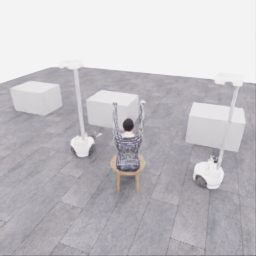
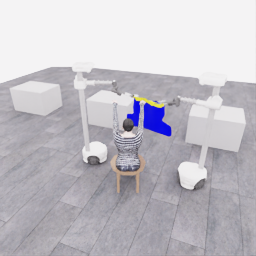
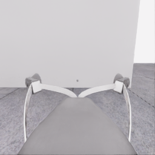
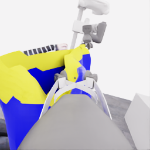
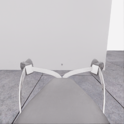
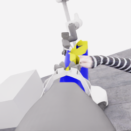
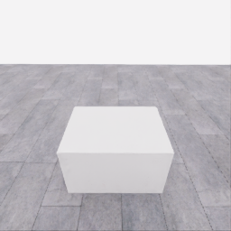
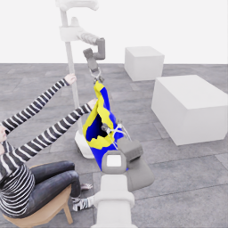
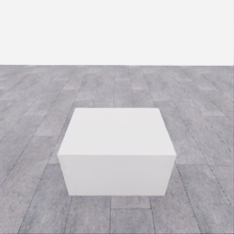
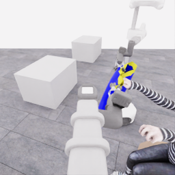

# 자동 시연 수집 시도 · 20261113-astra-diagonal738-001

[전체 수집 기록](../../README.ko.md) · [구조화 요약](manifest.json) · [전체 행동 기록](decisions.jsonl) · [사용한 기본 프롬프트](prompt.txt)

실행 상태는 **completed**, 원본 출처는 `gpt`입니다. 완료 상태와 과제 성공은 아래에서 따로 기록합니다.

## 실행 조건과 시간

| 항목 | 기록 |
|---|---|
| 기록 시작 UTC | 2026-11-13T22:31:59Z |
| 기록 종료 UTC | 2026-11-13T23:02:50Z |
| 이전 시도 | 20261113-astra-side-hem-fresh-001 |
| 재시도 사유 | Compare separate lowering, diagonal reorientation, and raising around the same visible wrist while retaining one anchor; use current public observations and avoid combining lift with retraction or a hand-target switch. |
| 출처 그룹 | 20261113-astra-side-hem-fresh-001 |
| 요청 모델 / 추론 설정 | gpt-6-astra / ultra |
| 전체 실제 경과 시간 (초) | 1850.453 |
| Actor 호출 합계 (초) | 1035.999 |
| 환경 요청·응답 합계 (초) | 764.021 |
| 시뮬레이션 시간 (초) | 45.750 |
| 저장 전이 수 | 915.000 |
| 응답 확인 전이 수 | 915.000 |
| 모델 호출 시도 수 | 20.000 |
| 완료한 결정 구간 수 | 19.000 |
| 파일 완료 상태 | true |
| 데이터 정합성 검사 | true |
| 학습 데이터 승인 | unreviewed |
| Actor 호출 방식 | exec |
| 한 호출의 최대 계획 구간 수 | 1.000 |
| 한 계획의 최대 제어 step 수 | 20.000 |
| 제어기 정착 대기 설정 | true |
| 정착 대기 요청 step 수 | 6.000 |
| 완료한 제어기 정착 구간 수 | 15.000 |
| 제어기 정착 전이 수 | 90.000 |
| 제어기 정착 환경 요청·응답 (초) | 73.666 |
| 전이 예산으로 단축한 정착 구간 수 | 0.000 |
| 전이 예산으로 건너뛴 정착 구간 수 | 0.000 |

Actor 호출 시간은 공개 입력 저장·요청 전송·응답 처리 등 호출 경로를 측정합니다. 방식에 따라 Docker/CLI 시작이 호출 안에 들어가거나 상주 서버 준비 시간으로 분리됩니다. 내부 모델 추론 시간만 별도로 측정한 값은 아닙니다. 모델이 판단하는 동안 물리 시간은 멈추며 실제 경과 시간과 시뮬레이션 시간은 다릅니다. 세부 요청 프로세스 시간에도 CLI 처리·네트워크·서버 대기·생성이 함께 포함됩니다.

## 토큰 사용량의 범위

`actor_usage`는 thread별 관측 누계를 합친 값입니다. 결정의 `usage`는 원본 CLI 누계이며, 호출별 증가량은 `usage_accounting.incremental_usage`입니다. 캐시 입력은 입력의 부분집합이고 추론 출력은 출력의 부분집합이므로 열들을 다시 합산하지 않습니다.

전체 호출 사용량 확정: **true** · 기록한 호출 수: 20.

| 입력 | 캐시 입력 | 캐시 쓰기 입력 | 출력 | 추론 출력 |
|---:|---:|---:|---:|---:|
| 2481537 | 2178944 | 0 | 31686 | 27200 |

중복 누계는 추가 사용량 0으로 처리하고, 역행한 누계는 미확정으로 보존합니다. 새 thread는 별도로 집계합니다. 토큰 기록은 화폐 비용이나 청구서가 아닙니다.

## 리뷰 정지 조건

목표 누적 점수 10.000 · 감시 상태 `collector_ended_before_gate` · 수집기 상태 `completed`.

마지막 관측 점수 5.000 · 응답 확인 step 915.

`review_ready`는 정지 조건에 따라 실행을 마치고 리뷰할 준비가 된 상태입니다. 50점·착의 성공이나 학습 데이터 승인을 뜻하지 않습니다. 공식 점수와 success는 아래 평가 결과로 확인합니다.

## 공식 평가 결과

평가 유효성 `true` · 누적 점수 **5.000 / 50** · 착의 success **false** · rate 상태 `no_dressing_points` · 최종 rate 0.000 points/s.

누적 50점, 착의 success, 정상 파일 종료와 데이터 정합성은 서로 다른 상태입니다. 접촉 전 `no_contact`의 rate는 0점/초로 바꾸지 않습니다.

| 단계 | 획득 점수 / 최대 | 획득 시각 (episode 초) |
|---|---:|---:|
| 파지·들기 | 5.000 / 5 | 18.550 |
| 첫 소매 | 0.000 / 5 | 미측정/해당 없음 |
| 반대 어깨 | 0.000 / 5 | 미측정/해당 없음 |
| 두 번째 소매 | 0.000 / 5 | 미측정/해당 없음 |
| 왼쪽 위팔 | 0.000 / 5 | 미측정/해당 없음 |
| 오른쪽 위팔 | 0.000 / 5 | 미측정/해당 없음 |
| 목 통과 | 0.000 / 10 | 미측정/해당 없음 |
| 앞면 방향 | 0.000 / 10 | 미측정/해당 없음 |

## 단계 획득 경로

점수 획득은 [평가 이벤트](score-events.jsonl)에서 같은 physics tick끼리 묶었습니다. 같은 시각에 인정된 항목의 내부 순서는 추정하지 않습니다. 착의 success는 점수 획득과 별도로 기록합니다.

| 순서 | episode 시간 (초) | 전이 경계 step | 누적 점수 변화 | 같은 시각의 항목 변화 |
|---:|---:|---:|---:|---|
| 0 | 18.550 | 371 | 0.000→5.000 | 파지·들기 0.000→5.000 |

평가 clock 0초에 대응하는 공개 simulation clock은 1.525초입니다. 두 시계를 같은 절대 시각으로 혼동하지 않습니다.

별도 success 이벤트 수: **0**. 평가 유효성: `true`.


## 원본 관측 화면

지정된 공개 카메라의 저장 RGB 픽셀입니다. 시작은 첫 `obs`, 종료는 마지막 `next_obs`입니다. 이미지 합성이나 내부 상태 기반 장면 재구성 없이 원본 픽셀로 PNG를 저장했습니다.

| 카메라 | 시작 | 종료 |
|---|---|---|
| `overview` | [](images/initial-overview.png) | [](images/final-overview.png) |
| `robot_0_wrist` | [](images/initial-robot_0_wrist.png) | [](images/final-robot_0_wrist.png) |
| `robot_1_wrist` | [](images/initial-robot_1_wrist.png) | [](images/final-robot_1_wrist.png) |
| `robot_0_head` | [](images/initial-robot_0_head.png) | [](images/final-robot_0_head.png) |
| `robot_1_head` | [](images/initial-robot_1_head.png) | [](images/final-robot_1_head.png) |

시작 관측 시각 1.525초 · 종료 관측 시각 47.275초 (공개 simulation clock).

[▶ overview 관측 영상 보기](overview.mp4)

저장된 20 Hz `obs` 중 915프레임을 순서대로 사용했습니다. 재생은 **1배 느리게** (20.000 fps), 실제 대기 시간·모델 호출 지연은 영상에 들어가지 않습니다. 종료 `next_obs`는 위 PNG에서 확인합니다.

## 결정과 실행 순서

아래 근거는 모델 최종 JSON의 짧은 행동 설명입니다. 시각적 평가는 행동 전 관측에 대한 판단이며, 그 행동의 실행 후 성공 라벨로 사용하지 않습니다. 공식 점수는 별도의 평가 결과입니다.

행동의 각 행은 로봇 0·1 순서이며 열은 `전진, 왼쪽 이동, 반시계 회전, 리프트, 팔 신장, 손목 yaw, pitch, roll, gripper`입니다. 앞 8개는 정규화 속도이고 gripper는 닫기 `+1`, 열기 `-1`, 의도 유지 `0`입니다.

제어기 정착 대기는 앞선 모델 결정에 연결된 별도 중립 행동입니다. 추가 모델 호출이나 모델 결정으로 집계하지 않으며, 실제 전이와 환경 요청·응답 시간은 전체 합계에 포함됩니다. 중립 행동은 두 로봇의 속도와 gripper 명령을 모두 0으로 보내 기존 gripper 의도를 유지합니다. 대기를 실행했다는 기록이 옷의 정착이나 과제 개선을 확인했다는 뜻은 아닙니다.

### 기록된 행동의 재실행 구간

원본 `20261113-astra-side-hem-fresh-001`의 행동 738전이를 새 환경에서 다시 실행했습니다. 이 구간에는 새 모델 호출이 없고 관측·평가를 새로 기록했습니다. 정확한 물리 상태 복원이나 독립적인 새 시연으로 집계하지 않습니다. 원본 step 대응과 실제 행동은 `decisions.jsonl`의 `replayed_segment`에 있습니다.

### 별도 모델 호출 0 · `initial`

실행 결정 인덱스 0의 고정 관측을 사용했습니다. 호출 경과 50.847초. 같은 call index의 행동 기록과 사용량을 중복 합산하지 않습니다.

공개 입력 저장 0.212초 · 요청 프로세스 50.634초 · 결과 해석 0.000초.

### 결정 0 · 첫 소매 · `act`

입력 관측 38.425초 · Actor 호출 50.847초 · 시각적 판단 `uncertain`.

계획 `20261113-astra-diagonal738-001:call-00000` · 모델 호출 인덱스 0 · 계획 구간 1/1 · 이 구간에서 모델 호출 `true`.

실행 직전 최신 관측 38.425초.

공개 입력 저장 0.212초 · 요청 프로세스 50.634초 · 결과 해석 0.000초.

호출 사용량 상태 `observed` · 이번 증가량 입력 23236 / 출력 1686 토큰.

최종 응답의 행동 설명: Lower-and-inspect: robot 0 appears to support the opposite edge; robot 1 guides the candidate lip above the hand on the right-entering striped forearm in its wrist view. Lower robot 1 alone; inspect cloth following, retained anchor support and clearance at that same wrist. Entry remains unconfirmed.

요청 행동:

```json
[[0, 0, 0, 0, 0, 0, 0, 0, 0], [0, 0, 0, -0.08, 0, 0, 0, 0, 0]]
```

실행 구간 step **[738, 742)** · 요청 4 step / 실제 4 step · 환경 요청·응답 3.401초.

실제 적용 행동:

```json
[[0.0, 0.0, 0.0, 0.0, 0.0, 0.0, 0.0, 0.0, 0.0], [0.0, 0.0, 0.0, -0.07999999821186066, 0.0, 0.0, 0.0, 0.0, 0.0]]
```

### 제어기 정착 대기 · 연결 결정 0

구간 `20261113-astra-diagonal738-001:settle-00000` · 출처 `controller_settle` · 이 구간에서 모델 호출 `false`.

앞선 모델 호출 인덱스 0에 연결됩니다. 추가 호출은 없습니다.

실행 구간 step **[742, 748)** · 요청 6 step / 실제 6 step · 환경 요청·응답 4.994초.

공개 simulation clock 38.625→38.925초 · 실행 전 관측 38.625초.

실제 적용 중립 행동:

```json
[[0.0, 0.0, 0.0, 0.0, 0.0, 0.0, 0.0, 0.0, 0.0], [0.0, 0.0, 0.0, 0.0, 0.0, 0.0, 0.0, 0.0, 0.0]]
```

### 별도 모델 호출 1 · `initial`

실행 결정 인덱스 1의 고정 관측을 사용했습니다. 호출 경과 34.038초. 같은 call index의 행동 기록과 사용량을 중복 합산하지 않습니다.

공개 입력 저장 0.076초 · 요청 프로세스 33.962초 · 결과 해석 0.000초.

### 결정 1 · 첫 소매 · `act`

입력 관측 38.925초 · Actor 호출 34.038초 · 시각적 판단 `uncertain`.

계획 `20261113-astra-diagonal738-001:call-00001` · 모델 호출 인덱스 1 · 계획 구간 1/1 · 이 구간에서 모델 호출 `true`.

실행 직전 최신 관측 38.925초.

공개 입력 저장 0.076초 · 요청 프로세스 33.962초 · 결과 해석 0.000초.

호출 사용량 상태 `observed` · 이번 증가량 입력 33804 / 출력 1048 토큰.

최종 응답의 행동 설명: Robot 1 lowered 2.3 cm and its held edge appears to follow; robot 0 retains opposite support. The same right-entering hand remains beside the candidate rim, without confirmed entry. Diagonal-reorientation trial: roll robot 1 slightly to test lip separation and clearance for both housings before considering a raise.

요청 행동:

```json
[[0, 0, 0, 0, 0, 0, 0, 0, 0], [0, 0, 0, 0, 0, 0, 0, 0.12, 0]]
```

실행 구간 step **[748, 752)** · 요청 4 step / 실제 4 step · 환경 요청·응답 3.352초.

실제 적용 행동:

```json
[[0.0, 0.0, 0.0, 0.0, 0.0, 0.0, 0.0, 0.0, 0.0], [0.0, 0.0, 0.0, 0.0, 0.0, 0.0, 0.0, 0.11999999731779099, 0.0]]
```

### 제어기 정착 대기 · 연결 결정 1

구간 `20261113-astra-diagonal738-001:settle-00001` · 출처 `controller_settle` · 이 구간에서 모델 호출 `false`.

앞선 모델 호출 인덱스 1에 연결됩니다. 추가 호출은 없습니다.

실행 구간 step **[752, 758)** · 요청 6 step / 실제 6 step · 환경 요청·응답 4.660초.

공개 simulation clock 39.125→39.425초 · 실행 전 관측 39.125초.

실제 적용 중립 행동:

```json
[[0.0, 0.0, 0.0, 0.0, 0.0, 0.0, 0.0, 0.0, 0.0], [0.0, 0.0, 0.0, 0.0, 0.0, 0.0, 0.0, 0.0, 0.0]]
```

### 별도 모델 호출 2 · `initial`

실행 결정 인덱스 2의 고정 관측을 사용했습니다. 호출 경과 37.998초. 같은 call index의 행동 기록과 사용량을 중복 합산하지 않습니다.

공개 입력 저장 0.079초 · 요청 프로세스 37.920초 · 결과 해석 0.000초.

### 결정 2 · 첫 소매 · `act`

입력 관측 39.425초 · Actor 호출 37.998초 · 시각적 판단 `uncertain`.

계획 `20261113-astra-diagonal738-001:call-00002` · 모델 호출 인덱스 2 · 계획 구간 1/1 · 이 구간에서 모델 호출 `true`.

실행 직전 최신 관측 39.425초.

공개 입력 저장 0.079초 · 요청 프로세스 37.920초 · 결과 해석 0.000초.

호출 사용량 상태 `observed` · 이번 증가량 입력 43716 / 출력 1115 토큰.

최종 응답의 행동 설명: Robot 1 rolled 0.115 rad but remains 0.015 rad short of target and moving. Robot 0 retains opposite support; the same hand remains beside the candidate rim without established entry. Briefly hold both to inspect residual rotation and lip separation before deciding on the raising trial.

요청 행동:

```json
[[0, 0, 0, 0, 0, 0, 0, 0, 0], [0, 0, 0, 0, 0, 0, 0, 0, 0]]
```

실행 구간 step **[758, 762)** · 요청 4 step / 실제 4 step · 환경 요청·응답 3.331초.

실제 적용 행동:

```json
[[0.0, 0.0, 0.0, 0.0, 0.0, 0.0, 0.0, 0.0, 0.0], [0.0, 0.0, 0.0, 0.0, 0.0, 0.0, 0.0, 0.0, 0.0]]
```

### 별도 모델 호출 3 · `initial`

실행 결정 인덱스 3의 고정 관측을 사용했습니다. 호출 경과 25.378초. 같은 call index의 행동 기록과 사용량을 중복 합산하지 않습니다.

공개 입력 저장 0.076초 · 요청 프로세스 25.302초 · 결과 해석 0.000초.

### 결정 3 · 첫 소매 · `act`

입력 관측 39.625초 · Actor 호출 25.378초 · 시각적 판단 `uncertain`.

계획 `20261113-astra-diagonal738-001:call-00003` · 모델 호출 인덱스 3 · 계획 구간 1/1 · 이 구간에서 모델 호출 `true`.

실행 직전 최신 관측 39.625초.

공개 입력 저장 0.076초 · 요청 프로세스 25.302초 · 결과 해석 0.000초.

호출 사용량 상태 `observed` · 이번 증가량 입력 53703 / 출력 737 토큰.

최종 응답의 행동 설명: Robot 1’s roll is now near target; robot 0’s opposite support appears retained. The candidate lower lip remains trackable beside and below the same hand. Conditional-raise trial: raise robot 1 alone slightly, then inspect lip crossing, housing clearance and cloth following; disappearance behind cloth will not establish entry.

요청 행동:

```json
[[0, 0, 0, 0, 0, 0, 0, 0, 0], [0, 0, 0, 0.06, 0, 0, 0, 0, 0]]
```

실행 구간 step **[762, 766)** · 요청 4 step / 실제 4 step · 환경 요청·응답 3.310초.

실제 적용 행동:

```json
[[0.0, 0.0, 0.0, 0.0, 0.0, 0.0, 0.0, 0.0, 0.0], [0.0, 0.0, 0.0, 0.05999999865889549, 0.0, 0.0, 0.0, 0.0, 0.0]]
```

### 제어기 정착 대기 · 연결 결정 3

구간 `20261113-astra-diagonal738-001:settle-00003` · 출처 `controller_settle` · 이 구간에서 모델 호출 `false`.

앞선 모델 호출 인덱스 3에 연결됩니다. 추가 호출은 없습니다.

실행 구간 step **[766, 772)** · 요청 6 step / 실제 6 step · 환경 요청·응답 5.003초.

공개 simulation clock 39.825→40.125초 · 실행 전 관측 39.825초.

실제 적용 중립 행동:

```json
[[0.0, 0.0, 0.0, 0.0, 0.0, 0.0, 0.0, 0.0, 0.0], [0.0, 0.0, 0.0, 0.0, 0.0, 0.0, 0.0, 0.0, 0.0]]
```

### 별도 모델 호출 4 · `initial`

실행 결정 인덱스 4의 고정 관측을 사용했습니다. 호출 경과 93.920초. 같은 call index의 행동 기록과 사용량을 중복 합산하지 않습니다.

공개 입력 저장 0.076초 · 요청 프로세스 93.844초 · 결과 해석 0.000초.

### 공개 픽셀 depth 조회 · 결정 4

물리 전이 없이 같은 카메라·시각의 원본 값을 조회했습니다. 무효 값은 null이며 접촉·입구 통과 판단이 아닙니다.

```json
{
  "request": {
    "kind": "depth_query",
    "observation_id": "ead7b592d2d5458a663d7c75610db1326728ee71cc1f4d2621992ddaaaaab264",
    "camera": "robot_1_wrist",
    "pixels_uv": [
      [
        176,
        138
      ],
      [
        195,
        133
      ],
      [
        131,
        128
      ],
      [
        151,
        115
      ],
      [
        174,
        110
      ],
      [
        153,
        130
      ],
      [
        165,
        151
      ]
    ],
    "include_camera_geometry": true
  },
  "response": {
    "kind": "depth_query_result",
    "observation_id": "ead7b592d2d5458a663d7c75610db1326728ee71cc1f4d2621992ddaaaaab264",
    "camera": "robot_1_wrist",
    "camera_index": 2,
    "simulation_time_s": 40.125002092681825,
    "intrinsics_sha256": "3dd91a2df5cb0a47b6f5ceb86d60d41e1f5d6753d2a11a034ac0b52bc385cd23",
    "request_sha256": "7efe1d93493428992c32982a46bf261550cdb0d12e1ed5a4aa7265159c865bfd",
    "depth_semantics": "optical_Z_metres_not_ray_range",
    "geometry_semantics": "camera_X_right_Y_down_Z_forward",
    "rgb_image_order": [
      "overview",
      "robot_0_wrist",
      "robot_1_wrist",
      "robot_0_head",
      "robot_1_head"
    ],
    "resolution_wh": [
      256,
      256
    ],
    "neighbor_depth_substituted": false,
    "hidden_surfaces_estimated": false,
    "object_pose_or_contact_inferred": false,
    "source_sha256": {
      "observation_json": "d5da7bc5c5f768895371713a5db63b5bd770c1706d4c66b93868b4f14f5657ed",
      "public_depth_npz": "f050b3b4908bdfe530b241fa656e5aa3151c169fafaac99f2f6ec61ee49f58d0",
      "overview_rgb": "935610af5b33747d33621c93fe9c8c16b784a4c4ab1c554bca701abeec8c5190",
      "robot_0_wrist_rgb": "dc27a0eadee6bd31edbb9821b9c8348530b4f93987f7aa14cfdec80e16c070e4",
      "robot_1_wrist_rgb": "f018973478a7626e5844aa08831f8cba925279c18ca68173b170db3527ba831f",
      "robot_0_head_rgb": "377a703f52be0618dce0d08830ec4bc3186a6fbb3e8fb2a2d1a4adee14aa5f4c",
      "robot_1_head_rgb": "bac1a80e3d5bee5deb27cb9810b72e965a04132115928760afd7982f28da1cd6"
    },
    "results": [
      {
        "pixel_uv": [
          176,
          138
        ],
        "status": "valid",
        "optical_z_m": 0.3206339180469513,
        "camera_xyz_m": [
          0.08419135740832111,
          0.017539866126733562,
          0.3206339180469513
        ],
        "camera_range_m": 0.3319667769041632,
        "invalid_reasons": []
      },
      {
        "pixel_uv": [
          195,
          133
        ],
        "status": "valid",
        "optical_z_m": 0.3232610523700714,
        "camera_xyz_m": [
          0.11847998687891843,
          0.008841790065590929,
          0.3232610523700714
        ],
        "camera_range_m": 0.34440295080297834,
        "invalid_reasons": []
      },
      {
        "pixel_uv": [
          131,
          128
        ],
        "status": "valid",
        "optical_z_m": 0.4945685565471649,
        "camera_xyz_m": [
          0.00811642104974578,
          0.0,
          0.4945685565471649
        ],
        "camera_range_m": 0.4946351518198065,
        "invalid_reasons": []
      },
      {
        "pixel_uv": [
          151,
          115
        ],
        "status": "valid",
        "optical_z_m": 0.29543009400367737,
        "camera_xyz_m": [
          0.03717058369698199,
          -0.021009460350468082,
          0.29543009400367737
        ],
        "camera_range_m": 0.29849956475615486,
        "invalid_reasons": []
      },
      {
        "pixel_uv": [
          174,
          110
        ],
        "status": "valid",
        "optical_z_m": 0.4459421932697296,
        "camera_xyz_m": [
          0.11221559316663168,
          -0.04391044949998631,
          0.4459421932697296
        ],
        "camera_range_m": 0.4619360417452255,
        "invalid_reasons": []
      },
      {
        "pixel_uv": [
          153,
          130
        ],
        "status": "valid",
        "optical_z_m": 0.22360554337501526,
        "camera_xyz_m": [
          0.030580134190754667,
          0.0024464107352603734,
          0.22360554337501526
        ],
        "camera_range_m": 0.2257001740376954,
        "invalid_reasons": []
      },
      {
        "pixel_uv": [
          165,
          151
        ],
        "status": "valid",
        "optical_z_m": 0.45756909251213074,
        "camera_xyz_m": [
          0.09261369632550383,
          0.05757067609423211,
          0.45756909251213074
        ],
        "camera_range_m": 0.47038404938453693,
        "invalid_reasons": []
      }
    ]
  }
}
```

### 별도 모델 호출 5 · `action_after_query`

실행 결정 인덱스 4의 고정 관측을 사용했습니다. 호출 경과 35.492초. 같은 call index의 행동 기록과 사용량을 중복 합산하지 않습니다.

공개 입력 저장 0.076초 · 요청 프로세스 35.416초 · 결과 해석 0.000초.

### 결정 4 · 첫 소매 · `act`

입력 관측 40.125초 · Actor 호출 35.492초 · 시각적 판단 `uncertain`.

계획 `20261113-astra-diagonal738-001:call-00005` · 모델 호출 인덱스 5 · 계획 구간 1/1 · 이 구간에서 모델 호출 `true`.

실행 직전 최신 관측 40.125초.

공개 입력 저장 0.076초 · 요청 프로세스 35.416초 · 결과 해석 0.000초.

호출 사용량 상태 `observed` · 이번 증가량 입력 76373 / 출력 1214 토큰.

최종 응답의 행동 설명: The sampled hand is approximately 5 cm sideways from the near lip candidate; height and roll trials have not established crossing. Robot 0 maintains opposite support while robot 1 guides. Shift both supports laterally toward that same hand about 2.4 cm, then inspect rim crossing, cloth following and housing clearance.

요청 행동:

```json
[[-0.023, 0.128, 0, 0, 0, 0, 0, 0, 0], [-0.044, -0.122, 0, 0, 0, 0, 0, 0, 0]]
```

실행 구간 step **[772, 778)** · 요청 6 step / 실제 6 step · 환경 요청·응답 4.956초.

실제 적용 행동:

```json
[[-0.023000000044703484, 0.12800000607967377, 0.0, 0.0, 0.0, 0.0, 0.0, 0.0, 0.0], [-0.04399999976158142, -0.12200000137090683, 0.0, 0.0, 0.0, 0.0, 0.0, 0.0, 0.0]]
```

### 제어기 정착 대기 · 연결 결정 4

구간 `20261113-astra-diagonal738-001:settle-00004` · 출처 `controller_settle` · 이 구간에서 모델 호출 `false`.

앞선 모델 호출 인덱스 5에 연결됩니다. 추가 호출은 없습니다.

실행 구간 step **[778, 784)** · 요청 6 step / 실제 6 step · 환경 요청·응답 4.940초.

공개 simulation clock 40.425→40.725초 · 실행 전 관측 40.425초.

실제 적용 중립 행동:

```json
[[0.0, 0.0, 0.0, 0.0, 0.0, 0.0, 0.0, 0.0, 0.0], [0.0, 0.0, 0.0, 0.0, 0.0, 0.0, 0.0, 0.0, 0.0]]
```

### 별도 모델 호출 6 · `initial`

실행 결정 인덱스 5의 고정 관측을 사용했습니다. 호출 경과 86.961초. 같은 call index의 행동 기록과 사용량을 중복 합산하지 않습니다.

공개 입력 저장 0.076초 · 요청 프로세스 86.884초 · 결과 해석 0.000초.

### 결정 5 · 첫 소매 · `act`

입력 관측 40.725초 · Actor 호출 86.961초 · 시각적 판단 `uncertain`.

계획 `20261113-astra-diagonal738-001:call-00006` · 모델 호출 인덱스 6 · 계획 구간 1/1 · 이 구간에서 모델 호출 `true`.

실행 직전 최신 관측 40.725초.

공개 입력 저장 0.076초 · 요청 프로세스 86.884초 · 결과 해석 0.000초.

호출 사용량 상태 `observed` · 이번 증가량 입력 86548 / 출력 2605 토큰.

최종 응답의 행동 설명: Both bases shifted about 2.4 cm, with cloth retained at both grips. The same hand moved closer to the candidate lip and remains trackable in robot 1’s head view. Robot 0 supports while robot 1 guides another short lateral alignment; inspect rim crossing and housing clearance before further advance.

요청 행동:

```json
[[-0.023, 0.128, 0, 0, 0, 0, 0, 0, 0], [-0.044, -0.122, 0, 0, 0, 0, 0, 0, 0]]
```

실행 구간 step **[784, 788)** · 요청 4 step / 실제 4 step · 환경 요청·응답 3.381초.

실제 적용 행동:

```json
[[-0.023000000044703484, 0.12800000607967377, 0.0, 0.0, 0.0, 0.0, 0.0, 0.0, 0.0], [-0.04399999976158142, -0.12200000137090683, 0.0, 0.0, 0.0, 0.0, 0.0, 0.0, 0.0]]
```

### 제어기 정착 대기 · 연결 결정 5

구간 `20261113-astra-diagonal738-001:settle-00005` · 출처 `controller_settle` · 이 구간에서 모델 호출 `false`.

앞선 모델 호출 인덱스 6에 연결됩니다. 추가 호출은 없습니다.

실행 구간 step **[788, 794)** · 요청 6 step / 실제 6 step · 환경 요청·응답 4.882초.

공개 simulation clock 40.925→41.225초 · 실행 전 관측 40.925초.

실제 적용 중립 행동:

```json
[[0.0, 0.0, 0.0, 0.0, 0.0, 0.0, 0.0, 0.0, 0.0], [0.0, 0.0, 0.0, 0.0, 0.0, 0.0, 0.0, 0.0, 0.0]]
```

### 별도 모델 호출 7 · `initial`

실행 결정 인덱스 6의 고정 관측을 사용했습니다. 호출 경과 41.354초. 같은 call index의 행동 기록과 사용량을 중복 합산하지 않습니다.

공개 입력 저장 0.079초 · 요청 프로세스 41.275초 · 결과 해석 0.000초.

### 결정 6 · 첫 소매 · `act`

입력 관측 41.225초 · Actor 호출 41.354초 · 시각적 판단 `recovering`.

계획 `20261113-astra-diagonal738-001:call-00007` · 모델 호출 인덱스 7 · 계획 구간 1/1 · 이 구간에서 모델 호출 `true`.

실행 직전 최신 관측 41.225초.

공개 입력 저장 0.079초 · 요청 프로세스 41.275초 · 결과 해석 0.000초.

호출 사용량 상태 `observed` · 이번 증가량 입력 98005 / 출력 1255 토큰.

최종 응답의 행동 설명: The additional 1.6 cm shift occurred, but the same hand now overlaps robot 1’s finger in its wrist view without established rim crossing. Robot 0 retains opposite support; yaw robot 1 outward to recover housing clearance and change the opening’s approach angle. Inspect the retained hand/rim relationship before advancing.

요청 행동:

```json
[[0, 0, 0, 0, 0, 0, 0, 0, 0], [0, 0, 0, 0, 0, 0.1, 0, 0, 0]]
```

실행 구간 step **[794, 798)** · 요청 4 step / 실제 4 step · 환경 요청·응답 3.391초.

실제 적용 행동:

```json
[[0.0, 0.0, 0.0, 0.0, 0.0, 0.0, 0.0, 0.0, 0.0], [0.0, 0.0, 0.0, 0.0, 0.0, 0.10000000149011612, 0.0, 0.0, 0.0]]
```

### 제어기 정착 대기 · 연결 결정 6

구간 `20261113-astra-diagonal738-001:settle-00006` · 출처 `controller_settle` · 이 구간에서 모델 호출 `false`.

앞선 모델 호출 인덱스 7에 연결됩니다. 추가 호출은 없습니다.

실행 구간 step **[798, 804)** · 요청 6 step / 실제 6 step · 환경 요청·응답 4.837초.

공개 simulation clock 41.425→41.725초 · 실행 전 관측 41.425초.

실제 적용 중립 행동:

```json
[[0.0, 0.0, 0.0, 0.0, 0.0, 0.0, 0.0, 0.0, 0.0], [0.0, 0.0, 0.0, 0.0, 0.0, 0.0, 0.0, 0.0, 0.0]]
```

### 별도 모델 호출 8 · `initial`

실행 결정 인덱스 7의 고정 관측을 사용했습니다. 호출 경과 106.398초. 같은 call index의 행동 기록과 사용량을 중복 합산하지 않습니다.

공개 입력 저장 0.080초 · 요청 프로세스 106.318초 · 결과 해석 0.000초.

### 결정 7 · 첫 소매 · `act`

입력 관측 41.725초 · Actor 호출 106.398초 · 시각적 판단 `uncertain`.

계획 `20261113-astra-diagonal738-001:call-00008` · 모델 호출 인덱스 8 · 계획 구간 1/1 · 이 구간에서 모델 호출 `true`.

실행 직전 최신 관측 41.725초.

공개 입력 저장 0.080초 · 요청 프로세스 106.318초 · 결과 해석 0.000초.

호출 사용량 상태 `observed` · 이번 증가량 입력 108136 / 출력 3289 토큰.

최종 응답의 행동 설명: Robot 0 retains opposite support; robot 1’s yaw moved 0.095 rad and exposed the same hand again. The guide lip still appears above that hand. From this changed approach, lower robot 1 alone about 4.6 cm; inspect lip-to-wrist height, cloth following and housing clearance before another entry trial.

요청 행동:

```json
[[0, 0, 0, 0, 0, 0, 0, 0, 0], [0, 0, 0, -0.12, 0, 0, 0, 0, 0]]
```

실행 구간 step **[804, 809)** · 요청 5 step / 실제 5 step · 환경 요청·응답 4.272초.

실제 적용 행동:

```json
[[0.0, 0.0, 0.0, 0.0, 0.0, 0.0, 0.0, 0.0, 0.0], [0.0, 0.0, 0.0, -0.11999999731779099, 0.0, 0.0, 0.0, 0.0, 0.0]]
```

### 제어기 정착 대기 · 연결 결정 7

구간 `20261113-astra-diagonal738-001:settle-00007` · 출처 `controller_settle` · 이 구간에서 모델 호출 `false`.

앞선 모델 호출 인덱스 8에 연결됩니다. 추가 호출은 없습니다.

실행 구간 step **[809, 815)** · 요청 6 step / 실제 6 step · 환경 요청·응답 4.907초.

공개 simulation clock 41.975→42.275초 · 실행 전 관측 41.975초.

실제 적용 중립 행동:

```json
[[0.0, 0.0, 0.0, 0.0, 0.0, 0.0, 0.0, 0.0, 0.0], [0.0, 0.0, 0.0, 0.0, 0.0, 0.0, 0.0, 0.0, 0.0]]
```

### 별도 모델 호출 9 · `initial`

실행 결정 인덱스 8의 고정 관측을 사용했습니다. 호출 경과 77.649초. 같은 call index의 행동 기록과 사용량을 중복 합산하지 않습니다.

공개 입력 저장 0.077초 · 요청 프로세스 77.572초 · 결과 해석 0.000초.

### 결정 8 · 첫 소매 · `act`

입력 관측 42.275초 · Actor 호출 77.649초 · 시각적 판단 `uncertain`.

계획 `20261113-astra-diagonal738-001:call-00009` · 모델 호출 인덱스 9 · 계획 구간 1/1 · 이 구간에서 모델 호출 `true`.

실행 직전 최신 관측 42.275초.

공개 입력 저장 0.077초 · 요청 프로세스 77.572초 · 결과 해석 0.000초.

호출 사용량 상태 `observed` · 이번 증가량 입력 120306 / 출력 2405 토큰.

최종 응답의 행동 설명: Robot 1 lowered about 4.1 cm with cloth following; the same hand is now visible above its near held edge. Robot 0 retains opposite support. Test a small downward pitch of robot 1 to reorient that lip beneath the hand; inspect lip separation and both housings’ clearance before raising.

요청 행동:

```json
[[0, 0, 0, 0, 0, 0, 0, 0, 0], [0, 0, 0, 0, 0, 0, 0.08, 0, 0]]
```

실행 구간 step **[815, 819)** · 요청 4 step / 실제 4 step · 환경 요청·응답 3.498초.

실제 적용 행동:

```json
[[0.0, 0.0, 0.0, 0.0, 0.0, 0.0, 0.0, 0.0, 0.0], [0.0, 0.0, 0.0, 0.0, 0.0, 0.0, 0.07999999821186066, 0.0, 0.0]]
```

### 제어기 정착 대기 · 연결 결정 8

구간 `20261113-astra-diagonal738-001:settle-00008` · 출처 `controller_settle` · 이 구간에서 모델 호출 `false`.

앞선 모델 호출 인덱스 9에 연결됩니다. 추가 호출은 없습니다.

실행 구간 step **[819, 825)** · 요청 6 step / 실제 6 step · 환경 요청·응답 4.864초.

공개 simulation clock 42.475→42.775초 · 실행 전 관측 42.475초.

실제 적용 중립 행동:

```json
[[0.0, 0.0, 0.0, 0.0, 0.0, 0.0, 0.0, 0.0, 0.0], [0.0, 0.0, 0.0, 0.0, 0.0, 0.0, 0.0, 0.0, 0.0]]
```

### 별도 모델 호출 10 · `initial`

실행 결정 인덱스 9의 고정 관측을 사용했습니다. 호출 경과 24.926초. 같은 call index의 행동 기록과 사용량을 중복 합산하지 않습니다.

공개 입력 저장 0.077초 · 요청 프로세스 24.848초 · 결과 해석 0.000초.

### 결정 9 · 첫 소매 · `act`

입력 관측 42.775초 · Actor 호출 24.926초 · 시각적 판단 `uncertain`.

계획 `20261113-astra-diagonal738-001:call-00010` · 모델 호출 인덱스 10 · 계획 구간 1/1 · 이 구간에서 모델 호출 `true`.

실행 직전 최신 관측 42.775초.

공개 입력 저장 0.077초 · 요청 프로세스 24.848초 · 결과 해석 0.000초.

호출 사용량 상태 `observed` · 이번 증가량 입력 131596 / 출력 735 토큰.

최종 응답의 행동 설명: The pitch trial lowered robot 1’s grip another 2.7 cm; the same hand remains visible above the candidate near lip. Robot 0 retains opposite support. Conditionally raise robot 1 alone about 3 cm, then inspect whether the lip crosses around that wrist or merely lifts an exterior panel.

요청 행동:

```json
[[0, 0, 0, 0, 0, 0, 0, 0, 0], [0, 0, 0, 0.08, 0, 0, 0, 0, 0]]
```

실행 구간 step **[825, 830)** · 요청 5 step / 실제 5 step · 환경 요청·응답 4.161초.

실제 적용 행동:

```json
[[0.0, 0.0, 0.0, 0.0, 0.0, 0.0, 0.0, 0.0, 0.0], [0.0, 0.0, 0.0, 0.07999999821186066, 0.0, 0.0, 0.0, 0.0, 0.0]]
```

### 제어기 정착 대기 · 연결 결정 9

구간 `20261113-astra-diagonal738-001:settle-00009` · 출처 `controller_settle` · 이 구간에서 모델 호출 `false`.

앞선 모델 호출 인덱스 10에 연결됩니다. 추가 호출은 없습니다.

실행 구간 step **[830, 836)** · 요청 6 step / 실제 6 step · 환경 요청·응답 5.021초.

공개 simulation clock 43.025→43.325초 · 실행 전 관측 43.025초.

실제 적용 중립 행동:

```json
[[0.0, 0.0, 0.0, 0.0, 0.0, 0.0, 0.0, 0.0, 0.0], [0.0, 0.0, 0.0, 0.0, 0.0, 0.0, 0.0, 0.0, 0.0]]
```

### 별도 모델 호출 11 · `initial`

실행 결정 인덱스 10의 고정 관측을 사용했습니다. 호출 경과 47.210초. 같은 call index의 행동 기록과 사용량을 중복 합산하지 않습니다.

공개 입력 저장 0.076초 · 요청 프로세스 47.134초 · 결과 해석 0.000초.

### 결정 10 · 첫 소매 · `act`

입력 관측 43.325초 · Actor 호출 47.210초 · 시각적 판단 `uncertain`.

계획 `20261113-astra-diagonal738-001:call-00011` · 모델 호출 인덱스 11 · 계획 구간 1/1 · 이 구간에서 모델 호출 `true`.

실행 직전 최신 관측 43.325초.

공개 입력 저장 0.076초 · 요청 프로세스 47.134초 · 결과 해석 0.000초.

호출 사용량 상태 `observed` · 이번 증가량 입력 141230 / 출력 1398 토큰.

최종 응답의 행동 설명: Robot 1’s grip rose 2.3 cm, but its lift remains 6 mm short of target and rising. The same hand is visible without established rim crossing. Robot 0 anchors and robot 1 retains the guide grip; briefly observe residual motion and cloth response before choosing the next approach.

요청 행동:

```json
[[0, 0, 0, 0, 0, 0, 0, 0, 0], [0, 0, 0, 0, 0, 0, 0, 0, 0]]
```

실행 구간 step **[836, 840)** · 요청 4 step / 실제 4 step · 환경 요청·응답 3.427초.

실제 적용 행동:

```json
[[0.0, 0.0, 0.0, 0.0, 0.0, 0.0, 0.0, 0.0, 0.0], [0.0, 0.0, 0.0, 0.0, 0.0, 0.0, 0.0, 0.0, 0.0]]
```

### 별도 모델 호출 12 · `initial`

실행 결정 인덱스 11의 고정 관측을 사용했습니다. 호출 경과 21.924초. 같은 call index의 행동 기록과 사용량을 중복 합산하지 않습니다.

공개 입력 저장 0.077초 · 요청 프로세스 21.847초 · 결과 해석 0.000초.

### 결정 11 · 첫 소매 · `act`

입력 관측 43.525초 · Actor 호출 21.924초 · 시각적 판단 `uncertain`.

계획 `20261113-astra-diagonal738-001:call-00012` · 모델 호출 인덱스 12 · 계획 구간 1/1 · 이 구간에서 모델 호출 `true`.

실행 직전 최신 관측 43.525초.

공개 입력 저장 0.077초 · 요청 프로세스 21.847초 · 결과 해석 0.000초.

호출 사용량 상태 `observed` · 이번 증가량 입력 151539 / 출력 629 토큰.

최종 응답의 행동 설명: The extra observation added about 2 mm of grip rise without revealing rim crossing. Robot 0 retains opposite support; robot 1 shifts its lowered, pitched guide edge laterally about 3 cm toward the same hand. Test mouth centering while inspecting cloth following and housing clearance.

요청 행동:

```json
[[0, 0, 0, 0, 0, 0, 0, 0, 0], [-0.055, -0.15, 0, 0, 0, 0, 0, 0, 0]]
```

실행 구간 step **[840, 846)** · 요청 6 step / 실제 6 step · 환경 요청·응답 4.891초.

실제 적용 행동:

```json
[[0.0, 0.0, 0.0, 0.0, 0.0, 0.0, 0.0, 0.0, 0.0], [-0.054999999701976776, -0.15000000596046448, 0.0, 0.0, 0.0, 0.0, 0.0, 0.0, 0.0]]
```

### 제어기 정착 대기 · 연결 결정 11

구간 `20261113-astra-diagonal738-001:settle-00011` · 출처 `controller_settle` · 이 구간에서 모델 호출 `false`.

앞선 모델 호출 인덱스 12에 연결됩니다. 추가 호출은 없습니다.

실행 구간 step **[846, 852)** · 요청 6 step / 실제 6 step · 환경 요청·응답 4.922초.

공개 simulation clock 43.825→44.125초 · 실행 전 관측 43.825초.

실제 적용 중립 행동:

```json
[[0.0, 0.0, 0.0, 0.0, 0.0, 0.0, 0.0, 0.0, 0.0], [0.0, 0.0, 0.0, 0.0, 0.0, 0.0, 0.0, 0.0, 0.0]]
```

### 별도 모델 호출 13 · `initial`

실행 결정 인덱스 12의 고정 관측을 사용했습니다. 호출 경과 73.955초. 같은 call index의 행동 기록과 사용량을 중복 합산하지 않습니다.

공개 입력 저장 0.076초 · 요청 프로세스 73.878초 · 결과 해석 0.000초.

### 결정 12 · 첫 소매 · `act`

입력 관측 44.125초 · Actor 호출 73.955초 · 시각적 판단 `uncertain`.

계획 `20261113-astra-diagonal738-001:call-00013` · 모델 호출 인덱스 13 · 계획 구간 1/1 · 이 구간에서 모델 호출 `true`.

실행 직전 최신 관측 44.125초.

공개 입력 저장 0.076초 · 요청 프로세스 73.878초 · 결과 해석 0.000초.

호출 사용량 상태 `observed` · 이번 증가량 입력 161055 / 출력 2297 토큰.

최종 응답의 행동 설명: Robot 1 moved 2.9 cm, but the same hand remains near the held corner. Robot 0 maintains opposite support while robot 1 guides a coordinated shift toward its side, aiming a broader portion of the candidate opening at the hand. Inspect hand-to-rim depth, cloth following and housing clearance.

요청 행동:

```json
[[0.158, 0.028, 0, 0, 0, 0, 0, 0, 0], [-0.15, 0.055, 0, 0, 0, 0, 0, 0, 0]]
```

실행 구간 step **[852, 858)** · 요청 6 step / 실제 6 step · 환경 요청·응답 4.824초.

실제 적용 행동:

```json
[[0.15800000727176666, 0.02800000086426735, 0.0, 0.0, 0.0, 0.0, 0.0, 0.0, 0.0], [-0.15000000596046448, 0.054999999701976776, 0.0, 0.0, 0.0, 0.0, 0.0, 0.0, 0.0]]
```

### 제어기 정착 대기 · 연결 결정 12

구간 `20261113-astra-diagonal738-001:settle-00012` · 출처 `controller_settle` · 이 구간에서 모델 호출 `false`.

앞선 모델 호출 인덱스 13에 연결됩니다. 추가 호출은 없습니다.

실행 구간 step **[858, 864)** · 요청 6 step / 실제 6 step · 환경 요청·응답 4.817초.

공개 simulation clock 44.425→44.725초 · 실행 전 관측 44.425초.

실제 적용 중립 행동:

```json
[[0.0, 0.0, 0.0, 0.0, 0.0, 0.0, 0.0, 0.0, 0.0], [0.0, 0.0, 0.0, 0.0, 0.0, 0.0, 0.0, 0.0, 0.0]]
```

### 별도 모델 호출 14 · `initial`

실행 결정 인덱스 13의 고정 관측을 사용했습니다. 호출 경과 36.595초. 같은 call index의 행동 기록과 사용량을 중복 합산하지 않습니다.

공개 입력 저장 0.076초 · 요청 프로세스 36.519초 · 결과 해석 0.000초.

### 결정 13 · 첫 소매 · `act`

입력 관측 44.725초 · Actor 호출 36.595초 · 시각적 판단 `uncertain`.

계획 `20261113-astra-diagonal738-001:call-00014` · 모델 호출 인덱스 14 · 계획 구간 1/1 · 이 구간에서 모델 호출 `true`.

실행 직전 최신 관측 44.725초.

공개 입력 저장 0.076초 · 요청 프로세스 36.519초 · 결과 해석 0.000초.

호출 사용량 상태 `observed` · 이번 증가량 입력 172230 / 출력 1088 토큰.

최종 응답의 행동 설명: Both bases shifted about 3 cm; the same hand is now farther beyond robot 1’s fingers in depth, with both cloth supports retained. Robot 0 supports the opposite lip while robot 1 guides another short centering shift toward its side. Inspect the hand against both candidate boundaries; entry remains unconfirmed.

요청 행동:

```json
[[0.158, 0.028, 0, 0, 0, 0, 0, 0, 0], [-0.15, 0.055, 0, 0, 0, 0, 0, 0, 0]]
```

실행 구간 step **[864, 870)** · 요청 6 step / 실제 6 step · 환경 요청·응답 4.944초.

실제 적용 행동:

```json
[[0.15800000727176666, 0.02800000086426735, 0.0, 0.0, 0.0, 0.0, 0.0, 0.0, 0.0], [-0.15000000596046448, 0.054999999701976776, 0.0, 0.0, 0.0, 0.0, 0.0, 0.0, 0.0]]
```

### 제어기 정착 대기 · 연결 결정 13

구간 `20261113-astra-diagonal738-001:settle-00013` · 출처 `controller_settle` · 이 구간에서 모델 호출 `false`.

앞선 모델 호출 인덱스 14에 연결됩니다. 추가 호출은 없습니다.

실행 구간 step **[870, 876)** · 요청 6 step / 실제 6 step · 환경 요청·응답 5.187초.

공개 simulation clock 45.025→45.325초 · 실행 전 관측 45.025초.

실제 적용 중립 행동:

```json
[[0.0, 0.0, 0.0, 0.0, 0.0, 0.0, 0.0, 0.0, 0.0], [0.0, 0.0, 0.0, 0.0, 0.0, 0.0, 0.0, 0.0, 0.0]]
```

### 별도 모델 호출 15 · `initial`

실행 결정 인덱스 14의 고정 관측을 사용했습니다. 호출 경과 43.413초. 같은 call index의 행동 기록과 사용량을 중복 합산하지 않습니다.

공개 입력 저장 0.080초 · 요청 프로세스 43.333초 · 결과 해석 0.000초.

### 결정 14 · 첫 소매 · `act`

입력 관측 45.325초 · Actor 호출 43.413초 · 시각적 판단 `uncertain`.

계획 `20261113-astra-diagonal738-001:call-00015` · 모델 호출 인덱스 15 · 계획 구간 1/1 · 이 구간에서 모델 호출 `true`.

실행 직전 최신 관측 45.325초.

공개 입력 저장 0.080초 · 요청 프로세스 43.333초 · 결과 해석 0.000초.

호출 사용량 상태 `observed` · 이번 증가량 입력 182205 / 출력 1390 토큰.

최종 응답의 행동 설명: The second centering shift moved both bases about 3 cm and increased the same hand’s depth separation from the guide fingers. The candidate near lip remains below that hand. Robot 0 anchors while robot 1 makes a separate 3 cm raising trial; inspect rim crossing and the connected forearm, without assuming passage.

요청 행동:

```json
[[0, 0, 0, 0, 0, 0, 0, 0, 0], [0, 0, 0, 0.1, 0, 0, 0, 0, 0]]
```

실행 구간 step **[876, 880)** · 요청 4 step / 실제 4 step · 환경 요청·응답 3.299초.

실제 적용 행동:

```json
[[0.0, 0.0, 0.0, 0.0, 0.0, 0.0, 0.0, 0.0, 0.0], [0.0, 0.0, 0.0, 0.10000000149011612, 0.0, 0.0, 0.0, 0.0, 0.0]]
```

### 제어기 정착 대기 · 연결 결정 14

구간 `20261113-astra-diagonal738-001:settle-00014` · 출처 `controller_settle` · 이 구간에서 모델 호출 `false`.

앞선 모델 호출 인덱스 15에 연결됩니다. 추가 호출은 없습니다.

실행 구간 step **[880, 886)** · 요청 6 step / 실제 6 step · 환경 요청·응답 4.962초.

공개 simulation clock 45.525→45.825초 · 실행 전 관측 45.525초.

실제 적용 중립 행동:

```json
[[0.0, 0.0, 0.0, 0.0, 0.0, 0.0, 0.0, 0.0, 0.0], [0.0, 0.0, 0.0, 0.0, 0.0, 0.0, 0.0, 0.0, 0.0]]
```

### 별도 모델 호출 16 · `initial`

실행 결정 인덱스 15의 고정 관측을 사용했습니다. 호출 경과 81.302초. 같은 call index의 행동 기록과 사용량을 중복 합산하지 않습니다.

공개 입력 저장 0.076초 · 요청 프로세스 81.226초 · 결과 해석 0.000초.

### 결정 15 · 첫 소매 · `act`

입력 관측 45.825초 · Actor 호출 81.302초 · 시각적 판단 `recovering`.

계획 `20261113-astra-diagonal738-001:call-00016` · 모델 호출 인덱스 16 · 계획 구간 1/1 · 이 구간에서 모델 호출 `true`.

실행 직전 최신 관측 45.825초.

공개 입력 저장 0.076초 · 요청 프로세스 81.226초 · 결과 해석 0.000초.

호출 사용량 상태 `observed` · 이번 증가량 입력 192521 / 출력 2346 토큰.

최종 응답의 행동 설명: Robot 1’s raise moved 2.7 cm without clear wrist progression. It retains the grip beside the same hand while robot 0 shifts its opposite held edge away from the hand to test lip separation. Inspect whether opening depth increases, support persists and the first-hand relationship is retained.

요청 행동:

```json
[[0.028, -0.158, 0, 0, 0, 0, 0, 0, 0], [0, 0, 0, 0, 0, 0, 0, 0, 0]]
```

실행 구간 step **[886, 892)** · 요청 6 step / 실제 6 step · 환경 요청·응답 4.864초.

실제 적용 행동:

```json
[[0.02800000086426735, -0.15800000727176666, 0.0, 0.0, 0.0, 0.0, 0.0, 0.0, 0.0], [0.0, 0.0, 0.0, 0.0, 0.0, 0.0, 0.0, 0.0, 0.0]]
```

### 제어기 정착 대기 · 연결 결정 15

구간 `20261113-astra-diagonal738-001:settle-00015` · 출처 `controller_settle` · 이 구간에서 모델 호출 `false`.

앞선 모델 호출 인덱스 16에 연결됩니다. 추가 호출은 없습니다.

실행 구간 step **[892, 898)** · 요청 6 step / 실제 6 step · 환경 요청·응답 4.793초.

공개 simulation clock 46.125→46.425초 · 실행 전 관측 46.125초.

실제 적용 중립 행동:

```json
[[0.0, 0.0, 0.0, 0.0, 0.0, 0.0, 0.0, 0.0, 0.0], [0.0, 0.0, 0.0, 0.0, 0.0, 0.0, 0.0, 0.0, 0.0]]
```

### 별도 모델 호출 17 · `initial`

실행 결정 인덱스 16의 고정 관측을 사용했습니다. 호출 경과 58.321초. 같은 call index의 행동 기록과 사용량을 중복 합산하지 않습니다.

공개 입력 저장 0.076초 · 요청 프로세스 58.245초 · 결과 해석 0.000초.

### 결정 16 · 첫 소매 · `act`

입력 관측 46.425초 · Actor 호출 58.321초 · 시각적 판단 `recovering`.

계획 `20261113-astra-diagonal738-001:call-00017` · 모델 호출 인덱스 17 · 계획 구간 1/1 · 이 구간에서 모델 호출 `true`.

실행 직전 최신 관측 46.425초.

공개 입력 저장 0.076초 · 요청 프로세스 58.245초 · 결과 해석 0.000초.

호출 사용량 상태 `observed` · 이번 증가량 입력 203783 / 출력 1699 토큰.

최종 응답의 행동 설명: Robot 0’s 3 cm shift changed the boundary angle without revealing a clearer passage. Robot 1 retains support beside the same hand; roll robot 0’s held lip outward to test separation of the candidate boundaries. Inspect cloth response, opening depth and retained wrist adjacency before further advance.

요청 행동:

```json
[[0, 0, 0, 0, 0, 0, 0, -0.18, 0], [0, 0, 0, 0, 0, 0, 0, 0, 0]]
```

실행 구간 step **[898, 903)** · 요청 5 step / 실제 5 step · 환경 요청·응답 4.345초.

실제 적용 행동:

```json
[[0.0, 0.0, 0.0, 0.0, 0.0, 0.0, 0.0, -0.18000000715255737, 0.0], [0.0, 0.0, 0.0, 0.0, 0.0, 0.0, 0.0, 0.0, 0.0]]
```

### 제어기 정착 대기 · 연결 결정 16

구간 `20261113-astra-diagonal738-001:settle-00016` · 출처 `controller_settle` · 이 구간에서 모델 호출 `false`.

앞선 모델 호출 인덱스 17에 연결됩니다. 추가 호출은 없습니다.

실행 구간 step **[903, 909)** · 요청 6 step / 실제 6 step · 환경 요청·응답 4.876초.

공개 simulation clock 46.675→46.975초 · 실행 전 관측 46.675초.

실제 적용 중립 행동:

```json
[[0.0, 0.0, 0.0, 0.0, 0.0, 0.0, 0.0, 0.0, 0.0], [0.0, 0.0, 0.0, 0.0, 0.0, 0.0, 0.0, 0.0, 0.0]]
```

### 별도 모델 호출 18 · `initial`

실행 결정 인덱스 17의 고정 관측을 사용했습니다. 호출 경과 21.876초. 같은 call index의 행동 기록과 사용량을 중복 합산하지 않습니다.

공개 입력 저장 0.081초 · 요청 프로세스 21.795초 · 결과 해석 0.000초.

### 결정 17 · 첫 소매 · `act`

입력 관측 46.975초 · Actor 호출 21.876초 · 시각적 판단 `uncertain`.

계획 `20261113-astra-diagonal738-001:call-00018` · 모델 호출 인덱스 18 · 계획 구간 1/1 · 이 구간에서 모델 호출 `true`.

실행 직전 최신 관측 46.975초.

공개 입력 저장 0.081초 · 요청 프로세스 21.795초 · 결과 해석 0.000초.

호출 사용량 상태 `observed` · 이번 증가량 입력 214392 / 출력 566 토큰.

최종 응답의 행동 설명: Robot 0 rolled about 0.220 rad but remains 0.029 rad short of target and moving. Robot 1 retains support beside the same hand. Briefly observe the pending roll and candidate lip separation; the changed wrist-camera angle alone does not establish an opening or entry.

요청 행동:

```json
[[0, 0, 0, 0, 0, 0, 0, 0, 0], [0, 0, 0, 0, 0, 0, 0, 0, 0]]
```

실행 구간 step **[909, 915)** · 요청 6 step / 실제 6 step · 환경 요청·응답 4.762초.

실제 적용 행동:

```json
[[0.0, 0.0, 0.0, 0.0, 0.0, 0.0, 0.0, 0.0, 0.0], [0.0, 0.0, 0.0, 0.0, 0.0, 0.0, 0.0, 0.0, 0.0]]
```

### 별도 모델 호출 19 · `initial`

실행 결정 인덱스 18의 고정 관측을 사용했습니다. 호출 경과 36.443초. 같은 call index의 행동 기록과 사용량을 중복 합산하지 않습니다.

공개 입력 저장 0.076초 · 요청 프로세스 36.366초 · 결과 해석 0.000초.

### 결정 18 · 최종 확인 · `finish_episode`

입력 관측 47.275초 · Actor 호출 36.443초 · 시각적 판단 `blocked`.

계획 `20261113-astra-diagonal738-001:call-00019` · 모델 호출 인덱스 19 · 계획 구간 1/1 · 이 구간에서 모델 호출 `true`.

실행 직전 최신 관측 47.275초.

공개 입력 저장 0.076초 · 요청 프로세스 36.366초 · 결과 해석 0.000초.

호출 사용량 상태 `observed` · 이번 증가량 입력 223861 / 출력 1102 토큰.

최종 응답의 행동 설명: Robot 0 retains the opposite edge and robot 1 the hand-side support. Robot 0’s roll is now near target, but the selected wrist relationship remains unchanged. Varied height, orientation and approach trials have not revealed a workable passage; further local corrections appear unproductive. Dressing remains incomplete.

요청 행동:

```json
[[0, 0, 0, 0, 0, 0, 0, 0, 0], [0, 0, 0, 0, 0, 0, 0, 0, 0]]
```

실행 구간 step **[915, 915)** · 요청 0 step / 실제 0 step · 환경 요청·응답 0.010초.

실제 적용 행동:

```json
[[0.0, 0.0, 0.0, 0.0, 0.0, 0.0, 0.0, 0.0, 0.0], [0.0, 0.0, 0.0, 0.0, 0.0, 0.0, 0.0, 0.0, 0.0]]
```

## 검수와 후속 판단

현재 데이터 승인은 `unreviewed`입니다. 형식과 시간 정합성 검사를 통과해도 시연의 유용성이나 착의 성공을 보장하지 않습니다.

이 페이지의 원본 파일 SHA256과 생성 파일 SHA256은 [manifest.json](manifest.json)에 있습니다. 실행 실패도 같은 run ID와 부모 시도 관계로 보존합니다. 공개 범위는 카메라, 최종 행동 응답, 시간, 평가 요약입니다.
