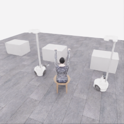
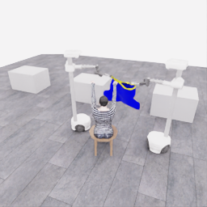
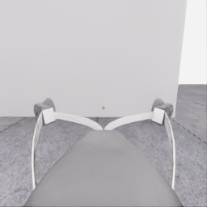
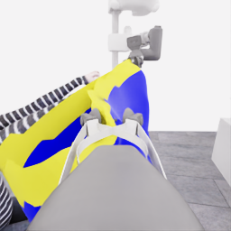
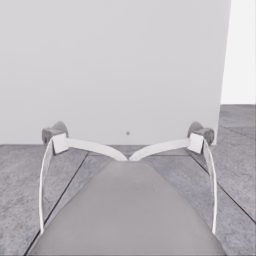
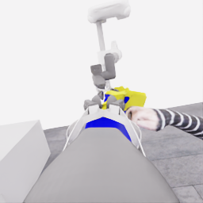
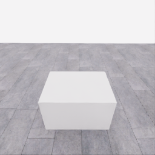
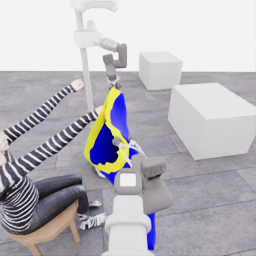
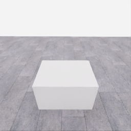
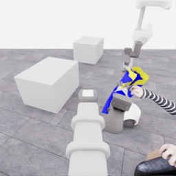

# 자동 시연 수집 시도 · 20261113-astra-side-hem-fresh-001

[전체 수집 기록](../../README.ko.md) · [구조화 요약](manifest.json) · [전체 행동 기록](decisions.jsonl) · [사용한 기본 프롬프트](prompt.txt)

실행 상태는 **completed**, 원본 출처는 `gpt`입니다. 완료 상태와 과제 성공은 아래에서 따로 기록합니다.

## 실행 조건과 시간

| 항목 | 기록 |
|---|---|
| 기록 시작 UTC | 2026-11-13T20:43:30Z |
| 기록 종료 UTC | 2026-11-13T21:29:28Z |
| 이전 시도 | 미측정/해당 없음 |
| 재시도 사유 | 미측정/해당 없음 |
| 출처 그룹 | 20261113-astra-side-hem-fresh-001 |
| 요청 모델 / 추론 설정 | gpt-6-astra / ultra |
| 전체 실제 경과 시간 (초) | 2758.774 |
| Actor 호출 합계 (초) | 2054.429 |
| 환경 요청·응답 합계 (초) | 643.217 |
| 시뮬레이션 시간 (초) | 36.950 |
| 저장 전이 수 | 739.000 |
| 응답 확인 전이 수 | 739.000 |
| 모델 호출 시도 수 | 46.000 |
| 완료한 결정 구간 수 | 40.000 |
| 파일 완료 상태 | true |
| 데이터 정합성 검사 | true |
| 학습 데이터 승인 | unreviewed |
| Actor 호출 방식 | exec |
| 한 호출의 최대 계획 구간 수 | 1.000 |
| 한 계획의 최대 제어 step 수 | 20.000 |
| 제어기 정착 대기 설정 | true |
| 정착 대기 요청 step 수 | 6.000 |
| 완료한 제어기 정착 구간 수 | 37.000 |
| 제어기 정착 전이 수 | 222.000 |
| 제어기 정착 환경 요청·응답 (초) | 201.713 |
| 전이 예산으로 단축한 정착 구간 수 | 0.000 |
| 전이 예산으로 건너뛴 정착 구간 수 | 0.000 |

Actor 호출 시간은 공개 입력 저장·요청 전송·응답 처리 등 호출 경로를 측정합니다. 방식에 따라 Docker/CLI 시작이 호출 안에 들어가거나 상주 서버 준비 시간으로 분리됩니다. 내부 모델 추론 시간만 별도로 측정한 값은 아닙니다. 모델이 판단하는 동안 물리 시간은 멈추며 실제 경과 시간과 시뮬레이션 시간은 다릅니다. 세부 요청 프로세스 시간에도 CLI 처리·네트워크·서버 대기·생성이 함께 포함됩니다.

## 토큰 사용량의 범위

`actor_usage`는 thread별 관측 누계를 합친 값입니다. 결정의 `usage`는 원본 CLI 누계이며, 호출별 증가량은 `usage_accounting.incremental_usage`입니다. 캐시 입력은 입력의 부분집합이고 추론 출력은 출력의 부분집합이므로 열들을 다시 합산하지 않습니다.

전체 호출 사용량 확정: **true** · 기록한 호출 수: 46.

| 입력 | 캐시 입력 | 캐시 쓰기 입력 | 출력 | 추론 출력 |
|---:|---:|---:|---:|---:|
| 6455527 | 5367296 | 0 | 52352 | 41906 |

중복 누계는 추가 사용량 0으로 처리하고, 역행한 누계는 미확정으로 보존합니다. 새 thread는 별도로 집계합니다. 토큰 기록은 화폐 비용이나 청구서가 아닙니다.

## 리뷰 정지 조건

목표 누적 점수 10.000 · 감시 상태 `collector_ended_before_gate` · 수집기 상태 `completed`.

마지막 관측 점수 5.000 · 응답 확인 step 738.

`review_ready`는 정지 조건에 따라 실행을 마치고 리뷰할 준비가 된 상태입니다. 50점·착의 성공이나 학습 데이터 승인을 뜻하지 않습니다. 공식 점수와 success는 아래 평가 결과로 확인합니다.

## 공식 평가 결과

평가 유효성 `true` · 누적 점수 **5.000 / 50** · 착의 success **false** · rate 상태 `no_dressing_points` · 최종 rate 0.000 points/s.

누적 50점, 착의 success, 정상 파일 종료와 데이터 정합성은 서로 다른 상태입니다. 접촉 전 `no_contact`의 rate는 0점/초로 바꾸지 않습니다.

| 단계 | 획득 점수 / 최대 | 획득 시각 (episode 초) |
|---|---:|---:|
| 파지·들기 | 5.000 / 5 | 18.550 |
| 첫 소매 | 0.000 / 5 | 미측정/해당 없음 |
| 반대 어깨 | 0.000 / 5 | 미측정/해당 없음 |
| 두 번째 소매 | 0.000 / 5 | 미측정/해당 없음 |
| 왼쪽 위팔 | 0.000 / 5 | 미측정/해당 없음 |
| 오른쪽 위팔 | 0.000 / 5 | 미측정/해당 없음 |
| 목 통과 | 0.000 / 10 | 미측정/해당 없음 |
| 앞면 방향 | 0.000 / 10 | 미측정/해당 없음 |

## 단계 획득 경로

점수 획득은 [평가 이벤트](score-events.jsonl)에서 같은 physics tick끼리 묶었습니다. 같은 시각에 인정된 항목의 내부 순서는 추정하지 않습니다. 착의 success는 점수 획득과 별도로 기록합니다.

| 순서 | episode 시간 (초) | 전이 경계 step | 누적 점수 변화 | 같은 시각의 항목 변화 |
|---:|---:|---:|---:|---|
| 0 | 18.550 | 371 | 0.000→5.000 | 파지·들기 0.000→5.000 |

평가 clock 0초에 대응하는 공개 simulation clock은 1.525초입니다. 두 시계를 같은 절대 시각으로 혼동하지 않습니다.

별도 success 이벤트 수: **0**. 평가 유효성: `true`.


## 원본 관측 화면

지정된 공개 카메라의 저장 RGB 픽셀입니다. 시작은 첫 `obs`, 종료는 마지막 `next_obs`입니다. 이미지 합성이나 내부 상태 기반 장면 재구성 없이 원본 픽셀로 PNG를 저장했습니다.

| 카메라 | 시작 | 종료 |
|---|---|---|
| `overview` | [](images/initial-overview.png) | [](images/final-overview.png) |
| `robot_0_wrist` | [](images/initial-robot_0_wrist.png) | [](images/final-robot_0_wrist.png) |
| `robot_1_wrist` | [](images/initial-robot_1_wrist.png) | [](images/final-robot_1_wrist.png) |
| `robot_0_head` | [](images/initial-robot_0_head.png) | [](images/final-robot_0_head.png) |
| `robot_1_head` | [](images/initial-robot_1_head.png) | [](images/final-robot_1_head.png) |

시작 관측 시각 1.525초 · 종료 관측 시각 38.475초 (공개 simulation clock).

[▶ overview 관측 영상 보기](overview.mp4)

저장된 20 Hz `obs` 중 739프레임을 순서대로 사용했습니다. 재생은 **1배 느리게** (20.000 fps), 실제 대기 시간·모델 호출 지연은 영상에 들어가지 않습니다. 종료 `next_obs`는 위 PNG에서 확인합니다.

## 결정과 실행 순서

아래 근거는 모델 최종 JSON의 짧은 행동 설명입니다. 시각적 평가는 행동 전 관측에 대한 판단이며, 그 행동의 실행 후 성공 라벨로 사용하지 않습니다. 공식 점수는 별도의 평가 결과입니다.

행동의 각 행은 로봇 0·1 순서이며 열은 `전진, 왼쪽 이동, 반시계 회전, 리프트, 팔 신장, 손목 yaw, pitch, roll, gripper`입니다. 앞 8개는 정규화 속도이고 gripper는 닫기 `+1`, 열기 `-1`, 의도 유지 `0`입니다.

제어기 정착 대기는 앞선 모델 결정에 연결된 별도 중립 행동입니다. 추가 모델 호출이나 모델 결정으로 집계하지 않으며, 실제 전이와 환경 요청·응답 시간은 전체 합계에 포함됩니다. 중립 행동은 두 로봇의 속도와 gripper 명령을 모두 0으로 보내 기존 gripper 의도를 유지합니다. 대기를 실행했다는 기록이 옷의 정착이나 과제 개선을 확인했다는 뜻은 아닙니다.

### 별도 모델 호출 0 · `initial`

실행 결정 인덱스 0의 고정 관측을 사용했습니다. 호출 경과 33.165초. 같은 call index의 행동 기록과 사용량을 중복 합산하지 않습니다.

공개 입력 저장 0.087초 · 요청 프로세스 33.077초 · 결과 해석 0.001초.

### 결정 0 · 준비 · `act`

입력 관측 1.525초 · Actor 호출 33.165초 · 시각적 판단 `uncertain`.

계획 `20261113-astra-side-hem-fresh-001:call-00000` · 모델 호출 인덱스 0 · 계획 구간 1/1 · 이 구간에서 모델 호출 `true`.

실행 직전 최신 관측 1.525초.

공개 입력 저장 0.087초 · 요청 프로세스 33.077초 · 결과 해석 0.001초.

호출 사용량 상태 `observed` · 이번 증가량 입력 20941 / 출력 963 토큰.

최종 응답의 행동 설명: Robot 0 and robot 1 have empty, open grippers below the visible tabletops. Raise both to reveal garment-edge candidates for separated lateral approaches; no first-hand relationship is established. Check tabletop visibility and actual lift displacement next.

요청 행동:

```json
[[0, 0, 0, 0.45, 0, 0, 0, 0, -1], [0, 0, 0, 0.45, 0, 0, 0, 0, -1]]
```

실행 구간 step **[0, 20)** · 요청 20 step / 실제 20 step · 환경 요청·응답 17.399초.

실제 적용 행동:

```json
[[0.0, 0.0, 0.0, 0.44999998807907104, 0.0, 0.0, 0.0, 0.0, -1.0], [0.0, 0.0, 0.0, 0.44999998807907104, 0.0, 0.0, 0.0, 0.0, -1.0]]
```

### 제어기 정착 대기 · 연결 결정 0

구간 `20261113-astra-side-hem-fresh-001:settle-00000` · 출처 `controller_settle` · 이 구간에서 모델 호출 `false`.

앞선 모델 호출 인덱스 0에 연결됩니다. 추가 호출은 없습니다.

실행 구간 step **[20, 26)** · 요청 6 step / 실제 6 step · 환경 요청·응답 5.977초.

공개 simulation clock 2.525→2.825초 · 실행 전 관측 2.525초.

실제 적용 중립 행동:

```json
[[0.0, 0.0, 0.0, 0.0, 0.0, 0.0, 0.0, 0.0, 0.0], [0.0, 0.0, 0.0, 0.0, 0.0, 0.0, 0.0, 0.0, 0.0]]
```

### 별도 모델 호출 1 · `initial`

실행 결정 인덱스 1의 고정 관측을 사용했습니다. 호출 경과 30.653초. 같은 call index의 행동 기록과 사용량을 중복 합산하지 않습니다.

공개 입력 저장 0.075초 · 요청 프로세스 30.578초 · 결과 해석 0.000초.

### 결정 1 · 접근 · `act`

입력 관측 2.825초 · Actor 호출 30.653초 · 시각적 판단 `uncertain`.

계획 `20261113-astra-side-hem-fresh-001:call-00001` · 모델 호출 인덱스 1 · 계획 구간 1/1 · 이 구간에서 모델 호출 `true`.

실행 직전 최신 관측 2.825초.

공개 입력 저장 0.075초 · 요청 프로세스 30.578초 · 결과 해석 0.000초.

호출 사용량 상태 `observed` · 이번 증가량 입력 30449 / 출력 892 토큰.

최종 응답의 행동 설명: Both empty, open grippers rose as intended, but garment edges remain unresolved. Turn robot 0 inward from the negative-x side and robot 1 inward from the positive-x side to inspect the central tabletop from separated positions. Check garment visibility next; no first-hand relationship exists yet.

요청 행동:

```json
[[0, 0, 0.25, 0, 0, 0, 0, 0, 0], [0, 0, -0.25, 0, 0, 0, 0, 0, 0]]
```

실행 구간 step **[26, 46)** · 요청 20 step / 실제 20 step · 환경 요청·응답 16.783초.

실제 적용 행동:

```json
[[0.0, 0.0, 0.25, 0.0, 0.0, 0.0, 0.0, 0.0, 0.0], [0.0, 0.0, -0.25, 0.0, 0.0, 0.0, 0.0, 0.0, 0.0]]
```

### 제어기 정착 대기 · 연결 결정 1

구간 `20261113-astra-side-hem-fresh-001:settle-00001` · 출처 `controller_settle` · 이 구간에서 모델 호출 `false`.

앞선 모델 호출 인덱스 1에 연결됩니다. 추가 호출은 없습니다.

실행 구간 step **[46, 52)** · 요청 6 step / 실제 6 step · 환경 요청·응답 5.675초.

공개 simulation clock 3.825→4.125초 · 실행 전 관측 3.825초.

실제 적용 중립 행동:

```json
[[0.0, 0.0, 0.0, 0.0, 0.0, 0.0, 0.0, 0.0, 0.0], [0.0, 0.0, 0.0, 0.0, 0.0, 0.0, 0.0, 0.0, 0.0]]
```

### 별도 모델 호출 2 · `initial`

실행 결정 인덱스 2의 고정 관측을 사용했습니다. 호출 경과 41.820초. 같은 call index의 행동 기록과 사용량을 중복 합산하지 않습니다.

공개 입력 저장 0.074초 · 요청 프로세스 41.746초 · 결과 해석 0.000초.

### 공개 픽셀 depth 조회 · 결정 2

물리 전이 없이 같은 카메라·시각의 원본 값을 조회했습니다. 무효 값은 null이며 접촉·입구 통과 판단이 아닙니다.

```json
{
  "request": {
    "kind": "depth_query",
    "observation_id": "2a50f882cbc194698974bf5054753ab55a1da8f5b9fe6406c11b0b1f3ba63ff6",
    "camera": "robot_1_head",
    "pixels_uv": [
      [
        236,
        60
      ],
      [
        247,
        63
      ],
      [
        230,
        66
      ],
      [
        237,
        82
      ],
      [
        179,
        95
      ]
    ],
    "include_camera_geometry": true
  },
  "response": {
    "kind": "depth_query_result",
    "observation_id": "2a50f882cbc194698974bf5054753ab55a1da8f5b9fe6406c11b0b1f3ba63ff6",
    "camera": "robot_1_head",
    "camera_index": 4,
    "simulation_time_s": 4.125000215135515,
    "intrinsics_sha256": "3dd91a2df5cb0a47b6f5ceb86d60d41e1f5d6753d2a11a034ac0b52bc385cd23",
    "request_sha256": "4300077d87b83425bd4b0fd73128dd937c7d604afd41dd1e549c12ddaf739c8d",
    "depth_semantics": "optical_Z_metres_not_ray_range",
    "geometry_semantics": "camera_X_right_Y_down_Z_forward",
    "rgb_image_order": [
      "overview",
      "robot_0_wrist",
      "robot_1_wrist",
      "robot_0_head",
      "robot_1_head"
    ],
    "resolution_wh": [
      256,
      256
    ],
    "neighbor_depth_substituted": false,
    "hidden_surfaces_estimated": false,
    "object_pose_or_contact_inferred": false,
    "source_sha256": {
      "observation_json": "e13f53acff05ebbc0265524b8d640ac03aeb2be9965897684fdda817ad8ace71",
      "public_depth_npz": "83059217865131caf7296e39bbb394d8b4d42f07c008b3ecc492b526bd629d99",
      "overview_rgb": "be5a4fe2e45414e1730c8056cc27bb909f621c238cecc3c9f75753b7713ab2a4",
      "robot_0_wrist_rgb": "44bc884481109e3c8a275015194364ebd57b5597e3228d9d1fd41308beb0f05b",
      "robot_1_wrist_rgb": "c363ef07084ea41b2fd0b4ccfb6cad695b92097bb9082f240d744ea8e9cddc1a",
      "robot_0_head_rgb": "e74b105dfe526d49a9362c7cf2a438862fb82a94371cabdd081ca5f625ff6e72",
      "robot_1_head_rgb": "d6e62498802edafc4c0d04a2ee2264e5b668b5c6a277ebb0bbc95ba777a79858"
    },
    "results": [
      {
        "pixel_uv": [
          236,
          60
        ],
        "status": "valid",
        "optical_z_m": 3.704737424850464,
        "camera_xyz_m": [
          2.1887592794729347,
          -1.3781076944829591,
          3.704737424850464
        ],
        "camera_range_m": 4.51828810371358,
        "invalid_reasons": []
      },
      {
        "pixel_uv": [
          247,
          63
        ],
        "status": "valid",
        "optical_z_m": 3.5265579223632812,
        "camera_xyz_m": [
          2.2956982070270398,
          -1.2539528021576267,
          3.5265579223632812
        ],
        "camera_range_m": 4.390812984809232,
        "invalid_reasons": []
      },
      {
        "pixel_uv": [
          230,
          66
        ],
        "status": "valid",
        "optical_z_m": 3.449493408203125,
        "camera_xyz_m": [
          1.924741025919611,
          -1.1699406235981948,
          3.449493408203125
        ],
        "camera_range_m": 4.119756528344875,
        "invalid_reasons": []
      },
      {
        "pixel_uv": [
          237,
          82
        ],
        "status": "valid",
        "optical_z_m": 3.459373950958252,
        "camera_xyz_m": [
          2.062722572314476,
          -0.8705067736373019,
          3.459373950958252
        ],
        "camera_range_m": 4.1206643379256915,
        "invalid_reasons": []
      },
      {
        "pixel_uv": [
          179,
          95
        ],
        "status": "valid",
        "optical_z_m": 2.3466310501098633,
        "camera_xyz_m": [
          0.6546841116006137,
          -0.42361913103569127,
          2.3466310501098633
        ],
        "camera_range_m": 2.4728003840790382,
        "invalid_reasons": []
      }
    ]
  }
}
```

### 별도 모델 호출 3 · `action_after_query`

실행 결정 인덱스 2의 고정 관측을 사용했습니다. 호출 경과 46.377초. 같은 call index의 행동 기록과 사용량을 중복 합산하지 않습니다.

공개 입력 저장 0.076초 · 요청 프로세스 46.301초 · 결과 해석 0.000초.

### 결정 2 · 접근 · `act`

입력 관측 4.125초 · Actor 호출 46.377초 · 시각적 판단 `progressing`.

계획 `20261113-astra-side-hem-fresh-001:call-00003` · 모델 호출 인덱스 3 · 계획 구간 1/1 · 이 구간에서 모델 호출 `true`.

실행 직전 최신 관측 4.125초.

공개 입력 저장 0.076초 · 요청 프로세스 46.301초 · 결과 해석 0.000초.

호출 사용량 상태 `observed` · 이번 증가량 입력 50650 / 출력 1251 토큰.

최종 응답의 행동 설명: The purple candidate is on a farther table, beyond the nearer bare tables. Robot 0 turns toward it with a modest advance; robot 1 turns and advances along the visible floor corridor. Both remain open and empty. Check candidate visibility and table clearance next; no first-hand relationship exists.

요청 행동:

```json
[[0.35, 0, -0.58, 0, 0, 0, 0, 0, 0], [0.6, 0, -0.18, 0, 0, 0, 0, 0, 0]]
```

실행 구간 step **[52, 72)** · 요청 20 step / 실제 20 step · 환경 요청·응답 16.483초.

실제 적용 행동:

```json
[[0.3499999940395355, 0.0, -0.5799999833106995, 0.0, 0.0, 0.0, 0.0, 0.0, 0.0], [0.6000000238418579, 0.0, -0.18000000715255737, 0.0, 0.0, 0.0, 0.0, 0.0, 0.0]]
```

### 제어기 정착 대기 · 연결 결정 2

구간 `20261113-astra-side-hem-fresh-001:settle-00002` · 출처 `controller_settle` · 이 구간에서 모델 호출 `false`.

앞선 모델 호출 인덱스 3에 연결됩니다. 추가 호출은 없습니다.

실행 구간 step **[72, 78)** · 요청 6 step / 실제 6 step · 환경 요청·응답 5.613초.

공개 simulation clock 5.125→5.425초 · 실행 전 관측 5.125초.

실제 적용 중립 행동:

```json
[[0.0, 0.0, 0.0, 0.0, 0.0, 0.0, 0.0, 0.0, 0.0], [0.0, 0.0, 0.0, 0.0, 0.0, 0.0, 0.0, 0.0, 0.0]]
```

### 별도 모델 호출 4 · `initial`

실행 결정 인덱스 3의 고정 관측을 사용했습니다. 호출 경과 42.129초. 같은 call index의 행동 기록과 사용량을 중복 합산하지 않습니다.

공개 입력 저장 0.082초 · 요청 프로세스 42.046초 · 결과 해석 0.000초.

### 결정 3 · 접근 · `act`

입력 관측 5.425초 · Actor 호출 42.129초 · 시각적 판단 `progressing`.

계획 `20261113-astra-side-hem-fresh-001:call-00004` · 모델 호출 인덱스 4 · 계획 구간 1/1 · 이 구간에서 모델 호출 `true`.

실행 직전 최신 관측 5.425초.

공개 입력 저장 0.082초 · 요청 프로세스 42.046초 · 결과 해석 0.000초.

호출 사용량 상태 `observed` · 이번 증가량 입력 60643 / 출력 1257 토큰.

최종 응답의 행동 설명: Both head views now show the purple garment supported on the farther table. Robot 0 advances toward lateral access; robot 1 crosses the foreground corridor to bypass the intervening bare table. Both grippers remain empty and open. Check separation, table clearance and garment boundaries next; no hand relationship exists.

요청 행동:

```json
[[0.9, 0, -0.04, 0, 0, 0, 0, 0, 0], [0.94, -0.34, 0, 0, 0, 0, 0, 0, 0]]
```

실행 구간 step **[78, 98)** · 요청 20 step / 실제 20 step · 환경 요청·응답 16.994초.

실제 적용 행동:

```json
[[0.8999999761581421, 0.0, -0.03999999910593033, 0.0, 0.0, 0.0, 0.0, 0.0, 0.0], [0.9399999976158142, -0.3400000035762787, 0.0, 0.0, 0.0, 0.0, 0.0, 0.0, 0.0]]
```

### 제어기 정착 대기 · 연결 결정 3

구간 `20261113-astra-side-hem-fresh-001:settle-00003` · 출처 `controller_settle` · 이 구간에서 모델 호출 `false`.

앞선 모델 호출 인덱스 4에 연결됩니다. 추가 호출은 없습니다.

실행 구간 step **[98, 104)** · 요청 6 step / 실제 6 step · 환경 요청·응답 5.470초.

공개 simulation clock 6.425→6.725초 · 실행 전 관측 6.425초.

실제 적용 중립 행동:

```json
[[0.0, 0.0, 0.0, 0.0, 0.0, 0.0, 0.0, 0.0, 0.0], [0.0, 0.0, 0.0, 0.0, 0.0, 0.0, 0.0, 0.0, 0.0]]
```

### 별도 모델 호출 5 · `initial`

실행 결정 인덱스 4의 고정 관측을 사용했습니다. 호출 경과 48.776초. 같은 call index의 행동 기록과 사용량을 중복 합산하지 않습니다.

공개 입력 저장 0.077초 · 요청 프로세스 48.699초 · 결과 해석 0.000초.

### 결정 4 · 접근 · `act`

입력 관측 6.725초 · Actor 호출 48.776초 · 시각적 판단 `progressing`.

계획 `20261113-astra-side-hem-fresh-001:call-00005` · 모델 호출 인덱스 5 · 계획 구간 1/1 · 이 구간에서 모델 호출 `true`.

실행 직전 최신 관측 6.725초.

공개 입력 저장 0.077초 · 요청 프로세스 48.699초 · 결과 해석 0.000초.

호출 사용량 상태 `observed` · 이번 증가량 입력 70531 / 출력 1397 토큰.

최종 응답의 행동 설명: Both robots advanced and the garment remains table-supported. Robot 0 moves across the clear near-side corridor toward opposite lateral access; robot 1 continues around the bare table toward the nearer side. Both remain open and empty. Check clearance and yellow-rim candidates next; no hand relationship exists.

요청 행동:

```json
[[0.87, -0.5, 0, 0, 0, 0, 0, 0, 0], [0.94, -0.34, 0, 0, 0, 0, 0, 0, 0]]
```

실행 구간 step **[104, 124)** · 요청 20 step / 실제 20 step · 환경 요청·응답 16.418초.

실제 적용 행동:

```json
[[0.8700000047683716, -0.5, 0.0, 0.0, 0.0, 0.0, 0.0, 0.0, 0.0], [0.9399999976158142, -0.3400000035762787, 0.0, 0.0, 0.0, 0.0, 0.0, 0.0, 0.0]]
```

### 제어기 정착 대기 · 연결 결정 4

구간 `20261113-astra-side-hem-fresh-001:settle-00004` · 출처 `controller_settle` · 이 구간에서 모델 호출 `false`.

앞선 모델 호출 인덱스 5에 연결됩니다. 추가 호출은 없습니다.

실행 구간 step **[124, 130)** · 요청 6 step / 실제 6 step · 환경 요청·응답 5.399초.

공개 simulation clock 7.725→8.025초 · 실행 전 관측 7.725초.

실제 적용 중립 행동:

```json
[[0.0, 0.0, 0.0, 0.0, 0.0, 0.0, 0.0, 0.0, 0.0], [0.0, 0.0, 0.0, 0.0, 0.0, 0.0, 0.0, 0.0, 0.0]]
```

### 별도 모델 호출 6 · `initial`

실행 결정 인덱스 5의 고정 관측을 사용했습니다. 호출 경과 35.604초. 같은 call index의 행동 기록과 사용량을 중복 합산하지 않습니다.

공개 입력 저장 0.075초 · 요청 프로세스 35.529초 · 결과 해석 0.000초.

### 결정 5 · 접근 · `act`

입력 관측 8.025초 · Actor 호출 35.604초 · 시각적 판단 `progressing`.

계획 `20261113-astra-side-hem-fresh-001:call-00006` · 모델 호출 인덱스 6 · 계획 구간 1/1 · 이 구간에서 모델 호출 `true`.

실행 직전 최신 관측 8.025초.

공개 입력 저장 0.075초 · 요청 프로세스 35.529초 · 결과 해석 0.000초.

호출 사용량 상태 `observed` · 이번 증가량 입력 80524 / 출력 1072 토큰.

최종 응답의 행동 설명: Robot 0 is closer with the yellow hem candidate visible; robot 1 is still approaching through the clear foreground corridor. Move robot 0 around the table&#x27;s near side while turning to retain its view, and advance robot 1 toward separate lateral access. Both remain empty; check clearance and untouched cloth next. No first-hand relationship exists.

요청 행동:

```json
[[0.55, -0.8, 0.25, 0, 0, 0, 0, 0, 0], [0.94, -0.34, 0, 0, 0, 0, 0, 0, 0]]
```

실행 구간 step **[130, 150)** · 요청 20 step / 실제 20 step · 환경 요청·응답 16.278초.

실제 적용 행동:

```json
[[0.550000011920929, -0.800000011920929, 0.25, 0.0, 0.0, 0.0, 0.0, 0.0, 0.0], [0.9399999976158142, -0.3400000035762787, 0.0, 0.0, 0.0, 0.0, 0.0, 0.0, 0.0]]
```

### 제어기 정착 대기 · 연결 결정 5

구간 `20261113-astra-side-hem-fresh-001:settle-00005` · 출처 `controller_settle` · 이 구간에서 모델 호출 `false`.

앞선 모델 호출 인덱스 6에 연결됩니다. 추가 호출은 없습니다.

실행 구간 step **[150, 156)** · 요청 6 step / 실제 6 step · 환경 요청·응답 5.542초.

공개 simulation clock 9.025→9.325초 · 실행 전 관측 9.025초.

실제 적용 중립 행동:

```json
[[0.0, 0.0, 0.0, 0.0, 0.0, 0.0, 0.0, 0.0, 0.0], [0.0, 0.0, 0.0, 0.0, 0.0, 0.0, 0.0, 0.0, 0.0]]
```

### 별도 모델 호출 7 · `initial`

실행 결정 인덱스 6의 고정 관측을 사용했습니다. 호출 경과 25.232초. 같은 call index의 행동 기록과 사용량을 중복 합산하지 않습니다.

공개 입력 저장 0.077초 · 요청 프로세스 25.155초 · 결과 해석 0.000초.

### 결정 6 · 접근 · `act`

입력 관측 9.325초 · Actor 호출 25.232초 · 시각적 판단 `progressing`.

계획 `20261113-astra-side-hem-fresh-001:call-00007` · 모델 호출 인덱스 7 · 계획 구간 1/1 · 이 구간에서 모델 호출 `true`.

실행 직전 최신 관측 9.325초.

공개 입력 저장 0.077초 · 요청 프로세스 25.155초 · 결과 해석 0.000초.

호출 사용량 상태 `observed` · 이번 증가량 입력 90214 / 출력 732 토큰.

최종 응답의 행동 설명: Robot 0 now sees the broad yellow hem candidate and continues around the near edge toward the opposite lateral side, keeping its empty gripper raised. Robot 1 advances toward the nearer lateral side. Check both routes and unchanged table support before alignment; no first-hand relationship exists.

요청 행동:

```json
[[0, -1, 0.25, 0, 0, 0, 0, 0, 0], [0.94, -0.34, 0, 0, 0, 0, 0, 0, 0]]
```

실행 구간 step **[156, 176)** · 요청 20 step / 실제 20 step · 환경 요청·응답 16.379초.

실제 적용 행동:

```json
[[0.0, -1.0, 0.25, 0.0, 0.0, 0.0, 0.0, 0.0, 0.0], [0.9399999976158142, -0.3400000035762787, 0.0, 0.0, 0.0, 0.0, 0.0, 0.0, 0.0]]
```

### 제어기 정착 대기 · 연결 결정 6

구간 `20261113-astra-side-hem-fresh-001:settle-00006` · 출처 `controller_settle` · 이 구간에서 모델 호출 `false`.

앞선 모델 호출 인덱스 7에 연결됩니다. 추가 호출은 없습니다.

실행 구간 step **[176, 182)** · 요청 6 step / 실제 6 step · 환경 요청·응답 5.230초.

공개 simulation clock 10.325→10.625초 · 실행 전 관측 10.325초.

실제 적용 중립 행동:

```json
[[0.0, 0.0, 0.0, 0.0, 0.0, 0.0, 0.0, 0.0, 0.0], [0.0, 0.0, 0.0, 0.0, 0.0, 0.0, 0.0, 0.0, 0.0]]
```

### 별도 모델 호출 8 · `initial`

실행 결정 인덱스 7의 고정 관측을 사용했습니다. 호출 경과 38.210초. 같은 call index의 행동 기록과 사용량을 중복 합산하지 않습니다.

공개 입력 저장 0.079초 · 요청 프로세스 38.131초 · 결과 해석 0.000초.

### 결정 7 · 접근 · `act`

입력 관측 10.625초 · Actor 호출 38.210초 · 시각적 판단 `progressing`.

계획 `20261113-astra-side-hem-fresh-001:call-00008` · 모델 호출 인덱스 8 · 계획 구간 1/1 · 이 구간에서 모델 호출 `true`.

실행 직전 최신 관측 10.625초.

공개 입력 저장 0.079초 · 요청 프로세스 38.131초 · 결과 해석 0.000초.

호출 사용량 상태 `observed` · 이번 증가량 입력 99559 / 출력 1157 토큰.

최종 응답의 행동 설명: The garment remains flat on the table. Robot 0 rounds the near corner toward negative-x lateral access; robot 1 approaches positive-x lateral access through the clear gap. Keep both empty grippers raised and open. Check corner clearance and separately reachable hem regions next; no first-hand relationship exists.

요청 행동:

```json
[[-0.18, -0.95, 0.36, 0, 0, 0, 0, 0, 0], [0.8, 0.65, 0, 0, 0, 0, 0, 0, 0]]
```

실행 구간 step **[182, 202)** · 요청 20 step / 실제 20 step · 환경 요청·응답 16.649초.

실제 적용 행동:

```json
[[-0.18000000715255737, -0.949999988079071, 0.36000001430511475, 0.0, 0.0, 0.0, 0.0, 0.0, 0.0], [0.800000011920929, 0.6499999761581421, 0.0, 0.0, 0.0, 0.0, 0.0, 0.0, 0.0]]
```

### 제어기 정착 대기 · 연결 결정 7

구간 `20261113-astra-side-hem-fresh-001:settle-00007` · 출처 `controller_settle` · 이 구간에서 모델 호출 `false`.

앞선 모델 호출 인덱스 8에 연결됩니다. 추가 호출은 없습니다.

실행 구간 step **[202, 208)** · 요청 6 step / 실제 6 step · 환경 요청·응답 5.275초.

공개 simulation clock 11.625→11.925초 · 실행 전 관측 11.625초.

실제 적용 중립 행동:

```json
[[0.0, 0.0, 0.0, 0.0, 0.0, 0.0, 0.0, 0.0, 0.0], [0.0, 0.0, 0.0, 0.0, 0.0, 0.0, 0.0, 0.0, 0.0]]
```

### 별도 모델 호출 9 · `initial`

실행 결정 인덱스 8의 고정 관측을 사용했습니다. 호출 경과 61.797초. 같은 call index의 행동 기록과 사용량을 중복 합산하지 않습니다.

공개 입력 저장 0.075초 · 요청 프로세스 61.722초 · 결과 해석 0.000초.

### 결정 8 · 접근 · `act`

입력 관측 11.925초 · Actor 호출 61.797초 · 시각적 판단 `progressing`.

계획 `20261113-astra-side-hem-fresh-001:call-00009` · 모델 호출 인덱스 9 · 계획 구간 1/1 · 이 구간에서 모델 호출 `true`.

실행 직전 최신 관측 11.925초.

공개 입력 저장 0.075초 · 요청 프로세스 61.722초 · 결과 해석 0.000초.

호출 사용량 상태 `observed` · 이번 증가량 입력 109399 / 출력 1754 토큰.

최종 응답의 행동 설명: Both robots have reached separated lateral positions, but their open grippers remain above and offset from the hem candidates. Robot 0 nudges inward; robot 1 shifts along its side. Pitch both grippers modestly downward, then inspect fingertip-to-rim alignment before closing. No first-hand relationship exists.

요청 행동:

```json
[[0.1, 0, 0, 0, 0, 0, 0.1, 0, 0], [0.3, 0.5, 0, 0, 0, 0, 0.1, 0, 0]]
```

실행 구간 step **[208, 220)** · 요청 12 step / 실제 12 step · 환경 요청·응답 10.289초.

실제 적용 행동:

```json
[[0.10000000149011612, 0.0, 0.0, 0.0, 0.0, 0.0, 0.10000000149011612, 0.0, 0.0], [0.30000001192092896, 0.5, 0.0, 0.0, 0.0, 0.0, 0.10000000149011612, 0.0, 0.0]]
```

### 제어기 정착 대기 · 연결 결정 8

구간 `20261113-astra-side-hem-fresh-001:settle-00008` · 출처 `controller_settle` · 이 구간에서 모델 호출 `false`.

앞선 모델 호출 인덱스 9에 연결됩니다. 추가 호출은 없습니다.

실행 구간 step **[220, 226)** · 요청 6 step / 실제 6 step · 환경 요청·응답 5.430초.

공개 simulation clock 12.525→12.825초 · 실행 전 관측 12.525초.

실제 적용 중립 행동:

```json
[[0.0, 0.0, 0.0, 0.0, 0.0, 0.0, 0.0, 0.0, 0.0], [0.0, 0.0, 0.0, 0.0, 0.0, 0.0, 0.0, 0.0, 0.0]]
```

### 별도 모델 호출 10 · `initial`

실행 결정 인덱스 9의 고정 관측을 사용했습니다. 호출 경과 72.779초. 같은 call index의 행동 기록과 사용량을 중복 합산하지 않습니다.

공개 입력 저장 0.090초 · 요청 프로세스 72.688초 · 결과 해석 0.000초.

### 공개 픽셀 depth 조회 · 결정 9

물리 전이 없이 같은 카메라·시각의 원본 값을 조회했습니다. 무효 값은 null이며 접촉·입구 통과 판단이 아닙니다.

```json
{
  "request": {
    "kind": "depth_query",
    "observation_id": "70857c2870971b8b19216a4bb4a192ddc25d74bf6345f687256d8d8cfb9c7d7f",
    "camera": "robot_0_head",
    "pixels_uv": [
      [
        128,
        237
      ],
      [
        173,
        236
      ],
      [
        144,
        247
      ],
      [
        138,
        215
      ],
      [
        132,
        181
      ],
      [
        151,
        226
      ],
      [
        119,
        213
      ]
    ],
    "include_camera_geometry": true
  },
  "response": {
    "kind": "depth_query_result",
    "observation_id": "70857c2870971b8b19216a4bb4a192ddc25d74bf6345f687256d8d8cfb9c7d7f",
    "camera": "robot_0_head",
    "camera_index": 3,
    "simulation_time_s": 12.825000668875873,
    "intrinsics_sha256": "3dd91a2df5cb0a47b6f5ceb86d60d41e1f5d6753d2a11a034ac0b52bc385cd23",
    "request_sha256": "a1452c1bf5d4d4dc3486be38181de0c79e6e26ecbae07ebb409ed3ada103df0d",
    "depth_semantics": "optical_Z_metres_not_ray_range",
    "geometry_semantics": "camera_X_right_Y_down_Z_forward",
    "rgb_image_order": [
      "overview",
      "robot_0_wrist",
      "robot_1_wrist",
      "robot_0_head",
      "robot_1_head"
    ],
    "resolution_wh": [
      256,
      256
    ],
    "neighbor_depth_substituted": false,
    "hidden_surfaces_estimated": false,
    "object_pose_or_contact_inferred": false,
    "source_sha256": {
      "observation_json": "e3b8e8e610df8bd6e3fb883841a002bd8402ea9563f4e127367fa0cfffdfada7",
      "public_depth_npz": "3d3576b3ba1ee0e43244f791a1b7dba39dc0df3b474f9f2aa6849516ce212d7f",
      "overview_rgb": "7a6eb7b3d398eceb58f4527c9028725ab1288b087ce5b80ff5e6dffa4dff85c3",
      "robot_0_wrist_rgb": "2473f6ee28aff7738e3c7d60082e29adbe1c0487bcb0891ffd1f43812af366d4",
      "robot_1_wrist_rgb": "4e2b47969a43ad43fcf62bcfeb9508cb197866099b6993fc24271390efab15cc",
      "robot_0_head_rgb": "f17c2f0f12cb65bc22d5be4702ac0a3b393d77154ac41dab6520ec775162feef",
      "robot_1_head_rgb": "9498bc379bc0d63e98e3435438931e16d8827e4c42a2ffdaca941ce87af689c9"
    },
    "results": [
      {
        "pixel_uv": [
          128,
          237
        ],
        "status": "valid",
        "optical_z_m": 0.7177700400352478,
        "camera_xyz_m": [
          0.0,
          0.4279850875623473,
          0.7177700400352478
        ],
        "camera_range_m": 0.8356823951406128,
        "invalid_reasons": []
      },
      {
        "pixel_uv": [
          173,
          236
        ],
        "status": "valid",
        "optical_z_m": 0.7220892906188965,
        "camera_xyz_m": [
          0.17775434691276087,
          0.4266104325906261,
          0.7220892906188965
        ],
        "camera_range_m": 0.8573249166261555,
        "invalid_reasons": []
      },
      {
        "pixel_uv": [
          144,
          247
        ],
        "status": "valid",
        "optical_z_m": 0.6863024830818176,
        "camera_xyz_m": [
          0.06006927151824131,
          0.4467652069169198,
          0.6863024830818176
        ],
        "camera_range_m": 0.8211081328159641,
        "invalid_reasons": []
      },
      {
        "pixel_uv": [
          138,
          215
        ],
        "status": "valid",
        "optical_z_m": 1.0119436979293823,
        "camera_xyz_m": [
          0.05535707855734086,
          0.4816065834488654,
          1.0119436979293823
        ],
        "camera_range_m": 1.1220692292130132,
        "invalid_reasons": []
      },
      {
        "pixel_uv": [
          132,
          181
        ],
        "status": "valid",
        "optical_z_m": 1.1992342472076416,
        "camera_xyz_m": [
          0.026241026874188663,
          0.34769360608299976,
          1.1992342472076416
        ],
        "camera_range_m": 1.2488963987769726,
        "invalid_reasons": []
      },
      {
        "pixel_uv": [
          151,
          226
        ],
        "status": "valid",
        "optical_z_m": 0.9573909044265747,
        "camera_xyz_m": [
          0.12045752774013035,
          0.5132538138492511,
          0.9573909044265747
        ],
        "camera_range_m": 1.0929486892342204,
        "invalid_reasons": []
      },
      {
        "pixel_uv": [
          119,
          213
        ],
        "status": "valid",
        "optical_z_m": 1.037144660949707,
        "camera_xyz_m": [
          -0.05106209834608161,
          0.48225315104632627,
          1.037144660949707
        ],
        "camera_range_m": 1.1449211707877964,
        "invalid_reasons": []
      }
    ]
  }
}
```

### 별도 모델 호출 11 · `action_after_query`

실행 결정 인덱스 9의 고정 관측을 사용했습니다. 호출 경과 33.609초. 같은 call index의 행동 기록과 사용량을 중복 합산하지 않습니다.

공개 입력 저장 0.084초 · 요청 프로세스 33.525초 · 결과 해석 0.000초.

### 결정 9 · 접근 · `act`

입력 관측 12.825초 · Actor 호출 33.609초 · 시각적 판단 `progressing`.

계획 `20261113-astra-side-hem-fresh-001:call-00011` · 모델 호출 인덱스 11 · 계획 구간 1/1 · 이 구간에서 모델 호출 `true`.

실행 직전 최신 관측 12.825초.

공개 입력 저장 0.084초 · 요청 프로세스 33.525초 · 결과 해석 0.000초.

호출 사용량 상태 `observed` · 이번 증가량 입력 132479 / 출력 909 토큰.

최종 응답의 행동 설명: Robot 0&#x27;s queried visible rim lies ahead of and below its fingertips; robot 1 shows a similar placement gap. Lower and extend both open grippers toward separated hem regions, leaving clearance for another observation. Cloth remains table-supported; check remaining gaps before closing. No first-hand relationship exists.

요청 행동:

```json
[[0, 0, 0, -0.18, 0.2, 0, 0, 0, 0], [0, 0, 0, -0.18, 0.2, 0, 0, 0, 0]]
```

실행 구간 step **[226, 236)** · 요청 10 step / 실제 10 step · 환경 요청·응답 8.475초.

실제 적용 행동:

```json
[[0.0, 0.0, 0.0, -0.18000000715255737, 0.20000000298023224, 0.0, 0.0, 0.0, 0.0], [0.0, 0.0, 0.0, -0.18000000715255737, 0.20000000298023224, 0.0, 0.0, 0.0, 0.0]]
```

### 제어기 정착 대기 · 연결 결정 9

구간 `20261113-astra-side-hem-fresh-001:settle-00009` · 출처 `controller_settle` · 이 구간에서 모델 호출 `false`.

앞선 모델 호출 인덱스 11에 연결됩니다. 추가 호출은 없습니다.

실행 구간 step **[236, 242)** · 요청 6 step / 실제 6 step · 환경 요청·응답 5.282초.

공개 simulation clock 13.325→13.625초 · 실행 전 관측 13.325초.

실제 적용 중립 행동:

```json
[[0.0, 0.0, 0.0, 0.0, 0.0, 0.0, 0.0, 0.0, 0.0], [0.0, 0.0, 0.0, 0.0, 0.0, 0.0, 0.0, 0.0, 0.0]]
```

### 별도 모델 호출 12 · `initial`

실행 결정 인덱스 10의 고정 관측을 사용했습니다. 호출 경과 35.209초. 같은 call index의 행동 기록과 사용량을 중복 합산하지 않습니다.

공개 입력 저장 0.084초 · 요청 프로세스 35.125초 · 결과 해석 0.000초.

### 결정 10 · 파지 · `act`

입력 관측 13.625초 · Actor 호출 35.209초 · 시각적 판단 `progressing`.

계획 `20261113-astra-side-hem-fresh-001:call-00012` · 모델 호출 인덱스 12 · 계획 구간 1/1 · 이 구간에서 모델 호출 `true`.

실행 직전 최신 관측 13.625초.

공개 입력 저장 0.084초 · 요청 프로세스 35.125초 · 결과 해석 0.000초.

호출 사용량 상태 `observed` · 이번 증가량 입력 142566 / 출력 1036 토큰.

최종 응답의 행동 설명: Both grippers moved closer as intended. Robot 0&#x27;s hem candidate remains left of center; robot 1&#x27;s remains right and farther ahead. Make a short asymmetric placement correction with both grippers open, then inspect remaining clearance and rim alignment. The table still supports the shirt; no first-hand relationship exists.

요청 행동:

```json
[[0, 0.1, 0, -0.11, 0.14, 0, 0, 0, 0], [0, -0.16, 0, -0.11, 0.22, 0, 0, 0, 0]]
```

실행 구간 step **[242, 248)** · 요청 6 step / 실제 6 step · 환경 요청·응답 5.621초.

실제 적용 행동:

```json
[[0.0, 0.10000000149011612, 0.0, -0.10999999940395355, 0.14000000059604645, 0.0, 0.0, 0.0, 0.0], [0.0, -0.1599999964237213, 0.0, -0.10999999940395355, 0.2199999988079071, 0.0, 0.0, 0.0, 0.0]]
```

### 제어기 정착 대기 · 연결 결정 10

구간 `20261113-astra-side-hem-fresh-001:settle-00010` · 출처 `controller_settle` · 이 구간에서 모델 호출 `false`.

앞선 모델 호출 인덱스 12에 연결됩니다. 추가 호출은 없습니다.

실행 구간 step **[248, 254)** · 요청 6 step / 실제 6 step · 환경 요청·응답 5.934초.

공개 simulation clock 13.925→14.225초 · 실행 전 관측 13.925초.

실제 적용 중립 행동:

```json
[[0.0, 0.0, 0.0, 0.0, 0.0, 0.0, 0.0, 0.0, 0.0], [0.0, 0.0, 0.0, 0.0, 0.0, 0.0, 0.0, 0.0, 0.0]]
```

### 별도 모델 호출 13 · `initial`

실행 결정 인덱스 11의 고정 관측을 사용했습니다. 호출 경과 24.740초. 같은 call index의 행동 기록과 사용량을 중복 합산하지 않습니다.

공개 입력 저장 0.086초 · 요청 프로세스 24.654초 · 결과 해석 0.000초.

### 결정 11 · 파지 · `act`

입력 관측 14.225초 · Actor 호출 24.740초 · 시각적 판단 `progressing`.

계획 `20261113-astra-side-hem-fresh-001:call-00013` · 모델 호출 인덱스 13 · 계획 구간 1/1 · 이 구간에서 모델 호출 `true`.

실행 직전 최신 관측 14.225초.

공개 입력 저장 0.086초 · 요청 프로세스 24.654초 · 결과 해석 0.000초.

호출 사용량 상태 `observed` · 이번 증가량 입력 152699 / 출력 740 토큰.

최종 응답의 행동 설명: Both placement gaps narrowed visibly; robot 1&#x27;s rim remains slightly farther ahead than robot 0&#x27;s. Make a final small inward, downward and lateral correction with both grippers open. Inspect rim placement between the fingers before closing; table support remains and no first-hand relationship exists.

요청 행동:

```json
[[0, 0.1, 0, -0.045, 0.08, 0, 0, 0, 0], [0, -0.1, 0, -0.045, 0.14, 0, 0, 0, 0]]
```

실행 구간 step **[254, 258)** · 요청 4 step / 실제 4 step · 환경 요청·응답 4.231초.

실제 적용 행동:

```json
[[0.0, 0.10000000149011612, 0.0, -0.04500000178813934, 0.07999999821186066, 0.0, 0.0, 0.0, 0.0], [0.0, -0.10000000149011612, 0.0, -0.04500000178813934, 0.14000000059604645, 0.0, 0.0, 0.0, 0.0]]
```

### 제어기 정착 대기 · 연결 결정 11

구간 `20261113-astra-side-hem-fresh-001:settle-00011` · 출처 `controller_settle` · 이 구간에서 모델 호출 `false`.

앞선 모델 호출 인덱스 13에 연결됩니다. 추가 호출은 없습니다.

실행 구간 step **[258, 264)** · 요청 6 step / 실제 6 step · 환경 요청·응답 5.957초.

공개 simulation clock 14.425→14.725초 · 실행 전 관측 14.425초.

실제 적용 중립 행동:

```json
[[0.0, 0.0, 0.0, 0.0, 0.0, 0.0, 0.0, 0.0, 0.0], [0.0, 0.0, 0.0, 0.0, 0.0, 0.0, 0.0, 0.0, 0.0]]
```

### 별도 모델 호출 14 · `initial`

실행 결정 인덱스 12의 고정 관측을 사용했습니다. 호출 경과 22.789초. 같은 call index의 행동 기록과 사용량을 중복 합산하지 않습니다.

공개 입력 저장 0.084초 · 요청 프로세스 22.704초 · 결과 해석 0.000초.

### 결정 12 · 파지 · `act`

입력 관측 14.725초 · Actor 호출 22.789초 · 시각적 판단 `uncertain`.

계획 `20261113-astra-side-hem-fresh-001:call-00014` · 모델 호출 인덱스 14 · 계획 구간 1/1 · 이 구간에서 모델 호출 `true`.

실행 직전 최신 관측 14.725초.

공개 입력 저장 0.084초 · 요청 프로세스 22.704초 · 결과 해석 0.000초.

호출 사용량 상태 `observed` · 이번 증가량 입력 162514 / 출력 595 토큰.

최종 응답의 행동 설명: Robot 0 and robot 1 straddle separated hem candidates, but extension lags and pitch deflection suggest placement resistance. Add no further reach; close both grippers while the table supports the shirt. Inspect closure before a short coordinated lift test; neither grasp nor any first-hand relationship is established.

요청 행동:

```json
[[0, 0, 0, 0, 0, 0, 0, 0, 1], [0, 0, 0, 0, 0, 0, 0, 0, 1]]
```

실행 구간 step **[264, 274)** · 요청 10 step / 실제 10 step · 환경 요청·응답 9.345초.

실제 적용 행동:

```json
[[0.0, 0.0, 0.0, 0.0, 0.0, 0.0, 0.0, 0.0, 1.0], [0.0, 0.0, 0.0, 0.0, 0.0, 0.0, 0.0, 0.0, 1.0]]
```

### 별도 모델 호출 15 · `initial`

실행 결정 인덱스 13의 고정 관측을 사용했습니다. 호출 경과 24.745초. 같은 call index의 행동 기록과 사용량을 중복 합산하지 않습니다.

공개 입력 저장 0.087초 · 요청 프로세스 24.658초 · 결과 해석 0.000초.

### 결정 13 · 복구 · `act`

입력 관측 15.225초 · Actor 호출 24.745초 · 시각적 판단 `recovering`.

계획 `20261113-astra-side-hem-fresh-001:call-00015` · 모델 호출 인덱스 15 · 계획 구간 1/1 · 이 구간에서 모델 호출 `true`.

실행 직전 최신 관측 15.225초.

공개 입력 저장 0.087초 · 요청 프로세스 24.658초 · 결과 해석 0.000초.

호출 사용량 상태 `observed` · 이번 증가량 입력 172200 / 출력 610 토큰.

최종 응답의 행동 설명: Both robots&#x27; fingers remain visibly open near 0.49 despite close targets of 0.103, suggesting placement obstruction. Raise both about 3 cm while retaining close intent to test clearance, actual closure and local cloth following separately. Keep the shirt over the table; neither support nor a first-hand relationship is confirmed.

요청 행동:

```json
[[0, 0, 0, 0.06, 0, 0, 0, 0, 1], [0, 0, 0, 0.06, 0, 0, 0, 0, 1]]
```

실행 구간 step **[274, 280)** · 요청 6 step / 실제 6 step · 환경 요청·응답 5.951초.

실제 적용 행동:

```json
[[0.0, 0.0, 0.0, 0.05999999865889549, 0.0, 0.0, 0.0, 0.0, 1.0], [0.0, 0.0, 0.0, 0.05999999865889549, 0.0, 0.0, 0.0, 0.0, 1.0]]
```

### 제어기 정착 대기 · 연결 결정 13

구간 `20261113-astra-side-hem-fresh-001:settle-00013` · 출처 `controller_settle` · 이 구간에서 모델 호출 `false`.

앞선 모델 호출 인덱스 15에 연결됩니다. 추가 호출은 없습니다.

실행 구간 step **[280, 286)** · 요청 6 step / 실제 6 step · 환경 요청·응답 5.733초.

공개 simulation clock 15.525→15.825초 · 실행 전 관측 15.525초.

실제 적용 중립 행동:

```json
[[0.0, 0.0, 0.0, 0.0, 0.0, 0.0, 0.0, 0.0, 0.0], [0.0, 0.0, 0.0, 0.0, 0.0, 0.0, 0.0, 0.0, 0.0]]
```

### 별도 모델 호출 16 · `initial`

실행 결정 인덱스 14의 고정 관측을 사용했습니다. 호출 경과 20.435초. 같은 call index의 행동 기록과 사용량을 중복 합산하지 않습니다.

공개 입력 저장 0.089초 · 요청 프로세스 20.346초 · 결과 해석 0.000초.

### 결정 14 · 파지 · `act`

입력 관측 15.825초 · Actor 호출 20.435초 · 시각적 판단 `progressing`.

계획 `20261113-astra-side-hem-fresh-001:call-00016` · 모델 호출 인덱스 16 · 계획 구간 1/1 · 이 구간에서 모델 호출 `true`.

실행 직전 최신 관측 15.825초.

공개 입력 저장 0.089초 · 요청 프로세스 20.346초 · 결과 해석 0.000초.

호출 사용량 상태 `observed` · 이번 증가량 입력 181940 / 출력 499 토큰.

최종 응답의 행동 설명: Clearance motion allowed both grippers to narrow and gathered cloth locally. Robot 0 is closing more slowly; robot 1 is nearer its target. Hold placement briefly while closure progresses, then test cloth following with a short coordinated lift. Neither grasp is confirmed; no first-hand relationship exists.

요청 행동:

```json
[[0, 0, 0, 0, 0, 0, 0, 0, 1], [0, 0, 0, 0, 0, 0, 0, 0, 1]]
```

실행 구간 step **[286, 294)** · 요청 8 step / 실제 8 step · 환경 요청·응답 8.477초.

실제 적용 행동:

```json
[[0.0, 0.0, 0.0, 0.0, 0.0, 0.0, 0.0, 0.0, 1.0], [0.0, 0.0, 0.0, 0.0, 0.0, 0.0, 0.0, 0.0, 1.0]]
```

### 별도 모델 호출 17 · `initial`

실행 결정 인덱스 15의 고정 관측을 사용했습니다. 호출 경과 13.827초. 같은 call index의 행동 기록과 사용량을 중복 합산하지 않습니다.

공개 입력 저장 0.090초 · 요청 프로세스 13.737초 · 결과 해석 0.000초.

### 결정 15 · 들기 · `act`

입력 관측 16.225초 · Actor 호출 13.827초 · 시각적 판단 `uncertain`.

계획 `20261113-astra-side-hem-fresh-001:call-00017` · 모델 호출 인덱스 17 · 계획 구간 1/1 · 이 구간에서 모델 호출 `true`.

실행 직전 최신 관측 16.225초.

공개 입력 저장 0.090초 · 요청 프로세스 13.737초 · 결과 해석 0.000초.

호출 사용량 상태 `observed` · 이번 증가량 입력 191569 / 출력 344 토큰.

최종 응답의 행동 설명: Robot 0 and robot 1 have narrowed their fingers around separate gathered hem candidates. Test both supports with a short coordinated lift of about 4 cm over the table. Next check actual rise and whether cloth follows each gripper separately; no first-hand relationship exists.

요청 행동:

```json
[[0, 0, 0, 0.08, 0, 0, 0, 0, 1], [0, 0, 0, 0.08, 0, 0, 0, 0, 1]]
```

실행 구간 step **[294, 300)** · 요청 6 step / 실제 6 step · 환경 요청·응답 6.300초.

실제 적용 행동:

```json
[[0.0, 0.0, 0.0, 0.07999999821186066, 0.0, 0.0, 0.0, 0.0, 1.0], [0.0, 0.0, 0.0, 0.07999999821186066, 0.0, 0.0, 0.0, 0.0, 1.0]]
```

### 제어기 정착 대기 · 연결 결정 15

구간 `20261113-astra-side-hem-fresh-001:settle-00015` · 출처 `controller_settle` · 이 구간에서 모델 호출 `false`.

앞선 모델 호출 인덱스 17에 연결됩니다. 추가 호출은 없습니다.

실행 구간 step **[300, 306)** · 요청 6 step / 실제 6 step · 환경 요청·응답 6.081초.

공개 simulation clock 16.525→16.825초 · 실행 전 관측 16.525초.

실제 적용 중립 행동:

```json
[[0.0, 0.0, 0.0, 0.0, 0.0, 0.0, 0.0, 0.0, 0.0], [0.0, 0.0, 0.0, 0.0, 0.0, 0.0, 0.0, 0.0, 0.0]]
```

### 별도 모델 호출 18 · `initial`

실행 결정 인덱스 16의 고정 관측을 사용했습니다. 호출 경과 42.071초. 같은 call index의 행동 기록과 사용량을 중복 합산하지 않습니다.

공개 입력 저장 0.084초 · 요청 프로세스 41.987초 · 결과 해석 0.000초.

### 결정 16 · 들기 · `act`

입력 관측 16.825초 · Actor 호출 42.071초 · 시각적 판단 `progressing`.

계획 `20261113-astra-side-hem-fresh-001:call-00018` · 모델 호출 인덱스 18 · 계획 구간 1/1 · 이 구간에서 모델 호출 `true`.

실행 직전 최신 관측 16.825초.

공개 입력 저장 0.084초 · 요청 프로세스 41.987초 · 결과 해석 0.000초.

호출 사용량 상태 `observed` · 이번 증가량 입력 201001 / 출력 950 토큰.

최종 응답의 행동 설명: Both grippers rose about 3 cm, with local yellow-rim folds following each. Robot 0 maintains support while robot 1 guides the opening slightly higher. Lift together over the table with a small height difference to reveal candidate lips and opening depth; an aperture and first-hand relationship remain unconfirmed.

요청 행동:

```json
[[0, 0, 0, 0.1, 0, 0, 0, 0, 1], [0, 0, 0, 0.18, 0, 0, 0, 0, 1]]
```

실행 구간 step **[306, 314)** · 요청 8 step / 실제 8 step · 환경 요청·응답 7.593초.

실제 적용 행동:

```json
[[0.0, 0.0, 0.0, 0.10000000149011612, 0.0, 0.0, 0.0, 0.0, 1.0], [0.0, 0.0, 0.0, 0.18000000715255737, 0.0, 0.0, 0.0, 0.0, 1.0]]
```

### 제어기 정착 대기 · 연결 결정 16

구간 `20261113-astra-side-hem-fresh-001:settle-00016` · 출처 `controller_settle` · 이 구간에서 모델 호출 `false`.

앞선 모델 호출 인덱스 18에 연결됩니다. 추가 호출은 없습니다.

실행 구간 step **[314, 320)** · 요청 6 step / 실제 6 step · 환경 요청·응답 5.500초.

공개 simulation clock 17.225→17.525초 · 실행 전 관측 17.225초.

실제 적용 중립 행동:

```json
[[0.0, 0.0, 0.0, 0.0, 0.0, 0.0, 0.0, 0.0, 0.0], [0.0, 0.0, 0.0, 0.0, 0.0, 0.0, 0.0, 0.0, 0.0]]
```

### 별도 모델 호출 19 · `initial`

실행 결정 인덱스 17의 고정 관측을 사용했습니다. 호출 경과 46.981초. 같은 call index의 행동 기록과 사용량을 중복 합산하지 않습니다.

공개 입력 저장 0.087초 · 요청 프로세스 46.893초 · 결과 해석 0.000초.

### 결정 17 · 들기 · `act`

입력 관측 17.525초 · Actor 호출 46.981초 · 시각적 판단 `uncertain`.

계획 `20261113-astra-side-hem-fresh-001:call-00019` · 모델 호출 인덱스 19 · 계획 구간 1/1 · 이 구간에서 모델 호출 `true`.

실행 직전 최신 관측 17.525초.

공개 입력 저장 0.087초 · 요청 프로세스 46.893초 · 결과 해석 0.000초.

호출 사용량 상태 `observed` · 이번 증가량 입력 211020 / 출력 1144 토큰.

최종 응답의 행동 설명: Both hem regions followed the differential lift, but robot 1&#x27;s folded yellow boundaries do not yet establish a passage. Robot 0 holds support while robot 1 shifts slightly along the hem normal and rolls to expose lip separation. Check opening depth and retained grips; no first-hand relationship exists.

요청 행동:

```json
[[0, 0, 0, 0, 0, 0, 0, 0, 1], [0, 0.15, 0, 0, 0, 0, 0, 0.1, 1]]
```

실행 구간 step **[320, 326)** · 요청 6 step / 실제 6 step · 환경 요청·응답 5.657초.

실제 적용 행동:

```json
[[0.0, 0.0, 0.0, 0.0, 0.0, 0.0, 0.0, 0.0, 1.0], [0.0, 0.15000000596046448, 0.0, 0.0, 0.0, 0.0, 0.0, 0.10000000149011612, 1.0]]
```

### 제어기 정착 대기 · 연결 결정 17

구간 `20261113-astra-side-hem-fresh-001:settle-00017` · 출처 `controller_settle` · 이 구간에서 모델 호출 `false`.

앞선 모델 호출 인덱스 19에 연결됩니다. 추가 호출은 없습니다.

실행 구간 step **[326, 332)** · 요청 6 step / 실제 6 step · 환경 요청·응답 5.562초.

공개 simulation clock 17.825→18.125초 · 실행 전 관측 17.825초.

실제 적용 중립 행동:

```json
[[0.0, 0.0, 0.0, 0.0, 0.0, 0.0, 0.0, 0.0, 0.0], [0.0, 0.0, 0.0, 0.0, 0.0, 0.0, 0.0, 0.0, 0.0]]
```

### 별도 모델 호출 20 · `initial`

실행 결정 인덱스 18의 고정 관측을 사용했습니다. 호출 경과 31.313초. 같은 call index의 행동 기록과 사용량을 중복 합산하지 않습니다.

공개 입력 저장 0.099초 · 요청 프로세스 31.214초 · 결과 해석 0.000초.

### 공개 픽셀 depth 조회 · 결정 18

물리 전이 없이 같은 카메라·시각의 원본 값을 조회했습니다. 무효 값은 null이며 접촉·입구 통과 판단이 아닙니다.

```json
{
  "request": {
    "kind": "depth_query",
    "observation_id": "c9d46838ca3b7e8748d475ec99d81ca3f9b0e1e4a97cb570f7eba46f953e1e18",
    "camera": "robot_1_wrist",
    "pixels_uv": [
      [
        138,
        111
      ],
      [
        146,
        121
      ],
      [
        186,
        122
      ],
      [
        173,
        135
      ],
      [
        164,
        128
      ],
      [
        184,
        142
      ],
      [
        113,
        129
      ],
      [
        160,
        100
      ]
    ],
    "include_camera_geometry": true
  },
  "response": {
    "kind": "depth_query_result",
    "observation_id": "c9d46838ca3b7e8748d475ec99d81ca3f9b0e1e4a97cb570f7eba46f953e1e18",
    "camera": "robot_1_wrist",
    "camera_index": 2,
    "simulation_time_s": 18.125000945292413,
    "intrinsics_sha256": "3dd91a2df5cb0a47b6f5ceb86d60d41e1f5d6753d2a11a034ac0b52bc385cd23",
    "request_sha256": "1d7d4ffe4bb537a0f0133c519b0604bba5cdacad580ce45e52eb07107583455d",
    "depth_semantics": "optical_Z_metres_not_ray_range",
    "geometry_semantics": "camera_X_right_Y_down_Z_forward",
    "rgb_image_order": [
      "overview",
      "robot_0_wrist",
      "robot_1_wrist",
      "robot_0_head",
      "robot_1_head"
    ],
    "resolution_wh": [
      256,
      256
    ],
    "neighbor_depth_substituted": false,
    "hidden_surfaces_estimated": false,
    "object_pose_or_contact_inferred": false,
    "source_sha256": {
      "observation_json": "eec0f81914a8f4c96388a269de154b7f5c28da0e3ac2d04ece5732e045cad748",
      "public_depth_npz": "e40e60c0565ce8bd1516f861704edcfedbe70d33a94aeb999e1eb90bd30c29e0",
      "overview_rgb": "8110ecdf14e186012057ad62dc7ee76b69a18105d7cb12f64c9e12d0f8236e42",
      "robot_0_wrist_rgb": "29e1437f49b5d94c7656447b29077de0af900d57ef205f1f09f620d959b84dfe",
      "robot_1_wrist_rgb": "e3a3b77d0367765d62dd31e4ae81ea130c1bcb628c27670b58ebb19acbf235d7",
      "robot_0_head_rgb": "e44c273f069527c277e5ebd8436c02e663a5d00d48d62b964355c6cd250cc04c",
      "robot_1_head_rgb": "56491a89daee41a2dbe73e3776104e37610a5bffac7e3f22cb4c6807c19fd99a"
    },
    "results": [
      {
        "pixel_uv": [
          138,
          111
        ],
        "status": "valid",
        "optical_z_m": 0.30843478441238403,
        "camera_xyz_m": [
          0.01687252821028422,
          -0.02868329795748317,
          0.30843478441238403
        ],
        "camera_range_m": 0.31022480562559535,
        "invalid_reasons": []
      },
      {
        "pixel_uv": [
          146,
          121
        ],
        "status": "valid",
        "optical_z_m": 0.3338490128517151,
        "camera_xyz_m": [
          0.03287300560630891,
          -0.012783946624675689,
          0.3338490128517151
        ],
        "camera_range_m": 0.33570705558709907,
        "invalid_reasons": []
      },
      {
        "pixel_uv": [
          186,
          122
        ],
        "status": "valid",
        "optical_z_m": 0.5564934015274048,
        "camera_xyz_m": [
          0.1765650838545328,
          -0.018265353502193046,
          0.5564934015274048
        ],
        "camera_range_m": 0.5841179315161106,
        "invalid_reasons": []
      },
      {
        "pixel_uv": [
          173,
          135
        ],
        "status": "valid",
        "optical_z_m": 0.48147955536842346,
        "camera_xyz_m": [
          0.11852423935411972,
          0.018437103899529735,
          0.48147955536842346
        ],
        "camera_range_m": 0.4961960140432906,
        "invalid_reasons": []
      },
      {
        "pixel_uv": [
          164,
          128
        ],
        "status": "valid",
        "optical_z_m": 0.5476246476173401,
        "camera_xyz_m": [
          0.10784556741687117,
          0.0,
          0.5476246476173401
        ],
        "camera_range_m": 0.558142832158116,
        "invalid_reasons": []
      },
      {
        "pixel_uv": [
          184,
          142
        ],
        "status": "valid",
        "optical_z_m": 0.48796015977859497,
        "camera_xyz_m": [
          0.14948210472255663,
          0.03737052618063916,
          0.48796015977859497
        ],
        "camera_range_m": 0.51170946189264,
        "invalid_reasons": []
      },
      {
        "pixel_uv": [
          113,
          129
        ],
        "status": "valid",
        "optical_z_m": 0.2112211287021637,
        "camera_xyz_m": [
          -0.017331870298408394,
          0.001155458019893893,
          0.2112211287021637
        ],
        "camera_range_m": 0.21193417379340357,
        "invalid_reasons": []
      },
      {
        "pixel_uv": [
          160,
          100
        ],
        "status": "valid",
        "optical_z_m": 0.478986531496048,
        "camera_xyz_m": [
          0.08384749501361384,
          -0.0733665581369121,
          0.478986531496048
        ],
        "camera_range_m": 0.4917734759292427,
        "invalid_reasons": []
      }
    ]
  }
}
```

### 별도 모델 호출 21 · `action_after_query`

실행 결정 인덱스 18의 고정 관측을 사용했습니다. 호출 경과 30.759초. 같은 call index의 행동 기록과 사용량을 중복 합산하지 않습니다.

공개 입력 저장 0.090초 · 요청 프로세스 30.668초 · 결과 해석 0.000초.

### 결정 18 · 들기 · `act`

입력 관측 18.125초 · Actor 호출 30.759초 · 시각적 판단 `progressing`.

계획 `20261113-astra-side-hem-fresh-001:call-00021` · 모델 호출 인덱스 21 · 계획 구간 1/1 · 이 구간에서 모델 호출 `true`.

실행 직전 최신 관측 18.125초.

공개 입력 저장 0.090초 · 요청 프로세스 30.668초 · 결과 해석 0.000초.

호출 사용량 상태 `observed` · 이번 증가량 입력 232364 / 출력 745 토큰.

최종 응답의 행동 설명: Depth places the near boundary at 0.31–0.33 m and the blue region farther back at 0.48–0.55 m, supporting a recessed-opening hypothesis. Robot 0 supports and robot 1 guides; retract both arms slightly to test gentle widening. Check for aperture growth rather than panel flattening or slip. No first-hand relationship exists.

요청 행동:

```json
[[0, 0, 0, 0, -0.08, 0, 0, 0, 1], [0, 0, 0, 0, -0.08, 0, 0, 0, 1]]
```

실행 구간 step **[332, 338)** · 요청 6 step / 실제 6 step · 환경 요청·응답 5.689초.

실제 적용 행동:

```json
[[0.0, 0.0, 0.0, 0.0, -0.07999999821186066, 0.0, 0.0, 0.0, 1.0], [0.0, 0.0, 0.0, 0.0, -0.07999999821186066, 0.0, 0.0, 0.0, 1.0]]
```

### 제어기 정착 대기 · 연결 결정 18

구간 `20261113-astra-side-hem-fresh-001:settle-00018` · 출처 `controller_settle` · 이 구간에서 모델 호출 `false`.

앞선 모델 호출 인덱스 21에 연결됩니다. 추가 호출은 없습니다.

실행 구간 step **[338, 344)** · 요청 6 step / 실제 6 step · 환경 요청·응답 5.897초.

공개 simulation clock 18.425→18.725초 · 실행 전 관측 18.425초.

실제 적용 중립 행동:

```json
[[0.0, 0.0, 0.0, 0.0, 0.0, 0.0, 0.0, 0.0, 0.0], [0.0, 0.0, 0.0, 0.0, 0.0, 0.0, 0.0, 0.0, 0.0]]
```

### 별도 모델 호출 22 · `initial`

실행 결정 인덱스 19의 고정 관측을 사용했습니다. 호출 경과 24.540초. 같은 call index의 행동 기록과 사용량을 중복 합산하지 않습니다.

공개 입력 저장 0.085초 · 요청 프로세스 24.455초 · 결과 해석 0.000초.

### 결정 19 · 들기 · `act`

입력 관측 18.725초 · Actor 호출 24.540초 · 시각적 판단 `progressing`.

계획 `20261113-astra-side-hem-fresh-001:call-00022` · 모델 호출 인덱스 22 · 계획 구간 1/1 · 이 구간에서 모델 호출 `true`.

실행 직전 최신 관측 18.725초.

공개 입력 저장 0.085초 · 요청 프로세스 24.455초 · 결과 해석 0.000초.

호출 사용량 상태 `observed` · 이번 증가량 입력 242245 / 출력 658 토큰.

최종 응답의 행동 설명: Both grips followed the modest widening, and robot 1&#x27;s view shows a larger recess between yellow boundary candidates. Robot 0 supports while robot 1 maintains opening orientation. Lift together without further spreading; inspect hanging cloth, table clearance and aperture retention before transport. No first-hand relationship exists.

요청 행동:

```json
[[0, 0, 0, 0.22, 0, 0, 0, 0, 1], [0, 0, 0, 0.22, 0, 0, 0, 0, 1]]
```

실행 구간 step **[344, 356)** · 요청 12 step / 실제 12 step · 환경 요청·응답 10.579초.

실제 적용 행동:

```json
[[0.0, 0.0, 0.0, 0.2199999988079071, 0.0, 0.0, 0.0, 0.0, 1.0], [0.0, 0.0, 0.0, 0.2199999988079071, 0.0, 0.0, 0.0, 0.0, 1.0]]
```

### 제어기 정착 대기 · 연결 결정 19

구간 `20261113-astra-side-hem-fresh-001:settle-00019` · 출처 `controller_settle` · 이 구간에서 모델 호출 `false`.

앞선 모델 호출 인덱스 22에 연결됩니다. 추가 호출은 없습니다.

실행 구간 step **[356, 362)** · 요청 6 step / 실제 6 step · 환경 요청·응답 5.646초.

공개 simulation clock 19.325→19.625초 · 실행 전 관측 19.325초.

실제 적용 중립 행동:

```json
[[0.0, 0.0, 0.0, 0.0, 0.0, 0.0, 0.0, 0.0, 0.0], [0.0, 0.0, 0.0, 0.0, 0.0, 0.0, 0.0, 0.0, 0.0]]
```

### 별도 모델 호출 23 · `initial`

실행 결정 인덱스 20의 고정 관측을 사용했습니다. 호출 경과 28.604초. 같은 call index의 행동 기록과 사용량을 중복 합산하지 않습니다.

공개 입력 저장 0.092초 · 요청 프로세스 28.512초 · 결과 해석 0.000초.

### 결정 20 · 들기 · `act`

입력 관측 19.625초 · Actor 호출 28.604초 · 시각적 판단 `progressing`.

계획 `20261113-astra-side-hem-fresh-001:call-00023` · 모델 호출 인덱스 23 · 계획 구간 1/1 · 이 구간에서 모델 호출 `true`.

실행 직전 최신 관측 19.625초.

공개 입력 저장 0.092초 · 요청 프로세스 28.512초 · 결과 해석 0.000초.

호출 사용량 상태 `observed` · 이번 증가량 입력 251906 / 출력 705 토큰.

최종 응답의 행동 설명: Both held regions followed the lift, and robot 1 retains a visible rim loop with recessed cloth. The lower shirt still rests on the table. Robot 0 supports and robot 1 preserves opening orientation while both rise together; check full table clearance and retained grips before transport. No first-hand relationship exists.

요청 행동:

```json
[[0, 0, 0, 0.2, 0, 0, 0, 0, 1], [0, 0, 0, 0.2, 0, 0, 0, 0, 1]]
```

실행 구간 step **[362, 374)** · 요청 12 step / 실제 12 step · 환경 요청·응답 10.510초.

실제 적용 행동:

```json
[[0.0, 0.0, 0.0, 0.20000000298023224, 0.0, 0.0, 0.0, 0.0, 1.0], [0.0, 0.0, 0.0, 0.20000000298023224, 0.0, 0.0, 0.0, 0.0, 1.0]]
```

### 제어기 정착 대기 · 연결 결정 20

구간 `20261113-astra-side-hem-fresh-001:settle-00020` · 출처 `controller_settle` · 이 구간에서 모델 호출 `false`.

앞선 모델 호출 인덱스 23에 연결됩니다. 추가 호출은 없습니다.

실행 구간 step **[374, 380)** · 요청 6 step / 실제 6 step · 환경 요청·응답 5.426초.

공개 simulation clock 20.225→20.525초 · 실행 전 관측 20.225초.

실제 적용 중립 행동:

```json
[[0.0, 0.0, 0.0, 0.0, 0.0, 0.0, 0.0, 0.0, 0.0], [0.0, 0.0, 0.0, 0.0, 0.0, 0.0, 0.0, 0.0, 0.0]]
```

### 별도 모델 호출 24 · `initial`

실행 결정 인덱스 21의 고정 관측을 사용했습니다. 호출 경과 128.316초. 같은 call index의 행동 기록과 사용량을 중복 합산하지 않습니다.

공개 입력 저장 0.080초 · 요청 프로세스 128.235초 · 결과 해석 0.000초.

### 결정 21 · 들기 · `act`

입력 관측 20.525초 · Actor 호출 128.316초 · 시각적 판단 `progressing`.

계획 `20261113-astra-side-hem-fresh-001:call-00024` · 모델 호출 인덱스 24 · 계획 구간 1/1 · 이 구간에서 모델 호출 `true`.

실행 직전 최신 관측 20.525초.

공개 입력 저장 0.080초 · 요청 프로세스 128.235초 · 결과 해석 0.000초.

호출 사용량 상태 `observed` · 이번 증가량 입력 63100 / 출력 1257 토큰.

최종 응답의 행동 설명: Both grips retain the rim, but lower fabric still overlaps the table. Raise slightly and translate together toward the near edge, with robot 0 supporting and robot 1 preserving opening orientation. Check trailing-cloth clearance and grip retention; no mannequin hand has entered.

요청 행동:

```json
[[-0.0434, 0.2462, 0, 0.06, 0, 0, 0, 0, 1], [-0.0858, -0.2348, 0, 0.06, 0, 0, 0, 0, 1]]
```

실행 구간 step **[380, 390)** · 요청 10 step / 실제 10 step · 환경 요청·응답 8.723초.

실제 적용 행동:

```json
[[-0.04340000078082085, 0.24619999527931213, 0.0, 0.05999999865889549, 0.0, 0.0, 0.0, 0.0, 1.0], [-0.08579999953508377, -0.23479999601840973, 0.0, 0.05999999865889549, 0.0, 0.0, 0.0, 0.0, 1.0]]
```

### 제어기 정착 대기 · 연결 결정 21

구간 `20261113-astra-side-hem-fresh-001:settle-00021` · 출처 `controller_settle` · 이 구간에서 모델 호출 `false`.

앞선 모델 호출 인덱스 24에 연결됩니다. 추가 호출은 없습니다.

실행 구간 step **[390, 396)** · 요청 6 step / 실제 6 step · 환경 요청·응답 5.581초.

공개 simulation clock 21.025→21.325초 · 실행 전 관측 21.025초.

실제 적용 중립 행동:

```json
[[0.0, 0.0, 0.0, 0.0, 0.0, 0.0, 0.0, 0.0, 0.0], [0.0, 0.0, 0.0, 0.0, 0.0, 0.0, 0.0, 0.0, 0.0]]
```

### 별도 모델 호출 25 · `initial`

실행 결정 인덱스 22의 고정 관측을 사용했습니다. 호출 경과 24.635초. 같은 call index의 행동 기록과 사용량을 중복 합산하지 않습니다.

공개 입력 저장 0.080초 · 요청 프로세스 24.555초 · 결과 해석 0.000초.

### 결정 22 · 운반 · `act`

입력 관측 21.325초 · Actor 호출 24.635초 · 시각적 판단 `progressing`.

계획 `20261113-astra-side-hem-fresh-001:call-00025` · 모델 호출 인덱스 25 · 계획 구간 1/1 · 이 구간에서 모델 호출 `true`.

실행 직전 최신 관측 21.325초.

공개 입력 저장 0.080초 · 요청 프로세스 24.555초 · 결과 해석 0.000초.

호출 사용량 상태 `observed` · 이번 증가량 입력 73281 / 출력 657 토큰.

최종 응답의 행동 설명: Both held edges followed the paired motion, with the rim opening retained. Continue a short coordinated translation away from the table while holding height: robot 0 supports, robot 1 maintains orientation. Check lower-fabric clearance and slipping before moving toward the mannequin; no hand has entered.

요청 행동:

```json
[[-0.0695, 0.3939, 0, 0, 0, 0, 0, 0, 1], [-0.1372, -0.3757, 0, 0, 0, 0, 0, 0, 1]]
```

실행 구간 step **[396, 408)** · 요청 12 step / 실제 12 step · 환경 요청·응답 10.379초.

실제 적용 행동:

```json
[[-0.06949999928474426, 0.3939000070095062, 0.0, 0.0, 0.0, 0.0, 0.0, 0.0, 1.0], [-0.1371999979019165, -0.3756999969482422, 0.0, 0.0, 0.0, 0.0, 0.0, 0.0, 1.0]]
```

### 제어기 정착 대기 · 연결 결정 22

구간 `20261113-astra-side-hem-fresh-001:settle-00022` · 출처 `controller_settle` · 이 구간에서 모델 호출 `false`.

앞선 모델 호출 인덱스 25에 연결됩니다. 추가 호출은 없습니다.

실행 구간 step **[408, 414)** · 요청 6 step / 실제 6 step · 환경 요청·응답 5.593초.

공개 simulation clock 21.925→22.225초 · 실행 전 관측 21.925초.

실제 적용 중립 행동:

```json
[[0.0, 0.0, 0.0, 0.0, 0.0, 0.0, 0.0, 0.0, 0.0], [0.0, 0.0, 0.0, 0.0, 0.0, 0.0, 0.0, 0.0, 0.0]]
```

### 별도 모델 호출 26 · `initial`

실행 결정 인덱스 23의 고정 관측을 사용했습니다. 호출 경과 44.613초. 같은 call index의 행동 기록과 사용량을 중복 합산하지 않습니다.

공개 입력 저장 0.079초 · 요청 프로세스 44.533초 · 결과 해석 0.000초.

### 결정 23 · 운반 · `act`

입력 관측 22.225초 · Actor 호출 44.613초 · 시각적 판단 `progressing`.

계획 `20261113-astra-side-hem-fresh-001:call-00026` · 모델 호출 인덱스 26 · 계획 구간 1/1 · 이 구간에서 모델 호출 `true`.

실행 직전 최신 관측 22.225초.

공개 입력 저장 0.079초 · 요청 프로세스 44.533초 · 결과 해석 0.000초.

호출 사용량 상태 `observed` · 이번 증가량 입력 82870 / 출력 1255 토큰.

최종 응답의 행동 설명: The rim and hanging panel remain stable through translation. Move both robots diagonally away from the table and toward the visible mannequin, preserving grip spacing and height. Robot 0 supports; robot 1 maintains opening orientation. Check trailing fabric and obstacle clearance; no hand has entered.

요청 행동:

```json
[[0.2086, 0.5445, 0, 0, 0, 0, 0, 0, 1], [-0.4533, -0.3668, 0, 0, 0, 0, 0, 0, 1]]
```

실행 구간 step **[414, 430)** · 요청 16 step / 실제 16 step · 환경 요청·응답 13.386초.

실제 적용 행동:

```json
[[0.2085999995470047, 0.5444999933242798, 0.0, 0.0, 0.0, 0.0, 0.0, 0.0, 1.0], [-0.45329999923706055, -0.3668000102043152, 0.0, 0.0, 0.0, 0.0, 0.0, 0.0, 1.0]]
```

### 제어기 정착 대기 · 연결 결정 23

구간 `20261113-astra-side-hem-fresh-001:settle-00023` · 출처 `controller_settle` · 이 구간에서 모델 호출 `false`.

앞선 모델 호출 인덱스 26에 연결됩니다. 추가 호출은 없습니다.

실행 구간 step **[430, 436)** · 요청 6 step / 실제 6 step · 환경 요청·응답 5.379초.

공개 simulation clock 23.025→23.325초 · 실행 전 관측 23.025초.

실제 적용 중립 행동:

```json
[[0.0, 0.0, 0.0, 0.0, 0.0, 0.0, 0.0, 0.0, 0.0], [0.0, 0.0, 0.0, 0.0, 0.0, 0.0, 0.0, 0.0, 0.0]]
```

### 별도 모델 호출 27 · `initial`

실행 결정 인덱스 24의 고정 관측을 사용했습니다. 호출 경과 39.655초. 같은 call index의 행동 기록과 사용량을 중복 합산하지 않습니다.

공개 입력 저장 0.080초 · 요청 프로세스 39.575초 · 결과 해석 0.000초.

### 결정 24 · 운반 · `act`

입력 관측 23.325초 · Actor 호출 39.655초 · 시각적 판단 `progressing`.

계획 `20261113-astra-side-hem-fresh-001:call-00027` · 모델 호출 인덱스 27 · 계획 구간 1/1 · 이 구간에서 모델 호출 `true`.

실행 직전 최신 관측 23.325초.

공개 입력 저장 0.080초 · 요청 프로세스 39.575초 · 결과 해석 0.000초.

호출 사용량 상태 `observed` · 이번 증가량 입력 93100 / 출력 1072 토큰.

최종 응답의 행동 설명: The hanging panel appears clear of the near table edge, and both rim grips remain stable. Carry together toward the mannequin through the visible floor corridor, preserving height and spacing. Robot 0 supports; robot 1 maintains opening orientation. Recheck clearance and cloth retention before approaching a hand.

요청 행동:

```json
[[0.5476, 0.3503, 0, 0, 0, 0, 0, 0, 1], [-0.6493, -0.0296, 0, 0, 0, 0, 0, 0, 1]]
```

실행 구간 step **[436, 456)** · 요청 20 step / 실제 20 step · 환경 요청·응답 16.824초.

실제 적용 행동:

```json
[[0.5475999712944031, 0.35030001401901245, 0.0, 0.0, 0.0, 0.0, 0.0, 0.0, 1.0], [-0.6492999792098999, -0.029600000008940697, 0.0, 0.0, 0.0, 0.0, 0.0, 0.0, 1.0]]
```

### 제어기 정착 대기 · 연결 결정 24

구간 `20261113-astra-side-hem-fresh-001:settle-00024` · 출처 `controller_settle` · 이 구간에서 모델 호출 `false`.

앞선 모델 호출 인덱스 27에 연결됩니다. 추가 호출은 없습니다.

실행 구간 step **[456, 462)** · 요청 6 step / 실제 6 step · 환경 요청·응답 5.406초.

공개 simulation clock 24.325→24.625초 · 실행 전 관측 24.325초.

실제 적용 중립 행동:

```json
[[0.0, 0.0, 0.0, 0.0, 0.0, 0.0, 0.0, 0.0, 0.0], [0.0, 0.0, 0.0, 0.0, 0.0, 0.0, 0.0, 0.0, 0.0]]
```

### 별도 모델 호출 28 · `initial`

실행 결정 인덱스 25의 고정 관측을 사용했습니다. 호출 경과 69.457초. 같은 call index의 행동 기록과 사용량을 중복 합산하지 않습니다.

공개 입력 저장 0.086초 · 요청 프로세스 69.371초 · 결과 해석 0.000초.

### 결정 25 · 운반 · `act`

입력 관측 24.625초 · Actor 호출 69.457초 · 시각적 판단 `progressing`.

계획 `20261113-astra-side-hem-fresh-001:call-00028` · 모델 호출 인덱스 28 · 계획 구간 1/1 · 이 구간에서 모델 호출 `true`.

실행 직전 최신 관측 24.625초.

공개 입력 저장 0.086초 · 요청 프로세스 69.371초 · 결과 해석 0.000초.

호출 사용량 상태 `observed` · 이번 증가량 입력 103176 / 출력 1994 토큰.

최종 응답의 행동 설명: The shirt is visibly clear of the table and both grips remain useful. Continue toward the mannequin while keeping the current lateral offset for a side approach. Robot 0 supports and robot 1 preserves the rim opening; check the leading base&#x27;s clearance and retained cloth shape.

요청 행동:

```json
[[0.591, 0.1036, 0, 0, 0, 0, 0, 0, 1], [-0.5638, 0.2052, 0, 0, 0, 0, 0, 0, 1]]
```

실행 구간 step **[462, 482)** · 요청 20 step / 실제 20 step · 환경 요청·응답 16.222초.

실제 적용 행동:

```json
[[0.5910000205039978, 0.10360000282526016, 0.0, 0.0, 0.0, 0.0, 0.0, 0.0, 1.0], [-0.5637999773025513, 0.20520000159740448, 0.0, 0.0, 0.0, 0.0, 0.0, 0.0, 1.0]]
```

### 제어기 정착 대기 · 연결 결정 25

구간 `20261113-astra-side-hem-fresh-001:settle-00025` · 출처 `controller_settle` · 이 구간에서 모델 호출 `false`.

앞선 모델 호출 인덱스 28에 연결됩니다. 추가 호출은 없습니다.

실행 구간 step **[482, 488)** · 요청 6 step / 실제 6 step · 환경 요청·응답 5.637초.

공개 simulation clock 25.625→25.925초 · 실행 전 관측 25.625초.

실제 적용 중립 행동:

```json
[[0.0, 0.0, 0.0, 0.0, 0.0, 0.0, 0.0, 0.0, 0.0], [0.0, 0.0, 0.0, 0.0, 0.0, 0.0, 0.0, 0.0, 0.0]]
```

### 별도 모델 호출 29 · `initial`

실행 결정 인덱스 26의 고정 관측을 사용했습니다. 호출 경과 25.540초. 같은 call index의 행동 기록과 사용량을 중복 합산하지 않습니다.

공개 입력 저장 0.088초 · 요청 프로세스 25.452초 · 결과 해석 0.000초.

### 결정 26 · 운반 · `act`

입력 관측 25.925초 · Actor 호출 25.540초 · 시각적 판단 `progressing`.

계획 `20261113-astra-side-hem-fresh-001:call-00029` · 모델 호출 인덱스 29 · 계획 구간 1/1 · 이 구간에서 모델 호출 `true`.

실행 직전 최신 관측 25.925초.

공개 입력 저장 0.088초 · 요청 프로세스 25.452초 · 결과 해석 0.000초.

호출 사용량 상태 `observed` · 이번 증가량 입력 114172 / 출력 675 토큰.

최종 응답의 행동 설명: Both grips and the rim opening remain stable. Continue matched translation along the clear side aisle, keeping the current offset from the mannequin and nearby block. Robot 0 supports; robot 1 maintains orientation. Reassess hand alignment as the distance closes.

요청 행동:

```json
[[0.591, 0.1034, 0, 0, 0, 0, 0, 0, 1], [-0.5638, 0.2051, 0, 0, 0, 0, 0, 0, 1]]
```

실행 구간 step **[488, 508)** · 요청 20 step / 실제 20 step · 환경 요청·응답 16.342초.

실제 적용 행동:

```json
[[0.5910000205039978, 0.10339999943971634, 0.0, 0.0, 0.0, 0.0, 0.0, 0.0, 1.0], [-0.5637999773025513, 0.20509999990463257, 0.0, 0.0, 0.0, 0.0, 0.0, 0.0, 1.0]]
```

### 제어기 정착 대기 · 연결 결정 26

구간 `20261113-astra-side-hem-fresh-001:settle-00026` · 출처 `controller_settle` · 이 구간에서 모델 호출 `false`.

앞선 모델 호출 인덱스 29에 연결됩니다. 추가 호출은 없습니다.

실행 구간 step **[508, 514)** · 요청 6 step / 실제 6 step · 환경 요청·응답 5.262초.

공개 simulation clock 26.925→27.225초 · 실행 전 관측 26.925초.

실제 적용 중립 행동:

```json
[[0.0, 0.0, 0.0, 0.0, 0.0, 0.0, 0.0, 0.0, 0.0], [0.0, 0.0, 0.0, 0.0, 0.0, 0.0, 0.0, 0.0, 0.0]]
```

### 별도 모델 호출 30 · `initial`

실행 결정 인덱스 27의 고정 관측을 사용했습니다. 호출 경과 49.726초. 같은 call index의 행동 기록과 사용량을 중복 합산하지 않습니다.

공개 입력 저장 0.083초 · 요청 프로세스 49.643초 · 결과 해석 0.000초.

### 결정 27 · 운반 · `act`

입력 관측 27.225초 · Actor 호출 49.726초 · 시각적 판단 `progressing`.

계획 `20261113-astra-side-hem-fresh-001:call-00030` · 모델 호출 인덱스 30 · 계획 구간 1/1 · 이 구간에서 모델 호출 `true`.

실행 직전 최신 관측 27.225초.

공개 입력 저장 0.083초 · 요청 프로세스 49.643초 · 결과 해석 0.000초.

호출 사용량 상태 `observed` · 이번 증가량 입력 123871 / 출력 1215 토큰.

최종 응답의 행동 설명: The garment remains suspended with both rim grips retained. Continue paired translation past the block at unchanged height and lateral offset. Robot 0 supports; robot 1 maintains the opening. Recheck the approaching hand and base clearance before turning inward.

요청 행동:

```json
[[0.591, 0.1034, 0, 0, 0, 0, 0, 0, 1], [-0.5638, 0.2051, 0, 0, 0, 0, 0, 0, 1]]
```

실행 구간 step **[514, 534)** · 요청 20 step / 실제 20 step · 환경 요청·응답 16.309초.

실제 적용 행동:

```json
[[0.5910000205039978, 0.10339999943971634, 0.0, 0.0, 0.0, 0.0, 0.0, 0.0, 1.0], [-0.5637999773025513, 0.20509999990463257, 0.0, 0.0, 0.0, 0.0, 0.0, 0.0, 1.0]]
```

### 제어기 정착 대기 · 연결 결정 27

구간 `20261113-astra-side-hem-fresh-001:settle-00027` · 출처 `controller_settle` · 이 구간에서 모델 호출 `false`.

앞선 모델 호출 인덱스 30에 연결됩니다. 추가 호출은 없습니다.

실행 구간 step **[534, 540)** · 요청 6 step / 실제 6 step · 환경 요청·응답 5.288초.

공개 simulation clock 28.225→28.525초 · 실행 전 관측 28.225초.

실제 적용 중립 행동:

```json
[[0.0, 0.0, 0.0, 0.0, 0.0, 0.0, 0.0, 0.0, 0.0], [0.0, 0.0, 0.0, 0.0, 0.0, 0.0, 0.0, 0.0, 0.0]]
```

### 별도 모델 호출 31 · `initial`

실행 결정 인덱스 28의 고정 관측을 사용했습니다. 호출 경과 63.137초. 같은 call index의 행동 기록과 사용량을 중복 합산하지 않습니다.

공개 입력 저장 0.079초 · 요청 프로세스 63.058초 · 결과 해석 0.000초.

### 결정 28 · 운반 · `act`

입력 관측 28.525초 · Actor 호출 63.137초 · 시각적 판단 `progressing`.

계획 `20261113-astra-side-hem-fresh-001:call-00031` · 모델 호출 인덱스 31 · 계획 구간 1/1 · 이 구간에서 모델 호출 `true`.

실행 직전 최신 관측 28.525초.

공개 입력 저장 0.079초 · 요청 프로세스 63.058초 · 결과 해석 0.000초.

호출 사용량 상태 `observed` · 이번 증가량 입력 134100 / 출력 1739 토큰.

최종 응답의 행동 설명: Both grips remain stable and the shirt stays clear of the blocks. Continue the matched lateral carry while retaining the forward offset from the mannequin. Robot 0 supports; robot 1 preserves the opening. Check hand alignment and leading-base clearance after this segment.

요청 행동:

```json
[[0.591, 0.1034, 0, 0, 0, 0, 0, 0, 1], [-0.5638, 0.2051, 0, 0, 0, 0, 0, 0, 1]]
```

실행 구간 step **[540, 560)** · 요청 20 step / 실제 20 step · 환경 요청·응답 16.476초.

실제 적용 행동:

```json
[[0.5910000205039978, 0.10339999943971634, 0.0, 0.0, 0.0, 0.0, 0.0, 0.0, 1.0], [-0.5637999773025513, 0.20509999990463257, 0.0, 0.0, 0.0, 0.0, 0.0, 0.0, 1.0]]
```

### 제어기 정착 대기 · 연결 결정 28

구간 `20261113-astra-side-hem-fresh-001:settle-00028` · 출처 `controller_settle` · 이 구간에서 모델 호출 `false`.

앞선 모델 호출 인덱스 31에 연결됩니다. 추가 호출은 없습니다.

실행 구간 step **[560, 566)** · 요청 6 step / 실제 6 step · 환경 요청·응답 5.395초.

공개 simulation clock 29.525→29.825초 · 실행 전 관측 29.525초.

실제 적용 중립 행동:

```json
[[0.0, 0.0, 0.0, 0.0, 0.0, 0.0, 0.0, 0.0, 0.0], [0.0, 0.0, 0.0, 0.0, 0.0, 0.0, 0.0, 0.0, 0.0]]
```

### 별도 모델 호출 32 · `initial`

실행 결정 인덱스 29의 고정 관측을 사용했습니다. 호출 경과 37.656초. 같은 call index의 행동 기록과 사용량을 중복 합산하지 않습니다.

공개 입력 저장 0.086초 · 요청 프로세스 37.570초 · 결과 해석 0.000초.

### 공개 픽셀 depth 조회 · 결정 29

물리 전이 없이 같은 카메라·시각의 원본 값을 조회했습니다. 무효 값은 null이며 접촉·입구 통과 판단이 아닙니다.

```json
{
  "request": {
    "kind": "depth_query",
    "observation_id": "506e381d879566d749fc9b5a08a76a0c70493c74d371959df799fcbe6e7453f5",
    "camera": "robot_0_head",
    "pixels_uv": [
      [
        39,
        53
      ],
      [
        47,
        61
      ],
      [
        35,
        65
      ],
      [
        134,
        94
      ],
      [
        144,
        140
      ],
      [
        137,
        145
      ],
      [
        125,
        121
      ],
      [
        128,
        132
      ]
    ],
    "include_camera_geometry": true
  },
  "response": {
    "kind": "depth_query_result",
    "observation_id": "506e381d879566d749fc9b5a08a76a0c70493c74d371959df799fcbe6e7453f5",
    "camera": "robot_0_head",
    "camera_index": 3,
    "simulation_time_s": 29.825001555494964,
    "intrinsics_sha256": "3dd91a2df5cb0a47b6f5ceb86d60d41e1f5d6753d2a11a034ac0b52bc385cd23",
    "request_sha256": "018620114778810198bcd3f7f37eaecb0f65527c90cdecb36c4683cce4ab5f6a",
    "depth_semantics": "optical_Z_metres_not_ray_range",
    "geometry_semantics": "camera_X_right_Y_down_Z_forward",
    "rgb_image_order": [
      "overview",
      "robot_0_wrist",
      "robot_1_wrist",
      "robot_0_head",
      "robot_1_head"
    ],
    "resolution_wh": [
      256,
      256
    ],
    "neighbor_depth_substituted": false,
    "hidden_surfaces_estimated": false,
    "object_pose_or_contact_inferred": false,
    "source_sha256": {
      "observation_json": "1a288d1fbfb95170590605f496356e07e09094f67fd878e99fa96ed2c8dcba3c",
      "public_depth_npz": "2770cc816c636edfec22076e0bffb289de765240af4f7dd5ea2b92b228de116c",
      "overview_rgb": "dfa23f25d9824e2a60a685733312e838caaae2157cdf748dfdf50b18401c9c53",
      "robot_0_wrist_rgb": "60f2bdee24d92f85e3fab56afa1f2443305771629d0c1485b22f491e5b2ef6d7",
      "robot_1_wrist_rgb": "f98383714e84d138b6024e0265d200b874519cdcd3bdc3131652eba6468a84db",
      "robot_0_head_rgb": "b19a0f165b151994bf5450f4aa8c347793ea445776c60e27b20223e3aee910c4",
      "robot_1_head_rgb": "7e0a29bc463472b4c43b8c30947db77847883070d4b6552e9cf75454478b2e79"
    },
    "results": [
      {
        "pixel_uv": [
          39,
          53
        ],
        "status": "valid",
        "optical_z_m": 1.8518762588500977,
        "camera_xyz_m": [
          -0.9016101308498486,
          -0.759783818131895,
          1.8518762588500977
        ],
        "camera_range_m": 2.1953628302489765,
        "invalid_reasons": []
      },
      {
        "pixel_uv": [
          47,
          61
        ],
        "status": "valid",
        "optical_z_m": 1.580003261566162,
        "camera_xyz_m": [
          -0.7000995759821009,
          -0.5790947109975403,
          1.580003261566162
        ],
        "camera_range_m": 1.8226081331858892,
        "invalid_reasons": []
      },
      {
        "pixel_uv": [
          35,
          65
        ],
        "status": "valid",
        "optical_z_m": 1.5805916786193848,
        "camera_xyz_m": [
          -0.8041173856459171,
          -0.544724680598847,
          1.5805916786193848
        ],
        "camera_range_m": 1.8551549267035314,
        "invalid_reasons": []
      },
      {
        "pixel_uv": [
          134,
          94
        ],
        "status": "valid",
        "optical_z_m": 0.9412913918495178,
        "camera_xyz_m": [
          0.030895281010544163,
          -0.17507325905975024,
          0.9412913918495178
        ],
        "camera_range_m": 0.9579324865545199,
        "invalid_reasons": []
      },
      {
        "pixel_uv": [
          144,
          140
        ],
        "status": "valid",
        "optical_z_m": 0.6530779600143433,
        "camera_xyz_m": [
          0.05716126383008282,
          0.04287094787256212,
          0.6530779600143433
        ],
        "camera_range_m": 0.6569749996085394,
        "invalid_reasons": []
      },
      {
        "pixel_uv": [
          137,
          145
        ],
        "status": "valid",
        "optical_z_m": 0.3423730731010437,
        "camera_xyz_m": [
          0.016856170781159165,
          0.03183943369774509,
          0.3423730731010437
        ],
        "camera_range_m": 0.3442632731155755,
        "invalid_reasons": []
      },
      {
        "pixel_uv": [
          125,
          121
        ],
        "status": "valid",
        "optical_z_m": 0.896083414554596,
        "camera_xyz_m": [
          -0.014705727228183385,
          -0.0343133635324279,
          0.896083414554596
        ],
        "camera_range_m": 0.8968607200508015,
        "invalid_reasons": []
      },
      {
        "pixel_uv": [
          128,
          132
        ],
        "status": "valid",
        "optical_z_m": 0.902295708656311,
        "camera_xyz_m": [
          0.0,
          0.019743570527981907,
          0.902295708656311
        ],
        "camera_range_m": 0.9025116921330094,
        "invalid_reasons": []
      }
    ]
  }
}
```

### 별도 모델 호출 33 · `action_after_query`

실행 결정 인덱스 29의 고정 관측을 사용했습니다. 호출 경과 74.358초. 같은 call index의 행동 기록과 사용량을 중복 합산하지 않습니다.

공개 입력 저장 0.082초 · 요청 프로세스 74.275초 · 결과 해석 0.000초.

### 결정 29 · 접근 · `act`

입력 관측 29.825초 · Actor 호출 74.358초 · 시각적 판단 `progressing`.

계획 `20261113-astra-side-hem-fresh-001:call-00033` · 모델 호출 인덱스 33 · 계획 구간 1/1 · 이 구간에서 모델 호출 `true`.

실행 직전 최신 관측 29.825초.

공개 입력 저장 0.082초 · 요청 프로세스 74.275초 · 결과 해석 0.000초.

호출 사용량 상태 `observed` · 이번 증가량 입력 156171 / 출력 2036 토큰.

최종 응답의 행동 설명: The sampled hands remain separated from the held rim. Advance together a short lateral segment and gently pitch both wrists upward to raise the opening toward hand height. Robot 0 supports and robot 1 guides; recheck rim shape and alignment before any insertion.

요청 행동:

```json
[[0.4925, 0.0862, 0, 0, 0, 0, -0.05, 0, 1], [-0.4699, 0.171, 0, 0, 0, 0, -0.05, 0, 1]]
```

실행 구간 step **[566, 582)** · 요청 16 step / 실제 16 step · 환경 요청·응답 13.708초.

실제 적용 행동:

```json
[[0.4925000071525574, 0.08619999885559082, 0.0, 0.0, 0.0, 0.0, -0.05000000074505806, 0.0, 1.0], [-0.4699000120162964, 0.17100000381469727, 0.0, 0.0, 0.0, 0.0, -0.05000000074505806, 0.0, 1.0]]
```

### 제어기 정착 대기 · 연결 결정 29

구간 `20261113-astra-side-hem-fresh-001:settle-00029` · 출처 `controller_settle` · 이 구간에서 모델 호출 `false`.

앞선 모델 호출 인덱스 33에 연결됩니다. 추가 호출은 없습니다.

실행 구간 step **[582, 588)** · 요청 6 step / 실제 6 step · 환경 요청·응답 5.453초.

공개 simulation clock 30.625→30.925초 · 실행 전 관측 30.625초.

실제 적용 중립 행동:

```json
[[0.0, 0.0, 0.0, 0.0, 0.0, 0.0, 0.0, 0.0, 0.0], [0.0, 0.0, 0.0, 0.0, 0.0, 0.0, 0.0, 0.0, 0.0]]
```

### 별도 모델 호출 34 · `initial`

실행 결정 인덱스 30의 고정 관측을 사용했습니다. 호출 경과 40.558초. 같은 call index의 행동 기록과 사용량을 중복 합산하지 않습니다.

공개 입력 저장 0.083초 · 요청 프로세스 40.475초 · 결과 해석 0.000초.

### 결정 30 · 접근 · `act`

입력 관측 30.925초 · Actor 호출 40.558초 · 시각적 판단 `progressing`.

계획 `20261113-astra-side-hem-fresh-001:call-00034` · 모델 호출 인덱스 34 · 계획 구간 1/1 · 이 구간에서 모델 호출 `true`.

실행 직전 최신 관측 30.925초.

공개 입력 저장 0.083초 · 요청 프로세스 40.475초 · 결과 해석 0.000초.

호출 사용량 상태 `observed` · 이번 증가량 입력 167178 / 출력 1218 토큰.

최종 응답의 행동 설명: The wrist adjustment raised the rim while both grips retained the cloth. Continue lateral alignment with the nearer hand, holding the new wrist angles and forward clearance. Robot 0 supports; robot 1 guides the opening. Hand entry is not yet established.

요청 행동:

```json
[[0.591, 0.1036, 0, 0, 0, 0, 0, 0, 1], [-0.5638, 0.2053, 0, 0, 0, 0, 0, 0, 1]]
```

실행 구간 step **[588, 608)** · 요청 20 step / 실제 20 step · 환경 요청·응답 16.233초.

실제 적용 행동:

```json
[[0.5910000205039978, 0.10360000282526016, 0.0, 0.0, 0.0, 0.0, 0.0, 0.0, 1.0], [-0.5637999773025513, 0.2053000032901764, 0.0, 0.0, 0.0, 0.0, 0.0, 0.0, 1.0]]
```

### 제어기 정착 대기 · 연결 결정 30

구간 `20261113-astra-side-hem-fresh-001:settle-00030` · 출처 `controller_settle` · 이 구간에서 모델 호출 `false`.

앞선 모델 호출 인덱스 34에 연결됩니다. 추가 호출은 없습니다.

실행 구간 step **[608, 614)** · 요청 6 step / 실제 6 step · 환경 요청·응답 5.261초.

공개 simulation clock 31.925→32.225초 · 실행 전 관측 31.925초.

실제 적용 중립 행동:

```json
[[0.0, 0.0, 0.0, 0.0, 0.0, 0.0, 0.0, 0.0, 0.0], [0.0, 0.0, 0.0, 0.0, 0.0, 0.0, 0.0, 0.0, 0.0]]
```

### 별도 모델 호출 35 · `initial`

실행 결정 인덱스 31의 고정 관측을 사용했습니다. 호출 경과 83.918초. 같은 call index의 행동 기록과 사용량을 중복 합산하지 않습니다.

공개 입력 저장 0.076초 · 요청 프로세스 83.842초 · 결과 해석 0.000초.

### 결정 31 · 접근 · `act`

입력 관측 32.225초 · Actor 호출 83.918초 · 시각적 판단 `progressing`.

계획 `20261113-astra-side-hem-fresh-001:call-00035` · 모델 호출 인덱스 35 · 계획 구간 1/1 · 이 구간에서 모델 호출 `true`.

실행 직전 최신 관측 32.225초.

공개 입력 저장 0.076초 · 요청 프로세스 83.842초 · 결과 해석 0.000초.

호출 사용량 상태 `observed` · 이번 증가량 입력 177246 / 출력 2206 토큰.

최종 응답의 행동 설명: Move the retained rim a short diagonal step toward the nearer hand while turning both wrists toward the approach side. Robot 0 supports and improves the hand view; robot 1 maintains the opposite rim. Check hand-to-opening alignment and cloth shape before insertion.

요청 행동:

```json
[[0.3189, 0.2082, 0, 0, 0, 0.1, 0, 0, 1], [-0.3802, -0.0213, 0, 0, 0, -0.1, 0, 0, 1]]
```

실행 구간 step **[614, 626)** · 요청 12 step / 실제 12 step · 환경 요청·응답 10.373초.

실제 적용 행동:

```json
[[0.3188999891281128, 0.20819999277591705, 0.0, 0.0, 0.0, 0.10000000149011612, 0.0, 0.0, 1.0], [-0.38019999861717224, -0.021299999207258224, 0.0, 0.0, 0.0, -0.10000000149011612, 0.0, 0.0, 1.0]]
```

### 제어기 정착 대기 · 연결 결정 31

구간 `20261113-astra-side-hem-fresh-001:settle-00031` · 출처 `controller_settle` · 이 구간에서 모델 호출 `false`.

앞선 모델 호출 인덱스 35에 연결됩니다. 추가 호출은 없습니다.

실행 구간 step **[626, 632)** · 요청 6 step / 실제 6 step · 환경 요청·응답 5.236초.

공개 simulation clock 32.825→33.125초 · 실행 전 관측 32.825초.

실제 적용 중립 행동:

```json
[[0.0, 0.0, 0.0, 0.0, 0.0, 0.0, 0.0, 0.0, 0.0], [0.0, 0.0, 0.0, 0.0, 0.0, 0.0, 0.0, 0.0, 0.0]]
```

### 별도 모델 호출 36 · `initial`

실행 결정 인덱스 32의 고정 관측을 사용했습니다. 호출 경과 43.056초. 같은 call index의 행동 기록과 사용량을 중복 합산하지 않습니다.

공개 입력 저장 0.075초 · 요청 프로세스 42.980초 · 결과 해석 0.000초.

### 결정 32 · 접근 · `act`

입력 관측 33.125초 · Actor 호출 43.056초 · 시각적 판단 `progressing`.

계획 `20261113-astra-side-hem-fresh-001:call-00036` · 모델 호출 인덱스 36 · 계획 구간 1/1 · 이 구간에서 모델 호출 `true`.

실행 직전 최신 관측 33.125초.

공개 입력 저장 0.075초 · 요청 프로세스 42.980초 · 결과 해석 0.000초.

호출 사용량 상태 `observed` · 이번 증가량 입력 188273 / 출력 1191 토큰.

최종 응답의 행동 설명: The nearer hand is now visible left of the rim in robot 0&#x27;s wrist view. Move both grips a short diagonal step toward alignment, holding wrist angles and height. Robot 0 guides visually; robot 1 supports the opposite edge. Recheck separation and opening shape before contact.

요청 행동:

```json
[[0.3421, 0.3647, 0, 0, 0, 0, 0, 0, 1], [-0.4785, -0.1449, 0, 0, 0, 0, 0, 0, 1]]
```

실행 구간 step **[632, 644)** · 요청 12 step / 실제 12 step · 환경 요청·응답 10.271초.

실제 적용 행동:

```json
[[0.34209999442100525, 0.36469998955726624, 0.0, 0.0, 0.0, 0.0, 0.0, 0.0, 1.0], [-0.47850000858306885, -0.14489999413490295, 0.0, 0.0, 0.0, 0.0, 0.0, 0.0, 1.0]]
```

### 제어기 정착 대기 · 연결 결정 32

구간 `20261113-astra-side-hem-fresh-001:settle-00032` · 출처 `controller_settle` · 이 구간에서 모델 호출 `false`.

앞선 모델 호출 인덱스 36에 연결됩니다. 추가 호출은 없습니다.

실행 구간 step **[644, 650)** · 요청 6 step / 실제 6 step · 환경 요청·응답 5.398초.

공개 simulation clock 33.725→34.025초 · 실행 전 관측 33.725초.

실제 적용 중립 행동:

```json
[[0.0, 0.0, 0.0, 0.0, 0.0, 0.0, 0.0, 0.0, 0.0], [0.0, 0.0, 0.0, 0.0, 0.0, 0.0, 0.0, 0.0, 0.0]]
```

### 별도 모델 호출 37 · `initial`

실행 결정 인덱스 33의 고정 관측을 사용했습니다. 호출 경과 38.654초. 같은 call index의 행동 기록과 사용량을 중복 합산하지 않습니다.

공개 입력 저장 0.079초 · 요청 프로세스 38.575초 · 결과 해석 0.000초.

### 결정 33 · 접근 · `act`

입력 관측 34.025초 · Actor 호출 38.654초 · 시각적 판단 `progressing`.

계획 `20261113-astra-side-hem-fresh-001:call-00037` · 모델 호출 인덱스 37 · 계획 구간 1/1 · 이 구간에서 모델 호출 `true`.

실행 직전 최신 관측 34.025초.

공개 입력 저장 0.079초 · 요청 프로세스 38.575초 · 결과 해석 0.000초.

호출 사용량 상태 `observed` · 이번 증가량 입력 198338 / 출력 1068 토큰.

최종 응답의 행동 설명: The nearer hand remains outside the rim. Make a smaller paired diagonal correction to center that hand within the opening while preserving height and grip spacing. Robot 0 guides visually; robot 1 supports the opposite edge. Recheck alignment before attempting entry.

요청 행동:

```json
[[0.1856, 0.388, 0, 0, 0, 0, 0, 0, 1], [-0.3547, -0.2433, 0, 0, 0, 0, 0, 0, 1]]
```

실행 구간 step **[650, 662)** · 요청 12 step / 실제 12 step · 환경 요청·응답 10.330초.

실제 적용 행동:

```json
[[0.18559999763965607, 0.3880000114440918, 0.0, 0.0, 0.0, 0.0, 0.0, 0.0, 1.0], [-0.3546999990940094, -0.24330000579357147, 0.0, 0.0, 0.0, 0.0, 0.0, 0.0, 1.0]]
```

### 제어기 정착 대기 · 연결 결정 33

구간 `20261113-astra-side-hem-fresh-001:settle-00033` · 출처 `controller_settle` · 이 구간에서 모델 호출 `false`.

앞선 모델 호출 인덱스 37에 연결됩니다. 추가 호출은 없습니다.

실행 구간 step **[662, 668)** · 요청 6 step / 실제 6 step · 환경 요청·응답 5.736초.

공개 simulation clock 34.625→34.925초 · 실행 전 관측 34.625초.

실제 적용 중립 행동:

```json
[[0.0, 0.0, 0.0, 0.0, 0.0, 0.0, 0.0, 0.0, 0.0], [0.0, 0.0, 0.0, 0.0, 0.0, 0.0, 0.0, 0.0, 0.0]]
```

### 별도 모델 호출 38 · `initial`

실행 결정 인덱스 34의 고정 관측을 사용했습니다. 호출 경과 33.491초. 같은 call index의 행동 기록과 사용량을 중복 합산하지 않습니다.

공개 입력 저장 0.076초 · 요청 프로세스 33.415초 · 결과 해석 0.000초.

### 공개 픽셀 depth 조회 · 결정 34

물리 전이 없이 같은 카메라·시각의 원본 값을 조회했습니다. 무효 값은 null이며 접촉·입구 통과 판단이 아닙니다.

```json
{
  "request": {
    "kind": "depth_query",
    "observation_id": "e97840cffb74fe77ababdfe5d439bfca13ea1ae07e09349dd54d2da87c5fe3ef",
    "camera": "robot_1_wrist",
    "pixels_uv": [
      [
        224,
        151
      ],
      [
        232,
        158
      ],
      [
        243,
        163
      ],
      [
        196,
        139
      ],
      [
        175,
        133
      ],
      [
        161,
        144
      ],
      [
        142,
        116
      ],
      [
        177,
        154
      ]
    ],
    "include_camera_geometry": true
  },
  "response": {
    "kind": "depth_query_result",
    "observation_id": "e97840cffb74fe77ababdfe5d439bfca13ea1ae07e09349dd54d2da87c5fe3ef",
    "camera": "robot_1_wrist",
    "camera_index": 2,
    "simulation_time_s": 34.92500182148069,
    "intrinsics_sha256": "3dd91a2df5cb0a47b6f5ceb86d60d41e1f5d6753d2a11a034ac0b52bc385cd23",
    "request_sha256": "6a109abba8865e07693cbc6548baee0885daf2d60e9e207cf281fc3bd5f55f6f",
    "depth_semantics": "optical_Z_metres_not_ray_range",
    "geometry_semantics": "camera_X_right_Y_down_Z_forward",
    "rgb_image_order": [
      "overview",
      "robot_0_wrist",
      "robot_1_wrist",
      "robot_0_head",
      "robot_1_head"
    ],
    "resolution_wh": [
      256,
      256
    ],
    "neighbor_depth_substituted": false,
    "hidden_surfaces_estimated": false,
    "object_pose_or_contact_inferred": false,
    "source_sha256": {
      "observation_json": "87c14a382e6d862aeb3b46d4f18d424155bef9213342972dcf0952537454b96d",
      "public_depth_npz": "51cc77b00e80393ba576ace4fdadcd25e6472a4d3fb2a1a159d3c28198809974",
      "overview_rgb": "488c192928d1dffb5f6789c59f16b7d397d3c461a16e98cc01c0ccbf19a3a0c3",
      "robot_0_wrist_rgb": "5d76bd41656664199534ed2773738358589d34ba11db672ad0321bf7f56c3f44",
      "robot_1_wrist_rgb": "e0f30032eacefedc511e6ba2cfbdaae2c5621e5e08f77647cc391a900bef8578",
      "robot_0_head_rgb": "edef152f9f6e8452ba9c80d1334e6957d661498a520665b36f558979e5064575",
      "robot_1_head_rgb": "7d5081c6e5fb6654a6e8010849320d37fc2a4f007428665b3c5bf5f48c604261"
    },
    "results": [
      {
        "pixel_uv": [
          224,
          151
        ],
        "status": "valid",
        "optical_z_m": 0.3507966697216034,
        "camera_xyz_m": [
          0.1842228543884464,
          0.04413672553056529,
          0.3507966697216034
        ],
        "camera_range_m": 0.39867833413336484,
        "invalid_reasons": []
      },
      {
        "pixel_uv": [
          232,
          158
        ],
        "status": "valid",
        "optical_z_m": 0.33697810769081116,
        "camera_xyz_m": [
          0.19171312161360882,
          0.05530186200392562,
          0.33697810769081116
        ],
        "camera_range_m": 0.39162030335877057,
        "invalid_reasons": []
      },
      {
        "pixel_uv": [
          243,
          163
        ],
        "status": "valid",
        "optical_z_m": 0.33663660287857056,
        "camera_xyz_m": [
          0.2117756328272001,
          0.06445345346914785,
          0.33663660287857056
        ],
        "camera_range_m": 0.4028987077679514,
        "invalid_reasons": []
      },
      {
        "pixel_uv": [
          196,
          139
        ],
        "status": "valid",
        "optical_z_m": 0.35426485538482666,
        "camera_xyz_m": [
          0.13178130245234004,
          0.021317563631996182,
          0.35426485538482666
        ],
        "camera_range_m": 0.37858200955152566,
        "invalid_reasons": []
      },
      {
        "pixel_uv": [
          175,
          133
        ],
        "status": "valid",
        "optical_z_m": 0.5980429649353027,
        "camera_xyz_m": [
          0.1537613049561426,
          0.016357585633632193,
          0.5980429649353027
        ],
        "camera_range_m": 0.6177098812696663,
        "invalid_reasons": []
      },
      {
        "pixel_uv": [
          161,
          144
        ],
        "status": "valid",
        "optical_z_m": 0.2991916835308075,
        "camera_xyz_m": [
          0.05401075767087136,
          0.02618703402224066,
          0.2991916835308075
        ],
        "camera_range_m": 0.30515338141508846,
        "invalid_reasons": []
      },
      {
        "pixel_uv": [
          142,
          116
        ],
        "status": "valid",
        "optical_z_m": 0.493623286485672,
        "camera_xyz_m": [
          0.03780423786924735,
          -0.032403632459354875,
          0.493623286485672
        ],
        "camera_range_m": 0.4961281132513571,
        "invalid_reasons": []
      },
      {
        "pixel_uv": [
          177,
          154
        ],
        "status": "valid",
        "optical_z_m": 0.3716500401496887,
        "camera_xyz_m": [
          0.09962012363085088,
          0.052859657436778014,
          0.3716500401496887
        ],
        "camera_range_m": 0.3883839141362896,
        "invalid_reasons": []
      }
    ]
  }
}
```

### 별도 모델 호출 39 · `action_after_query`

실행 결정 인덱스 34의 고정 관측을 사용했습니다. 호출 경과 76.756초. 같은 call index의 행동 기록과 사용량을 중복 합산하지 않습니다.

공개 입력 저장 0.078초 · 요청 프로세스 76.678초 · 결과 해석 0.000초.

### 결정 34 · 접근 · `act`

입력 관측 34.925초 · Actor 호출 76.756초 · 시각적 판단 `progressing`.

계획 `20261113-astra-side-hem-fresh-001:call-00039` · 모델 호출 인덱스 39 · 계획 구간 1/1 · 이 구간에서 모델 호출 `true`.

실행 직전 최신 관측 34.925초.

공개 입력 저장 0.078초 · 요청 프로세스 76.678초 · 결과 해석 0.000초.

호출 사용량 상태 `observed` · 이번 증가량 입력 219315 / 출력 2103 토큰.

최종 응답의 행동 설명: The sampled fingers remain beside and below the rim. Shift both held edges about five centimetres toward the hand while maintaining height. Robot 0 guides and robot 1 supports; verify that the fingers lie beneath the opening before lowering.

요청 행동:

```json
[[-0.0347, 0.197, 0, 0, 0, 0, 0, 0, 1], [-0.0685, -0.1879, 0, 0, 0, 0, 0, 0, 1]]
```

실행 구간 step **[668, 676)** · 요청 8 step / 실제 8 step · 환경 요청·응답 8.073초.

실제 적용 행동:

```json
[[-0.034699998795986176, 0.19699999690055847, 0.0, 0.0, 0.0, 0.0, 0.0, 0.0, 1.0], [-0.06849999725818634, -0.18790000677108765, 0.0, 0.0, 0.0, 0.0, 0.0, 0.0, 1.0]]
```

### 제어기 정착 대기 · 연결 결정 34

구간 `20261113-astra-side-hem-fresh-001:settle-00034` · 출처 `controller_settle` · 이 구간에서 모델 호출 `false`.

앞선 모델 호출 인덱스 39에 연결됩니다. 추가 호출은 없습니다.

실행 구간 step **[676, 682)** · 요청 6 step / 실제 6 step · 환경 요청·응답 5.019초.

공개 simulation clock 35.325→35.625초 · 실행 전 관측 35.325초.

실제 적용 중립 행동:

```json
[[0.0, 0.0, 0.0, 0.0, 0.0, 0.0, 0.0, 0.0, 0.0], [0.0, 0.0, 0.0, 0.0, 0.0, 0.0, 0.0, 0.0, 0.0]]
```

### 별도 모델 호출 40 · `initial`

실행 결정 인덱스 35의 고정 관측을 사용했습니다. 호출 경과 29.786초. 같은 call index의 행동 기록과 사용량을 중복 합산하지 않습니다.

공개 입력 저장 0.076초 · 요청 프로세스 29.710초 · 결과 해석 0.000초.

### 결정 35 · 첫 소매 · `act`

입력 관측 35.625초 · Actor 호출 29.786초 · 시각적 판단 `uncertain`.

계획 `20261113-astra-side-hem-fresh-001:call-00040` · 모델 호출 인덱스 40 · 계획 구간 1/1 · 이 구간에서 모델 호출 `true`.

실행 직전 최신 관측 35.625초.

공개 입력 저장 0.076초 · 요청 프로세스 29.710초 · 결과 해석 0.000초.

호출 사용량 상태 `observed` · 이번 증가량 입력 230368 / 출력 867 토큰.

최종 응답의 행동 설명: The leading fingers are close beneath the rim but not visibly encircled. Move the opening slightly inward and downward for a first-hand entry test. Robot 0 guides while robot 1 supports the opposite edge; check whether the rim surrounds the fingers before advancing.

요청 행동:

```json
[[-0.0261, 0.1477, 0, -0.05, 0, 0, 0, 0, 1], [-0.0514, -0.1409, 0, -0.05, 0, 0, 0, 0, 1]]
```

실행 구간 step **[682, 688)** · 요청 6 step / 실제 6 step · 환경 요청·응답 4.768초.

실제 적용 행동:

```json
[[-0.026100000366568565, 0.1476999968290329, 0.0, -0.05000000074505806, 0.0, 0.0, 0.0, 0.0, 1.0], [-0.05139999836683273, -0.14090000092983246, 0.0, -0.05000000074505806, 0.0, 0.0, 0.0, 0.0, 1.0]]
```

### 제어기 정착 대기 · 연결 결정 35

구간 `20261113-astra-side-hem-fresh-001:settle-00035` · 출처 `controller_settle` · 이 구간에서 모델 호출 `false`.

앞선 모델 호출 인덱스 40에 연결됩니다. 추가 호출은 없습니다.

실행 구간 step **[688, 694)** · 요청 6 step / 실제 6 step · 환경 요청·응답 4.852초.

공개 simulation clock 35.925→36.225초 · 실행 전 관측 35.925초.

실제 적용 중립 행동:

```json
[[0.0, 0.0, 0.0, 0.0, 0.0, 0.0, 0.0, 0.0, 0.0], [0.0, 0.0, 0.0, 0.0, 0.0, 0.0, 0.0, 0.0, 0.0]]
```

### 별도 모델 호출 41 · `initial`

실행 결정 인덱스 36의 고정 관측을 사용했습니다. 호출 경과 35.496초. 같은 call index의 행동 기록과 사용량을 중복 합산하지 않습니다.

공개 입력 저장 0.077초 · 요청 프로세스 35.418초 · 결과 해석 0.000초.

### 결정 36 · 첫 소매 · `act`

입력 관측 36.225초 · Actor 호출 35.496초 · 시각적 판단 `uncertain`.

계획 `20261113-astra-side-hem-fresh-001:call-00041` · 모델 호출 인덱스 41 · 계획 구간 1/1 · 이 구간에서 모델 호출 `true`.

실행 직전 최신 관측 36.225초.

공개 입력 저장 0.077초 · 요청 프로세스 35.418초 · 결과 해석 0.000초.

호출 사용량 상태 `observed` · 이번 증가량 입력 240100 / 출력 880 토큰.

최종 응답의 행동 설명: The leading fingers appear at the rim edge, but passage remains unclear. Make one more small inward-and-downward step, preserving opening width. Robot 0 guides and robot 1 supports; require visible rim enclosure before advancing onto the wrist.

요청 행동:

```json
[[-0.0261, 0.1477, 0, -0.06, 0, 0, 0, 0, 1], [-0.0514, -0.1409, 0, -0.06, 0, 0, 0, 0, 1]]
```

실행 구간 step **[694, 700)** · 요청 6 step / 실제 6 step · 환경 요청·응답 4.669초.

실제 적용 행동:

```json
[[-0.026100000366568565, 0.1476999968290329, 0.0, -0.05999999865889549, 0.0, 0.0, 0.0, 0.0, 1.0], [-0.05139999836683273, -0.14090000092983246, 0.0, -0.05999999865889549, 0.0, 0.0, 0.0, 0.0, 1.0]]
```

### 제어기 정착 대기 · 연결 결정 36

구간 `20261113-astra-side-hem-fresh-001:settle-00036` · 출처 `controller_settle` · 이 구간에서 모델 호출 `false`.

앞선 모델 호출 인덱스 41에 연결됩니다. 추가 호출은 없습니다.

실행 구간 step **[700, 706)** · 요청 6 step / 실제 6 step · 환경 요청·응답 4.870초.

공개 simulation clock 36.525→36.825초 · 실행 전 관측 36.525초.

실제 적용 중립 행동:

```json
[[0.0, 0.0, 0.0, 0.0, 0.0, 0.0, 0.0, 0.0, 0.0], [0.0, 0.0, 0.0, 0.0, 0.0, 0.0, 0.0, 0.0, 0.0]]
```

### 별도 모델 호출 42 · `initial`

실행 결정 인덱스 37의 고정 관측을 사용했습니다. 호출 경과 60.888초. 같은 call index의 행동 기록과 사용량을 중복 합산하지 않습니다.

공개 입력 저장 0.078초 · 요청 프로세스 60.810초 · 결과 해석 0.000초.

### 결정 37 · 첫 소매 · `act`

입력 관측 36.825초 · Actor 호출 60.888초 · 시각적 판단 `uncertain`.

계획 `20261113-astra-side-hem-fresh-001:call-00042` · 모델 호출 인덱스 42 · 계획 구간 1/1 · 이 구간에서 모델 호출 `true`.

실행 직전 최신 관측 36.825초.

공개 입력 저장 0.078초 · 요청 프로세스 60.810초 · 결과 해석 0.000초.

호출 사용량 상태 `observed` · 이번 증가량 입력 249834 / 출력 1567 토큰.

최종 응답의 행동 설명: The rim has folded near the leading fingers, obscuring whether they entered. Hold both edges briefly to let the cloth settle: robot 0 retains guidance and robot 1 supports. Inspect finger enclosure before further lowering or wrist advancement.

요청 행동:

```json
[[0, 0, 0, 0, 0, 0, 0, 0, 1], [0, 0, 0, 0, 0, 0, 0, 0, 1]]
```

실행 구간 step **[706, 714)** · 요청 8 step / 실제 8 step · 환경 요청·응답 6.740초.

실제 적용 행동:

```json
[[0.0, 0.0, 0.0, 0.0, 0.0, 0.0, 0.0, 0.0, 1.0], [0.0, 0.0, 0.0, 0.0, 0.0, 0.0, 0.0, 0.0, 1.0]]
```

### 별도 모델 호출 43 · `initial`

실행 결정 인덱스 38의 고정 관측을 사용했습니다. 호출 경과 121.775초. 같은 call index의 행동 기록과 사용량을 중복 합산하지 않습니다.

공개 입력 저장 0.076초 · 요청 프로세스 121.699초 · 결과 해석 0.000초.

### 결정 38 · 첫 소매 · `act`

입력 관측 37.225초 · Actor 호출 121.775초 · 시각적 판단 `uncertain`.

계획 `20261113-astra-side-hem-fresh-001:call-00043` · 모델 호출 인덱스 43 · 계획 구간 1/1 · 이 구간에서 모델 호출 `true`.

실행 직전 최신 관측 37.225초.

공개 입력 저장 0.076초 · 요청 프로세스 121.699초 · 결과 해석 0.000초.

호출 사용량 상태 `observed` · 이번 증가량 입력 62774 / 출력 1228 토큰.

최종 응답의 행동 설명: Settling has not clarified hand entry. Hold robot 0 fixed and raise robot 1&#x27;s held edge slightly to try opening the folded rim beside the fingers; reassess before advancing.

요청 행동:

```json
[[0, 0, 0, 0, 0, 0, 0, 0, 1], [0, 0, 0, 0.06, 0, 0, 0, 0, 1]]
```

실행 구간 step **[714, 720)** · 요청 6 step / 실제 6 step · 환경 요청·응답 4.940초.

실제 적용 행동:

```json
[[0.0, 0.0, 0.0, 0.0, 0.0, 0.0, 0.0, 0.0, 1.0], [0.0, 0.0, 0.0, 0.05999999865889549, 0.0, 0.0, 0.0, 0.0, 1.0]]
```

### 제어기 정착 대기 · 연결 결정 38

구간 `20261113-astra-side-hem-fresh-001:settle-00038` · 출처 `controller_settle` · 이 구간에서 모델 호출 `false`.

앞선 모델 호출 인덱스 43에 연결됩니다. 추가 호출은 없습니다.

실행 구간 step **[720, 726)** · 요청 6 step / 실제 6 step · 환경 요청·응답 4.847초.

공개 simulation clock 37.525→37.825초 · 실행 전 관측 37.525초.

실제 적용 중립 행동:

```json
[[0.0, 0.0, 0.0, 0.0, 0.0, 0.0, 0.0, 0.0, 0.0], [0.0, 0.0, 0.0, 0.0, 0.0, 0.0, 0.0, 0.0, 0.0]]
```

### 별도 모델 호출 44 · `initial`

실행 결정 인덱스 39의 고정 관측을 사용했습니다. 호출 경과 21.173초. 같은 call index의 행동 기록과 사용량을 중복 합산하지 않습니다.

공개 입력 저장 0.076초 · 요청 프로세스 21.096초 · 결과 해석 0.000초.

### 공개 픽셀 depth 조회 · 결정 39

물리 전이 없이 같은 카메라·시각의 원본 값을 조회했습니다. 무효 값은 null이며 접촉·입구 통과 판단이 아닙니다.

```json
{
  "request": {
    "kind": "depth_query",
    "observation_id": "b97d49574c54872e7738473457cbd71256012cbeb93c7a0966de38577b0bc1eb",
    "camera": "robot_1_wrist",
    "pixels_uv": [
      [
        171,
        146
      ],
      [
        184,
        153
      ],
      [
        201,
        155
      ],
      [
        162,
        139
      ],
      [
        179,
        125
      ],
      [
        159,
        119
      ],
      [
        166,
        130
      ],
      [
        150,
        147
      ]
    ],
    "include_camera_geometry": true
  },
  "response": {
    "kind": "depth_query_result",
    "observation_id": "b97d49574c54872e7738473457cbd71256012cbeb93c7a0966de38577b0bc1eb",
    "camera": "robot_1_wrist",
    "camera_index": 2,
    "simulation_time_s": 37.82500197272748,
    "intrinsics_sha256": "3dd91a2df5cb0a47b6f5ceb86d60d41e1f5d6753d2a11a034ac0b52bc385cd23",
    "request_sha256": "9bca2954d05c0c3b7dbe776000598a7b4324ecdbcea3993b5d1126a136f445dc",
    "depth_semantics": "optical_Z_metres_not_ray_range",
    "geometry_semantics": "camera_X_right_Y_down_Z_forward",
    "rgb_image_order": [
      "overview",
      "robot_0_wrist",
      "robot_1_wrist",
      "robot_0_head",
      "robot_1_head"
    ],
    "resolution_wh": [
      256,
      256
    ],
    "neighbor_depth_substituted": false,
    "hidden_surfaces_estimated": false,
    "object_pose_or_contact_inferred": false,
    "source_sha256": {
      "observation_json": "777e54ef0ab5c0c75448020b56903ca79d0bc86565d02dbc0617f4d9dd1252ce",
      "public_depth_npz": "37af1b5876aa8596d3c36a98e015e5b26f9a7146dfcca3c25854461dea18088a",
      "overview_rgb": "2e4a47a07ef21660ccbd76d389115fe2da3d3b59c5c0b2ddb5eeefe959e2f052",
      "robot_0_wrist_rgb": "20b6235146981c4dffb53dfec58499554197059eb04837bf05f864a279961698",
      "robot_1_wrist_rgb": "cb87a1460eaa1aa6d0d5087335114fb37ac9369f80c8f680e4fea21d1856907f",
      "robot_0_head_rgb": "fc16af7737f04765986776526dd2d679132dee3b3c9a338fc83c86d804718417",
      "robot_1_head_rgb": "edcb192f21719cdb221ae5efec731364c8cf4ea3ea977a26ba6eb01f67e0f77c"
    },
    "results": [
      {
        "pixel_uv": [
          171,
          146
        ],
        "status": "valid",
        "optical_z_m": 0.3430701196193695,
        "camera_xyz_m": [
          0.08069900161996517,
          0.033780977422311,
          0.3430701196193695
        ],
        "camera_range_m": 0.35404885294788674,
        "invalid_reasons": []
      },
      {
        "pixel_uv": [
          184,
          153
        ],
        "status": "valid",
        "optical_z_m": 0.323246031999588,
        "camera_xyz_m": [
          0.09902344738233876,
          0.04420689615282979,
          0.323246031999588
        ],
        "camera_range_m": 0.3409514481600402,
        "invalid_reasons": []
      },
      {
        "pixel_uv": [
          201,
          155
        ],
        "status": "valid",
        "optical_z_m": 0.33088645339012146,
        "camera_xyz_m": [
          0.13213524057603462,
          0.048871938295245686,
          0.33088645339012146
        ],
        "camera_range_m": 0.3596304119396938,
        "invalid_reasons": []
      },
      {
        "pixel_uv": [
          162,
          139
        ],
        "status": "valid",
        "optical_z_m": 0.34169772267341614,
        "camera_xyz_m": [
          0.06355325719508259,
          0.020561347916056134,
          0.34169772267341614
        ],
        "camera_range_m": 0.3481653618733895,
        "invalid_reasons": []
      },
      {
        "pixel_uv": [
          179,
          125
        ],
        "status": "valid",
        "optical_z_m": 0.3959510624408722,
        "camera_xyz_m": [
          0.11046596760035429,
          -0.006497998094138489,
          0.3959510624408722
        ],
        "camera_range_m": 0.41112309327641694,
        "invalid_reasons": []
      },
      {
        "pixel_uv": [
          159,
          119
        ],
        "status": "valid",
        "optical_z_m": 0.4388943910598755,
        "camera_xyz_m": [
          0.07442837495344247,
          -0.021608237889709104,
          0.4388943910598755
        ],
        "camera_range_m": 0.4456846255444845,
        "invalid_reasons": []
      },
      {
        "pixel_uv": [
          166,
          130
        ],
        "status": "valid",
        "optical_z_m": 0.6676003932952881,
        "camera_xyz_m": [
          0.13877683953195977,
          0.00730404418589262,
          0.6676003932952881
        ],
        "camera_range_m": 0.6819110245332393,
        "invalid_reasons": []
      },
      {
        "pixel_uv": [
          150,
          147
        ],
        "status": "valid",
        "optical_z_m": 0.17404890060424805,
        "camera_xyz_m": [
          0.020946466787848075,
          0.018090130407686974,
          0.17404890060424805
        ],
        "camera_range_m": 0.17623571457173193,
        "invalid_reasons": []
      }
    ]
  }
}
```

### 별도 모델 호출 45 · `action_after_query`

실행 결정 인덱스 39의 고정 관측을 사용했습니다. 호출 경과 55.622초. 같은 call index의 행동 기록과 사용량을 중복 합산하지 않습니다.

공개 입력 저장 0.077초 · 요청 프로세스 55.545초 · 결과 해석 0.000초.

### 결정 39 · 첫 소매 · `act`

입력 관측 37.825초 · Actor 호출 55.622초 · 시각적 판단 `uncertain`.

계획 `20261113-astra-side-hem-fresh-001:call-00045` · 모델 호출 인덱스 45 · 계획 구간 1/1 · 이 구간에서 모델 호출 `true`.

실행 직전 최신 관측 37.825초.

공개 입력 저장 0.077초 · 요청 프로세스 55.545초 · 결과 해석 0.000초.

호출 사용량 상태 `observed` · 이번 증가량 입력 83636 / 출력 1575 토큰.

최종 응답의 행동 설명: The sampled near rim lies slightly beside and above the leading fingers at similar depth. Shift both holds about 2 cm toward the hand and downward, preserving the higher support edge; inspect for entry afterward.

요청 행동:

```json
[[-0.0174, 0.0985, 0, -0.04, 0, 0, 0, 0, 1], [-0.0343, -0.0939, 0, -0.04, 0, 0, 0, 0, 1]]
```

실행 구간 step **[726, 732)** · 요청 6 step / 실제 6 step · 환경 요청·응답 4.635초.

실제 적용 행동:

```json
[[-0.017400000244379044, 0.09849999845027924, 0.0, -0.03999999910593033, 0.0, 0.0, 0.0, 0.0, 1.0], [-0.034299999475479126, -0.09390000253915787, 0.0, -0.03999999910593033, 0.0, 0.0, 0.0, 0.0, 1.0]]
```

### 제어기 정착 대기 · 연결 결정 39

구간 `20261113-astra-side-hem-fresh-001:settle-00039` · 출처 `controller_settle` · 이 구간에서 모델 호출 `false`.

앞선 모델 호출 인덱스 45에 연결됩니다. 추가 호출은 없습니다.

실행 구간 step **[732, 738)** · 요청 6 step / 실제 6 step · 환경 요청·응답 4.871초.

공개 simulation clock 38.125→38.425초 · 실행 전 관측 38.125초.

실제 적용 중립 행동:

```json
[[0.0, 0.0, 0.0, 0.0, 0.0, 0.0, 0.0, 0.0, 0.0], [0.0, 0.0, 0.0, 0.0, 0.0, 0.0, 0.0, 0.0, 0.0]]
```

수집기 정지: `decision_budget` · 중립 명령 1 step.

## 검수와 후속 판단

현재 데이터 승인은 `unreviewed`입니다. 형식과 시간 정합성 검사를 통과해도 시연의 유용성이나 착의 성공을 보장하지 않습니다.

이 페이지의 원본 파일 SHA256과 생성 파일 SHA256은 [manifest.json](manifest.json)에 있습니다. 실행 실패도 같은 run ID와 부모 시도 관계로 보존합니다. 공개 범위는 카메라, 최종 행동 응답, 시간, 평가 요약입니다.
