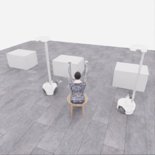
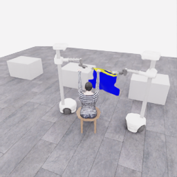
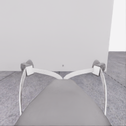
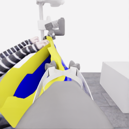
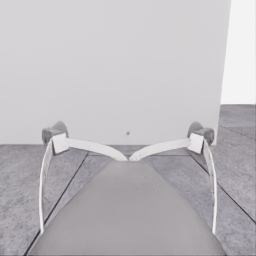
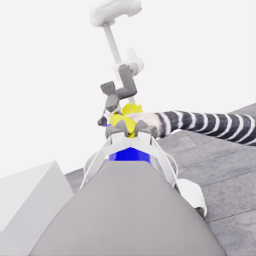
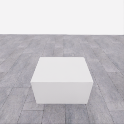
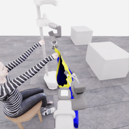
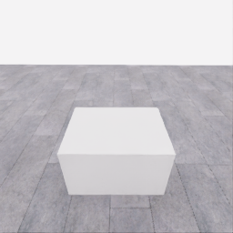
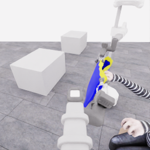

# 자동 시연 수집 시도 · 20261113-astra-side-hem738-continue20-001

[전체 수집 기록](../../README.ko.md) · [구조화 요약](manifest.json) · [전체 행동 기록](decisions.jsonl) · [사용한 기본 프롬프트](prompt.txt)

실행 상태는 **completed**, 원본 출처는 `gpt`입니다. 완료 상태와 과제 성공은 아래에서 따로 기록합니다.

## 실행 조건과 시간

| 항목 | 기록 |
|---|---|
| 기록 시작 UTC | 2026-11-13T21:41:33Z |
| 기록 종료 UTC | 2026-11-13T22:07:44Z |
| 이전 시도 | 20261113-astra-side-hem-fresh-001 |
| 재시도 사유 | User requested 20 additional decisions from the latest pre-cleanup alignment; recheck replayed cloth support and continue the first-wrist objective with the unchanged side-hem strategy. |
| 출처 그룹 | 20261113-astra-side-hem-fresh-001 |
| 요청 모델 / 추론 설정 | gpt-6-astra / ultra |
| 전체 실제 경과 시간 (초) | 1571.539 |
| Actor 호출 합계 (초) | 775.837 |
| 환경 요청·응답 합계 (초) | 747.066 |
| 시뮬레이션 시간 (초) | 41.700 |
| 저장 전이 수 | 834.000 |
| 응답 확인 전이 수 | 834.000 |
| 모델 호출 시도 수 | 12.000 |
| 완료한 결정 구간 수 | 11.000 |
| 파일 완료 상태 | true |
| 데이터 정합성 검사 | true |
| 학습 데이터 승인 | unreviewed |
| Actor 호출 방식 | exec |
| 한 호출의 최대 계획 구간 수 | 1.000 |
| 한 계획의 최대 제어 step 수 | 20.000 |
| 제어기 정착 대기 설정 | true |
| 정착 대기 요청 step 수 | 6.000 |
| 완료한 제어기 정착 구간 수 | 9.000 |
| 제어기 정착 전이 수 | 54.000 |
| 제어기 정착 환경 요청·응답 (초) | 43.701 |
| 전이 예산으로 단축한 정착 구간 수 | 0.000 |
| 전이 예산으로 건너뛴 정착 구간 수 | 0.000 |

Actor 호출 시간은 공개 입력 저장·요청 전송·응답 처리 등 호출 경로를 측정합니다. 방식에 따라 Docker/CLI 시작이 호출 안에 들어가거나 상주 서버 준비 시간으로 분리됩니다. 내부 모델 추론 시간만 별도로 측정한 값은 아닙니다. 모델이 판단하는 동안 물리 시간은 멈추며 실제 경과 시간과 시뮬레이션 시간은 다릅니다. 세부 요청 프로세스 시간에도 CLI 처리·네트워크·서버 대기·생성이 함께 포함됩니다.

## 토큰 사용량의 범위

`actor_usage`는 thread별 관측 누계를 합친 값입니다. 결정의 `usage`는 원본 CLI 누계이며, 호출별 증가량은 `usage_accounting.incremental_usage`입니다. 캐시 입력은 입력의 부분집합이고 추론 출력은 출력의 부분집합이므로 열들을 다시 합산하지 않습니다.

전체 호출 사용량 확정: **true** · 기록한 호출 수: 12.

| 입력 | 캐시 입력 | 캐시 쓰기 입력 | 출력 | 추론 출력 |
|---:|---:|---:|---:|---:|
| 1066513 | 889600 | 0 | 21745 | 19006 |

중복 누계는 추가 사용량 0으로 처리하고, 역행한 누계는 미확정으로 보존합니다. 새 thread는 별도로 집계합니다. 토큰 기록은 화폐 비용이나 청구서가 아닙니다.

## 리뷰 정지 조건

목표 누적 점수 10.000 · 감시 상태 `collector_ended_before_gate` · 수집기 상태 `completed`.

마지막 관측 점수 5.000 · 응답 확인 step 834.

`review_ready`는 정지 조건에 따라 실행을 마치고 리뷰할 준비가 된 상태입니다. 50점·착의 성공이나 학습 데이터 승인을 뜻하지 않습니다. 공식 점수와 success는 아래 평가 결과로 확인합니다.

## 공식 평가 결과

평가 유효성 `true` · 누적 점수 **5.000 / 50** · 착의 success **false** · rate 상태 `no_dressing_points` · 최종 rate 0.000 points/s.

누적 50점, 착의 success, 정상 파일 종료와 데이터 정합성은 서로 다른 상태입니다. 접촉 전 `no_contact`의 rate는 0점/초로 바꾸지 않습니다.

| 단계 | 획득 점수 / 최대 | 획득 시각 (episode 초) |
|---|---:|---:|
| 파지·들기 | 5.000 / 5 | 18.550 |
| 첫 소매 | 0.000 / 5 | 미측정/해당 없음 |
| 반대 어깨 | 0.000 / 5 | 미측정/해당 없음 |
| 두 번째 소매 | 0.000 / 5 | 미측정/해당 없음 |
| 왼쪽 위팔 | 0.000 / 5 | 미측정/해당 없음 |
| 오른쪽 위팔 | 0.000 / 5 | 미측정/해당 없음 |
| 목 통과 | 0.000 / 10 | 미측정/해당 없음 |
| 앞면 방향 | 0.000 / 10 | 미측정/해당 없음 |

## 단계 획득 경로

점수 획득은 [평가 이벤트](score-events.jsonl)에서 같은 physics tick끼리 묶었습니다. 같은 시각에 인정된 항목의 내부 순서는 추정하지 않습니다. 착의 success는 점수 획득과 별도로 기록합니다.

| 순서 | episode 시간 (초) | 전이 경계 step | 누적 점수 변화 | 같은 시각의 항목 변화 |
|---:|---:|---:|---:|---|
| 0 | 18.550 | 371 | 0.000→5.000 | 파지·들기 0.000→5.000 |

평가 clock 0초에 대응하는 공개 simulation clock은 1.525초입니다. 두 시계를 같은 절대 시각으로 혼동하지 않습니다.

별도 success 이벤트 수: **0**. 평가 유효성: `true`.


## 원본 관측 화면

지정된 공개 카메라의 저장 RGB 픽셀입니다. 시작은 첫 `obs`, 종료는 마지막 `next_obs`입니다. 이미지 합성이나 내부 상태 기반 장면 재구성 없이 원본 픽셀로 PNG를 저장했습니다.

| 카메라 | 시작 | 종료 |
|---|---|---|
| `overview` | [](images/initial-overview.png) | [](images/final-overview.png) |
| `robot_0_wrist` | [](images/initial-robot_0_wrist.png) | [](images/final-robot_0_wrist.png) |
| `robot_1_wrist` | [](images/initial-robot_1_wrist.png) | [](images/final-robot_1_wrist.png) |
| `robot_0_head` | [](images/initial-robot_0_head.png) | [](images/final-robot_0_head.png) |
| `robot_1_head` | [](images/initial-robot_1_head.png) | [](images/final-robot_1_head.png) |

시작 관측 시각 1.525초 · 종료 관측 시각 43.225초 (공개 simulation clock).

[▶ overview 관측 영상 보기](overview.mp4)

저장된 20 Hz `obs` 중 834프레임을 순서대로 사용했습니다. 재생은 **1배 느리게** (20.000 fps), 실제 대기 시간·모델 호출 지연은 영상에 들어가지 않습니다. 종료 `next_obs`는 위 PNG에서 확인합니다.

## 결정과 실행 순서

아래 근거는 모델 최종 JSON의 짧은 행동 설명입니다. 시각적 평가는 행동 전 관측에 대한 판단이며, 그 행동의 실행 후 성공 라벨로 사용하지 않습니다. 공식 점수는 별도의 평가 결과입니다.

행동의 각 행은 로봇 0·1 순서이며 열은 `전진, 왼쪽 이동, 반시계 회전, 리프트, 팔 신장, 손목 yaw, pitch, roll, gripper`입니다. 앞 8개는 정규화 속도이고 gripper는 닫기 `+1`, 열기 `-1`, 의도 유지 `0`입니다.

제어기 정착 대기는 앞선 모델 결정에 연결된 별도 중립 행동입니다. 추가 모델 호출이나 모델 결정으로 집계하지 않으며, 실제 전이와 환경 요청·응답 시간은 전체 합계에 포함됩니다. 중립 행동은 두 로봇의 속도와 gripper 명령을 모두 0으로 보내 기존 gripper 의도를 유지합니다. 대기를 실행했다는 기록이 옷의 정착이나 과제 개선을 확인했다는 뜻은 아닙니다.

### 기록된 행동의 재실행 구간

원본 `20261113-astra-side-hem-fresh-001`의 행동 738전이를 새 환경에서 다시 실행했습니다. 이 구간에는 새 모델 호출이 없고 관측·평가를 새로 기록했습니다. 정확한 물리 상태 복원이나 독립적인 새 시연으로 집계하지 않습니다. 원본 step 대응과 실제 행동은 `decisions.jsonl`의 `replayed_segment`에 있습니다.

### 별도 모델 호출 0 · `initial`

실행 결정 인덱스 0의 고정 관측을 사용했습니다. 호출 경과 106.058초. 같은 call index의 행동 기록과 사용량을 중복 합산하지 않습니다.

공개 입력 저장 0.236초 · 요청 프로세스 105.822초 · 결과 해석 0.000초.

### 공개 픽셀 depth 조회 · 결정 0

물리 전이 없이 같은 카메라·시각의 원본 값을 조회했습니다. 무효 값은 null이며 접촉·입구 통과 판단이 아닙니다.

```json
{
  "request": {
    "kind": "depth_query",
    "observation_id": "ada16f5290960053b425c09ace5c5347b4e407d0d62ca0ebbfd7455cc2adf6b1",
    "camera": "robot_1_wrist",
    "pixels_uv": [
      [
        153,
        115
      ],
      [
        177,
        122
      ],
      [
        157,
        130
      ],
      [
        163,
        141
      ],
      [
        180,
        149
      ],
      [
        203,
        149
      ],
      [
        132,
        137
      ],
      [
        145,
        126
      ]
    ],
    "include_camera_geometry": true
  },
  "response": {
    "kind": "depth_query_result",
    "observation_id": "ada16f5290960053b425c09ace5c5347b4e407d0d62ca0ebbfd7455cc2adf6b1",
    "camera": "robot_1_wrist",
    "camera_index": 2,
    "simulation_time_s": 38.425002004019916,
    "intrinsics_sha256": "3dd91a2df5cb0a47b6f5ceb86d60d41e1f5d6753d2a11a034ac0b52bc385cd23",
    "request_sha256": "d8d424bb57a951ca57e73a5279a4f4c06a3a3cadaa7b8176f452228ee6a21488",
    "depth_semantics": "optical_Z_metres_not_ray_range",
    "geometry_semantics": "camera_X_right_Y_down_Z_forward",
    "rgb_image_order": [
      "overview",
      "robot_0_wrist",
      "robot_1_wrist",
      "robot_0_head",
      "robot_1_head"
    ],
    "resolution_wh": [
      256,
      256
    ],
    "neighbor_depth_substituted": false,
    "hidden_surfaces_estimated": false,
    "object_pose_or_contact_inferred": false,
    "source_sha256": {
      "observation_json": "592cf6db3b3cbe5e727d8145c91dc653c4fba30642bb6b03a579bff8c4dc92e0",
      "public_depth_npz": "73b6d9da89f6b0c77e8da264fbe722f21cdcc1b8c9f5989205f17b86194b5850",
      "overview_rgb": "64b4a558487e4fb87b800c8b418e29ed68fe9da91a34a058e03b1b70afe042e5",
      "robot_0_wrist_rgb": "c75963492389b946c11269faa02a09451fb8e854117b0162cdd84b619f703bd4",
      "robot_1_wrist_rgb": "29dfef3312bef159de948c2541f0485fbd1c4b108e887388b2d40e4fbe1ceae4",
      "robot_0_head_rgb": "f746fda6db20761f6e6f2a641e8db9f192cd8c1142ef243d48f45732b3b93ed6",
      "robot_1_head_rgb": "4f236159690f9771cda5d5e6956a429bf0767872865b3445f65dc0a400a60024"
    },
    "results": [
      {
        "pixel_uv": [
          153,
          115
        ],
        "status": "valid",
        "optical_z_m": 0.5049983859062195,
        "camera_xyz_m": [
          0.06906321808501384,
          -0.0359128734042072,
          0.5049983859062195
        ],
        "camera_range_m": 0.510962652584601,
        "invalid_reasons": []
      },
      {
        "pixel_uv": [
          177,
          122
        ],
        "status": "valid",
        "optical_z_m": 0.4680304229259491,
        "camera_xyz_m": [
          0.12545471157786856,
          -0.015361801417698193,
          0.4680304229259491
        ],
        "camera_range_m": 0.48479619056272066,
        "invalid_reasons": []
      },
      {
        "pixel_uv": [
          157,
          130
        ],
        "status": "valid",
        "optical_z_m": 0.6949247717857361,
        "camera_xyz_m": [
          0.11024340114920315,
          0.007602993182703665,
          0.6949247717857361
        ],
        "camera_range_m": 0.7036560604753843,
        "invalid_reasons": []
      },
      {
        "pixel_uv": [
          163,
          141
        ],
        "status": "valid",
        "optical_z_m": 0.33839452266693115,
        "camera_xyz_m": [
          0.06479003006335281,
          0.024064868309245327,
          0.33839452266693115
        ],
        "camera_range_m": 0.34538054208847907,
        "invalid_reasons": []
      },
      {
        "pixel_uv": [
          180,
          149
        ],
        "status": "valid",
        "optical_z_m": 0.32687193155288696,
        "camera_xyz_m": [
          0.0929817648916405,
          0.03755032812931636,
          0.32687193155288696
        ],
        "camera_range_m": 0.34190772933950886,
        "invalid_reasons": []
      },
      {
        "pixel_uv": [
          203,
          149
        ],
        "status": "valid",
        "optical_z_m": 0.33703145384788513,
        "camera_xyz_m": [
          0.13827654175667992,
          0.03871743169187038,
          0.33703145384788513
        ],
        "camera_range_m": 0.36634634214063144,
        "invalid_reasons": []
      },
      {
        "pixel_uv": [
          132,
          137
        ],
        "status": "valid",
        "optical_z_m": 0.2559325695037842,
        "camera_xyz_m": [
          0.005600184826247817,
          0.012600415859057587,
          0.2559325695037842
        ],
        "camera_range_m": 0.25630375081671875,
        "invalid_reasons": []
      },
      {
        "pixel_uv": [
          145,
          126
        ],
        "status": "valid",
        "optical_z_m": 0.23339836299419403,
        "camera_xyz_m": [
          0.02170518737471714,
          -0.0025535514558490753,
          0.23339836299419403
        ],
        "camera_range_m": 0.23441934995298236,
        "invalid_reasons": []
      }
    ]
  }
}
```

### 별도 모델 호출 1 · `action_after_query`

실행 결정 인덱스 0의 고정 관측을 사용했습니다. 호출 경과 70.974초. 같은 call index의 행동 기록과 사용량을 중복 합산하지 않습니다.

공개 입력 저장 0.215초 · 요청 프로세스 70.759초 · 결과 해석 0.000초.

### 결정 0 · 첫 소매 · `act`

입력 관측 38.425초 · Actor 호출 70.974초 · 시각적 판단 `uncertain`.

계획 `20261113-astra-side-hem738-continue20-001:call-00001` · 모델 호출 인덱스 1 · 계획 구간 1/1 · 이 구간에서 모델 호출 `true`.

실행 직전 최신 관측 38.425초.

공개 입력 저장 0.215초 · 요청 프로세스 70.759초 · 결과 해석 0.000초.

호출 사용량 상태 `observed` · 이번 증가량 입력 41651 / 출력 2126 토큰.

최종 응답의 행동 설명: Robot 0 maintains apparent opposite-edge support; robot 1 guides beside the first target hand. Sampled hand depth lies between candidate lips, but entry remains unconfirmed. Shift the mouth slightly toward that hand and lower robot 1&#x27;s edge; inspect rim crossing and cloth following at both grips.

요청 행동:

```json
[[-0.02, 0.08, 0, 0, 0, 0, 0, 0, 0], [-0.05, -0.14, 0, -0.07, 0, 0, 0, 0, 0]]
```

실행 구간 step **[738, 742)** · 요청 4 step / 실제 4 step · 환경 요청·응답 3.557초.

실제 적용 행동:

```json
[[-0.019999999552965164, 0.07999999821186066, 0.0, 0.0, 0.0, 0.0, 0.0, 0.0, 0.0], [-0.05000000074505806, -0.14000000059604645, 0.0, -0.07000000029802322, 0.0, 0.0, 0.0, 0.0, 0.0]]
```

### 제어기 정착 대기 · 연결 결정 0

구간 `20261113-astra-side-hem738-continue20-001:settle-00000` · 출처 `controller_settle` · 이 구간에서 모델 호출 `false`.

앞선 모델 호출 인덱스 1에 연결됩니다. 추가 호출은 없습니다.

실행 구간 step **[742, 748)** · 요청 6 step / 실제 6 step · 환경 요청·응답 4.756초.

공개 simulation clock 38.625→38.925초 · 실행 전 관측 38.625초.

실제 적용 중립 행동:

```json
[[0.0, 0.0, 0.0, 0.0, 0.0, 0.0, 0.0, 0.0, 0.0], [0.0, 0.0, 0.0, 0.0, 0.0, 0.0, 0.0, 0.0, 0.0]]
```

### 별도 모델 호출 2 · `initial`

실행 결정 인덱스 1의 고정 관측을 사용했습니다. 호출 경과 35.994초. 같은 call index의 행동 기록과 사용량을 중복 합산하지 않습니다.

공개 입력 저장 0.080초 · 요청 프로세스 35.914초 · 결과 해석 0.000초.

### 결정 1 · 첫 소매 · `act`

입력 관측 38.925초 · Actor 호출 35.994초 · 시각적 판단 `progressing`.

계획 `20261113-astra-side-hem738-continue20-001:call-00002` · 모델 호출 인덱스 2 · 계획 구간 1/1 · 이 구간에서 모델 호출 `true`.

실행 직전 최신 관측 38.925초.

공개 입력 저장 0.080초 · 요청 프로세스 35.914초 · 결과 해석 0.000초.

호출 사용량 상태 `observed` · 이번 증가량 입력 52745 / 출력 1051 토큰.

최종 응답의 행동 설명: Robot 0 supports the opposite edge; robot 1 guides toward the same first hand. Measured motion matched the correction, cloth remained at both grips, and the hand moved closer to the rim without confirmed crossing. Advance the mouth slightly toward the hand and lower the guide edge; inspect whether the rim passes around it.

요청 행동:

```json
[[-0.025, 0.14, 0, 0, 0, 0, 0, 0, 0], [-0.06, -0.17, 0, -0.055, 0, 0, 0, 0, 0]]
```

실행 구간 step **[748, 753)** · 요청 5 step / 실제 5 step · 환경 요청·응답 4.199초.

실제 적용 행동:

```json
[[-0.02500000037252903, 0.14000000059604645, 0.0, 0.0, 0.0, 0.0, 0.0, 0.0, 0.0], [-0.05999999865889549, -0.17000000178813934, 0.0, -0.054999999701976776, 0.0, 0.0, 0.0, 0.0, 0.0]]
```

### 제어기 정착 대기 · 연결 결정 1

구간 `20261113-astra-side-hem738-continue20-001:settle-00001` · 출처 `controller_settle` · 이 구간에서 모델 호출 `false`.

앞선 모델 호출 인덱스 2에 연결됩니다. 추가 호출은 없습니다.

실행 구간 step **[753, 759)** · 요청 6 step / 실제 6 step · 환경 요청·응답 4.914초.

공개 simulation clock 39.175→39.475초 · 실행 전 관측 39.175초.

실제 적용 중립 행동:

```json
[[0.0, 0.0, 0.0, 0.0, 0.0, 0.0, 0.0, 0.0, 0.0], [0.0, 0.0, 0.0, 0.0, 0.0, 0.0, 0.0, 0.0, 0.0]]
```

### 별도 모델 호출 3 · `initial`

실행 결정 인덱스 2의 고정 관측을 사용했습니다. 호출 경과 52.570초. 같은 call index의 행동 기록과 사용량을 중복 합산하지 않습니다.

공개 입력 저장 0.083초 · 요청 프로세스 52.488초 · 결과 해석 0.000초.

### 결정 2 · 복구 · `act`

입력 관측 39.475초 · Actor 호출 52.570초 · 시각적 판단 `recovering`.

계획 `20261113-astra-side-hem738-continue20-001:call-00003` · 모델 호출 인덱스 3 · 계획 구간 1/1 · 이 구간에서 모델 호출 `true`.

실행 직전 최신 관측 39.475초.

공개 입력 저장 0.083초 · 요청 프로세스 52.488초 · 결과 해석 0.000초.

호출 사용량 상태 `observed` · 이번 증가량 입력 62657 / 출력 1437 토큰.

최종 응답의 행동 설명: Robot 0 holds the opposite edge; robot 1 guides beside the same first hand. Both translations executed, but fingertip-to-rim crossing is now obscured. Pause advancement and roll robot 1&#x27;s held edge to expose the candidate opening; check lip separation and retained hand adjacency before further entry.

요청 행동:

```json
[[0, 0, 0, 0, 0, 0, 0, 0, 0], [0, 0, 0, 0, 0, 0, 0, 0.16, 0]]
```

실행 구간 step **[759, 763)** · 요청 4 step / 실제 4 step · 환경 요청·응답 3.432초.

실제 적용 행동:

```json
[[0.0, 0.0, 0.0, 0.0, 0.0, 0.0, 0.0, 0.0, 0.0], [0.0, 0.0, 0.0, 0.0, 0.0, 0.0, 0.0, 0.1599999964237213, 0.0]]
```

### 제어기 정착 대기 · 연결 결정 2

구간 `20261113-astra-side-hem738-continue20-001:settle-00002` · 출처 `controller_settle` · 이 구간에서 모델 호출 `false`.

앞선 모델 호출 인덱스 3에 연결됩니다. 추가 호출은 없습니다.

실행 구간 step **[763, 769)** · 요청 6 step / 실제 6 step · 환경 요청·응답 5.023초.

공개 simulation clock 39.675→39.975초 · 실행 전 관측 39.675초.

실제 적용 중립 행동:

```json
[[0.0, 0.0, 0.0, 0.0, 0.0, 0.0, 0.0, 0.0, 0.0], [0.0, 0.0, 0.0, 0.0, 0.0, 0.0, 0.0, 0.0, 0.0]]
```

### 별도 모델 호출 4 · `initial`

실행 결정 인덱스 3의 고정 관측을 사용했습니다. 호출 경과 72.591초. 같은 call index의 행동 기록과 사용량을 중복 합산하지 않습니다.

공개 입력 저장 0.078초 · 요청 프로세스 72.514초 · 결과 해석 0.000초.

### 결정 3 · 복구 · `act`

입력 관측 39.975초 · Actor 호출 72.591초 · 시각적 판단 `uncertain`.

계획 `20261113-astra-side-hem738-continue20-001:call-00004` · 모델 호출 인덱스 4 · 계획 구간 1/1 · 이 구간에서 모델 호출 `true`.

실행 직전 최신 관측 39.975초.

공개 입력 저장 0.078초 · 요청 프로세스 72.514초 · 결과 해석 0.000초.

호출 사용량 상태 `observed` · 이번 증가량 입력 72950 / 출력 1998 토큰.

최종 응답의 행동 설명: Robot 0 anchors the opposite edge; robot 1 holds beside the same first hand. Rolling changed the view without clearly exposing rim crossing; measured roll is 0.320 toward the persistent 0.341 target and still moving. Briefly preserve both grips to inspect remaining motion and hand-to-lip separation.

요청 행동:

```json
[[0, 0, 0, 0, 0, 0, 0, 0, 0], [0, 0, 0, 0, 0, 0, 0, 0, 0]]
```

실행 구간 step **[769, 773)** · 요청 4 step / 실제 4 step · 환경 요청·응답 3.547초.

실제 적용 행동:

```json
[[0.0, 0.0, 0.0, 0.0, 0.0, 0.0, 0.0, 0.0, 0.0], [0.0, 0.0, 0.0, 0.0, 0.0, 0.0, 0.0, 0.0, 0.0]]
```

### 별도 모델 호출 5 · `initial`

실행 결정 인덱스 4의 고정 관측을 사용했습니다. 호출 경과 55.168초. 같은 call index의 행동 기록과 사용량을 중복 합산하지 않습니다.

공개 입력 저장 0.078초 · 요청 프로세스 55.089초 · 결과 해석 0.000초.

### 결정 4 · 복구 · `act`

입력 관측 40.175초 · Actor 호출 55.168초 · 시각적 판단 `recovering`.

계획 `20261113-astra-side-hem738-continue20-001:call-00005` · 모델 호출 인덱스 5 · 계획 구간 1/1 · 이 구간에서 모델 호출 `true`.

실행 직전 최신 관측 40.175초.

공개 입력 저장 0.078초 · 요청 프로세스 55.089초 · 결과 해석 0.000초.

호출 사용량 상태 `observed` · 이번 증가량 입력 83799 / 출력 1608 토큰.

최종 응답의 행동 설명: Robot 0 reshapes the opposite edge while robot 1 preserves adjacency to the same first hand. Roll is now near its target, but rim crossing remains unclear. Yaw robot 0&#x27;s held edge away from the hand to pivot the mouth; inspect lip separation, cloth following and retained hand adjacency.

요청 행동:

```json
[[0, 0, 0, 0, 0, -0.14, 0, 0, 0], [0, 0, 0, 0, 0, 0, 0, 0, 0]]
```

실행 구간 step **[773, 778)** · 요청 5 step / 실제 5 step · 환경 요청·응답 4.169초.

실제 적용 행동:

```json
[[0.0, 0.0, 0.0, 0.0, 0.0, -0.14000000059604645, 0.0, 0.0, 0.0], [0.0, 0.0, 0.0, 0.0, 0.0, 0.0, 0.0, 0.0, 0.0]]
```

### 제어기 정착 대기 · 연결 결정 4

구간 `20261113-astra-side-hem738-continue20-001:settle-00004` · 출처 `controller_settle` · 이 구간에서 모델 호출 `false`.

앞선 모델 호출 인덱스 5에 연결됩니다. 추가 호출은 없습니다.

실행 구간 step **[778, 784)** · 요청 6 step / 실제 6 step · 환경 요청·응답 4.903초.

공개 simulation clock 40.425→40.725초 · 실행 전 관측 40.425초.

실제 적용 중립 행동:

```json
[[0.0, 0.0, 0.0, 0.0, 0.0, 0.0, 0.0, 0.0, 0.0], [0.0, 0.0, 0.0, 0.0, 0.0, 0.0, 0.0, 0.0, 0.0]]
```

### 별도 모델 호출 6 · `initial`

실행 결정 인덱스 5의 고정 관측을 사용했습니다. 호출 경과 73.442초. 같은 call index의 행동 기록과 사용량을 중복 합산하지 않습니다.

공개 입력 저장 0.078초 · 요청 프로세스 73.363초 · 결과 해석 0.000초.

### 결정 5 · 첫 소매 · `act`

입력 관측 40.725초 · Actor 호출 73.442초 · 시각적 판단 `uncertain`.

계획 `20261113-astra-side-hem738-continue20-001:call-00006` · 모델 호출 인덱스 6 · 계획 구간 1/1 · 이 구간에서 모델 호출 `true`.

실행 직전 최신 관측 40.725초.

공개 입력 저장 0.078초 · 요청 프로세스 73.363초 · 결과 해석 0.000초.

호출 사용량 상태 `observed` · 이번 증가량 입력 94253 / 출력 1955 토큰.

최종 응답의 행동 설명: Robot 0 supports the reshaped opposite edge; robot 1 guides the same first hand. Yaw displaced cloth with robot 0 and widened the visible mouth contour, but entry remains unconfirmed. Advance robot 1 briefly toward the visible wrist along its forearm; inspect whether the rim surrounds the hand while both grips remain useful.

요청 행동:

```json
[[0, 0, 0, 0, 0, 0, 0, 0, 0], [-0.06, -0.17, 0, 0, 0, 0, 0, 0, 0]]
```

실행 구간 step **[784, 788)** · 요청 4 step / 실제 4 step · 환경 요청·응답 3.550초.

실제 적용 행동:

```json
[[0.0, 0.0, 0.0, 0.0, 0.0, 0.0, 0.0, 0.0, 0.0], [-0.05999999865889549, -0.17000000178813934, 0.0, 0.0, 0.0, 0.0, 0.0, 0.0, 0.0]]
```

### 제어기 정착 대기 · 연결 결정 5

구간 `20261113-astra-side-hem738-continue20-001:settle-00005` · 출처 `controller_settle` · 이 구간에서 모델 호출 `false`.

앞선 모델 호출 인덱스 6에 연결됩니다. 추가 호출은 없습니다.

실행 구간 step **[788, 794)** · 요청 6 step / 실제 6 step · 환경 요청·응답 4.971초.

공개 simulation clock 40.925→41.225초 · 실행 전 관측 40.925초.

실제 적용 중립 행동:

```json
[[0.0, 0.0, 0.0, 0.0, 0.0, 0.0, 0.0, 0.0, 0.0], [0.0, 0.0, 0.0, 0.0, 0.0, 0.0, 0.0, 0.0, 0.0]]
```

### 별도 모델 호출 7 · `initial`

실행 결정 인덱스 6의 고정 관측을 사용했습니다. 호출 경과 139.187초. 같은 call index의 행동 기록과 사용량을 중복 합산하지 않습니다.

공개 입력 저장 0.078초 · 요청 프로세스 139.110초 · 결과 해석 0.000초.

### 결정 6 · 복구 · `act`

입력 관측 41.225초 · Actor 호출 139.187초 · 시각적 판단 `recovering`.

계획 `20261113-astra-side-hem738-continue20-001:call-00007` · 모델 호출 인덱스 7 · 계획 구간 1/1 · 이 구간에서 모델 호출 `true`.

실행 직전 최신 관측 41.225초.

공개 입력 저장 0.078초 · 요청 프로세스 139.110초 · 결과 해석 0.000초.

호출 사용량 상태 `observed` · 이번 증가량 입력 105074 / 출력 3593 토큰.

최종 응답의 행동 설명: Robot 0 anchors the opposite rim; robot 1 holds beside the first wrist. The advance occurred but covered the fingertips without revealing rim crossing. Retract robot 1&#x27;s housing laterally with base compensation to preserve forearm alignment; inspect hand-to-rim clearance and cloth following before further entry.

요청 행동:

```json
[[0, 0, 0, 0, 0, 0, 0, 0, 0], [0, 0.07, 0, 0, -0.1, 0, 0, 0, 0]]
```

실행 구간 step **[794, 798)** · 요청 4 step / 실제 4 step · 환경 요청·응답 3.423초.

실제 적용 행동:

```json
[[0.0, 0.0, 0.0, 0.0, 0.0, 0.0, 0.0, 0.0, 0.0], [0.0, 0.07000000029802322, 0.0, 0.0, -0.10000000149011612, 0.0, 0.0, 0.0, 0.0]]
```

### 제어기 정착 대기 · 연결 결정 6

구간 `20261113-astra-side-hem738-continue20-001:settle-00006` · 출처 `controller_settle` · 이 구간에서 모델 호출 `false`.

앞선 모델 호출 인덱스 7에 연결됩니다. 추가 호출은 없습니다.

실행 구간 step **[798, 804)** · 요청 6 step / 실제 6 step · 환경 요청·응답 4.768초.

공개 simulation clock 41.425→41.725초 · 실행 전 관측 41.425초.

실제 적용 중립 행동:

```json
[[0.0, 0.0, 0.0, 0.0, 0.0, 0.0, 0.0, 0.0, 0.0], [0.0, 0.0, 0.0, 0.0, 0.0, 0.0, 0.0, 0.0, 0.0]]
```

### 별도 모델 호출 8 · `initial`

실행 결정 인덱스 7의 고정 관측을 사용했습니다. 호출 경과 57.273초. 같은 call index의 행동 기록과 사용량을 중복 합산하지 않습니다.

공개 입력 저장 0.076초 · 요청 프로세스 57.197초 · 결과 해석 0.000초.

### 결정 7 · 두 번째 소매 · `act`

입력 관측 41.725초 · Actor 호출 57.273초 · 시각적 판단 `uncertain`.

계획 `20261113-astra-side-hem738-continue20-001:call-00008` · 모델 호출 인덱스 8 · 계획 구간 1/1 · 이 구간에서 모델 호출 `true`.

실행 직전 최신 관측 41.725초.

공개 입력 저장 0.076초 · 요청 프로세스 57.197초 · 결과 해석 0.000초.

호출 사용량 상태 `observed` · 이번 증가량 입력 117531 / 출력 1671 토큰.

최종 응답의 행동 설명: Robot 0 supports cloth beside the first forearm; robot 1 guides the higher edge. Retraction moved the cloth while the first wrist appears to remain beneath the rim; sleeve passage is unconfirmed. Raise and retract robot 1 slightly toward the other raised hand, checking that the first wrist relationship remains intact.

요청 행동:

```json
[[0, 0, 0, 0, 0, 0, 0, 0, 0], [0, 0.04, 0, 0.1, -0.06, 0, 0, 0, 0]]
```

실행 구간 step **[804, 808)** · 요청 4 step / 실제 4 step · 환경 요청·응답 3.428초.

실제 적용 행동:

```json
[[0.0, 0.0, 0.0, 0.0, 0.0, 0.0, 0.0, 0.0, 0.0], [0.0, 0.03999999910593033, 0.0, 0.10000000149011612, -0.05999999865889549, 0.0, 0.0, 0.0, 0.0]]
```

### 제어기 정착 대기 · 연결 결정 7

구간 `20261113-astra-side-hem738-continue20-001:settle-00007` · 출처 `controller_settle` · 이 구간에서 모델 호출 `false`.

앞선 모델 호출 인덱스 8에 연결됩니다. 추가 호출은 없습니다.

실행 구간 step **[808, 814)** · 요청 6 step / 실제 6 step · 환경 요청·응답 4.716초.

공개 simulation clock 41.925→42.225초 · 실행 전 관측 41.925초.

실제 적용 중립 행동:

```json
[[0.0, 0.0, 0.0, 0.0, 0.0, 0.0, 0.0, 0.0, 0.0], [0.0, 0.0, 0.0, 0.0, 0.0, 0.0, 0.0, 0.0, 0.0]]
```

### 별도 모델 호출 9 · `initial`

실행 결정 인덱스 8의 고정 관측을 사용했습니다. 호출 경과 27.280초. 같은 call index의 행동 기록과 사용량을 중복 합산하지 않습니다.

공개 입력 저장 0.076초 · 요청 프로세스 27.204초 · 결과 해석 0.000초.

### 결정 8 · 복구 · `act`

입력 관측 42.225초 · Actor 호출 27.280초 · 시각적 판단 `recovering`.

계획 `20261113-astra-side-hem738-continue20-001:call-00009` · 모델 호출 인덱스 9 · 계획 구간 1/1 · 이 구간에서 모델 호출 `true`.

실행 직전 최신 관측 42.225초.

공개 입력 저장 0.076초 · 요청 프로세스 27.204초 · 결과 해석 0.000초.

호출 사용량 상태 `observed` · 이번 증가량 입력 128058 / 출력 734 토큰.

최종 응답의 행동 설명: Robot 0 maintains support beside the first forearm; robot 1&#x27;s lift and retraction narrowed the mouth and obscured the first-hand relationship. Pause second-hand advancement and reverse that bounded adjustment to relieve tension. Inspect whether the opening and first wrist adjacency return while preserving both grips.

요청 행동:

```json
[[0, 0, 0, 0, 0, 0, 0, 0, 0], [0, -0.04, 0, -0.1, 0.06, 0, 0, 0, 0]]
```

실행 구간 step **[814, 818)** · 요청 4 step / 실제 4 step · 환경 요청·응답 3.297초.

실제 적용 행동:

```json
[[0.0, 0.0, 0.0, 0.0, 0.0, 0.0, 0.0, 0.0, 0.0], [0.0, -0.03999999910593033, 0.0, -0.10000000149011612, 0.05999999865889549, 0.0, 0.0, 0.0, 0.0]]
```

### 제어기 정착 대기 · 연결 결정 8

구간 `20261113-astra-side-hem738-continue20-001:settle-00008` · 출처 `controller_settle` · 이 구간에서 모델 호출 `false`.

앞선 모델 호출 인덱스 9에 연결됩니다. 추가 호출은 없습니다.

실행 구간 step **[818, 824)** · 요청 6 step / 실제 6 step · 환경 요청·응답 4.785초.

공개 simulation clock 42.425→42.725초 · 실행 전 관측 42.425초.

실제 적용 중립 행동:

```json
[[0.0, 0.0, 0.0, 0.0, 0.0, 0.0, 0.0, 0.0, 0.0], [0.0, 0.0, 0.0, 0.0, 0.0, 0.0, 0.0, 0.0, 0.0]]
```

### 별도 모델 호출 10 · `initial`

실행 결정 인덱스 9의 고정 관측을 사용했습니다. 호출 경과 45.303초. 같은 call index의 행동 기록과 사용량을 중복 합산하지 않습니다.

공개 입력 저장 0.077초 · 요청 프로세스 45.226초 · 결과 해석 0.000초.

### 결정 9 · 복구 · `act`

입력 관측 42.725초 · Actor 호출 45.303초 · 시각적 판단 `recovering`.

계획 `20261113-astra-side-hem738-continue20-001:call-00010` · 모델 호출 인덱스 10 · 계획 구간 1/1 · 이 구간에서 모델 호출 `true`.

실행 직전 최신 관측 42.725초.

공개 입력 저장 0.077초 · 요청 프로세스 45.226초 · 결과 해석 0.000초.

호출 사용량 상태 `observed` · 이번 증가량 입력 137655 / 출력 1236 토큰.

최종 응답의 행동 설명: Robot 0 reshapes the opposite edge; robot 1 holds beside the same first wrist. Reversal restored the guide height, but the mouth remains narrow and entry unverified. Lower robot 0&#x27;s edge and extend slightly to relieve tension; inspect lip separation and whether the first wrist retains its observed rim adjacency.

요청 행동:

```json
[[0, 0, 0, -0.1, 0.04, 0, 0, 0, 0], [0, 0, 0, 0, 0, 0, 0, 0, 0]]
```

실행 구간 step **[824, 828)** · 요청 4 step / 실제 4 step · 환경 요청·응답 3.519초.

실제 적용 행동:

```json
[[0.0, 0.0, 0.0, -0.10000000149011612, 0.03999999910593033, 0.0, 0.0, 0.0, 0.0], [0.0, 0.0, 0.0, 0.0, 0.0, 0.0, 0.0, 0.0, 0.0]]
```

### 제어기 정착 대기 · 연결 결정 9

구간 `20261113-astra-side-hem738-continue20-001:settle-00009` · 출처 `controller_settle` · 이 구간에서 모델 호출 `false`.

앞선 모델 호출 인덱스 10에 연결됩니다. 추가 호출은 없습니다.

실행 구간 step **[828, 834)** · 요청 6 step / 실제 6 step · 환경 요청·응답 4.865초.

공개 simulation clock 42.925→43.225초 · 실행 전 관측 42.925초.

실제 적용 중립 행동:

```json
[[0.0, 0.0, 0.0, 0.0, 0.0, 0.0, 0.0, 0.0, 0.0], [0.0, 0.0, 0.0, 0.0, 0.0, 0.0, 0.0, 0.0, 0.0]]
```

### 별도 모델 호출 11 · `initial`

실행 결정 인덱스 10의 고정 관측을 사용했습니다. 호출 경과 39.997초. 같은 call index의 행동 기록과 사용량을 중복 합산하지 않습니다.

공개 입력 저장 0.077초 · 요청 프로세스 39.920초 · 결과 해석 0.000초.

### 결정 10 · 최종 확인 · `finish_episode`

입력 관측 43.225초 · Actor 호출 39.997초 · 시각적 판단 `blocked`.

계획 `20261113-astra-side-hem738-continue20-001:call-00011` · 모델 호출 인덱스 11 · 계획 구간 1/1 · 이 구간에서 모델 호출 `true`.

실행 직전 최신 관측 43.225초.

공개 입력 저장 0.077초 · 요청 프로세스 39.920초 · 결과 해석 0.000초.

호출 사용량 상태 `observed` · 이번 증가량 입력 147741 / 출력 1175 토큰.

최종 응답의 행동 설명: Robot 0 retains the opposite edge; robot 1 supports cloth beside the first wrist. The lowering executed, but the mouth remains narrow and repeated corrections have not established hand passage. No supported regrasp preserving this wrist relationship is apparent. End the unproductive attempt with both grips held; dressing remains incomplete.

요청 행동:

```json
[[0, 0, 0, 0, 0, 0, 0, 0, 0], [0, 0, 0, 0, 0, 0, 0, 0, 0]]
```

실행 구간 step **[834, 834)** · 요청 0 step / 실제 0 step · 환경 요청·응답 0.007초.

실제 적용 행동:

```json
[[0.0, 0.0, 0.0, 0.0, 0.0, 0.0, 0.0, 0.0, 0.0], [0.0, 0.0, 0.0, 0.0, 0.0, 0.0, 0.0, 0.0, 0.0]]
```

## 검수와 후속 판단

현재 데이터 승인은 `unreviewed`입니다. 형식과 시간 정합성 검사를 통과해도 시연의 유용성이나 착의 성공을 보장하지 않습니다.

이 페이지의 원본 파일 SHA256과 생성 파일 SHA256은 [manifest.json](manifest.json)에 있습니다. 실행 실패도 같은 run ID와 부모 시도 관계로 보존합니다. 공개 범위는 카메라, 최종 행동 응답, 시간, 평가 요약입니다.
