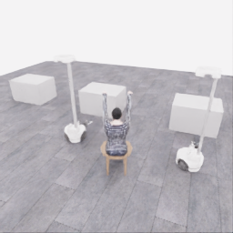
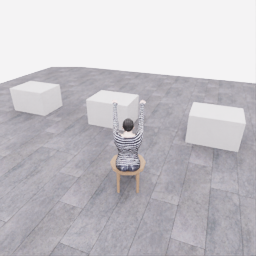
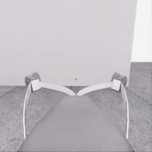
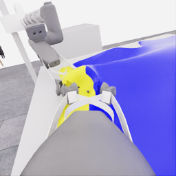
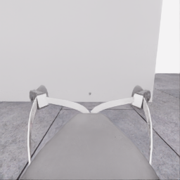
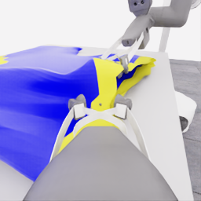
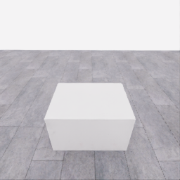
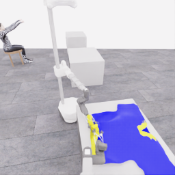
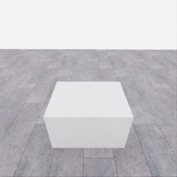
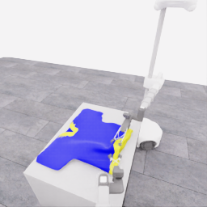

# 자동 시연 수집 시도 · 20261114-astra-middle-grip264-001

[전체 수집 기록](../../README.ko.md) · [구조화 요약](manifest.json) · [전체 행동 기록](decisions.jsonl) · [사용한 기본 프롬프트](prompt.txt)

실행 상태는 **completed**, 원본 출처는 `gpt`입니다. 완료 상태와 과제 성공은 아래에서 따로 기록합니다.

## 실행 조건과 시간

| 항목 | 기록 |
|---|---|
| 기록 시작 UTC | 2026-11-14T08:13:20Z |
| 기록 종료 UTC | 2026-11-14T08:35:52Z |
| 이전 시도 | 20261113-astra-side-hem-fresh-001 |
| 재시도 사유 | Compare inward initial hem grasp locations and vertical opening before a short descent above the same hand. |
| 출처 그룹 | 20261113-astra-side-hem-fresh-001 |
| 요청 모델 / 추론 설정 | gpt-6-astra / ultra |
| 전체 실제 경과 시간 (초) | 1351.411 |
| Actor 호출 합계 (초) | 881.828 |
| 환경 요청·응답 합계 (초) | 419.111 |
| 시뮬레이션 시간 (초) | 23.550 |
| 저장 전이 수 | 471.000 |
| 응답 확인 전이 수 | 471.000 |
| 모델 호출 시도 수 | 21.000 |
| 완료한 결정 구간 수 | 20.000 |
| 파일 완료 상태 | true |
| 데이터 정합성 검사 | true |
| 학습 데이터 승인 | unreviewed |
| Actor 호출 방식 | exec |
| 한 호출의 최대 계획 구간 수 | 1.000 |
| 한 계획의 최대 제어 step 수 | 20.000 |
| 제어기 정착 대기 설정 | true |
| 정착 대기 요청 step 수 | 6.000 |
| 완료한 제어기 정착 구간 수 | 13.000 |
| 제어기 정착 전이 수 | 78.000 |
| 제어기 정착 환경 요청·응답 (초) | 75.386 |
| 전이 예산으로 단축한 정착 구간 수 | 0.000 |
| 전이 예산으로 건너뛴 정착 구간 수 | 0.000 |

Actor 호출 시간은 공개 입력 저장·요청 전송·응답 처리 등 호출 경로를 측정합니다. 방식에 따라 Docker/CLI 시작이 호출 안에 들어가거나 상주 서버 준비 시간으로 분리됩니다. 내부 모델 추론 시간만 별도로 측정한 값은 아닙니다. 모델이 판단하는 동안 물리 시간은 멈추며 실제 경과 시간과 시뮬레이션 시간은 다릅니다. 세부 요청 프로세스 시간에도 CLI 처리·네트워크·서버 대기·생성이 함께 포함됩니다.

## 토큰 사용량의 범위

`actor_usage`는 thread별 관측 누계를 합친 값입니다. 결정의 `usage`는 원본 CLI 누계이며, 호출별 증가량은 `usage_accounting.incremental_usage`입니다. 캐시 입력은 입력의 부분집합이고 추론 출력은 출력의 부분집합이므로 열들을 다시 합산하지 않습니다.

전체 호출 사용량 확정: **true** · 기록한 호출 수: 21.

| 입력 | 캐시 입력 | 캐시 쓰기 입력 | 출력 | 추론 출력 |
|---:|---:|---:|---:|---:|
| 2684220 | 2235520 | 0 | 23461 | 18700 |

중복 누계는 추가 사용량 0으로 처리하고, 역행한 누계는 미확정으로 보존합니다. 새 thread는 별도로 집계합니다. 토큰 기록은 화폐 비용이나 청구서가 아닙니다.

## 리뷰 정지 조건

목표 누적 점수 10.000 · 감시 상태 `collector_ended_before_gate` · 수집기 상태 `completed`.

마지막 관측 점수 0.000 · 응답 확인 step 470.

`review_ready`는 정지 조건에 따라 실행을 마치고 리뷰할 준비가 된 상태입니다. 50점·착의 성공이나 학습 데이터 승인을 뜻하지 않습니다. 공식 점수와 success는 아래 평가 결과로 확인합니다.

## 공식 평가 결과

평가 유효성 `true` · 누적 점수 **0.000 / 50** · 착의 success **false** · rate 상태 `no_contact` · 최종 rate 미측정/해당 없음 points/s.

누적 50점, 착의 success, 정상 파일 종료와 데이터 정합성은 서로 다른 상태입니다. 접촉 전 `no_contact`의 rate는 0점/초로 바꾸지 않습니다.

| 단계 | 획득 점수 / 최대 | 획득 시각 (episode 초) |
|---|---:|---:|
| 파지·들기 | 0.000 / 5 | 미측정/해당 없음 |
| 첫 소매 | 0.000 / 5 | 미측정/해당 없음 |
| 반대 어깨 | 0.000 / 5 | 미측정/해당 없음 |
| 두 번째 소매 | 0.000 / 5 | 미측정/해당 없음 |
| 왼쪽 위팔 | 0.000 / 5 | 미측정/해당 없음 |
| 오른쪽 위팔 | 0.000 / 5 | 미측정/해당 없음 |
| 목 통과 | 0.000 / 10 | 미측정/해당 없음 |
| 앞면 방향 | 0.000 / 10 | 미측정/해당 없음 |

## 단계 획득 경로

점수 획득은 [평가 이벤트](score-events.jsonl)에서 같은 physics tick끼리 묶었습니다. 같은 시각에 인정된 항목의 내부 순서는 추정하지 않습니다. 착의 success는 점수 획득과 별도로 기록합니다.

| 순서 | episode 시간 (초) | 전이 경계 step | 누적 점수 변화 | 같은 시각의 항목 변화 |
|---:|---:|---:|---:|---|
| — | — | — | — | 기록된 공식 항목 획득 없음 |

평가 clock 0초에 대응하는 공개 simulation clock은 1.525초입니다. 두 시계를 같은 절대 시각으로 혼동하지 않습니다.

별도 success 이벤트 수: **0**. 평가 유효성: `true`.


## 원본 관측 화면

지정된 공개 카메라의 저장 RGB 픽셀입니다. 시작은 첫 `obs`, 종료는 마지막 `next_obs`입니다. 이미지 합성이나 내부 상태 기반 장면 재구성 없이 원본 픽셀로 PNG를 저장했습니다.

| 카메라 | 시작 | 종료 |
|---|---|---|
| `overview` | [](images/initial-overview.png) | [](images/final-overview.png) |
| `robot_0_wrist` | [](images/initial-robot_0_wrist.png) | [](images/final-robot_0_wrist.png) |
| `robot_1_wrist` | [](images/initial-robot_1_wrist.png) | [](images/final-robot_1_wrist.png) |
| `robot_0_head` | [](images/initial-robot_0_head.png) | [](images/final-robot_0_head.png) |
| `robot_1_head` | [](images/initial-robot_1_head.png) | [](images/final-robot_1_head.png) |

시작 관측 시각 1.525초 · 종료 관측 시각 25.075초 (공개 simulation clock).

[▶ overview 관측 영상 보기](overview.mp4)

저장된 20 Hz `obs` 중 471프레임을 순서대로 사용했습니다. 재생은 **1.0배 느리게** (20.000 fps), 실제 대기 시간·모델 호출 지연은 영상에 들어가지 않습니다. 종료 `next_obs`는 위 PNG에서 확인합니다.

## 결정과 실행 순서

아래 근거는 모델 최종 JSON의 짧은 행동 설명입니다. 시각적 평가는 행동 전 관측에 대한 판단이며, 그 행동의 실행 후 성공 라벨로 사용하지 않습니다. 공식 점수는 별도의 평가 결과입니다.

행동의 각 행은 로봇 0·1 순서이며 열은 `전진, 왼쪽 이동, 반시계 회전, 리프트, 팔 신장, 손목 yaw, pitch, roll, gripper`입니다. 앞 8개는 정규화 속도이고 gripper는 닫기 `+1`, 열기 `-1`, 의도 유지 `0`입니다.

제어기 정착 대기는 앞선 모델 결정에 연결된 별도 중립 행동입니다. 추가 모델 호출이나 모델 결정으로 집계하지 않으며, 실제 전이와 환경 요청·응답 시간은 전체 합계에 포함됩니다. 중립 행동은 두 로봇의 속도와 gripper 명령을 모두 0으로 보내 기존 gripper 의도를 유지합니다. 대기를 실행했다는 기록이 옷의 정착이나 과제 개선을 확인했다는 뜻은 아닙니다.

### 기록된 행동의 재실행 구간

원본 `20261113-astra-side-hem-fresh-001`의 행동 264전이를 새 환경에서 다시 실행했습니다. 이 구간에는 새 모델 호출이 없고 관측·평가를 새로 기록했습니다. 정확한 물리 상태 복원이나 독립적인 새 시연으로 집계하지 않습니다. 원본 step 대응과 실제 행동은 `decisions.jsonl`의 `replayed_segment`에 있습니다.

### 별도 모델 호출 0 · `initial`

실행 결정 인덱스 0의 고정 관측을 사용했습니다. 호출 경과 129.528초. 같은 call index의 행동 기록과 사용량을 중복 합산하지 않습니다.

공개 입력 저장 0.228초 · 요청 프로세스 129.300초 · 결과 해석 0.000초.

### 결정 0 · 접근 · `act`

입력 관측 14.725초 · Actor 호출 129.528초 · 시각적 판단 `uncertain`.

계획 `20261114-astra-middle-grip264-001:call-00000` · 모델 호출 인덱스 0 · 계획 구간 1/1 · 이 구간에서 모델 호출 `true`.

실행 직전 최신 관측 14.725초.

공개 입력 저장 0.228초 · 요청 프로세스 129.300초 · 결과 해석 0.000초.

호출 사용량 상태 `observed` · 이번 증가량 입력 23573 / 출력 3142 토큰.

최종 응답의 행동 설명: Initial acquisition: robot 0 is prospective guide, robot 1 prospective anchor; both grippers are open beside table-supported cloth. Yellow-rim candidates lie left of robot 0&#x27;s jaw center and right of robot 1&#x27;s. Shift slightly edgeward and inward, then inspect actual alignment, accounting for pending extension targets. Neither grasp nor hand entry is established.

요청 행동:

```json
[[0, 0.1, 0, 0, 0.04, 0, 0, 0, 0], [0, -0.1, 0, 0, 0.04, 0, 0, 0, 0]]
```

실행 구간 step **[264, 268)** · 요청 4 step / 실제 4 step · 환경 요청·응답 3.984초.

실제 적용 행동:

```json
[[0.0, 0.10000000149011612, 0.0, 0.0, 0.03999999910593033, 0.0, 0.0, 0.0, 0.0], [0.0, -0.10000000149011612, 0.0, 0.0, 0.03999999910593033, 0.0, 0.0, 0.0, 0.0]]
```

### 제어기 정착 대기 · 연결 결정 0

구간 `20261114-astra-middle-grip264-001:settle-00000` · 출처 `controller_settle` · 이 구간에서 모델 호출 `false`.

앞선 모델 호출 인덱스 0에 연결됩니다. 추가 호출은 없습니다.

실행 구간 step **[268, 274)** · 요청 6 step / 실제 6 step · 환경 요청·응답 5.706초.

공개 simulation clock 14.925→15.225초 · 실행 전 관측 14.925초.

실제 적용 중립 행동:

```json
[[0.0, 0.0, 0.0, 0.0, 0.0, 0.0, 0.0, 0.0, 0.0], [0.0, 0.0, 0.0, 0.0, 0.0, 0.0, 0.0, 0.0, 0.0]]
```

### 별도 모델 호출 1 · `initial`

실행 결정 인덱스 1의 고정 관측을 사용했습니다. 호출 경과 50.264초. 같은 call index의 행동 기록과 사용량을 중복 합산하지 않습니다.

공개 입력 저장 0.083초 · 요청 프로세스 50.181초 · 결과 해석 0.000초.

### 결정 1 · 접근 · `act`

입력 관측 15.225초 · Actor 호출 50.264초 · 시각적 판단 `uncertain`.

계획 `20261114-astra-middle-grip264-001:call-00001` · 모델 호출 인덱스 1 · 계획 구간 1/1 · 이 구간에서 모델 호출 `true`.

실행 직전 최신 관측 15.225초.

공개 입력 저장 0.083초 · 요청 프로세스 50.181초 · 결과 해석 0.000초.

호출 사용량 상태 `observed` · 이번 증가량 입력 35789 / 출력 1255 토큰.

최종 응답의 행동 설명: Robot 0 remains prospective guide and robot 1 prospective anchor, both open. Bases shifted slightly, but extensions advanced only a few millimetres and rim alignment barely changed. Raise both empty grippers slightly to test possible tabletop interference without increasing pending extension targets; inspect clearance and actual motion. No hand relationship exists yet.

요청 행동:

```json
[[0, 0, 0, 0.08, 0, 0, 0, 0, 0], [0, 0, 0, 0.08, 0, 0, 0, 0, 0]]
```

실행 구간 step **[274, 278)** · 요청 4 step / 실제 4 step · 환경 요청·응답 4.018초.

실제 적용 행동:

```json
[[0.0, 0.0, 0.0, 0.07999999821186066, 0.0, 0.0, 0.0, 0.0, 0.0], [0.0, 0.0, 0.0, 0.07999999821186066, 0.0, 0.0, 0.0, 0.0, 0.0]]
```

### 제어기 정착 대기 · 연결 결정 1

구간 `20261114-astra-middle-grip264-001:settle-00001` · 출처 `controller_settle` · 이 구간에서 모델 호출 `false`.

앞선 모델 호출 인덱스 1에 연결됩니다. 추가 호출은 없습니다.

실행 구간 step **[278, 284)** · 요청 6 step / 실제 6 step · 환경 요청·응답 5.793초.

공개 simulation clock 15.425→15.725초 · 실행 전 관측 15.425초.

실제 적용 중립 행동:

```json
[[0.0, 0.0, 0.0, 0.0, 0.0, 0.0, 0.0, 0.0, 0.0], [0.0, 0.0, 0.0, 0.0, 0.0, 0.0, 0.0, 0.0, 0.0]]
```

### 별도 모델 호출 2 · `initial`

실행 결정 인덱스 2의 고정 관측을 사용했습니다. 호출 경과 30.044초. 같은 call index의 행동 기록과 사용량을 중복 합산하지 않습니다.

공개 입력 저장 0.090초 · 요청 프로세스 29.954초 · 결과 해석 0.000초.

### 결정 2 · 파지 · `act`

입력 관측 15.725초 · Actor 호출 30.044초 · 시각적 판단 `progressing`.

계획 `20261114-astra-middle-grip264-001:call-00002` · 모델 호출 인덱스 2 · 계획 구간 1/1 · 이 구간에서 모델 호출 `true`.

실행 직전 최신 관측 15.725초.

공개 입력 저장 0.090초 · 요청 프로세스 29.954초 · 결과 해석 0.000초.

호출 사용량 상태 `observed` · 이번 증가량 입력 46146 / 출력 669 토큰.

최종 응답의 행동 설명: The clearance raise let both extensions advance, bringing the candidate yellow rim farther between the open jaws while the table supports the shirt. Robot 0 is prospective guide and robot 1 support: close both and allow finger motion before a coordinated lift test. Neither cloth attachment nor an opening or hand relationship is established.

요청 행동:

```json
[[0, 0, 0, 0, 0, 0, 0, 0, 1], [0, 0, 0, 0, 0, 0, 0, 0, 1]]
```

실행 구간 step **[284, 292)** · 요청 8 step / 실제 8 step · 환경 요청·응답 7.502초.

실제 적용 행동:

```json
[[0.0, 0.0, 0.0, 0.0, 0.0, 0.0, 0.0, 0.0, 1.0], [0.0, 0.0, 0.0, 0.0, 0.0, 0.0, 0.0, 0.0, 1.0]]
```

### 별도 모델 호출 3 · `initial`

실행 결정 인덱스 3의 고정 관측을 사용했습니다. 호출 경과 17.175초. 같은 call index의 행동 기록과 사용량을 중복 합산하지 않습니다.

공개 입력 저장 0.086초 · 요청 프로세스 17.088초 · 결과 해석 0.000초.

### 결정 3 · 파지 · `act`

입력 관측 16.125초 · Actor 호출 17.175초 · 시각적 판단 `progressing`.

계획 `20261114-astra-middle-grip264-001:call-00003` · 모델 호출 인덱스 3 · 계획 구간 1/1 · 이 구간에서 모델 호출 `true`.

실행 직전 최신 관측 16.125초.

공개 입력 저장 0.086초 · 요청 프로세스 17.088초 · 결과 해석 0.000초.

호출 사용량 상태 `observed` · 이번 증가량 입력 55918 / 출력 455 토큰.

최종 응답의 행동 설명: Both jaw pairs narrowed and nearby yellow cloth shifted, but measured fingers are still closing toward their targets. Keep robot 0&#x27;s prospective guide pose and robot 1&#x27;s support pose steady while closure continues; inspect before the coordinated lift test. Attachment remains unconfirmed, with no mannequin-hand relationship yet.

요청 행동:

```json
[[0, 0, 0, 0, 0, 0, 0, 0, 1], [0, 0, 0, 0, 0, 0, 0, 0, 1]]
```

실행 구간 step **[292, 300)** · 요청 8 step / 실제 8 step · 환경 요청·응답 7.379초.

실제 적용 행동:

```json
[[0.0, 0.0, 0.0, 0.0, 0.0, 0.0, 0.0, 0.0, 1.0], [0.0, 0.0, 0.0, 0.0, 0.0, 0.0, 0.0, 0.0, 1.0]]
```

### 별도 모델 호출 4 · `initial`

실행 결정 인덱스 4의 고정 관측을 사용했습니다. 호출 경과 17.278초. 같은 call index의 행동 기록과 사용량을 중복 합산하지 않습니다.

공개 입력 저장 0.086초 · 요청 프로세스 17.192초 · 결과 해석 0.000초.

### 결정 4 · 들기 · `act`

입력 관측 16.525초 · Actor 호출 17.278초 · 시각적 판단 `uncertain`.

계획 `20261114-astra-middle-grip264-001:call-00004` · 모델 호출 인덱스 4 · 계획 구간 1/1 · 이 구간에서 모델 호출 `true`.

실행 직전 최신 관측 16.525초.

공개 입력 저장 0.086초 · 요청 프로세스 17.192초 · 결과 해석 0.000초.

호출 사용량 상태 `observed` · 이번 증가량 입력 65502 / 출력 435 토큰.

최종 응답의 행동 설명: Both jaws narrowed further around visible yellow folds, but attachment remains untested. Robot 0 guides and robot 1 supports during a short coordinated lift test with close intent retained. Next compare cloth following at each gripper separately against measured lift and tabletop support; no mannequin-wrist relationship exists yet.

요청 행동:

```json
[[0, 0, 0, 0.1, 0, 0, 0, 0, 1], [0, 0, 0, 0.1, 0, 0, 0, 0, 1]]
```

실행 구간 step **[300, 304)** · 요청 4 step / 실제 4 step · 환경 요청·응답 3.992초.

실제 적용 행동:

```json
[[0.0, 0.0, 0.0, 0.10000000149011612, 0.0, 0.0, 0.0, 0.0, 1.0], [0.0, 0.0, 0.0, 0.10000000149011612, 0.0, 0.0, 0.0, 0.0, 1.0]]
```

### 제어기 정착 대기 · 연결 결정 4

구간 `20261114-astra-middle-grip264-001:settle-00004` · 출처 `controller_settle` · 이 구간에서 모델 호출 `false`.

앞선 모델 호출 인덱스 4에 연결됩니다. 추가 호출은 없습니다.

실행 구간 step **[304, 310)** · 요청 6 step / 실제 6 step · 환경 요청·응답 5.497초.

공개 simulation clock 16.725→17.025초 · 실행 전 관측 16.725초.

실제 적용 중립 행동:

```json
[[0.0, 0.0, 0.0, 0.0, 0.0, 0.0, 0.0, 0.0, 0.0], [0.0, 0.0, 0.0, 0.0, 0.0, 0.0, 0.0, 0.0, 0.0]]
```

### 별도 모델 호출 5 · `initial`

실행 결정 인덱스 5의 고정 관측을 사용했습니다. 호출 경과 79.861초. 같은 call index의 행동 기록과 사용량을 중복 합산하지 않습니다.

공개 입력 저장 0.083초 · 요청 프로세스 79.778초 · 결과 해석 0.000초.

### 결정 5 · 들기 · `act`

입력 관측 17.025초 · Actor 호출 79.861초 · 시각적 판단 `progressing`.

계획 `20261114-astra-middle-grip264-001:call-00005` · 모델 호출 인덱스 5 · 계획 구간 1/1 · 이 구간에서 모델 호출 `true`.

실행 직전 최신 관측 17.025초.

공개 입력 저장 0.083초 · 요청 프로세스 79.778초 · 결과 해석 0.000초.

호출 사용량 상태 `observed` · 이번 증가량 입력 75048 / 출력 2024 토큰.

최종 응답의 행동 설명: Both grippers rose about 26 mm, with yellow folds remaining near each jaw and most cloth table-supported, consistent with provisional bilateral holds. Raise robot 0&#x27;s guide above robot 1&#x27;s anchor for the first differential-height shape test. Inspect separate cloth following and possible rim-lip separation; an aperture and mannequin-hand relationship remain unconfirmed.

요청 행동:

```json
[[0, 0, 0, 0.14, 0, 0, 0, 0, 1], [0, 0, 0, 0.02, 0, 0, 0, 0, 1]]
```

실행 구간 step **[310, 314)** · 요청 4 step / 실제 4 step · 환경 요청·응답 4.760초.

실제 적용 행동:

```json
[[0.0, 0.0, 0.0, 0.14000000059604645, 0.0, 0.0, 0.0, 0.0, 1.0], [0.0, 0.0, 0.0, 0.019999999552965164, 0.0, 0.0, 0.0, 0.0, 1.0]]
```

### 제어기 정착 대기 · 연결 결정 5

구간 `20261114-astra-middle-grip264-001:settle-00005` · 출처 `controller_settle` · 이 구간에서 모델 호출 `false`.

앞선 모델 호출 인덱스 5에 연결됩니다. 추가 호출은 없습니다.

실행 구간 step **[314, 320)** · 요청 6 step / 실제 6 step · 환경 요청·응답 5.528초.

공개 simulation clock 17.225→17.525초 · 실행 전 관측 17.225초.

실제 적용 중립 행동:

```json
[[0.0, 0.0, 0.0, 0.0, 0.0, 0.0, 0.0, 0.0, 0.0], [0.0, 0.0, 0.0, 0.0, 0.0, 0.0, 0.0, 0.0, 0.0]]
```

### 별도 모델 호출 6 · `initial`

실행 결정 인덱스 6의 고정 관측을 사용했습니다. 호출 경과 40.614초. 같은 call index의 행동 기록과 사용량을 중복 합산하지 않습니다.

공개 입력 저장 0.092초 · 요청 프로세스 40.522초 · 결과 해석 0.000초.

### 공개 픽셀 depth 조회 · 결정 6

물리 전이 없이 같은 카메라·시각의 원본 값을 조회했습니다. 무효 값은 null이며 접촉·입구 통과 판단이 아닙니다.

```json
{
  "request": {
    "kind": "depth_query",
    "observation_id": "26c7b57cfc4dd06a967b4acf54e48f02fca98a6b59a076ae72364c3f11648a4f",
    "camera": "robot_1_wrist",
    "pixels_uv": [
      [
        111,
        131
      ],
      [
        127,
        137
      ],
      [
        126,
        153
      ],
      [
        145,
        119
      ],
      [
        162,
        64
      ],
      [
        173,
        72
      ],
      [
        180,
        77
      ],
      [
        188,
        88
      ]
    ],
    "include_camera_geometry": true
  },
  "response": {
    "kind": "depth_query_result",
    "observation_id": "26c7b57cfc4dd06a967b4acf54e48f02fca98a6b59a076ae72364c3f11648a4f",
    "camera": "robot_1_wrist",
    "camera_index": 2,
    "simulation_time_s": 17.525000913999975,
    "intrinsics_sha256": "3dd91a2df5cb0a47b6f5ceb86d60d41e1f5d6753d2a11a034ac0b52bc385cd23",
    "request_sha256": "9418055c6a97ba7ce9efaed157e360a72cc047fd4e565be22060541ef85443a7",
    "depth_semantics": "optical_Z_metres_not_ray_range",
    "geometry_semantics": "camera_X_right_Y_down_Z_forward",
    "rgb_image_order": [
      "overview",
      "robot_0_wrist",
      "robot_1_wrist",
      "robot_0_head",
      "robot_1_head"
    ],
    "resolution_wh": [
      256,
      256
    ],
    "neighbor_depth_substituted": false,
    "hidden_surfaces_estimated": false,
    "object_pose_or_contact_inferred": false,
    "source_sha256": {
      "observation_json": "cbf3d687ec6f110466d8d67d2a8fb86f7d84ad801e1e8bbb47b18b8edb69a5de",
      "public_depth_npz": "0b401cf64eadeae88a9e76f87155060d75555ca5ed2656cead35c196563cfe4f",
      "overview_rgb": "49a4c30ff22068c44c0cc11f9cb33ba6ad2c06ce47c2df83bfd8b8ccfc58777a",
      "robot_0_wrist_rgb": "997951d66e2afe7b8b9cb451410843d7e5eb175f09447598ec84cf66bf199656",
      "robot_1_wrist_rgb": "60cd6607998547b34fc9273baecc9fcbb3b1f67c861d9c1624b5bc1893c10d9f",
      "robot_0_head_rgb": "70cd869fb639e85ce343092aa7ba211b3f0921626c2af6055ef501418953f617",
      "robot_1_head_rgb": "bce9aa4e1a94cf64976fcca469191c27427140ac435510d3265ff4d5c3d02f3c"
    },
    "results": [
      {
        "pixel_uv": [
          111,
          131
        ],
        "status": "valid",
        "optical_z_m": 0.21631109714508057,
        "camera_xyz_m": [
          -0.02011613464007633,
          0.0035499061129546463,
          0.21631109714508057
        ],
        "camera_range_m": 0.21727344857201708,
        "invalid_reasons": []
      },
      {
        "pixel_uv": [
          127,
          137
        ],
        "status": "valid",
        "optical_z_m": 0.22546197474002838,
        "camera_xyz_m": [
          -0.0012333607366610548,
          0.011100246629949493,
          0.22546197474002838
        ],
        "camera_range_m": 0.22573842984220838,
        "invalid_reasons": []
      },
      {
        "pixel_uv": [
          126,
          153
        ],
        "status": "valid",
        "optical_z_m": 0.24399560689926147,
        "camera_xyz_m": [
          -0.0026694931756393115,
          0.03336866469549139,
          0.24399560689926147
        ],
        "camera_range_m": 0.2462812420049766,
        "invalid_reasons": []
      },
      {
        "pixel_uv": [
          145,
          119
        ],
        "status": "valid",
        "optical_z_m": 0.33065080642700195,
        "camera_xyz_m": [
          0.03074930610922037,
          -0.016279044410763725,
          0.33065080642700195
        ],
        "camera_range_m": 0.3324762892357181,
        "invalid_reasons": []
      },
      {
        "pixel_uv": [
          162,
          64
        ],
        "status": "valid",
        "optical_z_m": 0.4653863310813904,
        "camera_xyz_m": [
          0.0865584264445334,
          -0.16293350860147462,
          0.4653863310813904
        ],
        "camera_range_m": 0.5006237375226409,
        "invalid_reasons": []
      },
      {
        "pixel_uv": [
          173,
          72
        ],
        "status": "valid",
        "optical_z_m": 0.5457971096038818,
        "camera_xyz_m": [
          0.13435708024606965,
          -0.16719992208399778,
          0.5457971096038818
        ],
        "camera_range_m": 0.5864316872484769,
        "invalid_reasons": []
      },
      {
        "pixel_uv": [
          180,
          77
        ],
        "status": "valid",
        "optical_z_m": 0.6333320140838623,
        "camera_xyz_m": [
          0.18015718924574248,
          -0.17669262791409357,
          0.6333320140838623
        ],
        "camera_range_m": 0.6817524020197041,
        "invalid_reasons": []
      },
      {
        "pixel_uv": [
          188,
          88
        ],
        "status": "valid",
        "optical_z_m": 0.5787256360054016,
        "camera_xyz_m": [
          0.18995064979040194,
          -0.12663376652693464,
          0.5787256360054016
        ],
        "camera_range_m": 0.6221259695193978,
        "invalid_reasons": []
      }
    ]
  }
}
```

### 별도 모델 호출 7 · `action_after_query`

실행 결정 인덱스 6의 고정 관측을 사용했습니다. 호출 경과 78.707초. 같은 call index의 행동 기록과 사용량을 중복 합산하지 않습니다.

공개 입력 저장 0.083초 · 요청 프로세스 78.624초 · 결과 해석 0.000초.

### 결정 6 · 복구 · `act`

입력 관측 17.525초 · Actor 호출 78.707초 · 시각적 판단 `recovering`.

계획 `20261114-astra-middle-grip264-001:call-00007` · 모델 호출 인덱스 7 · 계획 구간 1/1 · 이 구간에서 모델 호출 `true`.

실행 직전 최신 관측 17.525초.

공개 입력 저장 0.083초 · 요청 프로세스 78.624초 · 결과 해석 0.000초.

호출 사용량 상태 `observed` · 이번 증가량 입력 97633 / 출력 2014 토큰.

최종 응답의 행동 설명: The sampled robot 0 jaw and yellow-rim candidates differ appreciably in depth, leaving its grasp uncertain. Lower robot 0&#x27;s guide toward the table-supported cloth while robot 1 retains its provisional anchor and both stay closed. Inspect local support before any one-sided regrasp; no aperture or mannequin-wrist relationship is established.

요청 행동:

```json
[[0, 0, 0, -0.16, 0, 0, 0, 0, 1], [0, 0, 0, 0, 0, 0, 0, 0, 1]]
```

실행 구간 step **[320, 324)** · 요청 4 step / 실제 4 step · 환경 요청·응답 4.023초.

실제 적용 행동:

```json
[[0.0, 0.0, 0.0, -0.1599999964237213, 0.0, 0.0, 0.0, 0.0, 1.0], [0.0, 0.0, 0.0, 0.0, 0.0, 0.0, 0.0, 0.0, 1.0]]
```

### 제어기 정착 대기 · 연결 결정 6

구간 `20261114-astra-middle-grip264-001:settle-00006` · 출처 `controller_settle` · 이 구간에서 모델 호출 `false`.

앞선 모델 호출 인덱스 7에 연결됩니다. 추가 호출은 없습니다.

실행 구간 step **[324, 330)** · 요청 6 step / 실제 6 step · 환경 요청·응답 5.768초.

공개 simulation clock 17.725→18.025초 · 실행 전 관측 17.725초.

실제 적용 중립 행동:

```json
[[0.0, 0.0, 0.0, 0.0, 0.0, 0.0, 0.0, 0.0, 0.0], [0.0, 0.0, 0.0, 0.0, 0.0, 0.0, 0.0, 0.0, 0.0]]
```

### 별도 모델 호출 8 · `initial`

실행 결정 인덱스 7의 고정 관측을 사용했습니다. 호출 경과 28.638초. 같은 call index의 행동 기록과 사용량을 중복 합산하지 않습니다.

공개 입력 저장 0.083초 · 요청 프로세스 28.555초 · 결과 해석 0.000초.

### 결정 7 · 복구 · `act`

입력 관측 18.025초 · Actor 호출 28.638초 · 시각적 판단 `recovering`.

계획 `20261114-astra-middle-grip264-001:call-00008` · 모델 호출 인덱스 8 · 계획 구간 1/1 · 이 구간에서 모델 호출 `true`.

실행 직전 최신 관측 18.025초.

공개 입력 저장 0.083초 · 요청 프로세스 28.555초 · 결과 해석 0.000초.

호출 사용량 상태 `observed` · 이번 증가량 입력 108849 / 출력 739 토큰.

최종 응답의 행동 설명: Robot 0 lowered about 37 mm; the shirt remains table-supported and robot 1&#x27;s local rim relationship appears unchanged. Begin robot 0&#x27;s single setup regrasp cycle by opening only its guide gripper, retaining robot 1&#x27;s provisional anchor. Inspect clearance before placing farther inward along the visible yellow boundary; no hand relationship exists.

요청 행동:

```json
[[0, 0, 0, 0, 0, 0, 0, 0, -1], [0, 0, 0, 0, 0, 0, 0, 0, 1]]
```

실행 구간 step **[330, 340)** · 요청 10 step / 실제 10 step · 환경 요청·응답 9.112초.

실제 적용 행동:

```json
[[0.0, 0.0, 0.0, 0.0, 0.0, 0.0, 0.0, 0.0, -1.0], [0.0, 0.0, 0.0, 0.0, 0.0, 0.0, 0.0, 0.0, 1.0]]
```

### 별도 모델 호출 9 · `initial`

실행 결정 인덱스 8의 고정 관측을 사용했습니다. 호출 경과 38.305초. 같은 call index의 행동 기록과 사용량을 중복 합산하지 않습니다.

공개 입력 저장 0.086초 · 요청 프로세스 38.219초 · 결과 해석 0.000초.

### 결정 8 · 복구 · `act`

입력 관측 18.525초 · Actor 호출 38.305초 · 시각적 판단 `recovering`.

계획 `20261114-astra-middle-grip264-001:call-00009` · 모델 호출 인덱스 9 · 계획 구간 1/1 · 이 구간에서 모델 호출 `true`.

실행 직전 최신 관측 18.525초.

공개 입력 저장 0.086초 · 요청 프로세스 38.219초 · 결과 해석 0.000초.

호출 사용량 상태 `observed` · 이번 증가량 입력 118671 / 출력 965 토큰.

최종 응답의 행동 설명: Robot 0 opened while the cloth stayed table-supported and robot 1&#x27;s provisional anchor remained unchanged. Placement correction 1 of 2: advance robot 0 toward the exposed yellow boundary ahead and left, lowering slightly to bring that inward rim candidate into the jaw plane. Robot 1 holds; inspect alignment before closing. No hand relationship exists.

요청 행동:

```json
[[0, 0.16, 0, -0.05, 0.25, 0, 0, 0, -1], [0, 0, 0, 0, 0, 0, 0, 0, 1]]
```

실행 구간 step **[340, 344)** · 요청 4 step / 실제 4 step · 환경 요청·응답 4.132초.

실제 적용 행동:

```json
[[0.0, 0.1599999964237213, 0.0, -0.05000000074505806, 0.25, 0.0, 0.0, 0.0, -1.0], [0.0, 0.0, 0.0, 0.0, 0.0, 0.0, 0.0, 0.0, 1.0]]
```

### 제어기 정착 대기 · 연결 결정 8

구간 `20261114-astra-middle-grip264-001:settle-00008` · 출처 `controller_settle` · 이 구간에서 모델 호출 `false`.

앞선 모델 호출 인덱스 9에 연결됩니다. 추가 호출은 없습니다.

실행 구간 step **[344, 350)** · 요청 6 step / 실제 6 step · 환경 요청·응답 6.057초.

공개 simulation clock 18.725→19.025초 · 실행 전 관측 18.725초.

실제 적용 중립 행동:

```json
[[0.0, 0.0, 0.0, 0.0, 0.0, 0.0, 0.0, 0.0, 0.0], [0.0, 0.0, 0.0, 0.0, 0.0, 0.0, 0.0, 0.0, 0.0]]
```

### 별도 모델 호출 10 · `initial`

실행 결정 인덱스 9의 고정 관측을 사용했습니다. 호출 경과 37.202초. 같은 call index의 행동 기록과 사용량을 중복 합산하지 않습니다.

공개 입력 저장 0.085초 · 요청 프로세스 37.117초 · 결과 해석 0.000초.

### 결정 9 · 복구 · `act`

입력 관측 19.025초 · Actor 호출 37.202초 · 시각적 판단 `recovering`.

계획 `20261114-astra-middle-grip264-001:call-00010` · 모델 호출 인덱스 10 · 계획 구간 1/1 · 이 구간에서 모델 호출 `true`.

실행 직전 최신 관측 19.025초.

공개 입력 저장 0.085초 · 요청 프로세스 37.117초 · 결과 해석 0.000초.

호출 사용량 상태 `observed` · 이번 증가량 입력 128718 / 출력 1404 토큰.

최종 응답의 행동 설명: Robot 0 advanced about 55 mm and lowered 14 mm, but the yellow boundary still appears beyond and below its fingertips. Use placement correction 2 of 2 to lower and advance the open guide onto that inward rim candidate, with a small leftward adjustment. Robot 1 retains its provisional anchor; inspect before closing. No hand relationship exists.

요청 행동:

```json
[[0, 0.1, 0, -0.13, 0.2, 0, 0, 0, -1], [0, 0, 0, 0, 0, 0, 0, 0, 1]]
```

실행 구간 step **[350, 354)** · 요청 4 step / 실제 4 step · 환경 요청·응답 4.332초.

실제 적용 행동:

```json
[[0.0, 0.10000000149011612, 0.0, -0.12999999523162842, 0.20000000298023224, 0.0, 0.0, 0.0, -1.0], [0.0, 0.0, 0.0, 0.0, 0.0, 0.0, 0.0, 0.0, 1.0]]
```

### 제어기 정착 대기 · 연결 결정 9

구간 `20261114-astra-middle-grip264-001:settle-00009` · 출처 `controller_settle` · 이 구간에서 모델 호출 `false`.

앞선 모델 호출 인덱스 10에 연결됩니다. 추가 호출은 없습니다.

실행 구간 step **[354, 360)** · 요청 6 step / 실제 6 step · 환경 요청·응답 5.904초.

공개 simulation clock 19.225→19.525초 · 실행 전 관측 19.225초.

실제 적용 중립 행동:

```json
[[0.0, 0.0, 0.0, 0.0, 0.0, 0.0, 0.0, 0.0, 0.0], [0.0, 0.0, 0.0, 0.0, 0.0, 0.0, 0.0, 0.0, 0.0]]
```

### 별도 모델 호출 11 · `initial`

실행 결정 인덱스 10의 고정 관측을 사용했습니다. 호출 경과 21.984초. 같은 call index의 행동 기록과 사용량을 중복 합산하지 않습니다.

공개 입력 저장 0.088초 · 요청 프로세스 21.895초 · 결과 해석 0.000초.

### 결정 10 · 파지 · `act`

입력 관측 19.525초 · Actor 호출 21.984초 · 시각적 판단 `uncertain`.

계획 `20261114-astra-middle-grip264-001:call-00011` · 모델 호출 인덱스 11 · 계획 구간 1/1 · 이 구간에서 모델 호출 `true`.

실행 직전 최신 관측 19.525초.

공개 입력 저장 0.088초 · 요청 프로세스 21.895초 · 결과 해석 0.000초.

호출 사용량 상태 `observed` · 이번 증가량 입력 139196 / 출력 602 토큰.

최종 응답의 행동 설명: Robot 0&#x27;s second correction brought the inward yellow-rim candidate between its open jaws, although extension and pitch still lag their targets. Close the guide without adding motion targets; robot 1 retains its provisional anchor and the table supports the shirt. Inspect closure before testing cloth following. No mannequin-hand relationship exists.

요청 행동:

```json
[[0, 0, 0, 0, 0, 0, 0, 0, 1], [0, 0, 0, 0, 0, 0, 0, 0, 1]]
```

실행 구간 step **[360, 372)** · 요청 12 step / 실제 12 step · 환경 요청·응답 11.465초.

실제 적용 행동:

```json
[[0.0, 0.0, 0.0, 0.0, 0.0, 0.0, 0.0, 0.0, 1.0], [0.0, 0.0, 0.0, 0.0, 0.0, 0.0, 0.0, 0.0, 1.0]]
```

### 별도 모델 호출 12 · `initial`

실행 결정 인덱스 11의 고정 관측을 사용했습니다. 호출 경과 40.665초. 같은 call index의 행동 기록과 사용량을 중복 합산하지 않습니다.

공개 입력 저장 0.087초 · 요청 프로세스 40.577초 · 결과 해석 0.000초.

### 결정 11 · 복구 · `act`

입력 관측 20.125초 · Actor 호출 40.665초 · 시각적 판단 `blocked`.

계획 `20261114-astra-middle-grip264-001:call-00012` · 모델 호출 인덱스 12 · 계획 구간 1/1 · 이 구간에서 모델 호출 `true`.

실행 직전 최신 관측 20.125초.

공개 입력 저장 0.087초 · 요청 프로세스 40.577초 · 결과 해석 0.000초.

호출 사용량 상태 `observed` · 이번 증가량 입력 148889 / 출력 1251 토큰.

최종 응답의 행동 설명: Robot 0&#x27;s fingers stayed open despite 0.6 seconds of close intent; pitch and extension also lag, suggesting tabletop interference. Raise its guide slightly with close intent retained to test clearance and actual closure. Robot 1 retains the provisional anchor while the table supports the cloth. No grasp or hand-entry claim follows from the command.

요청 행동:

```json
[[0, 0, 0, 0.07, 0, 0, 0, 0, 1], [0, 0, 0, 0, 0, 0, 0, 0, 1]]
```

실행 구간 step **[372, 376)** · 요청 4 step / 실제 4 step · 환경 요청·응답 4.188초.

실제 적용 행동:

```json
[[0.0, 0.0, 0.0, 0.07000000029802322, 0.0, 0.0, 0.0, 0.0, 1.0], [0.0, 0.0, 0.0, 0.0, 0.0, 0.0, 0.0, 0.0, 1.0]]
```

### 제어기 정착 대기 · 연결 결정 11

구간 `20261114-astra-middle-grip264-001:settle-00011` · 출처 `controller_settle` · 이 구간에서 모델 호출 `false`.

앞선 모델 호출 인덱스 12에 연결됩니다. 추가 호출은 없습니다.

실행 구간 step **[376, 382)** · 요청 6 step / 실제 6 step · 환경 요청·응답 5.977초.

공개 simulation clock 20.325→20.625초 · 실행 전 관측 20.325초.

실제 적용 중립 행동:

```json
[[0.0, 0.0, 0.0, 0.0, 0.0, 0.0, 0.0, 0.0, 0.0], [0.0, 0.0, 0.0, 0.0, 0.0, 0.0, 0.0, 0.0, 0.0]]
```

### 별도 모델 호출 13 · `initial`

실행 결정 인덱스 12의 고정 관측을 사용했습니다. 호출 경과 22.885초. 같은 call index의 행동 기록과 사용량을 중복 합산하지 않습니다.

공개 입력 저장 0.087초 · 요청 프로세스 22.798초 · 결과 해석 0.000초.

### 결정 12 · 파지 · `act`

입력 관측 20.625초 · Actor 호출 22.885초 · 시각적 판단 `progressing`.

계획 `20261114-astra-middle-grip264-001:call-00013` · 모델 호출 인덱스 13 · 계획 구간 1/1 · 이 구간에서 모델 호출 `true`.

실행 직전 최신 관측 20.625초.

공개 입력 저장 0.087초 · 요청 프로세스 22.798초 · 결과 해석 0.000초.

호출 사용량 상태 `observed` · 이번 증가량 입력 159257 / 출력 482 토큰.

최종 응답의 행동 설명: The clearance raise enabled robot 0&#x27;s fingers to close substantially, gathering nearby cloth, but closure is still progressing. Keep the guide&#x27;s existing targets and close intent while robot 1 retains its provisional anchor. Inspect actual closure and retained rim alignment before another coordinated lift test; no mannequin-hand relationship exists.

요청 행동:

```json
[[0, 0, 0, 0, 0, 0, 0, 0, 1], [0, 0, 0, 0, 0, 0, 0, 0, 1]]
```

실행 구간 step **[382, 392)** · 요청 10 step / 실제 10 step · 환경 요청·응답 9.599초.

실제 적용 행동:

```json
[[0.0, 0.0, 0.0, 0.0, 0.0, 0.0, 0.0, 0.0, 1.0], [0.0, 0.0, 0.0, 0.0, 0.0, 0.0, 0.0, 0.0, 1.0]]
```

### 별도 모델 호출 14 · `initial`

실행 결정 인덱스 13의 고정 관측을 사용했습니다. 호출 경과 26.141초. 같은 call index의 행동 기록과 사용량을 중복 합산하지 않습니다.

공개 입력 저장 0.087초 · 요청 프로세스 26.054초 · 결과 해석 0.000초.

### 결정 13 · 들기 · `act`

입력 관측 21.125초 · Actor 호출 26.141초 · 시각적 판단 `uncertain`.

계획 `20261114-astra-middle-grip264-001:call-00014` · 모델 호출 인덱스 14 · 계획 구간 1/1 · 이 구간에서 모델 호출 `true`.

실행 직전 최신 관측 21.125초.

공개 입력 저장 0.087초 · 요청 프로세스 26.054초 · 결과 해석 0.000초.

호출 사용량 상태 `observed` · 이번 증가량 입력 168820 / 출력 616 토큰.

최종 응답의 행동 설명: Robot 0&#x27;s closure slowed around gathered yellow fabric; robot 1&#x27;s closed-jaw rim relationship remains visually stable. Test the recovered guide and provisional anchor with one short coordinated lift, retaining close intent. Compare cloth following at each jaw separately before further lifting or transport; no opening or mannequin-hand relationship is established.

요청 행동:

```json
[[0, 0, 0, 0.1, 0, 0, 0, 0, 1], [0, 0, 0, 0.1, 0, 0, 0, 0, 1]]
```

실행 구간 step **[392, 396)** · 요청 4 step / 실제 4 step · 환경 요청·응답 4.222초.

실제 적용 행동:

```json
[[0.0, 0.0, 0.0, 0.10000000149011612, 0.0, 0.0, 0.0, 0.0, 1.0], [0.0, 0.0, 0.0, 0.10000000149011612, 0.0, 0.0, 0.0, 0.0, 1.0]]
```

### 제어기 정착 대기 · 연결 결정 13

구간 `20261114-astra-middle-grip264-001:settle-00013` · 출처 `controller_settle` · 이 구간에서 모델 호출 `false`.

앞선 모델 호출 인덱스 14에 연결됩니다. 추가 호출은 없습니다.

실행 구간 step **[396, 402)** · 요청 6 step / 실제 6 step · 환경 요청·응답 5.949초.

공개 simulation clock 21.325→21.625초 · 실행 전 관측 21.325초.

실제 적용 중립 행동:

```json
[[0.0, 0.0, 0.0, 0.0, 0.0, 0.0, 0.0, 0.0, 0.0], [0.0, 0.0, 0.0, 0.0, 0.0, 0.0, 0.0, 0.0, 0.0]]
```

### 별도 모델 호출 15 · `initial`

실행 결정 인덱스 14의 고정 관측을 사용했습니다. 호출 경과 44.968초. 같은 call index의 행동 기록과 사용량을 중복 합산하지 않습니다.

공개 입력 저장 0.088초 · 요청 프로세스 44.880초 · 결과 해석 0.000초.

### 결정 14 · 들기 · `act`

입력 관측 21.625초 · Actor 호출 44.968초 · 시각적 판단 `progressing`.

계획 `20261114-astra-middle-grip264-001:call-00015` · 모델 호출 인덱스 15 · 계획 구간 1/1 · 이 구간에서 모델 호출 `true`.

실행 직전 최신 관측 21.625초.

공개 입력 저장 0.088초 · 요청 프로세스 44.880초 · 결과 해석 0.000초.

호출 사용량 상태 `observed` · 이번 증가량 입력 178538 / 출력 1479 토큰.

최종 응답의 행동 설명: Both grippers rose 24–27 mm with local yellow folds appearing to follow each jaw. For the second opening-shape test, robot 0 remains the lower guide and rolls slightly while robot 1 raises the upper support. Inspect for vertically separated rim lips and usable depth, rather than a folded exterior panel. No mannequin-hand relationship exists.

요청 행동:

```json
[[0, 0, 0, 0.03, 0, 0, 0, 0.18, 1], [0, 0, 0, 0.14, 0, 0, 0, 0, 1]]
```

실행 구간 step **[402, 406)** · 요청 4 step / 실제 4 step · 환경 요청·응답 4.129초.

실제 적용 행동:

```json
[[0.0, 0.0, 0.0, 0.029999999329447746, 0.0, 0.0, 0.0, 0.18000000715255737, 1.0], [0.0, 0.0, 0.0, 0.14000000059604645, 0.0, 0.0, 0.0, 0.0, 1.0]]
```

### 제어기 정착 대기 · 연결 결정 14

구간 `20261114-astra-middle-grip264-001:settle-00014` · 출처 `controller_settle` · 이 구간에서 모델 호출 `false`.

앞선 모델 호출 인덱스 15에 연결됩니다. 추가 호출은 없습니다.

실행 구간 step **[406, 412)** · 요청 6 step / 실제 6 step · 환경 요청·응답 5.803초.

공개 simulation clock 21.825→22.125초 · 실행 전 관측 21.825초.

실제 적용 중립 행동:

```json
[[0.0, 0.0, 0.0, 0.0, 0.0, 0.0, 0.0, 0.0, 0.0], [0.0, 0.0, 0.0, 0.0, 0.0, 0.0, 0.0, 0.0, 0.0]]
```

### 별도 모델 호출 16 · `initial`

실행 결정 인덱스 15의 고정 관측을 사용했습니다. 호출 경과 39.206초. 같은 call index의 행동 기록과 사용량을 중복 합산하지 않습니다.

공개 입력 저장 0.087초 · 요청 프로세스 39.119초 · 결과 해석 0.000초.

### 결정 15 · 복구 · `act`

입력 관측 22.125초 · Actor 호출 39.206초 · 시각적 판단 `recovering`.

계획 `20261114-astra-middle-grip264-001:call-00016` · 모델 호출 인덱스 16 · 계획 구간 1/1 · 이 구간에서 모델 호출 `true`.

실행 직전 최신 관측 22.125초.

공개 입력 저장 0.087초 · 요청 프로세스 39.119초 · 결과 해석 0.000초.

호출 사용량 상태 `observed` · 이번 증가량 입력 189100 / 출력 1190 토큰.

최종 응답의 행동 설명: Two shape tests changed the folds but exposed no clearly usable aperture; the dark crease remains ambiguous. Robot 0 now anchors its inward grip while robot 1 lowers toward table support before its one permitted inward-rim relocation. Inspect retained robot 0 support and robot 1&#x27;s lowering response before release. No mannequin-hand relationship exists.

요청 행동:

```json
[[0, 0, 0, 0, 0, 0, 0, 0, 1], [0, 0, 0, -0.18, 0, 0, 0, 0, 1]]
```

실행 구간 step **[412, 418)** · 요청 6 step / 실제 6 step · 환경 요청·응답 5.781초.

실제 적용 행동:

```json
[[0.0, 0.0, 0.0, 0.0, 0.0, 0.0, 0.0, 0.0, 1.0], [0.0, 0.0, 0.0, -0.18000000715255737, 0.0, 0.0, 0.0, 0.0, 1.0]]
```

### 제어기 정착 대기 · 연결 결정 15

구간 `20261114-astra-middle-grip264-001:settle-00015` · 출처 `controller_settle` · 이 구간에서 모델 호출 `false`.

앞선 모델 호출 인덱스 16에 연결됩니다. 추가 호출은 없습니다.

실행 구간 step **[418, 424)** · 요청 6 step / 실제 6 step · 환경 요청·응답 5.685초.

공개 simulation clock 22.425→22.725초 · 실행 전 관측 22.425초.

실제 적용 중립 행동:

```json
[[0.0, 0.0, 0.0, 0.0, 0.0, 0.0, 0.0, 0.0, 0.0], [0.0, 0.0, 0.0, 0.0, 0.0, 0.0, 0.0, 0.0, 0.0]]
```

### 별도 모델 호출 17 · `initial`

실행 결정 인덱스 16의 고정 관측을 사용했습니다. 호출 경과 31.696초. 같은 call index의 행동 기록과 사용량을 중복 합산하지 않습니다.

공개 입력 저장 0.089초 · 요청 프로세스 31.606초 · 결과 해석 0.000초.

### 결정 16 · 복구 · `act`

입력 관측 22.725초 · Actor 호출 31.696초 · 시각적 판단 `recovering`.

계획 `20261114-astra-middle-grip264-001:call-00017` · 모델 호출 인덱스 17 · 계획 구간 1/1 · 이 구간에서 모델 호출 `true`.

실행 직전 최신 관측 22.725초.

공개 입력 저장 0.089초 · 요청 프로세스 31.606초 · 결과 해석 0.000초.

호출 사용량 상태 `observed` · 이번 증가량 입력 199416 / 출력 731 토큰.

최종 응답의 행동 설명: Robot 1 lowered about 68 mm while robot 0 retained its gathered rim and the table supported the shirt. The exposed slit remains narrow and ambiguous. Open only robot 1 to begin its single setup regrasp toward the visible inward yellow boundary beside that slit; inspect the released edge and retained anchor before placement. No hand relationship exists.

요청 행동:

```json
[[0, 0, 0, 0, 0, 0, 0, 0, 1], [0, 0, 0, 0, 0, 0, 0, 0, -1]]
```

실행 구간 step **[424, 434)** · 요청 10 step / 실제 10 step · 환경 요청·응답 9.164초.

실제 적용 행동:

```json
[[0.0, 0.0, 0.0, 0.0, 0.0, 0.0, 0.0, 0.0, 1.0], [0.0, 0.0, 0.0, 0.0, 0.0, 0.0, 0.0, 0.0, -1.0]]
```

### 별도 모델 호출 18 · `initial`

실행 결정 인덱스 17의 고정 관측을 사용했습니다. 호출 경과 46.624초. 같은 call index의 행동 기록과 사용량을 중복 합산하지 않습니다.

공개 입력 저장 0.092초 · 요청 프로세스 46.532초 · 결과 해석 0.000초.

### 결정 17 · 복구 · `act`

입력 관측 23.225초 · Actor 호출 46.624초 · 시각적 판단 `recovering`.

계획 `20261114-astra-middle-grip264-001:call-00018` · 모델 호출 인덱스 18 · 계획 구간 1/1 · 이 구간에서 모델 호출 `true`.

실행 직전 최신 관측 23.225초.

공개 입력 저장 0.092초 · 요청 프로세스 46.532초 · 결과 해석 0.000초.

호출 사용량 상태 `observed` · 이번 증가량 입력 209270 / 출력 1394 토큰.

최종 응답의 행동 설명: Robot 1 opened while robot 0 retained its gathered rim and the table supported the shirt. Placement correction 1 of 2: advance robot 1 toward the visible yellow edge bordering the slit, shifting right in its wrist view and lowering slightly. Robot 0 anchors; inspect edge alignment and partner clearance. No mannequin-hand relationship exists.

요청 행동:

```json
[[0, 0, 0, 0, 0, 0, 0, 0, 1], [0, -0.2, 0, -0.03, 0.22, 0, 0, 0, -1]]
```

실행 구간 step **[434, 438)** · 요청 4 step / 실제 4 step · 환경 요청·응답 4.028초.

실제 적용 행동:

```json
[[0.0, 0.0, 0.0, 0.0, 0.0, 0.0, 0.0, 0.0, 1.0], [0.0, -0.20000000298023224, 0.0, -0.029999999329447746, 0.2199999988079071, 0.0, 0.0, 0.0, -1.0]]
```

### 제어기 정착 대기 · 연결 결정 17

구간 `20261114-astra-middle-grip264-001:settle-00017` · 출처 `controller_settle` · 이 구간에서 모델 호출 `false`.

앞선 모델 호출 인덱스 18에 연결됩니다. 추가 호출은 없습니다.

실행 구간 step **[438, 444)** · 요청 6 step / 실제 6 step · 환경 요청·응답 5.927초.

공개 simulation clock 23.425→23.725초 · 실행 전 관측 23.425초.

실제 적용 중립 행동:

```json
[[0.0, 0.0, 0.0, 0.0, 0.0, 0.0, 0.0, 0.0, 0.0], [0.0, 0.0, 0.0, 0.0, 0.0, 0.0, 0.0, 0.0, 0.0]]
```

### 별도 모델 호출 19 · `initial`

실행 결정 인덱스 18의 고정 관측을 사용했습니다. 호출 경과 34.151초. 같은 call index의 행동 기록과 사용량을 중복 합산하지 않습니다.

공개 입력 저장 0.091초 · 요청 프로세스 34.060초 · 결과 해석 0.000초.

### 결정 18 · 복구 · `act`

입력 관측 23.725초 · Actor 호출 34.151초 · 시각적 판단 `recovering`.

계획 `20261114-astra-middle-grip264-001:call-00019` · 모델 호출 인덱스 19 · 계획 구간 1/1 · 이 구간에서 모델 호출 `true`.

실행 직전 최신 관측 23.725초.

공개 입력 저장 0.091초 · 요청 프로세스 34.060초 · 결과 해석 0.000초.

호출 사용량 상태 `observed` · 이번 증가량 입력 219813 / 출력 937 토큰.

최종 응답의 행동 설명: Robot 1 advanced about 48 mm; the slit-bordering yellow edge is nearer its jaw span but still appears beyond the fingertips. Placement correction 2 of 2 makes a shorter advance, slight lowering and rightward alignment. Robot 0 retains the anchor. Inspect rim placement and partner clearance before closing; no mannequin-hand relationship exists.

요청 행동:

```json
[[0, 0, 0, 0, 0, 0, 0, 0, 1], [0, -0.08, 0, -0.06, 0.12, 0, 0, 0, -1]]
```

실행 구간 step **[444, 448)** · 요청 4 step / 실제 4 step · 환경 요청·응답 4.317초.

실제 적용 행동:

```json
[[0.0, 0.0, 0.0, 0.0, 0.0, 0.0, 0.0, 0.0, 1.0], [0.0, -0.07999999821186066, 0.0, -0.05999999865889549, 0.11999999731779099, 0.0, 0.0, 0.0, -1.0]]
```

### 제어기 정착 대기 · 연결 결정 18

구간 `20261114-astra-middle-grip264-001:settle-00018` · 출처 `controller_settle` · 이 구간에서 모델 호출 `false`.

앞선 모델 호출 인덱스 19에 연결됩니다. 추가 호출은 없습니다.

실행 구간 step **[448, 454)** · 요청 6 step / 실제 6 step · 환경 요청·응답 5.791초.

공개 simulation clock 23.925→24.225초 · 실행 전 관측 23.925초.

실제 적용 중립 행동:

```json
[[0.0, 0.0, 0.0, 0.0, 0.0, 0.0, 0.0, 0.0, 0.0], [0.0, 0.0, 0.0, 0.0, 0.0, 0.0, 0.0, 0.0, 0.0]]
```

### 별도 모델 호출 20 · `initial`

실행 결정 인덱스 19의 고정 관측을 사용했습니다. 호출 경과 25.891초. 같은 call index의 행동 기록과 사용량을 중복 합산하지 않습니다.

공개 입력 저장 0.093초 · 요청 프로세스 25.798초 · 결과 해석 0.000초.

### 결정 19 · 파지 · `act`

입력 관측 24.225초 · Actor 호출 25.891초 · 시각적 판단 `uncertain`.

계획 `20261114-astra-middle-grip264-001:call-00020` · 모델 호출 인덱스 20 · 계획 구간 1/1 · 이 구간에서 모델 호출 `true`.

실행 직전 최신 관측 24.225초.

공개 입력 저장 0.093초 · 요청 프로세스 25.798초 · 결과 해석 0.000초.

호출 사용량 상태 `observed` · 이번 증가량 입력 229911 / 출력 529 토큰.

최종 응답의 행동 설명: Robot 1 advanced another 31 mm and lowered 17 mm, placing the candidate yellow edge within its jaw span while robot 0 retained its anchor. Close robot 1 to complete its single setup relocation, leaving motion targets unchanged. Inspect measured closure and rim retention before a coordinated lift test; no mannequin-hand relationship exists.

요청 행동:

```json
[[0, 0, 0, 0, 0, 0, 0, 0, 1], [0, 0, 0, 0, 0, 0, 0, 0, 1]]
```

실행 구간 step **[454, 470)** · 요청 16 step / 실제 16 step · 환경 요청·응답 14.613초.

실제 적용 행동:

```json
[[0.0, 0.0, 0.0, 0.0, 0.0, 0.0, 0.0, 0.0, 1.0], [0.0, 0.0, 0.0, 0.0, 0.0, 0.0, 0.0, 0.0, 1.0]]
```

수집기 정지: `decision_budget` · 중립 명령 1 step.

## 검수와 후속 판단

현재 데이터 승인은 `unreviewed`입니다. 형식과 시간 정합성 검사를 통과해도 시연의 유용성이나 착의 성공을 보장하지 않습니다.

이 페이지의 원본 파일 SHA256과 생성 파일 SHA256은 [manifest.json](manifest.json)에 있습니다. 실행 실패도 같은 run ID와 부모 시도 관계로 보존합니다. 공개 범위는 카메라, 최종 행동 응답, 시간, 평가 요약입니다.
