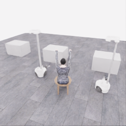
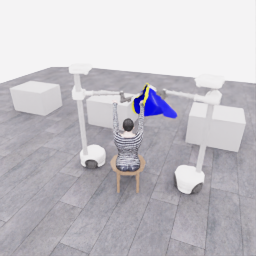
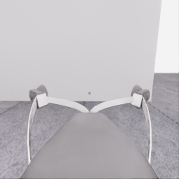
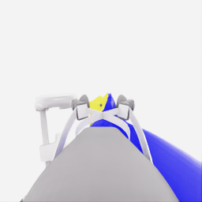
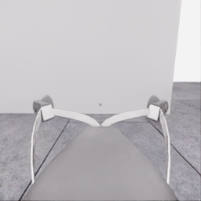
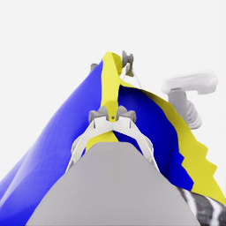
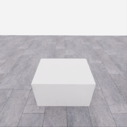
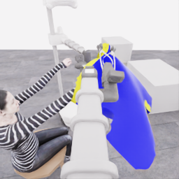
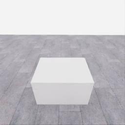
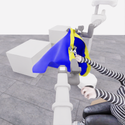

# 자동 시연 수집 시도 · 20261114-astra-middle-grip470-retain-001

[전체 수집 기록](../../README.ko.md) · [구조화 요약](manifest.json) · [전체 행동 기록](decisions.jsonl) · [사용한 기본 프롬프트](prompt.txt)

실행 상태는 **completed**, 원본 출처는 `gpt`입니다. 완료 상태와 과제 성공은 아래에서 따로 기록합니다.

## 실행 조건과 시간

| 항목 | 기록 |
|---|---|
| 기록 시작 UTC | 2026-11-14T08:41:36Z |
| 기록 종료 UTC | 2026-11-14T09:14:16Z |
| 이전 시도 | 20261114-astra-middle-grip264-001 |
| 재시도 사유 | Continue the final closed-grasp trial with zero further reopening; test cloth following and usable opening before transport and same-hand descent. |
| 출처 그룹 | 20261113-astra-side-hem-fresh-001 |
| 요청 모델 / 추론 설정 | gpt-6-astra / ultra |
| 전체 실제 경과 시간 (초) | 1959.323 |
| Actor 호출 합계 (초) | 1170.153 |
| 환경 요청·응답 합계 (초) | 737.509 |
| 시뮬레이션 시간 (초) | 41.800 |
| 저장 전이 수 | 836.000 |
| 응답 확인 전이 수 | 836.000 |
| 모델 호출 시도 수 | 24.000 |
| 완료한 결정 구간 수 | 20.000 |
| 파일 완료 상태 | true |
| 데이터 정합성 검사 | true |
| 학습 데이터 승인 | unreviewed |
| Actor 호출 방식 | exec |
| 한 호출의 최대 계획 구간 수 | 1.000 |
| 한 계획의 최대 제어 step 수 | 20.000 |
| 제어기 정착 대기 설정 | true |
| 정착 대기 요청 step 수 | 6.000 |
| 완료한 제어기 정착 구간 수 | 20.000 |
| 제어기 정착 전이 수 | 120.000 |
| 제어기 정착 환경 요청·응답 (초) | 109.043 |
| 전이 예산으로 단축한 정착 구간 수 | 0.000 |
| 전이 예산으로 건너뛴 정착 구간 수 | 0.000 |

Actor 호출 시간은 공개 입력 저장·요청 전송·응답 처리 등 호출 경로를 측정합니다. 방식에 따라 Docker/CLI 시작이 호출 안에 들어가거나 상주 서버 준비 시간으로 분리됩니다. 내부 모델 추론 시간만 별도로 측정한 값은 아닙니다. 모델이 판단하는 동안 물리 시간은 멈추며 실제 경과 시간과 시뮬레이션 시간은 다릅니다. 세부 요청 프로세스 시간에도 CLI 처리·네트워크·서버 대기·생성이 함께 포함됩니다.

## 토큰 사용량의 범위

`actor_usage`는 thread별 관측 누계를 합친 값입니다. 결정의 `usage`는 원본 CLI 누계이며, 호출별 증가량은 `usage_accounting.incremental_usage`입니다. 캐시 입력은 입력의 부분집합이고 추론 출력은 출력의 부분집합이므로 열들을 다시 합산하지 않습니다.

전체 호출 사용량 확정: **true** · 기록한 호출 수: 24.

| 입력 | 캐시 입력 | 캐시 쓰기 입력 | 출력 | 추론 출력 |
|---:|---:|---:|---:|---:|
| 3103736 | 2510080 | 0 | 34065 | 28291 |

중복 누계는 추가 사용량 0으로 처리하고, 역행한 누계는 미확정으로 보존합니다. 새 thread는 별도로 집계합니다. 토큰 기록은 화폐 비용이나 청구서가 아닙니다.

## 리뷰 정지 조건

목표 누적 점수 10.000 · 감시 상태 `collector_ended_before_gate` · 수집기 상태 `completed`.

마지막 관측 점수 5.000 · 응답 확인 step 835.

`review_ready`는 정지 조건에 따라 실행을 마치고 리뷰할 준비가 된 상태입니다. 50점·착의 성공이나 학습 데이터 승인을 뜻하지 않습니다. 공식 점수와 success는 아래 평가 결과로 확인합니다.

## 공식 평가 결과

평가 유효성 `true` · 누적 점수 **5.000 / 50** · 착의 success **false** · rate 상태 `no_dressing_points` · 최종 rate 0.000 points/s.

누적 50점, 착의 success, 정상 파일 종료와 데이터 정합성은 서로 다른 상태입니다. 접촉 전 `no_contact`의 rate는 0점/초로 바꾸지 않습니다.

| 단계 | 획득 점수 / 최대 | 획득 시각 (episode 초) |
|---|---:|---:|
| 파지·들기 | 5.000 / 5 | 26.850 |
| 첫 소매 | 0.000 / 5 | 미측정/해당 없음 |
| 반대 어깨 | 0.000 / 5 | 미측정/해당 없음 |
| 두 번째 소매 | 0.000 / 5 | 미측정/해당 없음 |
| 왼쪽 위팔 | 0.000 / 5 | 미측정/해당 없음 |
| 오른쪽 위팔 | 0.000 / 5 | 미측정/해당 없음 |
| 목 통과 | 0.000 / 10 | 미측정/해당 없음 |
| 앞면 방향 | 0.000 / 10 | 미측정/해당 없음 |

## 단계 획득 경로

점수 획득은 [평가 이벤트](score-events.jsonl)에서 같은 physics tick끼리 묶었습니다. 같은 시각에 인정된 항목의 내부 순서는 추정하지 않습니다. 착의 success는 점수 획득과 별도로 기록합니다.

| 순서 | episode 시간 (초) | 전이 경계 step | 누적 점수 변화 | 같은 시각의 항목 변화 |
|---:|---:|---:|---:|---|
| 0 | 26.850 | 537 | 0.000→5.000 | 파지·들기 0.000→5.000 |

평가 clock 0초에 대응하는 공개 simulation clock은 1.525초입니다. 두 시계를 같은 절대 시각으로 혼동하지 않습니다.

별도 success 이벤트 수: **0**. 평가 유효성: `true`.


## 원본 관측 화면

지정된 공개 카메라의 저장 RGB 픽셀입니다. 시작은 첫 `obs`, 종료는 마지막 `next_obs`입니다. 이미지 합성이나 내부 상태 기반 장면 재구성 없이 원본 픽셀로 PNG를 저장했습니다.

| 카메라 | 시작 | 종료 |
|---|---|---|
| `overview` | [](images/initial-overview.png) | [](images/final-overview.png) |
| `robot_0_wrist` | [](images/initial-robot_0_wrist.png) | [](images/final-robot_0_wrist.png) |
| `robot_1_wrist` | [](images/initial-robot_1_wrist.png) | [](images/final-robot_1_wrist.png) |
| `robot_0_head` | [](images/initial-robot_0_head.png) | [](images/final-robot_0_head.png) |
| `robot_1_head` | [](images/initial-robot_1_head.png) | [](images/final-robot_1_head.png) |

시작 관측 시각 1.525초 · 종료 관측 시각 43.325초 (공개 simulation clock).

[▶ overview 관측 영상 보기](overview.mp4)

저장된 20 Hz `obs` 중 836프레임을 순서대로 사용했습니다. 재생은 **1.0배 느리게** (20.000 fps), 실제 대기 시간·모델 호출 지연은 영상에 들어가지 않습니다. 종료 `next_obs`는 위 PNG에서 확인합니다.

## 결정과 실행 순서

아래 근거는 모델 최종 JSON의 짧은 행동 설명입니다. 시각적 평가는 행동 전 관측에 대한 판단이며, 그 행동의 실행 후 성공 라벨로 사용하지 않습니다. 공식 점수는 별도의 평가 결과입니다.

행동의 각 행은 로봇 0·1 순서이며 열은 `전진, 왼쪽 이동, 반시계 회전, 리프트, 팔 신장, 손목 yaw, pitch, roll, gripper`입니다. 앞 8개는 정규화 속도이고 gripper는 닫기 `+1`, 열기 `-1`, 의도 유지 `0`입니다.

제어기 정착 대기는 앞선 모델 결정에 연결된 별도 중립 행동입니다. 추가 모델 호출이나 모델 결정으로 집계하지 않으며, 실제 전이와 환경 요청·응답 시간은 전체 합계에 포함됩니다. 중립 행동은 두 로봇의 속도와 gripper 명령을 모두 0으로 보내 기존 gripper 의도를 유지합니다. 대기를 실행했다는 기록이 옷의 정착이나 과제 개선을 확인했다는 뜻은 아닙니다.

### 기록된 행동의 재실행 구간

원본 `20261114-astra-middle-grip264-001`의 행동 470전이를 새 환경에서 다시 실행했습니다. 이 구간에는 새 모델 호출이 없고 관측·평가를 새로 기록했습니다. 정확한 물리 상태 복원이나 독립적인 새 시연으로 집계하지 않습니다. 원본 step 대응과 실제 행동은 `decisions.jsonl`의 `replayed_segment`에 있습니다.

### 별도 모델 호출 0 · `initial`

실행 결정 인덱스 0의 고정 관측을 사용했습니다. 호출 경과 39.860초. 같은 call index의 행동 기록과 사용량을 중복 합산하지 않습니다.

공개 입력 저장 0.243초 · 요청 프로세스 39.616초 · 결과 해석 0.000초.

### 결정 0 · 들기 · `act`

입력 관측 25.025초 · Actor 호출 39.860초 · 시각적 판단 `uncertain`.

계획 `20261114-astra-middle-grip470-retain-001:call-00000` · 모델 호출 인덱스 0 · 계획 구간 1/1 · 이 구간에서 모델 호출 `true`.

실행 직전 최신 관측 25.025초.

공개 입력 저장 0.243초 · 요청 프로세스 39.616초 · 결과 해석 0.000초.

호출 사용량 상태 `observed` · 이번 증가량 입력 23854 / 출력 1058 토큰.

최종 응답의 행동 설명: Robot_0 is the prospective guide and robot_1 the anchor, both beside table-supported cloth with lifts near target. Attachment remains unverified. Test approximately 2.5 cm of coordinated lift while retaining both grips, then inspect cloth following separately at each jaw. No opening or mannequin-hand relationship is established.

요청 행동:

```json
[[0, 0, 0, 0.08, 0, 0, 0, 0, 1], [0, 0, 0, 0.08, 0, 0, 0, 0, 1]]
```

실행 구간 step **[470, 474)** · 요청 4 step / 실제 4 step · 환경 요청·응답 4.047초.

실제 적용 행동:

```json
[[0.0, 0.0, 0.0, 0.07999999821186066, 0.0, 0.0, 0.0, 0.0, 1.0], [0.0, 0.0, 0.0, 0.07999999821186066, 0.0, 0.0, 0.0, 0.0, 1.0]]
```

### 제어기 정착 대기 · 연결 결정 0

구간 `20261114-astra-middle-grip470-retain-001:settle-00000` · 출처 `controller_settle` · 이 구간에서 모델 호출 `false`.

앞선 모델 호출 인덱스 0에 연결됩니다. 추가 호출은 없습니다.

실행 구간 step **[474, 480)** · 요청 6 step / 실제 6 step · 환경 요청·응답 5.819초.

공개 simulation clock 25.225→25.525초 · 실행 전 관측 25.225초.

실제 적용 중립 행동:

```json
[[0.0, 0.0, 0.0, 0.0, 0.0, 0.0, 0.0, 0.0, 0.0], [0.0, 0.0, 0.0, 0.0, 0.0, 0.0, 0.0, 0.0, 0.0]]
```

### 별도 모델 호출 1 · `initial`

실행 결정 인덱스 1의 고정 관측을 사용했습니다. 호출 경과 42.110초. 같은 call index의 행동 기록과 사용량을 중복 합산하지 않습니다.

공개 입력 저장 0.089초 · 요청 프로세스 42.020초 · 결과 해석 0.000초.

### 결정 1 · 준비 · `act`

입력 관측 25.525초 · Actor 호출 42.110초 · 시각적 판단 `uncertain`.

계획 `20261114-astra-middle-grip470-retain-001:call-00001` · 모델 호출 인덱스 1 · 계획 구간 1/1 · 이 구간에서 모델 호출 `true`.

실행 직전 최신 관측 25.525초.

공개 입력 저장 0.089초 · 요청 프로세스 42.020초 · 결과 해석 0.000초.

호출 사용량 상태 `observed` · 이번 증가량 입력 34069 / 출력 1043 토큰.

최종 응답의 행동 설명: Both grippers rose about 2 cm while yellow-edge folds remained near their jaws, suggesting local support. Robot_0 guides a roughly 4 cm differential rise while robot_1 anchors over the table, testing whether candidate lips separate vertically rather than merely tensioning one panel. The opening and any mannequin-hand relationship remain unverified.

요청 행동:

```json
[[0, 0, 0, 0.1, 0, 0, 0, 0, 1], [0, 0, 0, 0, 0, 0, 0, 0, 1]]
```

실행 구간 step **[480, 485)** · 요청 5 step / 실제 5 step · 환경 요청·응답 5.146초.

실제 적용 행동:

```json
[[0.0, 0.0, 0.0, 0.10000000149011612, 0.0, 0.0, 0.0, 0.0, 1.0], [0.0, 0.0, 0.0, 0.0, 0.0, 0.0, 0.0, 0.0, 1.0]]
```

### 제어기 정착 대기 · 연결 결정 1

구간 `20261114-astra-middle-grip470-retain-001:settle-00001` · 출처 `controller_settle` · 이 구간에서 모델 호출 `false`.

앞선 모델 호출 인덱스 1에 연결됩니다. 추가 호출은 없습니다.

실행 구간 step **[485, 491)** · 요청 6 step / 실제 6 step · 환경 요청·응답 5.787초.

공개 simulation clock 25.775→26.075초 · 실행 전 관측 25.775초.

실제 적용 중립 행동:

```json
[[0.0, 0.0, 0.0, 0.0, 0.0, 0.0, 0.0, 0.0, 0.0], [0.0, 0.0, 0.0, 0.0, 0.0, 0.0, 0.0, 0.0, 0.0]]
```

### 별도 모델 호출 2 · `initial`

실행 결정 인덱스 2의 고정 관측을 사용했습니다. 호출 경과 64.491초. 같은 call index의 행동 기록과 사용량을 중복 합산하지 않습니다.

공개 입력 저장 0.088초 · 요청 프로세스 64.403초 · 결과 해석 0.000초.

### 결정 2 · 들기 · `act`

입력 관측 26.075초 · Actor 호출 64.491초 · 시각적 판단 `progressing`.

계획 `20261114-astra-middle-grip470-retain-001:call-00002` · 모델 호출 인덱스 2 · 계획 구간 1/1 · 이 구간에서 모델 호출 `true`.

실행 직전 최신 관측 26.075초.

공개 입력 저장 0.088초 · 요청 프로세스 64.403초 · 결과 해석 0.000초.

호출 사용량 상태 `observed` · 이번 증가량 입력 44245 / 출력 1673 토큰.

최종 응답의 행동 설명: Robot_0&#x27;s measured 3.7 cm rise raised its yellow boundary while robot_1 retained the lower candidate edge. The intervening blue surface appears recessed, but an open hem remains uncertain. Lift guide robot_0 and anchor robot_1 about 5.5 cm together, preserving their height offset; inspect separate cloth following and rim depth. No hand relationship yet.

요청 행동:

```json
[[0, 0, 0, 0.12, 0, 0, 0, 0, 1], [0, 0, 0, 0.12, 0, 0, 0, 0, 1]]
```

실행 구간 step **[491, 497)** · 요청 6 step / 실제 6 step · 환경 요청·응답 5.998초.

실제 적용 행동:

```json
[[0.0, 0.0, 0.0, 0.11999999731779099, 0.0, 0.0, 0.0, 0.0, 1.0], [0.0, 0.0, 0.0, 0.11999999731779099, 0.0, 0.0, 0.0, 0.0, 1.0]]
```

### 제어기 정착 대기 · 연결 결정 2

구간 `20261114-astra-middle-grip470-retain-001:settle-00002` · 출처 `controller_settle` · 이 구간에서 모델 호출 `false`.

앞선 모델 호출 인덱스 2에 연결됩니다. 추가 호출은 없습니다.

실행 구간 step **[497, 503)** · 요청 6 step / 실제 6 step · 환경 요청·응답 5.614초.

공개 simulation clock 26.375→26.675초 · 실행 전 관측 26.375초.

실제 적용 중립 행동:

```json
[[0.0, 0.0, 0.0, 0.0, 0.0, 0.0, 0.0, 0.0, 0.0], [0.0, 0.0, 0.0, 0.0, 0.0, 0.0, 0.0, 0.0, 0.0]]
```

### 별도 모델 호출 3 · `initial`

실행 결정 인덱스 3의 고정 관측을 사용했습니다. 호출 경과 52.772초. 같은 call index의 행동 기록과 사용량을 중복 합산하지 않습니다.

공개 입력 저장 0.088초 · 요청 프로세스 52.684초 · 결과 해석 0.000초.

### 결정 3 · 들기 · `act`

입력 관측 26.675초 · Actor 호출 52.772초 · 시각적 판단 `progressing`.

계획 `20261114-astra-middle-grip470-retain-001:call-00003` · 모델 호출 인덱스 3 · 계획 구간 1/1 · 이 구간에서 모델 호출 `true`.

실행 직전 최신 관측 26.675초.

공개 입력 저장 0.088초 · 요청 프로세스 52.684초 · 결과 해석 0.000초.

호출 사용량 상태 `observed` · 이번 증가량 입력 55014 / 출력 1240 토큰.

최종 응답의 행동 설명: Both yellow-edge regions followed the measured roughly 5 cm rise. Robot_0 remains the upper guide and robot_1 the lower anchor; the recessed candidate space persists, but hem continuity is uncertain. Raise both about 15 cm without spreading to expose the hanging body and inspect retained support and opening shape. No mannequin-hand relationship yet.

요청 행동:

```json
[[0, 0, 0, 0.2, 0, 0, 0, 0, 1], [0, 0, 0, 0.2, 0, 0, 0, 0, 1]]
```

실행 구간 step **[503, 513)** · 요청 10 step / 실제 10 step · 환경 요청·응답 8.672초.

실제 적용 행동:

```json
[[0.0, 0.0, 0.0, 0.20000000298023224, 0.0, 0.0, 0.0, 0.0, 1.0], [0.0, 0.0, 0.0, 0.20000000298023224, 0.0, 0.0, 0.0, 0.0, 1.0]]
```

### 제어기 정착 대기 · 연결 결정 3

구간 `20261114-astra-middle-grip470-retain-001:settle-00003` · 출처 `controller_settle` · 이 구간에서 모델 호출 `false`.

앞선 모델 호출 인덱스 3에 연결됩니다. 추가 호출은 없습니다.

실행 구간 step **[513, 519)** · 요청 6 step / 실제 6 step · 환경 요청·응답 5.537초.

공개 simulation clock 27.175→27.475초 · 실행 전 관측 27.175초.

실제 적용 중립 행동:

```json
[[0.0, 0.0, 0.0, 0.0, 0.0, 0.0, 0.0, 0.0, 0.0], [0.0, 0.0, 0.0, 0.0, 0.0, 0.0, 0.0, 0.0, 0.0]]
```

### 별도 모델 호출 4 · `initial`

실행 결정 인덱스 4의 고정 관측을 사용했습니다. 호출 경과 64.389초. 같은 call index의 행동 기록과 사용량을 중복 합산하지 않습니다.

공개 입력 저장 0.088초 · 요청 프로세스 64.302초 · 결과 해석 0.000초.

### 결정 4 · 들기 · `act`

입력 관측 27.475초 · Actor 호출 64.389초 · 시각적 판단 `progressing`.

계획 `20261114-astra-middle-grip470-retain-001:call-00004` · 모델 호출 인덱스 4 · 계획 구간 1/1 · 이 구간에서 모델 호출 `true`.

실행 직전 최신 관측 27.475초.

공개 입력 저장 0.088초 · 요청 프로세스 64.302초 · 결과 해석 0.000초.

호출 사용량 상태 `observed` · 이번 증가량 입력 65334 / 출력 1505 토큰.

최종 응답의 행동 설명: Both held regions followed approximately 15 cm of measured rise, and more cloth has peeled from the table. Robot_0 guides an 18 cm rise while robot_1 supports a 12 cm rise, testing greater vertical space between candidate boundaries without lateral spreading. Inspect retained support and aperture depth; the recessed blue area is not confirmed passage, and no hand relationship exists yet.

요청 행동:

```json
[[0, 0, 0, 0.24, 0, 0, 0, 0, 1], [0, 0, 0, 0.16, 0, 0, 0, 0, 1]]
```

실행 구간 step **[519, 529)** · 요청 10 step / 실제 10 step · 환경 요청·응답 8.542초.

실제 적용 행동:

```json
[[0.0, 0.0, 0.0, 0.23999999463558197, 0.0, 0.0, 0.0, 0.0, 1.0], [0.0, 0.0, 0.0, 0.1599999964237213, 0.0, 0.0, 0.0, 0.0, 1.0]]
```

### 제어기 정착 대기 · 연결 결정 4

구간 `20261114-astra-middle-grip470-retain-001:settle-00004` · 출처 `controller_settle` · 이 구간에서 모델 호출 `false`.

앞선 모델 호출 인덱스 4에 연결됩니다. 추가 호출은 없습니다.

실행 구간 step **[529, 535)** · 요청 6 step / 실제 6 step · 환경 요청·응답 5.389초.

공개 simulation clock 27.975→28.275초 · 실행 전 관측 27.975초.

실제 적용 중립 행동:

```json
[[0.0, 0.0, 0.0, 0.0, 0.0, 0.0, 0.0, 0.0, 0.0], [0.0, 0.0, 0.0, 0.0, 0.0, 0.0, 0.0, 0.0, 0.0]]
```

### 별도 모델 호출 5 · `initial`

실행 결정 인덱스 5의 고정 관측을 사용했습니다. 호출 경과 63.383초. 같은 call index의 행동 기록과 사용량을 중복 합산하지 않습니다.

공개 입력 저장 0.086초 · 요청 프로세스 63.296초 · 결과 해석 0.000초.

### 공개 픽셀 depth 조회 · 결정 5

물리 전이 없이 같은 카메라·시각의 원본 값을 조회했습니다. 무효 값은 null이며 접촉·입구 통과 판단이 아닙니다.

```json
{
  "request": {
    "kind": "depth_query",
    "observation_id": "43f4e583e0d80aba5ea74a25e1b5517d9b97bd0391973fd9a4d63fe292b6129c",
    "camera": "robot_0_head",
    "pixels_uv": [
      [
        29,
        32
      ],
      [
        24,
        35
      ],
      [
        18,
        40
      ],
      [
        144,
        132
      ],
      [
        137,
        145
      ],
      [
        170,
        178
      ],
      [
        215,
        195
      ]
    ],
    "include_camera_geometry": true
  },
  "response": {
    "kind": "depth_query_result",
    "observation_id": "43f4e583e0d80aba5ea74a25e1b5517d9b97bd0391973fd9a4d63fe292b6129c",
    "camera": "robot_0_head",
    "camera_index": 3,
    "simulation_time_s": 28.275001474656165,
    "intrinsics_sha256": "3dd91a2df5cb0a47b6f5ceb86d60d41e1f5d6753d2a11a034ac0b52bc385cd23",
    "request_sha256": "b7f8b6ce5e2ed12edcb4bdfe273e2aaca0be8333638878548cf4d9e6bf360b8d",
    "depth_semantics": "optical_Z_metres_not_ray_range",
    "geometry_semantics": "camera_X_right_Y_down_Z_forward",
    "rgb_image_order": [
      "overview",
      "robot_0_wrist",
      "robot_1_wrist",
      "robot_0_head",
      "robot_1_head"
    ],
    "resolution_wh": [
      256,
      256
    ],
    "neighbor_depth_substituted": false,
    "hidden_surfaces_estimated": false,
    "object_pose_or_contact_inferred": false,
    "source_sha256": {
      "observation_json": "61091b4475e6315e827d629a37509af43deb7d7e1a69cf0f24df419df7af2ab6",
      "public_depth_npz": "9594a6157c7252ef1a3d2c77f2c3c2d164b14fb44dff61cd41410271f17dca39",
      "overview_rgb": "c80ad40a1fd9e5ece8832c264bce1147bcccd04072c3491be640889a4d906d07",
      "robot_0_wrist_rgb": "5713a4135585294dbafe9e727b7b29925aaf10742c4cf08f3aea37ac4f8041aa",
      "robot_1_wrist_rgb": "ab8e59f442e6ba84e0c79881d49f457ff6d4957e57de4a04cdca3f908725da62",
      "robot_0_head_rgb": "9730b3e0dedd4b4c5792a08dad6a3f517aaf6cec8d343f0223b899cea48d8880",
      "robot_1_head_rgb": "c9f2667551bc1a9532447d34f7413b22b373a22139bef09f5aea51c4d15b4783"
    },
    "results": [
      {
        "pixel_uv": [
          29,
          32
        ],
        "status": "valid",
        "optical_z_m": 3.1202492713928223,
        "camera_xyz_m": [
          -1.6898233127448299,
          -1.6386165456919566,
          3.1202492713928223
        ],
        "camera_range_m": 3.908519224429987,
        "invalid_reasons": []
      },
      {
        "pixel_uv": [
          24,
          35
        ],
        "status": "valid",
        "optical_z_m": 3.1115427017211914,
        "camera_xyz_m": [
          -1.7702145948553498,
          -1.5829803588610343,
          3.1115427017211914
        ],
        "camera_range_m": 3.914228469700397,
        "invalid_reasons": []
      },
      {
        "pixel_uv": [
          18,
          40
        ],
        "status": "valid",
        "optical_z_m": 3.1050829887390137,
        "camera_xyz_m": [
          -1.8684552867421655,
          -1.4947642293937324,
          3.1050829887390137
        ],
        "camera_range_m": 3.920074696607986,
        "invalid_reasons": []
      },
      {
        "pixel_uv": [
          144,
          132
        ],
        "status": "valid",
        "optical_z_m": 0.8404650688171387,
        "camera_xyz_m": [
          0.07356249709846287,
          0.018390624274615717,
          0.8404650688171387
        ],
        "camera_range_m": 0.8438786571198309,
        "invalid_reasons": []
      },
      {
        "pixel_uv": [
          137,
          145
        ],
        "status": "valid",
        "optical_z_m": 0.4609103202819824,
        "camera_xyz_m": [
          0.022692155674225483,
          0.04286296071798147,
          0.4609103202819824
        ],
        "camera_range_m": 0.46345494999308634,
        "invalid_reasons": []
      },
      {
        "pixel_uv": [
          170,
          178
        ],
        "status": "valid",
        "optical_z_m": 0.8606277704238892,
        "camera_xyz_m": [
          0.19773404845799805,
          0.23539767673571196,
          0.8606277704238892
        ],
        "camera_range_m": 0.9138878374050916,
        "invalid_reasons": []
      },
      {
        "pixel_uv": [
          215,
          195
        ],
        "status": "valid",
        "optical_z_m": 1.1357817649841309,
        "camera_xyz_m": [
          0.5405438825270509,
          0.41628092102657943,
          1.1357817649841309
        ],
        "camera_range_m": 1.3249444183884178,
        "invalid_reasons": []
      }
    ]
  }
}
```

### 별도 모델 호출 6 · `action_after_query`

실행 결정 인덱스 5의 고정 관측을 사용했습니다. 호출 경과 56.375초. 같은 call index의 행동 기록과 사용량을 중복 합산하지 않습니다.

공개 입력 저장 0.087초 · 요청 프로세스 56.288초 · 결과 해석 0.000초.

### 결정 5 · 들기 · `act`

입력 관측 28.275초 · Actor 호출 56.375초 · 시각적 판단 `progressing`.

계획 `20261114-astra-middle-grip470-retain-001:call-00006` · 모델 호출 인덱스 6 · 계획 구간 1/1 · 이 구간에서 모델 호출 `true`.

실행 직전 최신 관측 28.275초.

공개 입력 저장 0.087초 · 요청 프로세스 56.288초 · 결과 해석 0.000초.

호출 사용량 상태 `observed` · 이번 증가량 입력 88242 / 출력 2202 토큰.

최종 응답의 행동 설명: Robot_0 retains the upper guide grip and robot_1 the lower anchor; the taller yellow boundary still has an ambiguous interior. Both lifts remain slightly below target. Add a modest coordinated rise and upward wrist pitch to test rim depth and table clearance before transport toward the selected upper-left hand. No hand contact is established.

요청 행동:

```json
[[0, 0, 0, 0.06, 0, 0, -0.1, 0, 1], [0, 0, 0, 0.06, 0, 0, -0.1, 0, 1]]
```

실행 구간 step **[535, 543)** · 요청 8 step / 실제 8 step · 환경 요청·응답 6.984초.

실제 적용 행동:

```json
[[0.0, 0.0, 0.0, 0.05999999865889549, 0.0, 0.0, -0.10000000149011612, 0.0, 1.0], [0.0, 0.0, 0.0, 0.05999999865889549, 0.0, 0.0, -0.10000000149011612, 0.0, 1.0]]
```

### 제어기 정착 대기 · 연결 결정 5

구간 `20261114-astra-middle-grip470-retain-001:settle-00005` · 출처 `controller_settle` · 이 구간에서 모델 호출 `false`.

앞선 모델 호출 인덱스 6에 연결됩니다. 추가 호출은 없습니다.

실행 구간 step **[543, 549)** · 요청 6 step / 실제 6 step · 환경 요청·응답 5.396초.

공개 simulation clock 28.675→28.975초 · 실행 전 관측 28.675초.

실제 적용 중립 행동:

```json
[[0.0, 0.0, 0.0, 0.0, 0.0, 0.0, 0.0, 0.0, 0.0], [0.0, 0.0, 0.0, 0.0, 0.0, 0.0, 0.0, 0.0, 0.0]]
```

### 별도 모델 호출 7 · `initial`

실행 결정 인덱스 6의 고정 관측을 사용했습니다. 호출 경과 44.558초. 같은 call index의 행동 기록과 사용량을 중복 합산하지 않습니다.

공개 입력 저장 0.084초 · 요청 프로세스 44.474초 · 결과 해석 0.000초.

### 결정 6 · 운반 · `act`

입력 관측 28.975초 · Actor 호출 44.558초 · 시각적 판단 `progressing`.

계획 `20261114-astra-middle-grip470-retain-001:call-00007` · 모델 호출 인덱스 7 · 계획 구간 1/1 · 이 구간에서 모델 호출 `true`.

실행 직전 최신 관측 28.975초.

공개 입력 저장 0.084초 · 요청 프로세스 44.474초 · 결과 해석 0.000초.

호출 사용량 상태 `observed` · 이번 증가량 입력 99507 / 출력 1610 토큰.

최종 응답의 행동 설명: Both cloth regions followed approximately 10 cm of gripper rise and the wrist tilt. Robot_0 remains upper guide, robot_1 lower anchor. Translate together about 18 cm away from the table toward the selected hand&#x27;s side, preserving the grasp arrangement while joints finish following their targets. Inspect trailing-cloth clearance and candidate-space retention; the same hand remains distant.

요청 행동:

```json
[[-0.087, 0.492, 0, 0, 0, 0, 0, 0, 1], [-0.172, -0.47, 0, 0, 0, 0, 0, 0, 1]]
```

실행 구간 step **[549, 561)** · 요청 12 step / 실제 12 step · 환경 요청·응답 10.205초.

실제 적용 행동:

```json
[[-0.08699999749660492, 0.492000013589859, 0.0, 0.0, 0.0, 0.0, 0.0, 0.0, 1.0], [-0.1720000058412552, -0.4699999988079071, 0.0, 0.0, 0.0, 0.0, 0.0, 0.0, 1.0]]
```

### 제어기 정착 대기 · 연결 결정 6

구간 `20261114-astra-middle-grip470-retain-001:settle-00006` · 출처 `controller_settle` · 이 구간에서 모델 호출 `false`.

앞선 모델 호출 인덱스 7에 연결됩니다. 추가 호출은 없습니다.

실행 구간 step **[561, 567)** · 요청 6 step / 실제 6 step · 환경 요청·응답 5.386초.

공개 simulation clock 29.575→29.875초 · 실행 전 관측 29.575초.

실제 적용 중립 행동:

```json
[[0.0, 0.0, 0.0, 0.0, 0.0, 0.0, 0.0, 0.0, 0.0], [0.0, 0.0, 0.0, 0.0, 0.0, 0.0, 0.0, 0.0, 0.0]]
```

### 별도 모델 호출 8 · `initial`

실행 결정 인덱스 7의 고정 관측을 사용했습니다. 호출 경과 26.433초. 같은 call index의 행동 기록과 사용량을 중복 합산하지 않습니다.

공개 입력 저장 0.081초 · 요청 프로세스 26.351초 · 결과 해석 0.000초.

### 결정 7 · 운반 · `act`

입력 관측 29.875초 · Actor 호출 26.433초 · 시각적 판단 `progressing`.

계획 `20261114-astra-middle-grip470-retain-001:call-00008` · 모델 호출 인덱스 8 · 계획 구간 1/1 · 이 구간에서 모델 호출 `true`.

실행 직전 최신 관측 29.875초.

공개 입력 저장 0.081초 · 요청 프로세스 26.351초 · 결과 해석 0.000초.

호출 사용량 상태 `observed` · 이번 증가량 입력 110055 / 출력 864 토큰.

최종 응답의 행동 설명: Both bases translated approximately 18 cm together, retaining local cloth following and the tall candidate space. Robot_0 remains upper guide and robot_1 lower anchor. Continue about 40 cm along the visibly clear lateral routes to move farther clear of the table, then reassess cloth clearance and the same selected hand. No entry is established.

요청 행동:

```json
[[-0.113, 0.64, 0, 0, 0, 0, 0, 0, 1], [-0.223, -0.611, 0, 0, 0, 0, 0, 0, 1]]
```

실행 구간 step **[567, 587)** · 요청 20 step / 실제 20 step · 환경 요청·응답 16.406초.

실제 적용 행동:

```json
[[-0.11299999803304672, 0.6399999856948853, 0.0, 0.0, 0.0, 0.0, 0.0, 0.0, 1.0], [-0.22300000488758087, -0.6110000014305115, 0.0, 0.0, 0.0, 0.0, 0.0, 0.0, 1.0]]
```

### 제어기 정착 대기 · 연결 결정 7

구간 `20261114-astra-middle-grip470-retain-001:settle-00007` · 출처 `controller_settle` · 이 구간에서 모델 호출 `false`.

앞선 모델 호출 인덱스 8에 연결됩니다. 추가 호출은 없습니다.

실행 구간 step **[587, 593)** · 요청 6 step / 실제 6 step · 환경 요청·응답 5.418초.

공개 simulation clock 30.875→31.175초 · 실행 전 관측 30.875초.

실제 적용 중립 행동:

```json
[[0.0, 0.0, 0.0, 0.0, 0.0, 0.0, 0.0, 0.0, 0.0], [0.0, 0.0, 0.0, 0.0, 0.0, 0.0, 0.0, 0.0, 0.0]]
```

### 별도 모델 호출 9 · `initial`

실행 결정 인덱스 8의 고정 관측을 사용했습니다. 호출 경과 25.428초. 같은 call index의 행동 기록과 사용량을 중복 합산하지 않습니다.

공개 입력 저장 0.079초 · 요청 프로세스 25.349초 · 결과 해석 0.000초.

### 결정 8 · 운반 · `act`

입력 관측 31.175초 · Actor 호출 25.428초 · 시각적 판단 `progressing`.

계획 `20261114-astra-middle-grip470-retain-001:call-00009` · 모델 호출 인덱스 9 · 계획 구간 1/1 · 이 구간에서 모델 호출 `true`.

실행 직전 최신 관측 31.175초.

공개 입력 저장 0.079초 · 요청 프로세스 25.349초 · 결과 해석 0.000초.

호출 사용량 상태 `observed` · 이번 증가량 입력 119912 / 출력 960 토큰.

최종 응답의 행동 설명: The measured 40 cm lateral translation moved the hanging garment clear of the table, with both grips retained. Robot_0 guides the upper boundary while robot_1 supports the lower boundary. Advance together along the clear aisle toward the same raised hand, preserving relative support; inspect aperture retention and obstacle clearance before any hand-relative descent.

요청 행동:

```json
[[0.606, 0.31, 0, 0, 0, 0, 0, 0, 1], [-0.679, 0.035, 0, 0, 0, 0, 0, 0, 1]]
```

실행 구간 step **[593, 613)** · 요청 20 step / 실제 20 step · 환경 요청·응답 16.928초.

실제 적용 행동:

```json
[[0.6060000061988831, 0.3100000023841858, 0.0, 0.0, 0.0, 0.0, 0.0, 0.0, 1.0], [-0.6790000200271606, 0.03500000014901161, 0.0, 0.0, 0.0, 0.0, 0.0, 0.0, 1.0]]
```

### 제어기 정착 대기 · 연결 결정 8

구간 `20261114-astra-middle-grip470-retain-001:settle-00008` · 출처 `controller_settle` · 이 구간에서 모델 호출 `false`.

앞선 모델 호출 인덱스 9에 연결됩니다. 추가 호출은 없습니다.

실행 구간 step **[613, 619)** · 요청 6 step / 실제 6 step · 환경 요청·응답 5.389초.

공개 simulation clock 32.175→32.475초 · 실행 전 관측 32.175초.

실제 적용 중립 행동:

```json
[[0.0, 0.0, 0.0, 0.0, 0.0, 0.0, 0.0, 0.0, 0.0], [0.0, 0.0, 0.0, 0.0, 0.0, 0.0, 0.0, 0.0, 0.0]]
```

### 별도 모델 호출 10 · `initial`

실행 결정 인덱스 9의 고정 관측을 사용했습니다. 호출 경과 31.292초. 같은 call index의 행동 기록과 사용량을 중복 합산하지 않습니다.

공개 입력 저장 0.087초 · 요청 프로세스 31.205초 · 결과 해석 0.000초.

### 결정 9 · 운반 · `act`

입력 관측 32.475초 · Actor 호출 31.292초 · 시각적 판단 `progressing`.

계획 `20261114-astra-middle-grip470-retain-001:call-00010` · 모델 호출 인덱스 10 · 계획 구간 1/1 · 이 구간에서 모델 호출 `true`.

실행 직전 최신 관측 32.475초.

공개 입력 저장 0.087초 · 요청 프로세스 31.205초 · 결과 해석 0.000초.

호출 사용량 상태 `observed` · 이번 증가량 입력 129855 / 출력 1164 토큰.

최종 응답의 행동 설명: Both robots advanced about 40 cm with cloth retained at each jaw; the candidate space remains vertically extended. Robot_0 is upper guide and robot_1 lower anchor. Continue approximately 50 cm through the clear corridor beside the white block toward the same raised hand, checking support and clearance afterward. No hand-relative descent yet.

요청 행동:

```json
[[0.754, 0.335, 0, 0, 0, 0, 0, 0, 1], [-0.82, 0.086, 0, 0, 0, 0, 0, 0, 1]]
```

실행 구간 step **[619, 639)** · 요청 20 step / 실제 20 step · 환경 요청·응답 16.223초.

실제 적용 행동:

```json
[[0.7540000081062317, 0.33500000834465027, 0.0, 0.0, 0.0, 0.0, 0.0, 0.0, 1.0], [-0.8199999928474426, 0.0860000029206276, 0.0, 0.0, 0.0, 0.0, 0.0, 0.0, 1.0]]
```

### 제어기 정착 대기 · 연결 결정 9

구간 `20261114-astra-middle-grip470-retain-001:settle-00009` · 출처 `controller_settle` · 이 구간에서 모델 호출 `false`.

앞선 모델 호출 인덱스 10에 연결됩니다. 추가 호출은 없습니다.

실행 구간 step **[639, 645)** · 요청 6 step / 실제 6 step · 환경 요청·응답 5.232초.

공개 simulation clock 33.475→33.775초 · 실행 전 관측 33.475초.

실제 적용 중립 행동:

```json
[[0.0, 0.0, 0.0, 0.0, 0.0, 0.0, 0.0, 0.0, 0.0], [0.0, 0.0, 0.0, 0.0, 0.0, 0.0, 0.0, 0.0, 0.0]]
```

### 별도 모델 호출 11 · `initial`

실행 결정 인덱스 10의 고정 관측을 사용했습니다. 호출 경과 31.397초. 같은 call index의 행동 기록과 사용량을 중복 합산하지 않습니다.

공개 입력 저장 0.087초 · 요청 프로세스 31.309초 · 결과 해석 0.000초.

### 결정 10 · 운반 · `act`

입력 관측 33.775초 · Actor 호출 31.397초 · 시각적 판단 `progressing`.

계획 `20261114-astra-middle-grip470-retain-001:call-00011` · 모델 호출 인덱스 11 · 계획 구간 1/1 · 이 구간에서 모델 호출 `true`.

실행 직전 최신 관측 33.775초.

공개 입력 저장 0.087초 · 요청 프로세스 31.309초 · 결과 해석 0.000초.

호출 사용량 상태 `observed` · 이번 증가량 입력 140000 / 출력 946 토큰.

최종 응답의 행동 설명: Both bases advanced approximately 49 cm, retaining cloth at both jaws and the vertical candidate shape. Robot_0 remains upper guide and robot_1 lower anchor. Continue matched travel through the clear aisle toward the same raised hand, still beyond the garment; reassess its connected forearm and clearance afterward. Residual base motion remains, so settling is not assumed.

요청 행동:

```json
[[0.754, 0.335, 0, 0, 0, 0, 0, 0, 1], [-0.82, 0.086, 0, 0, 0, 0, 0, 0, 1]]
```

실행 구간 step **[645, 665)** · 요청 20 step / 실제 20 step · 환경 요청·응답 16.123초.

실제 적용 행동:

```json
[[0.7540000081062317, 0.33500000834465027, 0.0, 0.0, 0.0, 0.0, 0.0, 0.0, 1.0], [-0.8199999928474426, 0.0860000029206276, 0.0, 0.0, 0.0, 0.0, 0.0, 0.0, 1.0]]
```

### 제어기 정착 대기 · 연결 결정 10

구간 `20261114-astra-middle-grip470-retain-001:settle-00010` · 출처 `controller_settle` · 이 구간에서 모델 호출 `false`.

앞선 모델 호출 인덱스 11에 연결됩니다. 추가 호출은 없습니다.

실행 구간 step **[665, 671)** · 요청 6 step / 실제 6 step · 환경 요청·응답 5.582초.

공개 simulation clock 34.775→35.075초 · 실행 전 관측 34.775초.

실제 적용 중립 행동:

```json
[[0.0, 0.0, 0.0, 0.0, 0.0, 0.0, 0.0, 0.0, 0.0], [0.0, 0.0, 0.0, 0.0, 0.0, 0.0, 0.0, 0.0, 0.0]]
```

### 별도 모델 호출 12 · `initial`

실행 결정 인덱스 11의 고정 관측을 사용했습니다. 호출 경과 64.531초. 같은 call index의 행동 기록과 사용량을 중복 합산하지 않습니다.

공개 입력 저장 0.081초 · 요청 프로세스 64.450초 · 결과 해석 0.000초.

### 결정 11 · 운반 · `act`

입력 관측 35.075초 · Actor 호출 64.531초 · 시각적 판단 `progressing`.

계획 `20261114-astra-middle-grip470-retain-001:call-00012` · 모델 호출 인덱스 12 · 계획 구간 1/1 · 이 구간에서 모델 호출 `true`.

실행 직전 최신 관측 35.075초.

공개 입력 저장 0.081초 · 요청 프로세스 64.450초 · 결과 해석 0.000초.

호출 사용량 상태 `observed` · 이번 증가량 입력 149914 / 출력 2193 토큰.

최종 응답의 행동 설명: Both supports survived another roughly 50 cm advance. Robot_0 remains upper guide and robot_1 lower anchor. Route both slightly away from the chair while advancing along the open floor, preserving space for robot_1 to pass the legs. Recheck chair clearance and the same selected forearm; its hand is partly obscured by the partner mast, so no descent yet.

요청 행동:

```json
[[0.675, -0.085, 0, 0, 0, 0, 0, 0, 1], [-0.542, 0.41, 0, 0, 0, 0, 0, 0, 1]]
```

실행 구간 step **[671, 691)** · 요청 20 step / 실제 20 step · 환경 요청·응답 16.210초.

실제 적용 행동:

```json
[[0.675000011920929, -0.08500000089406967, 0.0, 0.0, 0.0, 0.0, 0.0, 0.0, 1.0], [-0.5419999957084656, 0.4099999964237213, 0.0, 0.0, 0.0, 0.0, 0.0, 0.0, 1.0]]
```

### 제어기 정착 대기 · 연결 결정 11

구간 `20261114-astra-middle-grip470-retain-001:settle-00011` · 출처 `controller_settle` · 이 구간에서 모델 호출 `false`.

앞선 모델 호출 인덱스 12에 연결됩니다. 추가 호출은 없습니다.

실행 구간 step **[691, 697)** · 요청 6 step / 실제 6 step · 환경 요청·응답 5.374초.

공개 simulation clock 36.075→36.375초 · 실행 전 관측 36.075초.

실제 적용 중립 행동:

```json
[[0.0, 0.0, 0.0, 0.0, 0.0, 0.0, 0.0, 0.0, 0.0], [0.0, 0.0, 0.0, 0.0, 0.0, 0.0, 0.0, 0.0, 0.0]]
```

### 별도 모델 호출 13 · `initial`

실행 결정 인덱스 12의 고정 관측을 사용했습니다. 호출 경과 60.092초. 같은 call index의 행동 기록과 사용량을 중복 합산하지 않습니다.

공개 입력 저장 0.081초 · 요청 프로세스 60.011초 · 결과 해석 0.001초.

### 결정 12 · 운반 · `act`

입력 관측 36.375초 · Actor 호출 60.092초 · 시각적 판단 `progressing`.

계획 `20261114-astra-middle-grip470-retain-001:call-00013` · 모델 호출 인덱스 13 · 계획 구간 1/1 · 이 구간에서 모델 호출 `true`.

실행 직전 최신 관측 36.375초.

공개 입력 저장 0.081초 · 요청 프로세스 60.011초 · 결과 해석 0.001초.

호출 사용량 상태 `observed` · 이번 증가량 입력 161078 / 출력 2051 토큰.

최종 응답의 행동 설명: The pair advanced about 42 cm with the intended offset away from the chair; both yellow-edge grips remain supported. Robot_0 guides above robot_1&#x27;s anchor. Continue the matched pass along clear floor while maintaining leg clearance, then reassess the same nearer raised forearm and partially obscured hand before turning inward. No descent or entry yet.

요청 행동:

```json
[[0.675, -0.085, 0, 0, 0, 0, 0, 0, 1], [-0.542, 0.41, 0, 0, 0, 0, 0, 0, 1]]
```

실행 구간 step **[697, 717)** · 요청 20 step / 실제 20 step · 환경 요청·응답 17.181초.

실제 적용 행동:

```json
[[0.675000011920929, -0.08500000089406967, 0.0, 0.0, 0.0, 0.0, 0.0, 0.0, 1.0], [-0.5419999957084656, 0.4099999964237213, 0.0, 0.0, 0.0, 0.0, 0.0, 0.0, 1.0]]
```

### 제어기 정착 대기 · 연결 결정 12

구간 `20261114-astra-middle-grip470-retain-001:settle-00012` · 출처 `controller_settle` · 이 구간에서 모델 호출 `false`.

앞선 모델 호출 인덱스 13에 연결됩니다. 추가 호출은 없습니다.

실행 구간 step **[717, 723)** · 요청 6 step / 실제 6 step · 환경 요청·응답 5.494초.

공개 simulation clock 37.375→37.675초 · 실행 전 관측 37.375초.

실제 적용 중립 행동:

```json
[[0.0, 0.0, 0.0, 0.0, 0.0, 0.0, 0.0, 0.0, 0.0], [0.0, 0.0, 0.0, 0.0, 0.0, 0.0, 0.0, 0.0, 0.0]]
```

### 별도 모델 호출 14 · `initial`

실행 결정 인덱스 13의 고정 관측을 사용했습니다. 호출 경과 48.927초. 같은 call index의 행동 기록과 사용량을 중복 합산하지 않습니다.

공개 입력 저장 0.086초 · 요청 프로세스 48.841초 · 결과 해석 0.000초.

### 공개 픽셀 depth 조회 · 결정 13

물리 전이 없이 같은 카메라·시각의 원본 값을 조회했습니다. 무효 값은 null이며 접촉·입구 통과 판단이 아닙니다.

```json
{
  "request": {
    "kind": "depth_query",
    "observation_id": "b0cfc5584655277e9086afb63ac0e5a21aabcd5ea745462cca3cef299b82e37f",
    "camera": "robot_0_head",
    "pixels_uv": [
      [
        55,
        69
      ],
      [
        51,
        72
      ],
      [
        42,
        78
      ],
      [
        145,
        109
      ],
      [
        111,
        137
      ],
      [
        179,
        180
      ]
    ],
    "include_camera_geometry": true
  },
  "response": {
    "kind": "depth_query_result",
    "observation_id": "b0cfc5584655277e9086afb63ac0e5a21aabcd5ea745462cca3cef299b82e37f",
    "camera": "robot_0_head",
    "camera_index": 3,
    "simulation_time_s": 37.67500196490437,
    "intrinsics_sha256": "3dd91a2df5cb0a47b6f5ceb86d60d41e1f5d6753d2a11a034ac0b52bc385cd23",
    "request_sha256": "fded6c69cb170f51efde26777cf798c2d887576384066240e5d2d2aba8a43a2c",
    "depth_semantics": "optical_Z_metres_not_ray_range",
    "geometry_semantics": "camera_X_right_Y_down_Z_forward",
    "rgb_image_order": [
      "overview",
      "robot_0_wrist",
      "robot_1_wrist",
      "robot_0_head",
      "robot_1_head"
    ],
    "resolution_wh": [
      256,
      256
    ],
    "neighbor_depth_substituted": false,
    "hidden_surfaces_estimated": false,
    "object_pose_or_contact_inferred": false,
    "source_sha256": {
      "observation_json": "25f61bf64a1b1d03b81b97f9f22d1fe56426bf40704d7f8fe02f4699e4bb4a52",
      "public_depth_npz": "b84c853e6063afe1c3e46a7fdbf7a6fee1ef6d5990c776af0777fe123c87c033",
      "overview_rgb": "e7c6b02323b99187ae64601ba5b58a7ca28ba1824d42134765180ab955201f03",
      "robot_0_wrist_rgb": "dcb9c5e1e642064da52ed4814fd15e042b3784eb0a3dab6ea1209a6aa551229f",
      "robot_1_wrist_rgb": "defbd7c43af24f1fb1131564d5a6823fffe72287af83bfc7811b695f6aa94431",
      "robot_0_head_rgb": "43dcfa1d9f24dacb5ddf21dae96b51c05e12d18002c088d98b945372036741f0",
      "robot_1_head_rgb": "05a039bf7d1837591a27023b7fee7e167406b3301d4e73063bebc1025aed8793"
    },
    "results": [
      {
        "pixel_uv": [
          55,
          69
        ],
        "status": "valid",
        "optical_z_m": 1.4100911617279053,
        "camera_xyz_m": [
          -0.5631017316667807,
          -0.45510961874438444,
          1.4100911617279053
        ],
        "camera_range_m": 1.58510738111427,
        "invalid_reasons": []
      },
      {
        "pixel_uv": [
          51,
          72
        ],
        "status": "valid",
        "optical_z_m": 1.419281244277954,
        "camera_xyz_m": [
          -0.5978276547531027,
          -0.43478374891134747,
          1.419281244277954
        ],
        "camera_range_m": 1.6002481255930838,
        "invalid_reasons": []
      },
      {
        "pixel_uv": [
          42,
          78
        ],
        "status": "valid",
        "optical_z_m": 1.4128642082214355,
        "camera_xyz_m": [
          -0.664684707339433,
          -0.38644459729036795,
          1.4128642082214355
        ],
        "camera_range_m": 1.6085180937182542,
        "invalid_reasons": []
      },
      {
        "pixel_uv": [
          145,
          109
        ],
        "status": "valid",
        "optical_z_m": 0.7881041765213013,
        "camera_xyz_m": [
          0.07329078320321177,
          -0.08191322828594255,
          0.7881041765213013
        ],
        "camera_range_m": 0.7957320584977606,
        "invalid_reasons": []
      },
      {
        "pixel_uv": [
          111,
          137
        ],
        "status": "valid",
        "optical_z_m": 0.9707743525505066,
        "camera_xyz_m": [
          -0.09027843619109965,
          0.047794466218817465,
          0.9707743525505066
        ],
        "camera_range_m": 0.9761338794510246,
        "invalid_reasons": []
      },
      {
        "pixel_uv": [
          179,
          180
        ],
        "status": "valid",
        "optical_z_m": 0.8312102556228638,
        "camera_xyz_m": [
          0.23189846896907654,
          0.23644549777239177,
          0.8312102556228638
        ],
        "camera_range_m": 0.8947591085759689,
        "invalid_reasons": []
      }
    ]
  }
}
```

### 별도 모델 호출 15 · `action_after_query`

실행 결정 인덱스 13의 고정 관측을 사용했습니다. 호출 경과 41.867초. 같은 call index의 행동 기록과 사용량을 중복 합산하지 않습니다.

공개 입력 저장 0.083초 · 요청 프로세스 41.783초 · 결과 해석 0.000초.

### 결정 13 · 접근 · `act`

입력 관측 37.675초 · Actor 호출 41.867초 · 시각적 판단 `progressing`.

계획 `20261114-astra-middle-grip470-retain-001:call-00015` · 모델 호출 인덱스 15 · 계획 구간 1/1 · 이 구간에서 모델 호출 `true`.

실행 직전 최신 관측 37.675초.

공개 입력 저장 0.083초 · 요청 프로세스 41.783초 · 결과 해석 0.000초.

호출 사용량 상태 `observed` · 이번 증가량 입력 183821 / 출력 1260 토큰.

최종 응답의 행동 설명: The selected hand remains beyond and beside the rim; the lower candidate boundary is still below hand height. Robot_0 guides the upper boundary and robot_1 anchors below. Raise and pitch both wrists upward to place candidate approach space above that same hand before closing the horizontal gap. Inspect actual height change and retained opening; no descent yet.

요청 행동:

```json
[[0, 0, 0, 0.07, 0, 0, -0.18, 0, 1], [0, 0, 0, 0.07, 0, 0, -0.18, 0, 1]]
```

실행 구간 step **[723, 733)** · 요청 10 step / 실제 10 step · 환경 요청·응답 8.874초.

실제 적용 행동:

```json
[[0.0, 0.0, 0.0, 0.07000000029802322, 0.0, 0.0, -0.18000000715255737, 0.0, 1.0], [0.0, 0.0, 0.0, 0.07000000029802322, 0.0, 0.0, -0.18000000715255737, 0.0, 1.0]]
```

### 제어기 정착 대기 · 연결 결정 13

구간 `20261114-astra-middle-grip470-retain-001:settle-00013` · 출처 `controller_settle` · 이 구간에서 모델 호출 `false`.

앞선 모델 호출 인덱스 15에 연결됩니다. 추가 호출은 없습니다.

실행 구간 step **[733, 739)** · 요청 6 step / 실제 6 step · 환경 요청·응답 5.621초.

공개 simulation clock 38.175→38.475초 · 실행 전 관측 38.175초.

실제 적용 중립 행동:

```json
[[0.0, 0.0, 0.0, 0.0, 0.0, 0.0, 0.0, 0.0, 0.0], [0.0, 0.0, 0.0, 0.0, 0.0, 0.0, 0.0, 0.0, 0.0]]
```

### 별도 모델 호출 16 · `initial`

실행 결정 인덱스 14의 고정 관측을 사용했습니다. 호출 경과 29.347초. 같은 call index의 행동 기록과 사용량을 중복 합산하지 않습니다.

공개 입력 저장 0.081초 · 요청 프로세스 29.266초 · 결과 해석 0.000초.

### 결정 14 · 접근 · `act`

입력 관측 38.475초 · Actor 호출 29.347초 · 시각적 판단 `progressing`.

계획 `20261114-astra-middle-grip470-retain-001:call-00016` · 모델 호출 인덱스 16 · 계획 구간 1/1 · 이 구간에서 모델 호출 `true`.

실행 직전 최신 관측 38.475초.

공개 입력 저장 0.081초 · 요청 프로세스 29.266초 · 결과 해석 0.000초.

호출 사용량 상태 `observed` · 이번 증가량 입력 193847 / 출력 929 토큰.

최종 응답의 행동 설명: Both grippers rose about 18 cm with cloth following; wrist pitch still trails its targets slightly. Robot_0 remains upper guide and robot_1 lower anchor. Translate together about 40 cm to complete side positioning while the wrists settle, then reassess lateral alignment above the same selected hand. Candidate space is elevated, but no descent or entry is established.

요청 행동:

```json
[[0.64, 0.111, 0, 0, 0, 0, 0, 0, 1], [-0.61, 0.224, 0, 0, 0, 0, 0, 0, 1]]
```

실행 구간 step **[739, 759)** · 요청 20 step / 실제 20 step · 환경 요청·응답 17.497초.

실제 적용 행동:

```json
[[0.6399999856948853, 0.11100000143051147, 0.0, 0.0, 0.0, 0.0, 0.0, 0.0, 1.0], [-0.6100000143051147, 0.2240000069141388, 0.0, 0.0, 0.0, 0.0, 0.0, 0.0, 1.0]]
```

### 제어기 정착 대기 · 연결 결정 14

구간 `20261114-astra-middle-grip470-retain-001:settle-00014` · 출처 `controller_settle` · 이 구간에서 모델 호출 `false`.

앞선 모델 호출 인덱스 16에 연결됩니다. 추가 호출은 없습니다.

실행 구간 step **[759, 765)** · 요청 6 step / 실제 6 step · 환경 요청·응답 5.921초.

공개 simulation clock 39.475→39.775초 · 실행 전 관측 39.475초.

실제 적용 중립 행동:

```json
[[0.0, 0.0, 0.0, 0.0, 0.0, 0.0, 0.0, 0.0, 0.0], [0.0, 0.0, 0.0, 0.0, 0.0, 0.0, 0.0, 0.0, 0.0]]
```

### 별도 모델 호출 17 · `initial`

실행 결정 인덱스 15의 고정 관측을 사용했습니다. 호출 경과 52.818초. 같은 call index의 행동 기록과 사용량을 중복 합산하지 않습니다.

공개 입력 저장 0.073초 · 요청 프로세스 52.744초 · 결과 해석 0.000초.

### 결정 15 · 접근 · `act`

입력 관측 39.775초 · Actor 호출 52.818초 · 시각적 판단 `progressing`.

계획 `20261114-astra-middle-grip470-retain-001:call-00017` · 모델 호출 인덱스 17 · 계획 구간 1/1 · 이 구간에서 모델 호출 `true`.

실행 직전 최신 관측 39.775초.

공개 입력 저장 0.073초 · 요청 프로세스 52.744초 · 결과 해석 0.000초.

호출 사용량 상태 `observed` · 이번 증가량 입력 203396 / 출력 1568 토큰.

최종 응답의 행동 설명: Both supports followed the 40 cm translation, and wrist targets are nearly reached. Robot_0 guides the upper boundary while robot_1 anchors below. Close part of the remaining diagonal gap toward the same nearer hand, keeping garment height fixed. Inspect hand-to-mouth alignment and housing clearance before the first lowering trial; passage remains unverified.

요청 행동:

```json
[[0.341, 0.668, 0, 0, 0, 0, 0, 0, 1], [-0.629, -0.409, 0, 0, 0, 0, 0, 0, 1]]
```

실행 구간 step **[765, 781)** · 요청 16 step / 실제 16 step · 환경 요청·응답 13.715초.

실제 적용 행동:

```json
[[0.3409999907016754, 0.6679999828338623, 0.0, 0.0, 0.0, 0.0, 0.0, 0.0, 1.0], [-0.6290000081062317, -0.4090000092983246, 0.0, 0.0, 0.0, 0.0, 0.0, 0.0, 1.0]]
```

### 제어기 정착 대기 · 연결 결정 15

구간 `20261114-astra-middle-grip470-retain-001:settle-00015` · 출처 `controller_settle` · 이 구간에서 모델 호출 `false`.

앞선 모델 호출 인덱스 17에 연결됩니다. 추가 호출은 없습니다.

실행 구간 step **[781, 787)** · 요청 6 step / 실제 6 step · 환경 요청·응답 5.560초.

공개 simulation clock 40.575→40.875초 · 실행 전 관측 40.575초.

실제 적용 중립 행동:

```json
[[0.0, 0.0, 0.0, 0.0, 0.0, 0.0, 0.0, 0.0, 0.0], [0.0, 0.0, 0.0, 0.0, 0.0, 0.0, 0.0, 0.0, 0.0]]
```

### 별도 모델 호출 18 · `initial`

실행 결정 인덱스 16의 고정 관측을 사용했습니다. 호출 경과 46.458초. 같은 call index의 행동 기록과 사용량을 중복 합산하지 않습니다.

공개 입력 저장 0.076초 · 요청 프로세스 46.382초 · 결과 해석 0.000초.

### 공개 픽셀 depth 조회 · 결정 16

물리 전이 없이 같은 카메라·시각의 원본 값을 조회했습니다. 무효 값은 null이며 접촉·입구 통과 판단이 아닙니다.

```json
{
  "request": {
    "kind": "depth_query",
    "observation_id": "66050e5cd21add29273de5e12ab161aca9ef398709baa12fceded40ca265a41e",
    "camera": "robot_1_head",
    "pixels_uv": [
      [
        177,
        151
      ],
      [
        184,
        156
      ],
      [
        198,
        163
      ],
      [
        170,
        143
      ],
      [
        169,
        121
      ],
      [
        145,
        105
      ],
      [
        153,
        89
      ],
      [
        161,
        111
      ]
    ],
    "include_camera_geometry": true
  },
  "response": {
    "kind": "depth_query_result",
    "observation_id": "66050e5cd21add29273de5e12ab161aca9ef398709baa12fceded40ca265a41e",
    "camera": "robot_1_head",
    "camera_index": 4,
    "simulation_time_s": 40.87500213179737,
    "intrinsics_sha256": "3dd91a2df5cb0a47b6f5ceb86d60d41e1f5d6753d2a11a034ac0b52bc385cd23",
    "request_sha256": "f3413c369bb884d68c812b0cd4b4a5fc0156cd2576c419a06d2cee25f14452c9",
    "depth_semantics": "optical_Z_metres_not_ray_range",
    "geometry_semantics": "camera_X_right_Y_down_Z_forward",
    "rgb_image_order": [
      "overview",
      "robot_0_wrist",
      "robot_1_wrist",
      "robot_0_head",
      "robot_1_head"
    ],
    "resolution_wh": [
      256,
      256
    ],
    "neighbor_depth_substituted": false,
    "hidden_surfaces_estimated": false,
    "object_pose_or_contact_inferred": false,
    "source_sha256": {
      "observation_json": "c7d483f7fcf4520325a68a948707cb7affb3c6806dcc15597c2734a5abbc5a66",
      "public_depth_npz": "427ea43e1ec1cf3af5b844b7be101e619c30f87a21d0fb9b95cd23ee79b6a307",
      "overview_rgb": "51f75672faa3e3dba356c19c921d7df379bea38afeb339a7f3b2baca2be50582",
      "robot_0_wrist_rgb": "d708d2e4027ca5e8a1ed90289bb03703681262363df2b28c5bc569b6a807f724",
      "robot_1_wrist_rgb": "fec192d610e15d5ad0a4712c637ba212fd5c93d7459aa2646fb4a1e67f08141b",
      "robot_0_head_rgb": "a8d978f80ca43912a4f26257a272935ecc5db9af367ee71212e0f71b4338027f",
      "robot_1_head_rgb": "365a26675a2372dc533104a2a6d04904e86aeaebee1209ee453ed957bbe0d75f"
    },
    "results": [
      {
        "pixel_uv": [
          177,
          151
        ],
        "status": "valid",
        "optical_z_m": 0.6127530336380005,
        "camera_xyz_m": [
          0.1642473466210593,
          0.07709569331192581,
          0.6127530336380005
        ],
        "camera_range_m": 0.639051810913542,
        "invalid_reasons": []
      },
      {
        "pixel_uv": [
          184,
          156
        ],
        "status": "valid",
        "optical_z_m": 0.608718752861023,
        "camera_xyz_m": [
          0.18647538848876943,
          0.09323769424438472,
          0.608718752861023
        ],
        "camera_range_m": 0.6434320929396714,
        "invalid_reasons": []
      },
      {
        "pixel_uv": [
          198,
          163
        ],
        "status": "valid",
        "optical_z_m": 0.6157554984092712,
        "camera_xyz_m": [
          0.23578878841888598,
          0.11789439420944299,
          0.6157554984092712
        ],
        "camera_range_m": 0.6698136119483596,
        "invalid_reasons": []
      },
      {
        "pixel_uv": [
          170,
          143
        ],
        "status": "valid",
        "optical_z_m": 0.871281087398529,
        "camera_xyz_m": [
          0.20018170767525098,
          0.07149346702687534,
          0.871281087398529
        ],
        "camera_range_m": 0.8968359745090881,
        "invalid_reasons": []
      },
      {
        "pixel_uv": [
          169,
          121
        ],
        "status": "valid",
        "optical_z_m": 0.8930326104164124,
        "camera_xyz_m": [
          0.2002940218195886,
          -0.03419654031066147,
          0.8930326104164124
        ],
        "camera_range_m": 0.915857162341943,
        "invalid_reasons": []
      },
      {
        "pixel_uv": [
          145,
          105
        ],
        "status": "valid",
        "optical_z_m": 0.7457761764526367,
        "camera_xyz_m": [
          0.0693544352318669,
          -0.09383247119605523,
          0.7457761764526367
        ],
        "camera_range_m": 0.7548487767105436,
        "invalid_reasons": []
      },
      {
        "pixel_uv": [
          153,
          89
        ],
        "status": "valid",
        "optical_z_m": 0.9058597087860107,
        "camera_xyz_m": [
          0.12388472590867522,
          -0.19326017241753335,
          0.9058597087860107
        ],
        "camera_range_m": 0.9344938370894686,
        "invalid_reasons": []
      },
      {
        "pixel_uv": [
          161,
          111
        ],
        "status": "valid",
        "optical_z_m": 0.9596731662750244,
        "camera_xyz_m": [
          0.17324236494555176,
          -0.08924606679013272,
          0.9596731662750244
        ],
        "camera_range_m": 0.9792601102453664,
        "invalid_reasons": []
      }
    ]
  }
}
```

### 별도 모델 호출 19 · `action_after_query`

실행 결정 인덱스 16의 고정 관측을 사용했습니다. 호출 경과 45.812초. 같은 call index의 행동 기록과 사용량을 중복 합산하지 않습니다.

공개 입력 저장 0.079초 · 요청 프로세스 45.733초 · 결과 해석 0.000초.

### 결정 16 · 접근 · `act`

입력 관측 40.875초 · Actor 호출 45.812초 · 시각적 판단 `uncertain`.

계획 `20261114-astra-middle-grip470-retain-001:call-00019` · 모델 호출 인덱스 19 · 계획 구간 1/1 · 이 구간에서 모델 호출 `true`.

실행 직전 최신 관측 40.875초.

공개 입력 저장 0.079초 · 요청 프로세스 45.733초 · 결과 해석 0.000초.

호출 사용량 상태 `observed` · 이번 증가량 입력 224982 / 출력 1531 토큰.

최종 응답의 행동 설명: The queried hand is about 26 cm nearer the camera than the far rim, so image adjacency is not contact. Robot_0 guides above robot_1&#x27;s retained anchor. Make a short matched horizontal correction toward the same hand, preserving height; inspect whether the hand aligns beneath the candidate space before lowering.

요청 행동:

```json
[[0.352, 0.314, 0, 0, 0, 0, 0, 0, 1], [-0.461, -0.098, 0, 0, 0, 0, 0, 0, 1]]
```

실행 구간 step **[787, 795)** · 요청 8 step / 실제 8 step · 환경 요청·응답 7.348초.

실제 적용 행동:

```json
[[0.35199999809265137, 0.3140000104904175, 0.0, 0.0, 0.0, 0.0, 0.0, 0.0, 1.0], [-0.460999995470047, -0.09799999743700027, 0.0, 0.0, 0.0, 0.0, 0.0, 0.0, 1.0]]
```

### 제어기 정착 대기 · 연결 결정 16

구간 `20261114-astra-middle-grip470-retain-001:settle-00016` · 출처 `controller_settle` · 이 구간에서 모델 호출 `false`.

앞선 모델 호출 인덱스 19에 연결됩니다. 추가 호출은 없습니다.

실행 구간 step **[795, 801)** · 요청 6 step / 실제 6 step · 환경 요청·응답 5.393초.

공개 simulation clock 41.275→41.575초 · 실행 전 관측 41.275초.

실제 적용 중립 행동:

```json
[[0.0, 0.0, 0.0, 0.0, 0.0, 0.0, 0.0, 0.0, 0.0], [0.0, 0.0, 0.0, 0.0, 0.0, 0.0, 0.0, 0.0, 0.0]]
```

### 별도 모델 호출 20 · `initial`

실행 결정 인덱스 17의 고정 관측을 사용했습니다. 호출 경과 43.356초. 같은 call index의 행동 기록과 사용량을 중복 합산하지 않습니다.

공개 입력 저장 0.077초 · 요청 프로세스 43.279초 · 결과 해석 0.000초.

### 결정 17 · 접근 · `act`

입력 관측 41.575초 · Actor 호출 43.356초 · 시각적 판단 `progressing`.

계획 `20261114-astra-middle-grip470-retain-001:call-00020` · 모델 호출 인덱스 20 · 계획 구간 1/1 · 이 구간에서 모델 호출 `true`.

실행 직전 최신 관측 41.575초.

공개 입력 저장 0.077초 · 요청 프로세스 43.279초 · 결과 해석 0.000초.

호출 사용량 상태 `observed` · 이번 증가량 입력 235272 / 출력 1287 토큰.

최종 응답의 행동 설명: The measured 10 cm/6 cm translation brought the same hand beside the lower rim and anchor housing; it has not visibly crossed a boundary. Robot_0 remains upper guide and robot_1 lower anchor. Make one smaller horizontal alignment correction at fixed height, then inspect whether the hand lies beneath the candidate space with housings outside its path.

요청 행동:

```json
[[0.253, 0.298, 0, 0, 0, 0, 0, 0, 1], [-0.368, -0.132, 0, 0, 0, 0, 0, 0, 1]]
```

실행 구간 step **[801, 809)** · 요청 8 step / 실제 8 step · 환경 요청·응답 6.312초.

실제 적용 행동:

```json
[[0.2529999911785126, 0.2980000078678131, 0.0, 0.0, 0.0, 0.0, 0.0, 0.0, 1.0], [-0.36800000071525574, -0.13199999928474426, 0.0, 0.0, 0.0, 0.0, 0.0, 0.0, 1.0]]
```

### 제어기 정착 대기 · 연결 결정 17

구간 `20261114-astra-middle-grip470-retain-001:settle-00017` · 출처 `controller_settle` · 이 구간에서 모델 호출 `false`.

앞선 모델 호출 인덱스 20에 연결됩니다. 추가 호출은 없습니다.

실행 구간 step **[809, 815)** · 요청 6 step / 실제 6 step · 환경 요청·응답 4.974초.

공개 simulation clock 41.975→42.275초 · 실행 전 관측 41.975초.

실제 적용 중립 행동:

```json
[[0.0, 0.0, 0.0, 0.0, 0.0, 0.0, 0.0, 0.0, 0.0], [0.0, 0.0, 0.0, 0.0, 0.0, 0.0, 0.0, 0.0, 0.0]]
```

### 별도 모델 호출 21 · `initial`

실행 결정 인덱스 18의 고정 관측을 사용했습니다. 호출 경과 37.293초. 같은 call index의 행동 기록과 사용량을 중복 합산하지 않습니다.

공개 입력 저장 0.071초 · 요청 프로세스 37.222초 · 결과 해석 0.000초.

### 결정 18 · 첫 소매 · `act`

입력 관측 42.275초 · Actor 호출 37.293초 · 시각적 판단 `uncertain`.

계획 `20261114-astra-middle-grip470-retain-001:call-00021` · 모델 호출 인덱스 21 · 계획 구간 1/1 · 이 구간에서 모델 호출 `true`.

실행 직전 최신 관측 42.275초.

공개 입력 저장 0.071초 · 요청 프로세스 37.222초 · 결과 해석 0.000초.

호출 사용량 상태 `observed` · 이번 증가량 입력 245194 / 출력 1011 토큰.

최종 응답의 행동 설명: The measured alignment correction brought the same tracked wrist beneath the candidate space; its fingers are partly occluded, so entry remains unverified. Robot_0 guides the upper rim while robot_1 retains the lower anchor. Execute the first coordinated lowering trial of about 2 cm, then inspect for a retained wrist drape versus outer-panel coverage.

요청 행동:

```json
[[0, 0, 0, -0.06, 0, 0, 0, 0, 1], [0, 0, 0, -0.06, 0, 0, 0, 0, 1]]
```

실행 구간 step **[815, 819)** · 요청 4 step / 실제 4 step · 환경 요청·응답 3.604초.

실제 적용 행동:

```json
[[0.0, 0.0, 0.0, -0.05999999865889549, 0.0, 0.0, 0.0, 0.0, 1.0], [0.0, 0.0, 0.0, -0.05999999865889549, 0.0, 0.0, 0.0, 0.0, 1.0]]
```

### 제어기 정착 대기 · 연결 결정 18

구간 `20261114-astra-middle-grip470-retain-001:settle-00018` · 출처 `controller_settle` · 이 구간에서 모델 호출 `false`.

앞선 모델 호출 인덱스 21에 연결됩니다. 추가 호출은 없습니다.

실행 구간 step **[819, 825)** · 요청 6 step / 실제 6 step · 환경 요청·응답 5.137초.

공개 simulation clock 42.475→42.775초 · 실행 전 관측 42.475초.

실제 적용 중립 행동:

```json
[[0.0, 0.0, 0.0, 0.0, 0.0, 0.0, 0.0, 0.0, 0.0], [0.0, 0.0, 0.0, 0.0, 0.0, 0.0, 0.0, 0.0, 0.0]]
```

### 별도 모델 호출 22 · `initial`

실행 결정 인덱스 19의 고정 관측을 사용했습니다. 호출 경과 112.209초. 같은 call index의 행동 기록과 사용량을 중복 합산하지 않습니다.

공개 입력 저장 0.083초 · 요청 프로세스 112.125초 · 결과 해석 0.000초.

### 공개 픽셀 depth 조회 · 결정 19

물리 전이 없이 같은 카메라·시각의 원본 값을 조회했습니다. 무효 값은 null이며 접촉·입구 통과 판단이 아닙니다.

```json
{
  "request": {
    "kind": "depth_query",
    "observation_id": "85147af67f3f4f33c17d3357877fc9196edaf86693ec8f6e233f1e5d83ad8654",
    "camera": "robot_1_head",
    "pixels_uv": [
      [
        156,
        121
      ],
      [
        162,
        125
      ],
      [
        179,
        134
      ],
      [
        145,
        108
      ],
      [
        174,
        112
      ],
      [
        172,
        151
      ],
      [
        161,
        104
      ],
      [
        159,
        91
      ]
    ],
    "include_camera_geometry": true
  },
  "response": {
    "kind": "depth_query_result",
    "observation_id": "85147af67f3f4f33c17d3357877fc9196edaf86693ec8f6e233f1e5d83ad8654",
    "camera": "robot_1_head",
    "camera_index": 4,
    "simulation_time_s": 42.775002230890095,
    "intrinsics_sha256": "3dd91a2df5cb0a47b6f5ceb86d60d41e1f5d6753d2a11a034ac0b52bc385cd23",
    "request_sha256": "14cac5a1f2fb8f9bb00b5bcbf88a1361940aad11d5beb1e9363fa835bc0689db",
    "depth_semantics": "optical_Z_metres_not_ray_range",
    "geometry_semantics": "camera_X_right_Y_down_Z_forward",
    "rgb_image_order": [
      "overview",
      "robot_0_wrist",
      "robot_1_wrist",
      "robot_0_head",
      "robot_1_head"
    ],
    "resolution_wh": [
      256,
      256
    ],
    "neighbor_depth_substituted": false,
    "hidden_surfaces_estimated": false,
    "object_pose_or_contact_inferred": false,
    "source_sha256": {
      "observation_json": "dbb514f0592ae6ee20b081ce023ff6f97f139d2c99156091a97e1dd3e37b66f4",
      "public_depth_npz": "32c3705af48fd62b92aef77178f2761ad95e90f6fc7d0c60035d6ff930e3e391",
      "overview_rgb": "8990fcade3c0e2b3da2b13a91387de856f9bb6282ae54b0ad9b791a4d428e16d",
      "robot_0_wrist_rgb": "83e194d96a5df7f6c953a47999c2797a194d585a787057649d6aff5107edb095",
      "robot_1_wrist_rgb": "51078f19ccbed302be306da1388504ad39efc03a0a193dd71c9f586fa20ddafb",
      "robot_0_head_rgb": "eaf2028e0f96c4effefef3a7d4eada4d76576b45e7c59c39efa2742e252b7cdc",
      "robot_1_head_rgb": "49fd5bb7c29c97803bb03210a66e404677542e107ea9e1c4d43bdfa27221fbbb"
    },
    "results": [
      {
        "pixel_uv": [
          156,
          121
        ],
        "status": "valid",
        "optical_z_m": 0.7729312181472778,
        "camera_xyz_m": [
          0.11839018307032384,
          -0.02959754576758096,
          0.7729312181472778
        ],
        "camera_range_m": 0.7825055387340869,
        "invalid_reasons": []
      },
      {
        "pixel_uv": [
          162,
          125
        ],
        "status": "valid",
        "optical_z_m": 0.7742379903793335,
        "camera_xyz_m": [
          0.14400255801473566,
          -0.012706108060123737,
          0.7742379903793335
        ],
        "camera_range_m": 0.7876183388186513,
        "invalid_reasons": []
      },
      {
        "pixel_uv": [
          179,
          134
        ],
        "status": "valid",
        "optical_z_m": 0.8011699914932251,
        "camera_xyz_m": [
          0.2235175674920252,
          0.026296184410826498,
          0.8011699914932251
        ],
        "camera_range_m": 0.8321808382565502,
        "invalid_reasons": []
      },
      {
        "pixel_uv": [
          145,
          108
        ],
        "status": "valid",
        "optical_z_m": 0.7624273300170898,
        "camera_xyz_m": [
          0.07090293113168877,
          -0.08341521309610445,
          0.7624273300170898
        ],
        "camera_range_m": 0.7702472051075044,
        "invalid_reasons": []
      },
      {
        "pixel_uv": [
          174,
          112
        ],
        "status": "valid",
        "optical_z_m": 0.834129810333252,
        "camera_xyz_m": [
          0.20989799318652977,
          -0.0730079976300973,
          0.834129810333252
        ],
        "camera_range_m": 0.8632264336477862,
        "invalid_reasons": []
      },
      {
        "pixel_uv": [
          172,
          151
        ],
        "status": "valid",
        "optical_z_m": 0.8662381768226624,
        "camera_xyz_m": [
          0.20850035982059062,
          0.10898882445167238,
          0.8662381768226624
        ],
        "camera_range_m": 0.8976188182551228,
        "invalid_reasons": []
      },
      {
        "pixel_uv": [
          161,
          104
        ],
        "status": "valid",
        "optical_z_m": 0.9947999119758606,
        "camera_xyz_m": [
          0.17958352432346217,
          -0.1306061995079725,
          0.9947999119758606
        ],
        "camera_range_m": 1.0192816521577988,
        "invalid_reasons": []
      },
      {
        "pixel_uv": [
          159,
          91
        ],
        "status": "valid",
        "optical_z_m": 0.9032741785049438,
        "camera_xyz_m": [
          0.15317860198937253,
          -0.1828260733421543,
          0.9032741785049438
        ],
        "camera_range_m": 0.9342340706455264,
        "invalid_reasons": []
      }
    ]
  }
}
```

### 별도 모델 호출 23 · `action_after_query`

실행 결정 인덱스 19의 고정 관측을 사용했습니다. 호출 경과 44.954초. 같은 call index의 행동 기록과 사용량을 중복 합산하지 않습니다.

공개 입력 저장 0.077초 · 요청 프로세스 44.877초 · 결과 해석 0.000초.

### 결정 19 · 첫 소매 · `act`

입력 관측 42.775초 · Actor 호출 44.954초 · 시각적 판단 `uncertain`.

계획 `20261114-astra-middle-grip470-retain-001:call-00023` · 모델 호출 인덱스 23 · 계획 구간 1/1 · 이 구간에서 모델 호출 `true`.

실행 직전 최신 관측 42.775초.

공개 입력 저장 0.077초 · 요청 프로세스 44.877초 · 결과 해석 0.000초.

호출 사용량 상태 `observed` · 이번 증가량 입력 72786 / 출력 1491 토큰.

최종 응답의 행동 설명: The tracked hand is close in optical depth to the near lip; passage remains unverified. Make a small coordinated lateral correction to center the candidate opening over that hand, holding height and both grasps. Robot_0 guides the upper rim while robot_1 supports the lower edge.

요청 행동:

```json
[[0.3, 0.022, 0, 0, 0, 0, 0, 0, 1], [-0.271, 0.131, 0, 0, 0, 0, 0, 0, 1]]
```

실행 구간 step **[825, 829)** · 요청 4 step / 실제 4 step · 환경 요청·응답 3.542초.

실제 적용 행동:

```json
[[0.30000001192092896, 0.02199999988079071, 0.0, 0.0, 0.0, 0.0, 0.0, 0.0, 1.0], [-0.2709999978542328, 0.13099999725818634, 0.0, 0.0, 0.0, 0.0, 0.0, 0.0, 1.0]]
```

### 제어기 정착 대기 · 연결 결정 19

구간 `20261114-astra-middle-grip470-retain-001:settle-00019` · 출처 `controller_settle` · 이 구간에서 모델 호출 `false`.

앞선 모델 호출 인덱스 23에 연결됩니다. 추가 호출은 없습니다.

실행 구간 step **[829, 835)** · 요청 6 step / 실제 6 step · 환경 요청·응답 5.020초.

공개 simulation clock 42.975→43.275초 · 실행 전 관측 42.975초.

실제 적용 중립 행동:

```json
[[0.0, 0.0, 0.0, 0.0, 0.0, 0.0, 0.0, 0.0, 0.0], [0.0, 0.0, 0.0, 0.0, 0.0, 0.0, 0.0, 0.0, 0.0]]
```

수집기 정지: `decision_budget` · 중립 명령 1 step.

## 검수와 후속 판단

현재 데이터 승인은 `unreviewed`입니다. 형식과 시간 정합성 검사를 통과해도 시연의 유용성이나 착의 성공을 보장하지 않습니다.

이 페이지의 원본 파일 SHA256과 생성 파일 SHA256은 [manifest.json](manifest.json)에 있습니다. 실행 실패도 같은 run ID와 부모 시도 관계로 보존합니다. 공개 범위는 카메라, 최종 행동 응답, 시간, 평가 요약입니다.
