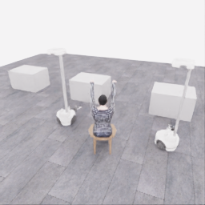
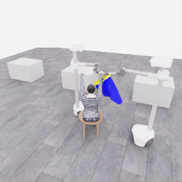
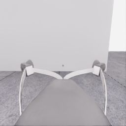
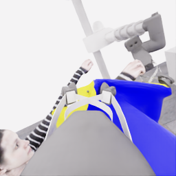
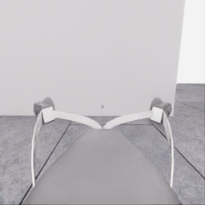
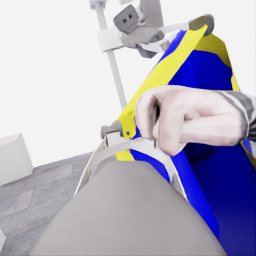
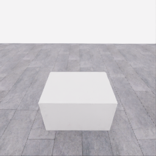
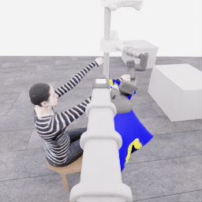
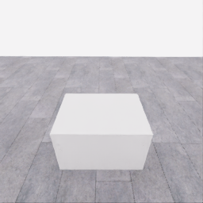
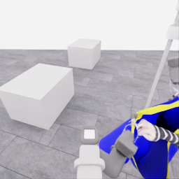

# 자동 시연 수집 시도 · 20261114-astra-wide-hem723-001

[전체 수집 기록](../../README.ko.md) · [구조화 요약](manifest.json) · [전체 행동 기록](decisions.jsonl) · [사용한 기본 프롬프트](prompt.txt)

실행 상태는 **completed**, 원본 출처는 `gpt`입니다. 완료 상태와 과제 성공은 아래에서 따로 기록합니다.

## 실행 조건과 시간

| 항목 | 기록 |
|---|---|
| 기록 시작 UTC | 2026-11-14T09:52:22Z |
| 기록 종료 UTC | 2026-11-14T10:32:33Z |
| 이전 시도 | 20261114-astra-middle-grip470-retain-001 |
| 재시도 사유 | Preserve the current grasps, broaden the candidate lower free span, and compare a short lateral approach from slightly above the same selected wrist before close occlusion. |
| 출처 그룹 | 20261113-astra-side-hem-fresh-001 |
| 요청 모델 / 추론 설정 | gpt-6-astra / ultra |
| 전체 실제 경과 시간 (초) | 2410.110 |
| Actor 호출 합계 (초) | 1473.917 |
| 환경 요청·응답 합계 (초) | 883.532 |
| 시뮬레이션 시간 (초) | 49.150 |
| 저장 전이 수 | 983.000 |
| 응답 확인 전이 수 | 983.000 |
| 모델 호출 시도 수 | 21.000 |
| 완료한 결정 구간 수 | 19.000 |
| 파일 완료 상태 | true |
| 데이터 정합성 검사 | true |
| 학습 데이터 승인 | unreviewed |
| Actor 호출 방식 | exec |
| 한 호출의 최대 계획 구간 수 | 1.000 |
| 한 계획의 최대 제어 step 수 | 20.000 |
| 제어기 정착 대기 설정 | true |
| 정착 대기 요청 step 수 | 6.000 |
| 완료한 제어기 정착 구간 수 | 17.000 |
| 제어기 정착 전이 수 | 102.000 |
| 제어기 정착 환경 요청·응답 (초) | 98.129 |
| 전이 예산으로 단축한 정착 구간 수 | 0.000 |
| 전이 예산으로 건너뛴 정착 구간 수 | 0.000 |

Actor 호출 시간은 공개 입력 저장·요청 전송·응답 처리 등 호출 경로를 측정합니다. 방식에 따라 Docker/CLI 시작이 호출 안에 들어가거나 상주 서버 준비 시간으로 분리됩니다. 내부 모델 추론 시간만 별도로 측정한 값은 아닙니다. 모델이 판단하는 동안 물리 시간은 멈추며 실제 경과 시간과 시뮬레이션 시간은 다릅니다. 세부 요청 프로세스 시간에도 CLI 처리·네트워크·서버 대기·생성이 함께 포함됩니다.

## 토큰 사용량의 범위

`actor_usage`는 thread별 관측 누계를 합친 값입니다. 결정의 `usage`는 원본 CLI 누계이며, 호출별 증가량은 `usage_accounting.incremental_usage`입니다. 캐시 입력은 입력의 부분집합이고 추론 출력은 출력의 부분집합이므로 열들을 다시 합산하지 않습니다.

전체 호출 사용량 확정: **true** · 기록한 호출 수: 21.

| 입력 | 캐시 입력 | 캐시 쓰기 입력 | 출력 | 추론 출력 |
|---:|---:|---:|---:|---:|
| 2789499 | 2413952 | 0 | 36199 | 31355 |

중복 누계는 추가 사용량 0으로 처리하고, 역행한 누계는 미확정으로 보존합니다. 새 thread는 별도로 집계합니다. 토큰 기록은 화폐 비용이나 청구서가 아닙니다.

## 리뷰 정지 조건

목표 누적 점수 10.000 · 감시 상태 `collector_ended_before_gate` · 수집기 상태 `completed`.

마지막 관측 점수 5.000 · 응답 확인 step 983.

`review_ready`는 정지 조건에 따라 실행을 마치고 리뷰할 준비가 된 상태입니다. 50점·착의 성공이나 학습 데이터 승인을 뜻하지 않습니다. 공식 점수와 success는 아래 평가 결과로 확인합니다.

## 공식 평가 결과

평가 유효성 `true` · 누적 점수 **5.000 / 50** · 착의 success **false** · rate 상태 `no_dressing_points` · 최종 rate 0.000 points/s.

누적 50점, 착의 success, 정상 파일 종료와 데이터 정합성은 서로 다른 상태입니다. 접촉 전 `no_contact`의 rate는 0점/초로 바꾸지 않습니다.

| 단계 | 획득 점수 / 최대 | 획득 시각 (episode 초) |
|---|---:|---:|
| 파지·들기 | 5.000 / 5 | 26.850 |
| 첫 소매 | 0.000 / 5 | 미측정/해당 없음 |
| 반대 어깨 | 0.000 / 5 | 미측정/해당 없음 |
| 두 번째 소매 | 0.000 / 5 | 미측정/해당 없음 |
| 왼쪽 위팔 | 0.000 / 5 | 미측정/해당 없음 |
| 오른쪽 위팔 | 0.000 / 5 | 미측정/해당 없음 |
| 목 통과 | 0.000 / 10 | 미측정/해당 없음 |
| 앞면 방향 | 0.000 / 10 | 미측정/해당 없음 |

## 단계 획득 경로

점수 획득은 [평가 이벤트](score-events.jsonl)에서 같은 physics tick끼리 묶었습니다. 같은 시각에 인정된 항목의 내부 순서는 추정하지 않습니다. 착의 success는 점수 획득과 별도로 기록합니다.

| 순서 | episode 시간 (초) | 전이 경계 step | 누적 점수 변화 | 같은 시각의 항목 변화 |
|---:|---:|---:|---:|---|
| 0 | 26.850 | 537 | 0.000→5.000 | 파지·들기 0.000→5.000 |

평가 clock 0초에 대응하는 공개 simulation clock은 1.525초입니다. 두 시계를 같은 절대 시각으로 혼동하지 않습니다.

별도 success 이벤트 수: **0**. 평가 유효성: `true`.


## 원본 관측 화면

지정된 공개 카메라의 저장 RGB 픽셀입니다. 시작은 첫 `obs`, 종료는 마지막 `next_obs`입니다. 이미지 합성이나 내부 상태 기반 장면 재구성 없이 원본 픽셀로 PNG를 저장했습니다.

| 카메라 | 시작 | 종료 |
|---|---|---|
| `overview` | [](images/initial-overview.png) | [](images/final-overview.png) |
| `robot_0_wrist` | [](images/initial-robot_0_wrist.png) | [](images/final-robot_0_wrist.png) |
| `robot_1_wrist` | [](images/initial-robot_1_wrist.png) | [](images/final-robot_1_wrist.png) |
| `robot_0_head` | [](images/initial-robot_0_head.png) | [](images/final-robot_0_head.png) |
| `robot_1_head` | [](images/initial-robot_1_head.png) | [](images/final-robot_1_head.png) |

시작 관측 시각 1.525초 · 종료 관측 시각 50.675초 (공개 simulation clock).

[▶ overview 관측 영상 보기](overview.mp4)

저장된 20 Hz `obs` 중 983프레임을 순서대로 사용했습니다. 재생은 **1.0배 느리게** (20.000 fps), 실제 대기 시간·모델 호출 지연은 영상에 들어가지 않습니다. 종료 `next_obs`는 위 PNG에서 확인합니다.

## 결정과 실행 순서

아래 근거는 모델 최종 JSON의 짧은 행동 설명입니다. 시각적 평가는 행동 전 관측에 대한 판단이며, 그 행동의 실행 후 성공 라벨로 사용하지 않습니다. 공식 점수는 별도의 평가 결과입니다.

행동의 각 행은 로봇 0·1 순서이며 열은 `전진, 왼쪽 이동, 반시계 회전, 리프트, 팔 신장, 손목 yaw, pitch, roll, gripper`입니다. 앞 8개는 정규화 속도이고 gripper는 닫기 `+1`, 열기 `-1`, 의도 유지 `0`입니다.

제어기 정착 대기는 앞선 모델 결정에 연결된 별도 중립 행동입니다. 추가 모델 호출이나 모델 결정으로 집계하지 않으며, 실제 전이와 환경 요청·응답 시간은 전체 합계에 포함됩니다. 중립 행동은 두 로봇의 속도와 gripper 명령을 모두 0으로 보내 기존 gripper 의도를 유지합니다. 대기를 실행했다는 기록이 옷의 정착이나 과제 개선을 확인했다는 뜻은 아닙니다.

### 기록된 행동의 재실행 구간

원본 `20261114-astra-middle-grip470-retain-001`의 행동 723전이를 새 환경에서 다시 실행했습니다. 이 구간에는 새 모델 호출이 없고 관측·평가를 새로 기록했습니다. 정확한 물리 상태 복원이나 독립적인 새 시연으로 집계하지 않습니다. 원본 step 대응과 실제 행동은 `decisions.jsonl`의 `replayed_segment`에 있습니다.

### 별도 모델 호출 0 · `initial`

실행 결정 인덱스 0의 고정 관측을 사용했습니다. 호출 경과 111.558초. 같은 call index의 행동 기록과 사용량을 중복 합산하지 않습니다.

공개 입력 저장 0.228초 · 요청 프로세스 111.329초 · 결과 해석 0.000초.

### 결정 0 · 방향 · `act`

입력 관측 37.675초 · Actor 호출 111.558초 · 시각적 판단 `uncertain`.

계획 `20261114-astra-wide-hem723-001:call-00000` · 모델 호출 인덱스 0 · 계획 구간 1/1 · 이 구간에서 모델 호출 `true`.

실행 직전 최신 관측 37.675초.

공개 입력 저장 0.228초 · 요청 프로세스 111.329초 · 결과 해석 0.000초.

호출 사용량 상태 `observed` · 이번 증가량 입력 23150 / 출력 2705 토큰.

최종 응답의 행동 설명: Robot 0 guides the higher rim candidate; robot 1 supports the lower candidate. The span appears narrow and vertically offset. Retract both arms and slightly raise robot 1 to test broadening while preserving grips. Check cloth following separately and opening depth. Target the overview-right raised wrist; no hand entry is established.

요청 행동:

```json
[[0, 0, 0, 0, -0.2, 0, 0, 0, 0], [0, 0, 0, 0.04, -0.2, 0, 0, 0, 0]]
```

실행 구간 step **[723, 729)** · 요청 6 step / 실제 6 step · 환경 요청·응답 5.399초.

실제 적용 행동:

```json
[[0.0, 0.0, 0.0, 0.0, -0.20000000298023224, 0.0, 0.0, 0.0, 0.0], [0.0, 0.0, 0.0, 0.03999999910593033, -0.20000000298023224, 0.0, 0.0, 0.0, 0.0]]
```

### 제어기 정착 대기 · 연결 결정 0

구간 `20261114-astra-wide-hem723-001:settle-00000` · 출처 `controller_settle` · 이 구간에서 모델 호출 `false`.

앞선 모델 호출 인덱스 0에 연결됩니다. 추가 호출은 없습니다.

실행 구간 step **[729, 735)** · 요청 6 step / 실제 6 step · 환경 요청·응답 5.276초.

공개 simulation clock 37.975→38.275초 · 실행 전 관측 37.975초.

실제 적용 중립 행동:

```json
[[0.0, 0.0, 0.0, 0.0, 0.0, 0.0, 0.0, 0.0, 0.0], [0.0, 0.0, 0.0, 0.0, 0.0, 0.0, 0.0, 0.0, 0.0]]
```

### 별도 모델 호출 1 · `initial`

실행 결정 인덱스 1의 고정 관측을 사용했습니다. 호출 경과 65.289초. 같은 call index의 행동 기록과 사용량을 중복 합산하지 않습니다.

공개 입력 저장 0.077초 · 요청 프로세스 65.212초 · 결과 해석 0.000초.

### 공개 픽셀 depth 조회 · 결정 1

물리 전이 없이 같은 카메라·시각의 원본 값을 조회했습니다. 무효 값은 null이며 접촉·입구 통과 판단이 아닙니다.

```json
{
  "request": {
    "kind": "depth_query",
    "observation_id": "d5e3802df4e1a8fbdf9489ec52a430264567cdd146a0ea5a26d4e83b47896733",
    "camera": "robot_0_head",
    "pixels_uv": [
      [
        57,
        67
      ],
      [
        50,
        70
      ],
      [
        44,
        75
      ],
      [
        132,
        124
      ],
      [
        145,
        113
      ],
      [
        141,
        128
      ],
      [
        161,
        133
      ]
    ],
    "include_camera_geometry": true
  },
  "response": {
    "kind": "depth_query_result",
    "observation_id": "d5e3802df4e1a8fbdf9489ec52a430264567cdd146a0ea5a26d4e83b47896733",
    "camera": "robot_0_head",
    "camera_index": 3,
    "simulation_time_s": 38.275001996196806,
    "intrinsics_sha256": "3dd91a2df5cb0a47b6f5ceb86d60d41e1f5d6753d2a11a034ac0b52bc385cd23",
    "request_sha256": "0fa273400680c983e44d8f64ec807350dc9a7051bd060e8d3f7a2b78a07865b5",
    "depth_semantics": "optical_Z_metres_not_ray_range",
    "geometry_semantics": "camera_X_right_Y_down_Z_forward",
    "rgb_image_order": [
      "overview",
      "robot_0_wrist",
      "robot_1_wrist",
      "robot_0_head",
      "robot_1_head"
    ],
    "resolution_wh": [
      256,
      256
    ],
    "neighbor_depth_substituted": false,
    "hidden_surfaces_estimated": false,
    "object_pose_or_contact_inferred": false,
    "source_sha256": {
      "observation_json": "b51ce07fb96c492ecac025b7363ca47f1156e9d882fb8bc6386056dceb6a0210",
      "public_depth_npz": "eb31e67496a2c15fbdb80d0b03ad4833c0cfc27d83436753dfce290ee900b306",
      "overview_rgb": "6ad436ae8db948da965634672aee75e8870fc3befa06b8100d73ab638e5e27c8",
      "robot_0_wrist_rgb": "d61bcce92a542131505850842e91944134ad03c23fb11c8e0500acb849a6d874",
      "robot_1_wrist_rgb": "89cef80c6bd5b2766f08d8d0101f90480f3bcbfc2e4c91a4a2e86c8fea33424c",
      "robot_0_head_rgb": "d18fe8faa1f4336924f812c844c523068c134f2b374cdf5e1d166def27d7bb4d",
      "robot_1_head_rgb": "bff462f5a0fc829f603baa9e36935cd23ec2ddc3cba447157d6738146ca91fb0"
    },
    "results": [
      {
        "pixel_uv": [
          57,
          67
        ],
        "status": "valid",
        "optical_z_m": 1.4093444347381592,
        "camera_xyz_m": [
          -0.547384260912241,
          -0.470287886135869,
          1.4093444347381592
        ],
        "camera_range_m": 1.5833672854609588,
        "invalid_reasons": []
      },
      {
        "pixel_uv": [
          50,
          70
        ],
        "status": "valid",
        "optical_z_m": 1.411376953125,
        "camera_xyz_m": [
          -0.6022189764298361,
          -0.4478038542683397,
          1.411376953125
        ],
        "camera_range_m": 1.5984933191234139,
        "invalid_reasons": []
      },
      {
        "pixel_uv": [
          44,
          75
        ],
        "status": "valid",
        "optical_z_m": 1.4091194868087769,
        "camera_xyz_m": [
          -0.6475061820292427,
          -0.40854556723273644,
          1.4091194868087769
        ],
        "camera_range_m": 1.6036805992390866,
        "invalid_reasons": []
      },
      {
        "pixel_uv": [
          132,
          124
        ],
        "status": "valid",
        "optical_z_m": 0.4192248582839966,
        "camera_xyz_m": [
          0.00917326268672974,
          -0.00917326268672974,
          0.4192248582839966
        ],
        "camera_range_m": 0.41942553486867784,
        "invalid_reasons": []
      },
      {
        "pixel_uv": [
          145,
          113
        ],
        "status": "valid",
        "optical_z_m": 0.7508387565612793,
        "camera_xyz_m": [
          0.06982523651962202,
          -0.0616105028114312,
          0.7508387565612793
        ],
        "camera_range_m": 0.7565912080286068,
        "invalid_reasons": []
      },
      {
        "pixel_uv": [
          141,
          128
        ],
        "status": "valid",
        "optical_z_m": 0.701793909072876,
        "camera_xyz_m": [
          0.04990795320494012,
          0.0,
          0.701793909072876
        ],
        "camera_range_m": 0.7035662688083437,
        "invalid_reasons": []
      },
      {
        "pixel_uv": [
          161,
          133
        ],
        "status": "valid",
        "optical_z_m": 0.48379969596862793,
        "camera_xyz_m": [
          0.08733661254161224,
          0.01323282008206246,
          0.48379969596862793
        ],
        "camera_range_m": 0.4917976588363397,
        "invalid_reasons": []
      }
    ]
  }
}
```

### 별도 모델 호출 2 · `action_after_query`

실행 결정 인덱스 1의 고정 관측을 사용했습니다. 호출 경과 83.310초. 같은 call index의 행동 기록과 사용량을 중복 합산하지 않습니다.

공개 입력 저장 0.076초 · 요청 프로세스 83.233초 · 결과 해석 0.000초.

### 결정 1 · 접근 · `act`

입력 관측 38.275초 · Actor 호출 83.310초 · 시각적 판단 `progressing`.

계획 `20261114-astra-wide-hem723-001:call-00002` · 모델 호출 인덱스 2 · 계획 구간 1/1 · 이 구간에서 모델 호출 `true`.

실행 직전 최신 관측 38.275초.

공개 입력 저장 0.076초 · 요청 프로세스 83.233초 · 결과 해석 0.000초.

호출 사용량 상태 `observed` · 이번 증가량 입력 46512 / 출력 2107 토큰.

최종 응답의 행동 설명: Cloth appears to follow both measured arm retractions. Robot 0 guides; robot 1 supports. Translate together partway toward the same overview-right wrist, preserving height and support spacing. Check reduced wrist-to-rim separation and retained cloth shape before entry; an open passage remains unverified.

요청 행동:

```json
[[0.25, 0.5, 0, 0, 0, 0, 0, 0, 0], [-0.466, -0.309, 0, 0, 0, 0, 0, 0, 0]]
```

실행 구간 step **[735, 755)** · 요청 20 step / 실제 20 step · 환경 요청·응답 17.951초.

실제 적용 행동:

```json
[[0.25, 0.5, 0.0, 0.0, 0.0, 0.0, 0.0, 0.0, 0.0], [-0.4659999907016754, -0.3089999854564667, 0.0, 0.0, 0.0, 0.0, 0.0, 0.0, 0.0]]
```

### 제어기 정착 대기 · 연결 결정 1

구간 `20261114-astra-wide-hem723-001:settle-00001` · 출처 `controller_settle` · 이 구간에서 모델 호출 `false`.

앞선 모델 호출 인덱스 2에 연결됩니다. 추가 호출은 없습니다.

실행 구간 step **[755, 761)** · 요청 6 step / 실제 6 step · 환경 요청·응답 6.040초.

공개 simulation clock 39.275→39.575초 · 실행 전 관측 39.275초.

실제 적용 중립 행동:

```json
[[0.0, 0.0, 0.0, 0.0, 0.0, 0.0, 0.0, 0.0, 0.0], [0.0, 0.0, 0.0, 0.0, 0.0, 0.0, 0.0, 0.0, 0.0]]
```

### 별도 모델 호출 3 · `initial`

실행 결정 인덱스 2의 고정 관측을 사용했습니다. 호출 경과 85.375초. 같은 call index의 행동 기록과 사용량을 중복 합산하지 않습니다.

공개 입력 저장 0.076초 · 요청 프로세스 85.299초 · 결과 해석 0.000초.

### 결정 2 · 접근 · `act`

입력 관측 39.575초 · Actor 호출 85.375초 · 시각적 판단 `uncertain`.

계획 `20261114-astra-wide-hem723-001:call-00003` · 모델 호출 인덱스 3 · 계획 구간 1/1 · 이 구간에서 모델 호출 `true`.

실행 직전 최신 관측 39.575초.

공개 입력 저장 0.076초 · 요청 프로세스 85.299초 · 결과 해석 0.000초.

호출 사용량 상태 `observed` · 이번 증가량 입력 57634 / 출력 2127 토큰.

최종 응답의 행동 설명: Robot 0 guides; robot 1 supports but translated less and remains tilted and moving. Cloth appears retained at both jaws, and the candidate mouth broadened. Pause new motion briefly to check robot 1 settling and opening retention; the same overview-right wrist remains outside.

요청 행동:

```json
[[0, 0, 0, 0, 0, 0, 0, 0, 0], [0, 0, 0, 0, 0, 0, 0, 0, 0]]
```

실행 구간 step **[761, 767)** · 요청 6 step / 실제 6 step · 환경 요청·응답 6.107초.

실제 적용 행동:

```json
[[0.0, 0.0, 0.0, 0.0, 0.0, 0.0, 0.0, 0.0, 0.0], [0.0, 0.0, 0.0, 0.0, 0.0, 0.0, 0.0, 0.0, 0.0]]
```

### 별도 모델 호출 4 · `initial`

실행 결정 인덱스 3의 고정 관측을 사용했습니다. 호출 경과 44.361초. 같은 call index의 행동 기록과 사용량을 중복 합산하지 않습니다.

공개 입력 저장 0.078초 · 요청 프로세스 44.283초 · 결과 해석 0.000초.

### 결정 3 · 접근 · `act`

입력 관측 39.875초 · Actor 호출 44.361초 · 시각적 판단 `progressing`.

계획 `20261114-astra-wide-hem723-001:call-00004` · 모델 호출 인덱스 4 · 계획 구간 1/1 · 이 구간에서 모델 호출 `true`.

실행 직전 최신 관측 39.875초.

공개 입력 저장 0.078초 · 요청 프로세스 44.283초 · 결과 해석 0.000초.

호출 사용량 상태 `observed` · 이번 증가량 입력 68654 / 출력 1102 토큰.

최종 응답의 행동 설명: Robot 1&#x27;s tilt decreased during the pause, though some drift remains; cloth stays near both jaws. Robot 0 guides and robot 1 supports a slower coordinated approach beside the same overview-right wrist. Preserve height and grips; check reduced wrist-to-mouth separation and opening retention before lateral entry.

요청 행동:

```json
[[0.12, 0.32, 0, 0, 0, 0, 0, 0, 0], [-0.283, -0.191, 0, 0, 0, 0, 0, 0, 0]]
```

실행 구간 step **[767, 787)** · 요청 20 step / 실제 20 step · 환경 요청·응답 19.353초.

실제 적용 행동:

```json
[[0.11999999731779099, 0.3199999928474426, 0.0, 0.0, 0.0, 0.0, 0.0, 0.0, 0.0], [-0.28299999237060547, -0.19099999964237213, 0.0, 0.0, 0.0, 0.0, 0.0, 0.0, 0.0]]
```

### 제어기 정착 대기 · 연결 결정 3

구간 `20261114-astra-wide-hem723-001:settle-00003` · 출처 `controller_settle` · 이 구간에서 모델 호출 `false`.

앞선 모델 호출 인덱스 4에 연결됩니다. 추가 호출은 없습니다.

실행 구간 step **[787, 793)** · 요청 6 step / 실제 6 step · 환경 요청·응답 6.171초.

공개 simulation clock 40.875→41.175초 · 실행 전 관측 40.875초.

실제 적용 중립 행동:

```json
[[0.0, 0.0, 0.0, 0.0, 0.0, 0.0, 0.0, 0.0, 0.0], [0.0, 0.0, 0.0, 0.0, 0.0, 0.0, 0.0, 0.0, 0.0]]
```

### 별도 모델 호출 5 · `initial`

실행 결정 인덱스 4의 고정 관측을 사용했습니다. 호출 경과 101.890초. 같은 call index의 행동 기록과 사용량을 중복 합산하지 않습니다.

공개 입력 저장 0.075초 · 요청 프로세스 101.815초 · 결과 해석 0.000초.

### 결정 4 · 복구 · `act`

입력 관측 41.175초 · Actor 호출 101.890초 · 시각적 판단 `recovering`.

계획 `20261114-astra-wide-hem723-001:call-00005` · 모델 호출 인덱스 5 · 계획 구간 1/1 · 이 구간에서 모델 호출 `true`.

실행 직전 최신 관측 41.175초.

공개 입력 저장 0.075초 · 요청 프로세스 101.815초 · 결과 해석 0.000초.

호출 사용량 상태 `observed` · 이번 증가량 입력 78580 / 출력 2289 토큰.

최종 응답의 행동 설명: Robot 0 guides; robot 1 supports but again undershot translation and tilted. Lateral approach appears obstructed. Test a short transverse detour with both robots, preserving grips and candidate mouth shape. Check actual base displacement and cloth retention; the same overview-right wrist remains outside.

요청 행동:

```json
[[0.32, 0.07, 0, 0, 0, 0, 0, 0, 0], [-0.284, 0.163, 0, 0, 0, 0, 0, 0, 0]]
```

실행 구간 step **[793, 805)** · 요청 12 step / 실제 12 step · 환경 요청·응답 11.245초.

실제 적용 행동:

```json
[[0.3199999928474426, 0.07000000029802322, 0.0, 0.0, 0.0, 0.0, 0.0, 0.0, 0.0], [-0.2840000092983246, 0.16300000250339508, 0.0, 0.0, 0.0, 0.0, 0.0, 0.0, 0.0]]
```

### 제어기 정착 대기 · 연결 결정 4

구간 `20261114-astra-wide-hem723-001:settle-00004` · 출처 `controller_settle` · 이 구간에서 모델 호출 `false`.

앞선 모델 호출 인덱스 5에 연결됩니다. 추가 호출은 없습니다.

실행 구간 step **[805, 811)** · 요청 6 step / 실제 6 step · 환경 요청·응답 5.701초.

공개 simulation clock 41.775→42.075초 · 실행 전 관측 41.775초.

실제 적용 중립 행동:

```json
[[0.0, 0.0, 0.0, 0.0, 0.0, 0.0, 0.0, 0.0, 0.0], [0.0, 0.0, 0.0, 0.0, 0.0, 0.0, 0.0, 0.0, 0.0]]
```

### 별도 모델 호출 6 · `initial`

실행 결정 인덱스 5의 고정 관측을 사용했습니다. 호출 경과 47.609초. 같은 call index의 행동 기록과 사용량을 중복 합산하지 않습니다.

공개 입력 저장 0.076초 · 요청 프로세스 47.533초 · 결과 해석 0.000초.

### 결정 5 · 접근 · `act`

입력 관측 42.075초 · Actor 호출 47.609초 · 시각적 판단 `progressing`.

계획 `20261114-astra-wide-hem723-001:call-00006` · 모델 호출 인덱스 6 · 계획 구간 1/1 · 이 구간에서 모델 호출 `true`.

실행 직전 최신 관측 42.075초.

공개 입력 저장 0.076초 · 요청 프로세스 47.533초 · 결과 해석 0.000초.

호출 사용량 상태 `observed` · 이번 증가량 입력 89715 / 출력 1215 토큰.

최종 응답의 행동 설명: The detour moved both bases and reduced robot 1&#x27;s tilt, with cloth retained near each jaw. Robot 0 guides and robot 1 supports a sideways approach from this new offset toward the same overview-right wrist. Preserve height and grips; test lateral clearance and reduced wrist-to-mouth separation. Entry remains unverified.

요청 행동:

```json
[[-0.071, 0.312, 0, 0, 0, 0, 0, 0, 0], [-0.166, -0.274, 0, 0, 0, 0, 0, 0, 0]]
```

실행 구간 step **[811, 827)** · 요청 16 step / 실제 16 step · 환경 요청·응답 14.818초.

실제 적용 행동:

```json
[[-0.07100000232458115, 0.31200000643730164, 0.0, 0.0, 0.0, 0.0, 0.0, 0.0, 0.0], [-0.16599999368190765, -0.27399998903274536, 0.0, 0.0, 0.0, 0.0, 0.0, 0.0, 0.0]]
```

### 제어기 정착 대기 · 연결 결정 5

구간 `20261114-astra-wide-hem723-001:settle-00005` · 출처 `controller_settle` · 이 구간에서 모델 호출 `false`.

앞선 모델 호출 인덱스 6에 연결됩니다. 추가 호출은 없습니다.

실행 구간 step **[827, 833)** · 요청 6 step / 실제 6 step · 환경 요청·응답 6.058초.

공개 simulation clock 42.875→43.175초 · 실행 전 관측 42.875초.

실제 적용 중립 행동:

```json
[[0.0, 0.0, 0.0, 0.0, 0.0, 0.0, 0.0, 0.0, 0.0], [0.0, 0.0, 0.0, 0.0, 0.0, 0.0, 0.0, 0.0, 0.0]]
```

### 별도 모델 호출 7 · `initial`

실행 결정 인덱스 6의 고정 관측을 사용했습니다. 호출 경과 64.736초. 같은 call index의 행동 기록과 사용량을 중복 합산하지 않습니다.

공개 입력 저장 0.077초 · 요청 프로세스 64.658초 · 결과 해석 0.000초.

### 결정 6 · 방향 · `act`

입력 관측 43.175초 · Actor 호출 64.736초 · 시각적 판단 `recovering`.

계획 `20261114-astra-wide-hem723-001:call-00007` · 모델 호출 인덱스 7 · 계획 구간 1/1 · 이 구간에서 모델 호출 `true`.

실행 직전 최신 관측 43.175초.

공개 입력 저장 0.077초 · 요청 프로세스 64.658초 · 결과 해석 0.000초.

호출 사용량 상태 `observed` · 이번 증가량 입력 99772 / 출력 1672 토큰.

최종 응답의 행동 설명: Sideways travel was limited to about 9 cm for robot 0 and 6 cm for robot 1, which tilted again. Keep bases neutral: robot 0 guides and robot 1 supports a paired wrist-yaw change toward the same overview-right wrist. Test mouth orientation, separate cloth following, and reduced hand-to-rim separation; no entry is established.

요청 행동:

```json
[[0, 0, 0, 0, 0, 0.12, 0, 0, 0], [0, 0, 0, 0, 0, -0.12, 0, 0, 0]]
```

실행 구간 step **[833, 841)** · 요청 8 step / 실제 8 step · 환경 요청·응답 7.751초.

실제 적용 행동:

```json
[[0.0, 0.0, 0.0, 0.0, 0.0, 0.11999999731779099, 0.0, 0.0, 0.0], [0.0, 0.0, 0.0, 0.0, 0.0, -0.11999999731779099, 0.0, 0.0, 0.0]]
```

### 제어기 정착 대기 · 연결 결정 6

구간 `20261114-astra-wide-hem723-001:settle-00006` · 출처 `controller_settle` · 이 구간에서 모델 호출 `false`.

앞선 모델 호출 인덱스 7에 연결됩니다. 추가 호출은 없습니다.

실행 구간 step **[841, 847)** · 요청 6 step / 실제 6 step · 환경 요청·응답 5.782초.

공개 simulation clock 43.575→43.875초 · 실행 전 관측 43.575초.

실제 적용 중립 행동:

```json
[[0.0, 0.0, 0.0, 0.0, 0.0, 0.0, 0.0, 0.0, 0.0], [0.0, 0.0, 0.0, 0.0, 0.0, 0.0, 0.0, 0.0, 0.0]]
```

### 별도 모델 호출 8 · `initial`

실행 결정 인덱스 7의 고정 관측을 사용했습니다. 호출 경과 108.855초. 같은 call index의 행동 기록과 사용량을 중복 합산하지 않습니다.

공개 입력 저장 0.081초 · 요청 프로세스 108.774초 · 결과 해석 0.000초.

### 결정 7 · 접근 · `act`

입력 관측 43.875초 · Actor 호출 108.855초 · 시각적 판단 `progressing`.

계획 `20261114-astra-wide-hem723-001:call-00008` · 모델 호출 인덱스 8 · 계획 구간 1/1 · 이 구간에서 모델 호출 `true`.

실행 직전 최신 관측 43.875초.

공개 입력 저장 0.081초 · 요청 프로세스 108.774초 · 결과 해석 0.000초.

호출 사용량 상태 `observed` · 이번 증가량 입력 110382 / 출력 2785 토큰.

최종 응답의 행동 설명: Both wrist yaw changes executed and cloth followed; the selected wrist remains separated from the rim. Robot 0 guides and robot 1 supports a short paired base pivot to sweep the mouth sideways toward that same wrist. Check housing clearance, cloth retention, and mouth-to-hand alignment before entry.

요청 행동:

```json
[[0, 0, 0.14, 0, 0, 0, 0, 0, 0], [0, 0, -0.17, 0, 0, 0, 0, 0, 0]]
```

실행 구간 step **[847, 855)** · 요청 8 step / 실제 8 step · 환경 요청·응답 7.735초.

실제 적용 행동:

```json
[[0.0, 0.0, 0.14000000059604645, 0.0, 0.0, 0.0, 0.0, 0.0, 0.0], [0.0, 0.0, -0.17000000178813934, 0.0, 0.0, 0.0, 0.0, 0.0, 0.0]]
```

### 제어기 정착 대기 · 연결 결정 7

구간 `20261114-astra-wide-hem723-001:settle-00007` · 출처 `controller_settle` · 이 구간에서 모델 호출 `false`.

앞선 모델 호출 인덱스 8에 연결됩니다. 추가 호출은 없습니다.

실행 구간 step **[855, 861)** · 요청 6 step / 실제 6 step · 환경 요청·응답 5.832초.

공개 simulation clock 44.275→44.575초 · 실행 전 관측 44.275초.

실제 적용 중립 행동:

```json
[[0.0, 0.0, 0.0, 0.0, 0.0, 0.0, 0.0, 0.0, 0.0], [0.0, 0.0, 0.0, 0.0, 0.0, 0.0, 0.0, 0.0, 0.0]]
```

### 별도 모델 호출 9 · `initial`

실행 결정 인덱스 8의 고정 관측을 사용했습니다. 호출 경과 42.509초. 같은 call index의 행동 기록과 사용량을 중복 합산하지 않습니다.

공개 입력 저장 0.081초 · 요청 프로세스 42.428초 · 결과 해석 0.000초.

### 공개 픽셀 depth 조회 · 결정 8

물리 전이 없이 같은 카메라·시각의 원본 값을 조회했습니다. 무효 값은 null이며 접촉·입구 통과 판단이 아닙니다.

```json
{
  "request": {
    "kind": "depth_query",
    "observation_id": "21c2bd60f0efa0c3c7afd09daaffadab06051cc3b735e015b59a3e92cf96929d",
    "camera": "robot_0_head",
    "pixels_uv": [
      [
        127,
        85
      ],
      [
        119,
        88
      ],
      [
        110,
        94
      ],
      [
        140,
        111
      ],
      [
        149,
        118
      ],
      [
        158,
        124
      ],
      [
        171,
        141
      ]
    ],
    "include_camera_geometry": true
  },
  "response": {
    "kind": "depth_query_result",
    "observation_id": "21c2bd60f0efa0c3c7afd09daaffadab06051cc3b735e015b59a3e92cf96929d",
    "camera": "robot_0_head",
    "camera_index": 3,
    "simulation_time_s": 44.57500232476741,
    "intrinsics_sha256": "3dd91a2df5cb0a47b6f5ceb86d60d41e1f5d6753d2a11a034ac0b52bc385cd23",
    "request_sha256": "fae61ee017eaf980934aca453395a97770f1370ed0c62733acf1ec92b41e37a6",
    "depth_semantics": "optical_Z_metres_not_ray_range",
    "geometry_semantics": "camera_X_right_Y_down_Z_forward",
    "rgb_image_order": [
      "overview",
      "robot_0_wrist",
      "robot_1_wrist",
      "robot_0_head",
      "robot_1_head"
    ],
    "resolution_wh": [
      256,
      256
    ],
    "neighbor_depth_substituted": false,
    "hidden_surfaces_estimated": false,
    "object_pose_or_contact_inferred": false,
    "source_sha256": {
      "observation_json": "e64a9f1266a3b26feb58c69f50e2cadb4d646ae3a93a56294b3cb82e4b34e748",
      "public_depth_npz": "a996dcc2bd5c028a97c5b19f6c6dfd276cd6a96deea6d0e62cb0c9c1fa071fcc",
      "overview_rgb": "de695f88c649f4dbd0b3c41e3db982c140a745ede1d1959628d71644d659684d",
      "robot_0_wrist_rgb": "54b24bdd22da87bae8a7b49940f51ae3a3013cc95a484d376f0f29f75c901b97",
      "robot_1_wrist_rgb": "cd70b4ca94e6bb1750ca9c603667fa996231d35327019e93da82a69dc39ae274",
      "robot_0_head_rgb": "ec10f2aa70378282cee6c05f4f6e50dbdf2d7f54851e638325584673059e379c",
      "robot_1_head_rgb": "e589217c48ecc6e16db8d6739b92ca93146399c64f617c3a96ec1f6ed517d2a2"
    },
    "results": [
      {
        "pixel_uv": [
          127,
          85
        ],
        "status": "valid",
        "optical_z_m": 1.1123636960983276,
        "camera_xyz_m": [
          -0.006085042540928623,
          -0.2616568292599308,
          1.1123636960983276
        ],
        "camera_range_m": 1.1427398288493396,
        "invalid_reasons": []
      },
      {
        "pixel_uv": [
          119,
          88
        ],
        "status": "valid",
        "optical_z_m": 1.1175719499588013,
        "camera_xyz_m": [
          -0.05502180261465542,
          -0.24454134495402413,
          1.1175719499588013
        ],
        "camera_range_m": 1.1453361652762069,
        "invalid_reasons": []
      },
      {
        "pixel_uv": [
          110,
          94
        ],
        "status": "valid",
        "optical_z_m": 1.1174601316452026,
        "camera_xyz_m": [
          -0.11003259485064171,
          -0.2078393458289899,
          1.1174601316452026
        ],
        "camera_range_m": 1.141937612753298,
        "invalid_reasons": []
      },
      {
        "pixel_uv": [
          140,
          111
        ],
        "status": "valid",
        "optical_z_m": 0.7909525632858276,
        "camera_xyz_m": [
          0.05192165129803397,
          -0.07355567267221479,
          0.7909525632858276
        ],
        "camera_range_m": 0.7960604576438889,
        "invalid_reasons": []
      },
      {
        "pixel_uv": [
          149,
          118
        ],
        "status": "valid",
        "optical_z_m": 0.536217451095581,
        "camera_xyz_m": [
          0.061599480694618486,
          -0.029333086045056425,
          0.536217451095581
        ],
        "camera_range_m": 0.5405405450271193,
        "invalid_reasons": []
      },
      {
        "pixel_uv": [
          158,
          124
        ],
        "status": "valid",
        "optical_z_m": 0.5410234928131104,
        "camera_xyz_m": [
          0.08878798312881717,
          -0.011838397750508956,
          0.5410234928131104
        ],
        "camera_range_m": 0.5483884329424538,
        "invalid_reasons": []
      },
      {
        "pixel_uv": [
          171,
          141
        ],
        "status": "valid",
        "optical_z_m": 0.8035962581634521,
        "camera_xyz_m": [
          0.1890267092082508,
          0.05714760976063396,
          0.8035962581634521
        ],
        "camera_range_m": 0.8275046176486002,
        "invalid_reasons": []
      }
    ]
  }
}
```

### 별도 모델 호출 10 · `action_after_query`

실행 결정 인덱스 8의 고정 관측을 사용했습니다. 호출 경과 73.810초. 같은 call index의 행동 기록과 사용량을 중복 합산하지 않습니다.

공개 입력 저장 0.087초 · 요청 프로세스 73.723초 · 결과 해석 0.000초.

### 결정 8 · 첫 소매 · `act`

입력 관측 44.575초 · Actor 호출 73.810초 · 시각적 판단 `uncertain`.

계획 `20261114-astra-wide-hem723-001:call-00010` · 모델 호출 인덱스 10 · 계획 구간 1/1 · 이 구간에서 모델 호출 `true`.

실행 직전 최신 관측 44.575초.

공개 입력 저장 0.087초 · 요청 프로세스 73.723초 · 결과 해석 0.000초.

호출 사용량 상태 `observed` · 이번 증가량 입력 133439 / 출력 1865 토큰.

최종 응답의 행동 설명: The selected hand remains deeper than the sampled rim. Robot 0 guides the higher side; robot 1 supports the lower side. Make a short coordinated movement toward and beside that same wrist, aiming to center it between supports at the current height. Check rim crossing and housing clearance; occlusion alone will not establish entry.

요청 행동:

```json
[[0.4, 0.4, 0, 0, 0, 0, 0, 0, 0], [-0.53, -0.198, 0, 0, 0, 0, 0, 0, 0]]
```

실행 구간 step **[861, 869)** · 요청 8 step / 실제 8 step · 환경 요청·응답 7.561초.

실제 적용 행동:

```json
[[0.4000000059604645, 0.4000000059604645, 0.0, 0.0, 0.0, 0.0, 0.0, 0.0, 0.0], [-0.5299999713897705, -0.1979999989271164, 0.0, 0.0, 0.0, 0.0, 0.0, 0.0, 0.0]]
```

### 제어기 정착 대기 · 연결 결정 8

구간 `20261114-astra-wide-hem723-001:settle-00008` · 출처 `controller_settle` · 이 구간에서 모델 호출 `false`.

앞선 모델 호출 인덱스 10에 연결됩니다. 추가 호출은 없습니다.

실행 구간 step **[869, 875)** · 요청 6 step / 실제 6 step · 환경 요청·응답 5.987초.

공개 simulation clock 44.975→45.275초 · 실행 전 관측 44.975초.

실제 적용 중립 행동:

```json
[[0.0, 0.0, 0.0, 0.0, 0.0, 0.0, 0.0, 0.0, 0.0], [0.0, 0.0, 0.0, 0.0, 0.0, 0.0, 0.0, 0.0, 0.0]]
```

### 별도 모델 호출 11 · `initial`

실행 결정 인덱스 9의 고정 관측을 사용했습니다. 호출 경과 66.893초. 같은 call index의 행동 기록과 사용량을 중복 합산하지 않습니다.

공개 입력 저장 0.081초 · 요청 프로세스 66.812초 · 결과 해석 0.000초.

### 결정 9 · 첫 소매 · `act`

입력 관측 45.275초 · Actor 호출 66.893초 · 시각적 판단 `uncertain`.

계획 `20261114-astra-wide-hem723-001:call-00011` · 모델 호출 인덱스 11 · 계획 구간 1/1 · 이 구간에서 모델 호출 `true`.

실행 직전 최신 관측 45.275초.

공개 입력 저장 0.081초 · 요청 프로세스 66.812초 · 결과 해석 0.000초.

호출 사용량 상태 `observed` · 이번 증가량 입력 144383 / 출력 1680 토큰.

최종 응답의 행동 설명: Both grips followed, but robot 1 again lagged sideways. The tracked wrist is closer; rim crossing remains unseen. Robot 0 guides a short entry trial while robot 1 combines backward translation and wrist yaw to carry its support sideways. Preserve both grips and inspect the same wrist/forearm against the rim afterward.

요청 행동:

```json
[[0.265, 0.303, 0, 0, 0, 0, 0, 0, 0], [-0.274, 0.034, 0, 0, 0, -0.1, 0, 0, 0]]
```

실행 구간 step **[875, 881)** · 요청 6 step / 실제 6 step · 환경 요청·응답 5.861초.

실제 적용 행동:

```json
[[0.26499998569488525, 0.30300000309944153, 0.0, 0.0, 0.0, 0.0, 0.0, 0.0, 0.0], [-0.27399998903274536, 0.03400000184774399, 0.0, 0.0, 0.0, -0.10000000149011612, 0.0, 0.0, 0.0]]
```

### 제어기 정착 대기 · 연결 결정 9

구간 `20261114-astra-wide-hem723-001:settle-00009` · 출처 `controller_settle` · 이 구간에서 모델 호출 `false`.

앞선 모델 호출 인덱스 11에 연결됩니다. 추가 호출은 없습니다.

실행 구간 step **[881, 887)** · 요청 6 step / 실제 6 step · 환경 요청·응답 6.130초.

공개 simulation clock 45.575→45.875초 · 실행 전 관측 45.575초.

실제 적용 중립 행동:

```json
[[0.0, 0.0, 0.0, 0.0, 0.0, 0.0, 0.0, 0.0, 0.0], [0.0, 0.0, 0.0, 0.0, 0.0, 0.0, 0.0, 0.0, 0.0]]
```

### 별도 모델 호출 12 · `initial`

실행 결정 인덱스 10의 고정 관측을 사용했습니다. 호출 경과 59.382초. 같은 call index의 행동 기록과 사용량을 중복 합산하지 않습니다.

공개 입력 저장 0.082초 · 요청 프로세스 59.300초 · 결과 해석 0.000초.

### 결정 10 · 첫 소매 · `act`

입력 관측 45.875초 · Actor 호출 59.382초 · 시각적 판단 `uncertain`.

계획 `20261114-astra-wide-hem723-001:call-00012` · 모델 호출 인덱스 12 · 계획 구간 1/1 · 이 구간에서 모델 호출 `true`.

실행 직전 최신 관측 45.875초.

공개 입력 저장 0.082초 · 요청 프로세스 59.300초 · 결과 해석 0.000초.

호출 사용량 상태 `observed` · 이번 증가량 입력 155019 / 출력 1563 토큰.

최종 응답의 행동 설명: The tracked hand now overlaps the span between rim candidates in robot 1&#x27;s head view, but crossing remains unconfirmed. Robot 0 guides and robot 1 supports a roughly 5 cm advance, preserving height and grips. Inspect whether the lips pass around the same wrist and forearm, rather than merely covering the hand.

요청 행동:

```json
[[0.285, 0.115, 0, 0, 0, 0, 0, 0, 0], [-0.308, 0.015, 0, 0, 0, 0, 0, 0, 0]]
```

실행 구간 step **[887, 893)** · 요청 6 step / 실제 6 step · 환경 요청·응답 6.644초.

실제 적용 행동:

```json
[[0.2849999964237213, 0.11500000208616257, 0.0, 0.0, 0.0, 0.0, 0.0, 0.0, 0.0], [-0.30799999833106995, 0.014999999664723873, 0.0, 0.0, 0.0, 0.0, 0.0, 0.0, 0.0]]
```

### 제어기 정착 대기 · 연결 결정 10

구간 `20261114-astra-wide-hem723-001:settle-00010` · 출처 `controller_settle` · 이 구간에서 모델 호출 `false`.

앞선 모델 호출 인덱스 12에 연결됩니다. 추가 호출은 없습니다.

실행 구간 step **[893, 899)** · 요청 6 step / 실제 6 step · 환경 요청·응답 5.354초.

공개 simulation clock 46.175→46.475초 · 실행 전 관측 46.175초.

실제 적용 중립 행동:

```json
[[0.0, 0.0, 0.0, 0.0, 0.0, 0.0, 0.0, 0.0, 0.0], [0.0, 0.0, 0.0, 0.0, 0.0, 0.0, 0.0, 0.0, 0.0]]
```

### 별도 모델 호출 13 · `initial`

실행 결정 인덱스 11의 고정 관측을 사용했습니다. 호출 경과 71.758초. 같은 call index의 행동 기록과 사용량을 중복 합산하지 않습니다.

공개 입력 저장 0.083초 · 요청 프로세스 71.675초 · 결과 해석 0.000초.

### 결정 11 · 첫 소매 · `act`

입력 관측 46.475초 · Actor 호출 71.758초 · 시각적 판단 `progressing`.

계획 `20261114-astra-wide-hem723-001:call-00013` · 모델 호출 인덱스 13 · 계획 구간 1/1 · 이 구간에서 모델 호출 `true`.

실행 직전 최신 관측 46.475초.

공개 입력 저장 0.083초 · 요청 프로세스 71.675초 · 결과 해석 0.000초.

호출 사용량 상태 `observed` · 이번 증가량 입력 165549 / 출력 1753 토큰.

최종 응답의 행동 설명: The same hand is newly visible in robot 1&#x27;s wrist view between projected rim boundaries; hem entry is plausible, but sleeve passage is unconfirmed. Robot 1 supports this relationship while robot 0 guides a short movement along the connected forearm, slightly downward. Check retained wrist-to-rim placement and housing clearance.

요청 행동:

```json
[[0.064, 0.301, 0, -0.05, 0, 0, 0, 0, 0], [-0.183, -0.248, 0, -0.05, 0, 0, 0, 0, 0]]
```

실행 구간 step **[899, 904)** · 요청 5 step / 실제 5 step · 환경 요청·응답 4.588초.

실제 적용 행동:

```json
[[0.06400000303983688, 0.3009999990463257, 0.0, -0.05000000074505806, 0.0, 0.0, 0.0, 0.0, 0.0], [-0.18299999833106995, -0.24799999594688416, 0.0, -0.05000000074505806, 0.0, 0.0, 0.0, 0.0, 0.0]]
```

### 제어기 정착 대기 · 연결 결정 11

구간 `20261114-astra-wide-hem723-001:settle-00011` · 출처 `controller_settle` · 이 구간에서 모델 호출 `false`.

앞선 모델 호출 인덱스 13에 연결됩니다. 추가 호출은 없습니다.

실행 구간 step **[904, 910)** · 요청 6 step / 실제 6 step · 환경 요청·응답 5.546초.

공개 simulation clock 46.725→47.025초 · 실행 전 관측 46.725초.

실제 적용 중립 행동:

```json
[[0.0, 0.0, 0.0, 0.0, 0.0, 0.0, 0.0, 0.0, 0.0], [0.0, 0.0, 0.0, 0.0, 0.0, 0.0, 0.0, 0.0, 0.0]]
```

### 별도 모델 호출 14 · `initial`

실행 결정 인덱스 12의 고정 관측을 사용했습니다. 호출 경과 47.073초. 같은 call index의 행동 기록과 사용량을 중복 합산하지 않습니다.

공개 입력 저장 0.086초 · 요청 프로세스 46.987초 · 결과 해석 0.000초.

### 결정 12 · 복구 · `act`

입력 관측 47.025초 · Actor 호출 47.073초 · 시각적 판단 `recovering`.

계획 `20261114-astra-wide-hem723-001:call-00014` · 모델 호출 인덱스 14 · 계획 구간 1/1 · 이 구간에서 모델 호출 `true`.

실행 직전 최신 관측 47.025초.

공개 입력 저장 0.086초 · 요청 프로세스 46.987초 · 결과 해석 0.000초.

호출 사용량 상태 `observed` · 이번 증가량 입력 176303 / 출력 1097 토큰.

최종 응답의 행동 설명: The forearm-directed motion executed, but the same hand now obscures robot 1&#x27;s wrist view at roughly 4–6 cm depth. Robot 0 holds the supporting rim; robot 1 briefly withdraws its housing and lower rim sideways without releasing. Check restored clearance and retention of the wrist-to-rim relationship before advancing.

요청 행동:

```json
[[0, 0, 0, 0, 0, 0, 0, 0, 0], [0.081, 0.247, 0, 0, 0, 0, 0, 0, 0]]
```

실행 구간 step **[910, 915)** · 요청 5 step / 실제 5 step · 환경 요청·응답 4.907초.

실제 적용 행동:

```json
[[0.0, 0.0, 0.0, 0.0, 0.0, 0.0, 0.0, 0.0, 0.0], [0.08100000023841858, 0.24699999392032623, 0.0, 0.0, 0.0, 0.0, 0.0, 0.0, 0.0]]
```

### 제어기 정착 대기 · 연결 결정 12

구간 `20261114-astra-wide-hem723-001:settle-00012` · 출처 `controller_settle` · 이 구간에서 모델 호출 `false`.

앞선 모델 호출 인덱스 14에 연결됩니다. 추가 호출은 없습니다.

실행 구간 step **[915, 921)** · 요청 6 step / 실제 6 step · 환경 요청·응답 5.872초.

공개 simulation clock 47.275→47.575초 · 실행 전 관측 47.275초.

실제 적용 중립 행동:

```json
[[0.0, 0.0, 0.0, 0.0, 0.0, 0.0, 0.0, 0.0, 0.0], [0.0, 0.0, 0.0, 0.0, 0.0, 0.0, 0.0, 0.0, 0.0]]
```

### 별도 모델 호출 15 · `initial`

실행 결정 인덱스 13의 고정 관측을 사용했습니다. 호출 경과 104.798초. 같은 call index의 행동 기록과 사용량을 중복 합산하지 않습니다.

공개 입력 저장 0.081초 · 요청 프로세스 104.716초 · 결과 해석 0.000초.

### 결정 13 · 복구 · `act`

입력 관측 47.575초 · Actor 호출 104.798초 · 시각적 판단 `recovering`.

계획 `20261114-astra-wide-hem723-001:call-00015` · 모델 호출 인덱스 15 · 계획 구간 1/1 · 이 구간에서 모델 호출 `true`.

실행 직전 최신 관측 47.575초.

공개 입력 저장 0.081초 · 요청 프로세스 104.716초 · 결과 해석 0.000초.

호출 사용량 상태 `observed` · 이번 증가량 입력 186392 / 출력 2606 토큰.

최종 응답의 행동 설명: The sideways withdrawal restored partial visibility, but the same fist remains close to robot 1&#x27;s housing and crossing is unclear. Robot 0 anchors its rim; robot 1 retracts its arm slightly to test greater housing clearance and opening depth. Preserve both grips and inspect whether the wrist-to-rim relationship remains useful.

요청 행동:

```json
[[0, 0, 0, 0, 0, 0, 0, 0, 0], [0, 0, 0, 0, -0.18, 0, 0, 0, 0]]
```

실행 구간 step **[921, 927)** · 요청 6 step / 실제 6 step · 환경 요청·응답 5.711초.

실제 적용 행동:

```json
[[0.0, 0.0, 0.0, 0.0, 0.0, 0.0, 0.0, 0.0, 0.0], [0.0, 0.0, 0.0, 0.0, -0.18000000715255737, 0.0, 0.0, 0.0, 0.0]]
```

### 제어기 정착 대기 · 연결 결정 13

구간 `20261114-astra-wide-hem723-001:settle-00013` · 출처 `controller_settle` · 이 구간에서 모델 호출 `false`.

앞선 모델 호출 인덱스 15에 연결됩니다. 추가 호출은 없습니다.

실행 구간 step **[927, 933)** · 요청 6 step / 실제 6 step · 환경 요청·응답 5.628초.

공개 simulation clock 47.875→48.175초 · 실행 전 관측 47.875초.

실제 적용 중립 행동:

```json
[[0.0, 0.0, 0.0, 0.0, 0.0, 0.0, 0.0, 0.0, 0.0], [0.0, 0.0, 0.0, 0.0, 0.0, 0.0, 0.0, 0.0, 0.0]]
```

### 별도 모델 호출 16 · `initial`

실행 결정 인덱스 14의 고정 관측을 사용했습니다. 호출 경과 98.284초. 같은 call index의 행동 기록과 사용량을 중복 합산하지 않습니다.

공개 입력 저장 0.080초 · 요청 프로세스 98.203초 · 결과 해석 0.000초.

### 결정 14 · 방향 · `act`

입력 관측 48.175초 · Actor 호출 98.284초 · 시각적 판단 `uncertain`.

계획 `20261114-astra-wide-hem723-001:call-00016` · 모델 호출 인덱스 16 · 계획 구간 1/1 · 이 구간에서 모델 호출 `true`.

실행 직전 최신 관측 48.175초.

공개 입력 저장 0.080초 · 요청 프로세스 98.203초 · 결과 해석 0.000초.

호출 사용량 상태 `observed` · 이번 증가량 입력 197944 / 출력 2374 토큰.

최종 응답의 행동 설명: Robot 1 retracted about 5 cm, increasing visible fist depth to roughly 9–10 cm while retaining cloth. Sleeve passage remains unseen. Robot 1 now supports the same wrist relationship; robot 0 raises and moves its rim outward to expose a broader opening above that hand. Check both lip boundaries and retained forearm placement.

요청 행동:

```json
[[-0.04, 0.35, 0, 0.12, 0, 0, 0, 0, 0], [0, 0, 0, 0, 0, 0, 0, 0, 0]]
```

실행 구간 step **[933, 939)** · 요청 6 step / 실제 6 step · 환경 요청·응답 5.642초.

실제 적용 행동:

```json
[[-0.03999999910593033, 0.3499999940395355, 0.0, 0.11999999731779099, 0.0, 0.0, 0.0, 0.0, 0.0], [0.0, 0.0, 0.0, 0.0, 0.0, 0.0, 0.0, 0.0, 0.0]]
```

### 제어기 정착 대기 · 연결 결정 14

구간 `20261114-astra-wide-hem723-001:settle-00014` · 출처 `controller_settle` · 이 구간에서 모델 호출 `false`.

앞선 모델 호출 인덱스 16에 연결됩니다. 추가 호출은 없습니다.

실행 구간 step **[939, 945)** · 요청 6 step / 실제 6 step · 환경 요청·응답 5.513초.

공개 simulation clock 48.475→48.775초 · 실행 전 관측 48.475초.

실제 적용 중립 행동:

```json
[[0.0, 0.0, 0.0, 0.0, 0.0, 0.0, 0.0, 0.0, 0.0], [0.0, 0.0, 0.0, 0.0, 0.0, 0.0, 0.0, 0.0, 0.0]]
```

### 별도 모델 호출 17 · `initial`

실행 결정 인덱스 15의 고정 관측을 사용했습니다. 호출 경과 59.132초. 같은 call index의 행동 기록과 사용량을 중복 합산하지 않습니다.

공개 입력 저장 0.081초 · 요청 프로세스 59.050초 · 결과 해석 0.000초.

### 결정 15 · 방향 · `act`

입력 관측 48.775초 · Actor 호출 59.132초 · 시각적 판단 `uncertain`.

계획 `20261114-astra-wide-hem723-001:call-00017` · 모델 호출 인덱스 17 · 계획 구간 1/1 · 이 구간에서 모델 호출 `true`.

실행 직전 최신 관측 48.775초.

공개 입력 저장 0.081초 · 요청 프로세스 59.050초 · 결과 해석 0.000초.

호출 사용량 상태 `observed` · 이번 증가량 입력 209270 / 출력 1419 토큰.

최종 응답의 행동 설명: Robot 0&#x27;s rim followed its upward/outward movement, but the same wrist remains near the mouth edge without clear passage. Robot 0 guides and robot 1 supports a small opposed rotation of the held edges to test lip separation. Preserve positions and grips; inspect opening depth and retained forearm placement before advancing.

요청 행동:

```json
[[0, 0, 0, 0, 0, 0, 0, 0.14, 0], [0, 0, 0, 0, 0, 0, 0, 0.14, 0]]
```

실행 구간 step **[945, 951)** · 요청 6 step / 실제 6 step · 환경 요청·응답 5.893초.

실제 적용 행동:

```json
[[0.0, 0.0, 0.0, 0.0, 0.0, 0.0, 0.0, 0.14000000059604645, 0.0], [0.0, 0.0, 0.0, 0.0, 0.0, 0.0, 0.0, 0.14000000059604645, 0.0]]
```

### 제어기 정착 대기 · 연결 결정 15

구간 `20261114-astra-wide-hem723-001:settle-00015` · 출처 `controller_settle` · 이 구간에서 모델 호출 `false`.

앞선 모델 호출 인덱스 17에 연결됩니다. 추가 호출은 없습니다.

실행 구간 step **[951, 957)** · 요청 6 step / 실제 6 step · 환경 요청·응답 5.670초.

공개 simulation clock 49.075→49.375초 · 실행 전 관측 49.075초.

실제 적용 중립 행동:

```json
[[0.0, 0.0, 0.0, 0.0, 0.0, 0.0, 0.0, 0.0, 0.0], [0.0, 0.0, 0.0, 0.0, 0.0, 0.0, 0.0, 0.0, 0.0]]
```

### 별도 모델 호출 18 · `initial`

실행 결정 인덱스 16의 고정 관측을 사용했습니다. 호출 경과 61.237초. 같은 call index의 행동 기록과 사용량을 중복 합산하지 않습니다.

공개 입력 저장 0.086초 · 요청 프로세스 61.151초 · 결과 해석 0.000초.

### 결정 16 · 방향 · `act`

입력 관측 49.375초 · Actor 호출 61.237초 · 시각적 판단 `recovering`.

계획 `20261114-astra-wide-hem723-001:call-00018` · 모델 호출 인덱스 18 · 계획 구간 1/1 · 이 구간에서 모델 호출 `true`.

실행 직전 최신 관측 49.375초.

공개 입력 저장 0.086초 · 요청 프로세스 61.151초 · 결과 해석 0.000초.

호출 사용량 상태 `observed` · 이번 증가량 입력 219680 / 출력 1453 토큰.

최종 응답의 행동 설명: The rim lift and rolls executed without revealing passage around the same fist. Robot 0 holds the upper anchor; robot 1 moves its lower rim outward and upward to level the candidate hem above that hand for a different entry direction. Check housing clearance, opening depth, and retained forearm placement; preserve both grips.

요청 행동:

```json
[[0, 0, 0, 0, 0, 0, 0, 0, 0], [0.05, 0.154, 0, 0.16, 0, 0, 0, 0, 0]]
```

실행 구간 step **[957, 965)** · 요청 8 step / 실제 8 step · 환경 요청·응답 7.650초.

실제 적용 행동:

```json
[[0.0, 0.0, 0.0, 0.0, 0.0, 0.0, 0.0, 0.0, 0.0], [0.05000000074505806, 0.15399999916553497, 0.0, 0.1599999964237213, 0.0, 0.0, 0.0, 0.0, 0.0]]
```

### 제어기 정착 대기 · 연결 결정 16

구간 `20261114-astra-wide-hem723-001:settle-00016` · 출처 `controller_settle` · 이 구간에서 모델 호출 `false`.

앞선 모델 호출 인덱스 18에 연결됩니다. 추가 호출은 없습니다.

실행 구간 step **[965, 971)** · 요청 6 step / 실제 6 step · 환경 요청·응답 5.734초.

공개 simulation clock 49.775→50.075초 · 실행 전 관측 49.775초.

실제 적용 중립 행동:

```json
[[0.0, 0.0, 0.0, 0.0, 0.0, 0.0, 0.0, 0.0, 0.0], [0.0, 0.0, 0.0, 0.0, 0.0, 0.0, 0.0, 0.0, 0.0]]
```

### 별도 모델 호출 19 · `initial`

실행 결정 인덱스 17의 고정 관측을 사용했습니다. 호출 경과 42.813초. 같은 call index의 행동 기록과 사용량을 중복 합산하지 않습니다.

공개 입력 저장 0.089초 · 요청 프로세스 42.724초 · 결과 해석 0.000초.

### 결정 17 · 복구 · `act`

입력 관측 50.075초 · Actor 호출 42.813초 · 시각적 판단 `recovering`.

계획 `20261114-astra-wide-hem723-001:call-00019` · 모델 호출 인덱스 19 · 계획 구간 1/1 · 이 구간에서 모델 호출 `true`.

실행 직전 최신 관측 50.075초.

공개 입력 저장 0.089초 · 요청 프로세스 42.724초 · 결과 해석 0.000초.

호출 사용량 상태 `observed` · 이번 증가량 입력 230154 / 출력 888 토큰.

최종 응답의 행동 설명: Robot 1&#x27;s lift rose, but its wrist pitch departed from target and one finger separated beside the fist; the intended clearance was not achieved. Robot 0 anchors the cloth while robot 1 lowers toward its last clear height, preserving grip intent. Check relief of the apparent obstruction and retained support before further movement.

요청 행동:

```json
[[0, 0, 0, 0, 0, 0, 0, 0, 0], [0, 0, 0, -0.18, 0, 0, 0, 0, 0]]
```

실행 구간 step **[971, 977)** · 요청 6 step / 실제 6 step · 환경 요청·응답 5.812초.

실제 적용 행동:

```json
[[0.0, 0.0, 0.0, 0.0, 0.0, 0.0, 0.0, 0.0, 0.0], [0.0, 0.0, 0.0, -0.18000000715255737, 0.0, 0.0, 0.0, 0.0, 0.0]]
```

### 제어기 정착 대기 · 연결 결정 17

구간 `20261114-astra-wide-hem723-001:settle-00017` · 출처 `controller_settle` · 이 구간에서 모델 호출 `false`.

앞선 모델 호출 인덱스 19에 연결됩니다. 추가 호출은 없습니다.

실행 구간 step **[977, 983)** · 요청 6 step / 실제 6 step · 환경 요청·응답 5.836초.

공개 simulation clock 50.375→50.675초 · 실행 전 관측 50.375초.

실제 적용 중립 행동:

```json
[[0.0, 0.0, 0.0, 0.0, 0.0, 0.0, 0.0, 0.0, 0.0], [0.0, 0.0, 0.0, 0.0, 0.0, 0.0, 0.0, 0.0, 0.0]]
```

### 별도 모델 호출 20 · `initial`

실행 결정 인덱스 18의 고정 관측을 사용했습니다. 호출 경과 33.245초. 같은 call index의 행동 기록과 사용량을 중복 합산하지 않습니다.

공개 입력 저장 0.082초 · 요청 프로세스 33.163초 · 결과 해석 0.000초.

### 결정 18 · 최종 확인 · `finish_episode`

입력 관측 50.675초 · Actor 호출 33.245초 · 시각적 판단 `blocked`.

계획 `20261114-astra-wide-hem723-001:call-00020` · 모델 호출 인덱스 20 · 계획 구간 1/1 · 이 구간에서 모델 호출 `true`.

실행 직전 최신 관측 50.675초.

공개 입력 저장 0.082초 · 요청 프로세스 33.163초 · 결과 해석 0.000초.

호출 사용량 상태 `observed` · 이번 증가량 입력 239994 / 출력 736 토큰.

최종 응답의 행동 설명: Robot 0 retains the anchor; robot 1&#x27;s wrist and finger deflection decreased after lowering. The same hand remains beside its housing without clear hem or sleeve passage. Repeated supported opening and approach changes have stalled. Finish with grip intent preserved; no useful recovery is identified within the zero-regrasp constraint. Dressing remains incomplete.

요청 행동:

```json
[[0, 0, 0, 0, 0, 0, 0, 0, 0], [0, 0, 0, 0, 0, 0, 0, 0, 0]]
```

실행 구간 step **[983, 983)** · 요청 0 step / 실제 0 step · 환경 요청·응답 0.009초.

실제 적용 행동:

```json
[[0.0, 0.0, 0.0, 0.0, 0.0, 0.0, 0.0, 0.0, 0.0], [0.0, 0.0, 0.0, 0.0, 0.0, 0.0, 0.0, 0.0, 0.0]]
```

## 검수와 후속 판단

현재 데이터 승인은 `unreviewed`입니다. 형식과 시간 정합성 검사를 통과해도 시연의 유용성이나 착의 성공을 보장하지 않습니다.

이 페이지의 원본 파일 SHA256과 생성 파일 SHA256은 [manifest.json](manifest.json)에 있습니다. 실행 실패도 같은 run ID와 부모 시도 관계로 보존합니다. 공개 범위는 카메라, 최종 행동 응답, 시간, 평가 요약입니다.
