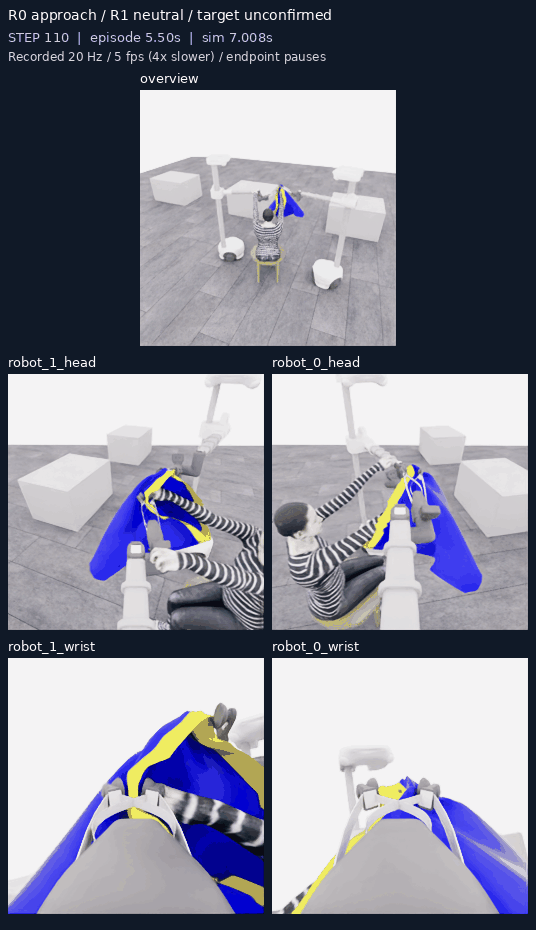

# R0 단독 접근 분기 마감

**사용자의 세션 종료 요청으로 135전이에서 정상 마감했다.** 현재 live HOLD가 아니다. 110전이는 이전 M1 행동 재생이고 새 시연은25전이·9 act·10모델 호출이다. 모델 stop 제안과 최종 종료는 추가 물리 전이 없이 처리했다.

[최종5카메라](../../user-reviews/20261116-astra-right-hand-hold10-001/hold-0002/README.ko.md) · [좌우 식별·복귀 비교·실제 운동 분석](../../reviews/20261116-right-hand-hold10-branch.ko.md) · [복귀와 새 동작을 구분한 GIF](../../../gallery/20261116-right-hand-hold10/README.ko.md)

## 결과와 범위

| 항목 | 확인한 결과 |
|---|---|
| run | `20261116-astra-right-hand-hold10-001` |
| 직접 parent / source group | `20261116-astra-m1-checkpoint-001` / E28 계보 |
| 기록 | 135 = 110 replay + 25 new; 종료 추가 전이0 |
| 새 행동 | 9 act, 10모델 호출; 모든 R1 채널0, R0는 기존 base XY만 명령 |
| 파지점 XY 순변위 | R0 41.57mm / R1 12.66mm |
| 시각 목표 | 오른팔 줄무늬 두 간격 도달·소매 통과 미확인 |
| 로컬 평가 | valid=true, raw0, 착의0, success=false |
| 마감·검사 | simulator0, capture complete, QC135/135·오류0 |
| 학습 승인 | `unreviewed`; 사람 피드백 개입 기록 유지 |

R1에 중립을 명령했어도 실제 위치가 고정되지는 않았다. 같은3전이 구간의 R1 grasp Y가1.018mm에서1.615mm로 다시 커졌으며, 천·접촉·제어 결합 중 원인은 확정하지 않았다. 파지점 이동량을 천의 이동량이나 소매 진입 깊이로 해석하지 않는다.

출발은 동일 초기 근사 slot과 닫힌 parent의 앞110행동을 새 환경에서 재생한 상태다. 기존 HOLD10과 공개 파지점 차이는 R0/R1 약1.86/0.63mm였다. 정확한 물리 되감기나 독립 성공 표본으로 세지 않는다. 실행 소스는 `8c013f3f29e0435cdc56ac1a51523c27d12ebb78`, 종료 시각은 `2026-11-16T04:08:43Z`다.

## 출발 checkpoint와 원본 보존

R0 단독 접근 전에 step110·tick1320에서 checkpoint와 receipt를 저장했고, 저장으로 추가 물리는 진행되지 않았다. 이 새 checkpoint의 **재복원은 아직 검증하지 않았다**. `exact_physics_checkpoint=false`, `restore_validated=false`를 유지한다. [출발 화면](../../user-reviews/20261116-astra-right-hand-hold10-001/hold-0001/README.ko.md) · [저장 검증](../../../gallery/20261116-right-hand-hold10/start-checkpoint-verification.json).

허용 목록의 원본142개 파일과 새 checkpoint pair·start receipt·초기 slot 출처를 보존했다. 비공개 HF 고정 revision `7b432df530a4b7001f3aaa63dea67b9bd6c44ef7`에서304,192,227bytes archive를 강제 재다운로드하여 archive SHA256·144개 manifest 파일의 크기/SHA와 정확한 목록을 모두 검증했다. 원본142개 파일은 재해시에서도 불변이었다. 민감 로그·인증·원시 CLI 기록은 묶음에서 제외했다. [공개 백업 검증 receipt](../../reviews/20261116-right-hand-hold10-backup-verification.json) · [연구용 catalog](../../catalog/README.ko.md).

정상 마감·QC·백업 무결성은 시각 목표 달성이나 학습 승인이 아니다. 이번 세션의 추가 행동은 종료했다.
