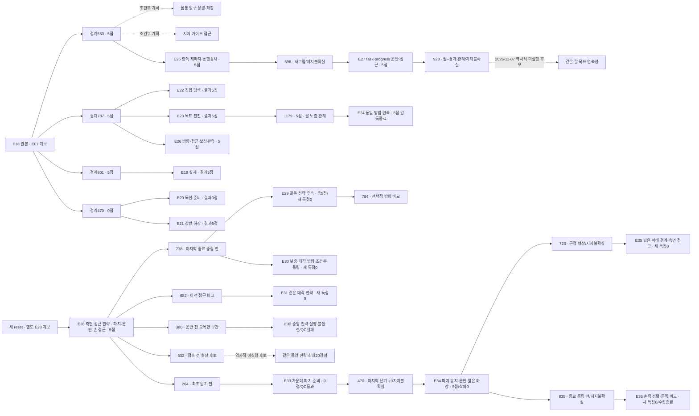

> **보존된 실행 색인.** JSON의 planned 항목은 당시 후보이며 자동 실행 지시가 아닙니다. 과거 E27/928의 same-arm 계획과 새 reset에서 마감한 실제 E28은 별도입니다. 추가 승인으로 E35·E36을 실행한 뒤 E36에서 수집을 종료했습니다. E37–E39는 취소했습니다. [COLLECTION_PLAN](../../COLLECTION_PLAN.md)을 따릅니다.

# 양측 지지 출발점과 5→10점 비교 목록

**색인은 E36 정상 마감과 E09·E32 실패를 함께 포함합니다.** E33은 E28/264, E34는 E33/470, E35·E36은 각각 E34/723·835에서 분기했습니다. E35·E36 모두 QC·공개 시각 검토·고정 백업 검증을 완료했습니다. E36에서 수집을 종료했고 E37–E39는 취소했습니다. E32는758전이 내용 검사가 통과했어도 capture/file incomplete로 전체 QC 실패이며 출발점을 추가하지 않습니다. 진단 백업과 정상 replay 자격을 구분합니다. [현재 상태](../../project/STATUS.md) / [미구현 재정비 계획](../research/2026-11-14-collection-system-redesign.ko.md).

**지지를 유지한 공개 관측 구간을 출발점으로 모으고, 그 뒤 바꾼 방법과 결과를 연결하는 연구용 목록입니다.** [정본 JSON](catalog.v1.json)을 Git에 보존하고, [조회 도구](../../../scripts/startpoint_catalog.py)로 SQLite 색인을 재생성합니다. 기록을 찾는 도구이며 시뮬레이터를 조작하거나 actor 입력을 만들지 않습니다.

현재 목록은 **실제 실행44건, 출발점22개, 방법·입력 설정27종, 조합 시도47건(실제44건·역사적 계획3건)**입니다. 실제는 completed37건·failed7건이며 연결 시험도 포함합니다. 시연으로 분류한33실행은 QC 통과31건·실패2건이며 E번호 전체와 같은 범위가 아닙니다. E34/723·835는 각각 E35·E36의 검토된 출발점입니다. E35·E36 자체의 새 출발점이나 다음 실행 계획은 추가하지 않았습니다. 같은 계보의 경계·분기를 독립 성공 표본으로 세지 않습니다.

QC 통과 시연31건의 기록은24,296전이이며 확인된 ACK replay는16,095전이(66.25%)입니다. 나머지8,201전이는 모델 행동·정착·종료 정리와 replay 메타데이터가 없는3실행을 포함하므로 독립적인 새 전문가 행동 수로 해석하지 않습니다. 불완전 E09·E32는 이 합계에서 제외합니다.

[전체 갤러리](../../gallery/README.ko.md) · [현재 실행](../../project/STATUS.md) · [출발 경계·점수·출처 검토](../research/2026-11-07-support-startpoints-review.ko.md) · [정밀 근거 JSON](../research/2026-11-07-support-startpoints-review.json)

## 보존된 출발점 비교 — 현재 수집 중지

| 출발점 | 그 경계의 점수 | 지지 근거 구간·표본 | 비교할 부분 |
|---|---:|---|---|
| **E28 /738** | **5** | 선택 표본682·714·738 | **E29·E30의 이전 진입 비교점**, 종료 중립739 제외. E29는 같은 전략으로 이어갔지만 새 득점0. 국소 천 동행·손 접근은 관측했으나 입구 정체·소매 통과 미확인. [리뷰](../reviews/20261113-astra-side-hem-fresh-001.ko.md) |
| **E29 /784** | **5** | 현재 실행의738→773→784 | 선택적 방향 변경 상태. history738·773을 새 replay에서 다시 기록. 독립 지지·통과 미확인. [리뷰](../reviews/20261113-astra-side-hem738-continue20-001.ko.md) |
| **E28 /632 — 과거 미실행 후보** | **5** | 공개 표본588·614·632 | 접촉 전 넓은 경계 후보·같은 손 정렬. 현재 replay에서 재확인, 지지/입구 인증 아님. [비교](../research/2026-11-14-e33-central632-direction.ko.md) |
| **E28 /682** | **5** | 이전 관측 후보632·668, 경계682 | **E31 실행: 같은 대각선 전략·최대20결정 비교, 새 득점0.** 같은 E28 계보이며738과 독립 성공 표본 아님 |
| **E28 /380 — E32 비교 이력** | 5 | 기존 근거320→380·추천 새 history264/332 | 들어 올린 입구 후보·차등 높이/손목 조절 비교. 픽업5점은 열린 통로 인증 아님 |
| **E28 /264 — E33 실행** | 0 | 경계264, 새 history242·254 | 닫기 전 가운데 파지 준비. E33에서 양측 순차 재파지를 시험했으나 손 접근·하강은 미실행 |
| **E33 /470 — E34 실행** | 0 | 마지막 닫기454→470; 새 history434·454 | 종료 중립471 전. 후속 동행·운반 검토 출발점이며 당시 지지uncertain. E34는 기존 파지로 운반·짧은 하강,5/50·착의0 |
| **E34 /723 — E35 실행** | 5 | 현재 근접 형상671→697→723; 새 history671·697 | 넓은 아래 자유구간·같은 손목 측면 접근 비교. E35 새 득점0·통과 미확인; 지지uncertain |
| **E34 /835 — E36 실행** | 5 | 짧은 하강·횡보정815→825→835; 새 history787·815 | 현재 형상 보존·같은 손목 정렬 후 몸쪽 진행 비교. E36 새 득점0·지지uncertain. 종료 중립836 제외 |
| **E27 /928** | **미확인** | 790→928, 표본790·842·890·906·928 | **지지uncertain·과거 same-arm 미실행 계획**. 실제 E28은 이 prefix를 사용하지 않음. 새 파지의 실제 운반·팔–노란 간격 관계 뒤 같은 팔 진행 비교. 정확 경계점수를 최종5점에서 복사하지 않음. [근거](../research/2026-11-07-e27-single-arm-continuation.ko.md) |
| **E23 /1179** | **5** | 1077→1179, 표본1077·1099·1121·1143·1161·1179 | E24에서같은방법연속실행·5점마감. 새파지없음·부분복구까지보존 |
| E18 /563 | **5** | 510→563, 표본510·542·563 | E25선택. 테이블지지아래한쪽rim재파지·닫힘후동행검사. 과거양측관측은새현재지지보장아님 |
| E18 /787 | 5 | 563→787, 표본563·641·719·771·787 | 기존 운반을 유지하고 손 접근 방향·관측·진입 순서 비교 |
| E18 /801 | 5 | 위 표본+801 | 첫 설명 밖 roll 이전. E19가 이미 이 출발점에서 named 행동을 시험함 |
| E19 /801 | 5 | 자체801 단일 관측 | 같은 행동의 별도 재실행 결과. 부모의 긴 지지 구간을 이 실행의 검수로 차용하지 않음 |
| E18 /470 | 0 | 자체470 단일 관측, 테이블 지지 혼입 | 기존 준비 상태 대조. **5점 출발점으로 표시하지 않음** |
| E25 /698 | 5 | 657→698, 표본657·667·678·690·698 | **지지불확실**. 원본E25에서는table혼입·운반미시험. 후속E27에서실제운반·접근했으나그결과를E25경계의하중인증으로소급하지않음. [근거](../research/2026-11-07-e25-new-grasp-continuation.ko.md) |

E18의 첫5점 발생은543이지만 D5 행동 도중입니다. 563은 그 뒤 첫 완결된 판단 경계여서 비교 후보로 분리했습니다. 점수는 해당 경계의 tick/raw_points를 별도 검수한 선택 정보입니다. **5점을 받았다는 사실을 양측 파지·입구·통과의 정답으로 사용하지 않습니다.**

위 유지 구간은 선택한 관측의 시각적 근거입니다. 중간 모든 프레임 검수, 독립 하중 지지, 같은 천 층, 미끄러짐 배제를 확인한 것은 아닙니다. 새 실행은 저장된 행동을 재실행하므로 원래 천 상태의 정확한 checkpoint 복원이 아닙니다. 새 현재 관측에서 지지를 다시 확인하고, 준비가 달라지면 그대로 기록합니다.

## 기록의 연결과 분류



- `runs`: 실행 종류·소스 커밋/수정 여부·계보·기록 수·QC·원본 백업. `replay_prefix_steps`는 의도한 길이, `replay_completed_steps`는 응답으로 확인한 재실행 길이입니다. E09처럼 ACK120·실제 부모 행동140이 다를 수 있어 차이를 신규 actor 행동으로 계산하지 않습니다.
- `startpoints`: 직접 출처·경계·추천 과거 관측·양측 지지 근거 구간·불확실성·경계 점수. 점수 미확인과0점을 구분합니다.
- `methods`: 파지 배치·목표 입구·접근·순서·관측·행동 표현의 설정. 이는 전략의 의도이며 실제 재파지 여부는 실행 기록으로 확인합니다.
- `attempts`: 출발점×방법의 실제 또는 명시적 계획. 결과·영상·검토를 연결하고, 미실행 계획에는 점수·성공 결과를 만들지 않습니다.

같은 방법 이름이라도 named/배열·depth 질의 설정을 구분합니다. E18/E19의 가이드 전략에서 실제 새 가이드 재파지는0회였고, E20은 두 목선 후보 재파지를 실행했지만 운반 전에 끝났습니다. 방법 이름을 실제 행동으로 대신하지 않습니다.

`review_ready`는 색인이 확인한 QC 통과·백업 검증·유효 경계를 뜻합니다. 지지 성공·학습 승인·새 실행에서 같은 점수 보장을 뜻하지 않습니다. E27 원본의 고정 백업을 재다운로드해 검증했으므로928의 기술 준비 조건이 갖춰졌습니다. 지지·소매 성공을 뜻하지는 않습니다. `observed_bilateral`도 공개 영상의 양측 지지 가설이며 완전한 물리 검증이 아닙니다. 과거 분기·인접 구간은 `source_group`으로 묶어야 하고, 과거 출발점은 E07 파생 계보이며 새 E28의 다섯 경계는 별도 E28 계보입니다. E28 경계끼리도 상관된 자료입니다. 학습 승인은 계속 `unreviewed`입니다.

## 만들고 찾아보기

저장소 루트에서 실행합니다. Python 표준 라이브러리만 사용하며 외부 원본·평가 파일을 자동으로 열지 않습니다. 정본 JSON을 수정하면 색인을 다시 생성합니다.

```bash
python scripts/startpoint_catalog.py validate
python scripts/startpoint_catalog.py build
python scripts/startpoint_catalog.py validate --db output/indices/startpoint-catalog.sqlite3

# 기술 준비 조건을 만족하고, 5점이며, 양측 지지 관측 근거가 있는 출발점
python scripts/startpoint_catalog.py list startpoints --ready --boundary-score 5 --support-status observed_bilateral

# 같은 계보 안에서 계획/실제 조합과 결과 찾기
python scripts/startpoint_catalog.py matrix --source-group 20261106-coordinated-demo-methods
python scripts/startpoint_catalog.py list attempts --attempt-status planned
python scripts/startpoint_catalog.py list attempts --result-score 5

# 해당 출발점의 근거와 연결된 시도
python scripts/startpoint_catalog.py show startpoints 20261106-astra-guide470-depth-001-p563
```

`--boundary-score`와 `--result-score`는 서로 다릅니다. 미확인 점수는 `--boundary-score-unknown` 또는 `--result-score-unknown`으로 찾습니다. `--run-kind`, `--qc-status`, `--method-status` 필터로 연결 시험·실패·실제 비교 범위를 좁힐 수 있습니다. 목록에 없는 조합을 실행 완료로 생성하지 않으며, E18/563의 조건부 비교 두 건은 아직 dispatch하지 않았습니다. E18/787 진입 탐색은 E22로 완료했고, 같은 경계의 task-progress는 E23로 실행돼5점으로 마감했습니다. E23/1179연속 분기는E24, E25/698연속 분기는E27로 각각5점으로 마감했습니다. E27/928의 같은 팔 진행은 세 번째 역사적 계획 항목이며 그 방법의 실제 run은 없습니다. 실제 E28은 별도 새 reset·측면 접근 전략으로 연결됩니다.

## 과거 시행 계획과 보존

E27은 E25/698 새 파지의 task-progress에서 실제 양측 lift·운반·팔 접근을 수행해5/50·착의0·1159QC로 마감했습니다. 1159=698재실행+334모델 행동+126정착+1예산 마감 중립이며22act·23calls·query1회6valid/물리0,host/Python/sim0입니다. source1ff16b2 clean을 보존합니다. D9/928의 팔–큰 노란 간격 관계, D11의 다른 손 목표 전환, 마지막 D20/D21의 부분 가시성 복구를 구분하며 첫 소매 통과는 인증하지 않습니다. 원본 백업은 고정revision6506b15378417c445bb8e84dbc43990a0c0fd291에서 재다운로드·254member 검증을 마쳤습니다.

**과거 2026-11-07 계획:** 당시 E28 후보로 E27/928·history890/906의 같은 팔 진행을 선택했지만 실행하지 않았습니다. **2026-11-13 실제 E28에는 적용하지 않은 이력**입니다. 24판단/max1600/settle6·named/query/wrist-panel·고정Astra/ultra/timeout180/plan1/review10이며928+24×26+1=1553으로 예산 여유47전이를 둡니다. 새 파지0회·손목 방향 보조 미적용입니다. 새 방법은 격리 전체325CPU와 통합 소스 hash 동일성을 확인했지만 실제 미실행이므로 `proposed`, 계획은 `planned`/`selected_not_started`로 남겼습니다. 다른 E18/563 조건부 계획2건도 유지합니다.

[현재 실행 여부](../../project/STATUS.md) · [E25 새 파지 근거](../research/2026-11-07-e25-new-grasp-continuation.ko.md) · [E27 리뷰](../reviews/20261107-astra-regrasp698-progress-named-001.ko.md) · [과거 same-arm 후보 선택 근거](../research/2026-11-07-e27-single-arm-continuation.ko.md)

정본44실행·22출발점·27방법·47시도(실제44=completed37+failed7,역사적 계획3)를 SQLite와 대조합니다. 기존 도구검사는 [검증 기록](../../project/sessions/20261107-catalog-validation.json)에 보존하며 이번 문서 변경을 새 runtime 검사로 세지 않습니다. 같은 계보·인접프레임은 독립 성공 표본이 아니고 학습 승인은unreviewed입니다.


## E28 마감과 후속 분기

E28은 source `9f797722acdb0f8d35001175e3aaa7e07a8dd2f8`의 clean snapshot에서 시작했습니다. parent와 replay 없이 총739전이(516모델+222정착+1종료중립),40판단·46호출·6회 depth 질의이며, 질의 중 물리는 진행하지 않았습니다. fullQC739/739 통과와 raw5·착의0·success=false를 구분합니다. 첫 픽업은371이며 이는 D20 동작 중간입니다. 380은 후속 실제 판단 경계입니다.

264·380·682·738의 점수는 닫힌 score sample의 해당 physics tick3168·4560·8184·8856에서 각각0·5·5·5를 읽었습니다. 최종 점수를 앞 경계에 복사하지 않았습니다. 지지 라벨은 모두 `uncertain`이며 별도 공개 리뷰의 국소 천 동행을 독립 하중·attachment·정확한 층·소매 통과로 확대하지 않습니다. 738과682의 CPU retry-plan은 원본 해시와 전체 QC를 검증했지만 simulator를 시작하지 않았습니다.

E28 백업은 고정 revision `230c90a5d7abe76216311590f7764a65c19a946d`에서 재다운로드·archive SHA256/크기·402개 member 검증을 마쳤습니다. [백업 receipt](../../project/sessions/20261113-e28-backup-verification.json)를 run에 연결했으며 당시 네 경계와 후속632 후보는 유효한 길이·QC·백업이라는 기술적 `review_ready` 조건을 만족합니다. 지지·통과·학습 승인과는 별개입니다. 후속 실행은 새로운 run ID로 기록하고 즉시 부모·source group·재실행/새 행동/정착 구간을 유지합니다.

## E29 추가 결정의 결과

E29는 E28과 같은 source group이며5점을 새 구간에서 추가한 것이 아니다.738재실행 중371에서 픽업5점을 다시 얻었고, 새 구간96전이(42모델+54정착)에는 추가 득점이 없었다.10 act 뒤11번째 결정은물리 진행 없는 `finish_episode`였고 총12호출에는depth 질의 후속1회가 포함된다.20결정 예산이 소진된 것이 아니다.

784의 점수5는 닫힌 score sample의 정확한 tick9408에서 확인했다. 지지 라벨은 `uncertain`이며 현재784에 제공할 과거 시점738·773도 새 replay에서 다시 기록한다. [E29 백업 receipt](../../project/sessions/20261113-e29-backup-verification.json)의 고정 revision `4a4700539b5abcd8e5e9a0a93a3824916f1ca7e3`에서 archive SHA256/크기·155개 member 검증을 마쳤으므로784도 QC·백업·길이라는 기술 준비 조건을 만족한다. 학습·지지·진입 성공 승인은 아니다. [추가 구간 리뷰](../reviews/20261113-astra-side-hem738-continue20-001.ko.md) / [결정 추가와 방법 변경 검토](../research/2026-11-13-e29-budget-review.ko.md).

## E30 대각선 진입 결과

E30은 E28/738의 같은 source group에서738재실행+87모델+90정착=915전이를 기록했다. 최대20결정 중18 act와 D18 finish로19개를 사용했고20호출에는질의 후속1회가 포함된다. 픽업5점은 replay371에서 얻었고 새177전이·8.85시뮬레이션초의 득점은0이다. 같은 손의 낮춤·방향 변경·올림을 분리했지만 통과는 확인되지 않았다. [공개 리뷰](../reviews/20261113-astra-diagonal738-001.ko.md)와 [결정·시간 분석](../reviews/20261113-decision-budget/E30/README.ko.md)을 연결한다.

[고정 백업 receipt](../../project/sessions/20261113-e30-backup-verification.json)의 revision6b259ab4에서 archive SHA256·크기·227members 검증을 마쳤다. E30/886·915는 진단 자료로만 보존하고 새 startpoint를 만들지 않았다. [E31 계획](../../project/sessions/20261113-e31-plan.ko.md)은 E28/682에서 동일 전략·예산의 출발점 비교다. E31의 마감 run/outcome은 아래 후속 갱신에 추가했다.

## E31 마감과 E32 준비

E31은682재실행+58모델+90정착=830전이,17결정(16act+finish)·19호출(질의후속2회)로 마감했다. 픽업5점은 replay371이고 새148전이·7.4시뮬레이션초의 득점은0이다. 수평 접근·자세 복구 뒤에도 같은 첫 팔 진행은 미확인이다. [공개 리뷰](../reviews/20261113-astra-diagonal682-001.ko.md) / [시간 분석](../reviews/20261113-decision-budget/E31/README.ko.md). 고정9254bf1e의 강제 재다운로드·archive SHA/크기·209members를 [검증](../../project/sessions/20261113-e31-backup-verification.json)했다. 새 E31 startpoint는 만들지 않았다.

E32 준비 시에는 E28/380에서 `coordinated-central-span-entry`를 비교할 proposed 기록이었다. 이후 실제20 act를 수행했으므로 방법은 tested로 갱신했으나 capture 불완전·QC 실패여서 정상 완료나 성능 성공을 뜻하지 않는다. [방법과 검증](../research/2026-11-13-central-span-entry.ko.md)을 보존한다. 추천 history는264/320에서264/332로 갱신했다.264 열린 테이블 준비→332 닫힌 초기 동행→현재380 raised concavity의 맥락을 보며, 기존320–380 근거 창은 유지했다. 새 replay에서 다시 기록해야 하고 현재380 관측이 우선이다. 같은 계보의 기존 점수·지지 가설을 새 현재 상태 인증으로 복사하지 않는다.

## E32 실패 보존과 당시 조건부 후보

E32는380재실행+256모델+120정착+2종료정리=758전이를 기록했으나 capture/두 파일 incomplete로 전체QC 실패다. 방법tested는 실행 사실만 뜻하며 어떤 E32 startpoint도 추가하지 않았다. [공개 리뷰](../reviews/20261113-astra-central380-001.ko.md)와 [진단 백업](../../project/sessions/20261114-e32-backup-verification.json)을 연결한다. 백업무결성 검증이 QC 실패나 replay/training 제외를 바꾸지 않는다.

유효한 E28/632의 공개 표본588/614/632와 정확tick7584의5점을 별도로 검토하고 supportuncertain·history588614로 추가했다. QC739/739·고정 백업을 만족해 기술review_ready이며 입구/독립 하중/진입 성공 인증은 아니다. 당시 사용자의 중지 요청으로632 후보는 미실행 계획으로 보존됐다. 이후 실제 E33은 파지 변경에 맞춰 E28/264에서 시작했으므로 이632 후보와 구분한다. [중지·인계](../../project/sessions/20261114-paused-clean-server-handoff.ko.md).


## E33·E34 마감과 당시 중지

E33은 E28/264·새 history242/254에서 가운데 파지 전략을 실행해20 act·21호출·471전이(264 replay+128 model+78 settle+1 cleanup), QC471/471·0/50으로 마감했다. 양측 각1회 초기 재파지 후 마지막 robot_1 닫기의 후속 이동 검증이 남아 E33/470을 supportuncertain·history434/454·경계점수0으로 추가했다. [E33 리뷰](../reviews/20261114-astra-middle-grip264-001.ko.md)와 [백업 receipt](../../project/sessions/20261114-e33-backup-verification.json)를 연결한다. 고정 revision0a79834c의 archive·236개 manifest 파일 검증을 통과했으며 학습 승인은unreviewed다.

E34는 직접 parent E33/470, source group E28에서 `coordinated-middle-grip-drape-retain`으로20 act·24호출·836전이를 기록했다.836=470 replay+245 model+120 settle+1 cleanup이며 새366전이·18.30시뮬레이션초다. client/simulator0·complete·QC836/836, 로컬5/50·pickup5·착의0·success=false다.5점은 새 구간 픽업에서 발생했고 같은 손목 걸침·소매 통과는 확인하지 못했다. 실제 들기·운반과 D18의약16mm하강, D19의횡방향 보정을 구분한다. 추가 열기 명령은0이지만 retain은 정적 프롬프트 조건이며 런타임 차단·누적 작업 원장 구현이 아니다. [E34 리뷰](../reviews/20261114-astra-middle-grip470-retain-001.ko.md) / [마감 세션](../../project/sessions/20261114-e34-retain-resume.ko.md).

[고정 백업 receipt](../../project/sessions/20261114-e34-backup-verification.json)의 revision `ba71dd6a07e2b05202c3dcaa5b0c9a3c17997b1d`에서 archive1,910,237,869bytes·SHA256·236개 manifest 파일·원본234파일 불변 검증을 완료했다. 정상 수집과 보존 검증은 학습 승인·착의 성공과 별개다. 당시 E34 이후 중지로 E34 startpoint나 E35 planned 조합을 생성하지 않았다. 이후 추가 수집 승인으로 E34/723·835를 검토해 아래 두 실행을 기록했으며, 최신 지시에 따라 E36 뒤 수집을 종료했다. [수집 시스템 재정비 계획](../research/2026-11-14-collection-system-redesign.ko.md)의 구현·학습은 수행하지 않았다.

## E35·E36 마감과 최종 종료

E35는 E34/723·새 history671/697에서 넓은 아래 자유구간과 같은 손목 측면 접근을 비교했다.983=723 replay+158 model+102 settle,19결정(18act+finish)·21호출이며 QC983/983·5/50·착의0·success=false다.5점은 replay26.85초에 얻었고 새260전이·13.00초의 득점은0이다. 손의 새 근접 관계는 관측했으나 손목 걸침·연속 전완 진행·소매 통과는 미확인이다. [리뷰](../reviews/20261114-astra-wide-hem723-001.ko.md) / [검증된 고정 백업](../../project/sessions/20261114-e35-backup-verification.json).

E36은 E35 말단 대신 E34/835·새 history787/815에서 현재 근접 형상을 보존하고 같은 손목 정렬 뒤 몸쪽으로 짧게 이동하는 비교를 수행했다.933=835 replay+50 model+48 settle,11결정(10act+finish)·12호출이며 QC933/933·5/50·착의0·success=false다.5점은 replay26.85초에 얻었고 새98전이·4.90초의 득점은0이다. 직접 진입 시험과 같은 전완의 새 노출은 관측했으나 손이 노란 파지 모서리/housing 곁에 남아 자유 경계 통과·손목 걸침·소매 통과는 미확인이다. [고정 백업 receipt](../../project/sessions/20261114-e36-backup-verification.json)의 revision `dcf059881e4e6c103dc8206438a70eb1b8ccb26f`에서 archive2,119,594,428bytes·SHA·155개 manifest 파일·원본153파일 불변 검증을 완료했다. 새10act의 base yaw는 모두0이므로 정확한 몸 방향 정렬이 달성됐다고 명령만으로 결론 내리지 않는다. [E36 리뷰](../reviews/20261114-astra-wrist-body835-001.ko.md) / [E36 실행 기록](../../project/sessions/20261114-e36-wrist-body.ko.md).

E35·E36은 각각20결정 예산 안에서 자발적으로 finish했고, 남은1개·9개를 합산하거나 다른 run에 이월하지 않는다. 같은 E28 계보로 묶으며 새 근접 변화·정상 QC·백업 무결성을 착의 성공 또는 학습 승인으로 바꾸지 않는다. E36까지 수집을 종료했고 E37–E39는 실행하지 않는다. 후속 키보드 직접 조작·사용자 개입은 계획이며 미구현 handoff를 현재 기능으로 설명하지 않는다.
