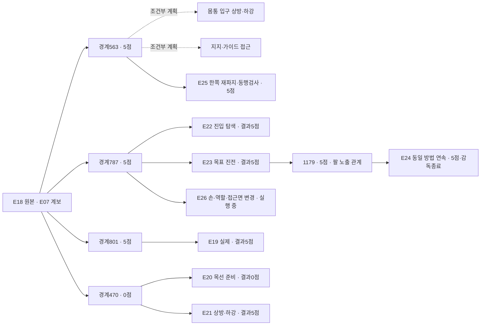

# 양측 지지 출발점과 5→10점 비교 목록

**지지를 유지한 공개 관측 구간을 출발점으로 모으고, 그 뒤 바꾼 방법과 결과를 연결하는 연구용 목록입니다.** [정본 JSON](catalog.v1.json)을 Git에 보존하고, [조회 도구](../../../scripts/startpoint_catalog.py)로 SQLite 색인을 재생성합니다. 기록을 찾는 도구이며 시뮬레이터를 조작하거나 actor 입력을 만들지 않습니다.

현재 목록은 **실제 실행34건, 출발점11개, 방법·입력 설정19종, 조합 시도36건(실제34건·계획2건)**을 연결합니다. 실제는 마감27건·실패6건·진행1건이며 연결 시험·시작 실패도 포함합니다. 출발점 중 기존5개와 E23/1179를 공개 관측으로 검토했으며 나머지는 과거 분기를 찾기 위한 항목입니다. **최신E25는5/50·698/698검사통과·착의0**입니다. 손·전완의 새 노출 관계와 공식 소매 통과는 구분합니다. 같은 계보의 분기를 독립 성공 시연 수로 세지 않습니다.

[전체 갤러리](../../gallery/README.ko.md) · [현재 실행](../../project/STATUS.md) · [출발 경계·점수·출처 검토](../research/2026-11-07-support-startpoints-review.ko.md) · [정밀 근거 JSON](../research/2026-11-07-support-startpoints-review.json)

## 우선 검토할 출발점

| 출발점 | 그 경계의 점수 | 지지 근거 구간·표본 | 비교할 부분 |
|---|---:|---|---|
| **E23 /1179** | **5** | 1077→1179, 표본1077·1099·1121·1143·1161·1179 | E24에서같은방법연속실행·5점마감. 새파지없음·부분복구까지보존 |
| E18 /563 | **5** | 510→563, 표본510·542·563 | E25선택. 테이블지지아래한쪽rim재파지·닫힘후동행검사. 과거양측관측은새현재지지보장아님 |
| E18 /787 | 5 | 563→787, 표본563·641·719·771·787 | 기존 운반을 유지하고 손 접근 방향·관측·진입 순서 비교 |
| E18 /801 | 5 | 위 표본+801 | 첫 설명 밖 roll 이전. E19가 이미 이 출발점에서 named 행동을 시험함 |
| E19 /801 | 5 | 자체801 단일 관측 | 같은 행동의 별도 재실행 결과. 부모의 긴 지지 구간을 이 실행의 검수로 차용하지 않음 |
| E18 /470 | 0 | 자체470 단일 관측, 테이블 지지 혼입 | 기존 준비 상태 대조. **5점 출발점으로 표시하지 않음** |

E18의 첫5점 발생은543이지만 D5 행동 도중입니다. 563은 그 뒤 첫 완결된 판단 경계여서 비교 후보로 분리했습니다. 점수는 해당 경계의 tick/raw_points를 별도 검수한 선택 정보입니다. **5점을 받았다는 사실을 양측 파지·입구·통과의 정답으로 사용하지 않습니다.**

위 유지 구간은 선택한 관측의 시각적 근거입니다. 중간 모든 프레임 검수, 독립 하중 지지, 같은 천 층, 미끄러짐 배제를 확인한 것은 아닙니다. 새 실행은 저장된 행동을 재실행하므로 원래 천 상태의 정확한 checkpoint 복원이 아닙니다. 새 현재 관측에서 지지를 다시 확인하고, 준비가 달라지면 그대로 기록합니다.

## 기록의 연결과 분류



- `runs`: 실행 종류·소스 커밋/수정 여부·계보·기록 수·QC·원본 백업. `replay_prefix_steps`는 의도한 길이, `replay_completed_steps`는 실제 재실행한 길이입니다.
- `startpoints`: 직접 출처·경계·추천 과거 관측·양측 지지 근거 구간·불확실성·경계 점수. 점수 미확인과0점을 구분합니다.
- `methods`: 파지 배치·목표 입구·접근·순서·관측·행동 표현의 설정. 이는 전략의 의도이며 실제 재파지 여부는 실행 기록으로 확인합니다.
- `attempts`: 출발점×방법의 실제 또는 명시적 계획. 결과·영상·검토를 연결하고, 미실행 계획에는 점수·성공 결과를 만들지 않습니다.

같은 방법 이름이라도 named/배열·depth 질의 설정을 구분합니다. E18/E19의 가이드 전략에서 실제 새 가이드 재파지는0회였고, E20은 두 목선 후보 재파지를 실행했지만 운반 전에 끝났습니다. 방법 이름을 실제 행동으로 대신하지 않습니다.

`review_ready`는 색인이 확인한 QC 통과·백업 검증·유효 경계를 뜻합니다. 지지 성공·학습 승인·새 실행에서 같은 점수 보장을 뜻하지 않습니다. `observed_bilateral`도 공개 영상의 양측 지지 가설이며 완전한 물리 검증이 아닙니다. 과거 분기·인접 구간은 `source_group`으로 묶어야 하고, 현재 검수6출발점은 모두 같은 E07 파생 계보입니다. 학습 승인은 계속 `unreviewed`입니다.

## 만들고 찾아보기

저장소 루트에서 실행합니다. Python 표준 라이브러리만 사용하며 외부 원본·평가 파일을 자동으로 열지 않습니다. 정본 JSON을 수정하면 색인을 다시 생성합니다.

```bash
python scripts/startpoint_catalog.py validate
python scripts/startpoint_catalog.py build
python scripts/startpoint_catalog.py validate --db output/indices/startpoint-catalog.sqlite3

# 기술 준비 조건을 만족하고, 5점이며, 양측 지지 관측 근거가 있는 출발점
python scripts/startpoint_catalog.py list startpoints --ready --boundary-score 5 --support-status observed_bilateral

# 같은 계보 안에서 계획/실제 조합과 결과 찾기
python scripts/startpoint_catalog.py matrix --source-group 20261106-coordinated-demo-methods
python scripts/startpoint_catalog.py list attempts --attempt-status planned
python scripts/startpoint_catalog.py list attempts --result-score 5

# 해당 출발점의 근거와 연결된 시도
python scripts/startpoint_catalog.py show startpoints 20261106-astra-guide470-depth-001-p563
```

`--boundary-score`와 `--result-score`는 서로 다릅니다. 미확인 점수는 `--boundary-score-unknown` 또는 `--result-score-unknown`으로 찾습니다. `--run-kind`, `--qc-status`, `--method-status` 필터로 연결 시험·실패·실제 비교 범위를 좁힐 수 있습니다. 목록에 없는 조합을 실행 완료로 생성하지 않으며, E18/563의 조건부 비교 두 건은 아직 dispatch하지 않았습니다. E18/787 진입 탐색은 E22로 완료했고, 같은 경계의 task-progress는 E23로 실행돼5점으로 마감했습니다. E23/1179연속 분기는E24로04:11:53UTC에 실제 시작했습니다.

## 다음 시행과 보존

E25는실제한쪽재파지와국소동행검사뒤5/50·698QC로자율종료했습니다. 반대입구경계는미확인·운반/진입0입니다. E26은E18/787history719771의손/역할/접근면변경을선택했고2026-11-07T05:51:36Z에source53a58bb clean으로실제시작했습니다. 현재재실행중입니다. 실제3축변경을일반비대칭동작과구분합니다. E18/563상방·가이드의조건부계획2건도남겨둡니다. [M2설명](../research/2026-11-07-leading-hand-candidate.ko.md)

실제 시작·재실행 완료·소스·조건·행동·결과·QC·영상·백업을 각각 갱신합니다. 새 관련 관계가 나타나면 다듬고, 충분한 동작에도 관계가 포화되면 파지·접근 구조 전환을 검토합니다. E21 마지막 새 파지는 후속 지지 검사가 없어 검증된 출발점으로 승격하지 않습니다.

목록 도구8365f0d 통합 당시 전용CPU11검사와 정본/SQLite일치 검사를 통과했습니다. [당시 검증 기록](../../project/sessions/20261107-catalog-validation.json). 현재 정본34실행·11출발점·19방법·36시도(계획2·진행1)를 색인과 다시 대조합니다. 이는 새 과제 성과나 학습 승인이 아닙니다. 근거 없는 값은unknown/null로 남기며, training approval은unreviewed입니다.
