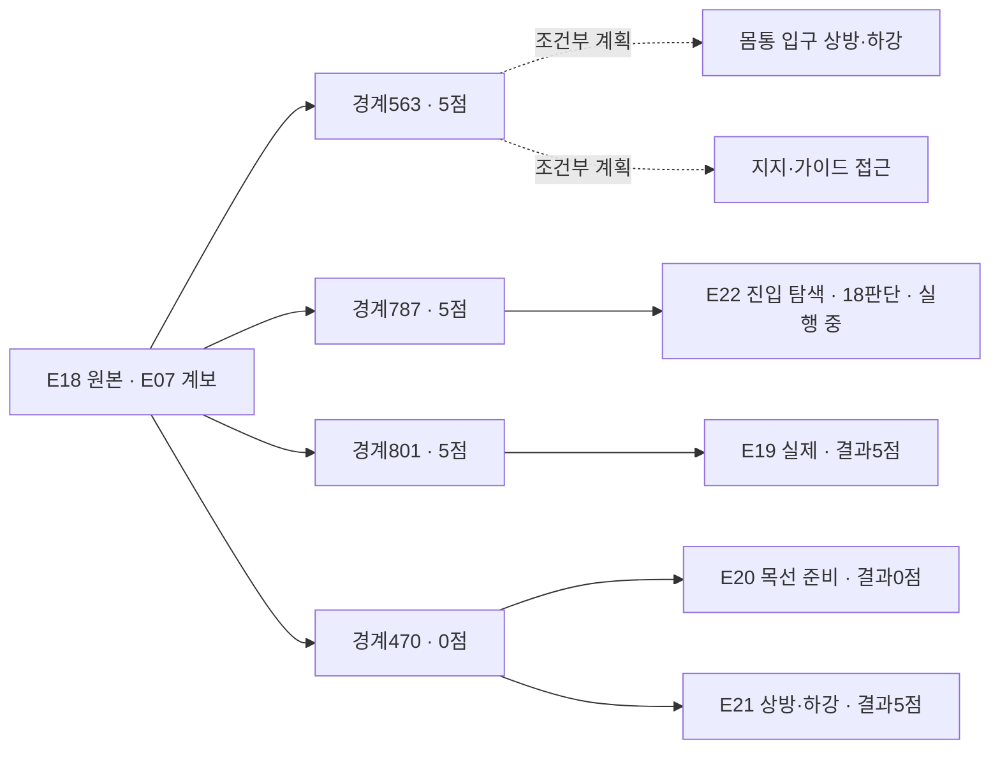

# 양측 지지 출발점과 5→10점 비교 목록

**지지를 유지한 공개 관측 구간을 출발점으로 모으고, 그 뒤 바꾼 방법과 결과를 연결하는 연구용 목록입니다.** [정본 JSON](catalog.v1.json)을 Git에 보존하고, [조회 도구](../../../scripts/startpoint_catalog.py)로 SQLite 색인을 재생성합니다. 기록을 찾는 도구이며 시뮬레이터를 조작하거나 actor 입력을 만들지 않습니다.

현재 목록은 **실제 실행 30건, 출발점 10개, 방법·입력 설정 16종, 조합 시도 32건(실제 30건·계획 2건)**을 연결합니다. 실제 시도는 완료23건·실패6건·진행1건이며 시연뿐 아니라 연결 시험·시작 실패가 들어 있습니다. 출발점 10개 중 아래 5개를 추가 검수했으며 나머지는 과거 분기를 찾기 위한 미검수 항목입니다. **E21은5/50·1111/1111검사 통과로 종료했고, E22는 E18/787·18판단으로03:01:21UTC에 시작해 현재 진행 중**입니다. 이것들을 독립 성공 시연 수로 세지 않습니다.

[전체 갤러리](../../gallery/README.ko.md) · [현재 실행](../../project/STATUS.md) · [출발 경계·점수·출처 검토](../research/2026-11-07-support-startpoints-review.ko.md) · [정밀 근거 JSON](../research/2026-11-07-support-startpoints-review.json)

## 우선 검토할 출발점

| 출발점 | 그 경계의 점수 | 지지 근거 구간·표본 | 비교할 부분 |
|---|---:|---|---|
| **E18 /563** | **5** | 510→563, 표본510·542·563 | 우선 후보. 테이블에서 들어 후퇴한 뒤, 운반 방향·상방 배치·지지/가이드 경로를 바꿔 비교 |
| E18 /787 | 5 | 563→787, 표본563·641·719·771·787 | 기존 운반을 유지하고 손 접근 방향·관측·진입 순서 비교 |
| E18 /801 | 5 | 위 표본+801 | 첫 설명 밖 roll 이전. E19가 이미 이 출발점에서 named 행동을 시험함 |
| E19 /801 | 5 | 자체801 단일 관측 | 같은 행동의 별도 재실행 결과. 부모의 긴 지지 구간을 이 실행의 검수로 차용하지 않음 |
| E18 /470 | 0 | 자체470 단일 관측, 테이블 지지 혼입 | 기존 준비 상태 대조. **5점 출발점으로 표시하지 않음** |

E18의 첫5점 발생은543이지만 D5 행동 도중입니다. 563은 그 뒤 첫 완결된 판단 경계여서 비교 후보로 분리했습니다. 점수는 해당 경계의 tick/raw_points를 별도 검수한 선택 정보입니다. **5점을 받았다는 사실을 양측 파지·입구·통과의 정답으로 사용하지 않습니다.**

위 유지 구간은 선택한 관측의 시각적 근거입니다. 중간 모든 프레임 검수, 독립 하중 지지, 같은 천 층, 미끄러짐 배제를 확인한 것은 아닙니다. 새 실행은 저장된 행동을 재실행하므로 원래 천 상태의 정확한 checkpoint 복원이 아닙니다. 새 현재 관측에서 지지를 다시 확인하고, 준비가 달라지면 그대로 기록합니다.

## 기록의 연결과 분류



- `runs`: 실행 종류·소스 커밋/수정 여부·계보·기록 수·QC·원본 백업. `replay_prefix_steps`는 의도한 길이, `replay_completed_steps`는 실제 재실행한 길이입니다.
- `startpoints`: 직접 출처·경계·추천 과거 관측·양측 지지 근거 구간·불확실성·경계 점수. 점수 미확인과0점을 구분합니다.
- `methods`: 파지 배치·목표 입구·접근·순서·관측·행동 표현의 설정. 이는 전략의 의도이며 실제 재파지 여부는 실행 기록으로 확인합니다.
- `attempts`: 출발점×방법의 실제 또는 명시적 계획. 결과·영상·검토를 연결하고, 미실행 계획에는 점수·성공 결과를 만들지 않습니다.

같은 방법 이름이라도 named/배열·depth 질의 설정을 구분합니다. E18/E19의 가이드 전략에서 실제 새 가이드 재파지는0회였고, E20은 두 목선 후보 재파지를 실행했지만 운반 전에 끝났습니다. 방법 이름을 실제 행동으로 대신하지 않습니다.

`review_ready`는 색인이 확인한 QC 통과·백업 검증·유효 경계를 뜻합니다. 지지 성공·학습 승인·새 실행에서 같은 점수 보장을 뜻하지 않습니다. `observed_bilateral`도 공개 영상의 양측 지지 가설이며 완전한 물리 검증이 아닙니다. 과거 분기·인접 구간은 `source_group`으로 묶어야 하고, 현재 검수5후보는 모두 같은 E07 파생 계보입니다. 학습 승인은 계속 `unreviewed`입니다.

## 만들고 찾아보기

저장소 루트에서 실행합니다. Python 표준 라이브러리만 사용하며 외부 원본·평가 파일을 자동으로 열지 않습니다. 정본 JSON을 수정하면 색인을 다시 생성합니다.

```bash
python scripts/startpoint_catalog.py validate
python scripts/startpoint_catalog.py build
python scripts/startpoint_catalog.py validate --db output/indices/startpoint-catalog.sqlite3

# 기술 준비 조건을 만족하고, 5점이며, 양측 지지 관측 근거가 있는 출발점
python scripts/startpoint_catalog.py list startpoints --ready --boundary-score 5 --support-status observed_bilateral

# 같은 계보 안에서 계획/실제 조합과 결과 찾기
python scripts/startpoint_catalog.py matrix --source-group 20261106-coordinated-demo-methods
python scripts/startpoint_catalog.py list attempts --attempt-status planned
python scripts/startpoint_catalog.py list attempts --result-score 5

# 해당 출발점의 근거와 연결된 시도
python scripts/startpoint_catalog.py show startpoints 20261106-astra-guide470-depth-001-p563
```

`--boundary-score`와 `--result-score`는 서로 다릅니다. 미확인 점수는 `--boundary-score-unknown` 또는 `--result-score-unknown`으로 찾습니다. `--run-kind`, `--qc-status`, `--method-status` 필터로 연결 시험·실패·실제 비교 범위를 좁힐 수 있습니다. 목록에 없는 조합을 실행 완료로 생성하지 않으며, E18/563의 조건부 비교 두 건은 아직 dispatch하지 않았습니다. E18/787 진입 탐색은 E22로 실제 시작했습니다.

## 다음 시행과 보존

E21을 마감했고 다음 E22는 **E18/787의5점 이후 출발점에서 같은 파지를 유지한18판단 진입 탐색**으로03:01:21UTC에 시작했습니다. E18/563의 두 비교는 조건부 계획으로 남깁니다. E21 마지막 새 파지는 유지 검사 없이 종료돼 검증된 출발점으로 승격하지 않습니다. 실행이 시작되면 선택한 출발점·방법, 실제 시작·재실행 완료 여부·소스·조건·부분 행동·최종 결과·QC·영상·백업을 갱신합니다. 미세조정으로 새 관련 관계가 드러나면 계속 다듬고, 충분히 수행해도 관계가 포화되면 접근이나 조작 구조를 바꿉니다.

목록의 최초 구성은 당시 공개 보고서21개와 로컬 attempt 메타데이터23개의 합집합29건을 사용했고, 이후 E21 마감 결과와 E22 계획을 갱신했습니다. 모든 서버 로그나 존재하지 않는 원본까지 복원됐다는 뜻은 아닙니다. 근거가 부족한 QC·백업·지지·결과는 unknown/null로 남깁니다. [실패·복구 카드](../research/2026-11-07-observable-procedure-cards.ko.md)와 [준비 조건 검토](../research/2026-11-07-preparation-gate-review.ko.md)도 함께 참고합니다.

목록 도구8365f0d 통합 당시 전용CPU11검사와 정본/SQLite일치검사를 통과했고 활성 E21 실행파일은 변경하지 않았습니다. 당시 준비조건+양측지지근거+시작5점 검색은4건, 조건부 계획은2건이었습니다. [당시 검증 기록](../../project/sessions/20261107-catalog-validation.json). 현재 정본은30실행·10출발점·16방법·32시도이며 계획2건입니다. E21 마감·E22 시작 반영 뒤 정본 schema/참조 검사를 다시 통과했습니다. 이는 새 시도의 성능 검사나 학습 승인이 아닙니다.

**03:01:21UTC 갱신:** E22가공개소스11faab3·clean에서실제시작했다. 현재30실행=완료23+실패6+진행1,조건부계획2,총32시도다. E18/787진입탐색은계획에서진행중으로전환했고최종결과는아직없다.
