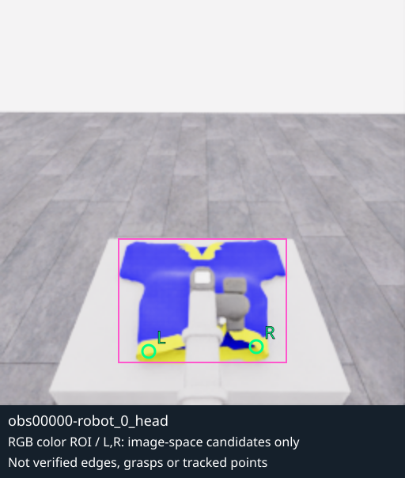
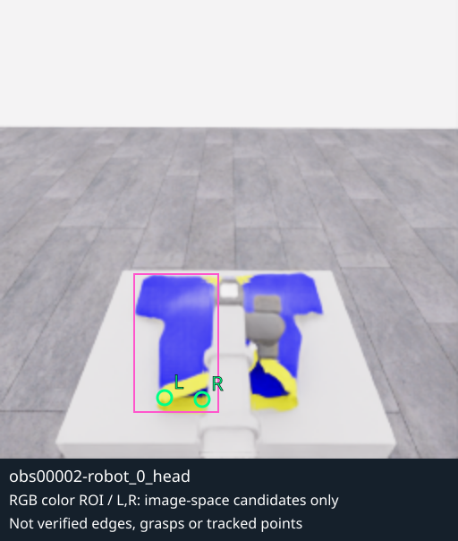
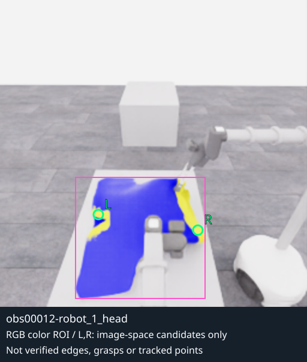

# B1b: 옷 색 영역에서 고른 픽셀과 공개 depth 연결

**실제 옷 색 영역으로 후보 선택을 좁히는 연결은 확인했지만, 가림으로 옷 영역이 나뉘자 두 후보가 같은 조각에 놓이는 실패가 드러났습니다.** B1b는 이 한계까지 보존한 작은 offline 기준선입니다. 색 mask를 옷의 의미·기하 경계나 두 그리퍼의 파지 성공으로 해석하지 않습니다.

[고정 3프레임 결과·후보·불확실성·원본 SHA](../assets/20261106-b1b-color-depth-roi/result.json) · [새 offline 모듈](../../../participant/research/color_depth_roi.py) · [CPU 테스트](../../../tests/test_color_depth_roi.py) · [B1 광축 Z 역투영](2026-11-06-b1-depth-sanity.ko.md)

## 입력과 단순한 색 규칙

종료된 E06 `20261106-astra-dressing-continue-001`의 공개 RGB를 먼저 눈으로 확인하고, 관측 0·2의 `robot_0_head`, 관측 12의 `robot_1_head`를 고정했습니다. 파랑 몸판과 노랑 무늬가 보이는 실제 지정 카메라 3장이며 공식 데모 프레임은 사용하지 않았습니다. 시뮬레이터 asset·material 정답·기하·seed·audit·평가·HDF5도 입력에 쓰지 않았습니다. E07 runtime과 actor 입력은 변경하지 않았습니다.

8bit RGB의 명시적 휴리스틱은 다음과 같습니다. 색 차이는 정수로 바꾼 뒤 계산해 uint8 음수 뺄셈이 돌아가는 오류를 피합니다.

- 파랑: `B≥120`, `B−R≥40`, `B−G≥40`.
- 노랑: `R≥150`, `G≥130`, `B≤120`, `R−B≥70`, `G−B≥60`.
- 파랑·노랑 합집합을 반경 1픽셀 확장한 mask에서 8방향 연결 성분을 찾습니다. 성분 비교와 후보의 실제 색 여부는 원래 mask로 확인합니다.
- 원래 색 픽셀 128개 이상·파랑 64개 이상인 성분 중 가장 큰 하나를 선택합니다. 노랑만 있는 큰 배경은 이 조건을 통과하지 않습니다.
- 노랑이 8픽셀 미만이거나 가로 폭이 4픽셀 미만이면 두 후보를 만들지 않습니다. 충분하면 노랑 u좌표의 10%·90% 위치 주변 ±2열에서 3×3 노랑 이웃이 많은 원래 픽셀을 고릅니다. L/R은 선택한 색 성분 안에서의 영상 좌우입니다.

규칙은 이 영상의 색에 맞춘 **장면 특이적 baseline**입니다. 다른 색 옷, 비슷한 색 배경, 조명 변화에 대한 일반 segmentation 성능은 검증하지 않았습니다. 노랑 무늬 전체가 실제 외곽선인 것도 아니므로 후보는 `colored_band_edge_candidate_unverified`로 기록합니다. 후보 선택 단계는 depth를 보지 않으며, 고른 뒤에만 B1의 공개 depth·내부행렬 연결과 invalid·patch 검사를 적용합니다.

## 실제 세 프레임과 실패 위치

분홍 사각형은 선택된 색 성분의 bounding box, 초록 L/R은 후보 픽셀입니다. 원본 PNG는 그대로 보존했고 SVG 주석만 코드로 생성했습니다. AI 이미지 생성이나 장면 합성은 사용하지 않았습니다.

| 관측 0 · robot 0 head | 관측 2 · robot 0 head |
|---|---|
|  |  |

관측 0에서는 파랑·노랑의 유효 연결 성분이 하나이며 색 픽셀 4,687개를 포함합니다. 관측 2에서는 로봇 팔이 가운데를 가리고 색 mask가 갈라져 유효 성분이 두 개가 됩니다. 가장 큰 성분 규칙은 2,358픽셀의 왼쪽 조각만 선택합니다. 그 결과 L `(92,222)`와 R `(113,223)`이 **둘 다 왼쪽 조각의 노랑 부분**에 놓입니다. 관측 0의 R `(162,219)`와 관측 2의 R은 같은 물리적 옷 점을 추적한 결과가 아닙니다.



관측 12에서는 다른 카메라에서 5,784픽셀의 한 성분이 선택됩니다. 이 영상의 L/R을 앞선 카메라의 후보와 대응시켰다고 주장하지 않습니다. 관절점·천의 같은 정점·봉제선 끝·최적 파지점의 정답을 사용하거나 추정 성공으로 라벨링하지 않았습니다.

## 여섯 후보의 depth 결과

| 관측·카메라 | 후보 (u,v) | 카메라 XYZ (m) | 5×5 patch 깊이 범위 | 처리 |
|---|---|---|---:|---|
| 0 · robot_0_head | L (94,222) | (−0.1749, 0.4835, 0.9402) | 0.0492m | 유효 depth 표본 |
| 0 · robot_0_head | R (162,219) | (0.1761, 0.4713, 0.9468) | 0.0643m | 깊이 차이 주의 |
| 2 · robot_0_head | L (92,222) | (−0.1826, 0.4768, 0.9272) | 0.0630m | 깊이 차이 주의 |
| 2 · robot_0_head | R (113,223) | (−0.0808, 0.5120, 0.9853) | 0.0178m | 유효 depth 표본 |
| 12 · robot_1_head | L (82,179) | (−0.3046, 0.3377, 1.2104) | 0.0326m | 유효 depth 표본 |
| 12 · robot_1_head | R (165,192) | (0.2071, 0.3582, 1.0232) | 0.0350m | 유효 depth 표본 |

6개 중심 픽셀의 depth는 모두 유효했습니다. 그러나 2개는 B1의 patch 깊이 범위 기준을 넘어 `review_required`로 남습니다. 깊이 차이가 실제 물체 경계, 표면 기울기 또는 가림 혼합 중 무엇 때문인지는 이 숫자만으로 확정하지 않습니다. invalid가 나오면 XYZ를 `null`로 두는 동작은 합성 테스트에서 확인했고, 후보를 옮겨 결과를 좋게 만드는 방식으로 숨기지 않습니다.

위 좌표는 **각 카메라의 optical 좌표**이며 세계 좌표나 로봇 제어 목표가 아닙니다. 유효 depth와 정확한 역투영 계산이 있어도 픽셀의 의미·옷 양측 대응·파지 가능성이 잘못될 수 있다는 점을 관측 2가 보여줍니다. 따라서 후보 6개를 성공 파지 6개 또는 두 로봇 지지 성공으로 집계하지 않습니다.

## 검사·비용·다음 적용 경계

CPU 회귀 10개가 통과했습니다. 실제 색 픽셀 선택, 큰 노랑 배경 제외, 잡음·색 부족 시 abstention, 정수 색 차이, mask 확장으로 생긴 배경 픽셀 제외, 가림으로 두 후보가 한 조각에 놓이는 한계, depth와 후보 선택의 독립성, invalid 무보간·depth 경계 표시, 공개 필드·원본 바이트 보존과 덮어쓰기 거부를 검사했습니다.

실제 입력 3장의 읽기·해시·색 연결 성분·6개 역투영·PNG 복사·SVG 생성의 CPU 경과는 **0.0994초**, 모델 호출은 **0회**입니다. 작은 256×256 offline 표본의 비용이며 일반 영상 분할·추적·로봇 행동의 지연이나 성능을 뜻하지 않습니다. SVG는 SDK·네트워크·WebRTC 없이 로컬 정적 브라우저로도 확인했습니다.

```bash
PYTHONPATH=. .venv/bin/python -m unittest discover -s tests -p test_color_depth_roi.py -v
PYTHONPATH=. .venv/bin/python -m participant.research.color_depth_roi \
  --run-id 20261106-astra-dressing-continue-001 \
  --frames 0:robot_0_head 2:robot_0_head 12:robot_1_head \
  --output /tmp/phyrc-b1b-color-depth-new
```

후속 검증의 우선 대상은 **성분이 나뉜 상황에서 두 점이 옷 양쪽을 대표한다는 가정을 거부하고, 이전 영상의 점과 대응하는지 확인하는 과정**입니다. 점 이름 L/R만 유지하는 것은 tracking이 아닙니다. 이 검토와 추가 offline 비교를 거친 뒤에야 정책 관측으로 쓸지를 판단할 수 있습니다. 현재 baseline 결과는 사후 연구 자료이며 실행 중 actor에는 전달하지 않았습니다. 기존 B1 코드와 기록도 수정하지 않았습니다.
