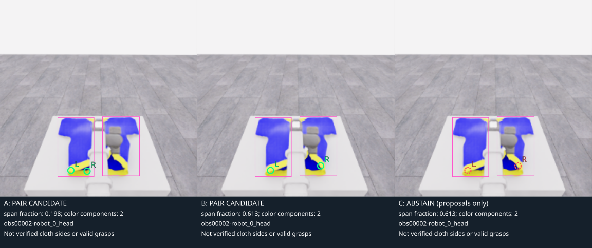
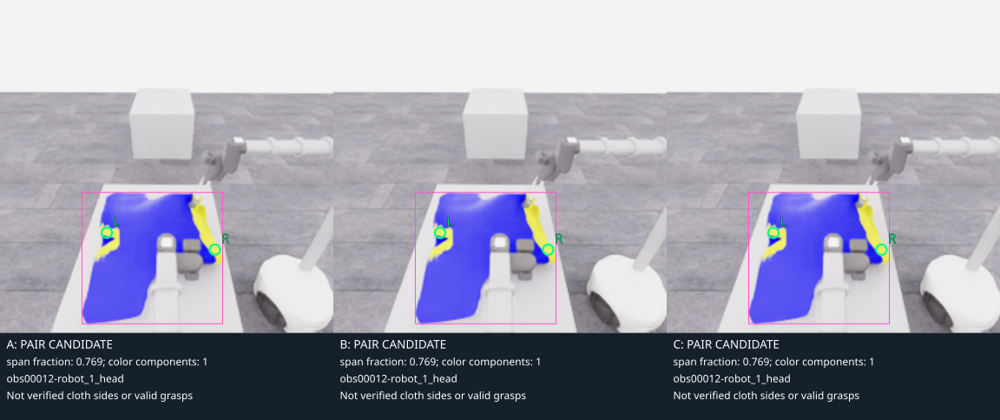
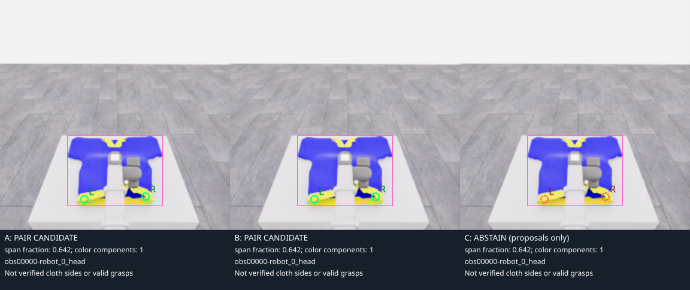
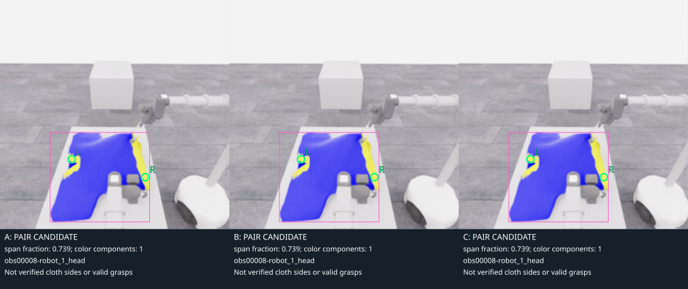
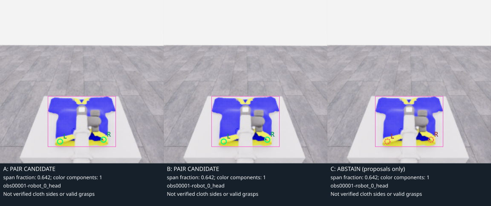

# B1c: 두 후보의 배치 개선과 판단 보류 비교

**화면 배치:** 로봇을 나란히 비교하는 그림은 왼쪽 `robot_1`, 오른쪽 `robot_0`입니다. 카메라 픽셀을 좌우 반전하지 않고 표시 위치만 바꿨습니다. 원본 관측·행동의 로봇 번호와 배열 순서는 그대로입니다.

**기존 obs2의 한 조각 몰림은 B의 색 성분 합집합으로 영상상 분리를 개선했고, C는 남은 모호함 때문에 후보 쌍 출력을 보류했습니다.** 개선된 배치와 유효 파지점 판정은 구분합니다. 기존 B1b의 코드·결과를 그대로 보존하고 새 파일에서 세 방법을 비교했습니다.

[전체 5프레임 결과·후보·보류 이유·원본 SHA](../assets/20261106-b1c-color-pair-comparison/result.json) · [실제 회귀 대조](../assets/20261106-b1c-color-pair-comparison/comparison-checks.json) · [새 비교 모듈](../../../participant/research/color_pair_comparison.py) · [CPU 테스트](../../../tests/test_color_pair_comparison.py) · [기존 B1b 실패](2026-11-06-b1b-color-depth-roi.ko.md)

## 같은 입력에서 무엇을 바꾸었나

입력은 종료된 E06의 공개 RGB-D입니다. 기존 세 장인 관측 0·2의 robot_0_head와 관측 12의 robot_1_head에 관측 1의 robot_0_head, 관측 8의 robot_1_head를 추가했습니다. 다섯 장 모두 같은 에피소드의 상관된 **개발 사례**이며 별도 held-out 정확도 시험이 아닙니다. 공식 데모 프레임, 시뮬레이터 asset·material 정답·기하·seed·audit·평가·HDF5는 사용하지 않았습니다.

| 규칙 | A: 기존 largest-component | B: 성분 합집합·넓은 후보 쌍 | C: component-aware 보류 |
|---|---|---|---|
| 파랑·노랑 RGB 임계값 | 기존 B1b 그대로 | 동일 | 동일 |
| 성분 적격 기준 | 색 128픽셀·파랑 64픽셀 이상 | 동일 | 동일 |
| 후보 선택 | 가장 큰 성분의 노랑 10/90% u좌표 주변·3×3 색 지지 | 적격 성분 전체의 노랑 합집합에 같은 선택 규칙 | B의 제안점부터 검사 |
| 가로 분리 | 노랑 영역 폭 4픽셀 이상 | 추가로 전체 적격 영역 bbox 폭 대비 후보 간격 ≥0.55 | B와 동일 |
| 여러 성분 | 가장 큰 하나 사용 | 전부 합침 | 둘 이상의 성분 의미가 불명확하면 보류 |
| 한 조각에 몰림 | 진단만 기록, 기존 동작 유지 | 전체 폭 대비 좁으면 출력하지 않음 | 다른 성분이 있는데 두 후보가 한 성분에 있으면 보류 |
| depth | B1의 invalid·patch 정보를 기록 | 동일 | 두 후보 중 invalid 또는 patch 주의가 있으면 보류 |

색 임계값은 `B≥120, B−R≥40, B−G≥40`과 `R≥150, G≥130, B≤120, R−B≥70, G−B≥60`으로 바꾸지 않았습니다. 연결용 반경 1픽셀 확장과 8방향 성분 처리도 같습니다. depth의 유효 비율 0.8 및 깊이 범위 `max(0.05m, 0.05×중앙값)` 기준 역시 유지했습니다.

새로운 0.55 기준은 후보가 영상상의 옷 색 영역 절반 이상에 걸쳐 있도록 한 **검증 전 개발 휴리스틱**입니다. 실제 옷 양쪽이라는 학습 정답에서 구한 값이 아닙니다. C가 여러 성분을 모두 보류하는 이유도 두 조각이 같은 옷인지·가림으로 나뉜 것인지 색만으로 확정하지 않기 때문입니다. 보수적인 보류로 유효할 수 있는 후보도 버릴 수 있습니다.

C는 보류 시 `emitted_candidates=[]`로 저장합니다. 검토를 위해 `proposed_candidates`에는 제안점과 depth를 남깁니다. 따라서 빨간 점선 표시는 사용할 점을 승인했다는 뜻이 아닙니다. A/B/C 어느 방법도 semantic edge, 파지 가능한 접힘 또는 두 그리퍼 성공을 승인하지 않습니다.

## 알려진 obs2 실패의 실제 대조



| 방법 | 제안점 L / R | 서로 놓인 성분 | 전체 폭 대비 간격 | 처리 |
|---|---|---|---:|---|
| A | (92,222) / (113,223) | 같은 왼쪽 조각 | 0.198 | 기존처럼 쌍 출력; 실패 보존 |
| B | (95,222) / (160,216) | 서로 다른 두 가시 성분 | 0.613 | 영상상 넓게 분리된 후보 쌍 출력 |
| C | B의 제안점을 검토 | 서로 다른 성분의 의미 미확정 | 0.613 | 출력 보류 |

A의 두 점은 이미지에서 중앙 로봇 팔의 왼쪽에 함께 놓입니다. B는 같은 색 임계값으로 오른쪽 가시 조각까지 후보 선택에 포함해 수평 간격을 21픽셀에서 65픽셀로 늘렸습니다. **이것이 확인된 배치 개선 범위**입니다. 두 점이 같은 옷의 올바른 양측 경계인지, 기존 파지를 방해하지 않는지 또는 그리퍼가 닿을 수 있는지는 확인하지 않았습니다.

C는 `multiple_color_components_semantically_ambiguous`와 양 후보의 `depth_patch_requires_review`를 기록하고 쌍을 내보내지 않았습니다. 알려진 한 조각 몰림을 유효한 두 점으로 전달하는 문제는 이 사례에서 막았지만, 그 대가는 **판단 보류**이며 실제 파지 성공으로 바꾼 것은 아닙니다. 프레임 안의 성분 ID도 임시 ID이므로 다음 프레임의 같은 번호가 같은 옷 조각이라는 보장은 없습니다.

## 다섯 개발 사례 전체 결과

| 표본 | 구분 | 적격 성분 수 | A | B | C와 보류 근거 |
|---|---|---:|---|---|---|
| obs0 · robot_0_head | 기존 | 1 | 쌍 출력 | 쌍 출력 | 보류: R depth patch 주의 |
| obs2 · robot_0_head | 기존 실패 | 2 | 같은 조각의 쌍 출력 | 넓게 분리된 쌍 출력 | 보류: 다중 성분·L/R depth patch 주의 |
| obs12 · robot_1_head | 기존 | 1 | 쌍 출력 | 쌍 출력 | 후보 쌍 출력, 파지 승인 아님 |
| obs1 · robot_0_head | 추가 | 1 | 쌍 출력 | 쌍 출력 | 보류: L/R depth patch 주의 |
| obs8 · robot_1_head | 추가 | 1 | 쌍 출력 | 쌍 출력 | 후보 쌍 출력, 파지 승인 아님 |

A/B는 5건에서 후보 쌍을 내보냈고 C는 2건 출력·3건 보류했습니다. 이는 **출력·보류 개수**이며 정확도나 성공률이 아닙니다. 표에 실패·주의 사례를 모두 포함했습니다. 그림의 초록 원은 쌍을 출력했다는 뜻이고 빨간 점선은 보류된 제안점입니다. 분홍 상자는 비교 문맥의 모든 적격 색 성분을 표시합니다.

| obs12 · 기존 / 후보 출력 | obs0 · 기존 / R depth 주의 |
| --- | --- |
|  |  |

| obs8 · 추가 / 후보 출력 | obs1 · 추가 / 양 후보 depth 주의 |
| --- | --- |
|  |  |

## 검증·과적합 위험·재현

CPU 테스트 8개가 통과했습니다. A가 기존 B1b 후보·depth를 그대로 반환하는지, 가림으로 분리된 합성 사례에서 B는 분리하고 C는 보류하는지, 노랑이 한 조각에만 있는 경우, invalid·depth 경계, 빈 색 영상, 공개 필드·원본 보존과 덮어쓰기 거부를 검사했습니다. 실제 기존 세 장에서도 A의 후보·depth가 보존된 B1b 결과와 정확히 일치했습니다. SVG는 원본 PNG를 그대로 포함하며 코드로 상자·점·판정 글자만 추가했습니다. SDK·WebRTC 없이 로컬 정적 브라우저로 obs2 비교를 확인했습니다.

실제 5프레임의 입력·해시·세 방법 비교·PNG 복사·SVG 생성 CPU 경과는 **0.2438초**, 모델 호출은 **0회**였습니다. B1b의 3프레임 비용과 입력 수·작업량이 다르므로 그 수치를 속도 개선 비율로 비교하지 않습니다.

이번 설계는 이미 본 obs2 실패에 영향을 받았습니다. 같은 에피소드의 가까운 프레임을 추가해도 독립 검증이 되지 않으며 **특정 실패에 맞춘 과적합 위험**이 있습니다. B는 서로 다른 물체의 비슷한 색을 합칠 수 있고, C는 가려졌지만 실제로는 같은 옷인 경우를 과도하게 보류할 수 있습니다. 한 성분으로 연결됐다는 이유만으로 내부 무늬·외곽·접힘을 구분할 수도 없습니다. 다음 검증에는 다른 가림·조명·배경·옷 배치와 사람이 검토한 2D 대응 기준이 필요합니다.

```bash
PYTHONPATH=. .venv/bin/python -m unittest discover -s tests -p test_color_pair_comparison.py -v
PYTHONPATH=. .venv/bin/python -m participant.research.color_pair_comparison \
  --run-id 20261106-astra-dressing-continue-001 \
  --frames 0:robot_0_head 2:robot_0_head 12:robot_1_head 1:robot_0_head 8:robot_1_head \
  --output /tmp/phyrc-b1c-color-pair-new
```

출력은 새 폴더만 허용합니다. 기존 B1/B1b 코드·결과와 수집 원본을 수정하지 않았고, E07 runtime과 actor 입력에도 반영하지 않았습니다. 실제 정책에 사용할지를 판단하기 위한 별도의 offline 비교 기록입니다.
