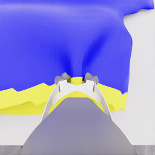
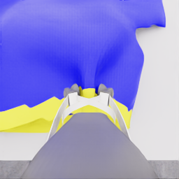
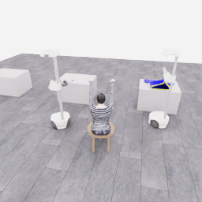

# E06 이어 시도: 첫 세 판단의 공개 관측 검토

**2026-11-06 04:29:02.700703 UTC를 기준으로 관측·결정 0~2만 고정한 중간 검토**입니다. 이후 진행이나 최종 결과를 포함하지 않습니다. [원본 프레임·선별 상태·행동·시간·출처 SHA](../assets/20261106-continuation-public-review/snapshot.json) · [부모 E05 결과](../attempts/20261106-astra-pickup-hold5-001/README.ko.md) · [행동 재실행과 분기 방식](../guides/continuation-and-branches.ko.md)

대상은 `20261106-astra-dressing-continue-001`입니다. E05의 253개 실제 행동을 재실행한 뒤 새 actor가 받은 지정 RGB 5장씩, 공개 로봇 상태와 최종 행동 응답을 검토했습니다. 평가·seed·내부 기하·자유 viewport는 이 시각 분석의 근거로 사용하지 않았으며, 이 문서의 분석을 실행 중 actor에 전달하지 않습니다. HDF5는 열지 않았습니다.

## 소폭 들어 확인한 뒤 지지 파지 접근으로 이동

E05의 마지막 기록은 로봇 0의 기존 그립을 유지하는 중립 행동이었습니다. 새 actor는 그 성공을 당연하게 여기지 않고, 결정 0에서 로봇 0을 조금 들어 천이 손끝을 따라오는지 확인하는 `lift / uncertain` 행동을 선택했습니다. 다음 판단에서는 천이 따라온다는 시각적 가설을 짧은 이유로 남기고 로봇 1의 접근을 시작했습니다.

| 결정 | 입력 공개 시계 | 요청·실행 | 모델 단계·판단 | 확인 범위 |
|---|---:|---|---|---|
| 0 | 14.175초 | 로봇 0 lift +0.15, 4전이·0.20초 | lift / uncertain | 작은 들기 후 새 관측 요청 |
| 1 | 14.375초 | 로봇 0 lift +0.10, 로봇 1 base_left −0.80, 6전이·0.30초 | lift / progressing | 그립 유지와 지지 파지 위치 접근을 병행 |
| 2 | 14.675초 | 로봇 0 중립, 로봇 1 base_forward +0.20·base_left −0.80, 20전이·1.00초 | approach / progressing | 테이블 사이 접근 의도. 이 결정의 실행 후 이미지는 이번 범위에 없음 |

행동 수치는 정규화 속도 명령이며 위치·이동 거리 자체가 아닙니다. 그리퍼 명령 0은 기존 의도 유지입니다. 세 구간의 실행 응답은 전이 253→257→263→283을 기록했습니다. 하지만 관측 2는 **결정 2를 내리기 전** 이미지이므로, 아래 사진에서 확인할 수 있는 신규 물리 진행은 앞선 두 행동의 10전이·0.50초뿐입니다.

## 실제 카메라에서 보이는 것

| E05 종료의 손목 관측 | E06 관측 2: 추가 들기 후 |
|---|---|
|  |  |

로봇 0의 손목 영상에서는 노란 밑단이 손끝 가까이에 남아 있고, 추가 들기 뒤 파란 천의 윤곽과 주름이 달라집니다. 공개 상태에서 관측 0→2의 로봇 0 lift 관절은 약 **6.32cm** 올라갔습니다. 관절 변화는 측정된 로봇 상태이며 옷의 상승 높이나 파지 접촉 자체를 확정하는 값은 아닙니다.

같은 구간에서 로봇 1 베이스의 공개 세계 X 좌표는 약 **−5.07cm** 바뀌었습니다. 로봇 1의 머리·손목 영상은 여전히 빈 테이블과 열린 그리퍼를 보여주며, 공개 그리퍼 닫힘 명령도 로봇 0은 참·로봇 1은 거짓으로 유지됐습니다. 따라서 이 범위에서 확인되는 변화는 **한쪽 들기를 확인하면서 다른 로봇의 지지 파지 접근을 시작한 것**입니다. 두 번째 파지 성공, 테이블에서 완전히 들어 올림, 의자 쪽 운반이나 소매 삽입이 끝났다고 판단하지 않습니다.

## 재실행 동일성과 시간의 한계

E05 종료 PNG와 E06 첫 관측의 5개 카메라는 시각적으로 비슷하지만 픽셀 단위로 동일하지 않습니다. 0~255 채널 값 기준 평균 절대 차이는 카메라별 약 **0.61~1.99**였습니다. 이 수치는 이미지 차이를 재현하기 위한 지표이며 cloth·접촉·물리 상태의 동등성 검사가 아닙니다. 새 actor가 최신 공개 관측에서 다시 확인한 이유와 함께 해석합니다.

첫 세 actor 호출 합계는 **84.295초**, 세 환경 요청·응답 합계는 **33.765초**입니다. actor 시간에는 입력 준비·Docker/CLI·네트워크·서비스 대기와 생성이 함께 들어가며 내부 추론 시간은 별도로 제공되지 않습니다. 실제로 새로 적용된 30전이의 물리 시간 1.50초 및 이 문서 이미지가 덮는 0.50초와 구분합니다. 초기화·253행동 재실행을 포함한 E06 전체 시간이나 최종 성공률은 이 작은 범위에서 산출하지 않습니다.

공개 이미지는 원본 PNG를 그대로 복사했고 SHA256이 일치합니다. 기존 E05 기록을 추가 독립 시연으로 집계하지 않으며, 이번 문서도 종료된 성공 시연의 승인 자료가 아닌 진행 중 고정 분석입니다.
