# E07: 함께 들기·첫 5점·마네킹 방향 운반의 중간 검토

**이후 구간:** [관측 48·700전이의 마네킹 손 근처 운반과 후속 분기 후보](2026-11-06-transport-waypoint.ko.md). 아래 고정 검토의 시각·경계·원본은 그대로 보존합니다.

[첫 5점까지의 단계별 시간·모델 호출 분석](2026-11-06-first5-time-breakdown.ko.md)에서 접근·재파지 과정의 비용을 따로 확인할 수 있습니다.

**두 로봇의 손끝 사이에 옷을 유지하면서 들어 올리고, 회전한 뒤 마네킹 방향으로 함께 이동한 장면을 확인했습니다.** E05의 한 로봇 픽업과 구분되는 의미 있는 협력 구간입니다. 공식 평가기의 첫 픽업 점수는 **5/50점**이며, 이 점수 자체가 양쪽의 안정적인 파지나 착의 성공을 인증하는 것은 아닙니다.

`20261106-astra-coordinated-fresh-001`의 **2026-11-06 05:18:51.347310 UTC 고정 검토**입니다. 완료 관측 25~39, 완료 결정·실행 구간 25~38만 선택했습니다. 마지막 사진은 **전이 경계 530·에피소드 26.50초·공개 관측 시계 28.025001초**입니다. 이후 진행과 최종 평가는 포함하지 않습니다. [선별 상태·행동·시간·원본 SHA](../assets/20261106-coordinated-first5-review/snapshot.json) · [E07 시작 기록](2026-11-06-coordinated-fresh.ko.md) · [갤러리](../../gallery/README.ko.md)

사진은 지정 공개 카메라의 원본 PNG입니다. 시각 검토에는 공개 로봇 상태와 최종 행동 응답만 사용했고, 점수는 별도 검수 메타데이터로 대조했습니다. 실행 중 HDF5를 열지 않았으며 이 분석·점수를 actor에 전달하거나 행동·물리·평가 코드를 바꾸지 않았습니다.

## 함께 들기에서 공동 이동까지

| 고정 관측 | 전이 경계 / 에피소드 시간 | 원본에서 확인한 변화 |
|---|---:|---|
| 25 | 304 / 15.20초 | 양쪽 손목 카메라에서 서로 다른 노란 부분이 각 손끝 가까이에 보임 |
| 27 | 332 / 16.60초 | 양쪽 리프트가 올라가고 overview에서 옷이 테이블보다 높이 들림 |
| 28~29 | 352~360 / 17.60~18.00초 | 함께 후진한 뒤 로봇 1 손목의 큰 회전과 천이 감기는 형태가 나타남. 중간 경계 356에서 공식 첫 5점 |
| 31~34 | 392~430 / 19.60~21.50초 | 로봇 0은 지지 자세를 유지하고 로봇 1은 반대 roll 명령으로 복구. 관측 34에서 roll 관절이 약 0.037rad로 돌아옴 |
| 34~37 | 430~490 / 21.50~24.50초 | 두 손끝 사이 천을 유지하며 두 베이스가 짝을 이루어 회전. 마네킹이 양쪽 머리 카메라 앞에 들어옴 |
| 37~39 | 490~530 / 24.50~26.50초 | 회전 뒤 두 로봇이 함께 전진. 머리 영상의 천과 마네킹, overview와 공개 베이스 위치 변화가 실제 이동을 뒷받침 |

| 관측 25: 들기 진행 | 관측 27: 테이블 위로 올라온 옷 |
|---|---|
| 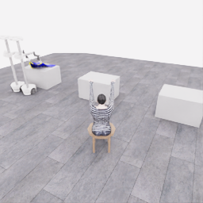 | 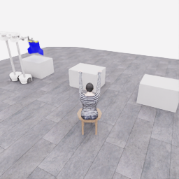 |

| 관측 27: 로봇 0 손목 | 같은 시각: 로봇 1 손목 |
|---|---|
| 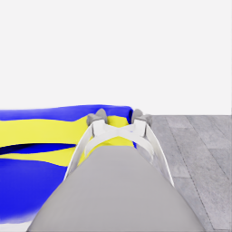 | 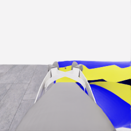 |

두 로봇의 lift 관절은 관측 25→27에서 각각 약 **0.295m** 올라갔습니다. 위 수치는 로봇 관절의 변화이며 천 자체의 높이·접촉력 측정은 아닙니다. 모든 선별 관측에서 두 `gripper_close_command`가 참이지만, 닫기 의도와 실제 파지는 별개입니다. 사진의 천·손끝 관계와 연속 행동을 함께 볼 때 **공동 지지와 들기를 뒷받침하는 시각적 근거**가 있습니다. 정확한 파지 접촉이나 이후까지 지속되는 안정성은 이 자료만으로 확정하지 않습니다.

## 첫 5점의 정확한 경계

검수용 `score_segments.json`의 첫 batch는 **physics tick 4,272 = 전이 경계 356 = 에피소드 17.80초**이며 `pickup: 0→5`, 총점 `0→5`입니다. 초기화 오프셋 약 1.525초를 더한 공개 시계 참조는 19.325초입니다. 실제 관측 시계의 미세한 부동소수점 차이와 구분합니다. 처음 확인한 시각은 **05:12:07.889970 UTC**이며, 득점 이벤트 자체의 실제 UTC는 이 검토에서 확인하지 않아 JSON에 `null`로 남겼습니다.

득점은 결정 28의 **352→360 정지·유지 구간 안**에서 일어났습니다. 이 결정은 결정 27과 한 응답에 포함된 두 번째 고정 행동입니다. `model_invoked=false`이고 원래 모델 입력은 공개 시계 18.125초, 실행 직전 새 관측은 19.125초입니다. **관측 28을 보고 새 모델이 판단한 행동으로 해석하지 않습니다.** 관측 29에서 비로소 다음 모델 호출이 새 모습을 보고 복구를 선택했습니다.

정확한 득점 이미지는 `demo_0/next_obs/overview_rgb[355]`를 참조하도록 색인돼 있지만, 파일이 닫히기 전이어서 읽거나 공개하지 않았습니다. 위 사진은 득점 전후의 모델·실행 경계 사진이며 득점 tick과 동일한 프레임이 아닙니다. 최종 평가 유효성·착의 `success`·전수 기술 검사·학습 승인은 아직 이 고정 검토의 결과가 아닙니다.

## 함께 후진하는 설명에 포함된 손목 roll

결정 27의 짧은 이유는 두 로봇이 높이와 그립을 유지하며 함께 뒤로 이동한다는 내용입니다. 실제 두 번째 로봇 행동은 다음과 같습니다.

```json
[-0.65, 0, 0, 0, 0, 0, 0, 1, 0]
```

공식 계약의 **0부터 시작하는 index 7은 wrist roll**, **index 8은 gripper 명령**입니다. 따라서 로봇 1에는 후진과 함께 `roll=+1`이 20전이·1초 동안 적용됐고, 마지막 `gripper=0`은 이전 닫기 의도를 유지합니다. 손목 회전은 짧은 이유에 설명되지 않았습니다. 이를 의도하지 않은 배열 실수라고 확정하거나 자동으로 고치지는 않았습니다.

| 관측 | 로봇 1 실제 roll 관절 | roll 제어 목표 | 확인 범위 |
|---|---:|---:|---|
| 27 | −0.000728rad | 0rad | 후진·회전 명령 전 |
| 28 | 3.935066rad | 4.276rad | 명령 직후 큰 회전 |
| 29 | 4.217647rad | 4.276rad | 정지·유지 뒤, 약 242° 회전 상태 |
| 31 | 2.346043rad | 2.076rad | 음의 roll 복구 진행 |
| 34 | 0.036557rad | −0.000250rad | 복구·정착 후 중립 근처 |

| 관측 28: 회전 후 감기는 형태 | 관측 31: 반대 회전 복구 중 |
|---|---|
| 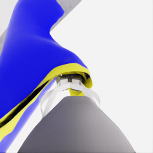 | 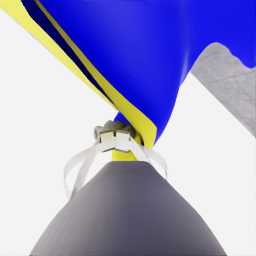 |

원본 영상에서도 로봇 1 손목 주변의 천 방향이 크게 바뀌고 감기는 형태가 보입니다. 모델은 결정 29~32에 음의 roll을 요청하고 결정 33에는 정착을 기다렸습니다. **양의 roll 명령 → 실제 관절 변화·시각 변화 → 반대 roll 복구**는 기록으로 확인할 수 있습니다. 손목 roll이 모든 문제의 유일한 원인인지, 실제 접촉이 얼마나 유지됐는지는 단정하지 않습니다.

다음 쉬운 개선 후보는 모델 응답에서 행동 채널 이름을 명확히 표시하고 이름과 배열 위치의 대응을 검사하는 것입니다. 공식 `(2,9)` 행동과 의미를 유지하는 제안이며, 현재 실행에 새 검증·자동 교정을 적용한 것은 아닙니다.

[별도 명명 행동 변환 시험](2026-11-06-named-action-encoding.ko.md)에서 원본 명령을 바꾸지 않고 채널을 표시하는 도구를 검사했습니다. 실제 모델의 오류 감소·속도와 현재 수집 적용은 아직 확인하지 않았습니다.

## 마네킹 방향 회전과 실제 전진

| 관측 34: 회전 전 로봇 0 머리 | 같은 시각: 로봇 1 머리 |
|---|---|
| 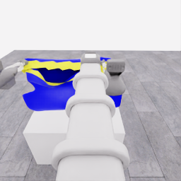 | 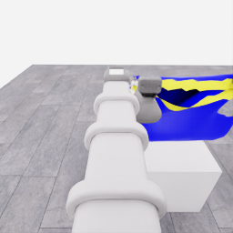 |

| 관측 37: 회전 후 로봇 0 머리 | 같은 시각: 로봇 1 머리 |
|---|---|
| 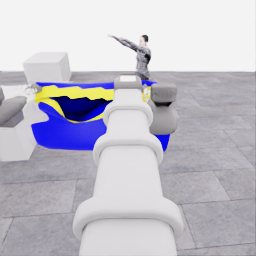 | 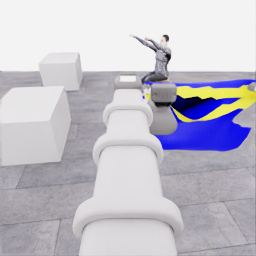 |

결정 34~36은 양쪽 `base_yaw=-0.2`와 서로 반대인 `base_forward=-0.202/+0.202`를 조합해 짝을 회전시켰습니다. 두 머리 카메라에서는 천이 양쪽 손끝 가까이에 남아 있고, 처음 화면 밖에 있던 마네킹이 앞쪽에 나타납니다. 모델의 “양쪽 그립이 안정적”이라는 이유는 모델의 시각 판단으로 보존하며 접촉 정답 라벨로 사용하지 않습니다.

| 관측 39: 전진 후 로봇 0 머리 | 같은 시각: 로봇 1 머리 |
|---|---|
| 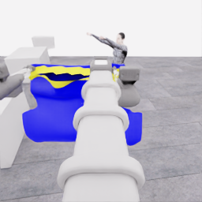 | 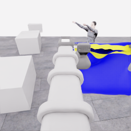 |

| 관측 37: 회전 후 | 관측 39: 40전이·2초 함께 이동 후 |
|---|---|
| 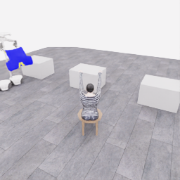 | 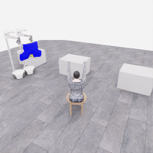 |

결정 37·38은 실제로 **490→510→530**까지 적용됐습니다. 관측 37→39에서 공개 베이스 위치의 수평 시작·끝점 변위는 로봇 0 **0.6453m**, 로봇 1 **0.6775m**입니다. 이는 경로 전체 길이나 마네킹과의 거리 측정이 아닙니다. 두 lift 관절은 약 1.143m에 머물고, 사진에는 두 손끝 사이에서 늘어진 옷과 앞쪽의 마네킹이 함께 보입니다. 따라서 **옷을 함께 지지한 채 마네킹 방향으로 이동한 부분 과정**을 보존할 근거가 있습니다. 마네킹 앞 정렬 완료·소매 삽입·전체 착의 완료를 뜻하지 않습니다.

## 기록의 한계와 보존

원본 PNG 14장과 공개 상태·선별 최종 응답·실제 적용 행동을 보존했습니다. 원본 이미지와 복사본 SHA256이 같고, 늘어나는 JSONL 전체 대신 결정 38의 완료 실행 행까지의 바이트 prefix SHA를 남겼습니다. 숨은 모델 추론·세션 ID·인증·개인 주소·seed·내부 옷 기하는 공개하지 않았습니다.

관측은 모델 판단·실행 경계의 불균일한 간격입니다. 이 PNG들을 20Hz 연속 영상으로 표시하거나 모델 대기 시간을 추정하지 않습니다. 실제 20Hz 영상·득점 정확 프레임·전수 기술 검사는 수집 종료와 파일 닫힘 확인 뒤 별도 결과로 남깁니다. 이번 페이지는 **진행 중 시도의 고정 부분 기록**이며, 독립 성공 시연이나 승인 학습 데이터로 추가 집계하지 않습니다.
