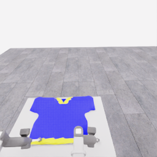
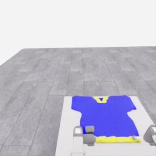
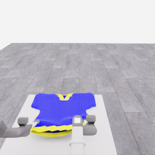
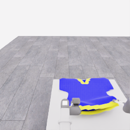
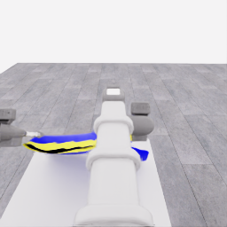
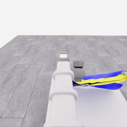

# E15 부분 원인 검토: 첫 다섯 결정에서 층 분리와 시야 가림까지

**초기 들기·기울이기 뒤 가까운 가장자리의 층 분리가 나타났고, 모델은 이를 가능한 입구로 해석해 계속 들어 올렸습니다. 더 큰 상승 뒤에는 팔·천의 가림이 커졌습니다.** 입구의 정체나 양쪽 파지의 독립적 지지를 확정한 결과는 아닙니다.

이 페이지는 `20261106-astra-opening264-001`의 **첫 5개 실행 결정 D0…D4와 각각의 중립 대기까지만 고정한 부분 검토**입니다. 264→325경계의 모델 행동 31전이와 제어기 중립 30전이, 총 61전이·3.05 simulation초를 다룹니다. **E15 최종 결과나 현재 진행 상태를 나타내지 않습니다.** 관측 `00005`는 D4 실행·대기 뒤의 다음 D5 입력 상태라는 뜻이며, 여섯 번째 모델 판단·행동은 검토하지 않았습니다.

출처는 저장된 지정 카메라 PNG·공개 `observation.json`·최종 운영 결정과 적용 행동입니다. 활성 HDF5·audit·평가·장면 내부 상태·모델 추론 원문은 사용하지 않았고 actor에 피드백하지 않았습니다. [관련 연구 방향](../research/2026-11-06-stretch4-astra-directions.ko.md) · [중립 대기의 제어 의미](2026-11-06-move-settle.ko.md)

## 세 시각의 원본 스냅샷

아래는 **연속 영상이 아닌 세 시각의 원본 사진**입니다. 파일은 256×256 PNG를 바이트 그대로 복사했고, 문서 표시 크기만 확대했습니다. 자르기·보간 파일 생성·주석 합성은 하지 않았습니다. 확대해도 원본의 세부 정보가 늘어나지는 않습니다.

**D0 입력 · 관측 00000 · 경계 264 · 공개 시계 14.725000768초.** 테이블 위 넓은 파란 몸판과 가까운 노란 가장자리가 보입니다. 그리퍼 근처에 천이 있다는 사실이나 닫기 의도만으로 파지가 확인되지는 않습니다.

| robot_0_head | robot_1_head |
|---|---|
|  |  |

**D3 입력 · 관측 00003 · 경계 295 · 공개 시계 16.275000849초.** D0의 지지 확인과 D1·D2의 두 보정 뒤입니다. 가까운 노란 가장자리와 위쪽 파란 층 사이에 가는 어두운 띠가 드러납니다. 이는 새롭게 보이는 층 분리이며, 관통 구멍이나 몸통 입구라는 정답은 아닙니다.

| robot_0_head | robot_1_head |
|---|---|
|  |  |

**D5 입력 상태 · 관측 00005 · 경계 325 · 공개 시계 17.775000927초.** D3·D4의 추가 상승 뒤입니다. 특히 D4의 더 큰 상승 뒤 머리 카메라 중앙을 로봇 팔이 크게 가리고, 천은 좁고 겹친 띠처럼 보입니다. 카메라 시야 변화와 천의 접힘이 각각 얼마나 기여했는지는 이 자료만으로 분리하지 못했습니다.

| robot_0_head | robot_1_head |
|---|---|
|  |  |

## 실제 행동과 모델 판단

다음 값은 정규화된 행동 명령이며 실측 이동량과 구분합니다. 모든 D0…D4의 gripper 채널은 0이었고, 각 행동 뒤 모든 채널이 0인 제어기 중립 6전이가 추가됐습니다. 별도의 모델 결정은 아닙니다.

| 결정 | 모델 행동 경계 / 중립 경계 | 두 로봇의 주요 명령 | 모델의 운영 판단 |
|---|---|---|---|
| D0 | 264→268 / 268→274 | lift `0.10 / 0.10`, 4전이 | 파지 미확인, 짧게 들어 각 지지 확인 |
| D1 | 274→278 / 278→284 | lift `0.08 / 0.08`, pitch `−0.15 / −0.15`, 4전이 | 지지 가능성, 첫 형태 보정 |
| D2 | 284→289 / 289→295 | lift `0.14 / 0.08`, pitch `−0.15 / −0.15`, 5전이 | 입구 불명확, 두 번째 형태 보정 |
| D3 | 295→303 / 303→309 | lift `0.22 / 0.22`, 8전이 | 층 분리를 가능한 body-hem opening으로 보고 `progressing` 전환 |
| D4 | 309→319 / 319→325 | lift `0.28 / 0.28`, 10전이 | 입구가 추적된다고 판단해 더 크게 상승 |

**두 번의 보정 제한이 이 구간을 중단시키지는 않았습니다.** 모델은 D3에서 새로운 시각적 진전이 있다고 판단하고 D3·D4의 상승을 실행했습니다. 그 해석이 올바른 의복 위상이라는 증거는 아직 없습니다. 보정·재파지 횟수 제한은 프롬프트 지침이며, 이 실행의 supervisor가 의미를 판정해 강제로 세는 제한이 아닙니다.

## 공개 로봇 수치: 작은 초기 상승과 남아 있는 운동

각 쌍은 **robot0 / robot1**, 단위는 mm입니다. lift는 공개 관절 위치이고 grasp 높이는 **각 로봇 base 좌표에서 grasp frame의 Z**입니다. 천의 높이·손끝 접촉점·테이블과의 간격을 뜻하지 않습니다. 표시는 반올림했습니다.

| 입력 상태 | lift 실측 높이(mm) | grasp의 base 높이(mm) |
|---|---:|---:|
| D0 입력 | 650.134 / 651.087 | 565.640 / 568.135 |
| D3 입력 | 748.347 / 728.055 | 715.832 / 695.531 |
| D5 입력 상태 | 1089.170 / 1066.074 | 1062.222 / 1039.132 |

D0→D3에서 lift 실측 상승은 **98.213 / 76.968mm**, grasp 높이 상승은 **150.192 / 127.395mm**입니다. 함께 변한 손목 pitch 등 때문에 두 높이는 같지 않습니다. 따라서 초기 모습이 낮다는 인상만으로 로봇이 전혀 들지 않았다거나 파지가 실패했다고 단정할 수 없습니다.

D3 입력은 중립 6전이·0.3초 뒤인데도 lift의 `목표−실측` 잔차가 **9.333 / 6.525mm**, 속도가 **44.666 / 30.686mm/s**였습니다. D5 입력 상태에서는 잔차 **19.630 / 19.626mm**, 속도 **95.458 / 96.429mm/s**가 남았습니다. 중립은 기존 목표 추종을 멈추거나 수렴을 보장하지 않습니다. 중립이 없었을 결과나 최적 대기 길이를 이 표본으로 정할 수는 없습니다.

gripper 0도 기존 닫기 의도를 유지했습니다. 공개 닫기 의도는 계속 true였고, grip 목표는 D0 입력 약 0.20225rad에서 다음 관측의 0.103rad로 바뀌며 손가락 닫힘이 이어졌습니다. 이는 새 닫기 명령이나 접촉 검출이 아닙니다. 손가락 위치 차이·`fingertip_origin_distance`도 파지 성공 센서로 해석하지 않습니다.

## 사실·가설·미해결 원인

| 구분 | 이 구간에서 말할 수 있는 내용 |
|---|---|
| 관측 사실 | 각 그리퍼 주변의 천 영역이 상승 뒤에도 보이고, 층 분리가 나타났습니다. 이후 더 큰 상승에서는 팔·천의 가림이 늘었습니다. 공개 관절 상태에는 중립 뒤 잔류 운동이 있습니다. |
| 모델의 해석 | D3는 분리된 윤곽을 가능한 몸통 입구로 받아들였습니다. 이는 최종 운영 판단이지 정답 라벨이 아닙니다. |
| 가능한 원인 | 초기에 충분히 드러나지 않은 입구, 상승에 따른 가시성 상실, 계속된 닫힘과 국소 접힘, 잔류 관절 운동이 함께 영향을 줬을 수 있습니다. 어느 하나를 단독 원인으로 확정하지 않았습니다. |
| 남은 불확실성 | 두 그리퍼가 각각 실제 하중을 지지하는지, 연결된 천이 한쪽 파지만으로 따라오는지, 국소 미끄러짐이 있는지 미확인입니다. 동시 움직임과 두 층의 틈만으로 이를 분리할 수 없습니다. |

**추가 원인 검토에서는 각 지지의 증거, 연속적으로 추적 가능한 입구, 가림의 증가를 별도로 판단해야 합니다.** 닫힌 그리퍼나 더 큰 어두운 틈만으로 지지·입구 통과를 승인하지 않습니다. 이 페이지의 사진은 사람 손이 입구를 통과했다는 증거가 아니며, 부분 검토를 이후 실행의 결론으로 확장하지 않습니다.

## 원본 시각과 SHA256

공개 시계는 reset 뒤 누적 simulation 시계입니다. 위 경계 번호의 20Hz 상대 시간과 원점이 다르므로 `경계/20`으로 시계를 대체하지 않았습니다. D0·D3의 전체 입력 SHA는 최종 운영 결정에서 복사했으며, 이 검토에서 비공개 runtime 프롬프트를 읽어 재계산하지 않았습니다. D5 판단은 검토 범위 밖이므로 그 입력 SHA를 주장하지 않습니다. 아래 PNG는 게시 파일과 원본 파일의 전체 SHA256이 일치합니다.

관측 JSON과 게시 원본 PNG의 전체 SHA256

| 원본 식별 | SHA256 |
|---|---|
| 00000 observation.json | `cc5d4b8913003c784f15766b86a6605292ac6d55653104f3e637015aae5a48f2` |
| [obs00000-robot_0_head.png](../assets/20261106-opening-first-partial-review/obs00000-robot_0_head.png) | `ca3cf286382e03b98088095591397b0d1fb550669901ed244bc35a8391641c5f` |
| [obs00000-robot_1_head.png](../assets/20261106-opening-first-partial-review/obs00000-robot_1_head.png) | `ec37b0580af1fb2283ab5a2c5c74a2265a5d48d910828710678f30c95fa30338` |
| 00003 observation.json | `10f9b918132b67784763496a11f93be744edc4e46c5493919f1003c783079eea` |
| [obs00003-robot_0_head.png](../assets/20261106-opening-first-partial-review/obs00003-robot_0_head.png) | `71005d9ae8b395dcd74b3017270649779ecb54f06da56f12bff7b8b3f810c6ce` |
| [obs00003-robot_1_head.png](../assets/20261106-opening-first-partial-review/obs00003-robot_1_head.png) | `fb5121e4322be55af2b8d755d2241c57d2b350165ffdaeb4dc34fe09aa57c08a` |
| 00005 observation.json | `5c78f0c6facfa6e6d7e13e3d42e3d1ae5d66205f7e56cdc68ff44e368aa4beb5` |
| [obs00005-robot_0_head.png](../assets/20261106-opening-first-partial-review/obs00005-robot_0_head.png) | `81cd5d9dc414b13601acadc4a67df320655fb693be27ea560eb37003f0f98ae8` |
| [obs00005-robot_1_head.png](../assets/20261106-opening-first-partial-review/obs00005-robot_1_head.png) | `9bc6f3caff7edfa6fc946642aadbc43c8a12cc2c4f15f060f8822973b0cecc4f` |

운영 결정의 전체 입력 SHA256:

- D0 입력: `c96883db13355390aef78a9f2bf1ee3b07ab670427825838caefbe843cc98429`
- D3 입력: `74ebbc000153b9705b4dfceb6b52d4951e33ace57c71b7ef53cc9b2cd222d412`

고정된 첫 다섯 결정 검토 수치의 SHA256: `3e075a89392c959f860cf02f215404007338da03c69a7a56cb48ca4038b0f0e8`. 이후 실행 자료와 합치지 않았습니다.

