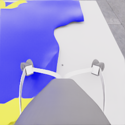
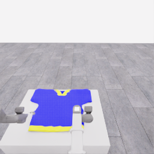
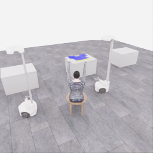
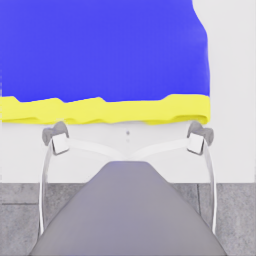
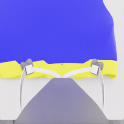
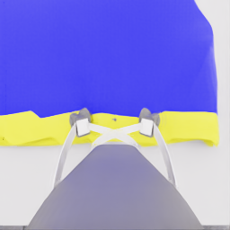

# 공개 관측으로 본 접근·파지 정확도

[방법 비교](2026-11-06-method-comparison.ko.md) · [수집 과정](../README.ko.md) · [이전 시도 기록](../attempts/20261106-astra-dressing-001/README.ko.md)

**검토 기준 시각은 2026-11-06 03:32:11.924777 UTC입니다.** `20261106-astra-pickup-plan2-001`은 이 시점에 실행 중이며, 완료된 결정 0~5와 그 결과인 공개 관측 00006까지만 분석했습니다. 후속 결과를 소급해서 이 시점의 판단 근거로 사용하지 않습니다.

분석 자료는 공개 RGB, 모델에 전달한 depth 요약, 공개 로봇 상태, 최종 행동 JSON과 짧은 행동 설명입니다. 실행 중 HDF5, 평가·검수 자료, 숨긴 물리 형상·접촉·부착 상태를 읽지 않았습니다. 따라서 아래의 시각적 판단은 공식 득점, 접촉, 파지 성공의 확정 판정이 아닙니다. 이 검토에서는 실행 코드·프롬프트·모델을 변경하거나 추가 모델·GPU 실행을 하지 않았습니다.

## 확인된 진전과 아직 구분하기 어려운 것

| 항목 | 이전 `astra-dressing-001` | 현재 `astra-pickup-plan2-001`의 스냅샷 |
|---|---|---|
| 분석 범위 | 완료 결정 0~14, 공개 관측 00000~00015 중 명시한 이미지·상태 | 완료 결정 0~5, 공개 관측 00000~00006 |
| 단계별 행동 | 양팔 접근 → 닫기 → 작은 lift → 재접근·닫기 | 로봇 0 준비 → 접근 → 하강 → 첫 닫기; 로봇 1에는 영벡터 행동 |
| 관측상 진전 | 손가락의 닫힘과 다시 벌어지는 변화가 보임. 모델은 첫 lift 뒤 파지 실패를 추정하고 재시도 | 손목 영상에서 노란 밑단이 손가락 근처로 이동하고, 첫 닫기 뒤 손가락 간 거리가 감소 |
| 아직 확정하지 않은 것 | 실제 접촉·미끄러짐·천 부착 여부와 재시도 실패 원인 | 첫 닫기의 파지 여부, 이후 lift·유지 결과, 최종 점수 |

현재 스냅샷은 6회 모델 호출·6개 적용 구간·82 step, 즉 **4.1 simulation초**입니다. 모델 호출 구간 합계는 245.675초, 환경 요청·응답 구간 합계는 90.646초입니다. 각각 다른 측정 구간이며, 모델 내부 추론 시간이나 순수 물리 계산 시간으로 해석하지 않습니다. 최대 2구간을 허용했지만 이 시점까지는 매번 1구간만 반환했으므로, 현재 과제에서 호출 묶음의 효과가 확인됐다고 볼 수 없습니다.

두 시도는 목표·프롬프트와 초기 화면 구성이 다릅니다. 초기 이미지를 같은 장면의 전후 프레임처럼 비교하거나, 더 적은 결정 수를 정확도 향상의 인과 증거로 사용하지 않습니다.

## 실제 이미지와 상태 근거

이미지는 원본 PNG를 그대로 복사했습니다. 각 이미지의 run·관측 번호·공개 simulation 시각·SHA-256은 [출처 목록](../assets/20261106-public-perception-review/provenance.json)에, 선별한 공개 상태와 최종 행동은 [관측 스냅샷](../assets/20261106-public-perception-review/public-snapshot.json)에 있습니다. 아래 이미지는 육안 검토용이며 목표 달성의 확정 증거가 아닙니다.

| 이전 시도: 닫기 직전 손목, 관측 00008·6.825초 | 이전 시도: 작은 lift 후 head, 관측 00011·8.125초 |
|---|---|
|  |  |

첫 손목 화면에서 손가락·천 경계·테이블이 같은 좁은 영역에 겹칩니다. 뒤의 head 화면에서는 상의가 대부분 테이블에 놓인 모습으로 보입니다. 모델도 결정 11에서 파지 실패를 추정해 재시도했습니다. 이 최종 행동 설명은 모델의 관측 해석이며 접촉·부착 상태의 정답 라벨이 아닙니다.

| 현재 시도: 초기 overview, 관측 00000·1.525초 | 현재 시도: 접근 후 손목, 관측 00003·4.325초 |
|---|---|
|  |  |

| 현재 시도: 닫기 직전, 관측 00005·5.225초 | 현재 시도: 닫기 0.4초 후, 관측 00006·5.625초 |
|---|---|
|  |  |

노란 밑단과 손가락이 영상에서 겹치고, 닫기 이후 손가락 간 거리가 줄어듭니다. 그러나 영상의 겹침만으로 천이 양 접촉면 사이에 들어갔다고 단정할 수 없습니다. 현재 모델의 최종 설명도 닫힘 자체는 파지 확인이 아니며 작은 lift 전 관찰이 필요하다고 구분했습니다.

| 공개 상태: 로봇 0 | simulation 시각 | 닫기 명령 | `fingertip_origin_distance` |
|---|---:|---|---:|
| 이전 관측 00008 | 6.825초 | false | 0.18850 m |
| 이전 관측 00009 | 7.225초 | true | 0.17951 m |
| 이전 관측 00010 | 7.625초 | true | 0.07916 m |
| 이전 관측 00011 | 8.125초 | true | 0.04304 m |
| 현재 관측 00005 | 5.225초 | false | 0.18791 m |
| 현재 관측 00006 | 5.625초 | true | 0.10962 m |

이 값은 **손가락 원점 사이 거리**이며 접촉면의 실제 틈이나 천 두께가 아닙니다. 이전 시도는 닫기 시작 후 1.3 simulation초 동안 거리 값이 크게 변했습니다. 닫기 명령 직후의 짧은 관측만으로 최종 닫힘 상태를 가정하기 어렵다는 근거입니다. 그렇다고 모든 닫기에 1.3초가 필요하다거나, 거리가 줄면 파지가 성공한다는 뜻은 아닙니다. 로봇·접촉 상황에 따라 상태 변화가 다를 수 있습니다.

## 정확도 병목으로 의심되는 세 가지

1. **명령과 실제 상태 변화의 시차.** 현재 출력은 정해진 step 동안 적용할 행동입니다. 명령의 의도, 그동안의 로봇 움직임, 다음 관측에서 확인한 상태를 분리해야 합니다. 닫는 도중의 영상과 안정된 뒤의 영상을 같은 판정 기준으로 쓰면 재시도 시점이 흔들릴 수 있습니다. 다만 이번 자료만으로 이것이 이전 파지 실패의 원인이라고 확정할 수 없습니다.
2. **경계 부근의 깊이 정보 손실.** 모델 입력 depth는 256×256 영상의 각 16×16 pixel 타일에서 유효한 optical-axis Z의 중앙값을 구한 16×16 격자입니다. 손가락·천·테이블이 한 타일에 함께 들어갈 수 있고, 중앙값 하나로 개별 표면을 구분할 수 없습니다. 전체 공개 depth가 별도 보존돼 있어도 모델이 그 원본을 세밀하게 읽고 있다는 뜻은 아닙니다.
3. **파지 확인에서 카메라 움직임과 천 움직임의 혼동 가능성.** 손목 카메라는 팔과 함께 움직이고 손가락이 천을 가립니다. 작은 lift 전후에 천이 화면에서 이동해도 카메라 운동의 영향이 섞입니다. head·overview와 공개 로봇 상태를 함께 확인해야 하며, base가 움직인 경우 head 화면도 고정된 기준으로 취급할 수 없습니다.

## 다음 실험에서 하나씩 바꿀 후보

아래는 제안이며 아직 적용하지 않았습니다. 모델·effort, 관측 카메라, 공식 물리·행동 제한은 유지하고 한 run마다 하나의 변화만 선택합니다. 효과 판정에는 반복 시도와 동일한 비교 조건이 필요합니다.

| 후보 | 한 번에 바꿀 것 | 필요한 검증·기록 | 한계와 비용 |
|---|---|---|---|
| A. 닫기 상태의 시간 문맥 | 모델 입력에 직전·현재의 닫기 명령, 손가락 원점 거리 변화, 경과 simulation초를 명시하는 작은 표를 추가 | 원본 공개 상태와 계산값 일치, 닫기 지속·lift·재시도 판단 시점, 추가 토큰·호출 시간 | 입력 생성 변경과 CPU 검사가 필요. 안정화는 파지 성공이 아니며 고정 절대거리로 성공 판정하지 않음 |
| B. 파지점 주변 depth 해상도 | 기존 전체 격자를 유지하며 RGB로 지정한 작은 ROI에 한해 더 세밀한 depth 요약과 유효값 수·분포를 추가 | RGB pixel과 depth 대응, 단위·결측 처리, ROI가 실제 천 경계를 포함하는지, 입력 크기와 호출 시간 | 공개 RGB-D에서 계산해야 하며 숨긴 segmentation·접촉점 사용 금지. ROI 선택 오류와 손가락 가림은 남음 |
| C. lift 전후 비교 입력 | 닫기 직후와 작은 lift 후의 같은 head 카메라 원본 두 장을 시각·관측 번호와 함께 명시적으로 제시 | base 이동 유무, 공개 손 위치 변화, 천의 관측상 동반 이동/불명확 라벨, 추가 이미지 토큰 | 이미지 쌍 생성·전달 검증 필요. 두 장을 추가한다고 접촉·부착을 확정할 수 없으며 이미 세션에 남은 이미지 대비 추가 효용도 측정해야 함 |

가장 작은 A부터 검토하면 관측 정보의 출처를 유지하면서 상태 해석의 일관성을 볼 수 있습니다. B와 C를 동시에 추가하면 무엇이 효과를 냈는지 구분하기 어렵습니다. 실패·가림·유효 depth 부족은 `unknown`으로 보존하며, actor의 시각 추정과 별도 공식 평가를 같은 라벨로 합치지 않습니다.

이 후보들은 **입력과 판정 방식의 개선**입니다. 공개 관측을 빠르게 읽는 로컬 시각 제어기나 조건부 retry 실행기는 아직 별도 구현·검증이 필요합니다. 모델이 한 번에 여러 행동 구간을 반환하는 것만으로 구간 사이에 새로운 시각 판단이 생기는 것은 아닙니다. 현재 20 Hz 저장 주기를 모델의 시각 피드백 주기로 설명하지 않습니다.

## 참고 연구와 적용 범위

시각 서보는 영상 특징 또는 추정 위치의 오차를 줄이는 피드백 제어를 다룹니다. 카메라 기하, 특징 추적, 도달 가능 영역과 특징을 화면 안에 유지하는 조건이 함께 필요합니다. 이 원리는 파지점 주변 정밀 관측과 후속 로컬 제어기의 연구 방향을 뒷받침하지만, 현재 Astra JSON 행동 경로에 구현돼 있다는 뜻은 아닙니다. [Chaumette·Hutchinson의 원저자 연구 페이지](https://www-cvr.ai.uiuc.edu/ResPages/vs.php)

Haviland 등의 최종 접근 연구는 유효 RGB-D에서 얻은 목표 영상 특징을 이용하고, 근접 구간에서는 RGB 기반 IBVS로 제어합니다. 논문은 평면 물체 운동과 손가락이 물체를 가리지 않는 조건을 가정합니다. 이번 화면에는 천 변형과 손가락 가림이 있으므로 직접적인 성공률·속도 전용은 불가능합니다. 또한 이 시뮬레이터의 depth가 실제 센서의 최소 거리 문제로 실패했다고 확인한 바는 없으며, 여기서 확인한 문제는 모델 입력의 요약과 경계 혼합 가능성입니다. [원 논문: Control of the Final-Phase of Closed-Loop Visual Grasping using Image-Based Visual Servoing](https://arxiv.org/pdf/2001.05650)
