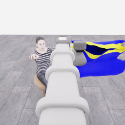
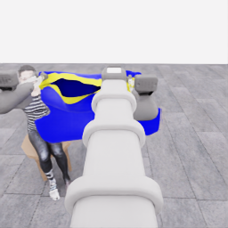

# E07: 마네킹 손 근처 운반 구간과 후속 분기 후보

**화면 배치:** 로봇을 나란히 비교하는 그림은 왼쪽 `robot_1`, 오른쪽 `robot_0`입니다. 카메라 픽셀을 좌우 반전하지 않고 표시 위치만 바꿨습니다. 원본 관측·행동의 로봇 번호와 배열 순서는 그대로입니다.

**두 로봇이 옷을 손끝 사이에 유지한 채 마네킹 손 근처까지 운반한 모습을 보존했습니다.** 아래는 E07 관측 48의 원본 공개 카메라 3장입니다. 소매 통과·최종 정렬·전체 착의 완료는 확인하지 않았습니다.

[선별 기록·원본 SHA·분기 조건](../assets/20261106-transport-waypoint/snapshot.json) · [앞선 첫 5점·공동 운반 검토](2026-11-06-coordinated-first5-review.ko.md) · [수집 목차](../README.ko.md)

| 같은 관측의 로봇 1 머리 카메라 | 같은 관측의 로봇 0 머리 카메라 |
| --- | --- |
|  |  |

파랑·노랑 천이 두 손끝 사이에 남아 있고 마네킹의 손과 상체가 가까이 보입니다. 공개 이미지의 육안 검토이며 내부 천 기하·접촉 정답을 사용하지 않았습니다. 그리퍼와 천의 정확한 접촉, 보이지 않는 소매 내부, 이후 파지 안정성까지 증명하는 사진은 아닙니다. 원본 256×256 PNG를 바꾸지 않고 표시 크기만 늘렸습니다.

| 고정 경계 | 확인한 값 |
|---|---|
| 실행 / 관측 | `20261106-astra-coordinated-fresh-001` / 관측 48 |
| 출처 묶음 | `20261106-coordinated-demo-methods` |
| 직전 완료 행동 | 결정 47: 680→700전이, 실제 20전이 |
| 누적 완료 행동 | 결정 0~47의 48구간, 연속 700전이 |
| 에피소드 경과 / 공개 관측 시계 | 35.00초 / 36.525001904927194초 |
| 경계 검증 | 결정 47의 종료 공개 시계와 관측 48의 시계가 정확히 일치 |
| 검토 기록 UTC | 2026-11-06 05:31:10 UTC. 이미지 촬영 UTC를 뜻하지 않음 |

직전 행동은 두 로봇에 동일한 좌우 이동 채널 `+0.4`와 그리퍼 닫기 명령을 20전이 동안 적용했습니다. 이 한 행동만으로 전체 운반 경로를 설명하지 않으며, 앞선 함께 들기·회전·전진은 별도 중간 검토에 보존했습니다. 관측 48은 다음 행동 실행 전의 경계 사진입니다.

**점수는 사진과 별도로 대조했습니다.** 05:31:10 UTC에 읽은 신뢰된 감시 기록은 승인 경계 740에서 중간 점수 **5/50점**이었습니다. 이는 관측 48의 700전이와 같은 순간에 읽은 평가가 아니므로 해당 사진의 동시점 평가라고 표시하지 않습니다. 최종 평가·전체 착의 성공·종료 후 전수 검사는 아직 이 기록의 결과가 아닙니다.

어떤 자료를 보존했고, 나중에 어떻게 분기할 수 있는가

원본 PNG 3장과 공개 관측 JSON의 SHA256, 완료 `applied_segment` 결정 47 행까지 JSONL 바이트 prefix의 크기·SHA256을 기록했습니다. 뒤에 추가되는 행은 이 해시에 포함하지 않고 원시 JSONL 자체도 공개하지 않습니다. 모델 판단·실행 경계의 이미지이므로 연속 20Hz 영상이나 정확한 득점 프레임으로 표시하지 않습니다. 실행 중 HDF5·숨은 모델 추론·seed·내부 기하는 읽지 않았습니다.

후속 분기 후보는 **원본의 처음 700전이를 같은 신뢰된 초기 배치에서 실제 행동으로 재실행한 뒤 새 공개 관측으로 이어가는 `action_replay`**입니다. 이번에 checkpoint 파일을 만들거나 재실행하지 않았고, 지금 복원 가능한 상태라는 뜻도 아닙니다. `exact_physics_restore=false`를 명시했습니다.

| 분기 전 조건 | 필요한 확인 |
|---|---|
| 원본 마감 | 수집 종료·파일 닫힘·전체 전이 검사·원본 해시 확인 |
| 실제 재실행 | 신뢰된 초기화와 보존된 행동 700전이를 적용하고 새 관측·별도 평가 확인 |
| 상태 차이 | 천·접촉·solver의 정확한 상태 복원을 가정하지 않으며 차이와 실패를 기록 |
| 데이터 집계 | 부모 실행과 같은 source group을 유지하고 중복 prefix를 새 독립 시연으로 집계하지 않음 |
| 정책 경계 | 원본 점수·검수 판단을 actor에 전달하거나 새 실행 점수로 복사하지 않음 |

구체적인 실행은 위 조건을 만족한 뒤 별도 run ID로 남겨야 합니다. 이번 작업은 원본·수집 코드·runtime을 바꾸지 않은 **운반 구간 보존과 후속 분기 후보 기록**입니다. [행동 재실행·분기 가이드](../guides/continuation-and-branches.ko.md)

