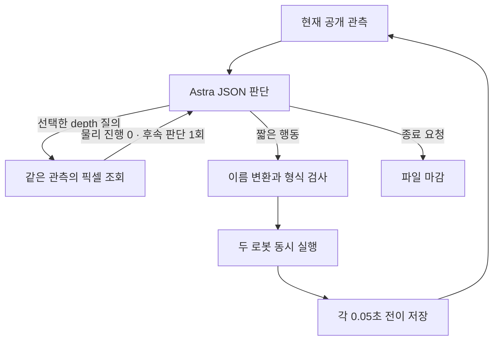

# Astra 자동 시연: 관측에서 검수된 기록까지

[전체 개요](../../../README.md) · [시간순 갤러리](../../gallery/README.ko.md) · [수집 방식 비교](../README.ko.md) · [코드 지도](../../project/CODE_MAP.ko.md) · [현재 상태](../../project/STATUS.md)

**실제 구현의 작동 원리를 설명하는 문서입니다.** 확인 기준은 2026-11-10, 소스 `ae434d08ddd4b384fbc8648bd9cf470e5b201ea5`입니다. 실제 수집은 E27에서 마감했고 E28은 미시작입니다. 아래 설명은 새 GPU 실행이나 자동 재개를 의미하지 않습니다.

## 1. 개발자, 행동 모델, 검수기를 구분한다

GPT는 시뮬레이터를 직접 수정하는 개발 에이전트가 아니라 **허용된 카메라와 로봇 상태를 보고 짧은 행동을 제안하는 시연자**로 사용됩니다. 신뢰된 수집기가 그 제안을 검사하고 실행하며 별도 검수 과정이 결과를 평가합니다.

| 역할 | 하는 일 | 경계 |
|---|---|---|
| 개발·운영 세션 | 코드·환경·예산·기록·복원 관리 | 넓은 개발 권한을 행동 모델에 넘기지 않음 |
| 행동 모델 `gpt-6-astra` | 공개 관측을 읽고 JSON 결정 반환 | 점수·audit·seed·숨은 천 기하·저장소 전체를 받지 않음 |
| 수집기·검수기 | 행동 검사·물리 진행·파일 기록·사후 점수와 QC | 평가 정보를 다음 모델 입력으로 복사하지 않음 |

현재 설정은 **Astra / `ultra`, Codex CLI `0.166.0`, `exec` backend**입니다. Responses API 연결 시험 `gpt_client.py`, 호환성 시험 중 보류한 App Server 경로와 다릅니다. 현재 자동 수집은 Chrome/WebRTC OFF이며 저장된 공개 관측과 갤러리로 검토합니다.

## 2. 한 번의 판단이 돌아가는 흐름



모델을 20Hz로 부르지 않습니다. **한 번 판단하고 짧게 실행한 뒤 새 관측**을 받습니다. 한 판단은 최대20전이의 행동을 요청할 수 있습니다. `plan-size>1`은 고정 행동 목록이지 목록 안에서 새 관측에 반응하는 조건부 제어기는 아닙니다.

## 3. 공개 관측을 만든다

[`prepare_observation()`](https://github.com/leonyoon-3dai/PhyRC_2027_phase1/blob/ae434d08ddd4b384fbc8648bd9cf470e5b201ea5/participant/collection/codex_client.py#L397)은 허용 목록의 필드만 읽습니다.

| 입력 | 런타임 형태 | 모델이 읽는 표현 |
|---|---|---|
| RGB | `(5,256,256,3)` | 지정 카메라 PNG 5장 |
| depth / valid mask | 각각 `(5,256,256,1)` | 기본16×16 중앙값 격자, 선택 손목 패널·픽셀 질의 |
| 관절 위치·속도 | 각각 `(2,13)` | 공개 상태 JSON |
| base / grasp pose | 각각 `(2,7)` | 위치·quaternion. grasp는 각 로봇 base 기준 |
| 제어기 목표·직전 행동 | 각각 `(2,9)` | 목표와 실제 상태를 구분할 정보 |
| 시뮬레이션 시간 | 스칼라 | 현재 관측 시각 |

카메라 순서는 `overview`, `robot_0_wrist`, `robot_1_wrist`, `robot_0_head`, `robot_1_head`입니다. 갤러리의2×2 영상은 머리2개·손목2개를 재배치한 것으로 모델 입력 순서와 다릅니다.

원본 공개 depth·유효 마스크는 재현용 NPZ에도 보존합니다. 격자 한 칸은16×16픽셀의 유효 광축 깊이 Z 중앙값이며, 손이나 입구의 좌표 정답이 아닙니다. 손목 depth 패널도 가려진 표면을 복원하지 않습니다.

## 4. 행동 세션에 필요한 자료만 전달한다

[`Actor.invoke()`](https://github.com/leonyoon-3dai/PhyRC_2027_phase1/blob/ae434d08ddd4b384fbc8648bd9cf470e5b201ea5/participant/collection/codex_actor.py#L305)은 공개 입력·이미지·응답 schema를 turn별로 준비합니다. PNG는 픽셀로 다시 만들어 원래 파일명·메타데이터를 전달하지 않습니다.

- 별도 Docker 파일시스템·내부 네트워크와 제한된 송신 프록시를 사용합니다.
- 호스트 저장소·평가 디렉터리·시뮬레이터 핸들을 actor에 마운트하지 않습니다.
- CLI에서 웹 검색·개발 도구 사용을 비활성화하고, 응답 이벤트에 도구 실행이 나타나면 행동을 거부합니다. 프롬프트만으로 격리했다고 설명하지 않습니다.
- 같은 episode 안에서는 CLI `resume`으로 이전 관측·행동 문맥을 이어갑니다. 다른 실험의 기억을 자동 공유하는 설계는 아닙니다.

코드: [`_provision()`](https://github.com/leonyoon-3dai/PhyRC_2027_phase1/blob/ae434d08ddd4b384fbc8648bd9cf470e5b201ea5/participant/collection/codex_actor.py#L240), [`_cli()`](https://github.com/leonyoon-3dai/PhyRC_2027_phase1/blob/ae434d08ddd4b384fbc8648bd9cf470e5b201ea5/participant/collection/codex_actor.py#L265), [`_read_result()`](https://github.com/leonyoon-3dai/PhyRC_2027_phase1/blob/ae434d08ddd4b384fbc8648bd9cf470e5b201ea5/participant/collection/codex_actor.py#L87).

원시 CLI reasoning·events·인증·세션 DB는 공개하지 않습니다. 공개 자료는 선별된 프롬프트·최종 결정·실제 적용 행동·요약 수치입니다.

## 5. 모델이 짧은 JSON 결정을 낸다

| 필드 | 의미 | 해석 주의 |
|---|---|---|
| `tool` | 기본 `act`, `stop`, `finish_episode`; 질의 옵션에서 `depth_query` 확장 | 종료 요청과 착의 성공은 별개 |
| `action` | 두 로봇의 정규화 명령 | 위치·cm·각도 차이가 아니라 속도 비율 |
| `steps` | 같은 명령을 실행할 전이 수1–20 | 10이면 로봇 시간0.5초 |
| `stage` | 모델이 의도한 작업 단계 | `first_sleeve`라고 써도 소매 득점은 아님 |
| `visual_assessment` | 시각적 진행·가림·복구 판단 | 공식 평가 label이 아님 |
| `reason` | 짧은 운영상 이유 | 측정 성공이나 원시 추론 로그가 아님 |

모델이 판단하는 동안 물리는 진행하지 않으며 이전 명령을 계속 적용하지 않습니다. 판단 수·전이 수·호출 시간·중단 예산은 따로 기록합니다.

### E18 이후: 현재 픽셀의 깊이를 질의

E18부터 실제 과제에서 [`depth_query.py`](https://github.com/leonyoon-3dai/PhyRC_2027_phase1/blob/ae434d08ddd4b384fbc8648bd9cf470e5b201ea5/participant/collection/depth_query.py)를 사용했습니다. `freeze_public_frame()`이 현재 공개 depth·mask·정적 카메라 K·출처 해시를 고정합니다.

1. 한 관측에서 한 번, 같은 카메라의 최대8개 `[u,v]`를 요청합니다.
2. `depth_query`의0행동 placeholder는 실행하지 않습니다.
3. `lookup()`이 광축 Z와 선택 camera XYZ/range를 반환합니다. invalid는 `null`입니다.
4. 물리는0전이 진행하며 같은 장면으로 모델을 한 번 더 호출합니다. 후속 응답은 원래 행동 schema이고 두 번째 질의는 금지합니다.

`XYZ = Z × inverse(K) × [u,v,1]`은 보이는 표면의 역투영입니다. 손의 정체·실제 입구·숨은 면·접촉·소매 통과를 알려주지 않습니다. 다른 카메라나 다른 시각의 Z를 그대로 빼지 않습니다. 질의는 물리0이어도 추가 모델 왕복 시간을 사용합니다.

### E19 이후: 배열 대신 이름으로 행동 표현

E18에서는 전진 설명에 없는 `wrist_roll=1`이 실행된 사건이 있었습니다. E19부터 실제 비교한 [`named_actions.pack()`](https://github.com/leonyoon-3dai/PhyRC_2027_phase1/blob/ae434d08ddd4b384fbc8648bd9cf470e5b201ea5/participant/collection/named_actions.py#L48)은 각 값을 명령 이름으로 받습니다.

```python
# 구조 설명용 예시이며 실제 시연의 정답 행동이 아닙니다.
from participant.collection.named_actions import CHANNELS, ROBOTS, pack

named = {robot: {name: 0.0 for name in CHANNELS} for robot in ROBOTS}
named['robot_0']['lift'] = 0.03
named['robot_1']['gripper'] = 1.0
rows = pack(named)  # 같은 값을 고정 순서의 2×9 배열로 재배열
```

이름·누락·숫자·유한값·범위를 검사하지만 clipping·속도 보정·의도 추측·IK는 하지 않습니다. raw named action과 mapping SHA를 보존하고 정규 배열과 대조합니다.

## 6. 공식 행동 계약을 검사하고 두 로봇을 움직인다

[`validate_decision()`](https://github.com/leonyoon-3dai/PhyRC_2027_phase1/blob/ae434d08ddd4b384fbc8648bd9cf470e5b201ea5/participant/collection/codex_client.py#L362)과 [`validate_action()`](https://github.com/leonyoon-3dai/PhyRC_2027_phase1/blob/ae434d08ddd4b384fbc8648bd9cf470e5b201ea5/participant/collection/boundary.py#L20)이 schema·행열·유한값·범위·steps를 검사합니다. `stop`·`finish_episode` 응답은0행동·steps1이어야 합니다.

| 열 | 명령 | 양의 방향 |
|---:|---|---|
| 0 | `base_forward` | 로봇 앞 |
| 1 | `base_left` | 로봇 왼쪽 |
| 2 | `base_CCW_yaw` | 위에서 보아 반시계 |
| 3 | `lift` | 위 |
| 4 | `arm_extension` | 팔 뻗기 |
| 5–7 | `wrist_yaw`, `wrist_pitch`, `wrist_roll` | 공식 관절 방향·action scale 참조 |
| 8 | `gripper` | `>0.5`닫기, `<−0.5`열기, 중간은 이전 의도 유지 |

최종 배열은 `float32 (2,9)`, 행0=robot_0·행1=robot_1입니다. 두 로봇은 같은 전이에서 함께 실행됩니다.

[`Simulator.dispatch()`](https://github.com/leonyoon-3dai/PhyRC_2027_phase1/blob/ae434d08ddd4b384fbc8648bd9cf470e5b201ea5/participant/collection/codex_client.py#L532)가 JSON Lines 요청을 별도 `collect_operator.py` 프로세스로 보냅니다. [`Operator.act()`](https://github.com/leonyoon-3dai/PhyRC_2027_phase1/blob/ae434d08ddd4b384fbc8648bd9cf470e5b201ea5/participant/collection/boundary.py#L62)는 각 step마다 `env.step()`과 `writer.append()`를 수행합니다.

```python
# boundary.py의 핵심을 축약한 의사코드
for _ in range(steps):
    before = current_public_observation
    after = env.step(action)  # 로봇 시간0.05초
    writer.append(before, action, after, start_tick=tick, end_tick=tick + 12)
    tick += 12
```

[`DressingEnv.step()`](https://github.com/leonyoon-3dai/PhyRC_2027_phase1/blob/ae434d08ddd4b384fbc8648bd9cf470e5b201ea5/src/PhyRC_Sim/Policy/environment.py#L268)은 한20Hz step에서60Hz 제어3회를 진행합니다. 한 전이는240Hz 물리12tick·0.05로봇초입니다.

| 단위 | 예 | 구분 |
|---|---|---|
| 모델 호출 | 깊이 질의+행동 후속 | 호출2회가 행동2개는 아님 |
| 행동 결정 | 같은 명령으로10steps | 결정1개가 전이10개일 수 있음 |
| 전이 | obs→action→next_obs | 독립 시연이나 episode1개가 아님 |
| 미리보기 |20Hz 자료를5fps로 재생 |4배 느린 영상, 모델 대기 시간 제외 |

선택한 `--post-action-settle-steps 6`은 움직임 뒤 중립6전이=0.3로봇초입니다. `action_source=controller_settle`로 모델 행동과 구분합니다.0명령이어도 기존 목표까지의 실제 관절 운동·닫힘·천 움직임이 남을 수 있습니다.

## 7. HDF5를 마감하고 전수 QC한다

[`DatasetWriter.append()`](https://github.com/leonyoon-3dai/PhyRC_2027_phase1/blob/ae434d08ddd4b384fbc8648bd9cf470e5b201ea5/src/PhyRC_Sim/Policy/training_dataset.py#L87)은 인접tick 연속·전이당12tick·시간차0.05초·`next_obs.previous_action` 일치·schema·shape·dtype를 검사한 뒤 추가하고 flush합니다. 런타임2×9는 HDF5에서18개로 펼쳐집니다.

| 파일·경로 | 내용 |
|---|---|
| `policy.hdf5`의 `data/demo_0/obs` | 카메라별 RGB-D·공개 상태 |
| `data/demo_0/actions` | `(N,18)` 실제 적용 행동 |
| `data/demo_0/next_obs` | 각 행동 뒤 공개 관측 |
| `rewards`, `dones` | 기본 reward0, 끝 표식. 점수·성공 flag가 아님 |
| 별도 `audit.hdf5`·평가 자료 | tick·검수·공식 결과. actor 입력 밖 |
| `capture.json`, `validation.json` | 파일 마감·해시·전수 검사 |

[`validate_capture()`](https://github.com/leonyoon-3dai/PhyRC_2027_phase1/blob/ae434d08ddd4b384fbc8648bd9cf470e5b201ea5/participant/collection/validate_capture.py#L169)은 Isaac 없이 닫힌 파일 전체를 읽습니다. `quality_passed=true`여도 `training_approval=unreviewed`입니다.

## 8. 결과를 별도로 검토하고 공개 자료를 만든다

**파일 QC, 공식 과제 결과, 실제 영상 해석, 학습 승인**은 각각 확인합니다. E27은1,159/1,159 전이가 검사 통과했지만 raw5·착의0·success=false·unreviewed입니다.

| 질문 | 근거 |
|---|---|
| 명령이 실제 실행됐나? | 최종 결정·적용 구간·실제/목표 상태 |
| 옷이 따라왔나? | 동작 전후 여러 카메라·지지 조건 |
| 소매를 통과했나? | 같은 손·경계의 연속 관측과 공식 득점 |
| 다음에는 무엇을 바꾸나? | 확인·가설·미확인을 나눈 review |
| 정답 행동으로 학습시킬까? | 좋은 동작·오류·복구를 구간별 별도 승인 |

[`export_report.py`](https://github.com/leonyoon-3dai/PhyRC_2027_phase1/blob/ae434d08ddd4b384fbc8648bd9cf470e5b201ea5/participant/collection/export_report.py#L875)는 허용된 최종 결정·평가 요약·선별 이미지를 공개 패키지로 만듭니다. 큰 원본·audit·인증·원시 CLI 로그는 GitHub 공개 대상이 아닙니다.

## 9. 백업과 다음 분기를 연결한다

닫힌 원본은 [`preserve_collection.py`](https://github.com/leonyoon-3dai/PhyRC_2027_phase1/blob/ae434d08ddd4b384fbc8648bd9cf470e5b201ea5/scripts/preserve_collection.py#L179)의 허용 목록으로 보존합니다. 실행 코드·프롬프트·CLI·모델·설정·원본 해시·고정 revision과 재다운로드 검사 여부를 연결합니다.

[`load_replay_prefix()`](https://github.com/leonyoon-3dai/PhyRC_2027_phase1/blob/ae434d08ddd4b384fbc8648bd9cf470e5b201ea5/participant/collection/continuation.py#L129)는 완결 원본의 전수 QC·SHA를 검사한 뒤 과거 공개 행동을 읽습니다. **새 환경에서 행동을 다시 실행하는 것이며 정확한 천 상태 checkpoint 복원이 아닙니다.** 새 관측·새 점수를 확인하고 부모·prefix·새 전이를 기록합니다.

| E27 구간 | 전이 | 로봇 시간 |
|---|---:|---:|
| E25 행동 재실행 |698|34.90초|
| 새 모델 행동 |334|16.70초|
| 자동 중립 정착 |126|6.30초|
| 예산 종료 정리 |1|0.05초|
| 전체 |1,159|57.95초|

새 suffix는461전이·23.05초입니다.1,159개 전체를 새 전문가 행동으로 세지 않습니다.

## 10. 시간 비용과 정책 학습 전환

E27의 wall time은40분50.624초, 모델 호출 경로 약1,348.906초·환경 요청 경로 약1,046.466초였습니다. 모델 경로에는 입력 준비·Docker/CLI·세션 로드·통신·서비스 대기·생성이 섞여 있어 **순수 추론시간**이 아닙니다. 환경도 재실행·관측·렌더·저장을 포함하며 물리 계산만의 시간이 아닙니다. 공식 평가의900초 예산·점수율은 별도 정의입니다.

현재 π0.5 어댑터는 overview·양 손목 RGB3와 state32를 사용합니다. Astra의 RGB5·depth·문맥에서 행동 근거가 무엇이었고 학생도 이를 볼 수 있는지 검토해야 합니다. `data.py`의 승인 gate는 초기 시험용 `approved_pipeline_test`이며 새 자동 시연으로 baseline을 학습·평가한 결과는 없습니다.

다음은 **prefix 중복 관리 → 좋은 행동·오류·복구 분리 → source_group별 분할 → 교사·학생 입력 차이 검토 → 작은 하위 기술 학습·평가** 순서입니다.63 scripted 전이·30 updates는 과거 연결 시험이며 새 착의 능력의 성과가 아닙니다.

[기술 발표 순서](../../project/PRESENTATION.ko.md) · [장면으로 다시 보기](../../gallery/README.ko.md) · [함수·폴더 지도](../../project/CODE_MAP.ko.md) · [재실행·분기](continuation-and-branches.ko.md)
