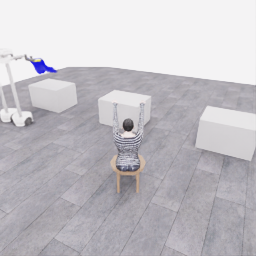
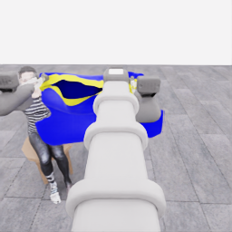
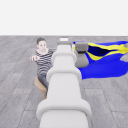

# E07: 첫 5점 경계와 이후 마네킹 접근 장면

[점수 구간 색인](../20261106-astra-coordinated-fresh-001.json) · [프레임 출처·SHA](manifest.json) · [전체 시도·영상](../../attempts/20261106-astra-coordinated-fresh-001/README.ko.md) · [종료 검토](../../reviews/20261106-astra-coordinated-fresh-001.ko.md)

## 첫 공식 픽업 5점: 전이 경계 356

**에피소드 17.80초·physics tick 4,272·전이 경계 356**에서 공식 픽업 원점수는 0→5가 됐습니다. 원본 `policy.hdf5/data/demo_0/next_obs/overview_rgb[355]`의 픽셀을 그대로 PNG로 옮겼습니다. 결정 28의 352→360 `transport` 구간 안에 있는 정확한 득점 경계입니다.

득점 이벤트의 실제 UTC는 **2026-11-06 05:08:02.507629**, 평가 기록 시작 뒤 경과는 **1,616.582782591초**입니다. 이는 종료 뒤 [공개 점수 이벤트](../../attempts/20261106-astra-coordinated-fresh-001/score-events.jsonl)에서 직접 확인한 값입니다. [이전 고정 검토](../../experiments/2026-11-06-coordinated-first5-review.ko.md)의 확인 시각과 당시 UTC 미확정 기록은 그 범위대로 보존합니다. 물리 시간·모델/환경 처리 합·평가 시작 이후 실제 시간을 서로 대체하지 않습니다.

당시 두 로봇이 테이블에서 옷을 들어 이동하는 모습이 보이지만, 픽업 점수 자체는 안정적인 양쪽 파지나 전체 착의 성공의 인증이 아닙니다. 같은 고정 계획의 두 번째 구간에서 얻은 점수이며 actor에 평가 정보를 전달하지 않았습니다.

## 마네킹 접근 참조: 전이 경계 700

| 같은 시각 로봇 0 머리 | 같은 시각 로봇 1 머리 |
|---|---|
|  |  |

**에피소드 35.00초·전이 경계 700**은 결정 47의 680→700 `approach / progressing` 구간이 끝난 시점입니다. 원본 `next_obs/*_rgb[699]` 세 카메라를 같은 경계에서 추출했습니다. 두 손끝 가까이에 옷을 유지한 채 마네킹 앞에 접근한 장면을 보여 줍니다. 운반·정렬 완료나 새 득점 경계로 표시하지 않습니다.

공개 관측의 절대 시계는 초기 안정화 약 1.525초를 포함하므로 위 에피소드 시간과 다릅니다. 각 이미지의 정확한 공개 시계·배열 위치·모델 단계·소스 SHA는 manifest에 기록했습니다. 이 이미지 네 장의 모든 픽셀이 원본 HDF5와 일치함을 확인했습니다.

최종 E07은 결정 예산으로 종료됐고 **픽업 원점수 5점·착의 success=false·최종 산식 0 points/s**입니다. 전수 기술 검사 1,067/1,067 통과와 학습 승인 `unreviewed`를 구분합니다. 이 페이지는 동일한 E07 안의 장면·분기 참조이며 독립적인 새 시연이나 추가 점수로 세지 않습니다. 원본과 기존 중간 자료를 덮어쓰지 않았습니다.
