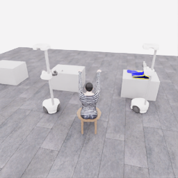

# E05: 첫 pickup 5점 경계

[점수 구간 색인](../20261106-astra-pickup-hold5-001.json) · [프레임·출처 manifest](manifest.json) · [전체 시도](../../attempts/20261106-astra-pickup-hold5-001/README.ko.md) · [5점 종료 검토](../../reviews/20261106-astra-pickup-hold5-001.ko.md) · [분기·재실행 가이드](../../guides/continuation-and-branches.ko.md)

공식 pickup 누적 **5/50점**이 처음 기록된 **episode 12.30초·physics tick 2952·전이 경계 246**의 실제 지정 overview 카메라 관측입니다. 원본 `policy.hdf5/data/demo_0/next_obs/overview_rgb[245]`를 PNG로 옮겼으며 이미지의 모든 픽셀이 원본과 일치합니다. 공개 관측의 절대 시계는 13.825000721초입니다. 평가기 episode 시계와 초기 안정화 오프셋이 있어 이 두 시계를 혼합하지 않습니다.

득점 UTC는 **2026-11-06 03:56:15.847846**, 평가 기록을 시작한 뒤 실제 경과는 **761.776초**입니다. 시도 전체 시간 828.300초에는 초기화와 종료 정리도 포함됩니다. 시뮬레이션 12.30초는 실제 대기 시간을 뜻하지 않습니다.

득점은 **결정 17**(0부터 시작, 18번째 모델 호출)의 `final_check` / `progressing` 구간에서 발생했습니다. 이 행동은 전이 232→252를 진행했고, 246은 그 안의 실제 득점 경계입니다. 단계는 모델의 행동 의도이며 pickup 점수는 별도 공식 평가에서 얻은 결과입니다. actor 호출의 입력 준비·프로세스 실행·결과 해석 시간은 manifest에 숫자로 연결했으며 모델 내부 추론 시간으로 해석하지 않습니다.

이후 같은 행동의 응답 경계 252와 중립 정리 1전이까지 저장돼 전체 E05는 253전이로 종료됐습니다. 따라서 이 첫 득점 사진은 기존 패키지의 최종 사진과 시점이 다릅니다. 착의 `success=false`이며 학습 승인은 `unreviewed`입니다.

이는 **이미 수집한 E05 안의 분기 후보를 찾는 추가 색인·이미지**입니다. 독립적인 새 시연이나 추가 5점 획득으로 집계하지 않습니다. 색인의 재개 경로는 같은 초기 배치에서 원본 246행동을 다시 실행하는 방법이며 정확한 물리 체크포인트 복원을 뜻하지 않습니다. E05 원본과 기존 공개 attempt 패키지는 수정하지 않았습니다.
