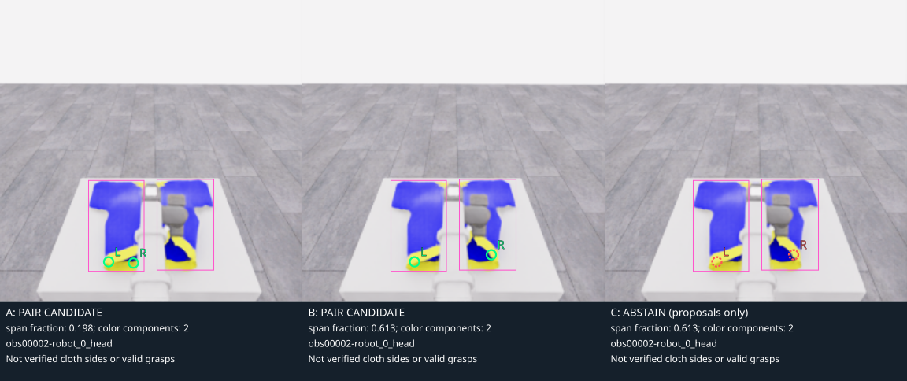

# 공개 RGB-D의 관절·천 추정 기준선

**2026-11-06 05:13 UTC 연구 문서 스냅샷.** B0는 E07의 기존 지정 5 RGB-D·공개 로봇 상태와 Astra 수집입니다. 종료된 E06의 공개 기록으로 **B1 좌표 연결 → B1b 색 후보의 실패 확인 → B1c 후보 배치·보류 비교**를 CPU에서 완료했습니다. 아래 결과는 사후 개발 사례이며 실행 중 actor에 전달하지 않았습니다. B2~B5는 문헌 조사 단계입니다. 이 지각 연구에서는 모델 설치·추론·GPU 실행 없이 진행했고, 실제 파지 정확도·실시간 추가 지연·메모리는 아직 평가하지 않았습니다.

| 후보 | 먼저 확인할 것 | 출력과 주요 한계 | 현재 상태 |
|---|---|---|---|
| B1 · depth → 카메라 XYZ | 단위·축·유효 마스크·역투영 연결 | 보이는 표면의 3D점. 관절 중심·접촉 여부가 아님 | [중심 10표본 CPU 검사 완료](../experiments/2026-11-06-b1-depth-sanity.ko.md) |
| B1b · 색 영역 + depth | 실제 공개 RGB에서 고른 후보의 표면 depth | 가림 뒤 두 후보가 같은 왼쪽 조각에 몰리는 실패 | [3프레임·6후보 검사 완료](../experiments/2026-11-06-b1b-color-depth-roi.ko.md) |
| B1c · 후보 분리·판단 보류 | 같은 입력에서 기존 A·합집합 B·보류 C 비교 | obs2의 간격 21→65픽셀. C는 모호한 후보 출력 보류 | [5개 개발 사례 비교 완료](../experiments/2026-11-06-b1c-color-pair-comparison.ko.md) |
| B2 · 2D pose + depth | 마네킹의 어깨·팔꿈치·손목 후보를 검출하는가 | 2D 관절 후보와 표면 depth. 가림·사람/마네킹 차이에 취약 | 문헌 조사 |
| B3 · CoTracker3 | 천 가장자리·손 주변의 점이 시간에 따라 유지되는가 | 점 궤적·가시성 추정. 동일한 천 재질점을 보장하지 않음 | 문헌 조사 |
| B4 · SAM 2 | 천·팔 영역을 나눠 depth 혼합을 줄이는가 | 추정 mask·영역 depth. 접힌 천·겹친 팔의 경계 오류 | 문헌 조사 |
| B5 · SMPL-X prior | 2D 근거에 맞는 인체 형상 추정이 도움이 되는가 | 추정 인체 mesh·관절. 가려진 부위는 prior의 추측 | 문헌 조사 |

**영상상 후보 배치 개선과 실제 파지 성공은 구분합니다.** [독립 시각 검토](../experiments/2026-11-06-cloth-edge-visual-review.ko.md)는 B1b 원본 3장을 확인한 05:06 UTC 기록으로, 노란 무늬·색 영역 경계·천 외곽·유효 파지점이 서로 다름을 지적합니다. 그때 준비 중이던 B1c의 완료 결과는 위 비교 기록에서 따로 확인할 수 있습니다.

**다음 검증은 다른 공개 프레임·에피소드에서 후보의 의미와 보류를 확인하고, 시간에 따른 점 연결의 유용성을 평가하는 것**입니다. B3 CoTracker3는 추적 후보 중 하나이며 즉시 설치한다는 뜻은 아닙니다. 먼저 두 로봇의 정렬·양쪽 천 지지에 필요한 근거를 검증하고, B2 관절 추정은 이후 손–소매·머리–목구멍 정렬에 연결합니다. B4 영역 분할과 B5 인체 prior는 해당 실패가 확인된 뒤 비교할 후순위 후보입니다. 번호는 방법의 식별자이며 실행 순서가 아닙니다. [조회 출처 JSON](2026-11-06-perception-baselines.sources.json) · [OpenWAM 분석 전용 검토](openwam-feasibility.ko.md)

공식 데모의 단계를 현재 문제·알고리즘·검증 조건에 연결하기

[공식 데모 관찰](../experiments/2026-11-06-official-demo-strategy.ko.md)을 개발 단계에서 **무엇을 먼저 확인할지 정하는 근거**로 사용합니다. 아래 시각은 영상 재생 시각입니다. E05는 한 로봇 픽업 부분 점수였고, [E07의 두 로봇 협력 결과](../experiments/2026-11-06-coordinated-fresh.ko.md)는 아직 확인 중입니다. 따라서 현재의 첫 문제를 두 로봇의 정렬과 양쪽 천 지지의 확인으로 두되, 내부 파지 실패 원인이 확정됐다고 쓰지 않습니다.

| 공식 데모에서 본 단계 | 현재 실패·미확인 지점 | 먼저 비교할 방법 | 성공 조건으로 따로 계측할 것 |
|---|---|---|---|
| 00:00~00:08 · 두 로봇 접근·양쪽 그리퍼 정렬 | 두 그리퍼가 각각 어느 천 가장자리에 접근하는지 불확실 | B1b 색 후보 + 유효 depth, B1c의 성분·보류 규칙을 다른 공개 프레임에서 검토 | 파지 직전 공개 RGB 검수의 후보 일치/오류/판독 불가 수, 2D 위치 오차와 depth 불확실성 |
| 00:10~00:14 · 가장자리 들림과 양쪽 지지 형태 | 닫기 명령과 천이 실제로 따라오는 관측의 구분, 양측 지지 미확인 | 검토한 후보를 시간에 따라 연결하고 필요시 B3 점 추적과 비교. 현재 B1b/B1c는 프레임 간 대응 미검증 | 양쪽 각각의 가시 프레임 수·추적 소실·잘못된 점 연결, 작은 들기 전후 천의 동반 움직임에 대한 시각 검수 |
| 이후 · 마네킹 쪽 운반·올림·내림 조정 | 손–소매·머리–목구멍 대응과 가림은 후속 문제 | B2 관절 + B1 depth, 옷 구멍 후보는 별도 추정; 필요시 B4 비교 | 손/머리와 옷 구멍 후보의 가시성·대응 오류·상대 위치 불확실성, 새 실행의 단계별 결과 |

이 표는 데모 좌표·시각을 새 행동으로 변환하는 규칙이 아닙니다. 참고 프레임에서 좌표·skeleton·궤적을 추출해 actor, teacher, 학습 라벨로 전달하지 않습니다. **새 후보점과 검수 라벨은 실제 실행의 허용된 공개 RGB-D에서만 만듭니다.** 관절 모델만으로 소매·목구멍의 의미와 통과를 알아낼 수 있다고 보지도 않습니다.

**작은 기준선마다 통과시킬 검토 조건**은 다음과 같습니다. B1~B1c의 표본 수·후보·보류·CPU 경과는 기록했지만, 아래 의미 정확도와 실제 행동 성능은 아직 평가하지 않았습니다. 오차·지연 허용치는 첫 측정으로 정한 뒤 후속 비교 전에 고정할 계획입니다.

| 검토 단계 | 남길 정량값과 통과 조건 |
|---|---|
| 파지 직전 시각 검수 | 프레임 목록·원본 SHA·카메라·시각을 고정하고, 각 후보의 일치/오류/가림·판독 불가를 모두 집계. 판독 불가를 성공으로 집계하지 않음 |
| 위치와 불확실성 | 공개 RGB 수동 표시 대비 픽셀 오차의 중앙값·p95, mask의 IoU, 유효 depth 비율·patch 범위를 기록. invalid 중심은 XYZ=null 유지. 색 mask를 정답 segmentation이나 해부학적 위치로 표시하지 않음 |
| 시간적 유지 | 가림 전후 추적 소실·오연결·재획득 건수와 후보의 관측 나이를 기록. 소실 구간을 관측된 천 지지로 채우지 않음 |
| 계산 비용 | 입력 준비·CPU 처리·저장 wall time, 표본 수·카메라 수·반복 수를 기록. 완료된 B1b/B1c의 모델 호출은 0회이며, 실시간 도입 시 추가 wall time·모델 호출 수를 B0와 별도 비교 |
| 실제 과제 결과 | 새 run에서 두 로봇 정렬·양측 천 지지의 시각 검수, 재파지 횟수·단계 시간과 별도 공식 결과를 함께 기록. 한 로봇 픽업 5점을 양측 지지 성공으로 대체하지 않음 |

색 기반 후보는 조명·가림·천 접힘이나 비슷한 색 물체 때문에 틀릴 수 있습니다. 노란 영역이 검출됐다는 이유만으로 특정 소매·천 모서리·유효 파지점으로 지정하지 않습니다. 시각적으로 천이 두 그리퍼를 따라 보이는 결과도 내부 접촉·파지 anchor의 정답은 아닙니다. 먼저 종료된 공개 기록에서 이 실패와 비용을 확인하고, **현재 실행 중인 B0/E07 코드·모델 입력은 유지**합니다.

공식 영상에서 보이는 것과 실제 정책 입력의 경계

[공식 데모 관찰 기록](../experiments/2026-11-06-official-demo-strategy.ko.md)에서 마네킹은 대체로 고정된 자세이고 로봇·천이 움직입니다. 사람 조작자의 신체 움직임·관절·모션캡처 데이터는 제공되지 않았습니다. 마네킹의 관절을 추정하는 연구와 사람 조작자의 동작을 로봇에 옮기는 연구는 데이터 근거가 다릅니다. 선택 프레임 관찰만으로 마네킹이 모든 순간에 완전히 정지했다고 단정하지도 않습니다.

공식 자유 시점 데모의 프레임·추정 skeleton·mesh·궤적·임베딩을 actor 입력, 행동 정답, teacher 또는 학습 데이터로 사용하지 않습니다. 실제 실험은 **그 실행에서 허용된 지정 5개 RGB·depth·depth_valid와 공개 상태·정적 보정값**에서만 추정합니다. RGB에서 예측한 mask는 내부 정답 segmentation과 구분하며, 내부 기하·물체 위치·동적 camera world matrix·평가 판단을 추정기의 입력이나 정답으로 쓰지 않습니다. 이 경계는 [공식 규칙](https://github.com/rirolab/PhyRC_2027_Challenge/blob/main/docs/competition/RULES.md)에 따른 설계이며, 개별 구현에 대한 주최 측 승인을 뜻하지 않습니다.

B1 · 공개 depth를 카메라 좌표에 연결하는 최소 기준선

공식 공개 depth는 미터 단위의 **광학축 Z**이며, 카메라 축은 X 오른쪽·Y 아래·Z 앞쪽입니다. 유효 마스크가 거짓이면 0을 실제 표면 거리로 취급하지 않습니다. 정적 내부 보정값과 동일 해상도의 픽셀 `(u,v)`를 사용하면 `Z=depth`, `X=(u-cx)Z/fx`, `Y=(v-cy)Z/fy`입니다. [공식 데이터 정의](../../../docs/competition/DATA.md) · [Open3D 역투영 정의](https://www.open3d.org/docs/release/python_api/open3d.geometry.PointCloud.html)

첫 검사는 종료된 E06의 관측 0·2에서 지정 5카메라의 중심 `(128,128)`만 사용했습니다. **10표본 중 8개 depth가 유효했고 2개는 XYZ=null**로 보존했습니다. 입력 읽기·해시·계산을 포함한 CPU 경과는 **0.0648초의 단일 측정**이며, 입력 15개 SHA와 모듈 해시를 기록하고 CPU 회귀 11개를 통과했습니다. [검사 설명](../experiments/2026-11-06-b1-depth-sanity.ko.md) · [결과·원본 해시](../assets/20261106-b1-depth-sanity/result.json)

중심 표본은 의미 있는 관절·옷 표적을 선택한 것이 아닙니다. 재투영 일치는 수식·배열 연결 검사이며, 표적 인식이나 실제 3D 정확도의 독립 검증이 아닙니다. 다음 단계에서 공개 RGB에 표시한 소수의 점과 depth 패치를 비교할 수 있습니다. 천·팔·상자 경계의 중앙값은 서로 다른 표면을 섞을 수 있으므로 유효 비율·깊이 분산·경계 근접성을 함께 남깁니다. 이 작은 offline 비용을 모델 추론이나 전체 수집 지연으로 일반화하지 않습니다.

결과는 우선 **카메라 좌표의 관측 표면점**으로 보존합니다. 공개 로봇 운동학·정적 장착 보정으로 허용된 좌표 변환을 별도 검증하기 전에는 서로 다른 카메라 XYZ를 합치거나 simulator world 위치로 표시하지 않습니다. 현재 actor의 16×16 depth 요약을 정밀한 256×256 픽셀 측정처럼 사용하지 않습니다. 전체 공개 depth를 분석하는 후보와 현행 actor 입력은 따로 기록합니다.

B1b·B1c · 실제 실패, 최소 수정, 보류의 비용

| 단계 | 고정 입력과 확인한 결과 | 단일 CPU 경과 | 기록 |
|---|---|---:|---|
| B1b | E06 공개 3장·6후보. 중심 depth는 모두 유효하지만 2개 patch에 주의 표시. obs2의 L/R이 같은 왼쪽 조각에 놓임 | 0.0994초 | [구현·실패](../experiments/2026-11-06-b1b-color-depth-roi.ko.md) · [결과 JSON](../assets/20261106-b1b-color-depth-roi/result.json) |
| B1c | 기존 3장 + 같은 에피소드의 2장. A/B는 5쌍 출력, C는 2쌍 출력·3건 보류 | 0.2438초 | [방법 비교](../experiments/2026-11-06-b1c-color-pair-comparison.ko.md) · [결과 JSON](../assets/20261106-b1c-color-pair-comparison/result.json) · [회귀 대조](../assets/20261106-b1c-color-pair-comparison/comparison-checks.json) |

B1b는 가장 큰 색 성분 하나에서 노란 후보 두 점을 고릅니다. B1c의 A는 그 결과를 그대로 재현했고, B는 적격 색 성분의 합집합에서 넓게 떨어진 후보를 고릅니다. C는 다중 성분의 의미가 불명확하거나 depth patch에 주의가 있으면 후보 쌍 출력을 보류합니다. 알려진 obs2에서 간격은 A의 21픽셀에서 B의 65픽셀로 늘었고, C는 그 제안점을 출력하지 않았습니다.

**출력 2건·보류 3건은 정확도나 성공률이 아닙니다.** 다섯 장은 이미 본 실패를 포함하는 같은 에피소드의 개발 사례입니다. 독립 검증·실제 파지·프레임 간 동일점 추적은 하지 않았고, 다른 물체의 비슷한 색을 합치거나 유효한 후보를 과도하게 버릴 수 있습니다. 입력 수와 저장 작업이 달라 B1b/B1c의 단일 CPU 경과를 속도 개선율로 비교하지 않습니다.

B1b CPU 회귀 10개와 B1c 8개가 각각 통과했고, 기존 3장의 A 후보·depth가 보존된 B1b 결과와 정확히 일치했습니다. B1c 회귀 대조는 입력 해시 16개·생성 자산 10개와 원본 PNG 보존을 확인합니다. 두 실험 모두 모델 호출 0회이며 E07 runtime·actor 입력에는 반영하지 않았습니다. [별도 시각 검토의 판단 범위](../experiments/2026-11-06-cloth-edge-visual-review.ko.md)

B2~B5 · 원문이 지원하는 기능과 과제 적용의 한계

**B2: MediaPipe Pose Landmarker + B1.** 공식 모델은 사람의 33개 관절 후보와 visibility·presence를 출력합니다. 우선 어깨·팔꿈치·손목의 2D 검출을 공개 RGB에서 검토하고, 보이는 후보에 한해 대응 depth를 읽습니다. 모델의 `worldLandmarks`는 골반 중심을 원점으로 하는 추정 좌표이므로 시뮬레이터 world 좌표나 깊이 센서 측정값과 섞지 않습니다. [공식 문서](https://developers.google.com/edge/mediapipe/solutions/vision/pose_landmarker)

과제 적용상의 미검증 위험은 사람 영상과 렌더링된 마네킹의 차이, 로봇·천에 의한 가림, 작은 손목 영역입니다. 관절의 2D 위치가 맞아도 해당 depth는 천이나 피부 표면일 수 있어 해부학적 관절 중심이 되지 않습니다. confidence가 높다는 이유만으로 오류를 배제하지 않습니다.

**B3: CoTracker3.** 공개 RGB에서 정한 소수의 점을 따라가며 2D 궤적과 가시성 추정을 얻는 후보입니다. 공식 구현은 offline·online 경로를 제공하고 online은 영상 조각을 처리합니다. GPU를 권장하지만 작은 작업은 CPU도 가능하다고 설명합니다. 이것만으로 현재 서버의 5카메라 실시간 처리가 가능하다고 판단하지 않습니다. [공식 구현](https://github.com/facebookresearch/co-tracker)

천 가장자리와 마네킹 손 주변에서 추적 소실·재검출·점 바뀜을 측정할 수 있습니다. 접힘·자가 가림·미끄러짐과 손목 카메라 이동 때문에 추적점이 동일한 물리 재질점을 뜻하지 않을 수 있습니다. 온라인 정책에는 결정 시각까지 도착한 프레임만 쓰고, 영상 조각을 모으는 지연을 따로 기록해야 합니다. 미래 프레임을 이용한 사후 추적 결과를 같은 시점의 정책 입력으로 취급하지 않습니다.

**B4: SAM 2의 천·팔 영역 + B1.** 공식 구현은 점·box prompt로 mask를 만들고 영상에서 여러 대상의 mask를 전파합니다. 공개 RGB에서 정한 prompt와 추정 mask를 이용해 depth의 관심 영역을 좁히는 후보입니다. [공식 구현·영상 API](https://github.com/facebookresearch/sam2)

영역 추정이 옷 구멍의 의미, 양쪽 소매의 동일성, 파지·접촉을 자동으로 판정하지는 않습니다. 얇은 가장자리·접힌 천·팔과 천의 겹침에서 mask가 틀리면 depth 선택도 틀립니다. 사후 보정 prompt에는 표시한 원본 프레임과 사람이 개입한 시점을 남기고, 미래 프레임의 보정을 과거 행동 입력에 소급하지 않습니다. 모델 준비·초기화·메모리·프레임 처리 비용을 별도로 측정해야 합니다.

**B5: SMPL-X / SMPLify-X.** SMPL-X는 몸·손·얼굴을 포함하는 인체 모델이고, 원 논문의 SMPLify-X는 2D 특징에 맞춰 매개변수와 pose prior를 이용해 형상을 추정합니다. 여기서는 이미 검토한 공개 2D·depth 관측과의 적합도를 비교하는 후순위 후보입니다. depth 적합 항목을 추가하는 것은 이 과제의 별도 구현 과제입니다. [원 논문](https://arxiv.org/abs/1904.05866) · [저자 구현](https://github.com/vchoutas/smplify-x)

가려진 손·몸통을 prior가 메웠다는 사실을 측정으로 표시하지 않습니다. 일반 인체 모델과 마네킹의 차이, 의자·옷의 가림, 최적화 시간과 모델 이용 조건을 먼저 확인해야 합니다. 공식 마네킹 mesh를 정답 template로 주입하지 않으며, 추정 mesh를 내부 충돌 형상이나 천 상태로 해석하지 않습니다. 원 논문은 2019년 연구이며 최신 최고 성능 방법이라는 의미로 선정한 것이 아닙니다.

B1~B1c 이후 정확도·비용 측정 계획

첫 B1 연결 검사는 종료·검수한 E06의 고정 관측 0·2에서 수행했고, B1b/B1c는 같은 종료 에피소드의 공개 프레임으로 후보 선택·보류를 비교했습니다. B2~B5 비교는 같은 방식으로 소량의 공개 RGB-D와 고정 프레임 목록에서 시작하는 제안입니다. 실행 중 HDF5를 열지 않고, 원본 SHA·카메라·simulation 시각·가림 여부·수동 표시 출처를 남깁니다. 이후 다른 시작 배치·에피소드에서 확인하며 인접 프레임을 학습/검증 양쪽에 나누지 않습니다.

| 측정 | 확인할 의미 | 현재 값 |
|---|---|---|
| 2D 픽셀 오차·미검출·가시 후보 비율 | 공개 RGB 수동 표시와의 일치. 가려진 관절을 정답으로 임의 생성하지 않음 | 미측정 |
| depth 유효 비율·경계 분산·단위·재투영 | 좌표 연결과 표면 불확실성. 절대 3D 관절 정확도와 구분 | B1 중심 10표본·8유효/2invalid, B1b 6후보·2patch 주의. 표적 정확도 미측정 |
| 추적 소실·점 바뀜·재획득·영역 IoU | 같은 공개 프레임의 점/영역 검수 기준과 비교 | 미측정 |
| 시간적 흔들림·가림 전후 변화 | 카메라 자체 이동을 고려한 관측 일관성 | 미측정 |
| 준비·첫 추론·반복 처리 p50/p95·최대 메모리 | 모델별 추가 CPU/GPU 비용과 5카메라 비용 | B1/B1b/B1c 단일 CPU 경과만 기록. 반복 분포·모델 비용 미측정 |
| 별도 새 run의 행동·복구·공식 결과 | 지각 개선이 실제 수집에 도움이 되는지 확인. 점수는 actor 입력과 분리 | 미실행 |

20 Hz로 보존된 프레임과 느린 모델 호출 사이의 표본 간격을 구분하며, 실제 simulation 시각을 이용합니다. 추정 결과에는 source camera·원본 관측 시각·계산 완료 시각·유효 여부를 남겨 오래된 특징이 현재 측정으로 사용되지 않게 해야 합니다. 추정기를 추가하면 계산·저장 비용이 생기므로 외부 논문의 FPS를 이 서버의 속도 향상으로 환산하지 않습니다. 허용된 독립 3D 정답이 없는 경우에는 절대 3D 오차가 검증됐다고 보고하지 않습니다.

