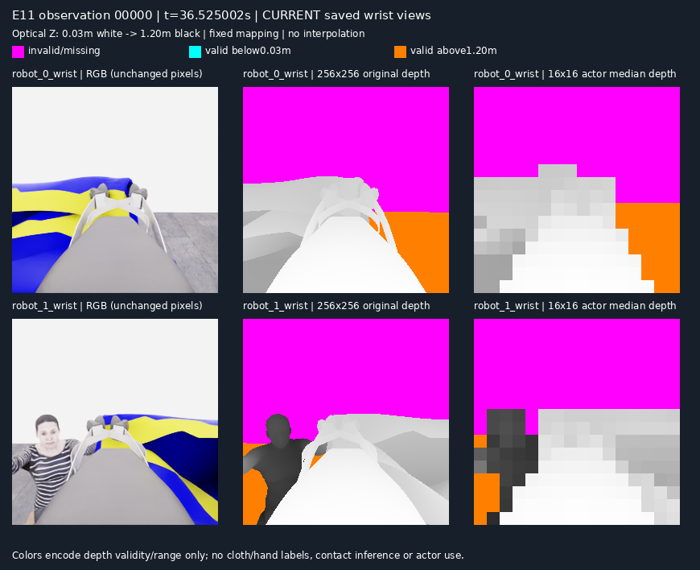
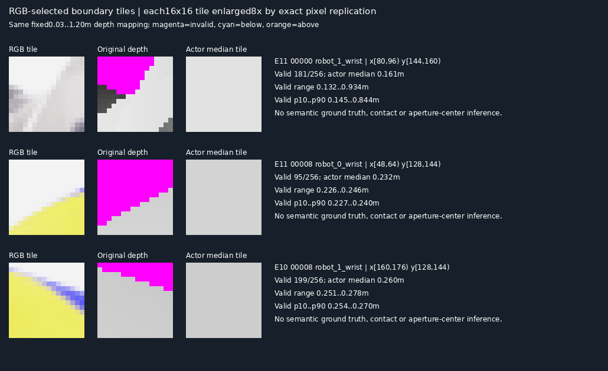

# 손목 depth 입력의 공간 정보 손실: 종료된 E10·E11 관측 비교

**현재 actor에는 depth가 전달되지만, 256×256 원본을 16×16 중앙값으로 요약하면서 일부 경계와 유효 마스크 정보가 사라집니다.** 종료된 두 실행의 3시각·양쪽 손목 카메라를 CPU에서 비교했습니다. 이는 **표현의 정보 손실을 확인한 결과**이며 소매 식별·접촉 판단·착의 점수 개선을 검증한 결과가 아닙니다. 실행 중인 E12의 코드·입력은 변경하지 않았습니다.

[기존 B1~B1c 검토](2026-11-06-perception-baselines.ko.md) · [현재 입력 변환](../../../participant/collection/codex_client.py) · [수치·원본 SHA256](../assets/20261106-wrist-depth-input/evidence.json) · [재현 소스](../assets/20261106-wrist-depth-input/review.py)

## 현재 입력과 비교 범위

`prepare_observation`이 만드는 현재 시각의 기본 입력은 지정 카메라의 RGB 5장, 공개 로봇 상태 전체, 카메라별 **16×16 광학축 Z 중앙값 격자**입니다. 격자의 한 칸은 원본의 16×16픽셀입니다. 유효한 양수 depth만 중앙값에 포함하고 미터 단위 소수 셋째 자리로 반올림합니다. 한 칸에 유효 픽셀이 하나라도 있으면 수치를 보내며, 그 칸의 유효 비율이나 깊이 분포는 보내지 않습니다. 유효 픽셀이 없으면 `null`입니다.

원본 `depth`와 `depth_valid`는 공개 관측 폴더의 `public_depth.npz`에 보존됩니다. 이번 비교는 이 파일과 같은 시각의 RGB·`observation.json`만 사용했습니다. `capture.json`의 완료 표시를 확인했으며 HDF5·audit·평가 내용·숨은 기하·원시 모델 추론을 읽지 않았습니다. 모델·GPU 호출은 각각 0회입니다.

| 별칭 | 원본 run ID | 관측 | 공개 simulation 시각(s) | 비교 카메라 |
|---|---|---|---:|---|
| E10 | `20261106-astra-sleeve-branch700-003` | `00008` | 39.0250020353 | `robot_0_wrist`, `robot_1_wrist` |
| E11 | `20261106-astra-sleeve-history-001` | `00000` | 36.5250019049 | `robot_0_wrist`, `robot_1_wrist` |
| E11 | `20261106-astra-sleeve-history-001` | `00008` | 38.9250020301 | `robot_0_wrist`, `robot_1_wrist` |

관측별 배열 순서는 `overview`, `robot_0_wrist`, `robot_1_wrist`, `robot_0_head`, `robot_1_head`입니다. 숫자 인덱스를 추정하지 않고 저장된 `rgb_image_order`로 손목 카메라를 찾았습니다. 각 원본 RGB·depth NPZ·관측 JSON의 **전체 SHA256**은 [evidence.json의 `source_frames[].sources`](../assets/20261106-wrist-depth-input/evidence.json)에 상대 경로·run·관측·카메라와 함께 기록했습니다. 원본 파일 자체를 이 페이지에 추가로 게시하지 않습니다.

## 관측된 차이



왼쪽은 RGB 원본 픽셀, 가운데는 원본 256×256 depth의 고정 범위 표시, 오른쪽은 actor가 받는 16×16 수치를 같은 색 규칙으로 표시한 것입니다. 오른쪽 확대는 픽셀 반복만 사용했습니다. 영상의 밝은 배경이 depth에서는 invalid인 부분도 많습니다. invalid는 빈 공간 또는 통과 가능 공간의 증거가 아닙니다.

아래 세 타일은 **depth를 보기 전에 RGB에서 독립적으로 선택한 가시 경계 사례**입니다. 좌표는 0부터 시작하는 `(u=열, v=행)`이며 끝 좌표를 포함하지 않습니다. 첫 타일은 밝은 로봇 구조와 줄무늬 표면 부근, 나머지는 색 있는 천의 외곽과 밝은 배경 부근입니다. 물체·의복 부위·접촉의 정답 라벨로 사용하지 않습니다.

| 관측·카메라 | 픽셀 범위 | 유효 픽셀 | 유효 Z 범위(m) | actor 중앙값(m) |
|---|---|---:|---:|---:|
| E11 `00000` · wrist1 | x[80,96), y[144,160) | 181/256 | 0.1323–0.9337 | **0.161** |
| E11 `00008` · wrist0 | x[48,64), y[128,144) | 95/256 | 0.2261–0.2462 | **0.232** |
| E10 `00008` · wrist1 | x[160,176), y[128,144) | 199/256 | 0.2505–0.2778 | **0.260** |



첫 타일의 유효 depth 10–90백분위는 **0.1445–0.8436m**입니다. 단일 중앙값은 이 분포와 부분 invalid를 나타내지 못합니다. 두 번째 타일은 **161/256픽셀이 invalid**인데도 actor에는 0.232m 하나가 전달됩니다. 원본 해상도 표현은 해당 경계의 모양을 유지합니다. 깊이 범위가 넓다는 사실만으로 여러 물체·접촉 여부를 확정할 수는 없으며 기울어진 표면도 범위를 넓힐 수 있습니다.

이 여섯 영상에서 부분 invalid를 포함한 16×16 칸은 카메라별 20–29개였습니다. 모든 **1,536개 칸**을 기존 `observation.json`의 actor 입력 수치와 대조해 일치를 확인했습니다. 새로운 중앙값 규칙으로 기존 입력을 재해석하지 않았습니다.

## 고정 변환·범위 밖 표시·양자화

공개 depth 분포를 먼저 확인하고, RGB에서 선택한 경계의 약 0.934m 표면까지 포함하도록 **0.03–1.20m**를 모든 영상에 동일하게 적용했습니다. 프레임별 자동 대비나 범위 조정은 없습니다.

- 유효 조건: `depth_valid=true`, 유한한 값, `Z>0`.
- 범위 안: `q = numpy.rint(255 × (Z−0.03) / (1.20−0.03))`, `gray = 255−q`. 가까운 표면은 밝게, 먼 표면은 어둡게 표시합니다.
- invalid: 자홍색 RGB `(255,0,255)`.
- 유효하지만 0.03m 미만: 청록색 `(0,255,255)`.
- 유효하지만 1.20m 초과: 주황색 `(255,128,0)`. invalid와 구분하며 원래 수치는 변경하지 않습니다.
- 범위 내 회색 단계 간격은 **4.588235mm**, 반올림의 최대 양자화 오차는 약 **2.294118mm**입니다. 수치 분석은 색에서 역산하지 않고 원본 float32 depth를 사용했습니다.
- invalid 보간·메우기, 깊이 평활화, 프레임별 자동 대비를 하지 않았습니다. 타일 확대는 최근접 픽셀 반복으로 새 중간값을 만들지 않습니다.

| 관측·카메라 | invalid 픽셀 / 전체 65,536 | 상한 초과 / 유효 픽셀 | 유효 픽셀 중 상한 초과 |
|---|---:|---:|---:|
| E10 `00008` · wrist0 | 34,870 | 4,051 / 30,666 | 13.21% |
| E10 `00008` · wrist1 | 38,472 | 1,842 / 27,064 | 6.81% |
| E11 `00000` · wrist0 | 33,130 | 6,068 / 32,406 | 18.72% |
| E11 `00000` · wrist1 | 32,988 | 2,031 / 32,548 | 6.24% |
| E11 `00008` · wrist0 | 39,261 | 2,950 / 26,275 | 11.23% |
| E11 `00008` · wrist1 | 39,697 | 215 / 25,839 | 0.83% |

하한 미만의 유효 픽셀은 여섯 영상 모두 0개입니다. 범위 밖의 값을 경계값으로 보이게 하지 않고 별도 색으로 표시했으므로, 주황 영역 내부의 실제 거리 차이는 이 그림에서 읽을 수 없습니다.

## 재현과 확인한 범위

[포함한 소스](../assets/20261106-wrist-depth-input/review.py)는 완료된 offline 계산·렌더링에 입력 루트와 새 출력 폴더 인자만 추가한 재현본입니다. 저장소의 검증된 원본 공개 관측과 해당 capture 완료 표시가 복원되어 있어야 합니다. 원본이나 기존 출력 폴더를 덮어쓰지 않습니다. 저장소 루트에서 실행합니다.

```bash
PYTHONPATH=.:src/PhyRC_Sim .venv/bin/python \
  docs/collection/assets/20261106-wrist-depth-input/review.py \
  --root . \
  --output "output/sessions/$(date -u +%Y%m%dT%H%M%SZ)-wrist-depth-review"
```

출력에는 3시각의 전체 비교 그림, 경계 타일 그림, 원본 해시·변환·카메라별 통계가 담긴 `summary.json`이 포함됩니다. 이 공개 페이지에는 그림 두 장만 선별했습니다. 포함한 재현본을 실제 CPU에서 실행해 공개 그림 두 장의 SHA256 일치를 확인했습니다. 원래 offline 재실행에서도 산출물 바이트 일치와 선택한 공개 원본 SHA 불변을 확인했습니다. [그림·재현 소스 해시와 확인 기록](../assets/20261106-wrist-depth-input/evidence.json)

**다음 후보는 별도 실행에서 현재 양쪽 손목 depth 패널 한 장만 추가하는 입력 비교입니다.** 기존 RGB·공개 상태·수치 격자를 유지한 채 가시 표면의 구분과 판단 보류에 도움이 되는지를 평가할 수 있습니다. 아직 actor 입력에 추가하거나 과제 개선을 측정하지 않았습니다.

원본 전체 depth도 **천이나 그리퍼 뒤에 가려진 표면을 보여주지 못합니다.** 구멍처럼 보이는 영역의 depth는 뒤쪽 표면일 수 있고, 깊이의 불연속이 소매·밑단·목구멍의 의미를 결정하지 않습니다. 카메라 XYZ로 변환하더라도 관측 표면점이며 물체 pose·구멍 중심·접촉 정답이 아닙니다. 이 자료를 착의 성능 향상이나 새로운 성공 시연으로 집계하지 않습니다.
