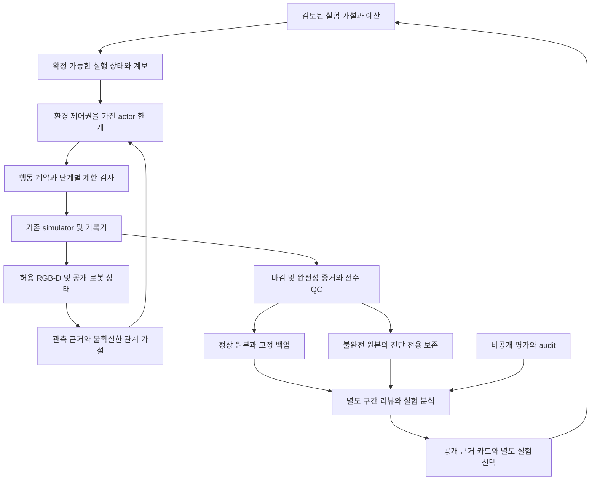

# PhyRC 데이터 수집 시스템 재정비 계획

> 이 문서는 E34 마감 시점의 재정비 계획이다. 이후09:29 UTC 사용자 요청으로 개편 구현을 보류하고 기존 방식 최대5회 추가 수집을 승인했다. 아래 당시 중지 범위는 [현재 배치 계획](../../COLLECTION_PLAN.md)이 대체하며, 재정비 설계 자체는 미구현 제안으로 보존한다.

기준일:2026-11-14. 사용자 지시는 **E34까지만 마감하고 추가 수집을 멈춘 뒤, 전체 경험과 agentic robotics 연구를 분석해 계획을 제안하는 것**이다. E34는20결정·24호출·836전이로 정상 마감했고 전수 QC836/836을 통과했다. 로컬5/50(픽업5·착의0), success=false다. E35는 실행하지 않는다. 아래 설계는 제안이며 새 시스템·학습·모니터를 구현했다는 기록이 아니다.

[전체 시연](../../EPISODES.md) · [카탈로그](../catalog/catalog.v1.json) · [선행 워크숍39편 조사](2026-11-14-agentic-robotics-workshop.ko.md) · [추가6편 연구](2026-11-14-agentic-collection-proposal.ko.md) · [현재 상태](../../project/STATUS.md)

## 1. 판단

**보존·격리·관측/행동 기록의 기반은 유지하고, 각 시도에서 검증할 가설과 필요한 전후 관측을 먼저 고정하는 구조로 바꾸는 것이 우선이다.** 현재 자료는 로봇을 움직이고 부분 파지·운반을 수행할 수 있음을 보여 준다. 그러나 그 파지가 어떤 자유 경계를 제어하며 같은 손·전완의 통과에 유리한지 확인하는 고리가 약하다. 새 방향을 설명하는 긴 문단을 추가하는 방식만으로는 이 문제가 해결됐다는 근거가 없다.

시스템 문제를 모두 정책 문제로 보거나, 모든 실패를 제어 불능으로 해석하면 개선 대상을 잘못 고른다. 명령·실제 로봇 운동, 천의 국소 동행, 유효 입구 가설, 같은 손의 진행, 파일 완료·QC, 학습 승인, 공식 점수는 별도로 기록해야 한다. 첫 변경은 더 많은 에이전트나 새 VLA가 아니라 이 구분을 실행·검수·데이터 선택에 일관되게 반영하는 것이다.

## 2. 전체 경험에서 확인한 것

범위는 E00–E34와 이전 인간 부분 시연의 공개 기록, 개별 리뷰·운동 분석·실패 기록, 카탈로그, 수집/학습 코드다. 모든 원본 영상을 이번 세션에서 처음부터 끝까지 다시 재생한 것은 아니다. 과거 시도는 보존된 리뷰와 provenance를 중심으로 검토하고, E33/E34는 새 공개 관측과 결과를 직접 검수한다. 관측 사실, 모델 설명, 설계자의 추론을 구분한다.

| 구간 | 축적된 근거 | 재정비에 주는 의미 |
|---|---|---|
| 인간 부분 시연·E00–E06 | 사람 기록은2225전이/111.25초의 부분 시연. 초기 모델 접근과 닫기, 유지시간 변화 뒤 픽업5점. 연결 시험·호환성 실패도 섞여 있음 | 시연 ID 수를 완전 착의 데이터 수로 세지 않는다. 픽업은 양측 지지·입구 확보·착의 성공과 다르다. |
| E07 | 두 로봇 공동 들기·운반을 실제 관측 | 운반 능력이 전혀 없어서 실패한다는 가설은 부적절하다. 이 능력을 회귀 기준으로 보존한다. |
| E10–E14 | 소매/밑단 해석, 과거 관측, wrist depth, 행동 후 정착 비교 | 입력을 더 주는 것과 올바른 관계를 확인하는 것은 다르다. 새 센서 없이도 기존 정보가 어떤 판단을 바꿨는지 측정해야 한다. |
| E15–E17 | 더 이른 준비, 로봇별 지지 진단, 한쪽 파지 복구를 이미 시험 | “천 동행 검사를 추가하자”만으로는 새 해결책이 아니다. 지지 후의 자유 경계·입구 가설을 구별해야 한다. [E16](../reviews/20261106-astra-support264-002.ko.md) |
| E18–E19 | named action 대응, 실제 시점 변화와 깊이 질의. E19의44–67mm 접근이 실행됐고 이동의54–61%가 settle 구간에 발생 | 모든 실패를 미실행 명령/포화로 설명하지 않는다. 중립 settle을 idle 또는 정지로 자동 분류하면 안 된다. [E19](../reviews/20261107-astra-entry801-named-001.ko.md), [운동 분석](../reviews/20261107-astra-entry801-named-001-motion.ko.md) |
| E20–E24 | 목 우선, 위쪽 접근·하강, 복구·다른 시점·추가 결정 비교 | 방향 전환 자체는 여러 번 있었다. 무엇을 검증한 변경이었는지와 반증 조건을 보존해야 한다. |
| E25–E27 | 실제 새 경계 재파지와 운반, 첫 손/전완 관계의 유망한 중간 장면. 이후 손 선택 전환과 진행 미확인 | 새 파지가 가능하다는 것과 올바른 통로를 잡았다는 것은 다르다. 같은 손 추적과 관계 유지가 별도 과제다. [E27](../reviews/20261107-astra-regrasp698-progress-named-001.ko.md) |
| E28–E31 | 측면 파지·운반 후 첫 손 근처의 여러 경계와 대각선 접근 비교, 정상 마감 시 최고5/50·착의0. E31은 같은 손을 유지했지만 전완 진행 미확인 | 손 추적·기억만으로 해결된다고 볼 수 없다. 실제 입구 제어와 진행 능력이 별도로 필요하다. 추가 횟수나 최근 경계만으로 더 나은 출발점이라고 판단하지 않는다. |
| E09·E32 | incomplete 원본과 전체 QC 실패. E30/E31의 host143은 정상 simulator 마감·QC와 공존 | 프로세스 반환값 하나로 데이터 손실·정책 실패를 판정하지 않는다. 요청/응답/파일 마감/QC/보존을 구분한다. [E32](../../project/sessions/20261114-e32-incomplete.ko.md) |
| E33 | 가운데 파지 준비와 양측 각1회 재파지에20결정 사용. 마지막 닫기 뒤 들기 검증 전에 예산 종료.0/50, QC471/471 | 동작을 시작할 예산뿐 아니라 효과를 확인할 예산을 예약해야 한다. 새 run에서 소진한 준비 횟수를 초기화하지 않는다. [리뷰](../reviews/20261114-astra-middle-grip264-001.ko.md) |
| E34 | E33/470에서 추가 재파지 없이 들기·운반·같은 손 근처 정렬, D18 실제 약16mm 하강.5/50(새 픽업5)·착의0, QC836/836.20결정·24호출·32.66분 | E33의 마지막 파지는 후속 운반에 쓰였지만 통과는 미확인이다. 미검증 close로 끝난 한 배치만으로 파지를 무용하다고 판정하지 않는다. E34 뒤 수집 중지. [리뷰](../reviews/20261114-astra-middle-grip470-retain-001.ko.md) |

정적 prompt 파일은 E07 5189bytes/781words → E27 14583/2129 → E28 15960/2364 → E33 21867/3252로 늘었다. 이는 파일 길이 측정이며 토큰 수나 지침 증가가 실패를 일으켰다는 인과 증거가 아니다. **현재 단계·근거·허용 동작·잔여 예산을 명시한 짧은 표현과 비교할 이유**는 된다. 현재 코드도 긴 task는 첫 호출에만 넣고 이후 동일 actor 세션을 이어가므로 매 호출마다 전체 task를 새로 넣는다고 설명하면 안 된다.

### 데이터 양을 다시 세야 하는 이유

E34 마감 시점 카탈로그에는 demonstration31개, 그중 QC 통과29개·실패2개가 있다. 이29개의 기록 합은22380전이이고 명시된 replay 완료 합은14537전이, 약65.0%다. 나머지7843도 새 모델 행동만이 아니라 정착·정리 등을 포함한다. 초기3개의 replay 메타데이터 null은 별도로 취급한다. **전체 기록 수나 차감값을 독립적인 전문가 행동 수로 부르면 안 된다.** 인간 시연·연결 시험·미실행 계획은 이 집계에 포함하지 않았다.

31개 demonstration은4개의 source_group 라벨에 묶여 있다. 라벨 수 자체가 독립적인 초기 조건 수의 증거도 아니다. 실제 parent/prefix/reset 계보를 조사해야 한다. 새 replay의 관측은 물리 편차가 있으므로 영상 파일을 기계적으로 중복 삭제하지 않고, 재사용된 행동 출처와 새 관측의 역할을 분리해 집계·가중한다.

## 3. 병목과 바꿀 대상

| 병목 | 현재 근거 | 제안 |
|---|---|---|
| 천의 위상·통로 가설이 확인되지 않음 | 색 띠·주름·가림·겹침과 통과를 구분하지 못한 반복 | 입구 가설마다 다른 설명과 이를 구별할 관측/짧은 시험을 정의한다. 단순한 VLM 자신감을 정답으로 쓰지 않는다. |
| 시도 의도와 관찰 결과가 혼합됨 | stage/reason은 actor의 자기 서술이며 별도 reviewer 판정이 아님 | 의도, 적용 명령, 실제 로봇 운동, 천/손 관계, 미확인을 별도 필드로 기록한다. |
| 분기 시 실행 맥락 일부 소실 | 새 actor에 replay 이미지2장은 있지만 누적 준비 예산을 강제하지 않음 | 실행 기록에서 확정 가능한 상태를 prefix별로 재구성한다. 시각 가설은 별도 불확실한 기억으로 관리한다. |
| 검증 없이 끝나는 조작 | E33 마지막 결정이 close였고 후속 동행 검사는 E34로 넘어감 | 새 조작 시작 전 실제 적용·정착·후속 관측·정상 마감 예산을 예약한다. |
| 실험 간 차이가 복합적 | 시작 경계·파지·전략·입력 변화와 replay 편차가 섞임 | 연구 질문을 고정하고 한 번에 바꿀 요소와 비교 대상을 명시한다. 여러 요소를 바꾼 경우 탐색 사례라고 표시한다. |
| 학습 가치와 기술적 유효성이 혼동될 수 있음 | QC 통과지만 착의0·training unreviewed; episode 전체 sampler | 원본 불변을 유지한 구간 리뷰·학습 승인·source-group 분리·horizon 경계 검증을 추가한다. |
| 마감 실패의 진단이 분산됨 | host143/EOF/complete/QC의 의미가 서로 다름 | 독립적인 실행·마감 상태와 재시작 가능한 보존 절차를 설계한다. 현재143 원인은 미확정으로 유지한다. |

## 4. 제안 구조

평가·audit에서 actor, critic, world model 또는 증류 교사로 정보를 보내는 간선은 만들지 않는다. 오프라인 분석→다음 계획에도 공개 정보 직렬화 검사를 둔다. 점수는 실험 선택용 outcome으로 관리하고, actor에 전달할 근거 카드에는 허용된 공개 관측에서 확인한 내용만 쓴다. 특권 기하로 만든 좌표·통과 정답을 우회 주입하지 않는다. 온라인 단계를 맡는 도구도 현재 공개 관측 계약만 사용한다. single L40S의 수집·렌더·학습은 계속 순차 실행한다.

### A. 확정 가능한 실행 상태

소유자는 LLM이 아닌 supervisor다. run/parent/source group, prefix, 실제 적용 action ID, 개폐 명령과 시뮬레이션 경과, 사용한 동작/호출/시간 예산, 종료 상태를 저장한다. 그리퍼가 닫히라는 명령을 받았다는 사실과 천을 잡았다는 판단은 분리한다. E09는 ACK replay120과 실제 기록141(부모 행동140+cleanup1)이 달랐다. issued/accepted/applied/acknowledged를 구분하고 모호한 명령을 자동 재전송하지 않는다. 기록−ACK replay를 신규 actor 전이로 분류하지 않는다.

분기에서는 선택한 prefix까지의 공개 실행 기록을 재구성한다. 단순히 이전 run의 최종 카운터를 복사하거나 중첩 replay를 중복 합산하지 않는다. sibling 분기의 횟수를 섞지 않고, 과거 경계로 되돌아갔다면 그 경계 뒤의 사건을 상속하지 않는다. 재파지 사이클은 명시적인 시작/종료 사건으로 정의하고, 단순 open 명령만 보고 접촉 성공을 역추정하지 않는다.

상태 의존 제한을 위반한 제안은 dispatch 전에 거부하며, 조용히 clipping·다른 행동으로 바꾸지 않는다. zero action으로 거부를 대체하지 않는다. 현재 `stop`도1전이를 실행하므로 물리가 진행한다. 거부 이유와 남은 예산을 기록해 제한된 재요청 또는 정상 마감으로 처리한다. 이 hard gate는 **미구현 제안**이다. 현재 E34 retain은 프롬프트 지시이며 스키마 검사가 release를 자동 차단하지 않는다.

### B. 관측 근거와 관계 가설

최소 기록은 `observation_id`, 카메라/프레임, 가설, 지지 근거, 대안 설명, 다음 판별 동작, 유효 시점이다. 파지 동행·자유 경계·입구 정체·같은 손과 전완의 관계에는 `unknown`을 허용한다. 손의 identity도 검증된 정답처럼 고정하지 않고 재식별 근거와 상실 사건을 남긴다.

관측 리뷰는 최소한 네 층을 구분한다:①명령과 실제 로봇 운동,②국소 천 동행,③제어 가능한 자유 경계/통로 가설,④같은 손·전완을 따른 진행. 상위 단계의 판단을 하위 단계의 성공으로 대신하지 않는다. 손의 가림이나 pickup5점을③/④의 정답 라벨로 쓰지 않는다.

현재의 긴 전략을 즉시 제거하지 않고, 동일 관측·동일 예산에서 단계별 표현과 비교한다. LLM reviewer가 낸 결과는 제안이며 사람이 만든 공개 관측 기준과의 불일치·오판을 측정한다. 검수자는 먼저 actor reason/stage와 공식 점수를 가린 공개 전후 관측을 판정한다. false-progress뿐 아니라 false-block, unknown 비율과 판정 가능한 범위도 보고한다. 모든 행동을 막는 reviewer를 좋은 정책으로 선택하지 않는다. 아직 신뢰할 라벨이 없는 상태에서 학습 critic을 먼저 추가하지 않는다.

### C. 실험 단위와 예산

각 수집 요청은 다음 여섯 항목을 갖는다:가설, 비교할 전후 관측, 보존할 관계, 바꿀 요소, 반증/중지 조건, 효과 확인과 마감에 남길 예산. 예를 들어 “더 가운데를 잡는다” 대신 “같은 외곽 띠만 당기는 경우와 서로 다른 자유 경계를 제어하는 경우를 이 시점 변화·짧은 들기로 구별한다”처럼 관측 가능한 질문으로 만든다.

20결정은 초기 비교 기준으로 남기되 phase별 검증 예산을 예약한다. 닫기만 하고 끝날 상황이면 새로운 재파지를 시작하지 않는다. 중립 정착 중 실제 이동을 관찰하므로 이를 공짜 대기·idle로 세지 않는다. 실제 적용과 정착을 합친 효과를 다음 관측에서 검토한다. 정체를 감지해도 성공 확률을 임의로 만들어 budget을 자동 증액하지 않는다.

### D. 데이터와 학습

원본 HDF5·capture·audit는 수정하지 않는다. 별도 구간 인덱스에 model/replay/settle/cleanup, 의도·관측 결과, progress/recovery/failure/idle/unknown, 검수 상태를 연결한다. idle 여부는 action이0인지가 아니라 실제 공개 관측 변화로 판단한다.

[`pi05/data.py`](../../../participant/pi05/data.py)는 현재 episode의 모든 행을 표본화하고 `approved_pipeline_test`를 요구하며 끝에서는 마지막 행동을 반복한다. 의미 구간 sampler·선호학습은 없다. 향후 구간 선택에서는 horizon 전체가 승인 범위 안에 있게 하거나 별도로 검증한 mask를 사용해야 한다. 실패 구간이나 reset을 가로지르는 action chunk, 임의 경계 padding이 좋은 교사 행동으로 들어가지 않게 한다.

정상 기록은 학습 승인이 아니다. 현재 loader에도 source group의 split 교차 검사가 있으므로 이를 유지하고 구간 계보·중복 가중치까지 확장한다. replay에 과도한 가중치를 주지 않고 통과 단계·복구 행동·정체를 함께 검토한다. 초기 π0.5의63전이·30updates는 연결 검사였고 착의 개선 baseline으로 쓰지 않는다. 검수된 데이터와 held-out 초기 조건이 준비되기 전 자동 재학습을 수집 루프에 붙이지 않는다.

현재 student 전처리는 overview·양손목의3RGB와32state를 사용한다. actor의5RGB-D와 동일한 입력이 아니므로, actor가 사용한 관계가 student 입력에서도 식별 가능한지 확인해야 한다. train/inference의 입력 투영·정규화·18개 제어값의32차원 padding 계약을 함께 검증한다. 현재 loader의 학습 cursor는 복원되지 않으므로 optimizer/RNG와 sampler cursor까지 포함한 재개도 별도 과제다.

### E. 수명 관리와 보존

`requested → running → closing → closed` 실행 수명과 capture completeness, QC, backup verification, learning approval은 독립 축으로 기록한다. 상태명은 설계안이다. finish 요청, collector 응답, writer close, manifest/hash, QC 결과를 각각 증거로 연결한다. E09처럼 closed여도 complete=false일 수 있고, E32처럼 진단 백업이 검증돼도 QCfailed일 수 있다. 불완전 자료의 진단 보존 분기를 두되 정상 replay/학습 자격으로 승격하지 않는다.

기존 source snapshot은 이미 선택 소스 파일과 commit/dirty 상태를 보존한다. 이를 유지하고 ExecutionSpec에 image·asset·CLI·runtime config hash와 실제 실행 소스의 읽기 전용 식별을 연결한다. 현재 request ID·timeout 후 모호한 후속 요청 차단·HDF5 연속성 검사·종료 reconciliation도 유지한다. 없는 기반을 새로 만드는 작업보다 흩어진 증거를 하나의 실행 이력으로 묶는 작업이다.

현재의 별도 process session launcher와 umask027은 검증된 운영 보완이지만 host/cgroup 종료 생존이나143 원인 해결을 보장하지 않는다. 재정비 때는 실행 재시작과 백업 재시작을 분리하고, 업로드가 끝난 뒤 검증만 실패한 경우 고정 commit의 검증부터 재개할 수 있게 한다. 기존 원본이나 receipt를 덮어쓰지 않고 이벤트를 추가한다.

## 5. 연구에서 가져올 부분과 유보할 부분

| 연구 | 적용할 원칙 | 현재 그대로 도입하지 않을 부분 |
|---|---|---|
| [ACE](https://arxiv.org/abs/2510.04618v3), [ASPIRE](https://arxiv.org/abs/2607.00272v2) | 실패 사실·조건·변경·반례를 증분 기록하고 재실행으로 확인한 수정만 재사용 | 검수되지 않은 자유 서술을 actor의 확정 기억으로 자동 주입하거나 실행 중 프롬프트 수정 |
| [HELP](https://arxiv.org/abs/2607.09776v2) | rollout 전체 성공 여부 대신 유용한 진행·복구 구간을 검수하고 선택 | 학습 critic이 이미 정확하다고 가정하거나 flow-matching에 실패 행동 negative loss를 바로 이식 |
| [RECALL](https://arxiv.org/abs/2606.23617v1) | 병목 상태를 선택해 수집하고 기존 능력 망각을 함께 평가 | token uncertainty를 π0.5 flow head나 Astra의 주관적 uncertain 값에 그대로 대입 |
| [RoboClaw](https://arxiv.org/abs/2603.11558v3) | 재시도와 준비 조건 복구를 분리하고 효과를 확인하는 수집 순환 | 천을 역방향 속도로 움직이면 원상복구된다는 가정, actor에 특권 reset 부여 |
| [Astra on RoboMME](https://arxiv.org/html/2611.06184v1) | 명령 발행과 관측상 완료를 분리하고 사건에 따라 재계획 | 검증된 저수준 π0.5·학습 완료 모니터가 없는 상태에서 planner/VLA/monitor3단을 즉시 배치 |
| [MAST](https://arxiv.org/abs/2503.13657v3) | 역할 사이 인계와 완료 검증을 명시 | 여러 agent가 동시에 환경을 제어하거나 agent 수 증가를 성능 개선으로 가정 |
| [PHIL](https://arxiv.org/abs/2611.05667v1) | 향후 같은 관측·같은 horizon의 거절 제안과 실제 교정을 분리 저장 | 현재 없는 human handoff·XR preview·preference trainer를 이미 가능한 기능으로 취급 |
| [ENCORE](https://arxiv.org/abs/2609.37359v1), [FEIJOA](https://arxiv.org/abs/2611.04080v1) | 개발자용 다중시점·그리퍼 사건 근거 묶음과 skill 사전·사후조건 검증 | actor의 저장소/평가 접근 확대, 다른 로봇의 실패 통계를 PhyRC 원인 비율로 전용 |
| [Robo-COP](https://arxiv.org/abs/2610.09228v1) | 목표 능력과 기존 능력을 검증한 정책 버전만 채택하고 되돌릴 수 있게 보존 | 학습이 끝났다는 이유만으로 실행 정책 자동 교체 |

이전 워크숍의 [Topology-Informed Visual Prompting](https://arxiv.org/abs/2609.23944v1)은 특권 geometry를 학습자료 생성에 사용하고, [Geometric Abstraction](https://arxiv.org/html/2611.05058v1) §5는 변형체를 향후 연구로 남긴다. 입구·통과 관계를 명시한다는 관점은 유용하지만 현재 변형체·허용 관측으로 그대로 옮기지 않는다. RoboMME §4도 always-replan 비교, monitor의 폐루프 오류율, 토큰·금전비용을 측정하지 않았다고 밝힌다. 위 논문의 다른 로봇/과제 수치나 호출 감소를 PhyRC 예상 개선율·비용절감으로 제시하지 않는다. 기존39편 조사와 이번 핵심 논문 검토의 접근 범위는 각 문서에 구분돼 있으며39편 모두를 재현한 것은 아니다.

## 6. 실행 순서와 채택 기준

0단계 마감은 완료했다.1–5단계는 **후속 개발 계획**이며 지금 자동 실행하지 않는다. 날짜보다 통과 조건을 우선한다.

| 단계 | 결과물 | 검증·진행 조건 |
|---|---|---|
|0. 완료: 이번 수집 마감·동결 | E34 원본/QC/영상/백업, 시도·분기·승인 상태 카탈로그 | collector·Docker 실행 없음, E35 미생성, QC836/836·고정 백업236파일 검증. [마감 receipt](../../project/sessions/20261114-e34-backup-verification.json) |
|1. 기존 자료의 재구성 | 별도 구간 인덱스와 공개 근거 카드, 실패 분류 | replay/model/settle/cleanup 수량 일치, score와 관측 라벨 분리, unknown 보존, 구간·source group 누수 없음 |
|2. 실행 상태와 수명 관리 | 분기 가능한 상태 원장, 단계별 행동 제한, 닫기/검증 예산 예약, idempotent 보존 상태 | 중첩/되감기/sibling 분기, 중복 ACK, stale observation, 중지/EOF/timeout, 권한 오류의 열거된 합성 CPU 사례 모두에서 거짓 완료·중복 실행·카운터 초기화0건을 진행 조건으로 설정. 모든 OS/전원 장애의 생존 보장은 아님 |
|3. 관측과 가설의 대조 | 단계별 관측 기준, 모델 reviewer와 사람 검수 비교, 정보가 필요한 짧은 행동 명세 | 사람이 검토한 자료에서 false-progress/false-passage와 unknown 처리, 검수자 불일치를 보고. 논문 수치로 기준을 대신하지 않음 |
|4. 제한된 후속 실험 | 기존 방식 대조군과 상태/가설 기반 방식의 동등 예산 비교 | 사용자의 별도 재개 지시 후 수행. 같은 모델·관측·물리·새 결정 한도, 독립 초기 조건별 결과·실패·시간을 보고 |
|5. 학습 연결 | 승인 구간 sampler, lineage split, action horizon 검증, 기존+새 데이터 혼합 실험 | 유용한 단계 자료와 held-out 평가 확보 후 시작. 기존 픽업/운반 보존과 새 진행을 함께 측정. full-task 성공·비용이 개선되지 않으면 자동 통합하지 않음 |

초기 재정비 완료 기준은 “착의 성공을 보장한다”가 아니다. **각 실패를 재현 가능한 근거로 설명하고, 같은 준비를 되풀이하지 않으며, 후속 학습에 어떤 구간을 쓸지 판단할 수 있는가**가 먼저다. 이후 실제 과제 성과로 효과를 검증한다.

### 첫 개발 묶음의 구체적인 산출물

새 서비스를 여러 개 띄우기보다 기존 Python 경로 옆에 아래 명세와 reader를 먼저 둔다. 지금은 파일이나 기능을 생성한 것이 아니라 구현 범위를 정한 것이다.

| 산출물 | 최소 내용 | 기존 경로와 연결 |
|---|---|---|
| `ExecutionSpec` | source/config/image/assets/CLI 식별, 관측·행동 계약, parent/prefix, 예산 | source snapshot·retry plan을 참조하고 검수 문서를 actor에 마운트하지 않음 |
| `RunEvent` | request ID, 관측 ID, 제안/수락/실제 적용/ACK, action source·범위, 제한 거부·종료 사유 | 현재 dispatch·collector의 증거를 통합. trace에서 결정 개수만 세는 방식 보완 |
| `BranchState` | 선택 prefix까지 확정한 실행 사건과 소진 예산, 출처 hash | continuation의 새 replay 관측과 함께 사용. 파지 성공·입구 정체는 확정 상태에 넣지 않음 |
| `HypothesisCard` | 공개 전후 프레임, 가설·대안·반증 조건, unknown·시효, 다음 판별 행동 | actor의 장기 자유 서술 대신 검토 가능한 기억 후보. 점수/audit 없이 직렬화 |
| `SegmentIndex` | 원본 hash와 `[start,end)`, 계보·행동 출처, 관측 판정, 허용 용도와 검수자 | 원본 변경 없이 학습 후보와 진단 전용 구간을 분리 |
| `ClosureReceipt` | writer close·완전성·QC·고정 backup 검증의 독립 결과 | 정상/불완전 보존 경로와 재시작 지점을 명시 |

처음 검수할 근거 묶음은 E07의 운반, E16의 한쪽 지지 검사, E19의 settle 중 운동, E25→E27의 새 파지 후 운반·손 전환, E31의 같은 손 유지에도 진입 미확인, E33→E34의 마지막 닫기 후 후속 시험이다. 이 대비 사례에서 기준을 먼저 정하고 나머지 자료로 확대한다. 이미 관측한 성공적인 하위 동작은 회귀 기준으로 보존하되, `prepare/lift/transport/align/lower/verify` 같은 단계 이름만으로 실행 가능한 skill이라고 인증하지 않는다.

이후 실험은 같은 parent/prefix를 사용해도 새 replay의 천 상태가 달라질 수 있다. 초기 공개 관측의 차이도 기록하고 여러 독립 초기 조건에서 반복해야 한다. 동일 계보의 두 사례 차이를 단일 기능의 인과 효과나 통계적으로 확정된 개선으로 발표하지 않는다.

## 7. 비교 실험과 보고 지표

1. 현재 긴 전략 vs 단계별 상태·근거 표현: 동일 입력/예산에서 중복 준비, 손 identity 상실, 미확인 성공 서술과 실제 진행을 비교한다.
2. 프롬프트 재파지 제한 vs 실행 전 명시적 제한: 위반 제안·차단·재요청·불필요 중지와 과제 진행을 함께 측정한다. 위반0만으로 좋은 조작 정책이라고 결론내리지 않는다.
3. 고정20결정 vs 조작의 효과 확인·마감을 예약하는20결정: 미검증 close로 끝난 비율, 확인된 관계 변화, 정보 없이 반복한 결정 수를 비교한다.
4. 기존 전체 episode 학습 후보 vs 검수 구간 후보: 전체 범위도 별도 승인된 자료만 대조군으로 허용한다. 승인 전에는 sampler 선택 분포만 오프라인 비교한다. 이후 동일 학습 예산·초기 checkpoint·source-group split에서 픽업/운반 보존, 복구 남용, held-out 착의 진행을 측정한다.
5. 이후 필요할 때만 event-based planner/monitor 또는 human 교정을 비교한다. 수집 방식 변경과 학습 loss 변경을 동시에 섞지 않는다.

보고는 네 묶음으로 한다:기록 신뢰성(complete/QC/backup), 수집 가치(새 model·정착·중복 prefix·구간 다양성), 조작 결과(공개 근거·별도 공식 점수·success), 비용(모델 호출·정확한 사용량 의미·actor/환경/replay wall time·검수 시간). 평균뿐 아니라 장시간 호출/실패도 남긴다.0득점에서 득점당 효율을 만들거나 같은 계보의 프레임 수를 독립 표본 수로 쓰지 않는다.

이번에 바로 권하는 개발 범위는 단계1–2의 명세와 오프라인 검증이다. 관측 가설의 정확도를 확인하기 전 학습 critic·world model·대규모 다중 agent를 붙이거나, 성공 시연이 부족한 상태에서 자동 자기개선 루프를 켜는 것은 우선순위가 낮다.
