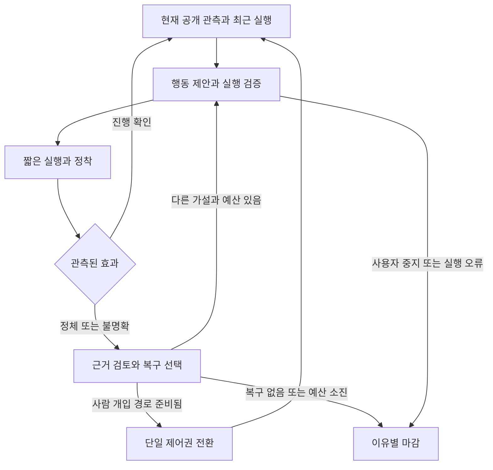

# E36 이후: 추가 득점을 위한 여러 접근과 수집 시스템 설계

> **2026-11-16 후속 방향:** 기존 계획은 HOLD다. [checkpoint 복원과 실행 효과 피드백 분석](2026-11-16-checkpoint-effect-feedback.ko.md)을 우선 진행하며 근거와 미결 사항을 계속 기록한다. 분석 정리 후 사용자가 클린 서버에서 반영한다. 아래 문서는 선행 분석과 선택지로 보존하며 자동 실행 계획이 아니다.

작성일: 2026-11-15. 이 문서는 E36 종료·득점 분석, HolidayFactory 검토, 사람 직접 조작에 관한 대화와 사용자의 후속 방향을 개발용 참고로 기록한다.

**사용자 방향은 한 가지 방법의 확정이 아니다.** E36에서 얻은 관측과 시연을 이어 받아 추가 착의 득점과 더 긴 성공 경로를 찾되, 사람 조작·Astra·사용자 피드백·복구 감독·후속 학습 등 여러 방법을 비교하고 조합할 수 있는 시스템을 검토한다. 어느 방법이든 실제 증거와 비용으로 선택하며, 특정 논문이나 단일 전략을 필수 경로로 고정하지 않는다.

**이번 반영은 분석·설계 문서다.** E36 원본은 이미 정상 마감됐으며, 이 문서 작성으로 새 시연·학습·실시간 제어권 전환·종료 로직 변경을 실행한 것은 아니다. 현재 상태와 구체적인 후속 작업 범위는 [STATUS](../../project/STATUS.md)와 [COLLECTION_PLAN](../../COLLECTION_PLAN.md)을 따른다. 아래 이름·표·도식은 미구현 설계이며 실행 명령이나 새 API 계약이 아니다.

[메인](../../../README.md) · [E36 공개 리뷰](../reviews/20261114-astra-wrist-body835-001.ko.md) · [HolidayFactory 참고와 적용 한계](2026-11-15-holidayfactory-phyrc.ko.md) · [이전 전체 재정비안](2026-11-14-collection-system-redesign.ko.md)

## 1. 확인된 사실과 아직 모르는 것

분석 기준은 E36 실행 소스 `f39b0e2fc9407adc1d9ced9765ff89824e90d05a`와 공개 검토 시점 `86ee362d763df74df946b56e33c7289eb425fa85`다. 근거는 선별 공개 관측·행동·manifest·평가 코드이며, 비공개 audit의 마지막 천/소매 기하를 이번 대화에서 새로 분석한 것은 아니다.

| 항목 | 확인된 E36 사실 | 해석 |
|---|---|---|
| 직접 parent / source group | E34 / E28 계열 | E36은 E35 말단의 자동 후속이 아니다 |
| 출발 | E34 행동 835전이를 새 환경에서 재생 | 정확한 천 상태 checkpoint 복원이 아니다 |
| 결정 예산 | 최대 20회, 실제 11회 = 10 act + finish | 9회가 남았고 결정 소진이 종료 원인이 아니다 |
| 전체 전이 예산 | 최대 1,400개, 실제 933개 | 467개가 남았지만 결정·행동 길이 제한도 별도로 적용된다 |
| 기록 구성 | 835 replay + 50 model + 48 settle | 새 suffix는 98전이, 4.90 simulation seconds |
| 새 이동 명령 구간 | 앞 8채널 중 비영 값이 있는 act 36전이 = 1.80초 | 실제 물리 운동이 이 시간에만 있었다는 뜻은 아니다 |
| 새 중립 구간 | model 중립 14 + settle 48 = 62전이, 3.10초 | 기존 목표 추종·천의 잔류 운동이 남을 수 있다 |
| 전체 시간 | 평가 경과 46.65초, 실제 client 경과 약 28.12분 | 모델 대기 중 물리는 멈춘다 |
| 종료 | 모델의 `finish_episode`, 실제 추가 전이 0 | 시간초과·review gate·사용자 개입 종료가 아니다 |
| 종료 라벨 | `operator_finished`, `human_intervention=false` | operator는 공통 API 라벨이며 사람이 끝냈다는 뜻이 아니다 |
| 결과 | raw 5/50, pickup 5, 착의 0, success=false | 픽업은 새 구간 이전 replay 26.85초에 획득 |
| 기술 품질 | capture complete, QC 933/933 | 정상 기록과 과제 성공은 별도다 |

새 구간은 평가 경과 41.75초부터 시작했다. 공개 관측의 absolute simulation time에는 reset 이후 offset이 있으므로 영상 시간·평가 시간·공개 상태의 시각을 같은 숫자로 취급하지 않는다. 남은 예산은 당시 미사용량이며 다음 run으로 자동 이월할 자원이 아니다.

근거: [manifest](../attempts/20261114-astra-wrist-body835-001/manifest.json), [허용 목록으로 정리한 decisions](../attempts/20261114-astra-wrist-body835-001/decisions.jsonl), [score events](../attempts/20261114-astra-wrist-body835-001/score-events.jsonl), [실행·마감 기록](../../project/sessions/20261114-e36-wrist-body.ko.md).

아직 확정하지 못한 것은 다음과 같다.

- 마지막 형상에서 현재 파지를 유지한 채 추가 득점이 가능했는가?
- 손이 실제 자유 입구로 들어갔는가, 잡힌 모서리나 그리퍼 본체 옆에 있었는가?
- 몸통 입구 진입은 있었지만 해당 소매로 이어지는 경로가 아직 없었는가?
- 소매 경로는 있었으나 손목 또는 손끝이 충분히 나오지 않았는가?
- 접힌 소매의 기하 판정이 유효한 교차를 검출하지 못한 것인가?

이 설명들은 경쟁하는 가설이다. 공개 영상에서 팔에 옷이 걸쳐 보이는 것만으로 어느 하나를 확정하거나, 몇 cm만 더 밀면 득점했을 것이라고 단정하지 않는다. 필요한 경우 비공개 평가·audit 원본을 이용한 별도 사후 진단으로 구분하며, 내부 기하를 actor의 좌표·행동 정답으로 전달하지 않는다.

## 2. 종료 판단과 득점 조건을 분리한다

### E36을 실제로 끝낸 조건

마지막 공개 결정은 두 로봇의 이동 불균형, 안내하는 쪽의 되밀림, 같은 손이 경계 옆에 남은 상태와 재파지 금지 조건을 근거로 유용한 후속 방법을 찾지 못했다고 설명한다. 이는 모델의 관측 기반 판단이지 기계적 복구 불가능의 증명은 아니다.

현재 [codex_client.py의 종료 dispatch](https://github.com/leonyoon-3dai/PhyRC_2027_phase1/blob/f39b0e2fc9407adc1d9ced9765ff89824e90d05a/participant/collection/codex_client.py#L1326)는 `finish_episode`를 받으면 바로 종료 상태로 바꾸고 루프를 끝낸다. [boundary.py](https://github.com/leonyoon-3dai/PhyRC_2027_phase1/blob/f39b0e2fc9407adc1d9ced9765ff89824e90d05a/participant/collection/boundary.py#L82)의 `stop`은 중립 1전이, `finish_episode`는 기록 종료이며 서로 다르다. finish의 응답 스키마에 `steps=1`이 있어도 실제 물리 전이는 0이었다.

| 종료·중지 요인 | E36 적용 여부 | 후속 설계에서의 취급 |
|---|---|---|
| 모델의 정체 판단 후 finish | 실제 원인 | 최종 종료와 제한된 재검토를 구분할 후보 |
| 20결정 / 총 1,400전이 | 소진 안 됨 | 실험별 상한을 명시하고 남은 양을 관리 |
| raw 10점 review gate | 5점이므로 미발동 | 현 구현은 알림이 아닌 실제 수집 종료 |
| 모델 호출 timeout 180초 / 입력 대기 480초 | 발생 안 함 | 통신·실행 실패와 조작 정체를 구분 |
| 사용자 중지·실행 오류 | 발생 안 함 | 의미적 정체 복구로 무시하지 않고 정상 정리 |

`review_points=10`에 도달해도 현재는 수집이 마감된다. 첫 추가 점수 뒤 계속 착의를 수집하려면 이 설정 또는 검토·재개 기능을 후속 작업에서 검토해야 한다. 점수 검토를 일시 정지로 바꾸는 것은 미구현 제안이며, 이미 닫힌 환경에서 재생하는 것과 같은 기능이 아니다. [review gate 코드](https://github.com/leonyoon-3dai/PhyRC_2027_phase1/blob/f39b0e2fc9407adc1d9ced9765ff89824e90d05a/participant/collection/codex_client.py#L1015).

### 팔에 들어가는 외관과 점수의 차이

현재 평가의 첫 소매 +5점은 해당 소매를 통한 경로가 성립하고 손목과 손끝이 밖으로 나와야 얻는다. 몸통 입구로 손을 넣거나 전완에 천이 걸치는 것에는 독립된 부분점수가 없다. 위팔 덮기 점수도 해당 소매가 어깨–팔꿈치 구간 일부를 감싸는 별도 조건이다. 다른 착의 항목의 순서가 달라질 수 있으므로 모든 추가점이 반드시 첫 소매부터라고 고정하지 않는다.

첫 소매 점수에는 별도 0.5초 유지 조건이 없다. 0.5초는 앞면 방향과 전체 성공 판정에 적용된다. 점수는 획득하면 유지되므로 E36의 착의 0은 기록된 평가 시점들에서 착의 득점 조건이 성립하지 않았다는 뜻이다. 단순히 이미 얻은 점수를 마지막에 잃은 것이 아니다.

근거: [평가 정의](../../competition/EVALUATION.md), [첫 소매 판정](https://github.com/leonyoon-3dai/PhyRC_2027_phase1/blob/f39b0e2fc9407adc1d9ced9765ff89824e90d05a/src/PhyRC_Sim/Policy/evaluation.py#L208), [소매 경로·hand-out 기하](https://github.com/leonyoon-3dai/PhyRC_2027_phase1/blob/f39b0e2fc9407adc1d9ced9765ff89824e90d05a/src/PhyRC_Sim/Policy/evaluation_geometry.py#L254). 이 문서는 공식 판정이나 dwell 조건을 수정하는 제안이 아니다.

## 3. 조작은 바뀌었지만 충분한 대안이 시험되지는 않았다

| 구간 | 실제 대응 | 남는 질문 |
|---|---|---|
| D0–D2 | 공동 몸쪽 이동·하강 3회 | 선택한 이동이 같은 전완의 유효 진입 방향인가? |
| D3–D4 | 중립 관찰, robot_1 wrist yaw 변경 | 자유 경계와 손의 관계가 개선됐는가? |
| D5–D6 | 재진입, robot_1 arm 수축 | 그리퍼 주변 여유와 실제 파지점 이동이 회복됐는가? |
| D7–D9 | robot_0 wrist yaw, 중립 관찰, 한쪽 높이를 유지한 공동 이동 | 다른 접근이 전완 진행을 만들었는가? |
| D10 | blocked로 finish | 남은 방법을 실제로 소진했는가, 모델이 찾지 못했는가? |

모델이 전후 관측에 전혀 반응하지 않은 것은 아니다. 그러나 새 10 act의 base yaw 명령은 모두 0이었다. 손목 회전은 두 차례 있었지만, 베이스 방향을 바꾸어 서는 접근까지 충분히 시험했다고 말할 수는 없다. 반대로 base yaw가 반드시 해법이라는 증거도 없다.

D5에서 robot_1 lift는 약 −16.97mm, `grasp_pose_base` Z는 약 −0.97mm였다. 이는 **베이스 기준 파지점**의 변화이므로 베이스가 움직이는 상황의 world 파지점 변위와 혼동하지 않는다. 공개 pose가 충분하면 다음 관계로 같은 좌표계에서 비교한다.

```text
T_world_grasp = T_world_base × T_base_grasp
```

명령 구간과 정착 구간을 분리해 파지점·두 로봇의 상대 자세·천의 국소 변화·같은 손 관계를 확인해야 한다. 되밀림과 목표 추종 오차는 접촉/구속의 단서이지만 특정 부품 충돌을 확정하지 않는다. [운동 수치와 한계](../reviews/20261114-astra-wrist-body835-001.ko.md).

E36의 재파지 0회는 [프롬프트](../attempts/20261114-astra-wrist-body835-001/prompt.txt)의 실험 제약이었다. 런타임에서 모든 열기를 차단하는 기능이 아니며 후속 실험의 영구 규칙도 아니다. 같은 프롬프트의 2–3회 정체 진단 역시 자동 종료 타이머가 아니다. 마지막 종료가 이 제약을 언급한 것은 확인되지만 프롬프트 충돌 버그나 단일 실패 원인으로 단정하지 않는다.

또한 [매 결정 입력 구성](https://github.com/leonyoon-3dai/PhyRC_2027_phase1/blob/f39b0e2fc9407adc1d9ced9765ff89824e90d05a/participant/collection/codex_client.py#L1112)은 결정 번호를 전달하지만 전체/남은 결정·전이 수치를 명시하지 않는다. 후속 설계에서는 공개 운영 메타데이터로 이를 명확히 할 수 있다. 평가 점수나 숨은 기하를 입력하는 것과는 별개다.

## 4. 열어 둘 방법과 현재 준비 수준

다음 후보들은 배타적 선택지가 아니다. 한 실험에서는 변경 요소를 좁혀 원인을 비교하고, 효과가 확인된 구성요소를 이후 조합한다. 이 표는 필수 순서나 실행 승인 목록이 아니다.

| 경로 | 시험할 수 있는 질문 | 현재 수준 / 필요한 확인 |
|---|---|---|
| Astra 단독 조작 | 공개 근거 정리·행동 목표·종료 해석을 바꾸면 진입이 나아지는가? | 기존 수집 경로 존재. 새 감독 기능은 미구현 |
| 사람 단독 키보드 | 같은 파지 또는 다른 파지에서 사람이 유효한 진입·복구를 찾는가? | 과거 사람 기록·GUI 구성요소 존재. 현재 사용자 접속부터 기록까지 연결은 별도 검증 |
| decision 경계 텍스트 피드백 | 관측에 근거한 사람의 제안이 다음 행동을 개선하는가? | [후보 패치](candidates/20261113-actor-feedback/README.ko.md)는 미적용, 실제 모델 전달 미검증 |
| Astra–사람 제어권 전환 | 모델이 만든 상태에서 사람이 짧게 복구하고 다시 넘길 수 있는가? | 실시간 handoff 미구현. 단일 제어원·큐·경계 기록 필요 |
| 제한된 복구 감독 | 정체를 최종 종료하기 전 다른 가설을 시험하면 효과가 있는가? | 종료 이유·가용 예산·공개 증거를 연결하는 신규 설계 |
| 관측 효과 기반 짧은 동작 단위 | 명확한 목표와 종료 기준이 있는 작은 동작이 재현되는가? | 후보. 고정 world 좌표나 숨은 기하로 정답 행동을 만들지 않음 |
| 후속 VLA·RL | 검수한 진행·복구 데이터가 정책의 성공률과 강건성을 개선하는가? | 학습 데이터 승인·평가 설계가 필요. 현재 새 학습·성능 검증 없음 |

사람 조작이 유용한 이유는 정답을 미리 안다고 가정해서가 아니다. 현재 파지에서 방향만 바꿔 진행되면 행동 선택의 여지를 보이고, 재파지가 필요하면 제약을 재검토할 근거가 된다. 사람이 실패해도 물리적 불가능은 증명되지 않는다. 같은 입력 비교를 주장할 때 사람과 모델 모두 지정 공개 관측을 사용한다.

원래 파지를 유지하는 비교, 한쪽을 다시 잡는 비교, 다른 시작 경계를 택하는 비교는 조건이 다르다. 어느 하나만을 영구 허용·금지하지 않고 각 시험 카드에 조건·복구 횟수·예산을 명시한다. 키보드에서는 키 누름/해제·포커스 이탈·연결 중단·두 로봇 매핑·잔류 목표 추종부터 검증한다. 표시 순서는 왼쪽 robot_1 / 오른쪽 robot_0, 실제 action 행은 robot_0 / robot_1이다.

## 5. 여러 방법이 같은 원본과 평가를 쓰는 시스템

아래 모듈 경계는 **제안**이다. 사람·Astra·향후 학습 정책을 바꿔도 관측·행동 검증·기록·공식 평가가 일관되도록 하는 것이 목적이다.

| 경계 | 공통 계약으로 남길 것 | 분리해야 할 것 |
|---|---|---|
| 관측 공급 | 지정 RGB-D, 공개 로봇 상태, 관측 ID와 시각 | 평가·audit·내부 천/접촉 기하 |
| 행동 제안 | 제어 주체, 동작 목적, 공식 action과 길이 | 의도와 실제 적용 행동 |
| 실행·정착 | 검증된 행동, 실제 전이, 잔류 운동, 종료 상태 | 모델 호출 시간과 물리 진행 시간 |
| 공개 근거 기록 | 명령 대비 실제 pose, 천/손 관계, 시점별 불확실성 | 측정값과 시각적 가설 |
| 진행·복구 감독 | 현재 목표, 허용 복구, 남은 예산, 종료 요청 | 모델의 의미적 정체와 기술적 중단 |
| 제어권 관리 | 한 환경 한 제어원, 전환 경계, 대기 입력 처리 | 사람·모델의 동시 명령 |
| 평가·검수 | 공식 raw/착의점/success, 종료 원인, QC, 학습 승인 | 공식 결과와 모델의 stage·진행 추정 |

상태 기록은 `supported=true` 같은 영구 boolean보다 다음 근거를 가진 기록이어야 한다.

- 대상 관계: 같은 손 추적, 국소 천 동행, 파지점 운동, 자유 경계 진행 등.
- 관측 경계와 카메라: 어떤 현재/과거 프레임을 비교했는가?
- 판단: 관측됨 / 반증됨 / 가림 / 불명확. 확률 숫자가 없으면 만들어 넣지 않는다.
- 실제 측정과 가설: pose 수치는 측정, 입구 정체나 접촉 대상은 가설일 수 있다.
- 재검사 조건: 파지 변경, 큰 회전, 가림, 제어권 전환 뒤에는 이전 판단을 다시 확인한다.
- 유지할 관계와 바꿀 요소: 실패한 부분을 바꿀 때 어떤 지원 관계를 보존할 것인가?

감독기의 실행 후보 흐름은 다음과 같다. 공식 평가 정보는 별도 평가 경로에 보관하며 이 도식의 actor 관측으로 역주입하지 않는다.



`blocked_but_supported`, `unclear`, `actor_finish_requested`, `budget_end`, `runtime_error`, `official_success` 같은 이유 구분을 검토할 수 있다. 이름은 예시이며 현재 로그 스키마라고 설명하지 않는다. 성공을 요청하는 모델도 공식 성공 판정의 대체자가 아니다.

정체 종료를 재검토한다면 기존 총예산 안에서 한 번의 제한된 복구 기회를 주는 등의 작은 비교부터 가능하다. 숫자를 보편 규칙으로 고정하지 않고 재검토 횟수·허용 동작·마감 여유를 실험마다 정한다. 사용자 중지·통신 상태 불명·검증 실패·환경 종료는 이 경로를 이용해 무시하지 않는다. 예산 연장은 관측된 진행과 실제 비용을 검토해 정하며, 남은 예산이나 과거 배치 횟수를 새 run에 자동 합산하지 않는다.

## 6. E36을 이어간다는 말의 세 가지 의미

| 방식 | 의미 | 현재 해석 |
|---|---|---|
| 종료 원본에서 행동 prefix 재생 | 새 환경에서 선택한 경계까지 공식 행동을 재실행 | 기존 방식. 천·접촉·grasp 결과가 달라질 수 있으므로 현재 상태 재확인 |
| 살아 있는 환경에서 pause 후 resume | 같은 실행 상태를 유지한 채 판단·제어원을 바꿔 이어감 | 후속 설계 후보. 마감된 E36에 소급 적용할 수 없음 |
| 정확한 physics checkpoint 복원 | 천·접촉·solver·제어기까지 동일 상태를 복원 | 현재 보장하지 않는 기능. 단순 pose나 action replay와 구분 |

E36 원본은 닫혀 있다. 후속 작업은 고유 새 run에서 부모와 선택 경계를 명시해야 한다. E36 마지막 933을 무조건 출발점으로 고정하지 않는다. E36 중 더 유용한 경계, 직접 부모 E34/835, 다른 정상 기록의 비교 경계도 검토할 수 있다. 먼저 정상 원본·해시·QC를 확인하고, 선택 이유와 새 replay 직후 상태를 남긴다. E09·E32의 불완전 원본은 정상 replay·학습 출처에서 계속 제외한다.

목표는 새로 확인되는 착의 득점을 확보하고 그 뒤 다음 착의 단계까지 연결하는 것이다. 첫 소매 +5점은 현재 병목에 맞는 유력한 단기 목표이지만, 다른 유효한 착의 경로나 득점 순서를 배제하지 않는다. 10점 도달 후 검토·보존·계속 진행을 어떻게 처리할지도 실행 전에 정의해야 한다.

## 7. 비교 실험 카드와 선택 기준

다음은 문서용 시험 카드 템플릿이다. 채워진 실행 설정이나 자동 재개 파일이 아니다.

| 항목 | 실행 전에 정할 내용 |
|---|---|
| 질문 | 이번 비교로 구분할 실패 설명 한 가지 |
| 부모·경계 | 정상 원본 run, prefix 범위, source group, 선택 이유 |
| 새 출발 확인 | 재생 후 지지·같은 손·입구 후보의 관측 근거와 차이 |
| 제어원 | 사람 / Astra / 명시된 전환 방식. 실제 사용 경로 |
| 변경 요소 | 접근 방향, 파지 조건, 종료 검토, 근거 전달 등 비교할 요소 |
| 유지 조건 | 공개 관측, 공식 제어·물리·평가, 비교 예산 등 |
| 조작·복구 제약 | 재파지 허용 조건, 지지 확인, 회복 횟수와 중지 조건 |
| 예산 | 결정·전체 전이·새 전이·모델/사람 wall 시간·정리 여유 |
| 검토와 마감 | 점수 gate, 정체, 오류, 사용자 중지, 미완료 처리 |
| 판단 근거 | 공식 점수와 별도 실행/관측 지표, 가설 반증 조건 |
| 재현성 | 반복 조건, replay 편차, 새로운 독립 출발 여부 |

예시 비교 축은 다음과 같다. 모든 행을 실행해야 하는 계획이나 고정된 A→B→C 순서는 아니다.

| 비교 축 | 대안 | 구분할 질문 |
|---|---|---|
| 종료 | 기존 즉시 finish / 한 번의 제한된 재검토 | 유효한 다음 행동 기회를 놓치는가? |
| 근거 | 기존 프롬프트 / 공개 실행 효과를 구조화한 입력 | 구체 진단이 실제 행동 선택을 바꾸는가? |
| 제어 | 사람 / Astra / 검증된 개입 | 같은 어려운 상태에서 서로 어떤 회복을 찾는가? |
| 파지 | 현재 파지 유지 / 지지 조건을 둔 한쪽 변경 | 파지 제약이 접근의 병목인가? |
| 방향 | 현재 자세 / 베이스 또는 입구 상대 자세 변경 | 같은 손과 자유 경계의 정렬이 개선되는가? |
| 시간 | 같은 예산 / 진행 근거가 있는 제한적 연장 | 시간 부족과 방법 부재를 구분할 수 있는가? |

여러 요소를 동시에 바꾸면 시스템 전체 개선 여부는 볼 수 있지만 어느 요소가 원인인지는 구분하기 어렵다. 초기 비교에서는 가능한 한 한 요소를 바꾸고, 이후 유용한 조합을 시험한다. 환경 replay 편차가 있으므로 같은 prefix라는 이유만으로 정확히 같은 상태의 A/B라고 부르지 않는다.

## 8. 성과와 데이터 가치를 따로 평가한다

| 층 | 남길 지표 | 혼동하지 않을 것 |
|---|---|---|
| 공식 과제 | raw 점수, 새 착의 항목, first award 시각, success, points/s | 파일 complete·모델의 성공 선언 |
| 실행 효과 | 실제 grasp 운동, 명령/정착 변위, 두 로봇 상대 변화 | 명령 크기만으로 추정한 이동 |
| 공개 관측 | 같은 손 유지, 천 동행, 경계 진행, 가림·불명확 | 숨은 소매 routing의 정답 |
| 복구 | 시도한 가설, 바꾼 요소, 진행 회복·지지 손실 | 실패 뒤 나온 모든 행동이 유용한 복구라는 가정 |
| 수집 비용 | 새 물리 전이, replay 비용, 모델 호출, 사람 시간, wall 시간 | 기다린 현실 시간과 simulation 시간 |
| 데이터 품질 | 연속성·타임스탬프·실제 행동·제어 주체·QC | 학습 승인이나 성능 개선 |

사람 성공·복구 시연은 막힌 상태 이전의 관측, 수정 행동, 이후 효과를 함께 남겨야 한다. 회복 후 좋은 부분만 저장하면 언제 그 행동이 필요한지 사라진다. 반대로 실패 에피소드 전체를 동일한 모방 대상으로 취급하면 정체 반복이나 조기 종료도 함께 학습할 수 있다. 진행·복구·정체·개입·마감 구간을 원본과 연결해 별도로 검수한다.

E34–E36에는 착의 득점 양성 사례가 없으므로 이 기록만으로 성공 판별기의 정확도를 검증할 수 없다. 공개 관측상의 동작 효과와 불확실성부터 점검하고, 실제 득점 사례가 생기면 성공 오판·진행 중 정체 오판·unknown 비율을 함께 평가한다. 여러 모델의 합의는 독립 참값이 아니다.

E28 계열의 반복 prefix·인접 프레임·분기는 독립 성공 표본으로 세지 않는다. train/validation 분리와 통계 보고는 source group과 전체 run의 의존성을 고려한다. VLA/RL은 검수한 공개 입력·실제 행동을 사용하고, 공식 결과는 허용된 보상·평가 용도로 구분한다. 내부 기하를 actor/critic/world model/증류 교사 입력으로 사용하지 않는다. 소수 성공 시연만으로 일반화나 추가 득점의 지속성을 보장하지 않는다.

## 9. 후속 개발 시 코드에서 확인할 경계

| 현재 코드·문서 | 확인할 내용 |
|---|---|
| [codex_client.py](https://github.com/leonyoon-3dai/PhyRC_2027_phase1/blob/f39b0e2fc9407adc1d9ced9765ff89824e90d05a/participant/collection/codex_client.py) | 프롬프트 구성, 남은 예산 전달, finish/review 처리, action·settle 경계 |
| [boundary.py](https://github.com/leonyoon-3dai/PhyRC_2027_phase1/blob/f39b0e2fc9407adc1d9ced9765ff89824e90d05a/participant/collection/boundary.py) | observe/act/stop/finish의 실제 의미와 writer 생명주기 |
| [collect_operator.py](https://github.com/leonyoon-3dai/PhyRC_2027_phase1/blob/f39b0e2fc9407adc1d9ced9765ff89824e90d05a/scripts/collect_operator.py) | 제어 요청, 입력 대기, 종료 라벨, 환경·기록 마감 |
| [ASTRA](../../ASTRA.md) | 모델 입력부터 실제 공식 action·20/60/240 Hz·기록까지의 경로 |
| [OPERATIONS](../../OPERATIONS.md) | 클린 서버 준비, 원본 복원, 현재 실제 입력 경로 확인 |
| [공식 정책 계약](../../competition/POLICY.md) | 제어 주체가 바뀌어도 유지할 관측·행동 범위 |

후속 구현을 시작하면 먼저 현재 head와 기존 후보 패치의 차이를 확인하고 선택한 작은 기능만 검증한다. CPU 검사, 실제 키 입력, 실제 모델 전달, GPU 시연, 과제 성능을 각각 별도 증거로 남긴다. 이 문서에 설계를 적었다는 사실은 어느 단계의 실행 성공도 대신하지 않는다.

## 10. 이 기록의 결론

E36은 명령이 실행되지 않은 기록도, 모든 복구 경로가 불가능하다고 증명한 기록도 아니다. 실제 조작과 대응은 있었고 소매 통과는 확인되지 않았으며, 모델이 실험 제약 안에서 다음 방법을 찾지 못해 예산 전에 마감했다.

후속 방향은 E36의 경험을 보존하면서 여러 제어·복구·검증 방법을 비교할 수 있게 만드는 것이다. 현재 파지 유지, 사람 직접 조작, 모델 감독, 제한된 재파지, 다른 접근, 후속 학습 중 어느 하나를 미리 정답으로 고정하지 않는다. 추가 득점과 그 이후의 지속 진행은 실행 결과로 확인하며, 성공 여부뿐 아니라 어떤 방법이 어떤 상태에서 유효했는지 남긴다.
