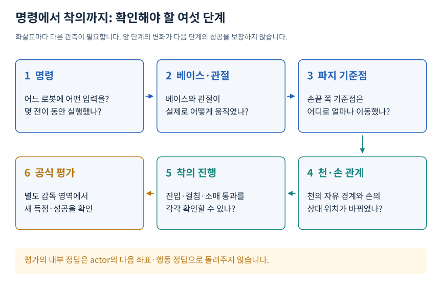
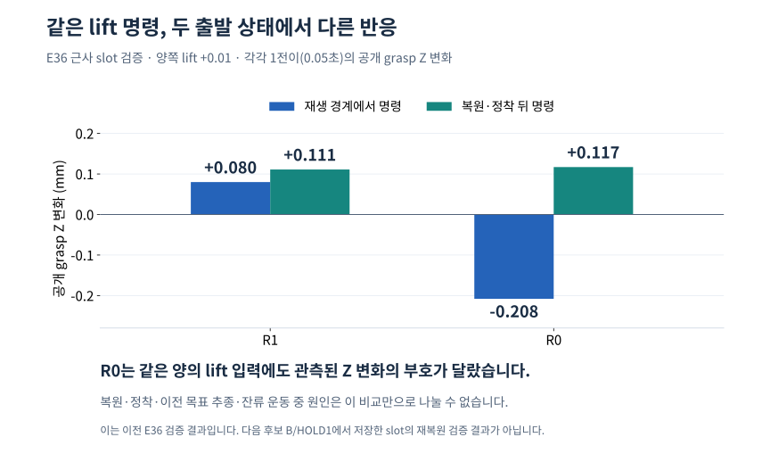
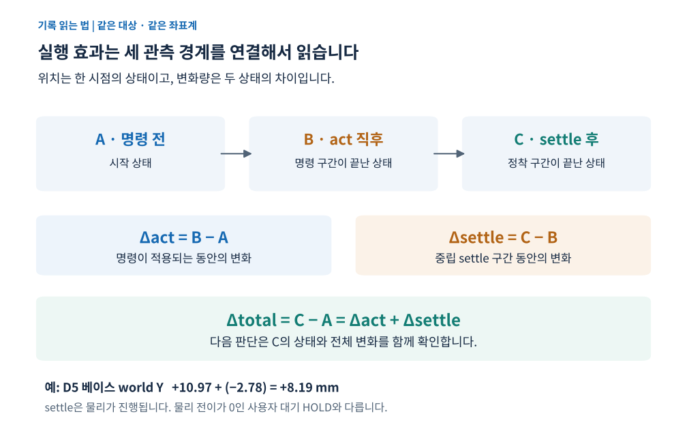
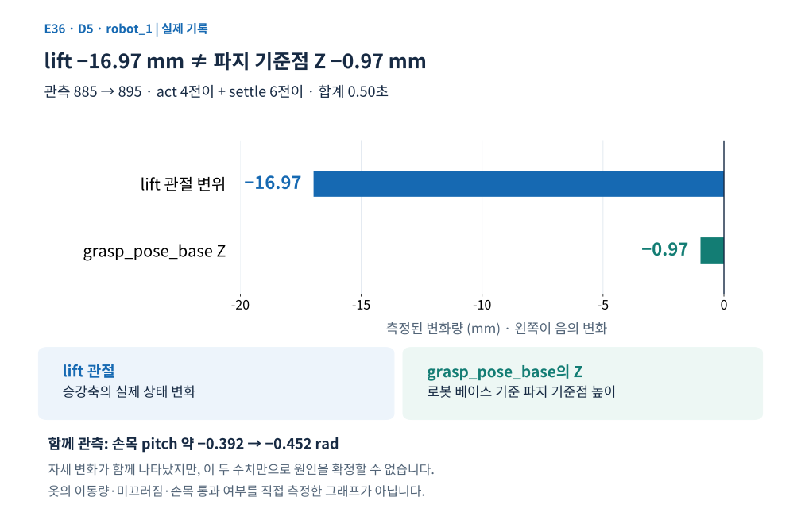
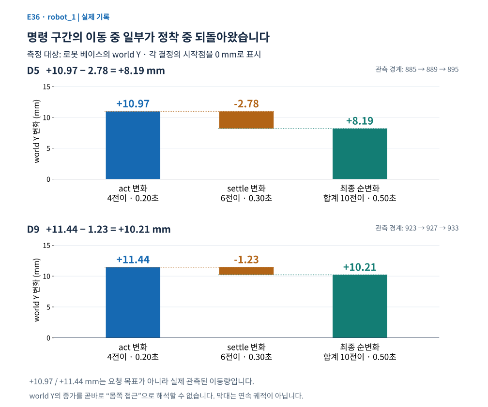
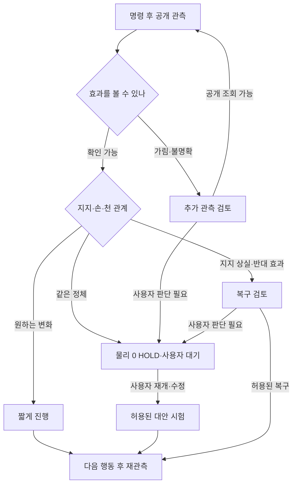
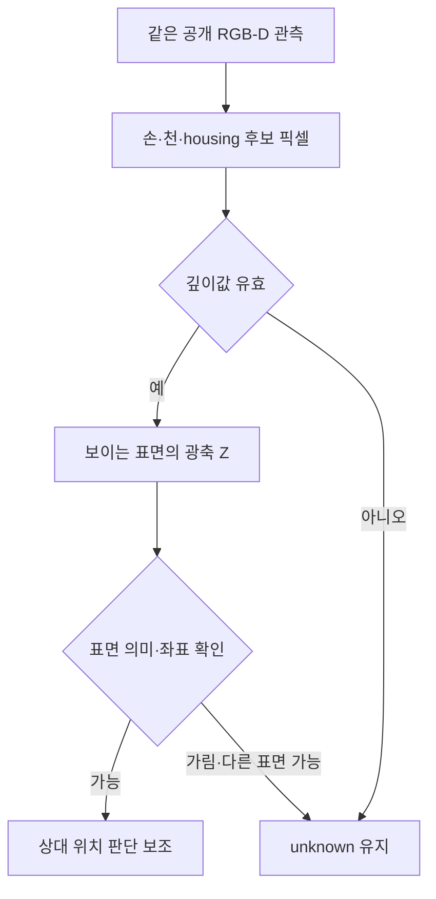
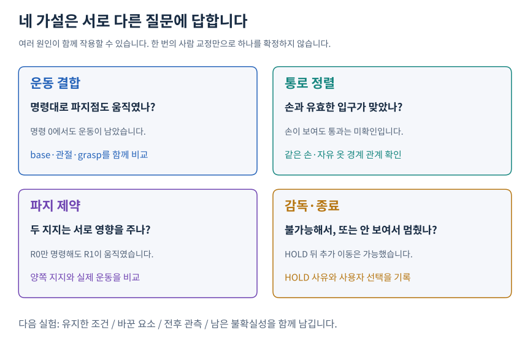

# 2026-11-16 연구방향 재정비: checkpoint와 실행 효과 피드백

**Checkpoint는 시작 상태를 다시 만들고, 실행 효과 피드백은 그 상태에서 실제로 무엇이 달라졌는지 보고 다음 행동을 고른다.** 이 문서는 두 방법을 함께 연구하게 된 근거와 비교 방법을 설명한다.

> **읽는 시점 — 2026-11-17 시각 설명 보강:** 본문의 출발점은 11월 16일 초기 분석이다. 이후 checkpoint·사용자 HOLD·게시·텍스트 재개가 구현·검증됐고 M/B 두 시연도 종료됐다. 현재 live HOLD는 없다. 다음 출발 후보인 **B/HOLD1·110전이 슬롯은 저장·해시 확인만 완료했고 복원은 미검증**이다. 실제 다음 실행은 [현재 계획](../../COLLECTION_PLAN.md)과 [현재 상태](../../project/STATUS.md)를 따른다.

이번 보강은 기존 기록으로 그림·그래프·예제를 만든 **문서 작업**이다. 새 조작·시뮬레이션·학습을 실행하지 않았다. [보강 전 원문](https://github.com/leonyoon-3dai/PhyRC_2027_phase1/blob/033103174282f21325906bf9b85c0135232859a1/docs/collection/research/2026-11-16-checkpoint-effect-feedback.ko.md)도 고정 revision으로 남아 있다.

여기서 **M은 기존 M1 시연**, **B는 뒤이어 만든 R0 단독 접근 분기**다. 두 실행의 ID와 움직임은 [이동 장부](../reviews/20261116-user-guided-movement-ledger.ko.md)에 연결돼 있다. **D는 각 실행의 모델 결정 번호**이므로 아래 E36 D5를 M/B의 D5와 혼동하지 않는다.

[메인](../../../README.md) · [현재 계획](../../COLLECTION_PLAN.md) · [기전 설명](../../MECHANISMS.ko.md) · [클린 서버 안내](../../OPERATIONS.md) · [11월 15일 분석과 선택지](2026-11-15-e36-continuation-options.ko.md)

### 먼저 볼 그림과 예제

| 궁금한 것 | 읽을 곳 | 핵심 질문 |
|---|---|---|
| 같은 장면에서 다시 시도하려면? | 2–3절 checkpoint | 복원된 모양과 다음 행동의 반응도 비슷한가? |
| 내리라고 했는데 왜 잘 안 내려갔나? | [4절 실행 효과 피드백](#4-실행-효과-피드백-무엇이-달랐는지-기록한다), 예제 A | 리프트와 파지점은 각각 얼마나 움직였나? |
| 움직인 뒤 왜 일부 돌아왔나? | 4절 예제 B | 명령 구간과 settle을 따로 봤나? |
| 결과를 보고 실제로 행동을 바꿨나? | 4절 예제 C | D5 관측이 D6 팔 수축으로 어떻게 이어졌나? |
| 더 보고, 고치고, 멈추는 기준은? | 4.6절·5절·8절 | 진행·정체·관측 불충분을 구분했나? |

**그림의 표시:** 수치 그래프는 기존 실측 기록, 흐름도는 설명용 판단 구조다. 예상 효과·원인 후보·향후 비교는 실측과 구분한다. 사람 조작·Astra·복구·학습의 선택지를 보존하며 한 가지 방법을 영구적인 정답으로 확정하지 않는다.

## 1. 이번에 갱신한 판단

**11월 16일 초기 분석 당시의 판단**이다. 이후 진행 여부는 바로 아래 표로 구분한다.

| 구분 | 당시 판단 | 당시 미결 항목 |
|---|---|---|
| 기존 시연 재개 계획 | 분석을 정리하는 동안 보류 | 새 시연 날짜·횟수·출발 경계·구체 예산 |
| Checkpoint | 기존 상태 슬롯을 활용할 수 있는지 우선 검토 | 수집기 연결, 필요한 저장 항목, 복원 허용 오차와 효과 |
| 실행 효과 피드백 | 의도·명령·실제 변화·다음 선택을 연결하는 실험 설계 | 측정 항목과 판단 기준, 구현 범위, 성능 개선 여부 |
| 실제 적용 | 분석 정리 후 클린 서버에서 별도 수행 | 현재 문서 작성만으로 기능이 적용됐다고 설명하지 않음 |

예전 배치의 남은 횟수, 11월 14일 사람 조작 우선 일정, 11월 15일 비교 후보를 현재 실행 명령으로 사용하지 않는다. 기존 문서와 원본은 이력·근거로 보존한다.

| 후속 확인 항목 | 2026-11-17 문서 보강 시 확인한 상태 |
|---|---|
| E36/933을 새로 재생해 만든 근사 슬롯 | 실제 저장·복원·짧은 행동 비교 완료. 정확한 원래 E36 물리 상태 복원은 아님 |
| 사용자 HOLD·5카메라 게시·텍스트 재개 | 구현·검증 및 후속 시연 수행. 현재 두 run 모두 종료 |
| 다음 B/HOLD1·110전이 출발 슬롯 | 저장·해시 확인 완료, **실제 복원 미검증** |
| 효과 피드백의 착의 성능 개선 | 새 착의점 획득으로 입증되지 않음. 세부 교정 정책·비교 연구는 남음 |

근거: [checkpoint 검증](../reviews/20261116-checkpoint-validation.ko.md) · [현재 상태](../../project/STATUS.md) · [최근 이동 장부](../reviews/20261116-user-guided-movement-ledger.ko.md).

## 2. Checkpoint에 관해 확인된 사실

Checkpoint 기능 자체가 없었던 것은 아니다. 사람 조작용 상태 슬롯은 천 입자의 위치·속도, 로봇 root pose와 관절 상태, 제어 목표, 파지 입자·offset 등을 저장한다. 그러나 복원 시 베이스 속도와 이동 명령을 초기화하고 일부 제어 이력·접촉 캐시를 지우며, 환경 경로에서는 중립 정착 구간을 거친다. 따라서 전체 물리 계산의 내부 이력까지 동일하게 재개하는 기능으로 취급하지 않는다.

- [상태 저장](https://github.com/leonyoon-3dai/PhyRC_2027_phase1/blob/8f7bd55dfb6d13aac0c44158ea35c258b88b16cf/src/PhyRC_Sim/Env_StandAlone/Teleop_TShirt_Stretch4_Env.py#L1366)과 [복원 중 초기화](https://github.com/leonyoon-3dai/PhyRC_2027_phase1/blob/8f7bd55dfb6d13aac0c44158ea35c258b88b16cf/src/PhyRC_Sim/Env_StandAlone/Teleop_TShirt_Stretch4_Env.py#L1534).
- [슬롯 로더](https://github.com/leonyoon-3dai/PhyRC_2027_phase1/blob/8f7bd55dfb6d13aac0c44158ea35c258b88b16cf/src/PhyRC_Sim/Policy/stages.py#L54)는 접촉 캐시·명령 이력 정리를 명시한다.
- [환경의 슬롯 reset](https://github.com/leonyoon-3dai/PhyRC_2027_phase1/blob/8f7bd55dfb6d13aac0c44158ea35c258b88b16cf/src/PhyRC_Sim/Policy/environment.py#L221)은 정착 뒤 새 관측을 얻고 평가기를 reset한다. 메타데이터에도 FEM history의 bitwise 복원이 아님을 남긴다.

기존 자동 수집은 마감·QC·해시를 확인한 행동 prefix를 새 환경에서 재실행하는 경로를 사용했다. 초기 이어가기 대상 E05에는 완전한 물리 checkpoint가 없었으며, 이 경로가 E36까지 사용됐다. 이는 checkpoint보다 재생이 우수하다는 비교 실험의 결론이 아니다. [당시 선택 근거](../guides/continuation-and-branches.ko.md) · [행동 prefix 로더](https://github.com/leonyoon-3dai/PhyRC_2027_phase1/blob/8f7bd55dfb6d13aac0c44158ea35c258b88b16cf/participant/collection/continuation.py)

| 방식 | 검토할 가치 | 구분할 한계 |
|---|---|---|
| 행동 prefix 재생 | 현재 작동하는 비교 기준과 복원 실패 시 대안 | 재생 비용과 물리 상태 편차 |
| 기존 슬롯 기반 checkpoint | 긴 prefix 없이 유용한 상태에서 여러 행동을 시험할 후보 | 복원 과정의 초기화·정착이 접촉과 파지에 미치는 영향 |
| 살아 있는 환경의 물리 0 HOLD·텍스트 재개 | 초기에는 후보였고 후속 구현·시연에서 검증됨 | 종료된 실행에는 소급 적용 불가. 사람 키보드–Astra 실시간 제어권 전환과는 별개 |
| 완전한 물리 checkpoint | 장기적으로 검토할 정확한 상태 재개 | 현재 구현·검증된 기능으로 주장하지 않음 |

비트 단위 일치가 안 된다는 이유만으로 근사 checkpoint를 배제하지 않는다. 복원 뒤 **실험에 중요한 상태와 다음 행동의 효과가 충분히 재현되는지**를 확인한다. 기존 E36 행동을 재생한 뒤 새 슬롯을 저장한다면, 그것은 그 새 실행에서 만들어진 상태이며 원래 E36의 정확한 말단 복원이라고 부르지 않는다.

## 3. Checkpoint 비교 실험의 설계 후보

아래는 **초기 분석에서 제안한 비교 설계**다. 이후 E36/933 재생 경계에서 저장·복원·정착·짧은 행동 비교를 수행했다. 모든 접촉 상태와 반복 횟수에 대한 검증이 끝난 것은 아니다.

예를 들어 같은 lift 입력을 1전이 주었는데 R0 grasp Z 변화는 재생 경계에서 약 −0.208mm, 복원·정착 뒤에는 약 +0.117mm였다. **출발 화면이 비슷해도 아주 짧은 다음 행동의 반응은 달라질 수 있다.** 이 차이를 새 명령의 효과로만 설명하지 않고 잔류 운동·초기화·정착 영향을 함께 검토한다. [실제 검증 기록](../reviews/20261116-checkpoint-validation.ko.md). 이 검증을 다음 B/HOLD1 슬롯의 복원 검증으로 대신할 수 없다.

| 비교 단계 | 쉬운 예 | 분리하려는 영향 |
|---|---|---|
| 저장 전 ↔ 복원 직후 | 같은 파지 기준점 위치가 돌아왔나? | 저장·복원 및 초기화 |
| 복원 직후 ↔ settle 후 | 중립으로 두었는데 자세가 달라졌나? | 정착 중 물리·제어 반응 |
| 각 출발점에 같은 짧은 행동 | 같은 lift 입력 뒤 같은 방향으로 움직이나? | 실제 다음 행동의 재현성 |

다음 여섯 항목은 비교 실험을 설계할 때의 점검 순서다. 모든 항목을 한 번에 구현해야 한다는 뜻은 아니다.

1. 정상 원본의 유용한 경계를 선택하고, source run·전이 경계·source group·소스/자산 버전·저장 범위를 기록한다.
2. 파지 후 안정된 상태와 손·옷이 접촉하며 움직이는 상태를 구분한다. 안정된 장면만 통과한 결과로 접촉 중 복원을 보장하지 않는다.
3. 저장 직전, 복원 직후, 정착 직후를 각각 기록한다. 정착 자체가 상태를 얼마나 바꾸는지 따로 측정한다.
4. 베이스·관절·파지 기준점 pose/속도, 공개 영상의 옷 형상과 지지 유지, 과도한 튐·관통 징후를 비교한다. 내부 진단 자료가 필요하면 actor 입력과 분리한다.
5. 각 출발 상태에서 같은 짧은 시험 행동을 적용해 다음 관측과 실제 이동을 비교한다. 정지 화면이 비슷한지뿐 아니라 이후 동작이 비슷한지도 확인한다.
6. 복원 비용·성공/실패·상태 편차를 prefix replay와 비교한다. checkpoint 검증에 실패한 경우 기존 재생 경로를 비교 기준으로 남긴다.

**중간 상태 실험과 공식 전체 과제 평가를 구분한다.** 슬롯 reset은 평가기를 다시 시작하므로 기존 점수와 경과 시간이 자동으로 이어진다고 가정하지 않는다. 중간부터 시작한 결과를 초기 상태부터의 완주·점수율과 합산하지 않으며, 시계를 0으로 만든 이점을 공식 성능 개선으로 보고하지 않는다. 이후 공식 전체 rollout에서 별도로 검증해야 한다.

Checkpoint의 내부 상태는 신뢰된 저장·복원 경로에서만 다룬다. actor에는 계속 지정 공개 관측만 주고, 천 입자·접촉·파지 내부 상태를 행동 정답으로 전달하지 않는다. 공식 평가·제출 경로를 임의로 바꾸는 제안이 아니다.

## 4. 실행 효과 피드백: 무엇이 달랐는지 기록한다

**“아래로 내리라고 했다”와 “파지점이 내려갔다”, “옷이 손목을 통과했다”는 각각 확인해야 할 다른 사실이다.** 실행 효과 피드백은 이 연결을 확인하고, 예상과 다르면 다음 행동을 수정하는 과정이다.

E36에도 전후 관측을 읽고 행동을 수정하는 루프가 있었다. 아래 D5→D6가 실제 사례다. 개선하려는 부분은 **어느 지점에서, 어떤 좌표로, 언제까지 측정한 변화인지**를 명확하게 남겨 같은 정체를 반복하는 이유를 구분하는 것이다. 이 절의 표는 설명·분석 형식이며 새로운 자동 감독 모듈을 구현했다는 뜻은 아니다.

### 4.1 먼저 세 경계를 나눈다: 실행 전, 명령 직후, 정착 후

**E36 D5의 실제 시간표**는 다음과 같다. 전이 1개는 시뮬레이션 0.05초이며, 모델 호출이나 사용자 응답에 걸리는 실제 대기 시간은 포함하지 않는다.

| 관측·실행 구간 | 기록 경계 | 의미 |
|---|---|---|
| 실행 전 관측 | 885 | 비교의 기준 |
| 모델 행동 4전이 | 885→889, 0.20초 | 정규화된 이동·하강 명령을 적용 |
| 명령 구간 직후 관측 | 889 | 행동 구간 동안 실제로 변한 양 확인 |
| 중립 settle 6전이 | 889→895, 0.30초 | 추가 속도 명령을 0으로 두고 물리·제어를 계속 진행 |
| settle 후 관측 | 895 | 잔류 운동·되돌림을 포함한 최종 변화 확인 |

여기서 **settle은 정지 사진을 기다리는 시간이 아니다.** 6전이 동안 시뮬레이션이 진행되며, 기존 목표를 향한 움직임이나 접촉에 따른 변화가 남을 수 있다. 사용자 **HOLD는 물리 전이 0**이므로 settle과 다르다. 또한 settle이 끝났다고 완전히 정착했다고 보장하지 않는다.

같은 로봇·지점·좌표 성분을 세 경계에서 측정했다면 다음처럼 계산한다.

- 행동 중 변화 = 명령 직후 값 − 실행 전 값
- 정착 중 변화 = 정착 후 값 − 명령 직후 값
- 전체 변화 = 정착 후 값 − 실행 전 값 = 행동 중 변화 + 정착 중 변화

이 계산은 구간의 **순변위**다. 왕복을 포함한 총 이동거리나 연속 궤적을 뜻하지 않는다.

### 4.2 예제 A — D5: 리프트는 약 17mm 내려갔는데 파지점은 왜 약 1mm인가?

두 값은 **885→895, 행동과 settle을 합친 0.50초**의 실측 변화다. 0.20초 명령 구간만의 값으로 읽지 않는다.

| 무엇을 읽었나 | 실제 변화 | 알 수 있는 것 |
|---|---:|---|
| R1 lift 관절 위치 | 약 −16.97mm | 승강축이 실제로 내려갔다 |
| R1 `grasp_pose_base`의 Z | 약 −0.97mm | 베이스를 기준으로 한 로봇 파지 기준점 높이는 조금 내려갔다 |
| R1 wrist pitch | 약 −0.392→−0.452rad | 같은 구간에서 손목 자세도 변했다. 기록된 목표는 −0.385rad였다 |

리프트만 움직이는 이상적인 경우를 떠올리면 “파지점도 비슷하게 내려갈 것”이라 기대하기 쉽다. 실제 파지점 위치는 lift뿐 아니라 arm과 손목 자세 등에도 영향을 받는다. **이번 기록은 lift 이동량만으로 파지점 이동을 설명할 수 없다는 증거**다.

다만 −16.97과 −0.97을 빼서 “손목이 정확히 16mm를 상쇄했다”고 단정할 수는 없다. 이 표는 전체 기구학·접촉 원인을 분해한 결과가 아니다. 손목 편차가 함께 나타났으므로 자세 결합을 조사할 단서가 생긴 것이다.

**실제 보낸 명령도 함께 읽어야 한다.** D5 R1은 다음 값으로 4전이를 실행했다. 아래 값은 요청값이며 실제 적용 기록은 그 float32 표현이다.

| action 채널 | 요청값 | 읽는 방법 |
|---|---:|---|
| base forward | −0.026 | 로봇 기준 전후 이동 속도의 정규화 비율 |
| base left | −0.207 | 로봇 기준 좌우 이동 속도의 정규화 비율 |
| lift | −0.070 | 하강 속도의 정규화 비율 |
| base yaw, arm, wrist yaw/pitch/roll | 0 | 해당 채널에 새 속도 입력을 주지 않음. 실제 운동이 반드시 0인 것은 아님 |
| gripper | 0 | 기존 열기/닫기 의도 유지 |

**−0.070은 −0.070m, −70mm, 목표 높이가 아니다.** 공식 속도 스케일과 적용 시간이 함께 작용하는 입력이다. 이 사례는 base 이동과 lift 하강을 동시에 실행했으므로 lift 하나만 분리한 실험도 아니다.

그리고 `grasp_pose_base`는 **로봇의 파지 기준점**이다. 천의 같은 재료점을 추적한 값이 아니므로, “옷이 0.97mm 내려갔다”거나 “슬립이 없었다”는 결론은 따로 검증해야 한다.

### 4.3 예제 B — D5·D9: 명령 구간에서 이동해도 settle 중 일부 돌아온다

이 그래프는 **R1 베이스 위치의 world Y 성분**을 비교한다. 각 행동 시작점을 0으로 놓았으며, 원본의 연속 궤적을 새로 그린 것이 아니다.

| 사례 | 행동 구간 | 행동 중 실측 | settle 구간 | settle 중 실측 | 전체 순변위 |
|---|---|---:|---|---:|---:|
| E36 D5 | 885→889, 4전이 | +10.97mm | 889→895, 6전이 | −2.78mm | 약 **+8.19mm** |
| E36 D9 | 923→927, 4전이 | +11.44mm | 927→933, 6전이 | −1.23mm | 약 **+10.21mm** |

D5를 읽는 순서는 간단하다.

1. 시작 위치를 0으로 놓으면 명령 구간 뒤에는 **+10.97mm**였다.
2. 중립 settle 중 **−2.78mm** 변해 일부 되돌아왔다.
3. 최종적으로 시작점보다 **+8.19mm**에 남았다.

따라서 “움직이지 않았다”는 설명은 맞지 않는다. 반대로 명령 직후만 보고 “10.97mm만큼 효과가 남았다”고 기록해도 부정확하다. D9에서는 같은 계산으로 약 +10.21mm가 남았다. 두 사례의 차이만으로 D9의 전략이 더 좋다고 결론 내릴 수는 없다. 출발 자세와 명령이 다르기 때문이다.

**세 가지를 혼동하지 않는다.**

| 표현 | 실제 의미 | 이 수치만으로 알 수 없는 것 |
|---|---|---|
| +10.97mm | D5 행동 구간의 실제 베이스 world Y 변화 | 요청 목표량 |
| +8.19mm | D5 행동+settle 뒤 남은 베이스 world Y 변화 | 파지점·천의 이동량 |
| world Y 증가 | 고정된 세계좌표의 한 축 방향 | 마네킨 몸쪽 거리, 전완을 따라 진행한 거리 |

로봇 기준 `base left` 입력과 세계좌표 Y는 이름이 비슷해도 같은 축으로 고정되어 있지 않다. 몸쪽 진행을 말하려면 같은 손·연결 전완·옷 경계의 관계를 공개 영상에서 함께 확인해야 한다.

### 4.4 예제 C — 실제 D5→D6: 관측 뒤에 다음 행동은 어떻게 달라졌나?

아래는 **이미 실행된 E36 기록**이다. 새로운 교정 실험이나 이번 문서 작업의 실행 결과가 아니다.

| 순서 | 실제 기록 | 설명 |
|---|---|---|
| D5 실행 | 양쪽 base 이동과 lift 하강 | 현재 형상에서 진입을 다시 시도 |
| D5 결과 확인 | R1 lift 약 −16.97mm, base 기준 grasp Z 약 −0.97mm, pitch 편차와 base 일부 되돌림 | 명령이 적용됐지만 기대한 파지점 하강과 다른 반응 |
| D6 행동 변경 | R1 arm extension **−0.12**, 4전이 + settle 6전이, 895→905 | 같은 하강 명령을 계속 반복하지 않고 팔 수축으로 여유를 시험 |
| D6 뒤 관측 | R1 arm 관절합 약 25.8mm 수축, pitch 약 −0.402rad, base 기준 grasp Z 추가 약 −17.3mm | 다음 행동 후 로봇 자세와 파지점 반응이 다시 달라짐 |
| 과제 결과 | 자유 경계 통과·유지된 손목 걸침은 확인하지 못함. E36 새 착의점 0 | 로봇 운동 개선과 착의 성공은 별도 판단 |

이 사례는 **“모델이 실행 결과를 전혀 보지 않았다”는 설명을 반박**한다. 동시에 “팔을 수축하면 해결된다”는 일반적인 해법도 증명하지 않는다. 다음에는 *팔 수축이 어떤 공개 관계를 개선했는지*, *그 관계가 다음 행동에서도 유지되는지*를 더 명확하게 기록할 필요가 있다.

### 4.5 한 행동을 실제로 어떻게 기록하면 좋은가?

다음은 **D5 근거를 이용해 재구성한 설명용 장부**다. 당시 모델이 모든 칸을 이 형식으로 작성했다는 뜻은 아니다. 실측이 없는 목표 수치와 원인은 채우지 않는다.

| 기록 칸 | D5를 넣은 예시 | 근거 수준 |
|---|---|---|
| 의도 | 현재 형상에서 공동 이동·하강으로 진입을 시험 | 당시 행동·공개 리뷰의 요약 |
| 예상 효과 | 파지점이 낮아지고 손–옷 경계 관계가 진입에 유리하게 바뀌는지 확인 | 작업 의도를 측정 질문으로 바꾼 설명. 당시 수치 목표는 이 표에서 확인하지 않음 |
| 명령 | R1 base forward −0.026, left −0.207, lift −0.070; 4전이 뒤 settle 6 | 실제 요청·적용 행동 기록 |
| 측정 경계 | 885 실행 전 / 889 명령 구간 끝 / 895 settle 끝 | 실제 전이 경계 |
| 로봇 효과 | lift −16.97mm, base grasp Z −0.97mm; base world Y +10.97→되돌림 −2.78mm | 공개 리뷰의 반올림 실측값 |
| 천·손 관계 | 같은 손/전완은 유지되지만 자유 경계 통과는 확인하지 못함 | 공개 영상 검토. 가려진 접촉·슬립 원인은 unknown |
| 차이와 가설 | lift 하강과 파지점 하강이 다름. 자세 결합·구속 등을 구분할 필요 | 사실과 원인 후보를 분리 |
| 다음 행동 | 실제 D6에서는 R1 arm 수축을 선택 | 실행 이력. 이 선택의 일반적 성공 효과는 미검증 |

**숫자만으로 쓰기 어려운 칸도 남긴다.** 예를 들어 “같은 손은 보이지만 옷의 자유 경계가 가려짐”은 유용한 기록이다. 이를 “진행 0”으로 바꾸면 관측 부족과 실제 정체를 혼동한다. 관측 ID·카메라·전이 경계·제어원을 함께 보존하면 이후 사람이 같은 근거를 다시 볼 수 있다.

추가 예로, 다음 짧은 행동 전에 “로봇 파지점은 내려가되 양쪽 지지와 같은 손의 가시성은 유지되어야 한다”고 적을 수 있다. 이는 **향후 실험용 예상 효과의 예시**다. 실제 허용 편차나 성공 임계값을 정한 결과는 아니며, 숫자는 사전 측정·비교 후 정한다.

### 4.6 그 기록을 다음 판단으로 연결한다

다음 그림은 공개 관측을 읽는 **판단 구조**다. 전 항목이 자동 분류기로 구현됐다는 뜻은 아니다. 실제 실행 계약은 [현재 계획](../../COLLECTION_PLAN.md)을 따른다.

현재 사용자 피드백 방식에서는 **모델 stop/finish·관리 예산 도달·목표 득점 등은 종료 dispatch 전에 물리 0 HOLD**로 넘긴다. 같은 경계의 지정 5카메라와 구간 GIF를 게시·확인한 뒤 사용자의 계속·수정·다른 checkpoint·종료 결정을 기다린다. 무응답을 재개 승인으로 사용하지 않는다. 실제 simulator hard horizon이나 장애는 정상 HOLD와 별개다.

**이 절의 근거와 범위:** [E36 공개 리뷰](../reviews/20261114-astra-wrist-body835-001.ko.md), [공개 행동 기록](../attempts/20261114-astra-wrist-body835-001/decisions.jsonl), [관측·행동·좌표 계약](../../../config/policy_interface.json). 그림의 운동 수치는 기존 리뷰의 반올림 값을 사용했고, 전이 경계와 action은 공개 행동 기록을 대조했다. 새 시뮬레이션이나 HDF5 재계산으로 만든 측정값이 아니다. 이 절의 D5·D6·D9는 모두 **E36의 결정 번호**이며, 이후 M/B 실행의 D번호와 구분한다.

## 5. 깊이 조회는 실행 효과를 해석하는 보조 수단

[GT-RAIL wrist depth API](https://www.gt-rail.com/blog/astra-beyond-tabletop/)와 현재 PhyRC의 추가 깊이 조회는 선택한 RGB 픽셀의 수치 깊이를 읽는다는 점에서 같은 원리다. 현재 [depth_query.py](https://github.com/leonyoon-3dai/PhyRC_2027_phase1/blob/8f7bd55dfb6d13aac0c44158ea35c258b88b16cf/participant/collection/depth_query.py)는 광축 Z와 선택적 카메라 XYZ·직선거리를 제공하며, E36에서도 한 관측의 8점에 대해 모두 유효한 값을 받았다. API 도입만으로 없던 물리 상태 정보를 얻는 것은 아니다.

깊이를 읽기 전에 **그 픽셀이 무엇을 보고 있는지**를 함께 기록한다.

| 설명용 상황 | 읽을 수 있는 것 | 추가로 필요한 것 |
|---|---|---|
| 같은 카메라에서 손 후보 Z=0.30m, 천 후보 Z=0.32m | 보이는 두 표면의 **광축 방향 깊이 차이**는 20mm | 표면 식별과 픽셀 위치. 이 값만으로 두 점의 3D 직선거리·입구 폭을 알 수 없음 |
| 천 후보 픽셀의 깊이가 invalid | 그 픽셀에서 신뢰할 깊이값이 없음 | 다른 공개 근거. 빈 공간·입구라고 판정하지 않음 |
| 이동한 wrist 카메라에서 이전보다 깊이가 작아짐 | 카메라와 보이는 표면의 관계가 변함 | 카메라 자체 이동을 고려한 비교. 천이 몸쪽으로 진행했다고 바로 판정하지 않음 |

첫 행의 0.30/0.32m는 **계산 설명용 가상 수치**이며 E36 측정값이 아니다. 현재 질의는 같은 관측의 한 카메라에서 최대 8점·관측당 1회이며, 질의 자체는 물리 0이다.

조회점의 표면 의미를 확인하고, 공개 깊이로 해결 가능한 모호함인지 판단하는 방식을 검토한다. 필요할 때 추가 조회하는 후보도 남기되 조회 횟수 증가의 모델 비용을 함께 측정한다. 깊이는 가려진 소매 경로나 접촉 성공의 정답이 아니며, 유효한 숫자를 얻었다는 사실이 유효한 행동 선택을 보장하지 않는다.

## 6. 분석 중 남겨 둘 질문과 기록 방식

- 어떤 상태에서 저장해야 파지·접촉을 충분히 유지하며 복원할 수 있는가? 어떤 초기화 항목이 실제 편차를 만드는가?
- 복원 상태의 차이를 어느 지표·허용 범위로 판정할 것인가? 원래 실행과 다음 행동의 효과를 비교할 수 있는가?
- 실행 효과 요약에 어떤 공개 측정값이 필요한가? 가림·unknown일 때 어떻게 관측과 행동을 선택할 것인가?
- 사람과 모델이 동일한 관측·행동 계약에서 서로 다른 복구를 시험하려면 어떤 제어권·기록 경계가 필요한가?
- 추가 착의점, 복구 성공, 정체 반복, 관측 불충분, 호출·실제 시간 중 무엇이 바뀌었는가? 같은 source group을 독립 표본으로 세고 있지 않은가?

후속 분석은 **날짜 / 질문 / 읽은 코드·관측 근거 / 확인된 사실 / 가설 / 보류·변경 이유 / 다음 검증**을 묶어 추가한다. 현재 계획과 다른 내용이 생기면 COLLECTION_PLAN과 저장소 상단을 함께 갱신한다. 기존 증거를 새 실험 결과처럼 덮어쓰지 않는다.

## 7. 이후 클린 서버에 넘길 경계

클린 서버에서 다음 사용자 재개 지시를 수행할 때는 최신 head와 자산 버전을 다시 확인하고, 이미 구현된 저장·복원·HOLD 연결과 선택한 슬롯의 실제 복원 상태부터 점검한다. CPU 검사, 실제 환경 복원, 다음 행동 재현, 착의 성능을 별도 증거로 남긴다. 새 run·원본·계보·점수 의미를 정한 뒤 실행하며 기존 E36과 고정 백업은 보존한다.

**이번 시각 설명 보강은 문서와 그림만 변경했다.** 초기 작성 당시의 “수집 연결·pause/resume 미구현”은 이후 후속 작업으로 달라졌다. 현재 구현·복원 절차는 [GUIDED_RUNTIME](../GUIDED_RUNTIME.ko.md)과 [OPERATIONS](../../OPERATIONS.md), 실제 결과는 [STATUS](../../project/STATUS.md)를 따른다. 효과에 따른 세부 교정 정책의 성능 검증과 사람 키보드–Astra 실시간 handoff가 모두 완료됐다는 뜻은 아니다.

## 8. 2026-11-16 추가 기록: 네 가지 설명을 구분하는 해결 후보

**질문:** 통합 보고서의 “단일 실패 원인으로 단정하지 않는다”에 제시된 네 설명에 실제 해결책이 있는가?

**판단:** 각각 대응할 설계가 있다. 다만 어느 설계가 E36의 추가 득점으로 이어지는지는 미검증이며, 여러 원인이 동시에 작용할 수 있다. 이 절은 초기 분석 단계에서 남긴 비교 후보다. checkpoint는 분기 시험의 비용을 줄이고 출발 조건을 비교하는 수단이며, 그 자체로 착의를 해결하지 않는다.

그림은 이후 M/B의 관측까지 포함한 [기전 정리](../../MECHANISMS.ko.md)의 요약이다. 아래 표는 초기 분석에서 제안한 **서로 경쟁하는 설명을 나누기 위한 실험 설계**이며, 표의 비교를 모두 실행했다는 뜻은 아니다.

| 기존 질문 | 해결 후보 | 작게 구분할 실험 | 결과를 해석하는 기준 |
|---|---|---|---|
| 원하는 grasp 방향이 실제로 얼마나 만들어지는가? | 파지 기준점의 실제 운동을 확인하는 짧은 제어·보정 | 다른 축 명령을 유지한 채 lift, arm, wrist 등을 개별적으로 짧게 바꾸고 명령/정착 구간을 분리해 관측 | 목표 관절도 못 움직이면 추종·한계·구속 등을 의심한다. 관절은 움직였지만 파지점 효과가 작으면 자세 결합을 조사한다. 파지점은 움직였지만 천·손 관계가 그대로면 지지·슬립·접근 형상을 별도로 본다. 각 경우는 원인 확정이 아닌 단서다. |
| 손 identity와 유효 통로 정렬을 별개로 볼 수 있는가? | 같은 손 추적과 손–입구 후보의 상대 관계를 별도 기록 | 동일 손을 유지하면서 가시 경계 후보의 위치·방향을 작은 변화 전후에 비교 | 손을 기억해도 입구 후보가 다른 쪽을 향하면 정렬 수정 대상이다. 가려진 경우는 unknown이며 성공·실패를 강제로 분류하지 않는다. |
| 사람의 짧은 방향 교정이 손–자유 경계 관계를 바꾸는가? | 가시성 확보와 접근 수정, 필요하면 파지 전략 재검토 | 비교 가능한 출발에서 현재 파지 유지 조건의 사람/모델 조작을 비교하고, 별도 분기에서 지지 조건을 둔 한쪽 재파지를 시험 | 같은 파지에서 진행이 회복되면 그 상태에 유효한 조작 여지가 있음을 보인다. 재파지 뒤에만 반복적으로 개선되면 파지 전략을 의심할 근거가 된다. 사람의 실패는 물리적 불가능의 증명이 아니다. |
| 무엇을 바꾸면 같은 정체에서 벗어나는가? | 실제 효과에 따른 진행·관측·복구·마감 선택 | 같은 총예산에서 기존 finish 처리와 제한된 대안 검토를 비교 | 다른 동작 이름보다 실제 관계 변화가 생겼는지 본다. 불명확하면 관측을 보완하고, 관측 가능한 정체이면 다른 가설을 시험한다. 더 많은 호출 자체를 개선으로 세지 않는다. |

### 8.1 첫 해결 후보: 명령량 대신 작업에 필요한 변화를 확인

예를 들어 작업 의도가 “파지 기준점을 아래로 옮기면서 같은 손과 옷 경계의 정렬을 유지”하는 것이라면 다음 순서를 비교한다.

1. 현재 공개 관측으로 파지점·손·경계 후보와 유지할 지지 관계를 기록한다. 관측할 수 없는 항목은 unknown으로 둔다.
2. 짧은 공식 행동을 실행한다. 초기 진단에서는 여러 축을 동시에 바꾸는 대신 한 축의 효과부터 분리한다. 다른 축에 중립 명령을 주어도 실제 자세가 고정된다고 가정하지 않는다. 비교 가능한 복원 상태에서 같은 길이의 중립 대조 구간도 두어, 잔류 운동과 새 명령 효과를 구분한다.
3. 명령 직후와 정착 후의 관절·손목 pitch·파지 기준점 변위를 같은 좌표계에서 비교한다. 베이스가 움직였다면 `grasp_pose_base`만으로 world 이동을 판정하지 않는다.
4. 원하는 변화가 작거나 반대이면 같은 명령을 더 오래 반복하기 전에 손목 자세 보정, arm/베이스 접근 변경, 재관측 중 하나를 선택해 별도로 시험한다.
5. 로봇 파지점이 원하는 방향으로 움직였더라도 천·손의 관계와 다음 동작 가능성을 다시 확인한다.

이것은 공식 저수준 제어기·물리를 교체하라는 뜻이 아니다. 참가자 측에서 공개 관측과 기존 공식 action을 사용하는 보정 정책 후보다. 정확한 Cartesian 이동 제어가 이미 구현됐다고 주장하지 않으며, 제어량·짧은 실행 길이·편차 임계값은 실제 측정 뒤 정한다. 모델이 행동을 제안하고 수치 요약을 받아 다시 판단하는 방식과, 제한된 보정을 하는 보조 모듈을 두는 방식 모두 비교할 수 있다.

근거가 되는 공개 필드는 [정책 계약](../../../config/policy_interface.json)의 joint position/velocity, controller target, base pose, grasp pose 및 RGB-D다. 천 내부 입자·힘·접촉 정답을 actor 피드백에 추가하지 않는다.

### 8.2 두 번째 해결 후보: 같은 손과 유효 경로를 별개로 관리

현재 손의 identity 외에 다음 관계를 매 관측에서 확인한다. 이 목록은 판별기 구현 완료나 숨은 기하의 정답을 뜻하지 않는다.

- 손 표면과 자유 경계 후보가 구별돼 보이는가? 그리퍼 housing·접힌 몸판을 경계로 착각할 가능성은 어떤가?
- 손과 입구 후보의 상대 위치·방향은 무엇이며 무엇이 가려져 있는가?
- 짧은 접근 뒤 같은 손이 입구 후보를 따라 진행하는가, 천 표면을 밀거나 같은 파지 모서리 옆에 머무르는가?
- 한쪽 파지·관측 시점을 바꾸면 이 관계를 더 분명히 볼 수 있는가? 지지 상실은 없는가?

단일 RGB-D 프레임이나 깊이 몇 점으로 소매 routing을 증명하지 않는다. 공개 관측의 진행 추정과 별도 공식 득점을 나눠 기록한다. 사람도 비교 목적에 맞는 같은 공개 관측을 사용한다. 사용자 텍스트를 받아 HOLD에서 이어가는 기능과, 사람이 키보드로 Astra의 제어권을 실시간 이어받는 기능은 구분한다. 후자는 아직 검증·연결할 과제다.

### 8.3 세 번째 해결 후보: 정체를 추가 시간과 구분

초기 제안의 진행·정체 구분은 여전히 비교할 연구 항목이다. 아래 종료·검토 행은 **현재의 사용자 HOLD 계약**에 맞춰 설명한다. 모든 관계 판별·교정 정책이 자동화됐다는 뜻은 아니다.

| 관측된 상황 | 다음 선택 후보 |
|---|---|
| 지지를 유지하면서 관계가 원하는 방향으로 바뀜 | 작게 이어가며 다시 확인 |
| 관측이 가려져 효과를 판단할 수 없음 | 공개 시점·깊이 조회를 보완. no-progress로 단정하지 않음 |
| 움직임은 보이지만 같은 관계에서 반복 정체 | 사용자 HOLD 검토에서 바꿀 가설 하나를 명시하고, 승인된 자세·접근·재파지 대안을 다음 구간에서 시험 |
| 지지 상실 또는 예상과 반대 효과 | 기존 총예산 안에서 복구 여부 판단 |
| 모델 stop/finish, 정체, 관리 예산 또는 목표 득점 도달 | 종료 dispatch 전에 물리 0 HOLD. 같은 경계 영상·5카메라를 게시·확인하고 사용자 텍스트를 기다림 |
| 사용자가 종료 선택 | 이유와 원본을 보존하고 마감 |
| 실제 simulator hard horizon·장애 | 정상 HOLD와 구분해 처리·기록. 이미 종료된 환경을 계속 살아 있다고 표시하지 않음 |

진행·정체 판정에는 관측 가능한 효과와 불확실성을 사용한다. 공식 점수는 별도 평가에 남기며 actor의 관측이나 행동 정답으로 역주입하지 않는다.

### 8.4 이후 클린 서버에서 구분할 최소 비교

우선순위는 **복원 상태를 믿을 수 있는지 확인 → 실제 운동을 측정할 수 있는지 확인 → 그 근거로 행동을 바꿀 때 효과가 있는지 비교**다. 이는 나중에 적용할 후보 순서이며 지금 실행하는 일정은 아니다.

- 복원 확인: 같은 슬롯의 반복 복원에서 파지·지지·과도 응답·다음 행동 효과를 비교한다. 허용 편차를 넘으면 checkpoint에서 정책 차이를 평가하지 말고 복원부터 진단한다. 현재 replay는 대안으로 남긴다.
- 정책 비교: 같은 출발 조건과 총예산에서 기존 방식과 실행 효과 요약을 사용하는 방식을 비교한다. 이후 사람 교정·접근 변경·재파지는 별도 요소로 분리한다. 한 번에 모두 바꾼 결과는 탐색 사례로 표시한다.
- 결과: 파지 기준점의 목표 방향 이동, 공개 관측의 관계 변화, 정체·복구·지지 손실, 새 착의 항목, 호출·wall 시간·물리 전이를 함께 보고한다. depth의 유효값 수나 act 수만으로 성과를 주장하지 않는다.
- 해석: checkpoint의 초기화와 정착 때문에 출발이 다르면 정확히 동일한 A/B가 아니다. 동일 prefix·source group의 분기들도 독립 일반화 표본으로 세지 않는다. 구간 복원 실험의 점수·시간은 공식 초기 상태부터의 전체 평가와 구분한다.

**초기 미결 항목의 후속 상태:** 출발 후보·구간 예산·사용자 검토 절차는 이후 [현재 계획](../../COLLECTION_PLAN.md)에 정리됐다. 복원 허용 편차, 효과 표현·정체 판별, 반복 비교와 교정 정책의 개선 효과는 계속 검증할 문제다. 이 문서의 사례만으로 추가 착의 득점이나 정책 성능 개선을 주장하지 않는다.

## 9. 2026-11-16 추가 기록: 최신 착의 연구와 진행 평가 자료

[최신 착의 제어·진행 평가 자료 조사](2026-11-16-recent-dressing-resources.ko.md)에 2026년 논문과 공식 평가 코드, 직접 참고할 실물 데모를 연결했다. 최초 공개일·출판일·저장소 갱신일을 구분하고, 본문 확인·영상 공개·실행 코드 확인 여부를 따로 기록했다.

현재 연구에 가져올 질문은 실제 개구부 통과와 접근의 구분, 연속 착의 진행과 공식 점수의 구분, 실행 후 경로 수정, 정체·복구·종료 사유의 구분이다. 논문이 사용하는 센서·마커·내부 모델과 PhyRC의 공개 관측 계약 차이도 함께 정리했다. 특정 모델 채택이나 추가 득점의 증거가 아니다. 자료 조사는 당시 범위에서 마무리했으며 현재 실행 방향은 COLLECTION_PLAN을 따른다.

## 10. 2026-11-16 사용자 결정: 최신 checkpoint와 텍스트 피드백 시연

**아래는 11월 16일 실행 전 사용자 결정의 이력이다.** 당시 자료 조사를 마무리하고 넓힌 옷·손목 근접 상태에서 첫 소매 새5점에 도전하기로 했다. E36/933을 먼저 재생해 후보를 만들고, 아직 검증 전이던 슬롯의 저장·복원을 확인하는 순서였다.

당시 M1 파지 유지·국소 교정을 먼저 시도하고, M2 베이스 방향·측면 접근 변경과 M3 한쪽 지지 재파지를 사용자 검토 때 제시하기로 했다. 자동 종료 제안·관리 예산·목표 득점은 live HOLD로 바꾸고 같은 경계의5카메라를 README 상단에 push한 뒤 사용자 텍스트를 기다리는 방향을 정했다. 계속·수정·다른 checkpoint·종료 선택권은 현재 계약에도 유지된다.

이 결정 당시에는 전체 흐름이 미구현이었고 [실행 인계서](2026-11-16-user-guided-resume.ko.md)에 필요한 작업을 남겼다. **이후 E36 파생 슬롯 검증, M/B 시연과 사용자 HOLD 운영을 수행했으며 두 시연은 모두 종료됐다.** 현재 출발 후보는 B/HOLD1·110전이이며 두 로봇을 마네킨 왼손 쪽으로 함께 옮긴 뒤 양손 걸침을 시험하는 방향이다. 이 새 슬롯의 복원은 아직 미검증이고 다음 시연도 미실행이다. 최신 [현재 계획](../../COLLECTION_PLAN.md)에서 복원·검토 절차를 확인한다.

