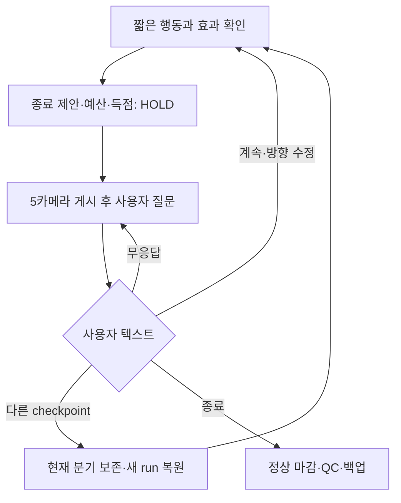

> **인계 문서의 후속 구현:** [GUIDED_RUNTIME](../GUIDED_RUNTIME.ko.md)에 추가된 옵션·실행 순서·검증 형식을 정리했다. 이 문서의 “현재 미구현” 설명은 인계 당시 코드 상태이며, 현재 구현·실행 증거는 [STATUS](../../project/STATUS.md)를 따른다.

# 클린 서버 인계: 최신 손목 근접 상태에서 사용자 피드백으로 첫 소매 +5점

**결정일 2026-11-16. 조사는 종료하고 다음 시연 방향을 정했다.** 현재 실제 실행은 E36에서 끝났으며 이 파일은 문서 인계다. 사용자가 클린 서버에서 이 계획으로 시작을 요청하면 환경 복원 → 필수 기능 구현·검증 → 출발 checkpoint 확인 → M1 시도를 진행한다. 조사·계획 선택을 다시 처음부터 반복하지 않는다.

[현재 계획과 세 방법](../../COLLECTION_PLAN.md) · [환경 설치·복원 명령](../../OPERATIONS.md) · [실제 실행 상태](../../project/STATUS.md) · [Astra 코드 설명](../../ASTRA.md) · [메인](../../../README.md)

## 1. 이번에 정한 운영 방식

1. 최신 정상 시연 중 옷을 넓게 펼쳐 손목에 접근한 상태에서 시작한다. 최신 후보는 E36/933이며 실제 공개 관측을 확인한다.
2. M1 현재 파지 유지·국소 교정, M2 베이스 방향·측면 접근 변경, M3 한쪽 지지 재파지의 세 후보 중 **M1을 먼저 시도**한다.
3. 자동 종료 제안, 정체, 관리 예산 도달, 목표 득점에서는 **live HOLD**한다. 모든 공개 카메라 스크린샷을 GitHub README 상단에 게시하고 사용자에게 다음 액션을 질문한다.
4. 사용자의 텍스트에 따라 같은 상태에서 계속·방향 변경·방법 변경·다른 checkpoint·종료를 처리한다. 답변 전에는 물리를 진행하지 않는다.

이 계획을 수행하는 데 필요한 checkpoint 연결과 HOLD·게시·피드백 기능은 클린 서버 구현 범위에 포함한다. 새 VLA/RL 학습, 과거 최대5회 자동 배치, 무응답 자동 재개는 포함하지 않는다. 서버 접근·HF·모델·GitHub 쓰기 권한이 실제로 없으면 부족한 항목을 알리고 해당 단계에서 멈춘다.

## 2. 출처와 원본 복원

검토한 코드 기준은 `e63b3f6d0ed069eef004bd09b04ba99d130192b6`이다. 실행할 때는 최신 main과 작업 트리를 확인하고 실제 구현 commit을 별도로 기록한다.

| 자료 | 고정 receipt | 고정 HF revision |
|---|---|---|
| 초기 자산 | [초기 receipt](../../project/sessions/20261106-remote-backup-verification.json) | `e1d32f9f9ea82438f90bc379452abf83a150999b` |
| 최신 E36 | [E36 receipt](../../project/sessions/20261114-e36-backup-verification.json) | `dcf059881e4e6c103dc8206438a70eb1b8ccb26f` |
| 이전 출발 대안 E34 | [E34 receipt](../../project/sessions/20261114-e34-backup-verification.json) | `ba71dd6a07e2b05202c3dcaa5b0c9a3c17997b1d` |

비공개 dataset은 `leonayoon/phyrc-2027-phase1-private-backup`이다. 먼저 초기 자산과 E36을 복원한다. E34는 대안 비교·복원을 준비할 때 추가한다. [OPERATIONS 3절](../../OPERATIONS.md#3-원본과-자산-복원)의 코드를 receipt별로 실행하여 고정 revision 다운로드 → archive 크기·SHA256 확인 → manifest 검증 → 누락 파일만 병합한다. 원본이나 기존 인증 파일을 덮어쓰지 않는다.

E36 archive 확인값:

```text
sessions/20261114-astra-wrist-body835-001-close-v1/20261114-astra-wrist-body835-001-close-v1.tar.gz
bytes: 2119594428
sha256: 2dcbf5e3ed0c02f879821747577ea20a7d538fd75660a8545eef475af6333bed
```

### 가장 최근 출발 후보

| 후보 | 의미 | 선택 방식 |
|---|---|---|
| **E36/933** | `20261114-astra-wrist-body835-001`의933전이 후. 마지막 finish는 물리0이며 `next_obs[932]`가 말단이다. | 가장 먼저 확인한다. 옷 펼침·같은 손·지지 유지가 복원 관측에서 확인되면 채택한다. |
| E34/835 | `20261114-astra-middle-grip470-retain-001`의835전이 후. E36의 실제 부모 경계이며 마지막 budget cleanup1전이를 제외한다. | E36 말단이 부적합하면 사용자에게 제시한다. |
| E34/723 | E35가 시작했던 더 이전 경계 | 사용자가 이전 형상으로 변경하려 할 때 제시한다. |

E36 말단은 최신 정상 상태지만 손이 파지부/housing 곁에 남은 상태다. 가장 넓거나 가장 좋은 진입 상태라고 검증된 것은 아니다. [기존 E36 최종 overview](../attempts/20261114-astra-wrist-body835-001/images/final-overview.png), [R1 head](../attempts/20261114-astra-wrist-body835-001/images/final-robot_1_head.png), [R0 head](../attempts/20261114-astra-wrist-body835-001/images/final-robot_0_head.png), [R1 wrist](../attempts/20261114-astra-wrist-body835-001/images/final-robot_1_wrist.png), [R0 wrist](../attempts/20261114-astra-wrist-body835-001/images/final-robot_0_wrist.png)는 **과거 참고 이미지**다. 새 live HOLD 화면으로 표시하지 않는다.

복원된 E36 원본의 CPU 출처 검사:

```bash
PYTHONPATH=.:src/PhyRC_Sim .venv/bin/python - <<'PY_PREFIX'
from pathlib import Path
from participant.collection.continuation import load_replay_prefix
prefix = load_replay_prefix(
    Path.cwd(), '20261114-astra-wrist-body835-001', 933
)
print(prefix.actions.shape, prefix.actions.dtype)
PY_PREFIX
```

이 검사는 원본·경계의 읽기 검증이며 physics 복원 검사가 아니다. [continuation.py](../../../participant/collection/continuation.py)를 사용한다.

## 3. 기존 checkpoint 기능과 새로 연결할 부분

**검증된 E36 저장 슬롯이 이미 있다는 증거는 없다.** E36 백업은 `exact_physics_checkpoint: false`이며 행동·관측 원본이다. 다른 초기 slot을 E36의 checkpoint로 바꾸어 부르지 않는다.

| 기존 구성요소 | 이미 있는 기능 | 이번에 필요한 연결 |
|---|---|---|
| [Teleop_TShirt_Stretch4_Env.py](../../../src/PhyRC_Sim/Env_StandAlone/Teleop_TShirt_Stretch4_Env.py)의 `save_state_slot()`, `load_state_slot()` | 천·로봇·파지 등의 슬롯 저장·복원 | collector의 확정 경계에서 고유 이름으로 저장하고 출처·SHA를 기록 |
| [stages.py](../../../src/PhyRC_Sim/Policy/stages.py)의 `validate_slot()`, `load_slot()` | slot 파일·revision 검사와 로딩 | 슬롯 출처와 실제 자산/코드 버전 연결 |
| [environment.py](../../../src/PhyRC_Sim/Policy/environment.py)의 `DressingEnv(initial_slot=...)` | 초기 slot을 사용하는 환경 경로 | 새 수집 run의 초기 상태로 연결하고 reset·평가 의미 기록 |
| [collect_operator.py](../../../scripts/collect_operator.py) | 현재 observe/act/stop/finish_episode만 수신. 생성자에 initial_slot을 전달하지 않음 | checkpoint 저장·시작 경로, 사용자 대기를 위한 상태·통신 연결 |

현재 collector에 없는 `--initial-slot`, `--hold` 같은 옵션을 기존 실행 명령처럼 쓰지 않는다. 구현할 인터페이스·도움말·실제 시작 명령을 검증한 뒤 이 문서와 새 세션 기록에 추가한다.

### 최초 한 번의 출발 상태 준비

1. 최초 출발에 사용할 E36 원본·933 경계·source group E28을 기록한다.
2. 새 환경에서 해당 행동933개를 재실행하여 후보 상태를 만든다. 이것은 원래 E36 천 상태의 정확한 재개가 아니다.
3. 새로운 동일 경계의 공개5 RGB-D와 로봇 상태를 확인한다. 펼침·파지·손 근접 관계가 무너졌으면 M1을 강행하지 않고 사용자에게 게시한다.
4. 후보 상태가 적합하면 더 움직이기 전에 고유 checkpoint 디렉터리·key로 저장한다. 재사용 F1 슬롯을 덮어쓰지 않는다.
5. 별도 검증 실행에서 슬롯을 복원하고 저장 직전·복원 직후·정착 후 상태를 비교한다. 다음 짧은 행동 효과도 검증한 뒤 실험용 슬롯을 채택한다.
6. 검증된 슬롯에서 새 run을 시작한다. 비교 가능한 근사 복원이 안 되면 그 차이를 게시하고 사용자가 replay 출발이나 다른 경계를 선택하게 한다.

슬롯 복원은 base/root 속도, command ramp, 일부 pending grasp·contact cache·history를 초기화한다. 기본 환경 slot reset에는90 control ticks, 즉1.5시뮬레이션초 정착이 있다. 저장 상태와 실험 시작 상태를 동일하다고 가정하지 않는다. 정착을 제거해 공식 물리를 바꾸지 말고 그 영향을 측정한다.

checkpoint를 바꾸는 경우에는 새 run·분기로 분리한다. 같은 live 상태에서 사용자를 기다리는 HOLD에는 slot 재로딩·reset을 하지 않는다.

## 4. 사용자 HOLD의 구현 계약

현재의 사용자 대기는 구현된 기능이 아니다. 다음 코드가 실제로 episode를 닫기 때문에 프롬프트만 바꾸어서는 충족되지 않는다.

| 코드 | 현재 동작 | 변경·검증할 내용 |
|---|---|---|
| [codex_client.py](../../../participant/collection/codex_client.py)의 main loop/종료 dispatch/cleanup | 모델 stop·finish 전송, 결정·review 예산 후 stop/finish/close | 종료 제안·검토·soft 예산을 사용자 HOLD로 전환. 회복 가능한 actor timeout도 분리 |
| [collect_operator.py](../../../scripts/collect_operator.py)의 idle timeout/request limit/stdin EOF | 시간이 지나거나 입력이 닫히면 마감 | supervisor와 collector 양쪽에 HOLD 상태. 사용자 대기로 인한 자동 마감 방지 |
| [boundary.py](../../../participant/collection/boundary.py)의 `stop()` | 중립1전이 실제 실행 | HOLD에서 호출하지 않음. `observe()`의 물리0 관측 복사를 활용 |
| environment max_episode_steps와 `Operator.act()`의 종료 처리 | 하드 horizon에서 done·기록 마감 | soft 구간 예산과 환경 하드 한계를 분리하고 마지막 허용 action/settle 전에 HOLD |
| 기존 [텍스트 피드백 후보](candidates/20261113-actor-feedback/README.ko.md) | 미적용 텍스트 큐 패치 | 현재 head와 비교해 필요한 부분만 통합. HOLD·게시·예산 갱신이 완성된 패치로 간주하지 않음 |



무응답 화살표는 대기 상태 유지를 의미하며 반복 게시·반복 질문·모델 재호출을 의미하지 않는다.

### HOLD에서 지킬 순서

1. 실행 중 요청이 있으면 ACK와 실제 완료 경계를 확정한다. ACK가 불명확하면 추가 행동을 보내지 않고 장애 상태로 기록한다.
2. 종료 제안·예산 등 HOLD 이유를 기록하고 아직 실행하지 않은 계획을 폐기한다.
3. recorder는 flush하되 complete 처리하지 않는다. 새 action·settle·stop·finish·close 없이 simulation tick과 전이 수를 유지한다.
4. 마지막 확정 관측의5 RGB를 고유 HOLD 디렉터리에 저장하고 README 상단에 게시한다.
5. 원격 push·이미지 접근을 확인한 후 사용자에게 한 번 질문한다. 답변이 오기 전에는 자동 행동을 재개하지 않는다.
6. run/HOLD/message ID를 확인해 사용자 텍스트를 적용한다. 같은 live 상태의 재개에는 reset이나 원본 점수 초기화를 하지 않는다.

감독 프로세스·simulator·stdin/통신 채널은 대화가 끝나거나 SSH 연결이 끊겨도 의도치 않게 종료되지 않도록 관리한다. 단순히 터미널을 닫거나 기존 CLI 프로세스에서 return하는 방식은 HOLD가 아니다. detached launcher만으로 서버·cgroup 장애까지 생존한다고 보장하지 않는다.

사람 대기가 기존 idle timeout을 넘어도 물리·파지·기록 상태가 유지되어야 한다. observe heartbeat로만 우회해 request limit을 소모하지 않도록 정식 대기 상태를 구현한다. render가 필요하면 [collector_stream.py](../../../participant/streaming/collector_stream.py)의 clock/tick 불변 검사를 참고한다.

## 5. 예산·득점·실제 장애의 처리

[현재 계획](../../COLLECTION_PLAN.md)의 초기 soft 구간 예산은20결정 또는 새400전이이며, 사용자 계속 답변마다 새 구간을 부여한다. 모든 누적값과 대기시간은 기록한다. replay 비용·실행 시간·모델 호출 시간·사용자 대기시간은 분리한다. 모델 대기 한도와 simulator ACK 한도는 다른 사건이다.

**공식 하드 horizon에 도달한 뒤에는 같은 episode를 되살릴 수 없다.** 다음 action와 settle이 하드 한계 안에 들어가는지 사전 검사하고, 여유가 부족하면 현재 경계에서 사용자에게 새 checkpoint 분기 또는 종료를 묻는다. 평가 시간·tick·done을 임의로 지우지 않는다.

목표는 trusted evaluator의 `first_sleeve`가 출발 기준0에서 새 행동 뒤5로 변하는 사건이다. 복원 직후 이미 성립한 항목의 재판정, pickup5, 다른 항목의5를 첫 소매 추가 득점으로 세지 않는다. 새 모드의 목표 게이트는 기존 `review_points=10` 대신 이 사건으로 대체한다. 별도 raw 검토 게이트를 유지할 때는 기준값·목적을 명시한다. 득점 확인은 종료가 아니라 사용자 검토 HOLD이며 평가 내부 정보는 actor에 전달하지 않는다.

모델 호출 timeout이라도 simulator가 정상이고 action이 전송되지 않았다면 HOLD할 수 있다. 실제 simulator crash, 이미 terminated/truncated된 환경, 손상된 기록을 정상 HOLD라고 표시하지 않는다. 이때는 가능한 마지막 관측·원본을 보존하고 상태 손실과 복원 선택을 사용자에게 알린다.

## 6. README 상단 게시 규격과 피드백

README의 `PHYRC_USER_REVIEW:START/END` 영역만 최신 사용자 검토 패널로 갱신한다. 현재 패널은 새 서버 대기이며 새 live 이미지가 없다. 기존 공식 데모·E36 GIF·PDF 버튼은 보존한다.

새 공개 파일 경로 규격(아직 생성된 파일이 아님):

```text
docs/collection/user-reviews/<run-id>/<hold-id>/
  README.ko.md
  overview.png
  robot_1_head.png
  robot_0_head.png
  robot_1_wrist.png
  robot_0_wrist.png
  cameras.png
  observation-metadata.json
```

- `cameras.png`는 같은 관측의 overview와4개 로봇 카메라를 모은 실제 스크린샷 패널이다. 원본5장 링크를 반드시 함께 둔다.
- 로봇 패널은 왼쪽 robot_1·오른쪽 robot_0, 위 head·아래 wrist이며 좌우 반전하지 않는다. 원본256×256 관측을 다른 카메라 영상으로 교체하지 않는다.
- 메타데이터에는 run/HOLD/관측 ID, step/tick, 시뮬레이션 시각, 촬영 UTC, source checkpoint, 방법과 중지 제안 사유를 기록한다.
- README에는 마지막 의도·관측된 효과·unknown·다음 선택 질문을 짧게 쓴다. 공개5 RGB-D와 로봇 상태 외의 숨은 기하·audit·인증·원시 CLI reasoning은 공개하지 않는다.
- depth·valid mask 원본도 같은 경계로 보존한다. 필요하면 시각화 링크를 추가하되 깊이 무효값을 빈 통로나 성공 증거로 설명하지 않는다.
- 새 이미지·검토문서·README를 같은 게시 변경으로 push하고 다른 사용자의 변경을 덮어쓰지 않는다. 원격에서5장 접근과 현재 run/HOLD ID를 확인한다.
- 게시 실패 시 물리를 계속 HOLD하고 채팅에서 실패와 사용 가능한 동일 관측 링크/첨부를 알린다. 게시 재시도 자체가 동작 재개의 근거는 아니다.

사용자 텍스트 원문·수신 시각·해석·적용 경계는 비공개 실행 로그에 연결한다. 공개 검토에는 필요한 작업 지시만 적는다. 사용자 교정 이후의 provenance는 Astra 단독과 구분한다. 격리 actor는 GitHub·평가·원본 저장소를 직접 읽지 않는다.

## 7. 실제 시연을 시작하기 전 통과할 검증

| 검증 | 통과 기준 |
|---|---|
| 원본·자산 복원 | 고정 revision·archive SHA·manifest·E36 전수 QC 일치 |
| slot 출발 | 저장/복원/정착 상태와 다음 짧은 행동의 효과를 확인. 부적합하면 출발 보류·사용자 게시 |
| 모델 finish·stop | 실제 종료 dispatch 없이 HOLD; 추가 전이0 |
| 결정·전이 soft 예산·목표 득점 | 종료 대신 HOLD, 누적 counter 보존 |
| 모델 timeout·하드 horizon 직전 | 환경이 정상인 actor timeout은 HOLD. 다음 action/settle이 하드 한계를 넘기기 전에 HOLD하여 종료된 환경의 재개를 시도하지 않음 |
| 사람 대기 | 기존 idle timeout보다 오래 기다려도 simulation tick·HDF5 전이 수·로봇 상태 불변, 프로세스·기록기 유지 |
| 모든 카메라 게시 | 같은 관측의5장과 메타데이터, README push와 원격 링크 확인 |
| 사용자 답변 | 계속·방향 수정·방법 변경·checkpoint 변경·종료가 서로 다른 흐름으로 처리됨 |
| 실패·오래된 메시지 | 게시 실패·무응답·중복/stale 답변에서 자동 실행 없음. ACK 불명확·실제 장애와 정상 HOLD 구분 |

CPU 검사와 실제 GPU·모델 연결 검사를 분리해 기록한다. 새 제어 기능의 검사에는 별도 test run을 사용하고 종료된 E36 원본을 수정하지 않는다. 이 표를 통과하기 전에 기존 즉시 종료 수집기를 그대로 착의 본 시연에 사용하지 않는다.

## 8. 클린 서버 Codex에 전달할 시작 프롬프트

```text
AGENTS.md, docs/COLLECTION_PLAN.md, docs/OPERATIONS.md,
docs/collection/research/2026-11-16-user-guided-resume.ko.md를 읽고 이 계획으로 착수하라.
조사는 끝났으며 과거 분석-only HOLD나 최대5회 배치를 현재 지시로 삼지 마라.
현재 HEAD·작업 트리·서버 권한을 확인하고 초기 잠금 자산과 E36 원본을 고정 receipt로 복원하라.
고정 Codex CLI0.166.0 / exec / gpt-6-astra / ultra와 격리를 유지하라.
checkpoint 수집 연결, 물리0 사용자 HOLD, 지정5카메라 README 게시, 텍스트 재개에 필요한
최소 기능을 구현하고 CPU 및 실제 연결 검증을 완료하라. 구현되지 않은 CLI 옵션을 있다고 가정하지 마라.
E36/933을 우선 재현해 펼침·파지·손목 근접 관계를 확인하고 고유 checkpoint를 저장·복원 검증하라.
적합하면 M1 현재 파지 유지·국소 교정을 첫 시도로 시작하여 first_sleeve 새5점에 도전하라.
부적합하면5카메라를 게시하고 E34/835 또는 E34/723 등 다른 출발점 선택을 사용자에게 물어라.
모델 종료 요청·관리 예산·목표 득점에서는 finish하지 말고 live HOLD한 뒤
같은 관측의5카메라를 README 맨 위에 push하고 사용자의 텍스트 피드백을 기다려라.
사용자 답변에 따라 계속·방향/방법 변경·새 checkpoint 분기·정상 종료를 처리하라.
무응답은 재개 승인이 아니다. 공식 하드 한계와 실제 장애는 우회하지 말고 상태를 보고하라.
모든 실제 명령·운동·정착·천-손 관계·계보·사용자 교정·예산·득점을 구분해 기록하라.
필요한 복원·최소 구현·검증·M1 시작은 이 착수 요청 범위에서 진행하고 같은 일괄 승인 질문을 반복하지 마라.
실제로 부족한 로그인/권한, 출발 상태 부적합, 사용자 HOLD의 다음 행동처럼
사용자 판단이 필요한 지점에서만 구체적인 상태와 화면을 제시해 물어라.
```

현재 문서에는 환경 복원용 기존 명령과 구현해야 할 계약을 구분해 적었다. 클린 서버 작업자는 검증한 실제 새 시작 명령, 코드 commit, test receipt와 첫 run ID를 이 문서·STATUS에 추가하여 다음 실행이 같은 경로로 이어지게 한다.
