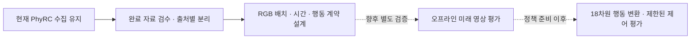

# Stanford OpenWAM · 현재 PhyRC 환경에서 사용할 수 있는가

[저장소 소개](../../../README.md) · [수집 과정](../README.ko.md) · [지각·모션 baseline 조사](2026-11-06-perception-baselines.ko.md) · [확인한 출처·버전](openwam-feasibility.sources.json)

**판정: 오프라인 영상 예측 연구의 후보입니다. 현재 PhyRC 수집에 바로 연결할 수 있다고 확인하지 않았습니다.** 사용자 요청에 따라 문서·설정·배포 메타데이터만 읽었으며 설치, 가중치 다운로드, 모델 실행, 학습, 수집 정책 변경을 하지 않았습니다.

| 검토 항목 | 확인한 사실 | 현재 판단 |
|---|---|---|
| 정확한 대상 | Stanford OpenWAM, arXiv **2610.07922**, Li Fei-Fei 공저 | 동명 프로젝트·World Labs Marble과 구분 |
| 공개 가중치 | 영상 사전학습용 가중치 공개, 행동 horizon은 0 | 영상 예측 후보. 즉시 사용할 행동 정책이 아님 |
| 정책·역동역학 | LIBERO 정책·IDM 체크포인트는 공식 README에서 공개 준비 상태 | 공개 코드만으로 논문 정책 결과를 재현했다고 볼 수 없음 |
| 입력·행동 | 다중 **RGB** 지원. 기본 LIBERO는 2뷰·행동 7차원 | PhyRC 5뷰 RGB-D·18차원 행동에 변환·학습·검증 필요 |
| 현재 서버 | L40S 한 장, Isaac 수집 동시 가동 | 전체 모델의 추론·학습 peak VRAM과 속도 미검증 |
| 라이선스 | 코드 `AGPL-3.0-only`; 공개 가중치의 명시적 조건은 확인되지 않음 | 코드·가중치·외부 frontend를 따로 확인해야 함 |

대상은 [공식 사이트](https://openwam.stanford.edu/), [공식 저장소](https://github.com/OpenWAM/OpenWAM), [논문](https://arxiv.org/abs/2610.07922)의 상호 링크와 저자로 확인했습니다. `OpenWAM-Official/OpenWAM`·arXiv `2609.07398`은 다른 프로젝트이며 이 페이지의 성능·가중치 근거로 섞지 않습니다.

실선까지도 이번에 새 변환기를 구현했다는 뜻은 아닙니다. 이 그림은 **자료를 활용할 순서 제안**이며, OpenWAM으로 공식 시뮬레이터나 평가기를 교체하지 않습니다.

1. 공개된 것은 무엇인가 · 영상 예측과 행동 제어 구분

OpenWAM은 영상과 행동의 생성 순서를 바꾸는 구조를 비교하는 연구 프레임워크입니다. 영상 먼저 생성, 행동 먼저 생성, 공동 생성, 분리 생성을 지원하고 영상→행동의 역동역학(IDM), 행동→미래 영상의 순동역학(FDM)을 연결합니다. 영상 기반 모델과 행동 전문가를 결합하는 구조가 있다는 사실과 특정 로봇을 제어하는 가중치가 준비됐다는 사실은 다릅니다. [공식 구조 설명](https://openwam.stanford.edu/)

확인한 코드 버전은 `030da766bbd882f2216606ec4c31a1dd224f82b3`입니다. [이 버전 README](https://github.com/OpenWAM/OpenWAM/blob/030da766bbd882f2216606ec4c31a1dd224f82b3/README.md)는 영상 가중치 공개와 정책·IDM·LIBERO-Long-CF 자료의 공개 준비를 구분합니다. [artifact 예시](https://github.com/OpenWAM/OpenWAM/blob/030da766bbd882f2216606ec4c31a1dd224f82b3/configs/artifacts.sample.yaml)의 정책 URL·checksum·license가 `null`인 항목은 다운로드 가능한 정책이 아닙니다.

[공식 HF 릴리스](https://huggingface.co/OpenWAM-Stanford/OpenWAM-Pretraining)는 `d04f1dae7e65f1f1dbe061947df87b99a63df286`에서 확인했습니다. `model_state.pt` 크기는 **20,433,187,287바이트(약 20.43GB)**로 게시되어 있습니다. 파일 자체는 다운로드하지 않았고, 게시된 SHA-256을 직접 계산해 검증한 것도 아닙니다. 디스크 파일 크기를 추론 peak VRAM으로 해석하지 않습니다. [배포 메타데이터](https://huggingface.co/OpenWAM-Stanford/OpenWAM-Pretraining/blob/d04f1dae7e65f1f1dbe061947df87b99a63df286/release_metadata.json)

공개 [reference config](https://huggingface.co/OpenWAM-Stanford/OpenWAM-Pretraining/blob/d04f1dae7e65f1f1dbe061947df87b99a63df286/resolved_config.yaml)는 `action_horizon: 0`인 영상 사전학습 설정입니다. 영상 frontend·텍스트 encoder/tokenizer·optimizer/scheduler·학습 자료는 이 릴리스에 포함되지 않습니다. 미래 영상 예측이 가능하더라도 supplied action에 따라 결과가 달라지는 FDM이나 바로 사용할 로봇 정책과 같지 않습니다.

2. 5개 카메라·RGB-D·18차원 행동은 어떻게 연결해야 하는가

| 현재 PhyRC | 확인한 OpenWAM 계약 | 필요한 작업·아직 모르는 것 |
|---|---|---|
| RGB 5뷰, 각각 256×256 | `WAMSample.views`: 카메라별 `[T,H,W,3]` RGB; 별도 canvas 배치 | 카메라 순서·역할·종횡비를 고정한 5뷰 변환기. 5뷰 PhyRC의 학습·추론 검증 자료는 확인되지 않음 |
| 전체 depth·유효 마스크 | 확인한 raw sample 계약에는 전용 depth 입력이 없음 | RGB-D를 4채널로 붙여 바로 입력하지 않음. depth는 보존하고 별도 기하 평가에 활용하는 후보부터 구분 |
| 두 로봇의 공개 상태 | 선택적 state와 state mask 지원 | 공개 상태 필드·단위·정규화·로봇 순서를 명시하고 학습 자료에서만 통계 계산 |
| 행동 `(2,9)`, 합계 18차원 | dataset별 행동 표현과 양방향 action adapter 인터페이스 | 그대로 flatten하는 것만으로 기존 제어 정책과 의미가 맞지 않음. 실제 제어 채널·범위·주기를 검증 |
| 실제 전이 20Hz, `delta_t=0.05` | 모델 frame과 제어 step의 시간 계약을 따로 관리 | 원본 전이·정지·reset·누락을 보존하고 영상/행동 시간 대응을 검사 |

근거: [raw sample 계약](https://github.com/OpenWAM/OpenWAM/blob/030da766bbd882f2216606ec4c31a1dd224f82b3/src/open_wam/data/contracts.py), [canvas 계약](https://github.com/OpenWAM/OpenWAM/blob/030da766bbd882f2216606ec4c31a1dd224f82b3/src/open_wam/contracts/video.py), [행동 변환 인터페이스](https://github.com/OpenWAM/OpenWAM/blob/030da766bbd882f2216606ec4c31a1dd224f82b3/src/open_wam/contracts/action_space.py), [PhyRC 공개 입력·행동](../../competition/POLICY.md).

**다중 RGB 지원은 확인했지만 5뷰 RGB-D 지원을 확인한 것은 아닙니다.** 공식 다중 시점 사전학습은 여러 RGB를 한 canvas로 합쳐 VAE에 한 번 통과시킵니다. 문서의 처리 예시는 15fps와 면적 약 256×256 기준이며, 현재의 5×256×256 전체 정보를 같은 크기로 압축하면 파지·소매의 작은 특징이 줄어들 수 있습니다. 이는 적용 시 예상되는 손실이며 이번에 측정한 결과는 아닙니다. [다중 시점 문서](https://github.com/OpenWAM/OpenWAM/blob/030da766bbd882f2216606ec4c31a1dd224f82b3/docs/pretraining/multiview_training.md)

기본 [LIBERO 설정](https://github.com/OpenWAM/OpenWAM/blob/030da766bbd882f2216606ec4c31a1dd224f82b3/configs/experiments/dual_expert_libero_joint.yaml)은 RGB 2뷰를 128×256 canvas에 배치하고 행동 7차원·상태 8차원·16 action step을 사용합니다. PhyRC는 두 이동형 로봇의 18개 정규화 명령을 함께 출력합니다. 배열 크기만 맞춰 LIBERO의 이동·회전·gripper 의미를 이식할 수 없습니다.

논문의 실제 양팔 실험도 PhyRC와 다릅니다. Franka FR3 두 팔·카메라 3개·30Hz 기록을 사용하고, 행동은 팔마다 위치 3·회전 표현 6·gripper 폭 1의 합계 **20차원**입니다. 두 로봇이 등장한다는 이유만으로 현재 Stretch 4 두 대의 정책과 호환되지 않습니다. [논문 부록 A.5](https://arxiv.org/html/2610.07922v1)

초기 RGB-only 오프라인 후보를 검토한다면 1뷰·선택 3뷰·전체 5뷰의 입력 범위를 각각 기록해야 합니다. 보존된 depth를 모델에서 제외한 실험과 RGB-D 모델을 구분하며, 현재 Codex의 16×16 depth 요약을 OpenWAM이 이미 소비한다고 표시하지 않습니다. 확장 지점은 있지만 PhyRC용 dataset·action·simulator adapter는 아직 작성하지 않았습니다. [확장 SDK](https://github.com/OpenWAM/OpenWAM/blob/030da766bbd882f2216606ec4c31a1dd224f82b3/docs/extension_sdk.md)

3. 현재 L40S 한 장의 자원 조건과 라이선스

현재 서버는 L40S 한 장·12 vCPU·RAM 약 70GiB이며 Isaac 기반 수집이 실행 중입니다. 2026-11-06 **04:59:02 UTC**의 `nvidia-smi` 읽기 값은 전체 **46,068MiB**, 사용 **9,231MiB**, 표시된 free **36,227MiB**입니다. free는 명시적 조회값이며 `전체−사용`을 대신 적지 않았습니다. 한 시점의 여유값은 OpenWAM과 동시 실행할 수 있다는 근거가 아닙니다. [서버 측정 배경](../experiments/2026-11-06-server-comparison.ko.md)

| 범위 | 공식 자료에서 확인한 자원 근거 | 현재 환경에 대한 판단 |
|---|---|---|
| 영상 사전학습 재현 | 논문에서 B200 32장·14일 | 현재 한 장 서버의 작업 범위로 삼지 않음 |
| 기본 dual-expert 정책 학습 | 공식 문서에서 48GB GPU 4장 기준, FSDP·CPU offload·activation checkpointing | YAML의 `devices: 1`만 보고 단일 GPU 학습 가능하다고 판단하지 않음 |
| 전체 모델 추론 | history가 채워지면 단일 GPU 메모리를 넘을 수 있음. frontend/decoder를 두 번째 GPU에 두는 예시 | 한 장 L40S에서의 전체 history peak·지연과 Isaac 동시 실행은 미검증 |
| 영상 예측만의 작은 오프라인 평가 | 단일 GPU·작은 batch 선택 경로는 문서에 있음 | 실행 옵션의 존재는 48GB 수용·품질·속도 검증이 아님 |

근거: [논문 부록 B.3](https://arxiv.org/html/2610.07922v1), [학습·추론 안내](https://github.com/OpenWAM/OpenWAM/blob/030da766bbd882f2216606ec4c31a1dd224f82b3/docs/running_experiments.md), [영상 학습 안내](https://github.com/OpenWAM/OpenWAM/blob/030da766bbd882f2216606ec4c31a1dd224f82b3/docs/pretraining/training.md).

현재 CPU·RAM에 대해서도 end-to-end 계측이 없습니다. CPU offload는 GPU 메모리를 줄이는 대신 호스트 메모리와 전송 비용을 사용하므로 RAM 70GiB만으로 훈련 가능성을 보장하지 않습니다. 수집·Isaac을 켜 둔 상태에서 OpenWAM 실험을 병행하는 계획은 권하지 않으며, 향후 검증하더라도 수집과 시간대를 분리해야 합니다.

코드의 [pyproject](https://github.com/OpenWAM/OpenWAM/blob/030da766bbd882f2216606ec4c31a1dd224f82b3/pyproject.toml)는 `AGPL-3.0-only`를 명시합니다. [third-party notice](https://github.com/OpenWAM/OpenWAM/blob/030da766bbd882f2216606ec4c31a1dd224f82b3/THIRD_PARTY_NOTICES.md)는 별도 구성 요소의 조건을 구분합니다. 반면 확인한 HF 모델 카드·API의 `cardData`·파일 목록·release metadata에는 가중치 라이선스가 명시되지 않았습니다. **공개 다운로드 가능 여부와 사용 조건 확인은 별개**이며 코드 라이선스를 가중치와 외부 frontend에 자동 적용하지 않습니다. 이번 문서는 사용 조건을 승인하거나 라이선스 적합성을 확정한 결과가 아닙니다.

4. 현재 데이터로 해볼 만한 순서 · 모두 향후 계획

현재 자료는 초기 수집 규모이며 주로 0점 시도와 한 로봇 픽업 부분 점수 5점입니다. 전수 기술 검사를 통과한 파일도 기본 학습 상태는 `unreviewed`이고, 50점 착의 시연을 확보했다는 근거가 아닙니다. 성공·실패를 모두 보존한 자료는 영상·전이 예측 연구에 유용할 가능성이 있지만, 소량 자료로 착의 정책을 학습할 수 있다고 입증하지는 않습니다.

| 순서 | 향후 검토할 실험 | 통과 근거 |
|---|---|---|
| 1. 자료 계약 | 완료 파일의 공개 RGB·상태·실제 행동·다음 관측·시간·마스크 대응 | source group별 고정 분리, 원본 해시, 카메라 순서·채널 검증 |
| 2. RGB 영상 예측 | 공개 영상 가중치와 별도 frontend의 자원·조건을 확인한 뒤 offline forecasting | 정지 화면 기준선 대비 같은 구간 RGB 오차·시각 검토·지연·peak VRAM |
| 3. 행동 조건 예측 | 실제 PhyRC 행동을 입력받는 FDM을 준비한 뒤 action-sensitive 예측 평가 | 행동을 바꿨을 때의 실제 다음 관측을 구분하는지 검증. 영상만의 predictor와 구분 |
| 4. 행동 예측 adapter | 준비된 정책/IDM을 18차원 명령·공개 상태·20Hz 계약에 맞춰 별도 학습·검증 | 행동 범위·로봇 순서·시간 정합성과 짧은 closed-loop 동작 검증 |
| 5. 수집 비교 | 정해진 입력·예산·초기 배치 그룹으로 기존 방법과 비교 | 점수·협력 과정·success·실패·시간을 따로 기록 |

제안한 지표와 순서는 이 저장소에 대한 검토 의견입니다. 모델 결과를 실행하지 않았으며 실측 점수나 예상 성능 수치가 아닙니다. 미래 관측은 학습 target·사후 평가에만 두고 동일 시각의 정책 입력으로 누출하지 않습니다. 원본 E05와 행동 재실행 E06은 같은 source group으로 묶어 분리하며, 중복 prefix를 독립 데이터로 세지 않습니다.

논문은 같은 상태에서 여러 행동을 시험한 counterfactual 자료를 다룹니다. 현재 PhyRC의 `action_replay`는 정확한 물리 checkpoint 복원이 아니므로 서로 같은 천 상태에서 출발한 실험이라고 가정하지 않습니다. 관측 차이와 새 평가를 기록하고, 다른 분기의 좋은 구간을 이어 붙여 하나의 연속 성공으로 표시하지 않습니다. [현재 재실행 한계](../guides/continuation-and-branches.ko.md)

**이번에 완료한 일은 사용 가능성 분석과 문서화뿐입니다.** 설치·추가 자산 다운로드·GPU 시험·정책 적용은 진행하지 않았습니다.

