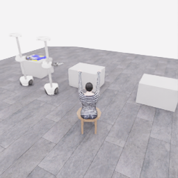

# E09 종료 검토: 사용자 요청으로 재실행 중단, 불완전 기록 보존

**작업을 마무리하라는 사용자 요청으로 E09를 종료했습니다. 새 actor는 한 번도 호출되지 않았습니다.** E07의 700전이까지 원본 행동을 재실행하려던 도중 종료 요청이 들어왔고, 종료 응답의 대응 오류 때문에 전체 capture는 불완전 상태로 남았습니다. 성공적인 복원이나 새로운 모델의 실패 시연으로 표시하지 않습니다.

[공개 관측·기록 패키지](../attempts/20261106-astra-coordinated-branch700-002/README.ko.md) · [정확한 계수·검수 JSON](20261106-astra-coordinated-branch700-002.json) · [28.2초 부분 기록 MP4](../attempts/20261106-astra-coordinated-branch700-002/overview.mp4) · [부모 E07의 완결된 원본](20261106-astra-coordinated-fresh-001.ko.md)

| 항목 | 확인한 결과 |
|---|---|
| 실행 | `20261106-astra-coordinated-branch700-002` |
| 실제 시작·종료 UTC | 2026-11-06 06:15:37 → 06:18:57 |
| 종료 의도 | 사용자 요청에 따른 신뢰된 제어기의 SIGTERM |
| 원본 상태 | `failed`, `finished=false`, `activity=closed` |
| 중단·정리 오류 | `KeyboardInterrupt: SIGTERM`, `simulator response does not match request` |
| 프로세스 | 수집기 종료 확인, simulator exit 0 |
| 파일 완료 | capture·policy 파일·audit 파일 모두 incomplete |
| 응답 확인 / 실제 기록 | **120 / 141전이** |
| 실제 부모 행동 재실행 | **140전이**, E07 첫 140행동과 값이 모두 같음 |
| 끝의 중립 행동 | 1전이·0.05초, 행동 벡터 0 |
| 신규 actor | **호출 0회·결정 0개·새 모델 행동 0전이** |
| 예정 복원 경계 | E07의 700전이, 이번 실행은 미도달 |
| 실제 기록 시간 | 7.05 simulation초 |
| 전체 실제 시간 | 200.424초 |
| 환경 요청·응답 계측 | 123.091초, 응답이 확인된 앞 120전이에 해당 |
| 부분 실행 공식 평가 | valid=true, 원점수 0, success=false, no_contact, final_score=null |
| 전체 기술 검사 | 141전이 검사, **quality_passed=false** |
| 학습 승인 | unreviewed, 불완전 자료로 학습 사용 제외 |

## 120과 141의 차이를 신규 시연으로 세지 않음

완료 JSONL에는 20전이씩 여섯 개의 `replayed_segment`가 있어 **0→120**까지 응답이 확인됐습니다. 그러나 닫힌 policy HDF5에는 **141전이**가 기록돼 있습니다. 원본 행동 배열을 대조한 결과 앞 **140개는 E07의 첫 140개 float32 행동과 정확히 같고**, 마지막 1개는 모든 값이 0인 중립 행동이었습니다.

따라서 차이 21은 **응답 확인이 끝나지 않은 부모 행동 재실행 20개 + 종료 중립 1개**입니다. 원본 attempt의 `new_recorded_suffix_steps=21`은 `recorded_steps - replay_steps_completed`로 계산된 값이므로, 이 사례에서는 신규 actor 시연량으로 해석할 수 없습니다. 원본 숫자를 바꾸지 않고 이 검토 JSON에 해석 정정을 따로 남겼습니다.

진행 중 행동의 응답과 종료 요청의 응답이 맞지 않아 정리 오류가 기록됐습니다. 기록된 행동이 존재한다는 사실과 제어기가 해당 응답을 정상 처리했다는 사실은 다릅니다. 이 자료를 완료 상태로 보이게 하려고 속성·manifest·원본 로그를 수정하지 않았습니다.

## 종료 표식과 전체 파일 완료는 별개

닫힌 HDF5 내부의 `demo_0.complete=true`, 마지막 `done=1`은 확인됐습니다. 하지만 capture manifest와 policy·audit **파일 수준의 complete는 false**입니다. 전수 검사는 실제 141전이를 읽었고 다음 세 오류로 최종 실패했습니다.

- `capture manifest is incomplete`
- `policy HDF5 file is incomplete`
- `audit HDF5 file is incomplete`

에피소드 내부의 행동·시계·관측 연속성 검사 결과가 양호해도 전체 capture가 완료됐다는 의미는 아닙니다. 오류 세 개와 원본 incomplete 상태를 그대로 보존합니다. 공식 평가의 `valid=true`도 저장된 부분 구간을 평가할 수 있었다는 뜻이며, 수집 완료나 학습 승인을 대신하지 않습니다.

사진은 아직 옷이 놓인 테이블 근처의 접근 구간입니다. 목표했던 마네킹 접근 경계 700이나 첫 소매 시도 상태까지 재실행하지 않았습니다. 부모 E07이 얻은 5점이 이 E09의 점수인 것처럼 합치지 않습니다.

## 모델 사용량과 공개 영상의 해석

공개 패키지의 `prompt.txt`는 이어 시도를 위해 준비한 **예정 프롬프트**이며 실제 모델 호출에 사용된 응답 이력이 없습니다. 사용량 원본은 `{}`, 기록된 호출 수 0, 미확정 호출 목록은 빈 배열입니다. 생성 페이지의 빈 토큰 열에 표시되는 “미확정”은 계측 필드가 없어서 나온 기본 표시이며, **사용량을 모르는 실패 모델 호출이 있었다는 뜻이 아닙니다.** 이 구분도 검토 JSON에 남겼습니다.

부분 영상은 실제 기록된 `obs/overview_rgb` **141프레임 전체**, 4배 저속·5fps·28.2초입니다. 프레임을 생략하지 않았고 실제 대기 시간은 포함하지 않았습니다. 시작·종료 5카메라 PNG 10장은 원본 픽셀과 일치합니다. 불완전 capture를 관찰·문제 분석용으로 공개한 것이며 승인 학습 데이터로 표시하지 않습니다.

E07의 완결 원본, E08의 초기화 실패, E09의 사용자 요청 중단과 정리 실패는 서로 다른 실행으로 보존합니다. source group은 부모 E07과 같게 유지하고 140개 재실행 행동을 독립적인 신규 시연량으로 중복 계산하지 않습니다. 물리 체크포인트를 저장하거나 정확한 물리 상태 복원을 완료했다고 주장하지 않습니다. 이후 깨끗한 서버에서 이어 시도할 때도 검증된 부모 E07 자료를 기준으로 새 run의 재실행·검사를 수행해야 합니다.
