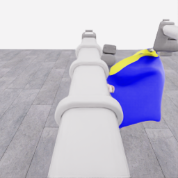
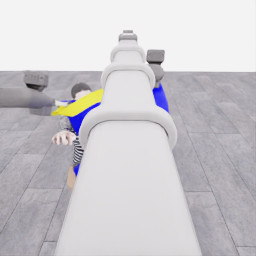
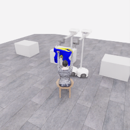

# E07 종료 검토: 함께 들기·운반 후 첫 소매 진입 시도

**화면 배치:** 로봇을 나란히 비교하는 그림은 왼쪽 `robot_1`, 오른쪽 `robot_0`입니다. 카메라 픽셀을 좌우 반전하지 않고 표시 위치만 바꿨습니다. 원본 관측·행동의 로봇 번호와 배열 순서는 그대로입니다.

**두 로봇이 옷을 함께 지지해 들고 마네킹 방향으로 운반한 부분 과정을 기록했으며, 80개 결정 예산을 모두 사용해 정상 종료했습니다.** 공식 픽업 원점수는 **5/50점**, 착의 `success=false`입니다. 착의 항목 득점은 없어서 최종 산식 점수는 **0 points/s**입니다. 이 정상 종료를 50점 달성이나 성공 시연 승인으로 해석하지 않습니다.

[전체 프롬프트·행동·관측·영상](../attempts/20261106-astra-coordinated-fresh-001/README.ko.md) · [구조화 종료 검토](20261106-astra-coordinated-fresh-001.json) · [정확한 첫 5점·접근 프레임](../milestones/20261106-astra-coordinated-fresh-001/README.ko.md) · [당시 고정 시각 검토](../experiments/2026-11-06-coordinated-first5-review.ko.md) · [첫 5점까지 단계별 시간](../experiments/2026-11-06-first5-time-breakdown.ko.md)

| 항목 | 최종 확인 |
|---|---|
| 실행 | `20261106-astra-coordinated-fresh-001`, 새 에피소드·부모 행동 재실행 없음 |
| 실제 시작·종료 UTC | 2026-11-06 04:40:12 → 06:04:06 |
| 종료 원인 | `supervisor_stop.reason=decision_budget` |
| 종료·파일 상태 | `completed`, `finished=true`, `capture_complete=true`, simulator exit 0 |
| 모델 행동 | 80개 완료 구간·1,066전이·53.30 simulation초 |
| 종료 정리 | 중립 1전이·0.05초, 기존 그리퍼 의도 유지 |
| 전체 기록·전수 QC | **1,067/1,067전이**, 53.35 simulation초, errors=[] |
| 모델 호출 | 73회 시도·73회 완료, 미확정 사용량 호출 없음 |
| 고정 2구간 계획 | 실제 7호출, 후속 구간 7개는 추가 모델 호출 없음 |
| 공식 평가 | valid=true, pickup 5·나머지 항목 0, success=false |
| 최종 점수 산식 | `no_dressing_points`, `final_score=0.0 points/s` |
| 전체 실제 시간 | **5,034.038초·83.90분** |
| Actor / 환경 요청·응답 | **3,737.894초 / 1,202.314초** |
| 학습 승인 | `unreviewed` |

## 실제로 남긴 협력 구간과 실패·복구

E05의 한 로봇 픽업을 이어 재생한 실행이 아니라 처음부터 두 로봇이 접근하도록 한 새 시도입니다. 양쪽 손끝 가까이에 옷을 유지하며 들어 올리고, 테이블에서 벗어나 짝을 회전시킨 뒤 마네킹 방향으로 실제 이동한 장면은 [당시 원본 관측](../experiments/2026-11-06-coordinated-first5-review.ko.md)에 고정돼 있습니다. 공개 관측에서 확인한 공동 지지·운반의 근거와 공식 부분 점수를 각각 보존합니다.

첫 픽업 5점은 **전이 356·17.80 simulation초**에 발생했습니다. 정확한 원본 이미지는 종료 뒤 `next_obs/overview_rgb[355]`에서 추출했습니다. 이후에도 50점 감시 조건으로 계속 수집했으며 5점을 얻었다고 멈춘 실행이 아닙니다.

함께 후진하던 결정 27에는 로봇 1의 `wrist_roll=+1`이 들어 있었고 실제 roll 관절의 큰 변화와 천이 감기는 형태가 보였습니다. 뒤이어 반대 roll 복구가 수행됐습니다. 이 명령과 짧은 이유의 불일치·공개 상태 변화·복구 과정을 보존했으며, 의도하지 않은 배열 실수나 유일한 실패 원인이라고 확정하지 않았습니다.

위 장면은 **전이 700·35.00초**, 모델 단계 `approach`의 실행 경계입니다. 운반 뒤 마네킹 앞에 접근한 관측이며, 새 점수나 정렬 완료 표시가 아닙니다. 관측·행동·득점의 서로 다른 경계를 구분해 후속 분기와 방법 비교에 사용할 수 있게 남겼습니다.

## 첫 소매 단계에서 확인하지 못한 것

모델은 결정 51, 전이 756→768부터 `first_sleeve` 단계에 들어갔습니다. 전체 실행에서 이 라벨을 붙인 구간은 **24개·254전이·12.70 simulation초**이며 모델의 시각 판단은 모두 `uncertain`이었습니다. 그 사이 방향 조정과 복구가 섞여 있으므로 24개를 독립적인 파지 실패나 새 시도 횟수로 세지 않습니다.

| 종료 시 로봇 1 머리 | 종료 시 로봇 0 머리 |
| --- | --- |
|  |  |

끝부분 사진에서는 천이 마네킹 앞과 두 그리퍼 근처에 남아 있으나 접힘·가림과 비스듬한 개구 형태 때문에 소매 진입을 확인하기 어렵습니다. 마지막 결정 79도 `orientation / uncertain`이며 로봇 0을 유지하고 로봇 1 lift를 올려 양쪽 높이 차이와 대각선 접힘을 줄이려는 행동이었습니다. 그 뒤 중립 1전이와 정상 파일 종료가 수행됐습니다.

공식 평가에는 접촉 시각이 기록됐지만 **first_sleeve·opposite_shoulder·second_sleeve·양쪽 upper_arm·neck·front_orientation은 모두 0점**입니다. 접촉, 그리퍼 닫기 명령, 천이 손끝에 가까이 보이는 장면은 소매 통과 성공과 다릅니다. 마지막까지 모델이 확인하지 못한 항목을 성공 라벨로 바꾸지 않았습니다.

## 단계별 실제 행동량

| 모델 의도 단계 | 완료 구간 | 실제 전이 | simulation초 |
|---|---:|---:|---:|
| approach | 17 | 302 | 15.10 |
| grasp | 4 | 30 | 1.50 |
| lift | 6 | 62 | 3.10 |
| recovery | 11 | 116 | 5.80 |
| transport | 14 | 258 | 12.90 |
| first_sleeve | 24 | 254 | 12.70 |
| orientation | 4 | 44 | 2.20 |
| **모델 행동 합** | **80** | **1,066** | **53.30** |

단계는 모델의 요청 의도이고 객관적인 단계 성공 라벨은 아닙니다. 종료 중립 1전이는 모델 단계 합과 별도로 보존합니다. 2구간 계획의 후속 행동은 중간 관측을 보고 새로 판단한 호출로 표시하지 않았으며, 공개 기록에는 원래 모델 입력 시각과 각 구간 실행 직전 관측 시각이 따로 있습니다.

## 시간·사용량·영상의 범위

73회 완료 호출의 thread 누계 차분 집계는 입력 **10,523,634**, 캐시 입력 **9,603,200**, 출력 **79,930**, 그중 추론 출력 **70,422**토큰입니다. 캐시 입력은 전체 입력의 부분집합이고 추론 출력은 전체 출력의 부분집합입니다. 다시 더하지 않으며, 숨은 추론 내용은 공개하지 않았습니다. 이번 실행은 `fully_known=true`, 미확정 호출 목록이 비어 있습니다.

actor 시간에는 공개 입력 준비·Docker/CLI·세션·네트워크·서비스 대기·생성·결과 해석이 함께 들어갑니다. **모델 내부 추론 시간은 별도로 제공되지 않습니다.** 전체 실제 시간에서 actor·환경 요청/응답 합을 뺀 약 **93.830초**는 초기화·종료·진행 관리·기타 미계측 시간이 합쳐진 잔차이며 초기화만의 시간으로 부르지 않습니다.

공개 패키지는 시작·종료 5카메라 PNG **10장**과 전체 `obs/overview_rgb` **1,067프레임**을 포함합니다. 영상은 **4배 저속·5fps·213.4초**이며 프레임 생략이나 앞부분 잘림이 없습니다. 83.90분의 실제 모델 대기는 영상에 포함하지 않습니다. 영상의 마지막 관측은 종료 중립 행동 직전 경계이고, 별도 최종 PNG는 마지막 `next_obs`인 경계 1,067입니다.

50점 감시는 `collector_ended_before_gate`로 남았습니다. 마지막 행동 ACK는 1,066이며 최종 attempt의 기록·ACK 1,067에는 종료 중립 1전이가 포함됩니다. 이 차이는 누락된 행동이 아닙니다. 전수 검사로 checksum·모든 행동·20Hz 시간·12 physics tick 간격·모든 관측 연속성·종료 표식·평가 라벨을 확인했습니다. 기술 검사 통과, 부분 원점수 5점, 전체 착의 성공, 학습 승인 상태를 각각 보존합니다.

기존 E07 중간 사진·시간 분석은 당시 고정 범위대로 유지합니다. 이 종료 패키지는 같은 시도의 최종 자료이며 독립 시연을 추가로 생성한 것으로 세지 않습니다. 다음 시도와 개선은 별도 run ID·프롬프트·변경 근거로 기록합니다.
