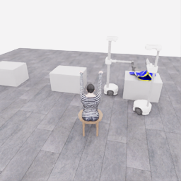
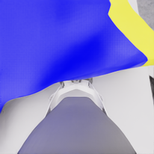

# E06 종료 검토: 재실행 후 지지 파지 접근과 전략 변경

[전체 프롬프트·행동·관측·영상](../attempts/20261106-astra-dressing-continue-001/README.ko.md) · [구조화 검토](20261106-astra-dressing-continue-001.json) · [관측 0~2 당시 중간 분석](../experiments/2026-11-06-continuation-public-review.ko.md)

**사용자의 수집 전략 변경에 따라 신뢰된 제어기가 SIGTERM을 보내 E06을 종료했습니다.** 초기 배치부터 다시 시작해 두 로봇이 접근하고 함께 들어 올리는 경로를 시도하는 방향으로 바뀌었습니다. 이번 중단은 원인 불명의 신호나 모델의 완료 선언이 아닙니다. 기존 E05 기반 이어 시도와 그 부분 결과는 그대로 보존합니다.

| 항목 | 최종 확인 |
|---|---|
| 실행 | `20261106-astra-dressing-continue-001` |
| 실제 시작·종료 UTC | 2026-11-06 04:20:36 → 04:34:37 |
| 종료 상태 | `interrupted`, 오류 `KeyboardInterrupt: SIGTERM` |
| 정상 파일 마감 | `finished=true`, `capture_complete=true`, simulator exit 0 |
| 기록·전수 QC | 386/386전이, 19.30 simulation초, errors=[] |
| 부모 행동 재실행 | 253전이·12.65초, 원본 E05 행동과 모든 값 일치 |
| 새 모델 행동 | 12개 결정·132전이·6.60초 |
| 종료 정리 | 중립 1전이·0.05초, 기존 그리퍼 의도 유지 |
| 모델 호출 | 13회 시도, 12회 완료, 13번째 호출 중단 |
| 최종 공식 평가 | valid=true, pickup 5/5·누적 5/50, 착의 success=false |
| rate | no_contact, final_score=null |
| 전체 실제 시간 | 840.451초 |
| Actor / 환경 요청·응답 | 344.641초 / 428.806초 |
| 학습 승인 | unreviewed |

## 재실행에서 회복한 5점과 새로운 행동을 구분

E06은 E05의 253행동을 같은 초기 배치에서 다시 실행했고, episode 12.30초에 공식 pickup 5점을 다시 기록했습니다. 이 점수는 부모 구간의 재실행 중 얻은 것이며 새 actor의 추가 착의 성과로 집계하지 않습니다. 원본과 새 HDF5의 첫 253개 실제 행동이 일치함을 확인했지만 물리 엔진 상태의 정확한 복원이라고 주장하지 않습니다.

새 actor는 현재 공개 관측에서 소폭 들기로 그립을 확인한 뒤 다른 로봇의 지지 파지 접근을 진행했습니다. 마지막 완료 결정 11은 로봇 1의 손가락을 닫은 다음 조금 들어 올리고 팔을 조금 줄여 천이 따라오는지 확인하는 `lift / uncertain`이었습니다. 그 결과를 받은 다음 13번째 모델 호출 중 SIGTERM이 도착했습니다.

종료 시 두 로봇의 공개 그리퍼 닫힘 **명령**은 모두 참이며, 로봇 1의 카메라에 천이 가까이 보입니다. 그러나 닫힘 명령과 가까운 영상만으로 두 번째 파지가 안정적으로 유지됐다고 확정하지 않습니다. 마지막 모델 설명도 retention을 미확인으로 남겼습니다. 최종 공식 평가에서는 pickup 이외 추가 점수와 착의 success가 기록되지 않았습니다.

이 시도의 점수 종료 기준은 50점이었고 gate는 `collector_ended_before_gate`로 남았습니다. 새 5점을 얻어 자동 종료한 실행이 아니라, 후속 수집 방식 변경으로 중단한 실행입니다. 원래 중간 분석은 관측 0~2만 본 당시 기록으로 보존하며 이 최종 상태로 소급 수정하지 않습니다.

## 중단된 호출과 자료량

완료된 12호출의 thread 누계 차분 합은 입력 **748,672**, 캐시 입력 **638,336**, 출력 **7,225**, 그중 추론 출력 **5,821**입니다. 마지막 완료 누계와 일치합니다. 중단된 13번째 호출(index 12)의 사용량은 미확정이므로 이 숫자를 전체 최종 소비량으로 확정하거나 미확정 호출을 0으로 채우지 않습니다. 호출 13의 실제 경과 약 11.071초는 별도로 기록됐습니다.

환경 요청·응답 시간은 부모 재실행 약 278.514초와 새 모델 행동 약 150.292초로 나뉩니다. 253전이의 부모 prefix를 독립적인 신규 시연량으로 중복 계산하지 않으며, 새 저장 suffix 133전이 중 1개는 종료 정리입니다. source group은 부모와 동일하게 유지합니다.

공개 패키지는 시작·종료의 지정 카메라 PNG 10장과 원본 overview의 **연속 386프레임 전체**를 포함합니다. 영상은 4배 저속·5fps·77.2초로 재생하며 실제 840초의 대기 시간은 포함하지 않습니다. 해시·전체 전이·관측 연속성·평가 라벨 검사는 통과했지만 이것이 착의 성공 시연 승인이나 두 로봇 동시 픽업의 완성을 뜻하지 않습니다.
