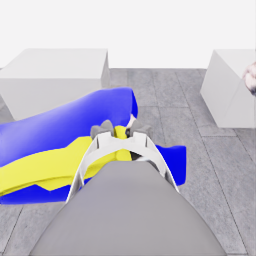
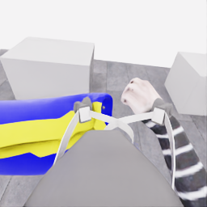
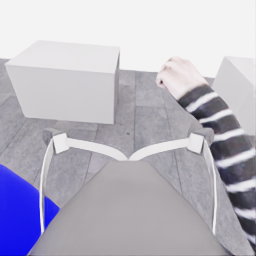

# E15 종료 검토: 준비 단계의 변화, 손 근처 가림, 한쪽 개방 후 종료

E15 `20261106-astra-opening264-001`은 **5/50점, 첫 소매 0점, 착의 success=false**로 모델이 자율 종료했다. **611/611전이 기술 검사를 통과**했지만 10점 목표와 성공 시연에는 도달하지 못했다. 사용자의 마감 지시에 따라 오늘 실험은 E15에서 끝낸다. E16·E17은 실행하지 않으며 새 수집은 재개 요청 이후 검토한다.

[시도 영상·단계별 보기](../../gallery/20261106-astra-opening264-001.ko.md) · [준비 구간의 당시 부분 검토](../experiments/2026-11-06-opening-first-partial-review.ko.md) · [공개 수치·이미지 출처와 SHA256](../assets/20261106-opening-final-review/evidence.json) · [원본 백업 검증](../../project/sessions/20261106-e15-backup-verification.json)

## 실행과 결과

| 항목 | 기록 |
|---|---|
| 실행 시간 | 2026-11-06 11:55:47–12:24:16 UTC |
| 실제 소스 | `fa3fb85a25b35228d5456fd3e70fca3259098e6b`, 실행 시 작업 트리 변경 없음 |
| 모델 | `gpt-6-astra`, `ultra`, 단일 계획 |
| 시작 | E07의 공개 행동 264전이를 새 에피소드에서 재실행. 물리 checkpoint 복원이나 천 상태 동일성은 주장하지 않음 |
| 방법 | `coordinated-opening-first`, 현재 RGB 5장·공개 상태·16×16 depth 요약·현재 손목 depth 패널. 과거 이미지 주입 없음 |
| 정착 | 움직임 결정 뒤 중립 6전이, 총21구간·126전이. 관절·천의 정지를 보장하지 않는 유한 대기 |
| 전체 | 재실행264 + 모델 동작221 + 자동 중립126 = **611전이**, 기록된 simulation 시간 **30.55초** |
| 모델 결정 | 24회: 동작23회와 종료 결정1회. 마지막 종료 요청의 실제 전이는0 |
| 결과 | 픽업5점, 첫 소매0점, 착의 실패, `no_dressing_points`, 최종 rate0점/초 |
| 검증 | capture complete, 오류0, **611/611전이 통과**. 학습 승인은 `unreviewed` |

모델 호출의 준비·CLI·통신·응답을 합친 시간은1,105.82초, 환경 요청 시간은548.95초였다. 모델 내부 추론 시간은 제공되지 않았다. 이 실행은 앞선 운반 후 분기와 시작 경계·전략·과거 입력 구성이 달라, 결과 차이를 한 요소의 인과 효과로 해석하지 않는다.

## 공개 관측에서 확인한 과정

아래 원인 검토는 지정 RGB, 공개 로봇 상태, 최종 행동과 적용 구간에 근거한다. 공식 점수·기술 검사는 종료 결과 확인에만 사용했다. 숨은 천·마네킹 기하나 평가기의 접촉 판정을 원인 정답으로 사용하지 않는다. 행동 설명에 나오는 입구·파지·접촉은 모델의 시각적 판단이다.

| 구간 | 관측 사실 | 해석의 한계 |
|---|---|---|
| 준비264→325, 입력0→5 | 처음 평평한 천이 양쪽 움직임을 따라 올라간다. 입력3에는 파랑 층과 노랑 띠 사이의 어두운 부분이 드러나고, 더 들면 접힘과 팔에 의한 가림이 커진다. | 어두운 선은 통과 가능한 입구의 증명이 아니다. 양쪽을 동시에 움직였으므로 각 파지의 독립적인 하중 지지를 이 구간만으로 확인하지 못했다. |
| 운반325→509, 입력5→13 | 두 베이스가 함께 실제 이동하고 손 근처에 도달한다. 분석한 D5–D15의 양쪽 베이스 이동 거리 차이는 최대0.26mm, 준비 이후 그리퍼 간 거리는443.99–444.98mm였다. | 로봇 간격이 일정하다고 천의 장력·파지·입구 형태가 유지됐다고 볼 수 없다. 각 구간 수치는 모델 동작과 뒤따른 중립6전이를 함께 포함한다. |
| 접근·복구509→589, 입력13→20 | robot0 손목 영상에서 같은 손이 보였다가 하우징/천에 가려지고, 복구 뒤 다시 보이는 현상이 반복된다. 옆 이동과 되돌리기는 실제로 실행됐다. 후반에는 robot0 손가락 사이가 커진다. | 손이 사라졌다는 사실만으로 천 경계를 통과했다고 볼 수 없다. 검토한 robot1 손목 프레임은 같은 손과 입구를 함께 확인하는 보조 시점을 주지 못했다. |
| 개방·철수589→611, 입력20→23 | D20·D21은 robot0만 명시적으로 열고, D22는 열린 robot0를 낮추고 당겼다. 천이 robot0에서 멀어지고 robot1 쪽에 매달린 모습이 보인다. 마지막 입력에서 robot0는 열린 상태로 물러나 있다. | 끝부분의 robot1 지지는 시각적으로 뒷받침되지만, 이것을 초기부터 모든 순간의 독립 지지가 확인됐다는 뜻으로 소급하지 않는다. |

초기 들기는 작동했다. 입력0→3에서 lift 실제 증가는 robot0/1 각각98.213/76.968mm, 자기 베이스 기준 grasp 높이 증가는150.192/127.395mm였다. 입력0→5에서는 lift가439.036/414.987mm 높아졌다. 따라서 초기 실패를 “전혀 들지 못함”으로 설명할 수 없다. 이후 손목 회전도 함께 바뀌므로 lift 높이와 그리퍼 위치의 변화를 동일시하지 않는다.

입력17→18의 base worldX 이동은−53.824/−55.432mm였고, 입력18→19에서는+55.162/+55.279mm로 되돌아갔다. 실제 이동은 확인되지만 유효한 입구에 대한 정확한 정렬 오차는 측정하지 못했다. 작은 접근 보정 뒤의 base 속도는 낮아졌어도, 자동 중립6전이가 모든 관절이나 천까지 안정시켰다는 증거는 아니다.

## 명령하지 않은 벌어짐과 이후의 명시적 개방

| 입력 | simulation 시간 | robot0 손가락 원점 거리 | robot1 같은 거리 | robot0 finger 관절값(rad) | robot0 닫기 의도 / 목표(rad) |
|---|---:|---:|---:|---|---|
| 18 | 29.775002s | 61.492mm | 39.807mm | 0.201166 / 0.118254 | true / 0.103 |
| 19 | 30.375002s | 91.007mm | 39.810mm | 0.198014 / 0.275497 | true / 0.103 |
| 20 | 30.975002s | 133.403mm | 39.811mm | 0.199227 / 0.500097 | true / 0.103 |
| 21 | 31.175002s | 137.804mm | 39.810mm | 0.22254 / 0.50010 | false / 0.3015 |
| 22 | 31.475002s | 172.473mm | 39.810mm | 0.40953 / 0.50007 | false / 0.5 |
| 23 | 32.075002s | 187.703mm | 39.809mm | 0.49543 / 0.49863 | false / 0.5 |

입력18→20은 열기 명령 전이다. 닫기 목표가 유지됐는데 robot0의 한 손가락 위치가 크게 변했고, 손목 pitch 목표 잔차도−0.148→+1.944°로 커졌다. 이후 입력21→23은 명시적 개방의 결과이므로 같은 현상으로 묶지 않는다. 시간은 공개 관측의 simulation 시계다. 기록 시작 시각1.525000초를 뺀 경과시간과 구분한다.

아래는 보정·자른 영역·보간 없이 복사한 원본 공개256×256 손목 영상이다.

| 입력18: 열기 전 | 입력20: 열기 직전 | 입력23: 개방·철수 후 |
|---|---|---|
|  |  |  |

열기 전의 비대칭 벌어짐은 실제 공개 상태와 이미지에서 확인된다. 그러나 `fingertip_origin_distance`는 접촉면 사이 간격이나 파지 센서가 아니다. 그 수치만으로 접촉 원인, 천 슬립, 부착 해제를 판정하지 않는다. 모델은 손목 부근의 끼임/접촉을 의심해 개방했지만, 본 검토의 결론은 **손 근처에서 한쪽 형상이 변했고, 가림 때문에 손–천 경계 통과를 확인하지 못했다**는 데 한정한다.

## 마감 시 남긴 원인 구분

1. **명령 미실행이나 한쪽 베이스의 큰 지연은 주된 설명으로 뒷받침되지 않는다.** 베이스·lift·손목의 실제 변화와 복구 방향을 확인했다. 그렇다고 모든 관절 잔차가 없었다는 뜻은 아니다.
2. **입구의 연속적인 관측과 손 근처 그리퍼 여유가 주요 미해결 문제다.** 접힌 층 사이의 어두운 선, 외부 패널 뒤로 사라진 손, 실제 통과를 구분하지 못한 채 국소 보정이 반복됐다. 밑단 파지 자체가 잘못됐거나 소매를 잡아야만 한다는 결론은 아니다.
3. **초기 두 파지의 독립 확인은 부족했다.** 다만 마지막 개방 뒤 robot1 쪽에 천이 매달린 관측이 있으므로, 처음부터 robot1이 실패했다고 단정할 근거도 없다. 향후 지지 확인을 한다면 상대 로봇의 실제 움직임도 함께 기록해야 한다.
4. **depth는 사용됐지만 가려진 표면을 보여 주지는 못했다.** 현재 손목 depth 패널과 공개 수치가 입력에 포함됐다. 선택한 RGB 지점의 depth 조회는 보이는 표면의 상대 깊이를 확인하는 별도 후보이며, 입구 의미·숨은 손·파지·통과를 대신 판정하지 않는다. 후보 코드는 미적용 상태로 보존하고 오늘 실행하지 않는다.

중립 대기와 후속 지각 도구를 포함한 비공개 분석·후보 패치는 새 서버 인계 자료로 보존한다. 다음 실행 방법은 이번 결과와 복원 검증을 확인한 뒤 사용자의 재개 요청에 맞춰 선택한다. 서버 종료는 사용자가 수행한다.
