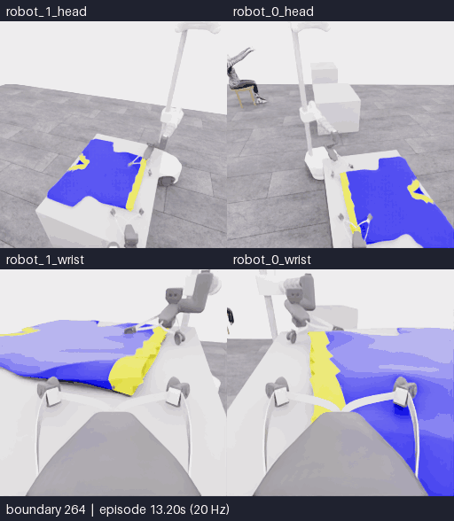
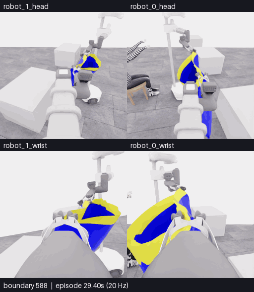

# E28 · 측면 파지, 입구 형태 유지, 첫 손 접근

**측면 배치에서 양측 천 동행과 운반, 손–경계 정렬까지 진전됐다. 명확한 첫 손목 진입·소매 통과는 확인하지 못했다.** 별도 로컬 공식 평가기는 **5/50점, 픽업만 득점, 착의 0, success=false**다. 739/739전이 전수 QC를 통과했고 학습 승인은 `unreviewed`다. [공개 실행 보고서](../attempts/20261113-astra-side-hem-fresh-001/README.ko.md) · [manifest](../attempts/20261113-astra-side-hem-fresh-001/manifest.json) · [E29 방향](../research/2026-11-13-e28-outcome-e29-direction.ko.md)

시도 `20261113-astra-side-hem-fresh-001`은 새 reset에서 시작했다. 소스는 `9f79772`, 전략은 `coordinated-side-hem-wrists`, 고정 Codex CLI 0.166.0 / exec / gpt-6-astra / ultra다. 40판단 예산 뒤 마감했으며 마지막 1전이는 종료 정리다. 아래 시각 판단은 공개 RGB-D·로봇 상태·확정 행동에 근거한다. 점수·내부 형상으로 파지나 통과를 판정하지 않았다.

## 대표 구간

**264–380: 닫기 → 국소 천 동행 → 높이 차와 방향 조절 → 들어 올린 고리 유지.** [출처](../../gallery/20261113-e28-opening-264-380/provenance.json)

**588–738: 손–경계 간격 감소 → 짧은 진입 시험 → 접힌 경계 주변에서 손 관계 유지.** [출처](../../gallery/20261113-e28-hand-588-738/provenance.json)

두 영상은 지정 head/wrist 4개를 **왼쪽 robot_1, 오른쪽 robot_0, 위 head·아래 wrist**로 배치한다. 20 Hz 원본을 5 fps로 재생해 4배 느리며 모델 대기 시간은 포함하지 않는다. 각각 117·151개 경계를 빠짐없이 내보냈다. 시각 검토는 실행 중 공개 관측 묶음, 정리 전 738경계 원본 RGB, 내보낸 GIF의 시작·중간·끝 표본을 확인했다. GIF의 색상 양자화를 미세 접촉의 근거로 삼지 않는다.

## 관측과 해석

| 구간 | 실제로 관측한 변화 | 해석의 한계 |
|---|---|---|
| 초기 탐색 → 208 | 가까운 빈 테이블에서 옷이 있는 테이블을 찾아 서로 다른 측면으로 접근 | 초기에 옷이 안 보였던 것을 지속적인 가시성 실패로 기록하지 않음 |
| 264 → 294 | 닫기 직후에는 손가락이 열려 보였지만 이후 좁아지고 노란 천이 국소적으로 모임 | 닫기 명령·손가락 간격만으로 attachment를 인증하지 않음 |
| 306 → 380 | 실제 그리퍼 상승에 양쪽 국소 노란 영역이 동행. 높이 차·손목 조절 후 오목한 경계가 유지됨 | **잠정적인 양측 국소 천 동행**이다. 독립 하중 지지·입구 위상은 불확실 |
| 380 → 588 | 동반 base 이동 중 그리퍼 주변 천과 경계 형태가 유지됨 | 팔에 가려진 아래 천과 주변 테이블 사이의 완전한 간격은 일부 불확실 |
| 588 → 682 | 마네킹과의 거리와 같은 손 후보에 대한 영상상 가로 간격이 줄어듦. 손목 방향 변경 뒤 손을 볼 수 있는 시점이 개선됨 | 대표 가시 표면 표본은 같은 천 입자나 실제 통로 중심을 보장하지 않음 |
| 682 → 738 | 같은 줄무늬 전완과 손이 접힌 노란 경계 옆으로 가까워짐. 이후 중립 유지·한쪽 lift·작은 추가 이동에도 양측 국소 지지 관계가 유지됨 | 일부 손가락은 가려지고 손목은 밖에 보임. 명확한 경계 통과나 소매 출구는 확인되지 않음 |

정리 전 최종 관측은 `policy.hdf5 / data/demo_0/next_obs[737]`, **경계 738**, 공개 simulation 시각 약 38.425초다. 최종 보고서의 일반 종료 이미지는 정리까지 포함한 경계 739이므로 두 경계를 혼동하지 않는다. `first_sleeve`는 actor의 의도이며 득점·통과 판정이 아니다.

## 후속 분기에 남길 경계

| 경계 | 보존 이유 | 권고 용도 |
|---|---|---|
| 264 | 초기 닫기 직전 | 파지 배치·닫기 후 대기 비교 |
| 380 | 들어 올린 오목한 경계 유지, 운반 전 | 펼침·운반 유지 비교 |
| **682** | 첫 안쪽·아래쪽 진입 시험 전 | 입구 방향을 바꾸는 통제 비교 |
| **738** | 마지막 부분 정렬·높이 차를 보존, 정리 제외 | **같은 전략의 우선 후반 진행 출발점** |

738 분기의 과거 영상이 필요하면 **이번 새 재실행에서** 682·714경계를 기록하고, 682 분기라면 632·668을 후보로 삼는다. 두 경계는 각각 prefix 끝보다 작다. 원본 이미지를 새 실행의 현재 상태로 넣지 않는다. 전체 원본 QC 뒤 직접 부모와 source group을 유지해 분기하고, 재실행한 현재 지지·손 관계를 다시 확인한다. 정확한 천 상태 checkpoint가 아니며 학습 승인을 부여하는 절차도 아니다.

다음 좁은 비교는 한쪽 지지를 유지하며 반대쪽 손목의 pitch 또는 roll 한 축으로 접힌 경계의 방향을 바꾸고 다시 관측하는 것이다. 기존 전략이 허용하는 조작이며 방향·크기는 새 현재 관측에서 정한다. E28은 예산으로 마감됐으므로 같은 전략의 후반 진행을 먼저 검토하고, 반복된 구체적 오류가 확인될 때 별도 프롬프트 패치를 비교한다. [가설과 전환 기준](../research/2026-11-13-e28-outcome-e29-direction.ko.md)
