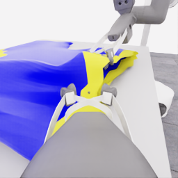
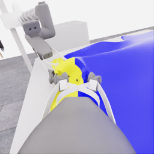

# E33 검토: 가운데 파지 변경은 시도했지만 손 접근 전 준비에서 마감

[시연 자료](../attempts/20261114-astra-middle-grip264-001/README.ko.md) · [manifest](../attempts/20261114-astra-middle-grip264-001/manifest.json) · [전체 overview](../attempts/20261114-astra-middle-grip264-001/overview.mp4) · [최신 수집 계획](../../COLLECTION_PLAN.md)

**로컬 공식 평가 0/50, pickup 0, 착의 0, `success=false`.** E28의 닫기 직전264에서 시작해20개 새 행동 결정으로 양쪽 파지 위치 변경과 국소 형상 시험을 수행했으나, 옷 운반·마네킹 손 위 정렬·짧은 하강까지 진행하지 못했다. 따라서 사용자 제안 전체를 시험했거나 내려 걸치기가 실패했다고 해석하지 않는다. 종료는20결정 예산 소진이며 모델의 착의 완료 선언·10점 검토 기준 도달이 아니다.

실행은 `20261114-astra-middle-grip264-001`, source `464203860304631d00a8acd6747b86c23cfded61`의 clean 상태, `coordinated-middle-grip-drape`, Codex CLI0.166.0 / exec / gpt-6-astra / ultra다. 시작08:13:20 UTC, 종료08:35:52 UTC. capture complete=true이며 전수 QC **471/471 통과**, 학습 승인은 `unreviewed`다. QC는 기록의 기술적 유효성이고 파지·착의 성공 승인이 아니다.

## 공개 관측에서 확인한 범위

검토자는 지정 카메라의 RGB와 허용 목록으로 정리한 최종 행동 설명·실행 전이, 별도 점수 요약을 확인했다. actor 원시 reasoning/events, 내부 천 기하와 접촉 정답은 사용하지 않았다. 아래 중간 경계는 policy HDF5의 공개 `next_obs[경계-1]`에서264·320·360·402·424·454·470·471을 비교했다. 모델 설명에 있는 “guide/anchor”, “provisional hold”, “slit”는 시각 가설이며 내부 부착 상태의 측정값이 아니다.

| 구간 | 실행과 공개 관측 | 판단과 남은 불확실성 |
|---|---|---|
| D0–D5,264→320 | 열린 그리퍼 위치 보정, 높이 조정, 양쪽 닫기, 짧은 들어 보기·높이 차 시험. 테이블 위 옷과 그리퍼 가까운 노란 주름의 모양이 달라졌다. | 국소 천 동행 후보는 있으나 양쪽의 독립 하중 지지나 열린 통로는 확인하지 못했다. |
| D6–D13,320→402 | robot_0을 낮추고 한쪽만 열기, 두 번 배치 보정, 닫기와 기다림·들기.360의 열린 jaw와402의 모인 노란 천 관계가 달라졌다. | 파지 위치를 바꾸려는 실제 open→이동→close가 기록됐다. “더 가운데의 올바른 밑단 층을 잡았다”는 성공 판정은 하지 않는다. |
| D14,402→412 | robot_0 손목 회전과 robot_1 높이 변경으로 형상 비교. | 노란 경계와 접힘은 변했지만 충분한 세로 입구·폭·깊이가 확보됐다는 근거는 없다. |
| D15–D18,412→454 | robot_1을 테이블 쪽으로 낮추고 한쪽만 열기, 두 번 배치 보정. robot_0 근처의 모인 천은 유지됐고 robot_1 jaw와 노란 경계의 상대 위치가 바뀌었다. | 검은 틈·겹쳐진 노란 경계만으로 입구 정체나 반대 층을 확인하지 않는다. |
| D19,454→470 | robot_1에16전이 닫기 명령. 마지막 wrist 영상에서 손가락 간격과 국소 천 모임이 달라졌으며 옷은 계속 테이블 쪽에 있다. | 새 robot_1 파지의 후속 들어 보기·천 동행 시험은 아직 수행하지 않았다. 마네킹 손과 옷의 접촉 관계는 형성하지 않았다. |

마지막 중립 정리470→471은 새 모델 결정이 아니다.470과471 영상에서 큰 형상 차이는 확인하지 못했지만, 중립도 남은 목표 추종을 완전히 멈추는 물리 checkpoint로 취급하지 않는다.

왼쪽 robot_1 / 오른쪽 robot_0, 원본 픽셀은 반전하지 않았다.

| 마지막 robot_1 wrist | 마지막 robot_0 wrist |
|---|---|
|  |  |

## 결정과 시간의 사용

전체471전이는 **264 replay +128 model +78 settle +1 budget cleanup**이다. 새207전이=10.35시뮬레이션초이며 모델 응답을 기다린 시간에는 물리가 진행하지 않는다.20 act,21모델 호출에는 물리 진행 없는 depth 질의 후속 호출1개가 포함된다.

| 용도 | 결정 / 호출 | 새 model / settle 전이 | actor 경로 초 | 새 환경 경로 초 |
|---|---:|---:|---:|---:|
| 초기 획득·첫 형상 시험 D0–D5 |6 /6|32 /24|324.152|54.159|
| robot_0 파지 변경·시험 D6–D13 |8 /9|52 /30|335.140|80.727|
| 추가 형상 시험 D14 |1 /1|4 /6|44.968|9.932|
| robot_1 파지 변경 D15–D19 |5 /5|40 /18|177.568|55.307|

총 실제 시간은1,351.411초, 약22.52분이다. actor 경로881.828초와 새 행동·정착의 환경 경로200.125초를 합하면1,081.954초, 약18.03분이다. 이는 replay218.986초와 초기화·기타 orchestration을 제외한 분석 합계이며 순수 모델 추론시간은 측정하지 않았다. 새 결정당 이 합계는 약54.1초다. 새 득점·확인된 손 진입이0이므로 득점당 효율이나 착의 개선율을 산출하지 않는다.

## 추가20결정에 대한 의견과 E34 후보

**같은 전략으로 한 번 더 이어 보는 것은 제한적으로 타당하다.** 이유는 개선된 착의 성과가 아니라, robot_1의 새 닫기가 마지막 결정에서 끝나 그 파지의 실제 동행과 형상 유지라는 구별 가능한 후속 시험이 남았기 때문이다. 준비 전체를 같은 시작점에서 반복하는 것보다 이 미완료 시험부터 관측하는 편이 다음 판단에 유용하다. 다만 이번20결정 대부분이 파지 준비·복구에 쓰였으므로 자동 예산 증액만으로 손 위 하강에 도달한다고 기대할 근거는 없다.

| E34 검토 후보 | 값과 의미 |
|---|---|
| 직접 parent | E33 `20261114-astra-middle-grip264-001` |
| source group | E28 `20261113-astra-side-hem-fresh-001` 유지 |
| prefix |470, D19 닫기 뒤·예산 정리 전 |
| 새 replay history |434·454: robot_1 열기 뒤와 닫기 직전의 공개 관측을 새 실행에서 기록 |
| 방법 | 같은 조작 방향에 재개 중 추가 해제를 금지하는 `coordinated-middle-grip-drape-retain` 조건을 추가. 입력·물리 설정 유지 |
| 예산 | 새20결정 / 총1400전이 / review10. 상한 `470+20×(20+6)+1=991` |
| 첫 비교 | 현재 닫힘과 지지를 재확인하고, 짧은 실제 움직임에서 천 동행·공간 유지 여부를 관측 |
| 이후 | 근거가 있으면 형상 유지·운반·같은 손 위 정렬과 하강. 같은 준비가 반복되면 출발점이나 방법 재검토 |

E33의 원본 전체 QC와 고정 백업 검증을 완료한 뒤에만 후속 원본으로 사용한다. prefix는 기록 행동 재실행이며 정확한 천 상태 복원이 아니다. 새 replay의 현재 관측을 우선하고 과거 이미지를 현재 상태로 사용하지 않는다. 위는 후보 제안이며 실제 E34 시작·선택은 최신 수집 계획과 별도 세션 기록으로 확인한다.

**누적 준비 횟수의 한계도 남는다.** E33에서 robot_0과 robot_1은 각각 초기 한쪽 재파지 사이클을 한 번 사용했다. 새 run 이름이 이 실패 준비 예산을 초기화하는 근거는 아니다. 현재 새 actor 경로는 이전 세션을 재사용하지 않으며 두 장의 replay history가 누적 사이클 수를 기계적으로 강제하지도 않는다. 이 한계를 줄이기 위해 별도 `coordinated-middle-grip-drape-retain` 선택지는 기존 방법 끝에 이번 continuation 전체에서 양쪽 그리퍼를 다시 열지 말라는 지침을 추가한다. 초기·복구·후속 단계의 해제 예외도 허용하지 않으며 지지를 회복할 수 없으면 마감하도록 한다. **프롬프트 지침일 뿐 런타임 action 차단이나 누적 횟수 상태기계는 아니다.** 가짜 actor의 유효한 open 명령은 기존 행동 검사를 통과하므로 실제 모델 준수는 별도로 확인해야 한다. 후속 검토에서 다시 같은 open→미세 보정→close를 반복하는지 반드시 구분하고, 그러한 반복을 새 착의 진행으로 세지 않는다.

E33과 후속 분기는 E28과 같은 source group으로, 독립 성공 표본이나 별도 validation 원천이 아니다. 다음 원본을 정상 마감한 후 추가 결정이 천 동행·공간·손 접근 중 어떤 관계를 새로 확인했는지와 득점·호출·시간을 함께 평가한다.
