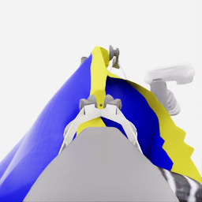
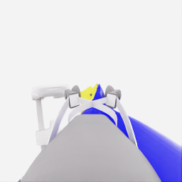

# E34 검토: 새 파지로 운반하고 짧게 낮췄지만 착의 진행은 미확인

[시연 자료](../attempts/20261114-astra-middle-grip470-retain-001/README.ko.md) · [manifest](../attempts/20261114-astra-middle-grip470-retain-001/manifest.json) · [전체 overview](../attempts/20261114-astra-middle-grip470-retain-001/overview.mp4) · [E33 검토](20261114-astra-middle-grip264-001.ko.md) · [현재 수집 계획](../../COLLECTION_PLAN.md)

**로컬 공식 평가5/50, pickup5, 착의0, `success=false`.** E33에서 바꾼 파지로 옷을 들어 테이블 밖으로 운반했고, 같은 손을 향한 정렬 뒤 한 차례 실제 하강 시험까지 진행했다. 기존 정상 시도의 최고5/50을 넘긴 결과는 아니다. E33의 준비 단계보다 진행한 관측 자료지만, 첫 손목에 안정적으로 걸린 관계·연속 전완 진행·소매 통과는 확인하지 못했다. 사용자의 최신 지시에 따라 **이번 E34로 수집을 종료하고 E35는 시작하지 않는다.** 아래 진단 조건은 향후 재설계 검토용이며 추가 실행 지시가 아니다.

## 실행·기록·지침 준수

| 항목 | 확인 결과 |
|---|---|
| 실행 | `20261114-astra-middle-grip470-retain-001` |
| source | `0a5121cde33a32db5e4888255de150e846d52c15`, 시작 clean |
| UTC |2026-11-14 08:41:36–09:14:16 |
| 직접 parent / source group | E33 / E28 `20261113-astra-side-hem-fresh-001` |
| 재실행 / history |470행동 / 이번 재실행에서434·454의 공개 RGB 생성 |
| 전략 | `coordinated-middle-grip-drape-retain`, CLI0.166.0 / exec / gpt-6-astra / ultra |
| 예산·입력 |20새 결정 /1400전이 /review10, named·pixel query·wrist panel·plan1·motion-only settle6 |
| 종료 |20 act 예산 소진, 모델finish0, capture complete=true, 오류 없음, client/simulator0 |
| 기술 검사 | 전수 QC836/836 통과, 학습 승인 `unreviewed` |
| 별도 평가 | pickup5, 모든 착의 항목0, `no_dressing_points`, success=false |

20개 최종 모델 행동의 양쪽 gripper 값은 모두 `+1`이었다. 공개 policy HDF5의 **새 suffix `[470,836)`**에서도 양쪽 gripper 채널의 값은 `{0,+1}`뿐이며 `<-0.5`의 열기 명령은 **0개**다.0은 제어기 정착과 예산 정리를 포함한다. 이는 이번 실행에서 추가 열기 금지 지침을 지킨 증거이며, 천의 부착·슬립 없음이나 실제 손가락의 불변을 인증하지 않는다. 지침 자체는 프롬프트 조건이고 런타임 차단기는 아니다.

E33 전체471전이 중 마지막 예산 정리1개를 제외한470을 재실행했다. 그 안에는 E28의264 prefix와 E33의 새 준비206전이가 함께 있다. 이번 새366전이를 E28/E33과 독립 성공 표본으로 세지 않는다. 재실행은 기록 행동의 새 수행이며 정확한 천 상태 checkpoint 복원이 아니다.

## 관측 사실과 모델 의도를 나누어 본 과정

검토는 지정 공개 RGB5개, 공개 로봇 상태·행동, 허용 목록으로 정리한 최종 결정·적용 구간, 별도 점수 요약에 한정했다. 원시 actor reasoning/events·audit·내부 천 기하·접촉 정답은 사용하지 않았다. 공개 HDF5의 `next_obs[경계-1]`에서470·535·593·723·787·815·825·836의 head/wrist를 직접 비교했고, 하강과 마지막 횡이동은815·819·825·829·835·836의 공개 상태로 따로 확인했다. 기존 actor의 설명은 관측 사실의 대체물이 아니다.

| 구간 | 실제 실행·공개 관측 | 해석의 한계 |
|---|---|---|
| D0–D5,470→549 | 양쪽 들기, robot_0 차등 높이, 추가 공동 들기와 pitch.535에서는 E33 끝보다 노란 경계가 세로로 길게 보이고 몸판 일부가 테이블에서 떨어져 늘어진 형상이다. 양 jaw 근처에 천이 남는다. | 새 파지의 국소 동행·들기 근거다. 노란 윤곽 안의 파란 면은 뒤쪽 몸판일 수도 있어 열린 통로 정체나 반대 lip의 독립 제어를 확정하지 않는다. |
| D6–D12,549→723 | 두 베이스가 옷을 함께 옮긴다.593에서는 테이블 모서리 밖으로 매달린 옷이 보이고,723에서는 출발 테이블과 떨어져 마네킹에 접근한다. 길게 세운 노란 경계와 국소 jaw–천 관계가 남는다. | E33에서는 시험하지 못했던 운반 중 유지의 새 근거다. 두 파지 각각의 독립 하중·부착이나 접촉 없는 운반을 센서로 인증한 것은 아니다. |
| D13–D15,723→787 | 공동 높이/pitch 변경과 이동으로 옷과 마네킹 손의 간격·시각 관계가 바뀐다. 손과 연결된 줄무늬 전완이 head 시점에 더 크게 보인다. | 모델의 “손 위 공간”은 작업 가설이다. 그리퍼 높이가 증가했다는 사실만으로 그 손이 자유 입구 아래에 정확히 정렬됐다고 볼 수 없다. |
| D16–D17,787→815 | 두 번의 더 짧은 수평 정렬.815의 head에서는 선택 손·전완이 노란 경계와 그리퍼/housing 근처에 보이며 손가락 일부가 가려진다. wrist 시점은 주로 천과 jaw를 보여 준다. | image adjacency와 실제 동일 깊이·입구 내부 정렬을 구분한다. 손의 일부 가림은 진입과 바깥 패널/하우징 가림 모두와 양립한다. |
| D18,815→825 | 양 lift에−0.06을4전이 적용하고 중립6전이. 실측 lift 변화는 robot_0 **−15.985mm**, robot_1 **−15.999mm**다. head에서 손·경계 관계가 조금 변하지만 큰 구조는 유지된다. | 한 번의 실제 하강은 확인된다. 모델 설명의 “약2cm”, `first_sleeve` 단계명, 손이 덜 보이는 현상은 걸침·통과 성공의 증거가 아니다. |
| D19,825→835 | depth 질의 뒤 높이를 추가 명령하지 않고 양 베이스의 짧은 횡방향 보정4전이+정착6전이. base 위치의 끝점 변위는 약 **37.433/36.384mm**다. | 두 번째 하강이 아니다. 마지막 영상도 손이 잡힌 경계/housing 근처에 있는 관계를 남기며, 안정된 손목 걸침이나 소매 출구의 새 근거는 없다. |
| 정리,835→836 | 예산 종료 중립1전이. 양쪽 닫기 의도를 유지한 채 정상 마감. | 모델 결정이나 추가 독립 시연으로 세지 않는다. |

D18의 lift−15.985/15.999mm 중 명령4전이가 끝난819까지는 약−7.235/−7.244mm, 뒤6개 정착 구간에는 약−8.751/−8.755mm가 더 진행됐다. 즉 하강의 절반 이상이 명령 종료 뒤에 나타났다. **중립은 목표 추종을 취소하는 정지 명령이 아니다.** D19의 base 변위도 모델 행동과 정착을 합친 값이며, 천의 재료점 이동이나 손–입구 오차를 측정한 것이 아니다.

D18 뒤 depth 질의는 보이는 손/경계 후보의 optical depth를 비교하는 정보였다. 현재 표면의 비슷한 깊이는 열린 통로·접촉·소매 통과를 판정하지 않는다. 평가기의 최초 접촉 시각도 별도 결과이며 특정 이미지의 가림 원인을 역으로 정답 라벨링하는 데 사용하지 않았다.

마지막 공개 wrist, 왼쪽 robot_1 / 오른쪽 robot_0. 픽셀 반전·보간 없음.

| robot_1 wrist | robot_0 wrist |
|---|---|
|  |  |

## 추가20결정이 만든 차이와 시간

전체836전이는 **470 replay +245 model +120 settle +1 budget cleanup**이다. 새366전이=18.30시뮬레이션초, 전체41.80시뮬레이션초다.20 act와24모델 호출의 차이4개는 물리 진행 없는 depth 질의 후속 호출이다.

| 용도 | 결정 / 호출 | 새 model / settle 전이 | actor 경로 초 | 새 환경 경로 초 |
|---|---:|---:|---:|---:|
| 들기·형상 D0–D5 |6 /7|43 /36|383.380|72.931|
| 운반 D6–D12 |7 /7|132 /42|283.731|147.153|
| 접근·정렬 D13–D17 |5 /7|62 /30|308.586|81.214|
| 하강 D18 |1 /1|4 /6|37.293|8.741|
| 횡보정 D19 |1 /2|4 /6|157.163|8.562|

총 실제 시간1,959.323초는 약32.66분이며 prefix 재실행·초기화를 포함한다. actor 경로1,170.153초와 새 행동·정착 환경 경로318.601초의 합계는1,488.754초, 약24.81분이다. replay 환경 경로418.908초와 기타 orchestration은 이 합계에서 제외했다. 새 결정당 합계는 약74.4초이며 순수 모델 추론시간은 따로 측정하지 않았다.

E33은 새 파지의 마지막 닫기에서 끝났으므로 운반 효과를 알 수 없었다. 이번 추가20결정은 **새 파지의 들기·운반 유지, 세로 형상 유지, 손 접근, 실제 짧은 하강**을 구분하는 자료를 추가했고 pickup5점은 이번 suffix에서 새로 얻었다. 하지만18결정이 하강 이전에 쓰였고, 실제 하강은 D18 한 번뿐이었다. 따라서 추가 시간이 무익했다고도, 사용자 제안이 착의에 성공했다고도 결론 내리지 않는다. 착의 득점당 효율·성공률 개선은 산출할 수 없다.

## 지금은 종료하고 재설계에서 구분할 조건

**사용자의 최신 지시대로 E34 마감 뒤 수집을 중지한다. E35나 추가20결정을 시작하지 않는다.** 재개 후보 경계·run ID를 실행 계획으로 승격하지 않으며, 향후 수집은 새 방법 검토와 별도 재개 지시에 따른다.

이번 결과가 남긴 진단 질문은 다음과 같다.

1. **파지가 만든 세로 윤곽을 실제로 조절 가능한 입구와 구분할 수 있는가.** 세로로 길어진 노란 경계는 관측됐지만 두 경계의 독립 운동·손 접근 가능한 공간이라는 가설은 여전히 미확인이다. 뒤쪽 파란 면을 보았다는 이유만으로 입구를 닫힘/열림 어느 쪽으로 확정하지 않는다.
2. **같은 손이 자유 구간에 정렬된 것과 잡힌 모서리/housing에 접근한 것을 구분할 수 있는가.** 마지막 head는 손·팔을 보이지만 wrist는 천·jaw 가림이 크다. 카메라·관측 경계에 묶인 손 식별과 대안 가설을 기록해야 하며, 픽셀 인접·비슷한 optical depth·단계 문자열만으로 다음 단계를 승인하면 안 된다.
3. **명령·실제 운동·천 변화·과제 진척을 별도 기록하는가.** D18은 실제 하강했고 그 절반 이상이 정착 중에 발생했다. “명령이 안 먹었다”는 설명이나 “하강했으니 걸쳤다”는 설명 모두 현재 증거보다 강하다.
4. **이어가기에서 이전 준비 예산·관측 근거를 유지하는가.** E34는 추가 열기0으로 지침을 지켰다. 그러나 누적 재파지 횟수·첫 손의 정체를 외부 상태기계로 강제하는 기능은 없고, 새 actor의 문맥 제한이 사라진 것은 아니다.
5. **관측 근거와 가설이 어떤 유한한 비교로 갈리는가.** 더 많은 문장이나 같은 미세 하강의 반복 대신, 어떤 다음 공개 변화가 파지·입구·정렬 가설을 지지하거나 반박할지 개발자 검토에서 먼저 명시해야 한다. 이는 미래 설계 조건이며 지금 actor에 입력하거나 실행한 기능이 아니다.

과거에도 [E16의 순차 지지·재파지](20261106-astra-support264-002.ko.md), [E25의 다른 낮은 경계 재파지](20261107-astra-opposing563-named-001.ko.md), [E19의 실제 접근과 잔류 운동](20261107-astra-entry801-named-001-motion.ko.md), [E27의 운반·팔 접근](20261107-astra-regrasp698-progress-named-001.ko.md), [E31의 같은 손 정렬과 보상](20261113-astra-diagonal682-001.ko.md)이 있었다. 이 동작들을 모두 “아직 안 해본 해결책”으로 다시 제안하지 않는다. E34의 추가 근거와 각 시도의 미확인을 함께 사용하되, 과거 모든 동영상을 이번에 다시 전수 시청한 것으로 설명하지 않는다.
