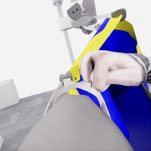
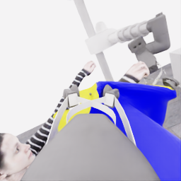

# E35 검토: 손과 천의 근접 관계는 달라졌지만 파지부 가림에서 중단

[시연 자료](../attempts/20261114-astra-wide-hem723-001/README.ko.md) · [manifest](../attempts/20261114-astra-wide-hem723-001/manifest.json) · [전체 overview](../attempts/20261114-astra-wide-hem723-001/overview.mp4) · [실행 기록](../../project/sessions/20261114-e35-wide-hem.ko.md) · [E34 검토](20261114-astra-middle-grip470-retain-001.ko.md)

**로컬 공식 평가5/50, pickup5, 착의0, `success=false`.** E34/723에서 현재 파지를 유지하며 아래 구간을 넓게 펴고 같은 손에 측면으로 접근했다. 매달린 천의 외관과 손–경계의 상대 위치가 달라졌고, 선택 손이 robot_1 wrist 시점에 새로 들어온 뒤 같은 전완과 연결된 채 보였다. 그러나 손이 잡힌 모서리/housing 가까이에 남았으며, 자유 경계 통과·유지된 손목 걸침·연속 전완 진행·소매 출구는 확인하지 못했다. 모델은18회 행동 뒤19번째 결정에서 스스로 마감했다.

pickup5는 **이번 새 replay의 평가 시간26.85초**에 이미 얻었고 prefix723의 끝은 평가 시간36.15초다. 최종5점을 새 suffix의 픽업 성과로 세지 않는다. 기술 QC와 시각 검토는 학습 승인이나 착의 성공과 별도다.

## 실행과 지침 준수

| 항목 | 확인 결과 |
|---|---|
| 실행 | `20261114-astra-wide-hem723-001` |
| source | `9a09099f170a76469b99ee1f7a177e3429933302`, 시작 clean |
| UTC |2026-11-14 09:52:22–10:32:33 |
| 직접 parent / source group | E34 / E28 `20261113-astra-side-hem-fresh-001` |
| replay / history |723전이 / 새 replay의671·697 공개 RGB |
| 전략 | `coordinated-wide-hem-side-entry`, CLI0.166.0 / exec / gpt-6-astra / ultra |
| 예산·입력 |20새 결정 /1400전이 /review10, named·pixel query·wrist panel·plan1·motion-only settle6 |
| 실제 종료 |19결정=18act+1finish,21모델 호출, 예산 전 자발적 종료, 오류 없음, client/simulator0 |
| 원본·기술 검사 | capture complete=true, 전수 QC983/983 통과, 학습 승인 `unreviewed` |
| 별도 평가 | pickup5, 모든 착의 항목0, `no_dressing_points`, success=false |

18개 모델 act의 양 gripper 값은 모두0이었다. 공개 policy HDF5의 새 suffix **`[723,983)`260전이**도 양 gripper 값이 모두0이며 `<−0.5` 열기 명령은 로봇별0개다. 기존 닫기 의도를 유지했으므로 추가 재파지0 지침에 맞는다. 하지만 이는 실제 손가락 간격 불변·천의 부착·슬립 없음을 보장하지 않는다. 이 제한은 정적 프롬프트 조건이며 런타임 차단기가 아니다.

전체983전이는 **723 replay +158 model +102 settle**다. D2의6전이는 모델이 선택한 중립 확인이며 추가 settle을 붙이지 않았다. 마지막 `finish_episode`는 실제 전이0개였고 별도의 예산 정리 전이도 없다. 새260전이는13.00시뮬레이션초, 전체는49.15평가 경과초다.2회 depth 조회의 후속 호출은 물리를 진행시키지 않는다.

E34 이후 중지 지시는 당시 기록이며, 이번 실행은 GitHub 선게시 뒤 최대5회 비교를 허용한2026-11-14의 새 사용자 지시에 따른다. 최대5회는 반드시 채워야 하는 횟수가 아니다.

## 공개 관측에서 확인한 변화

검토에는 지정 공개 RGB5개, 공개 로봇 상태·행동, 허용 목록으로 정리한 최종 결정·적용 구간과 별도 평가 요약만 사용했다. 원시 actor reasoning/events, audit, 내부 천·접촉 기하는 읽지 않았다. 단계 이름이나 모델의 짧은 설명은 의도이며 관측 정답이 아니다. 진행 중 고정 관측과 마감 HDF5의 공개 `next_obs[경계−1]`를 비교했다. 동일 시점4분할은 왼쪽 robot_1, 오른쪽 robot_0, 위 head, 아래 wrist이며 픽셀을 반전하지 않았다.

| 구간 | 실제 실행·공개 영상 | 확인 수준과 대안 설명 |
|---|---|---|
| 시작723 | E34/723과 대체로 비슷한 매달린 옷과 양 jaw 근처의 천이 보인다. | 새 재실행의 영상은 부모와 픽셀까지 같지 않다. 동일 천 checkpoint나 동일 접촉 상태를 가정하지 않는다. |
| D0,723→735 | 양 arm 수축, robot_1 소폭 상승. 실제 arm 합계 변화는 R0 약−61mm, R1 약−42mm이고 R1 lift는 약+16.5mm다. | 파지 주변 천의 관계와 형상 변경을 시험했다. 의도한 두 경계가 독립적인 입구 lip인지는 미확인이다. |
| D1–D5,735→833 | 협동 이동, 중립 확인, 횡방향 우회와 재접근.811의 R1 head에는 세로로 길던 외관 대신 넓은 삼각/그릇형 매달린 면과 노란 경계가 보인다. | 카메라 자세·천 자세도 변했으므로 이미지 폭을 물리적 개방률로 환산하지 않는다. 안쪽 파란 면은 뒤쪽 몸판일 수 있어 열린 통로·닫힌 패널 중 하나로 확정하지 않는다. |
| D6–D7,833→861 | 양 wrist yaw와 base pivot으로 상대 방향을 조절한다. R1 기울기가 줄며 손과 천이 가까워진다. | 실제 방향 변경이다. 이때까지 동일 손의 경계 통과 근거는 없다. |
| D8–D10,861→899 | 짧은 협동 측면 시험을3회 수행한다.887에서는 R1 head의 선택 손이 파란 면/노란 경계와 화면상 겹치고,899에서는 R1 wrist에 손이 새로 보인다. R0 wrist에는 같은 연결 전완이 계속 보인다. | 단순 stage 변경과 다른 실제 상대 위치 변화다. 손과 자유 경계의 교차 지점은 파지 모서리·housing에 가려져 통과와 앞면 접근을 분리하지 못한다. |
| D11,899→910 | 같은 전완 방향을 시험하는 공동 이동과 양 lift 하강. base 끝점 이동은 약44/51mm, lift는 약−16.9/−16.9mm다. 손이 R1 wrist 전경을 크게 차지한다. | 모델은 `hem entry is plausible`이라고 표현했다. 공개 영상은 가까워진 같은 손을 보여 주지만 실제 입구 통과나 소매 통과를 인증하지 않는다. |
| D12–D13,910→933 | R1 base 횡방향 이동 약35.9mm와 별도 arm 수축으로 housing 주변 여유를 시험한다. 손이 부분적으로 더 보이고 같은 전완과 이어진다. | 국소 관계는 유지되지만 천 경계가 전완을 따라 지속적으로 진행한 증거는 없다. |
| D14–D16,933→971 | R0 높이/위치 변경, 양 roll, R1 높이/위치 변경.945 이후에도 손이 잡힌 모서리 바로 옆에 남는다. D16 뒤 R1 손가락·손목의 실제 편차가 커진다. | 더 벌리기·회전·높이 조절이 실행됐으나 새 통과 근거를 얻지 못했다. 편차의 원인이나 실제 부착 상태는 공개 자료만으로 단정하지 않는다. |
| D17–D18,971→983 | R1 하강으로 편차를 줄인 뒤, 모델이 같은 손과 housing의 정체를 이유로 `finish_episode`를 선택한다. | 마지막 상태가 새 출발에 가장 유리하다고 자동 판단하지 않는다. 남은1결정을 쓰지 않은 사실만으로 예산 낭비나 기술 실패로 분류하지 않는다. |

마지막 공개 wrist는 손과 연결 전완이 새로 가까이 온 관계를 보여 준다. 손이 보인다는 사실만으로 대응 소매로 나온 것으로 해석하지 않는다.

| robot_1 wrist | robot_0 wrist |
|---|---|
|  |  |

## 명령과 실제 운동을 구분한 진단

초기 공동 이동은 두 로봇에서 같은 결과를 내지 않았다. D1의 base 평면 끝점 변위는 R0 약339mm/R1 약248mm, D3은 약123/43mm였다. D2의 중립6전이에서도 R1은 약23mm 이동했다. R1의 공개 base 기울기는833에서 약5.78°,847에서2.59°,861에서0.40°,887에서0.49°로 줄었다. 따라서 초기 제한된 이동을 무조건 명령 미실행으로 설명하거나, 중립을 즉시 정지로 설명하면 안 된다. 기울기와 이동 차이만으로 충돌 대상을 추정하지 않는다.

D8의 실제 base 이동은 R0 약132mm/R1 약96mm, D9는 약70/54mm였다. 이는 유한한 접근 시험이 실행됐다는 근거이며 손–입구 오차가 그만큼 줄었다는 측정은 아니다. 본문의 끝점 변위는 명령과 뒤의 settle을 함께 포함한다.

마지막 형상 조절에는 별도의 손목·손가락 편차가 있었다. **D16의 R1 lift는957→971에서 약+80.1mm** 움직였고, 같은 구간의 공개 fingertip-origin distance는 약51.2→104.7mm, wrist pitch는0.103→0.278rad로 바뀌었다. pitch 목표는 약0.110rad였다. D17 하강은 실제 약−36.8mm였고983에서 distance 약61.2mm/pitch0.132rad로 줄었다. 이 distance는 접촉면 사이의 안쪽 간격이 아니다. 열기 명령은 없었으므로 실제 편차와 지시 위반을 구분한다. 국소 천이 보인다는 것만으로 변형 뒤의 부착·지지를 인증하지 않는다.

## 예산·시간과 E34 비교

| 검토자가 분류한 주목적 | 결정 / 호출 | model / settle 전이 | actor 경로 초 | 새 환경 경로 초 |
|---|---:|---:|---:|---:|
| 형상·접근·방향 D0–D7 |8 /9|96 /42|712.983|131.220|
| 같은 손 측면·전완 방향 시험 D8–D11 |4 /5|25 /24|314.352|47.670|
| 여유·형상 회복 D12–D17 |6 /6|37 /36|413.336|69.867|
| 자발적 종료 D18 |1 /1|0 /0|33.245|0.009|

수집 클라이언트가 기록한 전체 wall은2,410.110초, 약40.17분이다. 별도 launcher의 시작–종료 측정2,412.262초와 측정 범위를 구분한다. actor 경로1,473.917초, replay 환경 경로634.765초, 새 환경 경로248.767초다. actor와 새 환경 경로 합계는1,722.684초, 약28.71분이며 종료 결정을 포함한 새19결정당 약90.7초다. actor wall은 staging·CLI·요청 응답을 포함하며 순수 추론시간이나 GPU시간이 아니다. 후속 QC·검토·백업·게시는 이 실행 wall에 포함되지 않는다.

비교 출발을 맞추면 **E34/723은 부모 D12 뒤**다. E34의 이후 D13–D19는7행동·112전이(70model+42settle)였고 그 뒤 정리1전이로836에서 끝났다. E35의 첫7행동 D0–D6은723→847의124전이(88model+36settle)였다. 그 시점 E35는 넓은 삼각형 외관과 손 접근을 만들었지만 부모 끝보다 경계 통과가 진행했다는 근거는 없었다. E34 전체20결정의 준비·운반과 E35의 N결정을 곧바로 속도 비교하지 않는다.

E35 전체에서는 이후 손이 wrist 시야에 들어온 새로운 근접 관계를 관측했다. 그러나 새 suffix의 착의점은0이고 추가6개 회복 행동 뒤 같은 손과 파지부의 관계에서 마감했다. 이번 결과는 다른 방향·형상 조절의 탐색 사례이며, 프롬프트 하나의 인과 효과·일반화 성공률이나 독립 성공 표본이 아니다.

## 다음 비교 권고

진행 중 사용자는 E34의 형상이 이미 넓고 손목 가까이에 있다는 점을 짚으며, **그 형상을 보존하고 같은 손목·연결 전완에 방향을 맞춘 뒤 몸쪽으로 짧게 밀기**를 제안했다. 이 피드백은 진행 중 E35 actor에 주입하지 않았으며 다음 비교 조건으로 검토한다. 사용자의 추가 득점 예상은 가설이고 actor 입력·점수 예측의 근거로 쓰지 않는다.

다음 한 번의 출발은 **E34/835, 새 history787·815**를 권고한다.787은 손과 경계가 아직 떨어져 보이고,815는 손 근접 직후,825는 실제 하강 뒤,835는 마지막 짧은 횡보정 뒤다.815→825→835에서 큰 형상 붕괴·탈락은 보이지 않고 같은 손과 연결 전완이 유지된다.835의 양 base 기울기는 약0.4°, 평면 속도는 약2.8/1.1mm/s였다. 따라서 사용자에게 보인 근접 형상을 활용하며 준비·넓히기를 반복하지 않는 비교에 직접적이다. 새 replay의 현재 관측에서 지원과 같은 손 방향을 다시 확인해야 한다.

E35의899/910은 손이 새로 wrist에 들어온 유용한 대조 경계다. 하지만 이후의 clearance·높이·roll 조절은 손과 파지부 가림을 해소하지 못했고971에는 실제 손목·손가락 편차가 커졌다. 최신983을 자동 승격하기보다 별도 대조 후보로 보존한다. E35에서도 D11의 짧은 전완 방향 이동은 이미 시험했으므로, 몸쪽 이동 전체를 아직 한 번도 하지 않은 새 아이디어라고 설명하지 않는다. 다음 차이는 **E34의 기존 근접 형상을 보존한 상태에서 필요한 방향 정렬과 유한한 몸쪽 전진에 집중하는 것**이다.

이 권고는 실행 완료가 아니다. 부모 마감·QC·고정 백업 확인, 공개 source와 새 run 준비, 사용자 최신 피드백 및 남은 실제 시간을 확인한 뒤 다음 실행을 선택한다. 최대5회와3–4시간은 상한이며 남은 횟수를 채우기 위한 자동 반복을 뜻하지 않는다.
