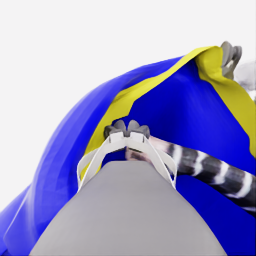
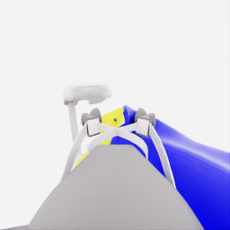

# E36 검토: 기존 근접 형상에서 바로 진입을 시험했지만 같은 손 옆에서 중단

[시연 자료](../attempts/20261114-astra-wrist-body835-001/README.ko.md) · [manifest](../attempts/20261114-astra-wrist-body835-001/manifest.json) · [전체 overview](../attempts/20261114-astra-wrist-body835-001/overview.mp4) · [실행 기록](../../project/sessions/20261114-e36-wrist-body.ko.md) · [E35 검토](20261114-astra-wide-hem723-001.ko.md)

**로컬 공식 평가5/50, pickup5, 착의0, `success=false`.** E34/835의 손 근접 형상을 활용해 재파지·운반·넓히기를 되풀이하지 않고 첫 행동부터 몸쪽 진입을 의도한 짧은 공동 이동을 시험했다. 같은 손과 연결 전완이 공개 영상에 유지됐고 실제 로봇 이동도 있었다. 그러나 손이 노란 파지 모서리/housing 곁에 남아 자유 경계 통과·유지된 손목 걸침·연속 전완 진행·소매 출구를 확인하지 못했다. 모델은10act 뒤11번째 결정에서 자발적으로 마감했다.

최종5점은 새 replay의 평가 시간26.85초에 이미 얻은 pickup 점수다.835 prefix의 끝은 평가 시간41.75초이므로 새 suffix의 픽업 성과나 추가5점으로 세지 않는다. **사용자의 최신 지시대로 E36에서 수집을 종료하며 E37이나 추가 이어가기를 실행하지 않는다.** 아래 직접 조작 제언은 향후 진단 검토이며 지금 추가 수집하거나 handoff를 구현했다는 뜻이 아니다.

## 실행·지침 준수

| 항목 | 확인 결과 |
|---|---|
| 실행 | `20261114-astra-wrist-body835-001` |
| source | `f39b0e2fc9407adc1d9ced9765ff89824e90d05a`, 시작 clean |
| UTC |2026-11-14 10:43:35–11:11:42 |
| 직접 parent / source group | E34 `20261114-astra-middle-grip470-retain-001` / E28 `20261113-astra-side-hem-fresh-001` |
| replay / history |835전이 / 새 replay의787·815 공개 RGB. 부모 마지막 budget cleanup1전이 제외 |
| 전략 | `coordinated-wrist-body-entry`, CLI0.166.0 / exec / gpt-6-astra / ultra |
| 예산·입력 |20새 결정 /1400전이 /review10, named·pixel query·wrist panel·plan1·motion-only settle6 |
| 실제 종료 |11결정=10act+1finish,12호출, 예산 전 자발적 종료, 오류 없음, client/simulator0 |
| 원본·기술 검사 | capture complete=true, 전수 QC933/933 통과, 학습 승인 `unreviewed` |
| 별도 평가 | pickup5, 모든 착의 항목0, `no_dressing_points`, success=false |

10개 모델 act의 양 gripper 값은 모두0이었다. 마감 policy HDF5의 새 suffix **`[835,933)`98전이**도 양 gripper 값이 모두0이며 `<−0.5` 열기 명령은 로봇별0개다. 이는 기존 닫기 의도를 유지했다는 뜻이며 물리적 손가락 간격 불변·부착·슬립 없음을 인증하지 않는다. 추가 재파지0은 정적 프롬프트 조건이고 런타임 차단기가 아니다.

전체933전이는 **835 replay +50 model +48 settle**다. D3·D8의 중립6·8전이는 모델이 선택한 행동이며 추가 settle이 없다. 마지막 `finish_episode`는 전이0개이고 별도 budget cleanup도 없다. 새98전이는4.90시뮬레이션초, 전체는46.65평가 경과초다. depth 질의1회의 후속 호출은 물리를 진행시키지 않았다.

## 공개 관측에서 본 실행

검토에는 지정 공개 RGB5개, 공개 로봇 상태·행동, 허용 목록으로 정리한 최종 결정·적용 구간과 별도 평가 요약만 사용했다. 원시 actor reasoning/events, audit, 내부 천·접촉 기하를 읽지 않았다. 진행 중 고정 관측과 종료 뒤 공개 `next_obs[경계−1]`를 비교했다. 모델의 단계 이름·최종 짧은 이유는 의도이며 관측 정답이 아니다.

| 구간 | 실제 실행·공개 영상 | 해석의 한계 |
|---|---|---|
| 초기835 | head의 옷·같은 손/전완·양 파지부 배치는 부모835와 대체로 비슷하다. R1 wrist의 노란 경계 폭/접힘과 파란 면 주름에는 차이가 있다. | 행동 replay는 동일 천 checkpoint 복원이 아니다. 부모의 지지·접촉 상태를 새 실행에 그대로 복사하지 않는다. |
| D0–D1,835→859 | 현재 형상을 유지한 채 공동 base 이동+소폭 하강을2회 실행한다. 실제 base 끝점 변위는 첫 회 약42/41mm, 두 번째도 약42/41mm다. | 재파지·운반 준비를 반복하지 않은 직접 시험이다. 몸쪽이라는 모델 의도와 실제 3차원 전완축 정렬을 구분한다. |
| D2,859→869 | 같은 현재 공개 depth 질의 뒤 더 가파른 하강을 결합한 공동 이동. 실제 base는 약35/21mm, 양 lift는 약−33.7/−33.4mm다. | 단순 수평 밀기가 아니며 높이 변화가 크게 결합됐다. 손이 잡힌 경계 근처에 있어 교차 지점이 분명하지 않다. |
| D3–D4,869→885 | 중립6전이 뒤 R1 wrist yaw를 변경한다.885에서 R1 wrist에 같은 줄무늬 전완이 가로질러 보이고 head에는 그 손이 유지된다. | 새로운 노출·상대 위치 변화다. 손이 자유 입구를 통과했는지, 바깥 면/파지부 옆에 있는지는 영상만으로 분리하지 못한다. |
| D5–D6,885→905 | 방향 변경 뒤 공동 이동·하강을 다시 시험하고, R1 arm을 수축해 여유를 시험한다. R1의 base 이동이 작아지고 wrist pitch 편차가 커졌다가 수축 후 줄어든다. | 공개 상태에서 실제 비대칭과 편차를 확인했다. 정확한 접촉 대상이나 막힘 원인은 단정하지 않는다. |
| D7–D8,905→923 | R0 wrist yaw 변경 뒤 중립8전이로 잔류 운동을 관찰한다. 같은 손/전완 관계는 남는다. | 천의 외관은 변하지만 경계가 전완을 따라 지속적으로 진행한 근거는 없다. 역할 조정은 있었지만 다른 손으로 목표를 바꾼 근거는 보이지 않는다. |
| D9–D10,923→933 | R1 높이를 유지하고 R0만 소폭 낮추는 공동 이동을 시험한다. 이후 모델이 같은 손 옆의 정체를 이유로 `finish_episode`를 선택한다. | 마지막도 손과 파지 모서리/housing의 가까운 관계를 남긴다. 배우가 유용한 다음 동작을 찾지 못한 것이며 기계적 불가능이나 모든 복구 경로의 소진을 증명한 것은 아니다. |

10act의 주목적은 **몸쪽/하강 시험5회(D0·D1·D2·D5·D9), wrist 방향 조절2회(D4·D7), R1 arm 수축1회(D6), 중립 관찰2회(D3·D8)**로 나뉜다. 이는 검토자의 실행 분류이며 stage 문자열을 그대로 센 결과가 아니다. 모든 새 act의 base yaw 명령은0이었다. 별도 베이스 회전으로 서는 방향을 맞추기보다 현재 자세에서 이동을 먼저 시도하고 후반 wrist yaw로 방향을 조절했다. 따라서 사용자의 “손목 방향으로 정확히 정렬”이 달성됐다고 명령만으로 결론 내리지 않는다.

마지막 공개 wrist, 왼쪽 robot_1 / 오른쪽 robot_0. 반전·보간 없이 같은 시점을 보여 준다.

| robot_1 wrist | robot_0 wrist |
|---|---|
|  |  |

## 실제 운동·정착과 손목 편차

처음3개 시험의 lift 누적 하강은 R0 약64.4mm/R1 약64.1mm다. 이후 중립 D3에서도 lift가 약4mm 더 내려갔고 R1 base는 약7.9mm 이동했다. 설정된 settle6이 목표 추종의 완료나 즉시 정지를 보장하지 않는다는 공개 근거다. 본문의 base 끝점 변위는 명령과 뒤의 settle을 함께 포함한다.

**D5에서 R1 lift는−16.97mm였으나 공개 `grasp_pose_base`의 Z 변화는−0.97mm뿐**이었다. 같은 구간의 wrist pitch는 약−0.392→−0.452rad로 움직였고 목표는−0.385rad였다. 따라서 lift 관절이 내려갔다는 사실만으로 파지점·천·손목 관계가 같은 양만큼 내려갔다고 설명할 수 없다. D6에서 R1 arm 합계가 약25.8mm 수축한 뒤 pitch는−0.402rad로 가까워졌고, grasp Z에는 추가 약−17.3mm 변화가 나타났다. 이 값들은 로봇 공개 상태이며 천 재료점이나 접촉 기하의 측정이 아니다.

D5의 R1 base world Y는 명령4전이에서 약+10.97mm, 뒤 settle6에서 약−2.78mm였다. D9도 약+11.44mm 뒤−1.23mm로 일부 되돌림이 있었다. 같은 D9의 전체 base 끝점 변위는 R0 약20.7mm/R1 약10.2mm다. **명령은 실행됐지만 두 로봇의 실제 반응과 정착 중 운동이 달랐다.** world Y를 정확한 몸쪽 축으로 동일시하거나, 되돌림만으로 충돌 대상을 특정하지 않는다.

R1의 fingertip-origin distance도835의 약39.95mm에서895의50.11mm로 늘었다가933에서40.98mm로 줄었다. 이는 접촉면 사이 안쪽 간격이 아니며 열기 명령도 아니었다. E35/971의 큰 편차와 동일한 상태로 취급하지 않고 이번 실행의 공개 전후값으로 판단한다.

## 시간과 이번 시험의 범위

| 구간 | 결정 / 호출 | model / settle 전이 | actor 경로 초 | 새 환경 경로 초 |
|---|---:|---:|---:|---:|
| 첫 직접 시험 D0–D2 |3 /4|16 /18|264.963|29.658|
| 중립·R1 방향 조절 D3–D4 |2 /2|10 /6|105.660|17.025|
| 재시험·수축·R0 방향·관찰 D5–D9 |5 /5|24 /24|412.139|49.844|
| 자발적 종료 D10 |1 /1|0 /0|23.878|0.007|

actor의 전체 wall은1,686.999초, 약28.12분이다. launcher 측정1,688.619초와 범위를 구분한다. actor 경로806.640초, replay 환경735.678초, 새 환경96.534초다. actor와 새 환경 합계는903.173초, 약15.05분이며 종료를 포함한 새11결정당 약82.1초다. actor wall은 staging·CLI·요청 응답을 포함하고 순수 추론시간이나 GPU시간이 아니다. 후속 QC·검토·백업·게시는 실행 wall에 포함되지 않는다.

E35는 E34/723에서 시작해 형상·접근을 더 바꾸었고 E36은 이미 손 근처인 E34/835에서 시작했다. E36가 첫 행동부터 진입을 시험했다는 관측은 유효하지만, 이를 동일 출발·동일 기회의 전략 속도 개선으로 발표하지 않는다. 짧아진 wall도 자발적 조기 종료와 다른 replay 길이가 섞여 있다. 남은9결정이 있었다는 사실만으로 더 쓰면 성공한다고 추정하거나 예산을 자동 이월하지 않는다.

## 종료 후 사용자 직접 조작이 구분할 수 있는 질문

**E36로 현재 수집을 마감한다. 다음 시연 출발점이나 자동 재개를 권고하지 않는다.** 이후 사용자가 직접 조작·시연 중 개입 방식을 설계한다면, 이번 관측은 다음의 서로 다른 불확실성을 남긴다.

| 진단 질문 | 직접 조작/표시가 보탤 수 있는 근거 | 해석의 한계 |
|---|---|---|
| 같은 손이 자유 구간에 정렬됐는가, 잡힌 모서리 옆인가 | 고정된 공개 head/wrist에서 사용자가 같은 손·연결 전완과 의도한 자유 구간을 지정하고, 작은 방향 변경 전후에 어느 경계를 지났는지 확인한다. | 사람의 표시도 가설이다. 숨은 접촉·입구 위상을 정답으로 인증하지 않는다. |
| 몸쪽이라는 지시가 실제 파지점 운동으로 연결되는가 | 같은 공식 제어를 사용한 짧은 수동 이동에서 base·lift·wrist와 실제 grasp 변화, settle 뒤 되돌림을 함께 기록하면 방향 선택과 실행 반응을 분리할 수 있다. | 이번 D5처럼 lift만 보고 성공/실패를 판정하면 안 된다. 수동 성공·실패 한 번으로 일반화나 기계적 불가능을 결론 내리지 않는다. |
| 기존 파지에서 유용한 회복이 남아 있었는가 | 현재 파지를 보존한 짧은 수동 방향/여유 조절이 실제 같은 전완 진행을 만들면, actor의 정체 판단 또는 행동 선택과 물리적 여지를 구분하는 사례가 된다. | 파지를 바꾸는 시연은 별도 조건이다. 기존 파지에서의 회복 비교와 섞지 않고 개입 종류·경계·실제 행동을 남겨야 한다. |

실시간 사람–Astra handoff는 현재 구현된 기능이 아니다. 향후 방식을 만들더라도 제어원은 하나여야 하며, 개입 전후의 공개 관측 경계·누가 낸 행동인지·중립/잔류 운동·최종 결과를 기록해야 한다. 새로운 자유 시점이나 내부 기하를 교사 정답으로 쓰지 않는다. 이 제언은 지금 사용자 조작이나 추가 수집을 실행한 결과가 아니며, 전체 자료 정리와 시스템 재설계 검토에 사용할 진단 질문이다.
