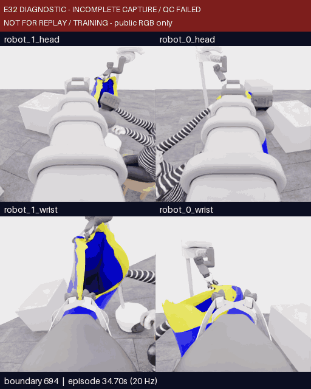

# 11월 13–14일 시연 영상과 실패 분석 모음

**확인된 최고 로컬 공식 점수는 5/50, 픽업만 득점했으며 착의 0·`success=false`다.** 목표 50점에는 도달하지 못했다. E28–E31은 정상 마감·전수 QC를 통과했고, **E32는 수집 파일 불완전으로 전체 QC 실패**다. 유효한 별도 평가값 5점이 E32의 수집 유효성을 대신하지 않는다.

현재는 사용자 요청으로 **수집 중지**, E33 **미실행** 상태다. 이 문서는 영상 검토와 새 서버 인계용이며 새 시연을 시작하는 지시가 아니다. [클린 서버 인계](../../project/sessions/20261114-paused-clean-server-handoff.ko.md) · [현재 상태](../../project/STATUS.md)

## 영상부터 보기

모두 지정 카메라의 실제 기록이다. **왼쪽 robot_1·오른쪽 robot_0, 위 head·아래 wrist**이며 픽셀은 반전하지 않았다. 원본 20 Hz를 5 fps로 재생해 실제 물리 진행보다 4배 느리고, 모델 응답을 기다린 시간은 영상에 없다. 세밀한 접촉은 GIF 색상보다 MP4·원본 PNG·다른 시점과 함께 판단한다.

| 시연·볼 구간 | 실제 영상 | 무엇을 비교할지 |
|---|---|---|
| **E28 / 264–380** | [MP4](../../gallery/20261113-e28-opening-264-380/event.mp4) · [GIF](../../gallery/20261113-e28-opening-264-380/preview.gif) | 닫힘 후 시간이 흐른 뒤 양측 국소 천 동행이 생기는지, 높이·방향 차이가 오목한 경계를 만드는지 |
| **E28 / 588–738** | [MP4](../../gallery/20261113-e28-hand-588-738/event.mp4) · [GIF](../../gallery/20261113-e28-hand-588-738/preview.gif) | 운반에서 손 접근으로 전환하며 손이 자유 구간보다 잡은 경계 쪽으로 가까워지는지 |
| **E29 / 738–834** | [MP4](../../gallery/20261113-e29-extra-decisions-738-834/event.mp4) · [GIF](../../gallery/20261113-e29-extra-decisions-738-834/preview.gif) | 같은 후반 상태의 추가 보정, 좁아지는 경계, 올림·팔 거두기·다른 손 전환이 섞인 구간 |
| **E30 / 738–915** | [MP4](../../gallery/20261113-e30-diagonal-738-915/event.mp4) · [GIF](../../gallery/20261113-e30-diagonal-738-915/preview.gif) | 같은 손에 낮춤→대각 방향→조건부 올림을 나눴어도 실제 손–입구 정렬이 바뀌는지 |
| **E31 / 682–830** | [MP4](../../gallery/20261113-e31-diagonal-682-830/event.mp4) · [GIF](../../gallery/20261113-e31-diagonal-682-830/preview.gif) | 더 이른 시작의 여유가 유지되는지, 다시 모서리·jaw 근처 가림으로 가는지 |
| **E32 / 380–758 · 불완전 진단 전체** | [MP4](../../gallery/20261114-e32-diagnostic-full-380-758/event.mp4) · [첫 화면](../../gallery/20261114-e32-diagnostic-full-380-758/first.png) | 넓어진 후보 형상을 운반하는 구간과 후반 접촉·복구를 구분 |
| **E32 / 694–758 · 불완전 진단 후반** | [MP4](../../gallery/20261114-e32-diagnostic-close-694-758/event.mp4) · [GIF](../../gallery/20261114-e32-diagnostic-close-694-758/preview.gif) | 넓은 후보694/706 → 접힘732 → 부분 후퇴744 → 마지막 roll756과 cleanup758 |

E32 영상은 **INCOMPLETE CAPTURE / QC FAILED**를 표시한 진단 자료다. 정상 시연·재실행·학습 출처가 아니며 완료 플래그를 고치지 않았다. 마지막 actor 입력은 경계744이고, 756/758은 simulator 정지 후 닫힌 파일의 공개 RGB로 확인했다. [E32 공개 검토와 원본 PNG](20261113-astra-central380-001.ko.md) · [전체 진단 영상 출처](../../gallery/20261114-e32-diagnostic-full-380-758/provenance.json) · [후반 구간 출처](../../gallery/20261114-e32-diagnostic-close-694-758/provenance.json)

## 시도별 결과와 추가 판단의 효용

| 시연 | 바꾼 목표·출발점 | 관측한 진전과 실패 근거 | 사용 판단·새 득점·예산 판단 |
|---|---|---|---|
| [E28 상세](20261113-astra-side-hem-fresh-001.ko.md) | 새 reset, 측면 파지→몸통 밑단→첫 손 우선 | 양측 국소 천 동행·오목한 형상·운반·손 접근. 명확한 첫 손 진입과 소매 통과는 미확인 | **40 act**, 예산 소진. 새 픽업 **+5**, 착의 **+0**. 마지막 접근이 늦게 시작돼 후반 추가 비교를 할 근거가 있었음 |
| [E29 상세](20261113-astra-side-hem738-continue20-001.ko.md) | E28/738, 같은 전략을 추가 진행 | 방향·높이·housing 관계를 바꿨으나 좁은 접힘과 손 가림이 남음. 사용자 대각선 제안의 분리 시험은 아니었음 | **10 act+finish=11/20**, 새 **0**. actor가 먼저 종료해 같은 방식의 예산 증가보다 방법 변경을 우선 |
| [E30 상세](20261113-astra-diagonal738-001.ko.md) | E28/738, 별도 대각선 진입 전략 | 같은 손을 유지하며 실제 낮춤·회전·올림·복구. 통과·전완 진행 근거는 없음 | **18 act+finish=19/20**, 새 **0**. 남은 판단을 더 주기보다 더 이른 접근 상태 비교 |
| [E31 상세](20261113-astra-diagonal682-001.ko.md) | E28/682, 같은 대각선 전략 | 초기 여유가 있었으나 손을 넓은 자유 구간에 맞추지 못한 채 모서리 근처 가림이 반복 | **16 act+finish=17/20**, 새 **0**. 단순 추가 시간보다 중앙 형상·정렬 목표를 변경 |
| [E32 상세](20261113-astra-central380-001.ko.md) | E28/380, 중앙 자유 구간 전략 | 차등 형상 변화와 긴 운반 유지, 694/706의 유용한 후보. 732에서 좁은 접힘, 후퇴·roll 뒤에도 통과 미확인. 별도로 capture 불완전 | **20 act/20**, 새 **0**. 후반5개는 실제 새 시험이었으나 정상 종료·좋은 최종 상태를 보장하지 않아 자동 예산 확대나 E32 분기 금지 |

E29 이후의 5점은 E28 prefix를 재실행하며 얻은 픽업 점수다. 서로 다른 새 성공 시연이나 추가 5점씩으로 합산하지 않는다. 행동 replay는 정확한 천 checkpoint가 아니며 새 actor·시작 경계·전략이 함께 달라진 비교를 단일 변수의 인과 효과로 설명하지 않는다.

시간은 E28 약 **46.0분**, E29 **26.2분**, E30 **30.8분**, E31 **28.7분**으로 replay를 포함한다. **E32 최종 client 전체 경과는 미기록**이며, 기록된 actor 호출 합계 약20.35분과 새 행동·정착 환경 시간 약5.38분을 정상 전체 시간으로 대체하지 않는다. actor 시간도 입력 준비·CLI·통신 등을 포함해 순수 모델 추론 시간이 아니다. [E28 예산](20261113-decision-budget/E28/README.ko.md) · [E29](20261113-decision-budget/E29/README.ko.md) · [E30](20261113-decision-budget/E30/README.ko.md) · [E31](20261113-decision-budget/E31/README.ko.md) · [E32](20261113-decision-budget/E32/README.ko.md)

## 관측 사실과 남은 가설

실제 확인한 것은 **국소 천 동행, 경계의 폭·방향 변화, 마네킹으로의 접근, 손 근처 접힘·가림과 복구 동작**이다. `first_sleeve` 같은 단계 이름, U형 외관, 손의 일시적 사라짐을 실제 진입·득점으로 바꾸어 말하지 않는다.

아직 구별하지 못한 것은 **잡은 두 영역이 서로 다른 입술을 제어하는지**, **보이는 넓은 구간이 손이 지날 깊이를 갖는지**, **접근이 자유 구간 대신 잡은 모서리·housing 쪽으로 향하는지**다. 파란 면이 보인다고 입구가 닫혔다고 할 수 없고, 화면에서 gripper와 손이 겹친다고 물리 충돌이 입증되는 것도 아니다. 중앙의 느슨함은 유용한 가설이지만 한 바깥 면만 늘어진 모양과 구분해야 한다.

## 영상 검토 메모

- 천이 각 jaw를 국소적으로 따라오는 순간은 어디인가? 반대편이 당겨 전체 몸판이 움직이는 모습과 구별되는가?
- 첫 손은 넓은 자유 구간으로 향하는가, 잡힌 모서리나 housing으로 향하는가? 그 관계가 처음 바뀌는 경계는 어디인가?
- 넓어 보이는 구간에 깊이와 서로 다른 경계 움직임이 보이는가? 현재 시점만으로 구별할 수 없는 것은 무엇인가?
- 손이 가려진 뒤 같은 연결 전완을 따라 옷이 실제로 진행하는가, 바깥 면이 접히며 가리기만 하는가?
- 접히기 전 마지막 유용한 상태와 복구 뒤 상태를 비교하면 무엇을 보존하고 무엇을 바꿔야 하는가?

중지 전 준비한 [E33/632 방향](../research/2026-11-14-e33-central632-direction.ko.md)은 긴 운반 대신 접촉 전 형상·정렬에 20판단을 쓰려는 **미실행 계획**이다. 별도의 [table-peel 후보 보존물](../research/candidates/20261114-table-peel-incomplete/README.ko.md)은 **미적용·미승인·검사 오류1개가 남은 개발 중단본**이다. 둘 다 새 서버에서 자동으로 실행하지 않는다.
