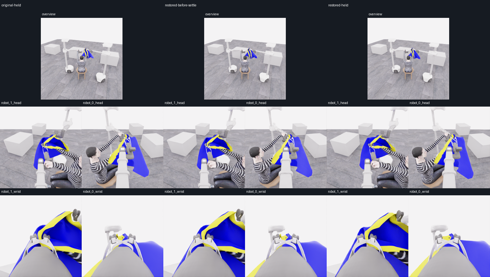

# E36 checkpoint 검증과 출발 상태 선택

**HOLD와 저장/복원 연결은 실제 GPU에서 통과했다. 복원 뒤의 상태와 짧은 명령 효과는 원래 재생 경계와 같지 않다.** M1 착의 행동을 시작하기 전에 사용자가 출발 상태를 선택한다. 새 착의 득점이나 원인 규명 성과로 해석하지 않는다.

[현재 live 검토](../user-reviews/20261116-astra-m1-checkpoint-001/hold-0001/README.ko.md) · [현재 계획](../../COLLECTION_PLAN.md) · [기전 정리](../../MECHANISMS.ko.md)

## 질문과 유지한 조건

E36/933 행동을 공식 환경에서 재실행한 뒤, 그 새 상태를 고유 slot으로 저장했다. 별도 환경에서 복원하고 기본90 control ticks(1.5초) 정착을 유지했다. 양쪽 lift에 정규화0.01을1전이(0.05초) 주는 같은 작은 명령을 저장 경계와 복원·정착 경계에서 각각 적용했다. 이 명령은 기전 확인용이며 착의 정책 시연이나 정답 행동이 아니다.

- 준비 run: `20261116-e36-checkpoint-001-original`, E36 행동933+검증 probe1=934전이.
- 복원 run: `20261116-e36-checkpoint-001-restored`, 복원·정착 뒤 probe1전이.
- 두 run 모두 정상 마감. 같은 E28 source group이며 독립 성공 표본이 아니다.
- 실행 코드: `e9cca079eae672d25abb2da9f182ce5a7e2ddf1e`. 초기 자산/E36은 고정 HF revision·archive SHA·manifest를 검증했고 E36 원본 QC933/933을 통과했다.

## 실제 비교 화면

아래는 **마감된 검증 실행의 스냅샷**이다. 왼쪽부터 저장 직전 / 복원 직후 /1.5초 정착 후. 각 패널의 왼쪽은 robot_1, 오른쪽은 robot_0, 위 head·아래 wrist다. 원본256×256 픽셀을 반전하거나 생성하지 않았다.

[원본 파일·변환 출처](../user-reviews/20261116-e36-checkpoint-001/validation/provenance.json)

## 관측과 해석

| 관측 | 확인 범위 |
|---|---|
| 원래 경계와 복원 경계 모두6초 HOLD 후 공개 관측·전이 불변; held act 거절; 두 프로세스 정상 종료 | 실제 GPU HOLD/통신/기록 연결 통과. 테스트 idle timeout5초를 초과해서 대기했으며, 장시간/서버 장애 생존 시험은 아니다. |
| 복원 직후 base 기준 grasp pose의 최대 원소 차이 약1.2e-7 | 저장 직후 수치 상태가 가깝다는 증거. 천 solver 상태의 완전 복원이 아니다. |
| 정착 후 R0 grasp XYZ 변화(+6.399, −0.623, −2.493)mm, R1(−6.147, −2.042, +2.587)mm | base 기준 변화. 벡터 일부만으로 천 변위나 world 변위로 해석하지 않는다. |
| 같은 probe의 R0 grasp Z: 재생 경계−0.208mm / 복원·정착 뒤+0.117mm | 같은 명령의 단기 효과가 달랐다. 잔류 운동·제어 이력 초기화·정착 효과를 분리할 후속 확인이 필요하다. |
| R1 probe grasp Z: +0.080mm / +0.111mm | 로봇별 효과도 다르며 한 원인으로 단정하지 않는다. |
| 화면에서 펼침·손 근접과 두 파지 위치는 대체로 유지 | 실제 지지 강도·미끄러짐·숨은 통로·소매 통과는 이 화면만으로 확정하지 않는다. |
| 첫 소매 점수는 원래/복원 시작과 probe 후 모두0 | 추가 착의 득점 없음. 원본 replay의 pickup5와 분리한다. |

복원 연결 통과와 M1 출발 채택을 구분하기 위해 `start-state-validation`의 자동 시작 승인 receipt는 만들지 않았다. 현재 별도 run `20261116-astra-m1-checkpoint-001`을 같은 slot에서 열어 **초기 live HOLD**하며 사용자 선택을 기다린다. actor 호출0·정책 행동0이며, reset의 기본 정착은 수행된다.

## 사용자 선택

1. **복원된 현재 상태에서 M1 진행:** 위 차이를 허용하고 현재 파지를 유지한 짧은 국소 교정을 시작한다. 새로운 관측을 기준으로 효과를 판단한다.
2. **E36 행동 재생 말단에서 M1 진행:** 현재 분기를 마감·보존하고 새 run에서933전이를 다시 재생한다. slot 정착 영향은 피하지만 행동 재생도 원래 천 상태의 정확한 복원은 아니다.
3. **이전 출발점으로 변경:** E34/835 또는 E34/723을 새 분기로 준비한다.

같은 live 상태의 계속은 reset 없이 실제 사용자 답변을 적용한다. 무응답 동안은 물리·모델 호출을 진행하지 않는다. 종료 요청도 가능하다.
