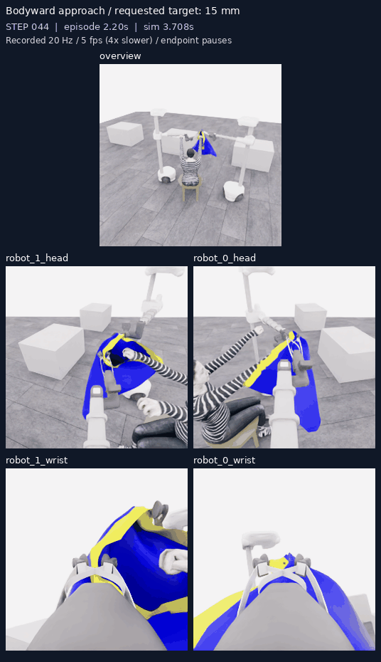

# M1: 같은 몸쪽 방향으로 약15mm 추가 접근

**사용자의 약15mm 요청에 따라 같은 방향으로 조금씩 접근했고, 파지 기준점의 평면 순변위는 R0/R1 약14.87/14.96mm였다.** 높이는 약1.26/1.27mm 더 낮아졌다. 새3 act·8전이(0.40초) 뒤 요청한 이동량에 근접하여 물리0 `hold-0006`에서 사용자 판단을 기다린다.

[현재 HOLD 5카메라](../user-reviews/20261116-astra-m1-checkpoint-001/hold-0006/README.ko.md) · [출발 HOLD](../user-reviews/20261116-astra-m1-checkpoint-001/hold-0005/README.ko.md) · [전체 구간별 GIF](../../gallery/20261116-m1-guided-segments/README.ko.md)

## 요청과 실제 이동량

같은 run `20261116-astra-m1-checkpoint-001`의44→52전이다. D17–D19는 같은 작은 베이스 평면 명령을3+3+2전이 실행했다. 양쪽 닫기 의도와 lift 목표를 유지했고 lift·arm·wrist·base yaw 명령은0이었다. 아래 수치는 공개 로봇 pose에서 계산했으며 단위는 mm다.

| 로봇 | grasp world ΔX | ΔY | ΔZ | XY 순변위 크기 | 직전 방향으로의 이동분 |
|---|---:|---:|---:|---:|---:|
| R0 | −0.027 | +14.866 | −1.263 | 14.866 | 14.866 |
| R1 | +0.367 | +14.953 | −1.274 | 14.958 | 14.958 |

XY 순변위는 시작·끝 사이의 평면 거리다. 마지막 열은 [직전42→44 구간](20261116-m1-tiny-body-approach.ko.md)의 각 파지점 실제 XY 방향에 이번 순변위를 투영한 보조값이다. 두 값이 거의 같아 같은 방향으로 약15mm 이동한 것으로 정리한다. **이 값은 몸통·손까지의 거리, 천의 이동량, 이동 경로의 총길이를 뜻하지 않는다.**

베이스 world Y는 +14.63/+14.56mm, lift 관절은 −1.23/−1.23mm 변했다. lift 명령0에서도 하강이 관측됐으며 단독 원인은 확정하지 않는다. 이번 결과는 목표보다 일찍 중단한 사례가 아니라 요청량에 근접한 뒤 멈춘 사례다.

## 화면과 다음 판단

head와 wrist에서 추적하던 손·연결 손목이 계속 보이며, 양쪽 파지부와 처진 천의 큰 배치는 유지되어 보인다. wrist에서는 손과 노란 경계의 화면상 상대 위치가 변했지만, **손이 유효한 입구로 진입했거나 소매 경로를 통과했다고 확인할 근거는 없다.** 현재 접근량이 적절한지, 다음에 방향·높이를 어떻게 조정할지 사용자 판단을 기다린다.

D20 stop은 simulator에 전달하지 않아 추가 전이0이며 별도 자동 settle은 없다. 누적21모델 호출·16 act·52전이의 live HOLD다. 기록기·환경이 열려 있으며 사용자 응답 전 물리 진행0, 마감·QC·고정 백업 전 상태다.

## 근거

완료 ACK와 불변 공개 입력 `guided-00017`–`guided-00020/observation.json`, HOLD5·6 관측을 비교했다. world 파지점 계산·해석 범위는 [앞선 분석](20261116-m1-right-hand-clearance.ko.md)을 따른다. 실행 중 HDF5는 열지 않았다. GIF는 hash와 HOLD 상태가 전후 동일한 고정 복사본의44–52 모든9경계를 사용했다. [복사 근거](../../gallery/20261116-m1-guided-segments/source-hold-0006.json) · [GIF 메타데이터](../../gallery/20261116-m1-guided-segments/bodyward-15mm.json)
