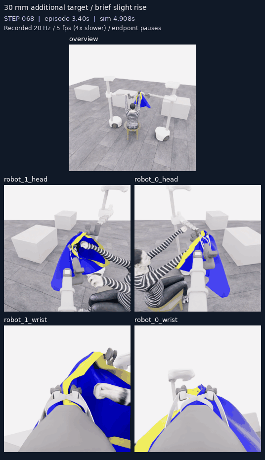

# M1: 약30mm 추가 접근과 아주 작은 상승

**같은 방향으로 약30mm 접근하면서 이번에는 조금 높였다.** HOLD7→8 파지 기준점의 평면 순변위는 R0/R1 약30.40/30.08mm, 상승은2.24/2.31mm다. 손이 화면상 파란 영역 안쪽으로 이동한 모습은 보이지만, 사용자가 예상한 실제 입구의 정중앙 도달·진입은 확인되지 않았다.

[현재 HOLD 5카메라](../user-reviews/20261116-astra-m1-checkpoint-001/hold-0008/README.ko.md) · [출발 HOLD](../user-reviews/20261116-astra-m1-checkpoint-001/hold-0007/README.ko.md) · [전체 구간별 GIF](../../gallery/20261116-m1-guided-segments/README.ko.md)

## 요청과 실제 이동량

같은 run `20261116-astra-m1-checkpoint-001`의68→84전이다. D27–D31은 동일한 베이스 평면 명령을3+4+4+3+2전이 실행했다. **양쪽 lift +0.01은 첫3전이에만 적용하고 이후13전이는0으로 유지했다.** 양쪽 닫기 의도를 유지했고 arm·wrist·base yaw 명령은0이었다. 아래 단위는 mm다.

| 로봇 | grasp world ΔX | ΔY | ΔZ | XY 순변위 크기 | 직전 방향으로의 이동분 |
|---|---:|---:|---:|---:|---:|
| R0 | +0.464 | +30.399 | +2.241 | 30.403 | 30.402 |
| R1 | −0.673 | +30.069 | +2.307 | 30.076 | 30.076 |

마지막 열은 [직전52→68](20261116-m1-bodyward-30mm.ko.md)의 각 파지점 실제 XY 방향으로 투영한 값이다. 약30mm 요청에 근접한 뒤 멈췄으며, 좌표상의 순변위·방향 성분을 몸통까지 거리나 천의 이동량으로 해석하지 않는다. 첫3전이의 파지점 상승은0.73/0.75mm, 이후 lift0인13전이의 추가 상승은1.51/1.56mm였다. 최종 lift 관절 상승은2.24/2.25mm다.

## 손이 가운데로 왔는가

R1 wrist에서는 손끝이 왼쪽, 즉 화면 중앙쪽으로 움직여 **가시적인 파란 천 영역 안쪽에 더 겹쳐 보인다. 동시에 손끝과 전경 그리퍼 housing의 화면상 간격도 좁아졌다.** R1 head에서도 같은 손이 왼쪽 파지부·노란 경계쪽으로 조금 이동한 모습이다. R0 head/wrist의 큰 지지 배치는 유지되어 보인다. 카메라 이름 R1을 해부학적 오른손의 근거로 사용하지 않는다.

이는 화면상의 상대 이동을 뒷받침하지만, 가려진 노란 경계와 천의 접힘 때문에 실제 입구 전체와 중심은 확정하기 어렵다. “딱 가운데”라는 예상은 부분적인2D 이동 근거만 얻었으며, 실제 비접촉·입구 진입·소매 통과는 미확인이다. 현재 정렬과 housing 부근의 여유를 보고 다음 방향·높이를 사용자에게 확인한다.

D32 stop은 simulator에 전달하지 않아 추가 전이0이며 별도 자동 settle은 없다. 새5 act·16전이(0.80초), 누적33모델 호출·26 act·84전이의 live HOLD다. 사용자 응답 전 물리 진행0이며 기록기·환경은 열려 있고 마감·QC·고정 백업 전이다.

## 근거

완료 ACK와 불변 공개 입력 `guided-00027`–`guided-00032/observation.json`, HOLD7·8 관측을 비교했다. world 파지점 계산·한계는 [앞선 분석](20261116-m1-right-hand-clearance.ko.md)을 따른다. 실행 중 HDF5는 열지 않았다. GIF는 hash·HOLD 상태를 전후 확인한 고정 복사본의68–84 모든17경계다. [복사 근거](../../gallery/20261116-m1-guided-segments/source-hold-0008.json) · [GIF 메타데이터](../../gallery/20261116-m1-guided-segments/bodyward-30mm-slight-rise.json)
