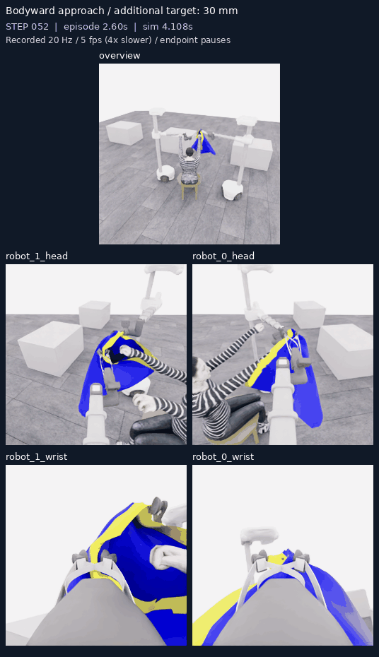

# M1: 같은 몸쪽 방향으로 약30mm 추가 접근

**HOLD6에서 같은 방향으로 약30mm 더 접근했다.** 파지 기준점의 평면 순변위는 R0/R1 약30.44/30.19mm, 직전 실제 이동 방향으로의 성분은30.43/30.15mm였다. 높이는 약0.24/0.19mm 낮아졌다. 새5 act·16전이(0.80초) 뒤 요청량에 근접하여 물리0 `hold-0007`에서 사용자 판단을 기다린다.

[현재 HOLD 5카메라](../user-reviews/20261116-astra-m1-checkpoint-001/hold-0007/README.ko.md) · [출발 HOLD](../user-reviews/20261116-astra-m1-checkpoint-001/hold-0006/README.ko.md) · [전체 구간별 GIF](../../gallery/20261116-m1-guided-segments/README.ko.md)

## 요청과 실제 이동량

같은 run `20261116-astra-m1-checkpoint-001`의52→68전이다. D21–D25는 같은 베이스 평면 명령을4+4+4+2+2전이 실행했다. 양쪽 닫기 의도와 lift 목표를 유지했고 lift·arm·wrist·base yaw 명령은0이었다. 아래 값은 공개 로봇 pose에서 계산했으며 단위는 mm다.

| 로봇 | grasp world ΔX | ΔY | ΔZ | XY 순변위 크기 | 직전 방향으로의 이동분 |
|---|---:|---:|---:|---:|---:|
| R0 | +0.596 | +30.429 | −0.240 | 30.435 | 30.428 |
| R1 | −0.635 | +30.179 | −0.186 | 30.186 | 30.154 |

XY 순변위는 시작·끝 사이의 평면 거리다. 마지막 열은 [직전44→52 구간](20261116-m1-bodyward-15mm.ko.md)의 각 파지점 실제 XY 방향에 이번 순변위를 투영한 보조값이다. 이 방향의 성분은 요청30mm보다 약0.43/0.15mm 커서, 약30mm에 도달한 뒤 멈춘 것으로 정리한다. **좌표상의 순변위·방향 성분은 몸통까지의 거리, 천의 이동량, 이동 경로의 총길이와 구분한다.**

베이스 world Y는 +30.60/+29.86mm, lift 관절은 −0.19/−0.19mm 변했다. 이번 구간의 하강은0.3mm 미만이었다. lift 명령0에서 관측된 작은 높이 변화로 접촉·추종 등의 원인을 확정하지 않는다.

## 화면과 다음 판단

head와 wrist에서 추적하던 손·연결 손목은 계속 보이고, 양쪽 파지부와 처진 천의 큰 배치는 유지되어 보인다. wrist 화면에서는 손이 천의 가시 경계에 대해 이동한 모습이 있으나, **실제 입구 진입·소매 통과나 완전한 비접촉은 확인되지 않았다.** 현재 접근량이 적절한지와 다음 방향·높이를 사용자에게 확인한다.

D26 stop은 simulator에 전달하지 않아 추가 전이0이며 별도 자동 settle은 없다. 누적27모델 호출·21 act·68전이의 live HOLD다. 기록기·환경이 열려 있으며 사용자 응답 전 물리 진행0, 마감·QC·고정 백업 전 상태다.

## 근거

완료 ACK와 불변 공개 입력 `guided-00021`–`guided-00026/observation.json`, HOLD6·7 관측을 비교했다. world 파지점 계산·해석 범위는 [앞선 분석](20261116-m1-right-hand-clearance.ko.md)을 따른다. 실행 중 HDF5는 열지 않았다. GIF는 hash와 HOLD 상태를 전후 확인한 고정 복사본의52–68 모든17경계를 사용했다. [복사 근거](../../gallery/20261116-m1-guided-segments/source-hold-0007.json) · [GIF 메타데이터](../../gallery/20261116-m1-guided-segments/bodyward-30mm.json)
