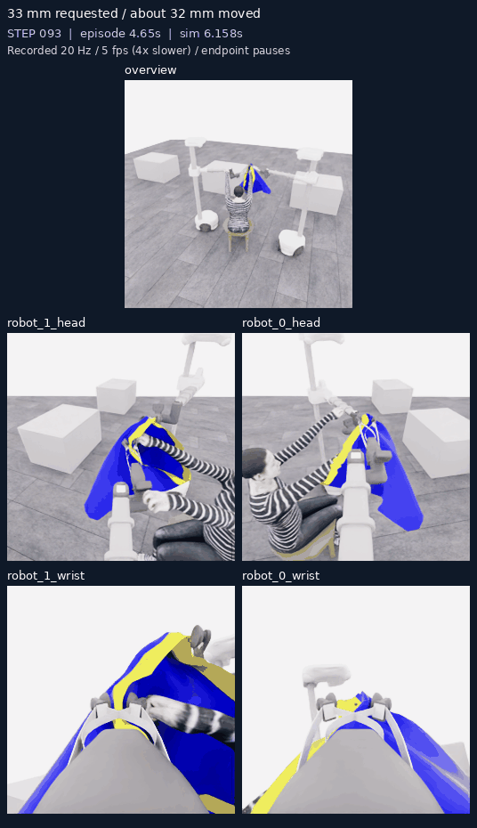

# M1: 사용자 검토 후33mm 추가 요청, 약32mm에서 HOLD

**사용자가 현재 가림을 검토하고 진행을 승인하여 같은 상태에서 다시 접근했다.** 새 평면 순변위는 R0/R1 약31.97/31.45mm로,33mm 요청 방향의 잔여량은1.03/1.57mm다. 원래50mm 요청을 시작한 HOLD8부터의 전체 평면 순변위는49.06/48.30mm이며, 정확히 요청량을 모두 채운 것은 아니다.

[현재 HOLD 5카메라](../user-reviews/20261116-astra-m1-checkpoint-001/hold-0010/README.ko.md) · [이번 출발 HOLD](../user-reviews/20261116-astra-m1-checkpoint-001/hold-0009/README.ko.md) · [원래50mm 요청의 출발](../user-reviews/20261116-astra-m1-checkpoint-001/hold-0008/README.ko.md) · [구간별 GIF](../../gallery/20261116-m1-guided-segments/README.ko.md)

## 이번 이동과 원래 요청의 누적

같은 run `20261116-astra-m1-checkpoint-001`에서 D37–D42가3+3+3+3+3+2=17전이(0.85초)를 실행했다. 두 베이스의 같은 평면 명령을 사용했고, **추가 lift 명령은 전체0**이었다. 양쪽 닫기 의도와 기존 높이 목표를 유지했으며 재파지하지 않았다. 아래 단위는 mm다.

| 구간 / 로봇 | grasp world ΔXYZ | XY 순변위 크기 | 해당 요청 방향 성분 |
|---|---|---:|---:|
| 새93→110 / R0 | +0.714, +31.966, +0.286 | 31.974 | 31.974 |
| 새93→110 / R1 | +0.289, +31.446, +0.500 | 31.447 | 31.433 |
| 전체84→110 / R0 | +1.075, +49.045, +2.341 | 49.057 | 49.056 |
| 전체84→110 / R1 | −0.061, +48.298, +2.538 | 48.298 | 48.287 |

새 구간의 방향 성분은 직전84→93의 실제 XY 방향으로, 전체는 원래 요청 직전68→84의 방향으로 투영했다. 전체값도 HOLD8 시작과 HOLD10 끝 사이의 순변위다. 원래50mm 방향 목표까지는 약0.94/1.71mm 남는다. **이 좌표값은 몸통까지 거리·천의 이동량·실제 통과량이 아니다.** 새 구간의 lift 관절은 +0.34/+0.35mm 변했으며, 명령0에서 관측된 작은 상승의 단독 원인은 확정하지 않는다.

## 사용자 재개와 현재 화면

사용자는 앞선 화면에 문제가 없어 보인다고 판단하여 추가33mm를 지시했다. 이에 같은 live 상태를 재개했고, 모델은 기존 가림과 새로운 장애·지지 악화를 구분하며 짧게 진행했다. 목표 근처에서 모델이 stop을 요청했다.

HOLD9→10의 R1 wrist에서는 손끝·손등이 전경 finger/housing 뒤로 더 가려지고 연결 전완은 계속 보인다. R1 head에도 손·전완이 보이지만 손 근처 노란 경계와 파지부가 겹친다. R0 화면의 큰 지지 배치는 유지되어 보인다. **사용자 승인에 따른 로봇의 추가 이동은 확인했지만, 손의 입구 진입·소매 통과·완전한 비접촉은 확인하지 못했다.** 현재 손·경계 관계와 남은 소량의 이동을 보고 다음 방향을 판단한다.

D43 stop은 물리0 `hold-0010`으로 전환했고 별도 자동 settle은 없다. 누적44모델 호출·35 act·110전이의 live HOLD다. 사용자 응답 전 물리 진행0, 기록기·환경은 열려 있으며 마감·QC·고정 백업 전이다.

## 근거

완료 ACK와 불변 공개 입력 `guided-00037`–`guided-00043/observation.json`, HOLD8·9·10 관측을 비교했다. 계산·해석 한계는 [기존 분석](20261116-m1-right-hand-clearance.ko.md)을 따른다. 실행 중 HDF5는 열지 않았다. GIF는 hash·HOLD 상태를 전후 확인한 고정 복사본의93–110 모든18경계다. [복사 근거](../../gallery/20261116-m1-guided-segments/source-hold-0010.json) · [GIF 메타데이터](../../gallery/20261116-m1-guided-segments/bodyward-33mm-completion.json)
