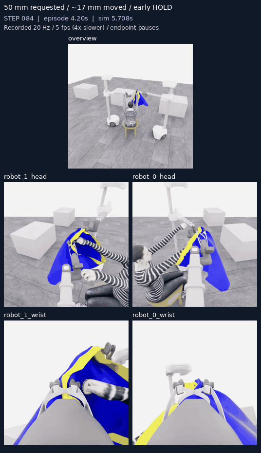

# M1: 50mm 요청 중 약17mm에서 가림으로 중간 HOLD

**추가50mm는 완료하지 않았다.** HOLD8에서 파지 기준점이 R0/R1 평면상 약17.08/16.86mm 이동하고2.06/2.04mm 상승한 뒤, 손과 파지부 사이의 여유를 판단하기 어려워 모델이 중간 검토를 요청했다. 요청 방향의 잔여량은 약32.92/33.14mm이며, 물리0 `hold-0009`에서 사용자 판단을 기다린다.

[현재 HOLD 5카메라](../user-reviews/20261116-astra-m1-checkpoint-001/hold-0009/README.ko.md) · [출발 HOLD](../user-reviews/20261116-astra-m1-checkpoint-001/hold-0008/README.ko.md) · [전체 구간별 GIF](../../gallery/20261116-m1-guided-segments/README.ko.md)

## 요청과 실제 이동량

같은 run `20261116-astra-m1-checkpoint-001`의84→93전이다. D33–D35는 같은 베이스 평면 명령을3+3+3전이 실행했다. 양쪽 lift +0.01은 첫3전이에만 적용하고 이후6전이는0이었다. 양쪽 닫기 의도를 유지했고 arm·wrist·base yaw 명령은0이었다. 아래 단위는 mm다.

| 로봇 | grasp world ΔX | ΔY | ΔZ | XY 순변위 크기 | 직전 방향 이동분 | 50mm까지 잔여 |
|---|---:|---:|---:|---:|---:|---:|
| R0 | +0.361 | +17.079 | +2.056 | 17.083 | 17.082 | 32.918 |
| R1 | −0.350 | +16.852 | +2.038 | 16.856 | 16.856 | 33.144 |

방향 이동분은 [직전68→84](20261116-m1-bodyward-30mm-slight-rise.ko.md)의 각 파지점 실제 XY 방향으로 투영한 값이다. **순변위·방향 성분과 잔여 요청량은 몸통까지 거리나 천의 이동량이 아니다.** 첫3전이 상승은0.79/0.78mm, 이후 lift0인6전이의 추가 상승은1.27/1.26mm였다. 최종 lift 관절 상승은2.02/2.02mm다.

## 중간에 멈춘 근거

HOLD8→9의 R1 wrist에서 손끝이 더 왼쪽으로 이동하여 전경의 회색 finger/housing과 겹치고 일부가 가려졌다. 가까운 파지부 쪽 노란 경계도 같은 곳에 겹친다. R1 head에는 같은 손·연결 전완이 계속 보이지만, 가려진 경계 때문에 손이 통과할 실제 입구 전체와 여유를 확정하기 어렵다. R0 head의 큰 지지 배치는 유지되어 보인다.

모델은 앞선 중간 관측에서 depth상 손이 전경 finger 뒤에 있는 것으로 추정했으나, 최종에는 **현재 영상과 coarse depth로도 추가 접근에 필요한 여유를 충분히 판단할 수 없다**고 stop을 요청했다. 공개 RGB 비교는 가림 증가를 뒷받침한다. 실제 접촉·충돌·진입 불가능을 확인한 것은 아니며, 중앙 정렬·입구 진입·소매 통과도 미확인이다. 다음 조작과 가시성 확보 방향을 사용자에게 확인한다.

D36 stop은 simulator에 전달하지 않아 추가 전이0이며 별도 자동 settle은 없다. 새3 act·9전이(0.45초), 누적37모델 호출·29 act·93전이의 live HOLD다. 사용자 응답 전 물리 진행0이며 기록기·환경은 열려 있고 마감·QC·고정 백업 전이다.

## 근거

완료 ACK와 불변 공개 입력 `guided-00033`–`guided-00036/observation.json`, HOLD8·9 관측을 비교했다. world 파지점 계산·한계는 [앞선 분석](20261116-m1-right-hand-clearance.ko.md)을 따른다. 실행 중 HDF5는 열지 않았다. GIF는 hash·HOLD 상태를 전후 확인한 고정 복사본의84–93 모든10경계다. [복사 근거](../../gallery/20261116-m1-guided-segments/source-hold-0009.json) · [GIF 메타데이터](../../gallery/20261116-m1-guided-segments/bodyward-50mm-slight-rise.json)
