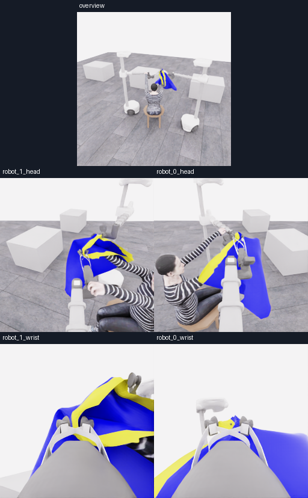

# M1: 앞쪽으로 물리기·낮추기·같은 손목 재접근

**사용자가 선택한 현재 상태에서 세 단계의 조작을 모두 시도했다. 파지 기준점은 약16mm 낮아졌고 짧은 재접근도 실행됐으나, 손목과 옷 입구의 관계가 계속 가려져 진입은 확인하지 못했다.** 모델의 stop 제안을 실제 종료 전에 가로채 **16전이·0.80시뮬레이션초 경계에서 live HOLD**했다.

[현재 HOLD 5카메라](../user-reviews/20261116-astra-m1-checkpoint-001/hold-0002/README.ko.md) · [출발 HOLD 5카메라](../user-reviews/20261116-astra-m1-checkpoint-001/hold-0001/README.ko.md) · [기전 요약](../../MECHANISMS.ko.md) · [현재 계획](../../COLLECTION_PLAN.md)

## 질문과 실제 실행

사용자는 새 checkpoint로 바꾸는 대신 살아 있는 현재 상태를 선택하고, **옷을 몸통 앞 공간으로 멀어지게 한 뒤 조금 낮추고 같은 손목으로 다시 접근하여 진입 여부를 확인**하도록 지시했다. 세 단계의 방향은 공개 화면에서 선택하도록 전달했으며 고정 world 축을 몸쪽 방향의 정답으로 지정하지 않았다.

| 항목 | 이번 구간의 확인 내용 |
|---|---|
| run / 방법 | `20261116-astra-m1-checkpoint-001` / M1 현재 파지 유지·국소 교정 |
| 사용자 지시 경계 | `hold-0001`, 전이0; 사용자 응답 `20261116-user-front-lower-wrist-001` |
| 현재 경계 | `hold-0002`, 전이16; 관측 ID `893fea342c192970b34e406fc93e541b771c7f16eac0d028bb2a8fa04a4cd5e7` |
| 실제 결정 | 6결정 =5 act +마지막 stop 제안; 모델 호출6회 |
| 물리 기록 | 3+3+3+4+3=16전이. D3의 중립4전이는 모델이 선택한 실제 act이며, 별도 자동 settle은0 |
| 종료 제안 처리 | 마지막 stop은 simulator에 전달하지 않음. HOLD 전환의 추가 전이0 |
| 파지 명령 | 양쪽의 기존 닫기 의도를 유지, open 명령0. 닫기 의도 자체를 실제 부착·독립 하중 지지의 증거로 보지는 않음 |
| 별도 감독 평가 | 현재 raw0/50·first_sleeve0·success=false. checkpoint reset으로 시작한 새 평가이며 E36의 과거 픽업5점을 이월하지 않음 |
| 파일 상태 | 기록기·환경이 열린 live HOLD. 정상 마감·전수 QC·고정 백업 완료로 표시하지 않음 |

## 의도와 측정된 효과

아래 수치는 완료된 각 act의 전후 **공개 로봇 상태**를 비교한 값이다. 왼쪽/오른쪽 화면 배치와 별개로 표의 수치 순서는 R0 / R1이다. 위치 단위는 mm다. **world Y는 기록 좌표이며 몸통 앞 거리·손목 접근 거리나 천의 이동량이 아니다.**

| 의도·경계 | lift 변화 R0 / R1 | grasp world Y 변화 R0 / R1 | grasp world Z 변화 R0 / R1 | 의미 |
|---|---:|---:|---:|---|
| D0–D1: 앞쪽 여유 만들기,0→6 | +0.01 / +0.00 | −28.69 / −24.29 | +0.19 / −0.03 | 베이스와 파지점이 움직였고 높이는 거의 유지됨 |
| D2: 조금 낮추기,6→9 | −5.96 / −5.97 | −9.43 / −8.19 | −5.85 / −5.98 | lift 하강과 함께 이전 평면 방향의 이동도 계속됨 |
| D3: 중립 대기,9→13 | −7.93 / −7.93 | −0.74 / +1.21 | −7.88 / −7.90 | 모든 action 값이0이어도 하강이 추가로 진행됨 |
| D4: 같은 손목 재접근,13→16 | −2.43 / −2.42 | +6.54 / +7.55 | −2.40 / −2.41 | 이전 평면 이동의 반대 방향으로 움직였으며 하강도 남아 있었음 |
| **전체0→16** | **−16.31 / −16.33** | **−32.32 / −23.72** | **−15.94 / −16.32** | 낮아진 상태에서 출발점과 다른 상대 배치로 HOLD |

재접근의 world Y 변화 +6.54/+7.55mm는 그 전에 누적된 반대 방향 변위를 되돌릴 만큼 크지 않았다. 따라서 “물러난 만큼 원래 위치까지 다시 접근했다”고 설명할 수 없다. 이것이 잘못된 거리라는 판정도 아니다. 실제 손·옷 경계 관계는 현재 공개5카메라에서 별도로 판단해야 한다.

D2의 base 명령은0이었지만 베이스 world Y가 −9.42/−7.30mm 더 움직였다. D3는 **18개 action 채널 모두0인4전이**였고 lift가 약7.93mm 더 내려갔다. D4에도 lift 명령은0인데 약2.42mm 하강이 남았다. 이는 명령 구간 이름과 실제 운동이 일치하지 않을 수 있으며, 목표 추종·잔류 운동을 확인해야 한다는 근거다. 특정 충돌·천의 미끄러짐을 이 값만으로 원인으로 단정하지 않는다. 같은 이유로 **물리0 HOLD와 중립 act는 다르다.**

## 화면으로 확인한 것과 남은 판단

출발과 현재의 R1 wrist 화면 모두 같은 손가락·손 부위가 상단의 노란 경계 가까이에 보인다. 현재 화면에서도 파지 housing과 천이 손목–입구 관계 일부를 가린다. head/overview에는 양측이 옷을 잡고 있는 배치가 보이지만, 이것만으로 손이 자유 밑단을 지나 소매 경로 안으로 들어갔다고 판정할 수 없다.

- **확인:** 물러나기·하강·재접근의 로봇 운동을 실행했고 양쪽 닫기 의도를 유지했다. 새 상태에서 모델의 stop을 물리0 사용자 HOLD로 바꿨다.
- **미확인:** 손목의 실제 밑단 진입, 유효한 소매 경로, housing과 손의 충분한 여유, 유지된 천의 하중 지지. 로봇 파지점 변위는 천 재료점의 변위가 아니다.
- **사용자 판단:** 현재 낮아진 위치에서 같은 손목 방향으로 더 접근할지, 먼저 가시성·방향을 교정할지, 방법·출발점 변경 또는 종료를 선택한다. 답변 전에는 물리를 진행하지 않는다.

## 수치 출처

실행 중 HDF5를 열지 않았다. 완료 ACK가 기록된 `applied_segment`와 불변 공개 입력 `guided-00000`–`guided-00005/observation.json`, 두 HOLD의 `observation.json`을 비교했다. 이번 구간은 각 act 끝점이 다음 호출 관측 또는 HOLD에 있으므로5개 act 모두 전후 측정이 가능하다. 새 `first_sleeve` 판정은 이 수치 계산에 사용하지 않았다.

공개 pose는 `xyz(m)+wxyz quaternion`이며 world 파지점은 `base_xyz + R(base_quaternion) × grasp_base_xyz`로 계산했다. 관절은 run의 공개 joint manifest로 이름과 단위를 확인했다. 이 표는 로봇 운동의 정적 요약이며, 원본 실행 기록·depth와 사용자 원문은 비공개 실행 자료에 보존한다.

| 경계 | 공개 observation.json SHA256 |
|---|---|
| 출발0 / hold-0001 | `2a5ebc122b2d6cca089839b957660b2f5991c65bb267e8df66e11200e66f1523` |
| 3 | `c40936052ff01040af758061c81889810d6b851640c831a65d82573f2c6acdb9` |
| 6 | `75a24d7e1cfb261d12075e495b3c6bc33658d66ad486f244e167cf6aead0c0f5` |
| 9 | `da93e557f816b960085a2d469543b807bb8e969ee5ad58d51abdecd0bb89dfac` |
| 13 | `bc195f3e7c1b9400818ecde1e80679c98a84f5ff7204e5b694a79d3bf1383387` |
| 현재16 / hold-0002 | `0fe7465f56069255668ed4cea0e98dffdb0401124ff8a33c43f201c72c485a7c` |
