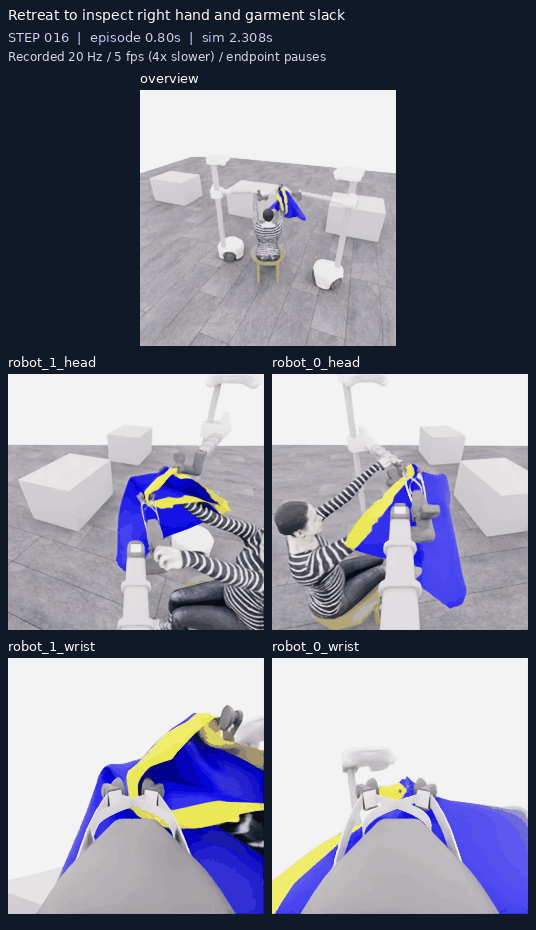

# M1: 오른손을 드러내기 위한 추가 후퇴와 옷 처짐

**같은 live 상태에서 양쪽 파지를 유지하며 추가로 물러났다. 손과 연결된 손목의 노출이 늘고 아래 노란 경계가 손 아래로 처지는 형상이 보인다. 손 전체의 여유와 옷의 늘어짐이 다음 조작에 충분한지는 사용자 판단을 기다린다.** 새5 act·23전이 뒤 모델의 stop을 물리 진행 없는 `hold-0003`으로 전환했다.

실제20Hz 기록의24개 경계를 모두 담았고,4배 느린 재생과 시작·끝 정지를 적용했다. 중간 프레임 생성·좌우 반전은 없다. [구간별 GIF 전체와 제작 근거](../../gallery/20261116-m1-guided-segments/README.ko.md) · [현재 HOLD 5카메라](../user-reviews/20261116-astra-m1-checkpoint-001/hold-0003/README.ko.md) · [직전 HOLD](../user-reviews/20261116-astra-m1-checkpoint-001/hold-0002/README.ko.md) · [기전 요약](../../MECHANISMS.ko.md)

## 이번에 바꾼 조건

사용자는 마지막 정지 화면만으로는 판단이 어렵다고 하여 **구간별 움직임을 게시하고, 오른손 전체가 보일 때까지 충분히 몸에서 멀어진 뒤 옷의 늘어짐을 확인하여 다시 의견을 묻도록** 지시했다. 이에 같은 run·파지에서 대략의 높이를 유지한 추가 후퇴만 시도했다. 하강·재접근·재파지·삽입을 새로 명령하지 않았다.

| 항목 | 확인 내용 |
|---|---|
| run / 사용자 응답 | `20261116-astra-m1-checkpoint-001` / `20261116-user-right-hand-clearance-001` |
| 시작 → 현재 | `hold-0002`, 전이16 → `hold-0003`, 전이39 |
| 새 실행 | D6–D10:5 act,4+6+6+4+3=23전이·1.15시뮬레이션초. 별도 자동 settle0 |
| 마지막 제안 | D11 stop은 simulator에 전달하지 않았고 추가 전이0 |
| 누적 기록 | 12모델 호출·12결정,10 act·39전이. 모델 stop 제안2회는 모두 HOLD로 전환 |
| 유지한 명령 | 양쪽 닫기 의도 유지. lift·arm·wrist·base yaw 명령0; 평면 베이스 이동만 명령 |
| 현재 상태 | 기록기·환경이 열린 live HOLD. 사용자 응답 전 물리 진행0; 마감·QC·고정 백업 완료 상태가 아님 |

닫기 의도 유지는 실제 천의 부착·하중 지지와 구분한다. 이번 구간에는 명령상 추가 하강이 없었지만 이전 운동의 영향으로 작은 실제 하강은 남았다.

## 화면에서 확인한 것과 미확인인 것

head 화면에서는 천에 가려졌던 살색 손과 연결된 손목·전완의 윤곽이 더 드러났다. wrist 화면에서도 손이 화면 오른쪽으로부터 보이며, 아래 노란 경계는 손 아래에 놓인다. 천은 양쪽 파지부에서 아래로 처진 모양이다. 상단 노란 경계의 회색 돌출부는 로봇 그리퍼와 구분해야 하며 마네킹 손가락의 근거로 사용하지 않는다.

**모델은 “해부학적 오른손과 연결 손목이 모두 드러났고 천에 여유가 보인다”고 판단하여 stop을 제안했다.** 검토에서는 이 시각 판단과 확인된 범위를 분리한다. 카메라 이름 R1이나 화면 오른쪽이 해부학적 오른손을 뜻하지 않는다. 같은 손·연결 전완을 이어서 보아야 하며, wrist 화면의 일부는 영상 가장자리와 겹친다. 현재 영상만으로 손 전체의 완전한 비접촉, 천 전체의 자유로운 늘어짐, 다음 접근에 충분한 간격·장력까지 확정하지 않는다. 손의 노출 증가도 밑단 진입이나 소매 통과의 증거는 아니다.

사용자가 판단할 대상은 **현재 손의 노출과 옷의 처짐이 충분한지, 다음에 어느 높이·방향으로 움직일지**다. 판단 전에는 현재 상태를 유지한다.

## 의도와 실제 로봇 운동

아래는 완료된 각 act 전후의 공개 로봇 상태다. 수치 순서는 R0 / R1, 단위는 mm다. **world Y는 기록 좌표이며 몸통에서 멀어진 거리나 천의 이동량이 아니다.**

| 구간 | grasp world Y 변화 R0 / R1 | grasp world Z 변화 R0 / R1 | 실제 경계 |
|---|---:|---:|---|
| D6: 후퇴 시작 | −5.59 / −4.13 | −1.29 / −1.29 | 16→20,4전이 |
| D7: 후퇴 지속 | −37.52 / −36.28 | −0.49 / −0.76 | 20→26,6전이 |
| D8: 후퇴 지속 | −37.81 / −36.04 | −0.05 / −0.27 | 26→32,6전이 |
| D9: 짧게 추가 후퇴 | −25.25 / −24.16 | −0.03 / −0.17 | 32→36,4전이 |
| D10: 명령 크기를 줄여 후퇴 | −13.87 / −13.05 | −0.05 / −0.14 | 36→39,3전이 |
| **전체16→39** | **−120.05 / −113.67** | **−1.91 / −2.63** | **23전이·1.15초** |

베이스 world Y 변화는 −121.80/−113.01mm, lift 관절 변화는 −2.14/−2.18mm였다. 파지점 높이는 첫 후퇴에서 각각 약1.29mm 내려간 뒤 변화가 작아졌다. 따라서 이번 결과는 높이를 대략 유지한 평면 후퇴이며, 완전히 일정한 높이의 운동은 아니다. 마지막 act는 베이스 명령 크기를 줄였으며, 사용자 HOLD는 중립 act와 달리 물리를 한 전이도 더 진행하지 않는다.

## 이번 기전 해석과 출처

추가 후퇴와 함께 손의 가시성과 아래 경계의 처진 형상이 달라졌다. 이는 **같은 파지를 유지한 상태에서도 손–천 관계를 관찰하기 쉬운 배치로 바꿀 여지가 있다**는 근거다. 후퇴만으로 충분한 자유 통로를 확보했다거나 천의 장력을 특정 수준까지 낮췄다는 결론은 아니다. 다음 조작을 판단할 때에는 움직임 GIF의 손·경계 관계와 현재 여유를 먼저 확인한다.

수치는 완료 ACK가 있는 `applied_segment`와 불변 공개 입력 `guided-00006`–`guided-00011/observation.json`, 두 HOLD 관측에서 계산했다. world 파지점은 공개 pose의 `base_xyz + R(base_wxyz) × grasp_base_xyz`이며 천 재료점이 아니다. 수치 분석은 실행 중 HDF5를 열지 않았다. GIF는 HOLD 상태와 원본 hash가 전후 동일한 것을 확인한 고정 복사본에서 생성했다. [GIF 메타데이터](../../gallery/20261116-m1-guided-segments/right-hand-retreat.json) · [복사 근거](../../gallery/20261116-m1-guided-segments/source-hold-0003.json)

| 경계 | 공개 observation.json SHA256 |
|---|---|
| 시작16 / hold-0002 | `0fe7465f56069255668ed4cea0e98dffdb0401124ff8a33c43f201c72c485a7c` |
| 현재39 / hold-0003 | `683c0b38485236becda0cbce96d085e6fbf9ff2c4f94171258a5f502c64ee543` |

원본 실행 기록·depth와 사용자 원문은 비공개 실행 자료에 보존한다. 공개 화면·로봇 운동 분석에 내부 착의 평가를 행동 정답으로 사용하지 않았다.
