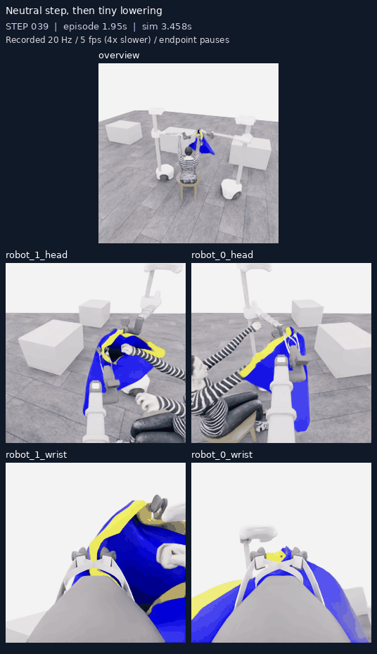

# M1: 아주 작은 추가 후퇴와 하강

**사용자가 현재 거리·옷의 늘어짐을 충분하다고 판단한 뒤, 같은 상태에서 아주 조금 더 물러나고 조금 낮췄다.** 새2 act·3전이(0.15초)에서 파지 기준점은 R0/R1 world Y −4.59/−3.69mm, world Z −0.73/−0.82mm 변했다. 모델 stop은 물리0 `hold-0004`로 전환했다.

[중립1전이](../../gallery/20261116-m1-guided-segments/neutral-residual-motion.gif) · [미세 하강2전이](../../gallery/20261116-m1-guided-segments/tiny-lowering.gif) · [GIF 제작 근거](../../gallery/20261116-m1-guided-segments/README.ko.md) · [현재 HOLD](../user-reviews/20261116-astra-m1-checkpoint-001/hold-0004/README.ko.md) · [직전 HOLD](../user-reviews/20261116-astra-m1-checkpoint-001/hold-0003/README.ko.md)

## 명령과 실제 변화

같은 run `20261116-astra-m1-checkpoint-001`의39→42전이다. 양쪽 닫기 의도를 유지하고 재접근·재파지를 명령하지 않았다. **이번 추가 후퇴는 새 베이스 이동 명령이 아니라 중립·하강 명령 중 실제로 발생한 변위다.** world Y는 기록 좌표이며 몸통과의 거리나 천의 이동량이 아니다. 아래 수치는 R0 / R1, 단위는 mm다.

| 실제 구간 | 명령 | grasp world Y 변화 | grasp world Z 변화 |
|---|---|---:|---:|
| D12,39→40 | 18채널 모두0,1전이 | −3.02 / −2.75 | +0.003 / −0.035 |
| D13,40→42 | 양쪽 lift−0.02,나머지0,2전이 | −1.57 / −0.94 | −0.73 / −0.78 |
| **전체39→42** | **2 act·3전이** | **−4.59 / −3.69** | **−0.73 / −0.82** |

lift 관절은 전체 약−0.75/−0.75mm 변했다. 별도 자동 settle은 없고 D14 stop은 추가 전이0이다. 누적15모델 호출·12 act·42전이이며, 기록기·환경이 열린 live HOLD로 마감·QC·고정 백업 전이다.

## 현재 화면과 다음 판단

head 화면에서 드러난 손·연결 손목과 아래로 처진 천의 큰 배치는 유지되어 보인다. wrist 화면에서도 손이 보이지만 일부는 영상 가장자리와 겹친다. 이번 하강은1mm 미만으로, RGB만으로 그 미세 효과나 여유 증가를 확정하기 어렵다. **로봇의 작은 변위는 공개 pose에서 확인했고, 손 전체의 비접촉·천의 자유 통로·실제 진입은 계속 별도 판단한다.**

사용자가 확인할 대상은 현재 높이가 적절한지와 다음 이동 방향이다. 모델은 추가 추종 운동 전에 검토하도록 멈췄으며, 사용자 응답 전 물리를 진행하지 않는다.

## 기전과 근거

중립1전이에서도 파지점이 약3mm 움직였다. 따라서 짧고 작은 조작에서는 **새 명령의 크기뿐 아니라 이미 진행 중인 실제 운동을 먼저 확인해야 한다.** 하강2전이에도 평면 변위가 함께 남았다. 이는 중립 act와 물리0 HOLD의 차이를 다시 보여주며 특정 접촉·슬립의 원인을 확정하지 않는다. [기전 요약](../../MECHANISMS.ko.md#6-현재-m1에서-확인한-기전-중립-명령-뒤에도-운동은-남는다)

수치는 완료 ACK와 불변 공개 입력 `guided-00012`–`guided-00014/observation.json`, HOLD3·4 관측에서 계산했다. world 파지점 계산과 해석 한계는 [앞선 분석](20261116-m1-right-hand-clearance.ko.md)을 따른다. 실행 중 HDF5는 열지 않았다. GIF는 전후 hash·HOLD 상태를 확인한 고정 복사본의39·40·41·42경계를 사용한다. [복사 근거](../../gallery/20261116-m1-guided-segments/source-hold-0004.json) · [GIF 메타데이터](../../gallery/20261116-m1-guided-segments/neutral-and-tiny-lowering.json)
