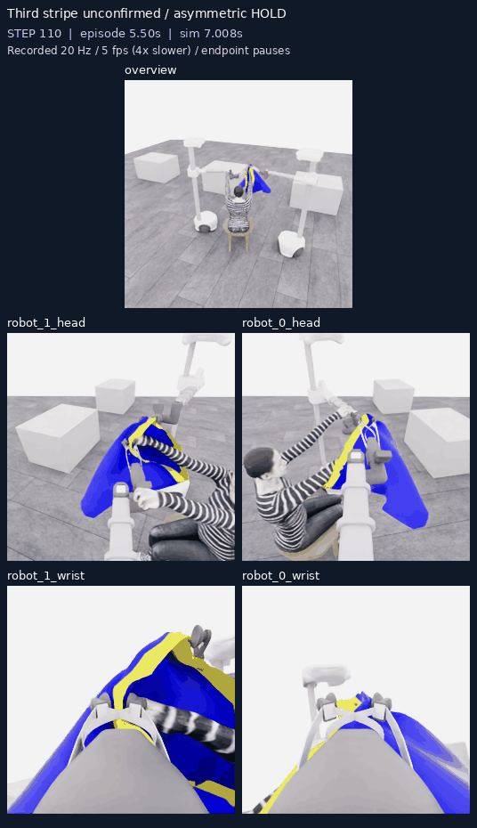

# M1: 세 번째 줄무늬 접근 중 비대칭 반응으로 HOLD

**손목 위 세 번째 짙은 줄무늬까지의 도달은 확인하지 못했다.** 같은 방향으로 새3 act·10전이(0.50초)를 실행하던 마지막 구간에서 R1의 전진 성분이 크게 줄고 명령하지 않은 자세 변화가 나타나, 모델이 물리0 `hold-0011`을 요청했다. 이번 평면 순변위는 R0/R1 약18.37/13.55mm다.

[현재 HOLD 5카메라](../user-reviews/20261116-astra-m1-checkpoint-001/hold-0011/README.ko.md) · [출발 HOLD](../user-reviews/20261116-astra-m1-checkpoint-001/hold-0010/README.ko.md) · [구간별 GIF](../../gallery/20261116-m1-guided-segments/README.ko.md)

## 실행과 전체 이동

같은 run `20261116-astra-m1-checkpoint-001`에서 D44–D46을3+4+3전이 실행했다. 모델은 같은 손의 피부–소매 손목 경계에서 팔꿈치쪽 세 번째 짙은 띠를 잠정 목표로 고정했다. 두 베이스의 기존 평면 명령을 유지했고, lift·arm·base yaw·wrist 명령은 모두0이었다. 양쪽 닫기 의도를 유지했다. 아래 위치 단위는 mm다.

| 로봇 | 전체110→120 grasp world ΔXYZ | XY 순변위 |
|---|---|---:|
| R0 | +1.316, +18.325, +0.012 | 18.372 |
| R1 | −1.444, +13.475, +0.321 | 13.553 |

## 마지막3전이에서 달라진 반응

D46의117→120은 앞선 구간과 같은 평면 명령이었다. 그런데 R1은 베이스가 계속 움직이는 동안 파지점의 world Y 전진이 작아지고 옆 방향 변위·관절 변화가 함께 나타났다.

| 공개 상태 변화,117→120 | R0 | R1 |
|---|---:|---:|
| base world Y,mm | +5.609 | +4.124 |
| grasp world Y,mm | +5.306 | +0.259 |
| grasp XY 순변위,mm | 5.326 | 1.477 |
| base yaw,도 — 해당 명령0 | −0.007 | +0.294 |
| arm 연장관절 합,mm — 해당 명령0 | +0.304 | +3.087 |

**R1이 총0.26mm만 움직인 것은 아니다.** world X도 −1.454mm 변해 XY 순변위는1.477mm였다. R1 lift 관절은 −0.297mm였지만 grasp world Z는 +0.240mm 변했다. 이 수치들은 명령과 다른 비대칭 반응·자세 변화를 확인하는 근거이며, 접촉·끼임·슬립 중 특정 원인을 확정하지 않는다. 좌표 변위를 천의 이동량이나 손 통과량으로 해석하지 않는다.

## 줄무늬 목표와 현재 화면

HOLD10→11의 R1 wrist에서 상단 노란 경계가 더 넓게 펴진 형상이 보인다. 손은 전경 finger/housing에 가려지고 줄무늬 전완은 계속 보인다. R1 head에서는 같은 손·전완을 추적할 수 있으나 손목 출발점과 관련 옷 경계 일부가 겹친다. **띠의 잠정 식별, 옷 경계가 그 띠까지 온 것, 실제 입구·소매를 통과한 것은 별도 판단이다.** 노란 경계의 펼쳐짐만으로 세 번째 띠 도달을 확정하지 않는다.

모델은 새 비대칭 반응으로 더 진행하기 불확실하다고 판단했으며 목표 정렬도 미확인으로 남겼다. D47 stop은 추가 전이0, 별도 자동 settle은 없다. 누적48모델 호출·38 act·120전이의 live HOLD이며 사용자 응답 전 물리 진행0이다. 기록기·환경은 열려 있고 마감·QC·고정 백업 전이다.

완료 ACK와 불변 공개 입력 `guided-00044`–`guided-00047/observation.json`, HOLD10·11 관측을 비교했다. 계산·한계는 [기존 분석](20261116-m1-right-hand-clearance.ko.md)을 따른다. 실행 중 HDF5는 열지 않았다. GIF는 hash·HOLD 상태를 전후 확인한 고정 복사본의110–120 모든11경계다. [복사 근거](../../gallery/20261116-m1-guided-segments/source-hold-0011.json) · [GIF 메타데이터](../../gallery/20261116-m1-guided-segments/third-stripe-approach.json)
